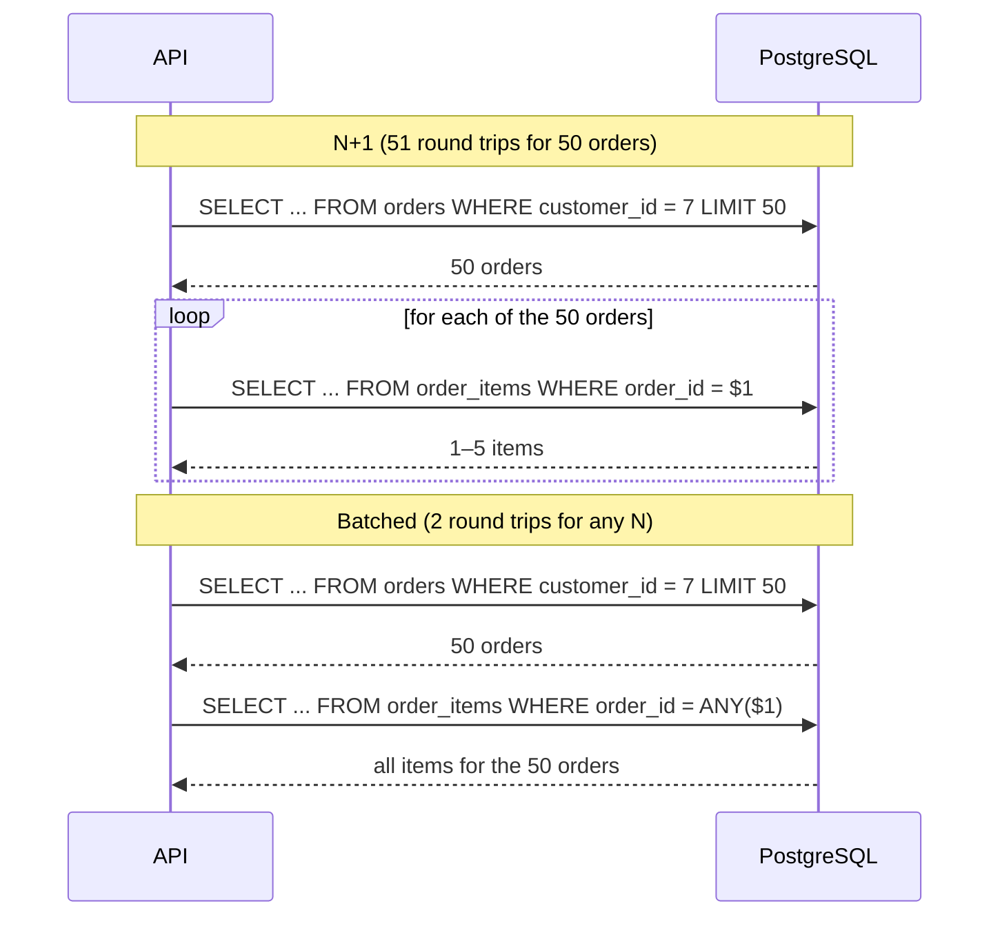

# Query Anti-Patterns

> **Module 03 · Databases** · Prerequisites: [Cursor Pagination](25-Cursor-Pagination.md), [Query Optimization](23-Query-Optimization.md) · Next: [Transactions](27-Transactions.md)

---

## ⏱ If You Only Have 2 Minutes

- **N+1 queries**: one query for a list, then one more per row. 50 orders = 51 round trips. Fix with a join or one batched query: `WHERE order_id = ANY($1)`. Catch it with a query-count assertion in tests.
- **A function on an indexed column** (`WHERE created_at::date = $1`, `lower(email) = $1`) hides the column from a plain index. Rewrite as a range (`created_at >= $1 AND created_at < $1 + 1 day`) or add an expression index.
- **`LIKE '%term'`** cannot use a B-tree. Use a `pg_trgm` GIN index or full-text search.
- **`NOT IN (subquery)`** returns no rows at all if the subquery yields one `NULL`. Use `NOT EXISTS`.
- **`COUNT(*) > 0`** counts every match to answer yes/no. `EXISTS` stops at the first row.
- **`ORDER BY random() LIMIT 1`** reads and sorts the whole table. **Queries without `LIMIT`** work in dev and run out of memory in production.
- **Long or idle-in-transaction sessions** hold locks and stop `VACUUM` from cleaning dead rows. Set `idle_in_transaction_session_timeout`.
- Schema anti-patterns, **comma-separated lists in a column** and **entity-attribute-value tables**, make every query above impossible to index.

---

## 1. What It Is and Why It Exists

A **query anti-pattern** is a way of writing SQL (or of calling the database from code) that returns the right answer on a small dataset but scales badly, uses the wrong plan, or returns a wrong answer in an edge case. Most of them are invisible in development: with 200 rows, every query is fast.

**Analogy:** asking a librarian for books one at a time. "Do you have the first book by this author?" Walk to the shelf, come back. "The second?" Walk again. Every answer is correct; the problem is the 50 trips. Other anti-patterns are like asking for "every book whose title *ends* with 'War'" in a library whose catalogue is sorted by the first letter: the librarian has to read every card.

**Why a catalogue matters.** These patterns appear in reviews and incident reports again and again, and interviewers ask about them because they test whether you understand *why* a query is slow, not just which index to add. For each one, this chapter gives the **symptom** you would see, **why** it happens inside PostgreSQL, and the **fix**. The general method for a slow query (measure, read the plan, change one thing) is in [Query Optimization](23-Query-Optimization.md); this chapter is the list of shapes to recognise on sight.

---

## 2. How It Works

Anti-patterns fall into four groups, and each group shows up in a different place:

| Group | Where you see it | Example |
|---|---|---|
| Too many round trips | Traces and query counts per request | N+1, per-row inserts in a loop |
| Index defeated | `Seq Scan` with a large `Rows Removed by Filter` | Function on a column, leading wildcard, implicit cast |
| Wrong question | Correct-looking SQL that does extra work or returns wrong rows | `COUNT(*) > 0`, `NOT IN` with NULLs, `ORDER BY random()` |
| Holding resources | Locks, bloat, memory, not query time | Idle in transaction, unbounded result sets |

### What an N+1 looks like on the wire



Each item query is fast (an index lookup, about 0.1 ms in the database). The cost is the **round trip**: network latency, driver work, and a pool connection held for the whole loop. At 1 ms per round trip inside a data centre, 51 queries add about 50 ms; across regions, at 30 ms each, the page takes over 1.5 s. Nothing in the database looks slow, which is why N+1 is found in traces, not in slow-query logs.

### How the other groups show up

1. **Query statistics.** `pg_stat_statements` groups queries by shape. An N+1 appears as one statement with a huge `calls` count and a tiny `mean_exec_time`. An index-defeated query appears with a high `mean_exec_time` and many `shared_blks_read` per call.
2. **Plans.** `EXPLAIN (ANALYZE, BUFFERS)` shows the predicate as a `Filter` on a `Seq Scan` rather than an `Index Cond`. `auto_explain` can log plans of statements slower than a threshold in production.
3. **Sessions.** `pg_stat_activity` shows sessions in state `idle in transaction` with an old `xact_start`.
4. **Application metrics.** Queries per request, rows returned per request and pool wait time. A request whose query count grows with page size is an N+1.

Here is the "index defeated" signature, using an added index on `orders(created_at)` and a table of 2 million orders:

```sql
CREATE INDEX orders_created_at_idx ON orders (created_at);

EXPLAIN (ANALYZE, BUFFERS, COSTS OFF)
SELECT id, total_cents FROM orders WHERE created_at::date = '2026-11-20';
```

Illustrative output:

```text
Seq Scan on orders (actual time=0.398..402.517 rows=2740 loops=1)
  Filter: ((created_at)::date = '2026-11-20'::date)
  Rows Removed by Filter: 1997260
  Buffers: shared hit=2115 read=12586
Execution Time: 402.904 ms
```

The same question as a half-open range:

```sql
EXPLAIN (ANALYZE, BUFFERS, COSTS OFF)
SELECT id, total_cents FROM orders
WHERE created_at >= '2026-11-20 00:00+00' AND created_at < '2026-11-21 00:00+00';
```

```text
Index Scan using orders_created_at_idx on orders (actual time=0.019..0.874 rows=2740 loops=1)
  Index Cond: ((created_at >= '2026-11-20 00:00:00+00'::timestamp with time zone) AND (created_at < '2026-11-21 00:00:00+00'::timestamp with time zone))
  Buffers: shared hit=33
Execution Time: 0.981 ms
```

Same 2,740 rows; 14,700 buffers versus 33. Orders are inserted in time order, so one day's rows sit on a few neighbouring pages.

---

## 3. Key Concepts

### Round-trip anti-patterns

**N+1 queries.**
*Symptom:* page latency grows with the number of rows shown; traces show the same short query repeated dozens of times.
*Why:* a loop in application code (or an ORM's lazy loading) issues one query per parent row.
*Fix:* load children in one query, `WHERE order_id = ANY($1::bigint[])`, and group them in memory; or use a join when you need one flat result; or aggregate in SQL with `json_agg`. In ORMs, use eager loading (see [ORM Fundamentals](33-ORM-Fundamentals.md)). The repository-level design, batch methods instead of `findById` in a loop, is in [Repository Pattern](../Module-02-Core-Backend/14-Repository-Pattern.md).

**Unbounded queries.**
*Symptom:* fine in development; in production one customer with 400,000 orders makes the API process run out of memory or stall for seconds.
*Why:* `SELECT ... WHERE customer_id = $1` with no `LIMIT` returns everything. Most drivers buffer the full result in memory before returning it.
*Fix:* every list query has a `LIMIT` from a capped page size ([Cursor Pagination](25-Cursor-Pagination.md)). Exports use keyset batches or a streaming cursor. A role-level `statement_timeout` is the safety net.

### Index-defeating predicates

**Functions or expressions on an indexed column.**
*Symptom:* `Seq Scan` with `Filter: (lower(email) = ...)` or `((created_at)::date = ...)` despite an index on the column.
*Why:* a B-tree index on `created_at` stores `created_at` values. It cannot answer a question about `created_at::date` or `created_at + interval '1 day'`, because the planner would have to compute the expression for every entry. The same applies to arithmetic: `WHERE total_cents / 100 > 50` cannot use an index on `total_cents`.
*Fix:* move the work to the parameter side, so the column stands alone: `created_at >= $1 AND created_at < $1 + interval '1 day'`, `total_cents > 5000`. When the expression is the real key, index it: `CREATE INDEX ON customers (lower(email))` and query with exactly `lower(email) = lower($1)`. Note that `created_at::date` on a `timestamptz` cannot be indexed at all: the result depends on the session's `TimeZone`, so it is not immutable. The range rewrite is the only fix, and it also makes the time zone explicit.

**Leading-wildcard `LIKE`.**
*Symptom:* `WHERE name LIKE '%phone%'` or `ILIKE` on a search box scans the whole table.
*Why:* a B-tree is sorted by the start of the string. It can serve `LIKE 'pho%'` (a range scan), but only with the `C` collation or a `text_pattern_ops` index. A pattern that starts with `%` has no starting point.
*Fix:* the `pg_trgm` extension splits text into three-character pieces (trigrams) and a GIN index on them supports `LIKE` and `ILIKE` with wildcards anywhere:

```sql
CREATE EXTENSION IF NOT EXISTS pg_trgm;
CREATE INDEX products_name_trgm_idx ON products USING gin (name gin_trgm_ops);
-- Now index-assisted:  SELECT id, name FROM products WHERE name ILIKE '%phone%';
```

Search terms shorter than three characters give the index little to work with. For word-based search with ranking, use full-text search (`tsvector` + GIN) or a search engine.

**`OR` across different columns.**
*Symptom:* `WHERE email = $1 OR name = $2` is slow even though each column is indexed.
*Why:* one index cannot serve two unrelated conditions. PostgreSQL can combine two separate indexes with a `BitmapOr`, but only if both columns have their own index; if either side has no usable index, it must scan everything. A related trap is the "optional filter" pattern `WHERE ($1::text IS NULL OR status = $1)`: with a reused prepared statement and a generic plan, the planner cannot know whether `$1` is NULL, so it cannot pick the `status` index.
*Fix:* index each column and check for `BitmapOr` in the plan, or rewrite as `UNION` of two indexed queries. For optional filters, build the SQL with only the conditions that are present (still parameterized). MySQL's equivalent of `BitmapOr` is the `index_merge` union.

**Implicit type casts.**
*Symptom:* `WHERE id = $1` uses the index from one client but not another.
*Why:* when the two sides of a comparison have different types, the database converts one of them. If it converts the **column**, the index is useless. In PostgreSQL, `WHERE id = 42.0` (a `numeric`) compares `id::numeric` and scans. In MySQL, comparing a `VARCHAR` column with a number converts every row's string to a number, which disables the index (and makes `'42abc'` match `42`).
*Fix:* send parameters with the column's type (cast in SQL: `$1::bigint`), keep join columns the same type in both tables, and check `Index Cond` in the plan.

### Asking the wrong question

**`NOT IN` with NULLs.**
*Symptom:* "customers without a paid order" returns zero rows after someone adds a nullable column to the subquery's source.
*Why:* `x NOT IN (1, 2, NULL)` is `x <> 1 AND x <> 2 AND x <> NULL`, and `x <> NULL` is unknown, so no row qualifies. PostgreSQL also cannot turn `NOT IN` into a hash anti-join because of these semantics.
*Fix:* `NOT EXISTS (SELECT 1 FROM orders o WHERE o.customer_id = c.id AND o.status = 'paid')`. Full treatment in [EXISTS vs IN](12-EXISTS-vs-IN.md).

**`COUNT(*) > 0` to test existence.**
*Symptom:* checking "does this customer have any orders?" gets slower for the biggest customers.
*Why:* `count(*)` must visit every matching row; the comparison happens after.
*Fix:* `SELECT EXISTS (SELECT 1 FROM orders WHERE customer_id = $1)`. It stops at the first match. The same goes for loading a full list in code just to check `.length > 0`.

**`ORDER BY random() LIMIT 1`.**
*Symptom:* "pick a random product" takes seconds on a large table.
*Why:* the database assigns a random number to **every** row, then sorts (a top-N heapsort keeps only one row in memory, but it still reads the whole table).
*Fix:* sample instead. `TABLESAMPLE SYSTEM (1)` reads about 1% of the pages (fast, but rows from the same page come together); `TABLESAMPLE BERNOULLI (1)` samples rows evenly but reads every page; the `tsm_system_rows` extension returns a fixed number of rows. For an even pick over dense IDs, choose a random id in `[min, max]` in code and run `WHERE id >= $1 ORDER BY id LIMIT 1`, accepting a small bias when there are gaps.

**`SELECT *`.**
*Symptom:* a query that needs two columns reads and transfers twenty, and an index-only scan never happens.
*Why:* `*` fetches every column, including large `text`/`jsonb` values stored out of line (TOAST), which must be fetched and decompressed. It also rules out an index-only scan, couples the code to column order, and changes the result shape whenever someone adds a column. A view defined with `SELECT *` freezes its column list at creation time, so new columns silently do not appear.
*Fix:* list the columns you use. `SELECT *` is fine in an ad-hoc `psql` session.

### Holding resources

**Long transactions and "idle in transaction".**
*Symptom:* table bloat grows, autovacuum runs constantly without shrinking it, and occasionally a migration's `ALTER TABLE` waits and blocks every query behind it.
*Why:* an open transaction keeps its row locks until it ends, and its snapshot keeps the "xmin horizon" back, so `VACUUM` cannot remove any row version that the old snapshot might still need. "Idle in transaction" means the application ran `BEGIN`, did some work, and then went off to call an HTTP API, wait for a user, or forgot to commit after an exception.
*Fix:* keep transactions to the database work only; never wait on a network call inside one. Set `idle_in_transaction_session_timeout` (for example `30s`) for application roles, and on PostgreSQL 17+ `transaction_timeout` as an upper bound. Find offenders with:

```sql
SELECT pid, usename, state, now() - xact_start AS xact_age, left(query, 80) AS last_query
FROM pg_stat_activity
WHERE state IN ('idle in transaction', 'idle in transaction (aborted)')
ORDER BY xact_age DESC;
```

Lock queues and timeouts are covered in [Database Locks](30-Database-Locks.md); transaction scoping in [Transactions](27-Transactions.md).

### Schema-level anti-patterns

**Comma-separated values in a column** (Bill Karwin calls this "Jaywalking").
*Symptom:* `products.tags = 'audio,sale,wireless'`, queried with `tags LIKE '%sale%'`, which also matches `'wholesale'`.
*Why:* the database sees one opaque string. It cannot index the elements, enforce that a tag exists (no foreign key), count products per tag without string parsing, or update one tag safely under concurrency.
*Fix:* a junction table `product_tags(product_id, tag_id)` with a primary key on both columns. If you do not need foreign keys, a `text[]` column with a GIN index supports `tags @> ARRAY['sale']`.

**Entity-attribute-value (EAV) tables.**
*Symptom:* a table `product_attributes(product_id, name, value text)` and queries that self-join it once per attribute to rebuild a row.
*Why:* every value is text, so there is no type checking, no `NOT NULL`, no `CHECK`, and no foreign key per attribute. "Phones with 128 GB and colour black" is two self-joins with string comparisons, and the planner's row estimates are poor because one column holds unrelated kinds of values.
*Fix:* real columns for attributes every row has. For genuinely sparse, varying attributes, a `jsonb` column with a GIN index (`@>` containment queries) and `CHECK` constraints on the keys that matter. See [Schema Design](05-Schema-Design.md).

---

## 4. Code Examples

Scenario: "a customer's 50 most recent orders with their items". First the N+1 version, then the batched fix, then a test that fails if anyone reintroduces the N+1.

### SQL

```sql
-- Supports the parent query (equality, then sort with tie-breaker).
CREATE INDEX orders_customer_created_id_idx ON orders (customer_id, created_at DESC, id DESC);
-- order_items' primary key (order_id, product_id) already serves the child lookup.

-- Parent query
SELECT id, status, total_cents, created_at
FROM orders
WHERE customer_id = $1
ORDER BY created_at DESC, id DESC
LIMIT 50;

-- Children for all parents in one round trip ($1 = array of order ids)
SELECT order_id, product_id, quantity, unit_price_cents
FROM order_items
WHERE order_id = ANY($1::bigint[])
ORDER BY order_id, product_id;
```

### Node.js / TypeScript

```ts
// npm i pg  (dev: @types/pg)  — Node.js 22+, TypeScript 5.4+ (lib ES2024 for Map.groupBy), ESM
import type { QueryResultRow } from "pg";

// The smallest interface both pg.Pool and pg.PoolClient satisfy. Tests wrap it to count queries.
export interface Db {
  query<R extends QueryResultRow>(sql: string, params?: unknown[]): Promise<{ rows: R[] }>;
}

interface OrderRow { id: string; status: string; total_cents: number; created_at: Date }
interface ItemRow { order_id: string; product_id: string; quantity: number; unit_price_cents: number }
export type OrderWithItems = OrderRow & { items: ItemRow[] };

const ORDERS_SQL = `SELECT id, status, total_cents, created_at FROM orders
  WHERE customer_id = $1 ORDER BY created_at DESC, id DESC LIMIT 50`;

// Anti-pattern: 1 query for orders + 1 per order. Each await is a full network round trip.
export async function recentOrdersNPlusOne(db: Db, customerId: string): Promise<OrderWithItems[]> {
  const { rows: orders } = await db.query<OrderRow>(ORDERS_SQL, [customerId]);
  const result: OrderWithItems[] = [];
  for (const o of orders) {
    const { rows: items } = await db.query<ItemRow>(
      "SELECT order_id, product_id, quantity, unit_price_cents FROM order_items WHERE order_id = $1",
      [o.id],
    );
    result.push({ ...o, items });
  }
  return result;
}

// Fix: exactly 2 queries for any number of orders.
export async function recentOrders(db: Db, customerId: string): Promise<OrderWithItems[]> {
  const { rows: orders } = await db.query<OrderRow>(ORDERS_SQL, [customerId]);
  if (orders.length === 0) return [];
  const { rows: items } = await db.query<ItemRow>(
    `SELECT order_id, product_id, quantity, unit_price_cents FROM order_items
     WHERE order_id = ANY($1::bigint[]) ORDER BY order_id, product_id`,
    [orders.map((o) => o.id)], // pg sends a JS array as a Postgres array: one parameter, not N
  );
  const byOrder = Map.groupBy(items, (i) => i.order_id);
  return orders.map((o) => ({ ...o, items: byOrder.get(o.id) ?? [] }));
}
```

The query-count test (Node's built-in runner, against a real test database, rolled back at the end):

```ts
// node --test   — needs TEST_DATABASE_URL pointing at a database with the sample schema
import { test } from "node:test";
import assert from "node:assert/strict";
import pg, { type QueryResultRow } from "pg";
import { recentOrders, type Db } from "./orders.js";

function countingDb(inner: Db) {
  const statements: string[] = [];
  const db: Db = {
    query<R extends QueryResultRow>(sql: string, params?: unknown[]) {
      statements.push(sql);
      return inner.query<R>(sql, params);
    },
  };
  return { db, statements };
}

test("recentOrders runs a constant number of queries", async (t) => {
  const pool = new pg.Pool({ connectionString: process.env.TEST_DATABASE_URL });
  const client = await pool.connect();
  t.after(async () => { await client.query("ROLLBACK"); client.release(); await pool.end(); });
  await client.query("BEGIN"); // all fixtures disappear on rollback

  const { rows: [c] } = await client.query<{ id: string }>(
    `INSERT INTO customers (email, name, country) VALUES ('nplus1@test.dev', 'Test', 'DE') RETURNING id`);
  const { rows: [p] } = await client.query<{ id: string }>(
    `INSERT INTO products (sku, name, category, price_cents) VALUES ('T-1', 'Cable', 'test', 500) RETURNING id`);
  await client.query(
    `WITH o AS (INSERT INTO orders (customer_id, status, total_cents)
                SELECT $1, 'paid', 500 FROM generate_series(1, 20) RETURNING id)
     INSERT INTO order_items (order_id, product_id, quantity, unit_price_cents)
     SELECT id, $2, 1, 500 FROM o`, [c.id, p.id]);

  const { db, statements } = countingDb(client);
  const orders = await recentOrders(db, c.id);

  assert.equal(orders.length, 20);
  assert.ok(orders.every((o) => o.items.length === 1));
  // 20 orders would mean 21 statements with the N+1 version.
  assert.equal(statements.length, 2, statements.join("\n---\n"));
});
```

### Python

```python
# pip install asyncpg   — Python 3.12+
from collections import defaultdict
from typing import Any, Protocol

import asyncpg


class Db(Protocol):
    """What the loader needs; asyncpg.Connection satisfies it, and tests wrap it."""

    async def fetch(self, query: str, *args: Any) -> list[asyncpg.Record]: ...


ORDERS_SQL = """SELECT id, status, total_cents, created_at FROM orders
    WHERE customer_id = $1 ORDER BY created_at DESC, id DESC LIMIT 50"""


async def recent_orders_n_plus_one(db: Db, customer_id: int) -> list[dict[str, Any]]:
    orders = await db.fetch(ORDERS_SQL, customer_id)
    result = []
    for o in orders:  # one awaited round trip per order
        items = await db.fetch(
            "SELECT order_id, product_id, quantity, unit_price_cents FROM order_items WHERE order_id = $1",
            o["id"],
        )
        result.append({**dict(o), "items": [dict(i) for i in items]})
    return result


async def recent_orders(db: Db, customer_id: int) -> list[dict[str, Any]]:
    orders = await db.fetch(ORDERS_SQL, customer_id)
    if not orders:
        return []
    items = await db.fetch(
        """SELECT order_id, product_id, quantity, unit_price_cents FROM order_items
           WHERE order_id = ANY($1::bigint[]) ORDER BY order_id, product_id""",
        [o["id"] for o in orders],  # asyncpg encodes a Python list as a Postgres array
    )
    by_order: defaultdict[int, list[dict[str, Any]]] = defaultdict(list)
    for i in items:
        by_order[i["order_id"]].append(dict(i))
    return [{**dict(o), "items": by_order[o["id"]]} for o in orders]
```

The query-count test (pytest, no async plugin needed; the transaction is rolled back):

```python
# pip install pytest asyncpg   — run: TEST_DATABASE_URL=... pytest
import asyncio
import os
from typing import Any

import asyncpg

from orders import recent_orders


class CountingDb:
    def __init__(self, conn: asyncpg.Connection) -> None:
        self._conn = conn
        self.statements: list[str] = []

    async def fetch(self, query: str, *args: Any) -> list[asyncpg.Record]:
        self.statements.append(query)
        return await self._conn.fetch(query, *args)


async def _check_query_count() -> None:
    conn = await asyncpg.connect(os.environ["TEST_DATABASE_URL"])
    tx = conn.transaction()
    await tx.start()
    try:
        cid = await conn.fetchval("INSERT INTO customers (email, name, country) "
                                  "VALUES ('nplus1@test.dev', 'Test', 'DE') RETURNING id")
        pid = await conn.fetchval("INSERT INTO products (sku, name, category, price_cents) "
                                  "VALUES ('T-1', 'Cable', 'test', 500) RETURNING id")
        await conn.execute(
            """WITH o AS (INSERT INTO orders (customer_id, status, total_cents)
                          SELECT $1, 'paid', 500 FROM generate_series(1, 20) RETURNING id)
               INSERT INTO order_items (order_id, product_id, quantity, unit_price_cents)
               SELECT id, $2, 1, 500 FROM o""", cid, pid)

        db = CountingDb(conn)
        orders = await recent_orders(db, cid)

        assert len(orders) == 20
        assert all(len(o["items"]) == 1 for o in orders)
        assert len(db.statements) == 2, db.statements  # the N+1 version runs 21
    finally:
        await tx.rollback()
        await conn.close()


def test_recent_orders_query_count() -> None:
    asyncio.run(_check_query_count())
```

**Runtime differences to notice:** both drivers turn a native list into one array parameter, so `= ANY($1)` is a single bound value no matter how many IDs you pass (unlike building `IN ($1, $2, …, $50)`, which creates a new statement shape for every list length and clutters `pg_stat_statements`). asyncpg prepares and caches statements per connection, so a repeated N+1 query costs less parsing than with `pg`, but the round trips are the same. In Django the same test is one line, `self.assertNumQueries(2)`; with SQLAlchemy you count statements with a `before_cursor_execute` event listener.

---

## 5. Production Concerns

- **Find N+1s in traces, not logs.** Each query is fast, so `log_min_duration_statement` never catches them. Use OpenTelemetry database spans: a request with 50 identical child spans is the signature. Record "queries per request" as a metric and alert when an endpoint's count grows with its page size.
- **Use `pg_stat_statements` as an inventory.** Sort by `total_exec_time` to find what costs the most overall (often an N+1 query with millions of calls), and by `mean_exec_time` to find individually slow shapes. Reset it after a fix to measure the change.
- **`auto_explain` for the slow ones.** With `auto_explain.log_min_duration` set (for example 500 ms) and `log_analyze` off to avoid overhead, you get plans of production queries that hit a `Seq Scan` because of a function or cast.
- **Timeouts as guard rails.** `statement_timeout` on the application role (seconds, not minutes) stops an unbounded or random-ordered query from occupying a connection forever; `idle_in_transaction_session_timeout` ends forgotten transactions and releases their locks. The application must treat the resulting errors as failures, not retry them blindly.
- **Batch sizes.** `ANY($1)` with 50 or 1,000 IDs is fine. With 100,000 IDs, the array becomes a large parameter and the plan may switch to a hash join or seq scan; chunk the IDs, or join against the parent query in SQL instead.
- **Watch bloat.** Long transactions show up later as table and index bloat. Track the oldest `xact_start` in `pg_stat_activity` and dead tuples in `pg_stat_user_tables.n_dead_tup`.
- **Search features.** A `pg_trgm` GIN index makes writes to the column slower and can be large. Measure index size and insert latency after adding it.

---

## 6. Common Mistakes

- **Fixing N+1 with a join that multiplies rows** — joining orders to items and to payments in one query returns items × payments rows per order — load each child collection with its own batched query, or aggregate per collection.
- **Adding an index for a query that wraps the column in a function** — the plain index is never used — rewrite the predicate as a range or create the matching expression index.
- **Building `IN (...)` by string concatenation** — SQL injection risk and a new statement shape per list length — pass one array parameter with `= ANY($1)`.
- **Using `NOT IN` on a nullable column** — returns no rows as soon as one NULL appears — use `NOT EXISTS`.
- **Calling external services inside a transaction** — the transaction stays open for the whole HTTP call, holding locks and blocking `VACUUM` — do the network call before or after, and keep the transaction to SQL.
- **Testing only with tiny datasets** — every anti-pattern here is fast with 100 rows — seed realistic volumes for performance tests and assert query counts in unit tests.
- **Treating `SELECT *` as harmless in ORMs** — entities load large `jsonb` or text columns on every list page — select only the needed fields (projections) for list views.

---

## 7. Comparison Table

Ways to load "orders with their items" for one page:

| | N+1 (lazy loop) | One `JOIN` | Batched `= ANY($1)` | `json_agg` in SQL |
|---|---|---|---|---|
| Round trips | 1 + N | 1 | 2 (one per collection) | 1 |
| Rows transferred | Exact | Parent columns repeated per child | Exact | One row per parent, children as JSON |
| `LIMIT 50` orders | Easy | Tricky: limits joined rows, not orders (needs a subquery) | Easy | Easy (limit in a subquery) |
| Several child collections | N per collection | Row explosion (items × payments) | One query each, no explosion | One `json_agg` per collection |
| Mapping in code | Trivial | Group rows by parent | Group by parent id | Parse JSON; types become strings/numbers |
| Best for | Never on lists | One small child collection | Default choice; what ORMs' `selectin` loading does | Read-only API responses built in SQL |

---

## 8. Interview Questions

**[Junior] What is the N+1 problem and how do you fix it?**
You run one query to get a list of N rows, then one more query per row to get related data, so N+1 queries in total. Each query is fast but each is a network round trip, so a page of 50 items costs 51 round trips. Fix it by loading all related rows at once with `WHERE parent_id = ANY($1)` and grouping in memory, by using a join, or with eager loading in an ORM.

**[Junior] Why might `WHERE lower(email) = 'a@b.com'` not use the index on `email`?**
The index stores `email` values in sorted order, but the query asks about `lower(email)`, a different value. The database would have to compute `lower()` for every row, so it scans. Either create an expression index `ON customers (lower(email))` and query with the same expression, or store emails normalised to lower case and compare directly.

**[Mid] Why is `NOT IN` dangerous, and what do you use instead?**
`x NOT IN (subquery)` is true only if `x` differs from every value. If the subquery returns a NULL, the comparison with that NULL is unknown, so the whole predicate is never true and you get zero rows. `NOT EXISTS` checks for the absence of a matching row and does not have this problem; PostgreSQL also plans it as an efficient anti-join, which it cannot do for `NOT IN`.

**[Mid] How do you make `WHERE name ILIKE '%phone%'` fast in PostgreSQL?**
A B-tree cannot help because the pattern has no fixed prefix. Install `pg_trgm` and create a GIN index with `gin_trgm_ops` on the column. The index stores trigrams, and the planner uses it for `LIKE` and `ILIKE` with wildcards anywhere, as long as the search term has at least three characters. For word-level search with ranking and stemming, use full-text search or a dedicated search engine.

**[Mid] How would you stop N+1 regressions from reaching production?**
Assert query counts in tests: wrap the database client to count statements, run the code path with a dataset of, say, 20 parents, and assert the count is constant (2, not 21). Django has `assertNumQueries`; SQLAlchemy has engine events. In production, emit a queries-per-request metric and database spans in traces, and alert when an endpoint's query count scales with page size.

**[Senior] An API's p99 is fine, but the database's dead tuples and table size keep growing and autovacuum never catches up. What do you look for?**
A long-running or idle-in-transaction session holding back the xmin horizon, so `VACUUM` cannot remove dead rows newer than its snapshot. I would check `pg_stat_activity` for the oldest `xact_start`, `idle in transaction` sessions, long-running reports or replication slots, and replicas with `hot_standby_feedback`. The fix is to end the offender, set `idle_in_transaction_session_timeout` and `statement_timeout` for application roles, and remove network calls from inside transactions.

**[Senior] A colleague stores product tags as a comma-separated string "to keep it simple". How do you argue against it?**
The database sees one opaque string, so it cannot index individual tags, enforce that a tag exists, or count products per tag without parsing. `LIKE '%sale%'` also matches "wholesale", and concurrent edits to the tag list overwrite each other. A junction table gives indexing, foreign keys and simple joins. If foreign keys are not needed, a `text[]` with a GIN index is a reasonable middle ground. "Simple" here only moves complexity into every query.

**[Senior] When is an entity-attribute-value design acceptable, and what would you use instead?**
Almost never for core data: it loses types, constraints and good statistics, and every query needs a self-join per attribute. It can survive for genuinely user-defined fields that the system never queries on. In PostgreSQL I would use real columns for common attributes and a `jsonb` column for the sparse, varying ones, with a GIN index for containment queries and `CHECK` constraints for the keys the business relies on.

---

## 9. Cheat Sheet

```text
N+1              list + 1 query/row → batch: WHERE fk = ANY($1::bigint[]) | JOIN | eager load
Detect N+1       traces with repeated spans · pg_stat_statements: huge calls, tiny mean · query-count tests
Unbounded        every list has LIMIT (capped) · exports in keyset batches · statement_timeout
Function on col  created_at::date = $1  →  created_at >= $1 AND created_at < $1 + 1 day
                 lower(email) = $1  →  expression index ON (lower(email))
LIKE '%x%'       pg_trgm + GIN (gin_trgm_ops) · ≥ 3 chars · prefix LIKE needs text_pattern_ops/C
OR               separate indexes → BitmapOr, or UNION · optional filters: build SQL per filter set
Implicit cast    bigint = numeric → seq scan · cast params: $1::bigint · same types on join keys
NOT IN           one NULL → zero rows · use NOT EXISTS (anti-join)
Existence        EXISTS, not COUNT(*) > 0
Random row       not ORDER BY random() · TABLESAMPLE / random id seek
SELECT *         no index-only scans, TOAST fetches, fragile shape → list columns
Long txns        hold locks + block VACUUM · idle_in_transaction_session_timeout · no HTTP inside txn
Schema           CSV in a column → junction table / text[] + GIN · EAV → columns + jsonb + GIN
```

---

## Related Topics

- [Query Optimization](23-Query-Optimization.md) — the measure-and-fix method these patterns plug into
- [EXISTS vs IN](12-EXISTS-vs-IN.md) — semi-joins, anti-joins and the `NOT IN` NULL trap in depth
- [ORM Fundamentals](33-ORM-Fundamentals.md) — where most N+1 queries come from, and eager loading
- [Repository Pattern](../Module-02-Core-Backend/14-Repository-Pattern.md) — designing batch methods so N+1 cannot hide behind an interface
- [Database Locks](30-Database-Locks.md) — what long transactions do to lock queues
- [Indexes](19-Indexes.md) — B-tree, GIN and expression indexes behind the fixes
