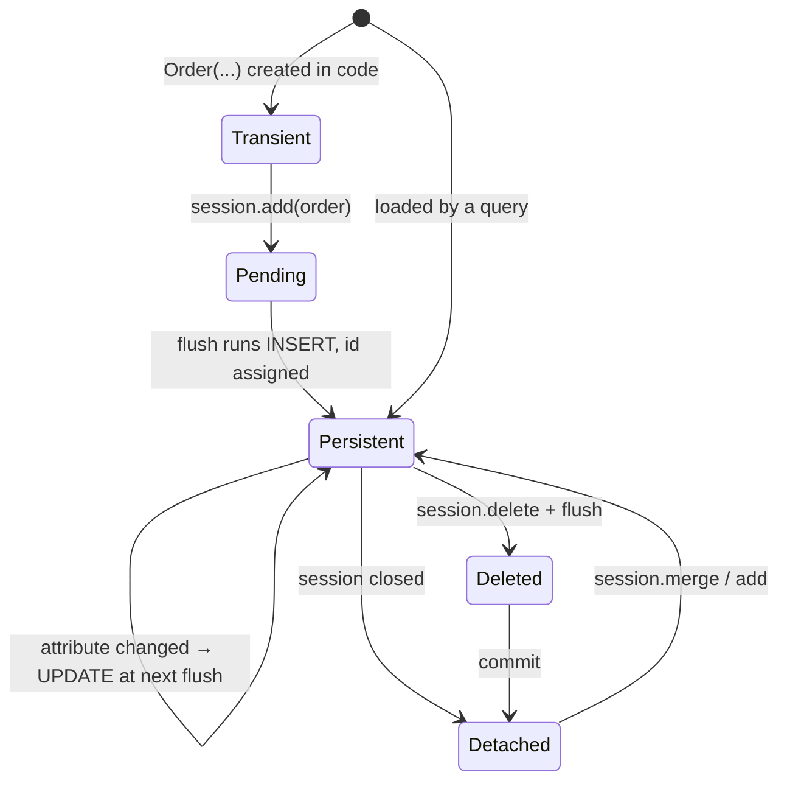

# ORM Fundamentals

> **Module 03 · Databases** · Prerequisites: [Optimistic vs Pessimistic Locking](32-Optimistic-vs-Pessimistic-Locking.md), [Query Anti-Patterns](26-Query-Anti-Patterns.md) · Next: [Database Migrations](34-Database-Migrations.md)

---

## ⏱ If You Only Have 2 Minutes

- An **ORM** (object-relational mapper) maps rows to objects and back. Full ORMs add an **identity map** (one object per row per session), a **unit of work** (track changes, write them at flush/commit), relationship loading and migrations.
- **Active Record** (Django ORM, Rails, Sequelize): the model saves itself, `order.save()`. **Data Mapper** (SQLAlchemy, Hibernate, TypeORM's repositories): plain objects plus a separate session that persists them.
- Prisma and Drizzle are **typed query builders with relation loading**: no identity map, no change tracking. Every write is an explicit call.
- **Lazy loading in a loop is the N+1 problem.** Load relations eagerly: Prisma `include`/`select`; SQLAlchemy `selectinload` (one extra `IN` query per relation) or `joinedload` (a `JOIN`); Django `prefetch_related`/`select_related`. Make lazy loads fail with SQLAlchemy `lazy="raise"`.
- Transactions are explicit: Prisma interactive `$transaction(async (tx) => …)`, SQLAlchemy `async with session.begin():`, Django `transaction.atomic()`. Never call a remote service inside one.
- **One session per request** (SQLAlchemy/Django), **one client per process** (Prisma, it owns the pool). A session shared across requests leaks stale objects and breaks under concurrency.
- Turn on SQL logging in development and read what the ORM generates. Use raw SQL for reporting queries, bulk operations and anything the ORM cannot express.

---

## 1. What It Is and Why It Exists

An **object-relational mapper** lets application code work with database rows as objects of its own language. You write `order.items` or `prisma.order.findMany(...)`, and the ORM generates SQL, sends it with bound parameters, and turns the result rows into typed objects.

**Analogy:** an interpreter between two people who think differently. Your code thinks in objects that point at each other (an order *has* items). The database thinks in tables joined by keys. The interpreter makes conversation easy, but if you do not listen to what it is actually saying, you will not notice when it turns one question into fifty.

**The problem it solves.** Without an ORM, every table needs hand-written SQL for insert, update, select and delete, plus code to copy columns into objects and back, and every schema change means editing strings in many places. ORMs remove that repetition and add:

- **Type safety**: Prisma and SQLAlchemy 2.0 give the compiler or type checker the shape of every result.
- **Relationship handling**: load an order's items, or insert an order with its items, in one call.
- **Change tracking** (in full ORMs): modify objects in memory, and the session writes only what changed, in foreign-key order, in one transaction.
- **Migrations** generated from the model.

**The cost.** The ORM does not remove the database. It still runs SQL with real plans, locks and transactions, and its defaults (lazy loading, `SELECT` of every column, automatic transactions) can produce [N+1 queries](26-Query-Anti-Patterns.md), oversized result sets and hidden transaction boundaries. A good ORM user knows which SQL each call produces.

---

## 2. How It Works

### Mapping and the session

A full ORM such as SQLAlchemy keeps a **session** (Hibernate: `Session`, EF Core: `DbContext`). It is the unit of work for one business operation:

1. **Query**: `select(Order)` is compiled to SQL for the dialect and sent with bound parameters.
2. **Identity map**: each returned row is looked up by primary key in the session's map. If an `Order(id=42)` is already there, the same Python object is returned, so two parts of the request never hold conflicting copies.
3. **Change tracking**: when you set `order.status = "paid"`, the session marks the object dirty and remembers the old value.
4. **Flush**: before the next query, or at commit, the session computes the differences and emits `INSERT`/`UPDATE`/`DELETE` statements, ordered so that parents are inserted before children.
5. **Commit**: the database transaction commits. By default SQLAlchemy then *expires* loaded attributes so the next access re-reads fresh values.

Objects move through states as the session works with them:



A **detached** object is the source of the classic "lazy load outside the session" error: the serializer touches `order.items`, there is no session to run the query, and the ORM raises.

### What Prisma does instead

Prisma generates a typed client from a schema file. A call such as `prisma.order.findMany({ include: { items: true } })` is translated by Prisma's query engine into one query for orders and one for their items (`WHERE order_id IN (...)`), and the results are stitched into plain objects. There is no session, no identity map and no change tracking: the objects returned are plain data, and writes happen only when you call `create`, `update` or `delete`. Drizzle works the same way, closer to SQL. That makes them simpler to reason about, and means "unit of work" in Prisma is just an interactive transaction.

### Loading relations

| Strategy | SQL produced | Good for | Risk |
|---|---|---|---|
| Lazy (SQLAlchemy default `lazy="select"`, Django default) | One `SELECT` per object, on first access | Rarely-used single relations | N+1 in loops; fails after the session closes or under asyncio |
| Joined (`joinedload`, `select_related`) | `LEFT OUTER JOIN` in the main query | Many-to-one (item → product) | With collections, parent columns repeat per child and several collections multiply (items × payments) |
| Select-in (`selectinload`, `prefetch_related`, Prisma `include`) | Second query `WHERE fk IN (...)` per relation | One-to-many collections (order → items) | One extra round trip per relation level; very large `IN` lists |
| Raise (`lazy="raise"`) | None: accessing an unloaded relation is an error | Making N+1 impossible to ship | You must declare loading for every query |

SQLAlchemy's documentation describes `selectinload` as the simplest and most efficient eager loader for collections in most cases. With `joinedload` on a collection in 2.0 you must call `.unique()` on the result, because the join returns each order once per item; when the query has a `LIMIT`, SQLAlchemy wraps the parent query in a subquery so the limit still counts orders, not joined rows. A hand-written join gets no such help.

---

## 3. Key Concepts

### Active Record vs Data Mapper

| | Active Record | Data Mapper |
|---|---|---|
| Who persists | The model: `order.save()`, `Order.objects.filter(...)` | A separate session or repository: `session.add(order)` |
| Model knows about the database | Yes, it inherits from the ORM base | Mapped, but the session does the I/O |
| Unit of work | Usually per `save()` call | Session tracks many objects and flushes them together |
| Strengths | Very fast to write CRUD; little ceremony | Domain objects stay free of persistence calls; batch writes |
| Examples | Django ORM, Rails ActiveRecord, Sequelize, TypeORM `BaseEntity` | SQLAlchemy ORM, Hibernate/JPA, TypeORM `Repository`/`EntityManager` |

How this relates to your own repositories (and why an ORM entity is not automatically a domain object) is in [Repository Pattern](../Module-02-Core-Backend/14-Repository-Pattern.md).

### The ecosystem

| Library | Style | Identity map / change tracking | Relation loading | Migrations |
|---|---|---|---|---|
| **Prisma** | Schema file → generated typed client | No | `include` / `select` (separate queries per level by default) | Prisma Migrate (SQL files) |
| **Drizzle** | Schema in TypeScript; SQL-like builder plus a relational query API | No | `with: { items: true }` in relational queries, or explicit joins | drizzle-kit |
| **TypeORM** | Decorated classes; Active Record or Data Mapper | No identity map; `save()` compares with the stored row | `relations` option, `leftJoinAndSelect` | Generated from entities |
| **Sequelize** | Model classes, Active Record | No session-level map | `include` | `sequelize-cli` migration files |
| **SQLAlchemy 2.0** | Core (SQL expression language) + ORM (Data Mapper) | Yes: session identity map + unit of work | `selectinload`, `joinedload`, `raise`, … | Alembic (autogenerate) |
| **Django ORM** | Active Record, tied to Django | Per-object `save()` | `select_related`, `prefetch_related` | Built-in `makemigrations` |

Prisma's client also batches `findUnique` calls made in the same event-loop tick into one query, which is meant to soften N+1 in GraphQL resolvers. It does not apply to `findMany` in a loop.

### Transactions in each ORM

| ORM | Default | Explicit transaction |
|---|---|---|
| Prisma | Each call is its own transaction; a nested write (order + items in one `create`) is atomic | `$transaction([a, b])` for independent calls; `$transaction(async (tx) => …, { isolationLevel, timeout })` for logic between queries (defaults: `maxWait` 2 s, `timeout` 5 s) |
| SQLAlchemy | The session **autobegins** a transaction on first use and keeps it open until `commit()`/`rollback()` | `async with session.begin():` commits or rolls back; `session.begin_nested()` makes a savepoint |
| Django | Autocommit: each query commits immediately | `with transaction.atomic():`; `ATOMIC_REQUESTS = True` wraps every view |

Two common surprises. In SQLAlchemy, a read-only request still holds a transaction open until the session closes, so long-lived sessions show up as `idle in transaction`. In Django, a view that does three `save()` calls without `atomic()` can leave the first two committed when the third fails. Either way, the transaction should cover only database work; see [Transactions](27-Transactions.md).

### Session and client lifetime

- **SQLAlchemy / Django**: one session per request (or per job), created at the start and closed at the end. A session is not safe to share across threads or concurrent asyncio tasks, and a long-lived session keeps returning stale objects from its identity map.
- **Prisma**: one `PrismaClient` per process. It owns the connection pool, so creating a client per request opens a new pool each time and quickly exhausts the database's `max_connections`. In serverless functions, create it outside the handler so warm invocations reuse it.
- **Async SQLAlchemy**: create the sessionmaker with `expire_on_commit=False`. Otherwise every attribute access after commit tries to reload from the database, which under asyncio raises instead of running a hidden query.

### Seeing the SQL, and leaving the ORM

You cannot review what you cannot see. Turn on query logging in development and in tests:

- Prisma: `new PrismaClient({ log: ["query"] })`, or `emit: "event"` and `prisma.$on("query", e => …)` to capture SQL, params and duration.
- SQLAlchemy: `create_async_engine(url, echo=True)` or the `sqlalchemy.engine` logger at `INFO`; `str(stmt.compile(dialect=postgresql.dialect()))` shows one statement.
- Server side: `pg_stat_statements` shows which ORM-generated shapes are expensive, whatever library produced them.

Every ORM has a raw SQL escape hatch that still binds parameters:

```ts
// Prisma: the tagged template turns ${...} into bind parameters, not string concatenation.
const daily = await prisma.$queryRaw<{ day: Date; revenue: bigint }[]>`
  SELECT date_trunc('day', created_at) AS day, sum(total_cents) AS revenue
  FROM orders WHERE customer_id = ${customerId} GROUP BY 1 ORDER BY 1`;
```

```python
# SQLAlchemy: text() with named bind parameters.
rows = (await session.execute(
    text("SELECT date_trunc('day', created_at) AS day, sum(total_cents) AS revenue "
         "FROM orders WHERE customer_id = :cid GROUP BY 1 ORDER BY 1"),
    {"cid": customer_id},
)).all()
```

Prisma's `$queryRawUnsafe` and string-formatted `text()` calls are the SQL-injection holes to look for in review.

### When an ORM hurts

- **Bulk operations.** Loading 100,000 objects to change one field, then flushing 100,000 `UPDATE`s, is orders of magnitude slower than one `UPDATE ... WHERE`. Use the ORM's set-based calls (`updateMany`, SQLAlchemy's `update()` statement, Django's `QuerySet.update()`), bulk inserts (`createMany`, `session.execute(insert(Model), [dicts])`), or `COPY` for large loads.
- **Reporting.** Window functions, `GROUPING SETS`, recursive CTEs and `LATERAL` joins are awkward or impossible in most ORM APIs. Write SQL, keep it in one place, and test it.
- **Constraints the ORM cannot model.** Prisma's schema has no `CHECK` constraints, partial indexes or exclusion constraints; they live in hand-edited migrations, and the generated types do not know about them.
- **Hiding cost.** `order.customer.country` looks like a field access and may be a query. Code review must treat attribute access on relationships as I/O.

---

## 4. Code Examples

Scenario: list a customer's 20 most recent orders with items and product names (eager loading, a fixed number of queries), and place an order that reserves stock and inserts the order and its items in one transaction.

### Prisma schema (mapped onto the sample tables)

```prisma
// Model syntax as in Prisma 5/6. Newer major versions move connection settings out of
// this file (prisma.config.ts and driver adapters); check the upgrade guide for yours.
generator client {
  provider = "prisma-client-js"
}

datasource db {
  provider = "postgresql"
  url      = env("DATABASE_URL")
}

model Customer {
  id      BigInt  @id @default(autoincrement())
  email   String  @unique
  name    String
  country String  @db.Char(2)
  orders  Order[]

  @@map("customers")
}

model Product {
  id         BigInt      @id @default(autoincrement())
  sku        String      @unique
  name       String
  category   String
  priceCents Int         @map("price_cents")
  inventory  Inventory?
  orderItems OrderItem[]

  @@map("products")
}

model Inventory {
  productId BigInt  @id @map("product_id")
  available Int
  version   Int     @default(0)
  product   Product @relation(fields: [productId], references: [id])

  @@map("inventory")
}

model Order {
  id         BigInt      @id @default(autoincrement())
  customerId BigInt      @map("customer_id")
  status     String      // CHECK (status IN ...) lives in SQL migrations; Prisma cannot express it
  totalCents Int         @map("total_cents")
  createdAt  DateTime    @default(now()) @map("created_at") @db.Timestamptz(6)
  customer   Customer    @relation(fields: [customerId], references: [id])
  items      OrderItem[]

  @@index([customerId, createdAt, id])
  @@map("orders")
}

model OrderItem {
  orderId        BigInt  @map("order_id")
  productId      BigInt  @map("product_id")
  quantity       Int
  unitPriceCents Int     @map("unit_price_cents")
  order          Order   @relation(fields: [orderId], references: [id], onDelete: Cascade)
  product        Product @relation(fields: [productId], references: [id])

  @@id([orderId, productId])
  @@map("order_items")
}
```

### Node.js / TypeScript

```ts
// npm i @prisma/client && npm i -D prisma && npx prisma generate   — Node.js 22+, TypeScript 5, ESM
import { Prisma, PrismaClient } from "@prisma/client";

// One client per process: it owns the connection pool.
export const prisma = new PrismaClient({ log: [{ emit: "event", level: "query" }] });
prisma.$on("query", (e) => {
  if (e.duration > 100) console.warn({ sql: e.query, ms: e.duration }, "slow query");
});

// A fixed 3 queries for any page size: orders, items WHERE order_id IN (...), products WHERE id IN (...).
// `select` (not `include`) also avoids fetching columns the page does not show.
export function recentOrders(customerId: bigint) {
  return prisma.order.findMany({
    where: { customerId },
    orderBy: [{ createdAt: "desc" }, { id: "desc" }],
    take: 20,
    select: {
      id: true, status: true, totalCents: true, createdAt: true,
      items: {
        select: { quantity: true, unitPriceCents: true, product: { select: { sku: true, name: true } } },
      },
    },
  });
}

export class OutOfStockError extends Error {}

export async function placeOrder(customerId: bigint, lines: { productId: bigint; quantity: number }[]) {
  // Lock inventory rows in a fixed order so two concurrent orders cannot deadlock.
  const sorted = [...lines].sort((a, b) => (a.productId < b.productId ? -1 : 1));

  return prisma.$transaction(async (tx) => {
    const products = await tx.product.findMany({
      where: { id: { in: sorted.map((l) => l.productId) } },
      select: { id: true, priceCents: true },
    });
    const price = new Map(products.map((p) => [p.id, p.priceCents])); // bigint keys compare by value

    for (const l of sorted) {
      // Conditional decrement in one statement: no read-check-write race.
      const { count } = await tx.inventory.updateMany({
        where: { productId: l.productId, available: { gte: l.quantity } },
        data: { available: { decrement: l.quantity }, version: { increment: 1 } },
      });
      if (count === 0 || !price.has(l.productId)) throw new OutOfStockError(String(l.productId)); // rolls back
    }

    return tx.order.create({
      data: {
        customerId,
        status: "pending",
        totalCents: sorted.reduce((sum, l) => sum + price.get(l.productId)! * l.quantity, 0),
        items: { create: sorted.map((l) => ({ productId: l.productId, quantity: l.quantity,
                                               unitPriceCents: price.get(l.productId)! })) },
      },
      select: { id: true, totalCents: true },
    });
  }, { isolationLevel: Prisma.TransactionIsolationLevel.ReadCommitted, timeout: 5_000 });
}
```

`BigInt` columns come back as JavaScript `bigint`, and `JSON.stringify` throws on them ("Do not know how to serialize a BigInt"). Convert IDs to strings in the response mapper, not by switching the column type.

### Python

Models (SQLAlchemy 2.0, typed `Mapped[]` declarations):

```python
# pip install "sqlalchemy[asyncio]>=2.0" asyncpg fastapi   — Python 3.12+
from datetime import datetime

from sqlalchemy import BigInteger, DateTime, ForeignKey, Identity, String, func
from sqlalchemy.orm import DeclarativeBase, Mapped, mapped_column, relationship


class Base(DeclarativeBase):
    pass


class Customer(Base):
    __tablename__ = "customers"
    id: Mapped[int] = mapped_column(BigInteger, Identity(always=True), primary_key=True)
    email: Mapped[str] = mapped_column(unique=True)
    name: Mapped[str]
    country: Mapped[str] = mapped_column(String(2))


class Product(Base):
    __tablename__ = "products"
    id: Mapped[int] = mapped_column(BigInteger, Identity(always=True), primary_key=True)
    sku: Mapped[str] = mapped_column(unique=True)
    name: Mapped[str]
    category: Mapped[str]
    price_cents: Mapped[int]


class Inventory(Base):
    __tablename__ = "inventory"
    product_id: Mapped[int] = mapped_column(BigInteger, ForeignKey("products.id"), primary_key=True)
    available: Mapped[int]
    version: Mapped[int] = mapped_column(server_default="0")


class Order(Base):
    __tablename__ = "orders"
    id: Mapped[int] = mapped_column(BigInteger, Identity(always=True), primary_key=True)
    customer_id: Mapped[int] = mapped_column(BigInteger, ForeignKey("customers.id"))
    status: Mapped[str]
    total_cents: Mapped[int]
    created_at: Mapped[datetime] = mapped_column(DateTime(timezone=True), server_default=func.now())
    # lazy="raise": touching order.items without eager loading is an error, not a hidden query.
    items: Mapped[list["OrderItem"]] = relationship(
        back_populates="order", lazy="raise", cascade="all, delete-orphan")


class OrderItem(Base):
    __tablename__ = "order_items"
    order_id: Mapped[int] = mapped_column(
        BigInteger, ForeignKey("orders.id", ondelete="CASCADE"), primary_key=True)
    product_id: Mapped[int] = mapped_column(BigInteger, ForeignKey("products.id"), primary_key=True)
    quantity: Mapped[int]
    unit_price_cents: Mapped[int]
    order: Mapped[Order] = relationship(back_populates="items", lazy="raise")
    product: Mapped[Product] = relationship(lazy="raise")
```

Session per request, eager loading and the transaction:

```python
import os
from collections.abc import AsyncIterator
from typing import Annotated, Any

from fastapi import Depends, FastAPI, HTTPException
from sqlalchemy import select, update
from sqlalchemy.ext.asyncio import AsyncSession, async_sessionmaker, create_async_engine
from sqlalchemy.orm import joinedload, selectinload

from models import Inventory, Order, OrderItem, Product

# DATABASE_URL=postgresql+asyncpg://...   echo=True prints every statement in development.
engine = create_async_engine(os.environ["DATABASE_URL"], pool_size=10, max_overflow=5)
# Without expire_on_commit=False, reading order.id after commit would try a reload, which asyncio forbids.
SessionLocal = async_sessionmaker(engine, expire_on_commit=False)


async def get_session() -> AsyncIterator[AsyncSession]:
    async with SessionLocal() as session:  # one session per request; closed (and rolled back) at the end
        yield session


Session = Annotated[AsyncSession, Depends(get_session)]
app = FastAPI()


class OutOfStock(Exception):
    pass


async def place_order(session: AsyncSession, customer_id: int, lines: dict[int, int]) -> Order:
    async with session.begin():  # COMMIT on success, ROLLBACK on any exception
        prices = dict((await session.execute(
            select(Product.id, Product.price_cents).where(Product.id.in_(list(lines))))).tuples().all())
        for product_id in sorted(lines):  # fixed lock order: no deadlocks between concurrent orders
            qty = lines[product_id]
            reserved = await session.execute(
                update(Inventory)
                .where(Inventory.product_id == product_id, Inventory.available >= qty)
                .values(available=Inventory.available - qty, version=Inventory.version + 1)
                .returning(Inventory.product_id))
            if reserved.first() is None or product_id not in prices:
                raise OutOfStock(product_id)
        order = Order(customer_id=customer_id, status="pending",
                      total_cents=sum(prices[p] * q for p, q in lines.items()),
                      items=[OrderItem(product_id=p, quantity=q, unit_price_cents=prices[p])
                             for p, q in lines.items()])
        session.add(order)  # unit of work: INSERT order, then items with its new id, at flush
    return order


@app.get("/customers/{customer_id}/orders")
async def recent_orders(customer_id: int, session: Session) -> list[dict[str, Any]]:
    stmt = (
        select(Order)
        .where(Order.customer_id == customer_id)
        .order_by(Order.created_at.desc(), Order.id.desc())
        .limit(20)
        # 2 queries for any page size: orders, then items (with products joined) WHERE order_id IN (...)
        .options(selectinload(Order.items).joinedload(OrderItem.product))
    )
    orders = (await session.scalars(stmt)).all()
    return [{"id": o.id, "status": o.status, "total_cents": o.total_cents, "created_at": o.created_at,
             "items": [{"sku": i.product.sku, "name": i.product.name, "quantity": i.quantity}
                       for i in o.items]}
            for o in orders]


@app.post("/customers/{customer_id}/orders", status_code=201)
async def create_order(customer_id: int, lines: dict[int, int], session: Session) -> dict[str, int]:
    try:
        order = await place_order(session, customer_id, lines)
    except OutOfStock as exc:
        raise HTTPException(409, f"out of stock: product {exc.args[0]}") from None
    return {"id": order.id, "total_cents": order.total_cents}
```

**Runtime and design differences to notice:** the SQLAlchemy session is a unit of work, so `session.add(order)` with nested `items` is enough; the session decides the `INSERT` order and fills in `order_id` after the parent's identity value comes back. Prisma has no unit of work, so the nested `items: { create: [...] }` inside one `create` call plays that role. Under asyncio, SQLAlchemy cannot run an implicit lazy load at all (it raises `MissingGreenlet`), which makes eager loading mandatory; `lazy="raise"` turns that into a clear error at the exact line. Prisma never lazy-loads: a relation you did not `select` is simply absent from the type, so the compiler catches it.

---

## 5. Production Concerns

- **Count queries per request.** ORM N+1s are invisible in slow-query logs because each query is fast. Record statement counts per request (Prisma query events, SQLAlchemy `before_cursor_execute` events, Django's `connection.queries` in debug) and add query-count assertions to tests for list endpoints.
- **Connection pools.** Each process has its own pool: SQLAlchemy defaults to `pool_size=5, max_overflow=10`; Prisma's built-in query engine sizes its pool from the CPU count unless the connection URL sets `connection_limit`. Multiply by the number of processes and replicas, and keep the total under PostgreSQL's `max_connections`, or put PgBouncer in front. With PgBouncer in transaction mode, server-side prepared statements need care; check your ORM's documented setting for it.
- **Transaction scope.** A SQLAlchemy session that stays open across an HTTP call to a payment provider is an open transaction, holding locks and blocking `VACUUM`. Commit before external calls, and use an outbox table (see [Asynchronous Processing](../Module-02-Core-Backend/19-Asynchronous-Processing.md)) when a database change and a message must both happen.
- **Generated migrations.** Autogenerated migrations (Prisma Migrate, Alembic autogenerate, Django) can rename by drop-and-add, create indexes without `CONCURRENTLY`, or rewrite a table. Review every generated SQL file before it reaches production; see [Database Migrations](34-Database-Migrations.md).
- **Retries.** Serialization failures (`40001`) and deadlocks (`40P01`) abort the whole transaction. Retry the entire `$transaction` callback or `session.begin()` block, never a single statement inside it, and make sure the block has no side effects outside the database.
- **Logging hygiene.** Query logs include bound parameters, which can contain emails and tokens. Log SQL text and duration in production, not parameter values.
- **Large `IN` lists.** `selectinload` and Prisma `include` send the parent IDs as a list. SQLAlchemy chunks them (500 per query by default); with huge pages, prefer smaller pages over larger batches.

---

## 6. Common Mistakes

- **Accessing a relation inside a loop without eager loading** — one query per row (N+1), or an exception under asyncio — declare `selectinload`/`include` on the query and set `lazy="raise"` on relationships.
- **`joinedload` on collections** — each order's columns are repeated for every item, two joined collections multiply rows (items × payments), and forgetting `.unique()` raises an error — use `selectinload` for collections and `joinedload` for many-to-one.
- **Creating a `PrismaClient` per request** — a new pool per request exhausts `max_connections` under load — one client per process.
- **A global SQLAlchemy session** — stale objects from the identity map, cross-request data leaks, and errors when two tasks share it — one session per request via a dependency.
- **Loading entities to update them in bulk** — 100,000 `SELECT`s and `UPDATE`s instead of one statement — use `updateMany` / `update()` / `QuerySet.update()`.
- **Read-check-write in ORM code** — `if inv.available >= qty: inv.available -= qty` loses updates under concurrency — use a conditional `UPDATE ... WHERE available >= qty` or a version column ([Optimistic vs Pessimistic Locking](32-Optimistic-vs-Pessimistic-Locking.md)).
- **Trusting autogenerated migrations** — a rename becomes drop + add and loses data, or an index build locks writes — read and edit the SQL before applying it.

---

## 7. Comparison Table

| | Full ORM (SQLAlchemy, Hibernate) | Typed query client (Prisma, Drizzle) | Query builder / raw SQL (`pg`, asyncpg, Kysely) |
|---|---|---|---|
| Identity map / unit of work | Yes | No | No |
| Change tracking | Automatic dirty checking | Explicit `update` calls | You write the `UPDATE` |
| Relation loading | Lazy by default; eager by option | Only what you `include`/`select` | You write joins or batch queries |
| Type safety | Good (SQLAlchemy 2.0 `Mapped[]`) | Excellent (generated types) | Depends (Kysely good; raw SQL manual) |
| Complex SQL (windows, CTEs) | Expressible in SQLAlchemy Core | Limited; raw SQL escape hatch | Full |
| Hidden queries | Possible (lazy loads, flush before query) | Rare | None |
| Learning cost | High (session states, loader options) | Low to medium | Low API, high SQL skill |
| Best for | Rich domain models, complex write workflows | CRUD-heavy TypeScript services | Performance-critical paths, reporting, teams fluent in SQL |

Most mature codebases mix them: the ORM for everyday CRUD and writes, raw SQL in a small number of well-tested query functions for reports and hot paths.

---

## 8. Interview Questions

**[Junior] What does an ORM do, and what does it not do for you?**
It maps rows to objects, generates SQL for common operations, binds parameters, loads related objects and often generates migrations. It does not choose indexes, prevent N+1 queries, pick transaction boundaries or make a slow query fast. You still need to know what SQL it runs and read the plans for the important queries.

**[Junior] What is the difference between Active Record and Data Mapper?**
In Active Record, the model class persists itself (`order.save()`, `Order.objects.filter()`), so domain objects and database access live together; Django and Rails work this way. In Data Mapper, objects are plain and a separate session or mapper loads and saves them; SQLAlchemy and Hibernate work this way. Active Record is quicker for CRUD; Data Mapper keeps the domain model independent and lets a unit of work batch many changes.

**[Mid] How do you avoid N+1 queries in SQLAlchemy and in Prisma?**
In SQLAlchemy, add loader options to the query: `selectinload` for collections (one extra `IN` query) and `joinedload` for many-to-one, and set `lazy="raise"` on relationships so any forgotten load fails loudly in tests. In Prisma, there is no lazy loading; you request relations with `include` or nested `select` in the same call, and avoid calling `findMany` inside loops. In both, assert query counts in tests.

**[Mid] What are the identity map and the unit of work?**
The identity map keeps one object per primary key per session, so loading order 42 twice gives the same object, and changes made in one place are seen everywhere in that request. The unit of work records which objects are new, changed or deleted, and at flush writes them in dependency order within one transaction. Together they let you change objects in memory and commit once, which is how SQLAlchemy's `Session` and Hibernate's `Session` work.

**[Mid] How long should a SQLAlchemy session or a Prisma client live?**
A SQLAlchemy session should live for one unit of work, normally one request or one job, and must not be shared across threads or concurrent tasks; a long-lived session returns stale objects and holds a transaction open. A Prisma client is the opposite: one per process, because it owns the connection pool. Creating a Prisma client per request opens new connections each time and exhausts the database.

**[Senior] A list endpoint built with an ORM got slow as data grew. How do you investigate?**
First count the queries per request from the ORM's query log or traces; if the count grows with page size it is N+1, fixed with eager loading. If the count is constant, take the slowest generated statement and run `EXPLAIN (ANALYZE, BUFFERS)` on it; look for missing indexes on the filter and sort, `OFFSET` pagination at depth, or a `joinedload` that multiplies rows. Also check that the query selects only needed columns and that the page size is capped. Fix in the ORM if it can express the better query, otherwise move that query to raw SQL.

**[Senior] When would you bypass the ORM?**
For bulk operations (millions of rows: set-based `UPDATE`, `INSERT ... SELECT`, `COPY`), for reporting queries with window functions, grouping sets or recursive CTEs, and for hot paths where I need exact control over the SQL and plan. I keep raw SQL in a small number of named functions with parameter binding and tests, so the rest of the codebase still uses the ORM. I also bypass it for schema features it cannot model, such as `CHECK` constraints and partial indexes, by editing migrations by hand.

**[Senior] What are the risks of ORM-managed transactions, and how do you control them?**
Implicit boundaries: Django autocommits each statement, so a multi-step operation can half-commit; SQLAlchemy autobegins and keeps a transaction open until commit, so a session that lives across an external call holds locks and blocks vacuum. Prisma interactive transactions have a default 5-second timeout and fail if you do slow work inside. I make every transaction explicit at the service layer (`atomic()`, `session.begin()`, `$transaction`), keep only database work inside it, order row locks consistently, and retry the whole block on serialization or deadlock errors.

---

## 9. Cheat Sheet

```text
ORM does        mapping · SQL generation · params · relations · migrations
Full ORM adds   identity map (1 object per PK per session) + unit of work (flush changes in FK order)
Active Record   model.save()            Django, Rails, Sequelize, TypeORM BaseEntity
Data Mapper     session.add(obj)         SQLAlchemy, Hibernate, TypeORM Repository
Prisma/Drizzle  typed client, no identity map, no change tracking, no lazy loading
N+1 fix         SQLAlchemy selectinload (collections) / joinedload (many-to-one) + lazy="raise"
                Prisma include / nested select · Django prefetch_related / select_related
joinedload      many-to-one; on collections rows repeat/multiply and need .unique()
Transactions    Prisma $transaction(async tx => …) (maxWait 2s, timeout 5s)
                SQLAlchemy async with session.begin() · Django transaction.atomic()
Lifetime        SQLAlchemy/Django session per request · PrismaClient per process
Async SA        expire_on_commit=False; lazy load under asyncio → MissingGreenlet
See the SQL     Prisma log:["query"] · SQLAlchemy echo=True · pg_stat_statements
Raw SQL         prisma.$queryRaw`…${x}` · session.execute(text("… :x"), {"x": x})
Bypass for      bulk ops, reporting (windows, CTEs), hot paths, CHECK/partial indexes
```

---

## Related Topics

- [Query Anti-Patterns](26-Query-Anti-Patterns.md) — N+1 and the other query shapes ORMs generate by accident
- [Repository Pattern](../Module-02-Core-Backend/14-Repository-Pattern.md) — wrapping an ORM behind domain-specific query methods
- [Transactions](27-Transactions.md) — scoping the transactions an ORM opens for you
- [Optimistic vs Pessimistic Locking](32-Optimistic-vs-Pessimistic-Locking.md) — version columns and row locks from ORM code
- [Database Migrations](34-Database-Migrations.md) — reviewing what Prisma Migrate and Alembic generate
