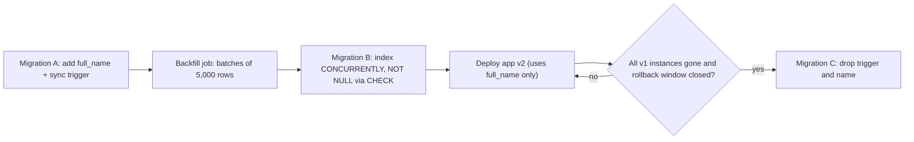

# Database Migrations

> **Module 03 · Databases** · Prerequisites: [SQL DDL](08-SQL-DDL.md), [ORM Fundamentals](33-ORM-Fundamentals.md) · Next: [MongoDB Fundamentals](35-MongoDB-Fundamentals.md)

---

## ⏱ If You Only Have 2 Minutes

- A migration is a versioned, ordered change script. The tool records each applied version in a history table (`alembic_version`, `knex_migrations`, `pgmigrations`, `_prisma_migrations`, `django_migrations`) and runs only what is missing.
- During a rolling deploy, **old and new application code run against the same schema at the same time**. Every migration must work with both.
- Renames and type changes use **expand → migrate → contract**: add the new column, keep both in sync, backfill, switch the code, and only then drop the old column — in a later release.
- Backfill large tables in **keyset batches** of a few thousand rows, one short transaction per batch, with a pause between batches. Never do it in one `UPDATE` inside the migration.
- `CREATE INDEX CONCURRENTLY` **cannot run inside a transaction block**. Every tool has an escape hatch: Alembic `autocommit_block()`, node-pg-migrate `pgm.noTransaction()`, Knex `config = { transaction: false }`, Django `atomic = False`.
- In production, migrations are effectively **forward-only**. Once the contract step has dropped data, "rollback" means a new migration, not `down()`.
- Only one runner may apply migrations at a time. Use a PostgreSQL **advisory lock** (or the tool's lock table) and run migrations as one deploy step, not from every container at startup.
- CI applies all migrations to an empty database, checks that the models match the schema, and flags destructive statements (`DROP`, `RENAME`, `ALTER ... TYPE`) for review.

---

## 1. What It Is and Why It Exists

A **database migration** is a file that moves the schema (and sometimes the data) from one version to the next. Migrations live in the repository next to the code, run in a fixed order, and are recorded in the database so each one runs exactly once per environment.

**Analogy:** renovating a restaurant kitchen while it is open. You cannot remove the old stove before the new one is connected, and the cooks on the evening shift still use the old recipes. You install the new stove next to the old one, teach the cooks, and only remove the old stove when nobody uses it.

**The problem it solves.** Without migrations, schema changes are SQL someone ran by hand on production. Nobody knows which environment has which columns, a new developer cannot build a working database, and staging silently drifts from production. Migrations turn the schema into code: reviewed, versioned, and repeatable.

**The harder problem.** Applying the change is easy. Applying it **without downtime** is the real skill. In a rolling deploy, version N and version N+1 of the application serve traffic side by side for minutes. If the migration renames `customers.name` to `full_name` in one step, every running N instance fails with `column "name" does not exist` until it is replaced. If the migration takes an exclusive lock on a 50-million-row table, checkout stops. Most of this chapter is about avoiding those two failures.

---

## 2. How It Works

### What a migration runner does

1. Connect and take a lock so that no other runner applies migrations at the same time.
2. Create the history table if it does not exist.
3. Read the applied versions from the history table and the migration files from disk.
4. Compute the pending list in order. Alembic follows the `down_revision` chain; Knex and node-pg-migrate sort by file name (a timestamp prefix).
5. For each pending migration: begin a transaction (by default), run it, insert its version into the history table, commit.
6. Release the lock.

Step 5 is why PostgreSQL is pleasant for migrations: its DDL is **transactional**. If a migration fails halfway, the whole migration rolls back and the history table stays consistent. MySQL commits implicitly on most DDL statements, so a failed multi-statement migration there can leave the schema half-applied.

### Expand → migrate → contract: renaming `customers.name` to `full_name`

You cannot rename a column in one step while old code still reads it. Split the change into steps that are each compatible with every application version that may be running.

| Step | What runs | Old app (reads/writes `name`) | New app (reads/writes `full_name`) |
|---|---|---|---|
| 1. Expand (migration A) | Add nullable `full_name`; add a trigger that copies between `name` and `full_name` on every write | Works: trigger fills `full_name` | Not deployed yet |
| 2. Migrate data (backfill job) | Copy `name` → `full_name` for existing rows, in batches | Works | Not deployed yet |
| 3. Tighten (migration B) | Index `full_name` concurrently; make it `NOT NULL` via `CHECK ... NOT VALID` → `VALIDATE` | Works | Not deployed yet |
| 4. Deploy app v2 | Rolling deploy of code that uses only `full_name` | Still running on some instances: trigger keeps `name` current | Works |
| 5. Wait | Until no v1 instance runs and you would no longer roll back to v1 | — | Works |
| 6. Contract (migration C) | Drop the trigger and the `name` column | Must be gone | Works |



The trigger is what makes this a **single application deploy**. Without it, you need application-level dual writes and three deploys (see Key Concepts). The trigger also keeps rollback safe: until step 6, you can redeploy v1 and it still finds a correct `name` in every row.

Type changes follow the same shape. To change `orders.total_cents` from `integer` to `bigint` on a large table, add `total_cents_big bigint`, sync with a trigger, backfill, switch reads, then drop the old column. A direct `ALTER COLUMN ... TYPE` rewrites the whole table under an `ACCESS EXCLUSIVE` lock; the lock level of each `ALTER TABLE` form is covered in [SQL DDL](08-SQL-DDL.md).

---

## 3. Key Concepts

### Tools and their history tables

| Tool | Stack | How migrations are written | History table | Down migrations |
|---|---|---|---|---|
| Prisma Migrate | Node | Generated SQL from `schema.prisma` (`prisma migrate dev`), applied with `prisma migrate deploy` | `_prisma_migrations` (stores a checksum per file) | None; fix forward |
| Drizzle Kit | Node | Generated SQL from TypeScript schema (`drizzle-kit generate`), applied with `drizzle-kit migrate` or the runtime `migrate()` helper | Managed by Drizzle | None |
| Knex | Node | `up`/`down` functions with the schema builder or raw SQL | `knex_migrations` + `knex_migrations_lock` | `knex migrate:rollback` |
| node-pg-migrate | Node | `up`/`down` with the `pgm` builder or `pgm.sql()` | `pgmigrations` | `node-pg-migrate down` |
| Alembic | Python | `upgrade()`/`downgrade()`; optional autogenerate from SQLAlchemy models | `alembic_version` | `alembic downgrade -1` |
| Django | Python | Generated from models (`makemigrations`), applied with `migrate` | `django_migrations` | Automatic for reversible operations; `RunPython` needs `reverse_code` |

**Generated migrations are a draft, not a decision.** Autogenerate tools compare models to the schema and see a rename as "column `name` disappeared, column `full_name` appeared". The generated file is `DROP COLUMN name; ADD COLUMN full_name` — which deletes every customer's name. Always read the SQL before committing it.

Two developers on separate branches can both add a migration with the same parent. Alembic then reports multiple heads and refuses to `upgrade head` until you create a merge revision (`alembic merge`). Timestamp-named tools (Knex, node-pg-migrate) avoid name clashes but can still apply two migrations in an order nobody tested. Rebase migrations onto `main` before merging.

### Forward-only vs down migrations

Down migrations are useful on a laptop: apply, test, roll back, edit, apply again. In production they rarely help:

- A `down()` for a contract step cannot restore dropped data. `ADD COLUMN name` brings the column back empty, and old code then reads empty names — worse than an error.
- When a deploy goes wrong, the fast fix is to roll back the **application**. If every migration is backward-compatible (the point of expand–contract), the old code runs fine on the new schema, and the schema does not need to move.
- A down migration that has never run in a production-like environment is untested code.

So most teams treat production as **forward-only**: to undo a change, write a new migration. Keep `down()` for local development, or make it raise an error for irreversible steps so nobody runs it by accident.

### Application dual-write: expand–contract without a trigger

Some teams keep logic out of the database. Then the application does the syncing, and the rename takes three deploys:

1. Migration: add nullable `full_name`. Deploy **v2**: writes both columns, still reads `name`.
2. Backfill. Deploy **v3**: reads `full_name`, still writes both (v2 instances still read `name` during the rollout).
3. Migration: `ALTER COLUMN name DROP NOT NULL`. Deploy **v4**: writes only `full_name`. Later, contract: drop `name`.

The rule behind both versions: **a column may be removed only when no running code reads it, and may become required only when every running code path writes it.** Also check ORM column caching: an ORM that lists all mapped columns in `INSERT` statements fails as soon as the column is dropped, even if no code path "uses" it.

### Schema migrations vs data migrations

A **schema migration** changes structure (`ADD COLUMN`, `CREATE INDEX`). It touches the catalog, usually finishes in milliseconds, and belongs in the deploy pipeline.

A **data migration** changes rows (the backfill). Its runtime grows with table size. Running it inside a migration transaction means one huge transaction: it holds row locks on every updated row until commit, blocks vacuum from cleaning up dead row versions, generates a burst of WAL that replicas must replay, and makes the deploy wait for minutes or hours. Run large data migrations as a separate, **resumable and idempotent** job. Tiny data changes (inserting a new row into a lookup table) can stay in the migration.

Inside migration files, do not import the application's current models. Migration `0042` must produce the same result next year, after the models have changed. Django gives you historical models through `apps.get_model()`; in Alembic, use `sa.table()` / `sa.column()` stubs or plain SQL.

### Non-transactional statements: `CREATE INDEX CONCURRENTLY`

A plain `CREATE INDEX` blocks writes to the table for the whole build. `CREATE INDEX CONCURRENTLY` lets writes continue: it scans the table twice and waits for older transactions to finish. To do that, it must manage its own transactions, so PostgreSQL rejects it inside a transaction block:

```text
ERROR:  CREATE INDEX CONCURRENTLY cannot run inside a transaction block
```

Migration tools wrap each migration in a transaction by default, so you must opt out for that migration:

| Tool | Opt-out |
|---|---|
| Alembic | `with op.get_context().autocommit_block():` around the statement; `op.create_index(..., postgresql_concurrently=True)` |
| node-pg-migrate | `pgm.noTransaction()` at the top of the migration; `pgm.createIndex(..., { concurrently: true })` |
| Knex | `export const config = { transaction: false };` in the migration file |
| Django | `atomic = False` on the `Migration` class, with `AddIndexConcurrently` from `django.contrib.postgres.operations` |

Two consequences. First, a non-transactional migration can fail halfway, so it must be **safe to re-run**: `DROP INDEX CONCURRENTLY IF EXISTS` before creating, `DROP CONSTRAINT IF EXISTS` before adding. Second, a failed concurrent build leaves an `INVALID` index that still slows down writes; drop it and try again.

### One runner at a time

If ten pods each run `migrate` on startup, they race: two may try to apply the same migration and one fails, or worse, both partly succeed in a non-transactional migration. Fixes:

- **Run migrations once per deploy**, as a pipeline step or a single job, before the new pods start.
- **Take a lock anyway**, in case two pipelines overlap. Knex uses its `knex_migrations_lock` table; node-pg-migrate and Prisma Migrate take a PostgreSQL advisory lock. Alembic has no lock, so add one in `env.py` (see Production Concerns).

```sql
-- Session-level advisory lock: one key for "schema migrations" in this database.
SELECT pg_advisory_lock(7240193);       -- waits until no other runner holds it
-- ... apply migrations ...
SELECT pg_advisory_unlock(7240193);     -- also released automatically when the session ends
```

---

## 4. Code Examples

Scenario: rename `customers.name` to `full_name` with expand → migrate → contract, as three migrations plus a batched backfill job.

### Node.js / TypeScript

Migrations with node-pg-migrate. Each block below is a separate file in `migrations/`.

```ts
// npm i node-pg-migrate pg   — run: DATABASE_URL=... npx node-pg-migrate up
// (configure a TypeScript loader for .ts migration files, per the node-pg-migrate docs)
import type { MigrationBuilder } from "node-pg-migrate";

// ── migrations/1764000000000_customers-full-name-expand.ts ──
export async function up(pgm: MigrationBuilder): Promise<void> {
  pgm.sql("SET lock_timeout = '5s'"); // fail fast instead of queueing behind a long transaction
  pgm.addColumn("customers", { full_name: { type: "text" } }); // nullable: metadata-only change
  // The trigger keeps both columns equal whichever app version did the write.
  pgm.sql(`
    CREATE FUNCTION customers_sync_full_name() RETURNS trigger LANGUAGE plpgsql AS $$
    BEGIN
      IF TG_OP = 'INSERT' THEN
        NEW.full_name := COALESCE(NEW.full_name, NEW.name);
        NEW.name      := COALESCE(NEW.name, NEW.full_name);
      ELSIF NEW.name IS DISTINCT FROM OLD.name THEN
        NEW.full_name := NEW.name;
      ELSIF NEW.full_name IS DISTINCT FROM OLD.full_name THEN
        NEW.name := NEW.full_name;
      END IF;
      RETURN NEW;
    END $$;
    CREATE TRIGGER customers_sync_full_name BEFORE INSERT OR UPDATE ON customers
      FOR EACH ROW EXECUTE FUNCTION customers_sync_full_name();`);
}
export async function down(pgm: MigrationBuilder): Promise<void> {
  pgm.sql("DROP TRIGGER customers_sync_full_name ON customers");
  pgm.sql("DROP FUNCTION customers_sync_full_name()");
  pgm.dropColumn("customers", "full_name");
}

// ── migrations/1764000100000_customers-full-name-tighten.ts (run after the backfill) ──
export async function up(pgm: MigrationBuilder): Promise<void> {
  pgm.noTransaction(); // CONCURRENTLY refuses to run in a transaction block
  // No transaction means a failure can leave partial work: make every step re-runnable.
  pgm.sql("DROP INDEX CONCURRENTLY IF EXISTS customers_full_name_idx");
  pgm.createIndex("customers", "full_name", { name: "customers_full_name_idx", concurrently: true });
  pgm.sql("ALTER TABLE customers DROP CONSTRAINT IF EXISTS customers_full_name_nn");
  pgm.sql("ALTER TABLE customers ADD CONSTRAINT customers_full_name_nn CHECK (full_name IS NOT NULL) NOT VALID");
  pgm.sql("ALTER TABLE customers VALIDATE CONSTRAINT customers_full_name_nn"); // scans without blocking writes
  pgm.sql("ALTER TABLE customers ALTER COLUMN full_name SET NOT NULL"); // PG 12+: proven by the CHECK, no scan
  pgm.sql("ALTER TABLE customers DROP CONSTRAINT customers_full_name_nn");
}

// ── migrations/1764000200000_customers-full-name-contract.ts (a later release) ──
export async function up(pgm: MigrationBuilder): Promise<void> {
  pgm.sql("SET lock_timeout = '5s'");
  pgm.sql("DROP TRIGGER customers_sync_full_name ON customers");
  pgm.sql("DROP FUNCTION customers_sync_full_name()");
  pgm.dropColumn("customers", "name");
}
export async function down(): Promise<void> {
  throw new Error("Irreversible: old code would read an empty name column. Roll forward instead.");
}
```

The backfill job:

```ts
// npm i pg   — Node.js 22+, TypeScript 5, ESM. Run: node backfill.js [startAfterId]
import pg from "pg";
import { setTimeout as sleep } from "node:timers/promises";

const BATCH_SIZE = 5_000;
const PAUSE_MS = 200;
const MAX_REPLICA_LAG_S = 5;

// One round trip per batch: take the next id range, update rows that still need it,
// return the last id of the range. `full_name IS NULL` makes re-runs harmless.
const BATCH_SQL = `
  WITH batch AS (
    SELECT id FROM customers WHERE id > $1 ORDER BY id LIMIT $2
  ), updated AS (
    UPDATE customers c SET full_name = c.name
    FROM batch b WHERE c.id = b.id AND c.full_name IS NULL
    RETURNING 1
  )
  SELECT (SELECT max(id) FROM batch) AS last_id, (SELECT count(*) FROM updated) AS updated`;
const LAG_SQL = `SELECT COALESCE(EXTRACT(epoch FROM max(replay_lag)), 0)::float8 AS lag FROM pg_stat_replication`;

const client = new pg.Client({ connectionString: process.env.DATABASE_URL });
await client.connect();
try {
  await client.query("SET lock_timeout = '2s'");
  await client.query("SET statement_timeout = '30s'");
  // int8 arrives from pg as a string. Keep the cursor a string: Number() loses precision above 2^53.
  let cursor = process.argv[2] ?? "0";
  for (;;) {
    const { rows: [{ lag }] } = await client.query<{ lag: number }>(LAG_SQL);
    if (lag > MAX_REPLICA_LAG_S) { await sleep(lag * 1000); continue; } // let replicas catch up
    try {
      // No BEGIN: each statement autocommits, so every batch is its own short transaction.
      const { rows: [row] } = await client.query<{ last_id: string | null; updated: string }>(
        BATCH_SQL, [cursor, BATCH_SIZE]);
      if (row.last_id === null) break; // walked past the last row
      cursor = row.last_id;
      console.log(JSON.stringify({ cursor, updated: Number(row.updated) })); // resume point
    } catch (err) {
      const code = (err as { code?: string }).code;
      if (code !== "55P03" && code !== "57014") throw err; // lock_not_available, query_canceled
      console.warn(JSON.stringify({ cursor, retry: code }));
    }
    await sleep(PAUSE_MS);
  }
} finally {
  await client.end();
}
```

### Python

The same three migrations with Alembic, each in its own file under `migrations/versions/`.

```python
# pip install alembic sqlalchemy "psycopg[binary]"   — run: alembic upgrade head
import sqlalchemy as sa
from alembic import op

# ── versions/a1_customers_full_name_expand.py ──
revision, down_revision = "a1f0c2d9e7b1", "9b1e47aa52c0"

SYNC_TRIGGER = """
CREATE FUNCTION customers_sync_full_name() RETURNS trigger LANGUAGE plpgsql AS $$
BEGIN
  IF TG_OP = 'INSERT' THEN
    NEW.full_name := COALESCE(NEW.full_name, NEW.name);
    NEW.name      := COALESCE(NEW.name, NEW.full_name);
  ELSIF NEW.name IS DISTINCT FROM OLD.name THEN
    NEW.full_name := NEW.name;
  ELSIF NEW.full_name IS DISTINCT FROM OLD.full_name THEN
    NEW.name := NEW.full_name;
  END IF;
  RETURN NEW;
END $$;
CREATE TRIGGER customers_sync_full_name BEFORE INSERT OR UPDATE ON customers
  FOR EACH ROW EXECUTE FUNCTION customers_sync_full_name();
"""


def upgrade() -> None:
    op.execute("SET lock_timeout = '5s'")  # give up quickly rather than block the table's queue
    op.add_column("customers", sa.Column("full_name", sa.Text(), nullable=True))
    op.execute(SYNC_TRIGGER)


def downgrade() -> None:
    op.execute("DROP TRIGGER customers_sync_full_name ON customers")
    op.execute("DROP FUNCTION customers_sync_full_name()")
    op.drop_column("customers", "full_name")


# ── versions/a2_customers_full_name_tighten.py (run after the backfill) ──
revision, down_revision = "b7d3e5a40c22", "a1f0c2d9e7b1"


def upgrade() -> None:
    # Commit Alembic's transaction and run in autocommit: CONCURRENTLY requires it, and
    # VALIDATE must not share a transaction with the ADD CONSTRAINT's exclusive lock.
    with op.get_context().autocommit_block():
        op.execute("DROP INDEX CONCURRENTLY IF EXISTS customers_full_name_idx")  # re-runnable
        op.create_index("customers_full_name_idx", "customers", ["full_name"],
                        postgresql_concurrently=True)
        op.execute("ALTER TABLE customers DROP CONSTRAINT IF EXISTS customers_full_name_nn")
        op.execute("ALTER TABLE customers ADD CONSTRAINT customers_full_name_nn "
                   "CHECK (full_name IS NOT NULL) NOT VALID")
        op.execute("ALTER TABLE customers VALIDATE CONSTRAINT customers_full_name_nn")
        op.execute("ALTER TABLE customers ALTER COLUMN full_name SET NOT NULL")  # PG 12+: no scan
        op.execute("ALTER TABLE customers DROP CONSTRAINT customers_full_name_nn")


# ── versions/a3_customers_full_name_contract.py (a later release) ──
revision, down_revision = "c4e8f1b6d903", "b7d3e5a40c22"


def upgrade() -> None:
    op.execute("SET lock_timeout = '5s'")
    op.execute("DROP TRIGGER customers_sync_full_name ON customers")
    op.execute("DROP FUNCTION customers_sync_full_name()")
    op.drop_column("customers", "name")


def downgrade() -> None:
    raise NotImplementedError("Irreversible: roll forward with a new migration")
```

The backfill job:

```python
# pip install "psycopg[binary]"   — Python 3.12+. Run: python backfill.py [start_after_id]
import os
import sys
import time

import psycopg
from psycopg import errors

BATCH_SIZE = 5_000
PAUSE_S = 0.2
MAX_REPLICA_LAG_S = 5.0

BATCH_SQL = """
WITH batch AS (
  SELECT id FROM customers WHERE id > %(after)s ORDER BY id LIMIT %(size)s
), updated AS (
  UPDATE customers c SET full_name = c.name
  FROM batch b WHERE c.id = b.id AND c.full_name IS NULL
  RETURNING 1
)
SELECT (SELECT max(id) FROM batch), (SELECT count(*) FROM updated)
"""
LAG_SQL = "SELECT COALESCE(EXTRACT(epoch FROM max(replay_lag)), 0)::float8 FROM pg_stat_replication"


def backfill(start_after: int) -> None:
    # autocommit=True matters: psycopg otherwise opens a transaction on the first statement
    # and the whole backfill would become one giant transaction until the script ends.
    with psycopg.connect(os.environ["DATABASE_URL"], autocommit=True) as conn:
        conn.execute("SET lock_timeout = '2s'")
        conn.execute("SET statement_timeout = '30s'")
        cursor = start_after
        while True:
            (lag,) = conn.execute(LAG_SQL).fetchone()
            if lag > MAX_REPLICA_LAG_S:
                time.sleep(lag)  # throttle on replica lag, not just a fixed pause
                continue
            try:
                last_id, updated = conn.execute(
                    BATCH_SQL, {"after": cursor, "size": BATCH_SIZE}).fetchone()
            except (errors.LockNotAvailable, errors.QueryCanceled) as exc:
                print({"cursor": cursor, "retry": type(exc).__name__}, file=sys.stderr)
                time.sleep(1)
                continue
            if last_id is None:
                break
            cursor = last_id
            print({"cursor": cursor, "updated": updated}, flush=True)  # resume point if killed
            time.sleep(PAUSE_S)


if __name__ == "__main__":
    backfill(int(sys.argv[1]) if len(sys.argv) > 1 else 0)
```

**Runtime differences to notice.** node-postgres sends each `query()` on its own unless you issue `BEGIN`, so the TypeScript job is autocommit by default. psycopg 3 starts a transaction implicitly, so the Python job must pass `autocommit=True` — forgetting it turns a gentle backfill into one long transaction. node-postgres returns `bigint` columns as strings to avoid JavaScript's 2^53 precision limit; Python integers have no such limit.

**Why this batch shape.** `WHERE id > $cursor ORDER BY id LIMIT n` is a keyset scan on the primary key: every batch costs the same, whether it is the first or the ten-thousandth. `OFFSET` would get slower with every batch. The batch CTE is referenced twice, so PostgreSQL materializes it once, and the data-modifying `updated` CTE runs to completion even though the outer query only counts its output.

---

## 5. Production Concerns

- **Set `lock_timeout` on every DDL migration.** Even a metadata-only `ADD COLUMN` needs a brief `ACCESS EXCLUSIVE` lock. If a long report query holds a conflicting lock, the `ALTER` waits — and every query that arrives after it queues behind the `ALTER`. A 5-second `lock_timeout` turns a site-wide stall into a failed migration you can retry at a quieter moment. The lock modes themselves are in [SQL DDL](08-SQL-DDL.md) and [Database Locks](30-Database-Locks.md).
- **Alembic advisory lock.** Add it in `env.py`'s `run_migrations_online()`:

  ```python
  with connectable.connect() as connection:
      # Session-level: survives the commits Alembic makes; released when the connection closes.
      connection.execute(text("SELECT pg_advisory_lock(7240193)"))
      connection.commit()
      context.configure(connection=connection, target_metadata=target_metadata)
      with context.begin_transaction():
          context.run_migrations()
  ```

  Session-level advisory locks do not work through PgBouncer in transaction-pooling mode, because consecutive statements may use different server connections. Run migrations over a direct connection.
- **Backfill throttling.** Every updated row creates a dead row version and WAL. Watch replica lag (`pg_stat_replication.replay_lag`), dead tuples, and autovacuum activity. Throttle on lag, not only on a fixed sleep, and run large backfills off-peak. Log the cursor after each batch so a killed job resumes where it stopped.
- **Test against production-sized data.** A migration that takes 40 ms on a 1,000-row CI database can take 40 minutes on 200 million rows. Time risky migrations on a restored, anonymized snapshot before release.
- **CI checks.** Start an empty PostgreSQL 16 container, run every migration from zero (`alembic upgrade head`, `prisma migrate deploy`, `knex migrate:latest`), then check that models and schema agree (`alembic check` reports pending autogenerate changes; Prisma's `migrate diff` and Django's `makemigrations --check` do the same job). Lint new migration files for destructive operations — a linter such as Squawk, or a simple rule that `DROP`, `RENAME` and `ALTER ... TYPE` need an explicit reviewer label. If you keep down migrations, run up → down → up to prove they work.
- **Observability.** Record which migration version each environment is on (the history table) next to the deployed app version. Alert on migrations that exceed an expected duration, and on `INVALID` indexes left by failed concurrent builds (`pg_index.indisvalid = false`).

---

## 6. Common Mistakes

- **Renaming or dropping a column in the same release that stops using it** — old instances still running during the rolling deploy fail on every query — expand first, contract in a later release.
- **Committing an autogenerated rename** — Alembic, Prisma or Drizzle produce `DROP COLUMN` + `ADD COLUMN` and the data is gone — read every generated SQL file and rewrite renames as expand–contract.
- **Backfilling with one `UPDATE customers SET full_name = name`** — a single huge transaction, row locks on every row, a WAL spike and replica lag — keyset batches of a few thousand rows, each committed separately, with throttling.
- **`CREATE INDEX` without `CONCURRENTLY` on a busy table** — writes block for the whole build — use `CONCURRENTLY` in a non-transactional migration, and make it re-runnable.
- **Running migrations from every pod's startup command** — racing runners and half-applied non-transactional migrations — one migration step per deploy, protected by an advisory lock.
- **Writing a `down()` that "restores" a dropped column** — it comes back empty and old code reads blank data — make irreversible steps raise and roll forward.
- **Importing current application models into old migrations** — the migration breaks or behaves differently when the model changes later — use historical models or plain SQL inside migrations.

---

## 7. Comparison Table

How to change an existing column (rename or type change) on a large, busy table:

| | Direct `ALTER` (rename / `TYPE`) | Expand–contract with sync trigger | Expand–contract with app dual-write | Maintenance window |
|---|---|---|---|---|
| Downtime | Rename: none, but old code breaks instantly. Type change: table rewrite under exclusive lock | None | None | Yes, planned |
| Application deploys | 1 (must be atomic with the schema change) | 1 | 3 | 1 |
| Rollback | Hard | Easy until contract | Easy until contract | Restore or reverse script |
| Logic in database | No | Yes (trigger) | No | No |
| Best for | Small tables, or columns no code reads yet | Most renames and type changes on live tables | Teams that forbid triggers | Internal tools, huge rewrites that cannot be batched |

---

## 8. Interview Questions

**[Junior] What is a migration, and how does the tool know which ones to run?**
A migration is a versioned script that changes the schema from one version to the next, committed alongside the code. The tool stores the IDs of applied migrations in a history table, such as `alembic_version` or `knex_migrations`. On each run it compares that table with the files on disk and applies the missing ones in order, each normally inside a transaction.

**[Junior] Why can't you just rename a column?**
`ALTER TABLE ... RENAME COLUMN` itself is fast, but during a rolling deploy the old version of the application is still running and still queries the old name. Those instances fail until they are replaced. You also cannot roll back the application afterwards. Expand–contract avoids this by keeping both columns until no code reads the old one.

**[Mid] Walk through renaming `customers.name` to `full_name` with zero downtime.**
Add a nullable `full_name` column and a trigger that keeps it equal to `name` on every insert and update. Backfill existing rows in keyset batches. Validate a `CHECK (full_name IS NOT NULL) NOT VALID` constraint and then set `NOT NULL`. Deploy code that uses only `full_name`; the trigger keeps `name` correct for old instances and rollbacks. In a later release, once no old instance runs, drop the trigger and `name`.

**[Mid] Why does `CREATE INDEX CONCURRENTLY` fail in a migration, and how do you fix it?**
It must commit internally between its phases, so PostgreSQL refuses to run it inside a transaction block, and migration tools wrap each migration in one. Opt out for that migration: Alembic's `autocommit_block()`, node-pg-migrate's `pgm.noTransaction()`, Knex's `config = { transaction: false }`, or Django's `atomic = False`. Because it is no longer atomic, make it re-runnable and check for an `INVALID` index after a failure.

**[Mid] How do you backfill 100 million rows safely?**
Run it as a separate job, not inside the migration. Walk the primary key with keyset batches (`WHERE id > $last ORDER BY id LIMIT 5000`), commit each batch, and update only rows that still need it, so the job is idempotent and resumable. Set `lock_timeout` and `statement_timeout`, retry lock timeouts, pause between batches, and slow down when replica lag rises. Log the cursor so you can restart from it.

**[Senior] Do you write down migrations? How do you roll back a bad schema change?**
I treat production as forward-only. If each migration is backward-compatible, rolling back the application is enough, and the schema stays where it is. A `down()` that re-adds a dropped column restores structure but not data, which is worse than failing. I keep `down()` for local development, make irreversible steps raise, and fix production problems with a new forward migration.

**[Senior] Two deploy pipelines start at the same time. What happens to the migrations, and how do you prevent problems?**
Both runners read the same pending list and try to apply the same migration. With transactional DDL one usually fails on a duplicate object or history row, but a non-transactional migration can be half-applied by both. Prevent it by running migrations as a single deploy step and taking a lock: a session-level `pg_advisory_lock` (node-pg-migrate and Prisma do this; Alembic needs it in `env.py`) or Knex's lock table. Make sure the lock is taken on a direct connection, not through a transaction-pooling proxy.

**[Senior] What would your CI pipeline check for migrations?**
Apply all migrations to an empty database of the same major version as production, then check that the ORM models match the resulting schema. Lint new migrations for destructive or locking statements and require explicit review for them. Run the application's integration tests against the migrated schema. For migrations touching large tables, time them against a production-sized snapshot before release, because CI data is too small to reveal lock or rewrite problems.

---

## 9. Cheat Sheet

```text
History table   alembic_version | knex_migrations(+_lock) | pgmigrations | _prisma_migrations | django_migrations
Rule            every migration must work with the app version before AND after it
Rename/type     expand (add col + sync trigger) → backfill → NOT NULL via CHECK NOT VALID + VALIDATE
                → deploy app → wait for old instances + rollback window → contract (drop old)
Backfill        separate job; WHERE id > $cursor ORDER BY id LIMIT 5000; commit per batch;
                idempotent (WHERE new IS NULL); lock_timeout; pause; throttle on replica lag
CONCURRENTLY    not in a transaction: autocommit_block() | pgm.noTransaction() | config.transaction=false | atomic=False
                re-runnable: DROP INDEX CONCURRENTLY IF EXISTS first; check indisvalid
DDL safety      SET lock_timeout = '5s' so ALTER doesn't queue the whole table behind it
Rollback        forward-only in prod; roll back the app, not the schema
One runner      single deploy step + pg_advisory_lock (direct connection, not PgBouncer txn mode)
CI              migrate empty DB → models == schema (alembic check / makemigrations --check) → lint DROP/RENAME/TYPE
Autogenerate    a rename becomes DROP + ADD — always read the SQL
```

---

## Related Topics

- [SQL DDL](08-SQL-DDL.md) — lock levels of each `ALTER TABLE` form and which ones rewrite the table
- [Database Locks](30-Database-Locks.md) — lock queues and advisory locks used by migration runners
- [ORM Fundamentals](33-ORM-Fundamentals.md) — where autogenerated migrations come from and why they need review
- [Rolling Deployment](../Module-07-Advanced-Backend-and-System-Design/43-Rolling-Deployment.md) — why two app versions share one schema during a deploy
- [CI/CD Fundamentals](../Module-10-DevOps-and-Cloud/12-CI-CD-Fundamentals.md) — where the migration step and its checks sit in the pipeline
