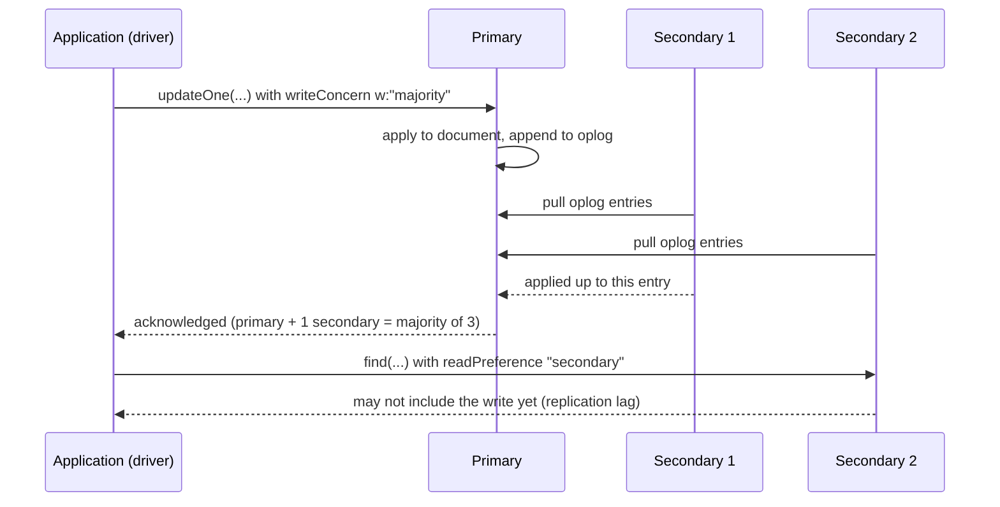

# MongoDB Fundamentals

> **Module 03 · Databases** · Prerequisites: [SQL vs NoSQL](01-SQL-vs-NoSQL.md), [Transactions](27-Transactions.md) · Next: [Document Modeling](36-Document-Modeling.md)

---

## ⏱ If You Only Have 2 Minutes

- MongoDB stores **documents** (BSON: binary JSON with extra types such as `ObjectId`, `Date`, `Decimal128`, 32/64-bit integers) in **collections**. The maximum document size is **16 MB**.
- Every document has a unique, immutable `_id`. If you do not set one, the driver generates a 12-byte **ObjectId**: a 4-byte creation timestamp, a 5-byte random value and a 3-byte counter.
- **A write to a single document is atomic**, including all its embedded arrays and sub-documents. `updateOne({ _id, available: { $gte: 2 } }, { $inc: { available: -2 } })` is a race-free stock reservation.
- Indexes are still required. Order compound index fields by **ESR: Equality, then Sort, then Range**. Check plans with `explain("executionStats")`: you want `IXSCAN`, not `COLLSCAN`, and `totalDocsExamined` close to `nReturned`.
- Production runs as a **replica set** (usually three members). Only the primary accepts writes. `w: "majority"` means a write survives a failover; it is the default write concern since MongoDB 5.0.
- Multi-document **transactions** exist (replica sets since 4.0, sharded clusters since 4.2), but they cost more and time out after 60 seconds by default. Design so that most invariants live inside one document.
- Collections are schema-less by default. Add a **`$jsonSchema` validator** so the database rejects malformed documents.

---

## 1. What It Is and Why It Exists

MongoDB is a **document database**. Instead of spreading an order over `orders`, `order_items` and `payments` rows, you can store it as one document that contains its items and payments. The application reads and writes that whole object in one operation.

**Analogy:** a relational database is a filing cabinet where every form is split into separate drawers — customer details in one, line items in another — and you assemble the full picture with joins. A document database is a folder per order: open it, and everything about that order is inside.

**The problem it solves.** Many applications read data in the same shape every time: "show this order with its items", "show this product with its attributes". In a relational schema that is a join over several tables on every read. In MongoDB it is one index lookup returning one document. Documents also allow fields that differ per record — a T-shirt has `size` and `color`, a laptop has `ramGb` and `cpu` — without an `attributes` side table or many nullable columns.

**What it costs.** Joins exist (`$lookup`) but are not the main tool. Data that many documents share (a customer's name copied into orders) must be kept up to date by your code. And without a validator, the database accepts any shape — bugs write bad data silently. The next chapter, [Document Modeling](36-Document-Modeling.md), is about choosing document shapes; this one is about the mechanics.

---

## 2. How It Works

### Documents, `_id` and BSON

The sample e-commerce schema as an order document (MongoDB shell syntax):

```js
// mongosh
db.orders.insertOne({
  _id: ObjectId("6742f1c2a9e4b1d3c8f0a111"),
  customerId: ObjectId("6742f0a8a9e4b1d3c8f0a001"),
  status: "pending",
  items: [
    { productId: ObjectId("6742ef10a9e4b1d3c8f09a01"), sku: "BOOK-42", name: "Designing Data", quantity: 1, unitPriceCents: 4500 },
    { productId: ObjectId("6742ef10a9e4b1d3c8f09a02"), sku: "MUG-01",  name: "Mug",            quantity: 2, unitPriceCents: 1200 }
  ],
  totalCents: 6900,
  createdAt: ISODate("2026-11-24T10:15:00Z")
})
```

BSON keeps types that JSON loses: `ISODate` is a real date, not a string; numbers have distinct `int32`, `int64`, `double` and `Decimal128` types; `ObjectId` is 12 bytes, not a 24-character string. Because the first four bytes are a timestamp, ObjectIds created later are roughly larger, so an index on `_id` is roughly in insertion order.

A **collection** is a group of documents, like a table without a fixed schema. It is created on the first insert. A **database** holds collections.

### How a write and a read flow through a replica set



1. The driver discovers the replica set members and sends every write to the **primary**.
2. The primary applies the change and records it in the **oplog**, a capped collection of operations.
3. Secondaries copy and replay the oplog. If the primary becomes unreachable, the remaining members **elect** a new primary, usually within seconds; drivers retry the write once automatically (retryable writes are on by default).
4. With `w: "majority"`, the primary acknowledges only after a majority of members have the write. With `w: 1`, it acknowledges after its own write — and if it fails before a secondary copies the write, the write is **rolled back** when it rejoins.
5. Reads go to the primary by default. Reading from a secondary trades freshness for load spreading.

### Reading a query plan

```js
db.orders.find({ customerId: ObjectId("6742f0a8a9e4b1d3c8f0a001") })
         .sort({ createdAt: -1 }).limit(20)
         .explain("executionStats")
```

Illustrative output (trimmed), with an index on `{ customerId: 1, createdAt: -1 }`:

```text
winningPlan:  LIMIT ← FETCH ← IXSCAN { customerId: 1, createdAt: -1 }
executionStats: nReturned: 20, totalKeysExamined: 20, totalDocsExamined: 20, executionTimeMillis: 1
```

Without that index the plan is `COLLSCAN` followed by an in-memory `SORT`, and `totalDocsExamined` equals the collection size.

---

## 3. Key Concepts

### CRUD and update operators

Updates describe **changes**, not whole new documents. The server applies them atomically to one document.

| Operator | Effect | Example |
|---|---|---|
| `$set` / `$unset` | Set or remove a field | `{ $set: { status: "paid" } }` |
| `$inc` | Add to a number (negative to subtract) | `{ $inc: { available: -2 } }` |
| `$push` (with `$each`, `$slice`) | Append to an array, optionally keep only the last N | `{ $push: { events: { $each: [e], $slice: -50 } } }` |
| `$addToSet` / `$pull` | Add if absent / remove matching elements | `{ $addToSet: { tags: "sale" } }` |
| `$setOnInsert` | Set only when an upsert inserts | with `{ upsert: true }` |

The important pattern is the **conditional atomic update**: put the precondition in the filter and the change in the update. If the filter no longer matches, nothing is written and `matchedCount` is 0.

```js
// Only one of two concurrent buyers of the last unit gets matchedCount: 1.
db.inventory.updateOne({ _id: productId, available: { $gte: 1 } }, { $inc: { available: -1 } })

// State machine guard: only a pending order can become paid.
db.orders.updateOne({ _id: orderId, status: "pending" }, { $set: { status: "paid", paidAt: new Date() } })
```

This is the document equivalent of `UPDATE inventory SET available = available - 1 WHERE product_id = $1 AND available >= 1`. Reading the document, checking in code, then writing is a race in both databases.

### Indexes

| Type | What it is | E-commerce example |
|---|---|---|
| Single field | One field, ascending or descending | `{ sku: 1 }` |
| Compound | Several fields; order matters | `{ customerId: 1, createdAt: -1 }` for "my orders, newest first" |
| Multikey | Created automatically when an indexed field holds an array; one entry per element | `{ "items.productId": 1 }` finds orders containing a product |
| Unique | Rejects duplicate values | `{ email: 1 }, { unique: true }` on customers |
| TTL | Deletes documents a number of seconds after a date field | `{ updatedAt: 1 }, { expireAfterSeconds: 604800 }` on abandoned carts |
| Partial | Indexes only documents matching a filter | `{ createdAt: 1 }` with `partialFilterExpression: { status: "pending" }` |

**ESR guideline.** For a query with equality filters, a sort and a range filter, put fields in the order **Equality → Sort → Range**. For "pending orders of a customer, newest first, from the last 30 days": `{ customerId: 1, status: 1, createdAt: -1 }` — here the sort and range field are the same, which is ideal. When they differ (`find({ customerId, totalCents: { $gte: 10000 } }).sort({ createdAt: -1 })`), use `{ customerId: 1, createdAt: -1, totalCents: 1 }`: the index returns documents already sorted, so there is no blocking in-memory `SORT` stage, at the price of scanning some extra keys for the range.

Limits worth knowing: a compound index can include at most one field that is an array in a given document; TTL deletion runs in a background task about once a minute, so expired documents can linger briefly; and every index slows down every insert and every update of an indexed field, exactly as in PostgreSQL.

### Aggregation pipeline

An aggregation is a list of stages; each stage transforms the stream of documents from the previous one.

| Stage | Role | SQL analogy |
|---|---|---|
| `$match` | Filter (uses indexes when it is first) | `WHERE` |
| `$group` | Group by a key and compute `$sum`, `$avg`, `$max`... | `GROUP BY` |
| `$sort`, `$limit` | Order and cut | `ORDER BY`, `LIMIT` |
| `$project` / `$set` | Reshape or add computed fields | `SELECT` expressions |
| `$unwind` | One output document per array element | joining to a child table |
| `$lookup` | Left outer join to another collection | `LEFT JOIN` |

```js
// Orders with the customer's email attached — a left outer join.
db.orders.aggregate([
  { $match: { status: "paid" } },
  { $lookup: { from: "customers", localField: "customerId", foreignField: "_id", as: "customer" } },
  { $project: { totalCents: 1, email: { $first: "$customer.email" } } }
])
```

Put `$match` first so it can use an index. Use `$lookup` for occasional reads, not for the hot path; if a page needs a join on every request, the model probably needs an embedded copy instead.

### Write concern, read concern, read preference

| Setting | Controls | Common values |
|---|---|---|
| Write concern | When a write is acknowledged | `w: 1` (primary only), `w: "majority"` (survives failover, default since 5.0), `j: true` (on-disk journal) |
| Read concern | Which data a read may return | `"local"` (default; may later be rolled back), `"majority"` (only majority-committed data), `"snapshot"` (in transactions), `"linearizable"` |
| Read preference | Which member serves the read | `primary` (default), `primaryPreferred`, `secondary`, `secondaryPreferred`, `nearest` |

Rules of thumb: money and stock writes use `w: "majority"`. Reads that must see the user's own write go to the primary. Analytics and other lag-tolerant reads can use `secondaryPreferred`. Causally consistent sessions can give read-your-writes on secondaries, but only when used with majority read and write concern.

### Multi-document transactions

Since 4.0 (replica sets) and 4.2 (sharded clusters), MongoDB supports ACID transactions across documents and collections with snapshot isolation. Use the driver's callback API (`session.withTransaction` / `session.with_transaction`): it retries the whole callback on `TransientTransactionError` (for example, a write conflict) and retries the commit on `UnknownTransactionCommitResult`.

Why single-document design is still the primary tool:

- A transaction holds its changes and locks in memory until commit; long transactions put pressure on the cache. The default limit is 60 seconds (`transactionLifetimeLimitSeconds`), after which the server aborts it.
- Write conflicts surface as errors to retry, not waits.
- On sharded clusters, a transaction across shards adds a two-phase commit between them.
- A single-document update needs none of this and is atomic anyway.

So: model so that one business operation touches one document where you can, and use transactions for the remaining cross-document invariants, such as reserving stock in several `inventory` documents and inserting the order.

### Schema validation and sharding

A **`$jsonSchema` validator** on a collection checks inserts and updates. `validationLevel` (`"strict"` checks all writes, `"moderate"` skips updates to documents that were already invalid) and `validationAction` (`"error"` rejects, `"warn"` only logs) control how strictly. It gives you `NOT NULL`, types and `CHECK`-like ranges; it does not give you foreign keys.

**Sharding** splits a collection across several replica sets (shards) by a **shard key**. A `mongos` router sends a query that includes the shard key to one shard, and a query without it to every shard (scatter-gather). Choosing the shard key is the most important and the hardest-to-change sharding decision; see [Sharding](../Module-07-Advanced-Backend-and-System-Design/20-Sharding.md).

---

## 4. Code Examples

Scenario: create indexes, place an order that reserves stock for each item with a conditional `$inc` and inserts the order in one transaction, and compute revenue by day. Transactions need a replica set; for local development a single-node replica set (`mongod --replSet rs0`, then `rs.initiate()` in `mongosh`) is enough.

### Node.js / TypeScript

```ts
// npm i mongodb   — Node.js 22+, TypeScript 5, ESM
import { MongoClient, ObjectId } from "mongodb";

interface OrderItem { productId: ObjectId; sku: string; name: string; quantity: number; unitPriceCents: number }
interface Order {
  _id: ObjectId; customerId: ObjectId; status: "pending" | "paid" | "shipped" | "cancelled";
  items: OrderItem[]; totalCents: number; createdAt: Date;
}
interface Inventory { _id: ObjectId; sku: string; available: number }

export class OutOfStockError extends Error {}

// Majority write concern in the URI: an acknowledged order survives a primary failover.
const client = new MongoClient(process.env.MONGODB_URI ?? "mongodb://localhost:27017/?w=majority");
const db = client.db("shop");
const orders = db.collection<Order>("orders");
const inventory = db.collection<Inventory>("inventory");

export async function ensureIndexes(): Promise<void> {
  await orders.createIndexes([
    { key: { customerId: 1, createdAt: -1 }, name: "customer_recent" },  // "my orders" page (E, S)
    { key: { status: 1, createdAt: 1 }, name: "status_created" },         // revenue report (E, R)
    { key: { "items.productId": 1 }, name: "items_product" },             // multikey: orders containing a product
  ]);
  await db.collection("carts").createIndex({ updatedAt: 1 }, { expireAfterSeconds: 7 * 24 * 3600 }); // TTL
  await db.collection("customers").createIndex({ email: 1 }, { unique: true });
}

export async function placeOrder(customerId: ObjectId, items: OrderItem[]): Promise<ObjectId> {
  const order: Order = {
    _id: new ObjectId(), customerId, status: "pending", items, createdAt: new Date(),
    totalCents: items.reduce((sum, i) => sum + i.quantity * i.unitPriceCents, 0),
  };
  const session = client.startSession();
  try {
    // withTransaction re-runs this callback on transient errors (write conflicts, failover),
    // so it must not have side effects outside the database.
    await session.withTransaction(async () => {
      for (const item of items) {
        const res = await inventory.updateOne(
          { _id: item.productId, available: { $gte: item.quantity } },  // condition and change
          { $inc: { available: -item.quantity } },                       // in one atomic write
          { session },
        );
        if (res.matchedCount === 0) throw new OutOfStockError(item.sku); // aborts the transaction
      }
      await orders.insertOne(order, { session });
    }, { readConcern: { level: "snapshot" }, writeConcern: { w: "majority" } });
    return order._id;
  } finally {
    await session.endSession();
  }
}
```

Revenue by day:

```ts
import type { Collection } from "mongodb";

interface DailyRevenue { _id: Date; revenueCents: number; orders: number }

export async function revenueByDay(orders: Collection<Order>, from: Date, to: Date): Promise<DailyRevenue[]> {
  return orders.aggregate<DailyRevenue>([
    // First stage, so it can use the { status, createdAt } index.
    { $match: { status: { $in: ["paid", "shipped"] }, createdAt: { $gte: from, $lt: to } } },
    { $group: {
        _id: { $dateTrunc: { date: "$createdAt", unit: "day", timezone: "UTC" } }, // MongoDB 5.0+
        revenueCents: { $sum: "$totalCents" },
        orders: { $sum: 1 },
    } },
    { $sort: { _id: 1 } },
  ]).toArray();
}
```

For a single-item order, skip the transaction: the conditional `updateOne` alone is atomic, and the order insert can follow it with a compensating `$inc` if the insert fails.

### Python

```python
# pip install pymongo   — Python 3.12+
import os
from datetime import datetime, timezone

from bson import ObjectId
from pymongo import ASCENDING, DESCENDING, IndexModel, MongoClient
from pymongo.client_session import ClientSession
from pymongo.read_concern import ReadConcern
from pymongo.write_concern import WriteConcern

client = MongoClient(os.environ.get("MONGODB_URI", "mongodb://localhost:27017/?w=majority"))
db = client["shop"]
orders, inventory = db["orders"], db["inventory"]


class OutOfStock(Exception):
    pass


def ensure_indexes() -> None:
    orders.create_indexes([
        IndexModel([("customerId", ASCENDING), ("createdAt", DESCENDING)], name="customer_recent"),
        IndexModel([("status", ASCENDING), ("createdAt", ASCENDING)], name="status_created"),
        IndexModel([("items.productId", ASCENDING)], name="items_product"),
    ])
    db["carts"].create_index("updatedAt", expireAfterSeconds=7 * 24 * 3600)
    db["customers"].create_index("email", unique=True)


def place_order(customer_id: ObjectId, items: list[dict]) -> ObjectId:
    order = {
        "_id": ObjectId(),
        "customerId": customer_id,
        "status": "pending",
        "items": items,
        "totalCents": sum(i["quantity"] * i["unitPriceCents"] for i in items),
        # PyMongo stores datetimes as UTC; pass an aware datetime to avoid local-time mistakes.
        "createdAt": datetime.now(timezone.utc),
    }

    def txn(session: ClientSession) -> None:
        for item in items:
            res = inventory.update_one(
                {"_id": item["productId"], "available": {"$gte": item["quantity"]}},
                {"$inc": {"available": -item["quantity"]}},
                session=session,
            )
            if res.matched_count == 0:
                raise OutOfStock(item["sku"])  # with_transaction aborts and re-raises
        orders.insert_one(order, session=session)

    with client.start_session() as session:
        # Retries txn() on TransientTransactionError, so keep it free of external side effects.
        session.with_transaction(txn, read_concern=ReadConcern("snapshot"),
                                 write_concern=WriteConcern("majority"))
    return order["_id"]


def revenue_by_day(start: datetime, end: datetime) -> list[dict]:
    pipeline = [
        {"$match": {"status": {"$in": ["paid", "shipped"]}, "createdAt": {"$gte": start, "$lt": end}}},
        {"$group": {
            "_id": {"$dateTrunc": {"date": "$createdAt", "unit": "day", "timezone": "UTC"}},
            "revenueCents": {"$sum": "$totalCents"},
            "orders": {"$sum": 1},
        }},
        {"$sort": {"_id": 1}},
    ]
    return list(orders.aggregate(pipeline))
```

**Runtime difference to notice.** PyMongo is synchronous: inside an `async def` FastAPI endpoint these calls would block the event loop. Call them from plain `def` endpoints (FastAPI runs those in a thread pool) or use PyMongo's async API (`AsyncMongoClient`, the successor to Motor). The Node driver is always asynchronous. Also, Node numbers are doubles: integer cents within 32-bit range are stored as BSON `int32`, larger ones as `double`. Use `Long` or `Decimal128` when you need exact 64-bit values; Python `int` maps to `int32`/`int64` automatically.

---

## 5. Production Concerns

- **Write concern is a durability decision.** With `w: 1`, a primary that crashes right after acknowledging can lose the write when it rejoins as a secondary (the write is rolled back). Use `w: "majority"` for orders, payments and stock. Set `wtimeoutMS` so a write does not hang forever when a majority is unavailable; a timeout does **not** undo the write, so treat it as "unknown" and make retries idempotent.
- **Stale reads from secondaries.** A user who places an order and is redirected to "my orders" served by a secondary may not see it. Keep read-your-writes paths on the primary. If you read from secondaries, `maxStalenessSeconds` (minimum 90) excludes badly lagging members.
- **Indexes and the working set.** Performance depends on indexes and hot documents fitting in the WiredTiger cache. Watch slow queries in the profiler or logs (`planSummary: COLLSCAN` is the red flag), and compare `totalDocsExamined` with `nReturned`. Build indexes before the feature ships.
- **Transactions.** Keep them short and small. Watch for aborted transactions and `TransientTransactionError` rates; a hot document (one product everyone buys) causes write conflicts and retries.
- **Security.** Enable authentication and TLS (older MongoDB versions exposed without auth are a classic data-leak source). Treat user input in filters as data: `{ email: req.body.email }` with an object body like `{ "$ne": null }` is **operator injection** — validate that inputs are strings before building queries.
- **Replica set topology.** Use three data-bearing members across availability zones. Monitor replication lag, oplog window (how many hours of history the oplog holds — a secondary that falls further behind needs a full resync), and election events.

---

## 6. Common Mistakes

- **Read-check-write in application code** — two requests both see `available: 1` and both decrement — put the condition in the update filter and check `matchedCount`.
- **No indexes because "it's NoSQL"** — every query becomes a `COLLSCAN` once the collection grows — create indexes for each query shape, ordered by ESR, and verify with `explain`.
- **Using `w: 1` for money** — acknowledged writes disappear after a failover — `w: "majority"` for anything you cannot lose.
- **Treating MongoDB transactions as free** — long or large transactions hit the 60-second limit and conflict under load — model the invariant into one document; keep transactions for the rare cross-document case.
- **Passing request bodies straight into filters** — `{ "$gt": "" }` matches every user — validate types (Pydantic, zod) before querying.
- **Storing dates or money as strings** — range queries and sums break, and sorting is lexical — use BSON `Date`, integer cents or `Decimal128`.
- **No schema validation** — a bug writes `totalcents` instead of `totalCents` and nobody notices for weeks — add a `$jsonSchema` validator with required fields and types.

---

## 7. Comparison Table

| | MongoDB | PostgreSQL (with `jsonb`) |
|---|---|---|
| Data model | Documents in collections; nested data is first-class | Tables with constraints; `jsonb` columns for flexible parts |
| Atomic unit without a transaction | One document | One row (and a statement can change many rows atomically) |
| Multi-record transactions | Yes since 4.0/4.2; costlier, 60 s default limit | Yes, the normal way of working |
| Joins | `$lookup` — available, but not the main tool | Mature joins and a cost-based planner |
| Schema enforcement | Optional `$jsonSchema` validator; no foreign keys | Types, `NOT NULL`, `CHECK`, foreign keys, unique constraints |
| Horizontal scaling | Built-in sharding | Read replicas built-in; sharding through extensions or application design |
| Best fit | Aggregate-shaped data read and written as a whole; varied attributes; very large datasets that need sharding | Strong cross-entity invariants, reporting, ad-hoc queries |

---

## 8. Interview Questions

**[Junior] What is `_id`, and what is inside an ObjectId?**
Every document needs a unique `_id` in its collection, and it cannot be changed after insert. If you do not provide one, the driver generates an ObjectId: 12 bytes made of a 4-byte timestamp in seconds, a 5-byte random value and a 3-byte counter. Because of the timestamp prefix, ObjectIds sort roughly by creation time, and you can read the creation time from them.

**[Junior] How do you decrement stock safely when two users buy the last item at the same time?**
Use one conditional update: `updateOne({ _id, available: { $gte: qty } }, { $inc: { available: -qty } })`. Single-document writes are atomic, so only one request matches the filter while stock is sufficient. The other gets `matchedCount: 0` and reports "out of stock". Never read the value, compare in code and write back.

**[Mid] What does the ESR rule say, and why does Sort come before Range?**
Order compound index fields as Equality, then Sort, then Range. After the equality fields, the index entries are already ordered by the sort field, so MongoDB can return results in order without a blocking in-memory sort. If the range field came first, the matching entries would be ordered by the range field and need sorting. The cost is that the range filter is applied while scanning, so a few extra keys are examined.

**[Mid] Explain write concern and read preference.**
Write concern says when the server acknowledges a write: `w: 1` after the primary applies it, `w: "majority"` after most members have it, which means it survives a failover. Read preference says which member serves reads: the primary by default, or secondaries to spread load at the risk of stale data. A typical setup is majority writes, primary reads for user-facing paths, and secondary reads for reporting.

**[Mid] What does `$lookup` do, and when should you avoid it?**
It is a left outer join: for each input document it finds matching documents in another collection and adds them as an array. It is fine for admin screens and reports. On a hot path, a `$lookup` on every request usually means the data model does not match the access pattern — copy the few fields you need into the document instead.

**[Senior] MongoDB supports transactions. Why do people still say "design for single-document atomicity"?**
Transactions work, but they cost more: the server keeps the transaction's changes and snapshot in memory, write conflicts abort with errors that the client must retry, the default lifetime is 60 seconds, and on sharded clusters a cross-shard commit needs coordination between shards. A single-document update gets atomicity for free with none of that. So you model data that must change together — order status and its payment records — into one document, and keep transactions for invariants that truly span documents, like reserving stock for several products.

**[Senior] A write was acknowledged, the primary crashed, and the write is gone. What happened, and how do you prevent it?**
The write used `w: 1`, so it was acknowledged when only the primary had it. A secondary that had not replicated it was elected primary and accepted new writes. When the old primary returned, it rolled back its unreplicated writes to match the new primary. Use `w: "majority"` for important writes (the default since 5.0, unless something overrides it), and read with `"majority"` read concern where you must not see data that may be rolled back.

**[Senior] When would you choose MongoDB over PostgreSQL for an e-commerce system?**
For the core order, payment and inventory data I would usually start with PostgreSQL: strong constraints and multi-row transactions protect money and stock, and reporting is easier. MongoDB fits parts of the system that are aggregate-shaped and varied: a product catalog with very different attributes per category, content, or event data that needs horizontal scaling. If I use MongoDB for orders, I would embed items and payments in the order document, use conditional updates for stock, `w: "majority"`, and validators.

---

## 9. Cheat Sheet

```text
Document     BSON, max 16 MB; _id unique + immutable; ObjectId = 4B time + 5B random + 3B counter
Atomic       single document (incl. embedded arrays) — no transaction needed
Race-free    updateOne({_id, available: {$gte: n}}, {$inc: {available: -n}}) → check matchedCount
Operators    $set $unset $inc $push($each,$slice) $addToSet $pull $setOnInsert (+ upsert)
Indexes      single, compound (ESR: Equality → Sort → Range), multikey, unique, TTL, partial
Plan         explain("executionStats"): IXSCAN good, COLLSCAN bad; keysExamined ≈ docsExamined ≈ nReturned
Pipeline     $match first (uses index) → $group → $sort; $lookup = left outer join
Replica set  1 primary (writes) + secondaries replaying the oplog; automatic election
Write        w:1 can be rolled back after failover; w:"majority" survives (default since 5.0)
Read         readConcern local | majority | snapshot | linearizable; readPreference primary by default
Txns         4.0 replica sets, 4.2 sharded; withTransaction retries; 60 s default lifetime
Validation   $jsonSchema + validationLevel strict|moderate + validationAction error|warn
Sharding     shard key decides targeted vs scatter-gather queries
```

---

## Related Topics

- [Document Modeling](36-Document-Modeling.md) — choosing what to embed and what to reference
- [SQL vs NoSQL](01-SQL-vs-NoSQL.md) — where document stores fit among database families
- [Optimistic vs Pessimistic Locking](32-Optimistic-vs-Pessimistic-Locking.md) — the conditional-update pattern in relational form
- [Replication](../Module-07-Advanced-Backend-and-System-Design/18-Replication.md) — primaries, secondaries, lag and failover in general
- [Sharding](../Module-07-Advanced-Backend-and-System-Design/20-Sharding.md) — shard keys and scatter-gather queries
