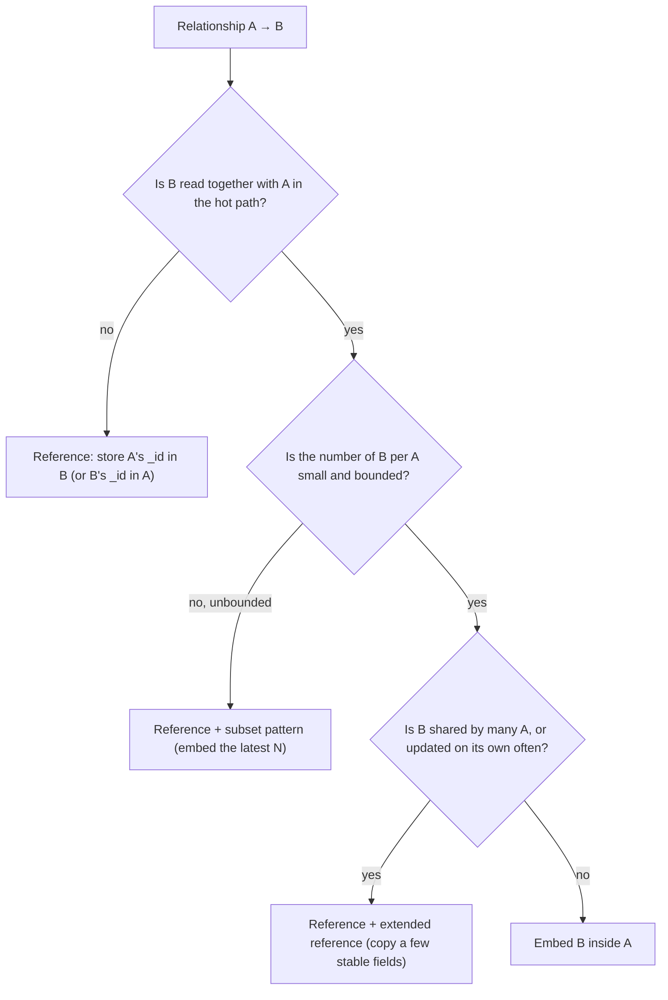

# Document Modeling

> **Module 03 · Databases** · Prerequisites: [MongoDB Fundamentals](35-MongoDB-Fundamentals.md), [Denormalization](07-Denormalization.md) · Next: [Module 03 overview](README.md)

---

## ⏱ If You Only Have 2 Minutes

- Relational design starts from the **data** (normalize, then query anything). Document design starts from the **access patterns**: list the reads and writes, their frequency, and shape documents so the hot ones touch one document.
- **Embed** what is owned, bounded and read together (an order's items). **Reference** what is shared, independently updated or unbounded (a product's reviews).
- **Unbounded arrays are the classic anti-pattern.** A document is capped at **16 MB**, every array element adds an entry to each multikey index on it, and large documents are slow to read and rewrite. Put the bound in the validator (`maxItems`).
- **The document is your free transaction.** Data that must change together — order status and its payment record — belongs in one document so one `updateOne` changes both atomically.
- Duplicated data has an **update fan-out cost**: renaming a customer means updating every document that copied the name. Copy only fields that rarely change, or that are deliberately historical snapshots (price at purchase time).
- Know the named patterns: **subset** (latest 10 reviews embedded), **extended reference** (customer name copied into the order), **computed** (rating count and sum), **bucket** (one document per product per day of events), **outlier** (overflow documents for the rare huge case), **schema versioning** (`schemaVersion` field, upgraded lazily).

---

## 1. What It Is and Why It Exists

**Document modeling** is deciding what one document contains: which data is nested inside it, which data lives in another collection and is referenced by `_id`, and which data is copied in both places on purpose.

**Analogy:** packing for a trip. Things you use together every day go in the same bag (toothbrush and toothpaste). Things that are shared by the whole family stay in one place and everyone knows where (the first-aid kit). And you never try to carry your whole library in a backpack just because the books are "yours" — that is the unbounded array.

**The problem it solves.** In PostgreSQL, a normalized schema can answer almost any question with a join, so you can design tables before you know every query (see [Normalization](06-Normalization.md)). MongoDB has `$lookup`, but it is not designed to join on every request. If you copy a relational schema table-for-collection into MongoDB, every page needs several round trips or a `$lookup`, and you get none of the benefits. If you go the other way and embed everything, documents grow without limit, hit the 16 MB cap, and a single hot document becomes a write bottleneck.

A good document model makes the common reads a single indexed lookup, makes the important invariants single-document updates, and keeps every document bounded in size.

---

## 2. How It Works

### The design process

1. **List the operations** with rough frequency and latency targets. For the shop: show an order (very frequent), list a customer's orders (frequent), show a product page with its rating and latest reviews (most frequent of all), add a review (moderate), mark an order paid (moderate), revenue report (rare, can be slow).
2. **List the relationships and their cardinality**, using numbers, not "many": a customer has 1–5 addresses; an order has 1–100 items (a few B2B orders have thousands); a product has 0 to 200,000 reviews; a customer has 0 to thousands of orders over the years.
3. **Decide embed vs reference** for each relationship (flowchart below).
4. **Apply patterns** where the simple rules leave a cost: subset, extended reference, computed, bucket, outlier.
5. **Write the validator and indexes** that enforce the model and serve the operations from step 1.
6. **Plan for change**: add a `schemaVersion` field from day one.



### The resulting e-commerce model

| Relationship | Decision | Reason |
|---|---|---|
| Customer → addresses (1–5) | Embed in `customers` | Owned, tiny, always shown with the profile |
| Customer → orders (unbounded) | Reference: `orders.customerId`, index `{ customerId: 1, createdAt: -1 }` | Grows forever; listed page by page |
| Order → items (1–100) | Embed a **snapshot** in `orders` | Owned by the order, read together, must not change when the product's price changes |
| Order → customer | Extended reference: `orders.customer: { name, email }` | Order page needs them; snapshot of "who and where we sent the receipt" |
| Order → payments (a few attempts) | Embed in `orders` | Bounded, and must change atomically with `status` |
| Product → reviews (0–200,000) | `reviews` collection + subset: latest 10 embedded in `products` | Unbounded; product page shows only the newest |
| Product → rating | Computed: `rating: { count, sum }` in `products` | Avoid aggregating 200,000 reviews per page view |
| Product → stock | Separate `inventory` collection | Hot writes on checkout should not contend with catalog reads and edits |

An order document:

```json
{
  "_id": { "$oid": "6742f1c2a9e4b1d3c8f0a111" },
  "schemaVersion": 2,
  "customerId": { "$oid": "6742f0a8a9e4b1d3c8f0a001" },
  "customer": { "name": "Ada Lovelace", "email": "ada@example.com" },
  "status": "paid",
  "items": [
    { "productId": { "$oid": "6742ef10a9e4b1d3c8f09a01" }, "sku": "BOOK-42", "name": "Designing Data", "quantity": 1, "unitPriceCents": 4500 }
  ],
  "payments": [
    { "status": "captured", "amountCents": 4500, "providerRef": "pi_3Q9x", "at": { "$date": "2026-11-24T10:16:02Z" } }
  ],
  "totalCents": 4500,
  "createdAt": { "$date": "2026-11-24T10:15:00Z" }
}
```

---

## 3. Key Concepts

### Embed vs reference rules

| Situation | Choice | Example |
|---|---|---|
| One-to-one, or one-to-few, owned | Embed | Customer addresses, order shipping address |
| One-to-many, bounded and read together | Embed, with `maxItems` in the validator | Order items (≤ 100) |
| One-to-many, unbounded ("one-to-squillions") | Reference from the child to the parent | `reviews.productId`, `orders.customerId` |
| Many-to-many | Array of `_id`s on the side that is queried, if bounded | Product → up to 20 category ids |
| Shared and frequently changed | Reference | Current product price (the catalog), not the price at purchase |

**Why unbounded arrays hurt.** A document cannot exceed 16 MB, and "customer embeds all their orders" crosses that for a busy B2B account. Long before that limit, every read loads the whole document, every `$push` makes the document bigger, and a multikey index on the array has one entry per element. Reference from the child (each order stores `customerId`) instead of keeping an ever-growing array of order ids in the parent.

### Atomicity at the document boundary

MongoDB guarantees that a single-document write is atomic. That makes the document boundary the **default transaction boundary**, and it should drive the model:

- Marking an order paid and recording the captured payment is one `updateOne({ _id, status: "pending" }, { $set: { status: "paid" }, $push: { payments: p } })`. With payments in a separate collection, you need a multi-document transaction or you risk a paid payment on a pending order.
- Stock across several products cannot live in one document. That invariant either uses a transaction or per-product conditional updates with compensation (see [MongoDB Fundamentals](35-MongoDB-Fundamentals.md)).

Ask "what must never be half-updated?" and put that data in one document.

### The six patterns

**Subset.** Embed the part of a large related set that the hot read needs. The product page shows the 10 newest reviews; the full set lives in `reviews`. Keep the subset bounded with `$push` + `$sort` + `$slice`:

```js
db.products.updateOne({ _id: productId }, {
  $push: { recentReviews: { $each: [summary], $sort: { createdAt: -1 }, $slice: 10 } },
  $inc: { "rating.count": 1, "rating.sum": 5 }
})
```

**Extended reference.** Store the referenced `_id` plus the few fields you display. The order stores `customer: { name, email }` so the order page does not join to `customers`; a review stores `customer: { _id, name }`.

**Computed.** Store a result instead of computing it on every read. The product keeps `rating.count` and `rating.sum`, updated with `$inc` when a review arrives; the average is `sum / count` at read time. The order stores `totalCents` computed at write time.

**Bucket.** Group many small, time-ordered records into one document per time window. Stock movements: one document per product per day, holding up to 500 events.

```js
db.stock_events.updateOne(
  { productId, day: ISODate("2026-11-24"), count: { $lt: 500 } },  // full bucket → no match → upsert opens a new one
  { $push: { events: { at: new Date(), delta: -2, reason: "order" } }, $inc: { count: 1 } },
  { upsert: true }
)
```

Fewer, larger documents mean fewer index entries and cheap "all events for this product today" reads. For pure measurement data, MongoDB's time series collections (5.0+) apply this bucketing internally.

**Outlier.** Design for the normal case and handle the rare huge one separately. 99.9% of orders have at most 100 items; a B2B order with 4,000 lines would break the model. Embed the first 100 items, set `hasOverflowItems: true`, and store the rest in `order_items_overflow`. Only code that sees the flag pays for the extra query.

**Schema versioning.** Every document carries `schemaVersion`. The application can read every version still in the collection, and upgrades documents **lazily** — when it reads or writes one — instead of rewriting the whole collection in one go. A background job can finish the long tail later. This is the document-database answer to the [migrations](34-Database-Migrations.md) problem, and it relies on the validator accepting old documents during the transition (`validationLevel: "moderate"`).

### The update fan-out cost

Every copy is a write you now own. If a customer changes their name:

- **Orders:** do nothing. `orders.customer` is a deliberate snapshot of who placed the order.
- **Reviews:** `updateMany({ "customer._id": id }, { $set: { "customer.name": newName } })` — cost grows with the number of reviews.
- **Product subsets:** update matching array elements with filtered positional updates:

```js
db.products.updateMany(
  { "recentReviews.customerId": id },
  { $set: { "recentReviews.$[r].customerName": newName } },
  { arrayFilters: [{ "r.customerId": id }] }
)
```

These updates are not atomic with the customer update, so readers briefly see the old name. That is fine for a display name; it is not fine for a price or a permission. The rule: **copy fields that rarely change or that are snapshots by definition**, run fan-out asynchronously (for example from a change stream or an outbox event), and make it idempotent.

### Contrast with relational normalization

[Normalization](06-Normalization.md) stores each fact once, so updates never fan out and any query is possible later. Document modeling deliberately denormalizes around the reads you know about, accepting fan-out work and less flexible ad-hoc queries. The [Denormalization](07-Denormalization.md) chapter's rule applies here too: every copy needs a named owner and an update path. The difference is that in MongoDB, embedding is the default starting point, not a later optimization.

---

## 4. Code Examples

Scenario: create the `orders` and `products` collections with `$jsonSchema` validators that enforce the bounds of the model, then run the operations the model makes cheap — customer order history, mark-paid-with-payment, add a review — and read orders written under an older schema version, upgrading them lazily.

### Node.js / TypeScript

```ts
// npm i mongodb   — Node.js 22+, TypeScript 5, ESM
import { MongoClient, type Db, type Document } from "mongodb";

const cents = { bsonType: ["int", "long"], minimum: 0 };

const orderSchema: Document = {
  bsonType: "object",
  required: ["schemaVersion", "customerId", "customer", "status", "items", "payments", "totalCents", "createdAt"],
  properties: {
    schemaVersion: { bsonType: "int", minimum: 2 },
    customerId: { bsonType: "objectId" },
    customer: { bsonType: "object", required: ["name", "email"] },   // extended reference
    status: { enum: ["pending", "paid", "shipped", "cancelled"] },
    items: {                                                         // bounded embed (outlier → overflow)
      bsonType: "array", minItems: 1, maxItems: 100,
      items: {
        bsonType: "object", required: ["productId", "sku", "name", "quantity", "unitPriceCents"],
        properties: { quantity: { bsonType: "int", minimum: 1 }, unitPriceCents: cents },
      },
    },
    payments: { bsonType: "array", maxItems: 20 },                   // same document as status: atomic
    totalCents: cents,                                               // computed at write time
    createdAt: { bsonType: "date" },
  },
};

const productSchema: Document = {
  bsonType: "object",
  required: ["sku", "name", "category", "priceCents", "rating", "recentReviews"],
  properties: {
    priceCents: cents,
    rating: { bsonType: "object", required: ["count", "sum"] },      // computed pattern
    recentReviews: { bsonType: "array", maxItems: 10 },              // subset pattern
  },
};

// "moderate": old documents that don't match yet (schemaVersion 1) can still be updated,
// which the lazy upgrade relies on; new inserts must be valid.
async function ensureCollection(db: Db, name: string, schema: Document): Promise<void> {
  const options = { validator: { $jsonSchema: schema }, validationLevel: "moderate", validationAction: "error" };
  const exists = await db.listCollections({ name }, { nameOnly: true }).hasNext();
  if (exists) await db.command({ collMod: name, ...options });
  else await db.createCollection(name, options as Document);
}

export async function setUp(client: MongoClient): Promise<void> {
  const db = client.db("shop");
  await ensureCollection(db, "orders", orderSchema);
  await ensureCollection(db, "products", productSchema);
  await db.collection("orders").createIndex({ customerId: 1, createdAt: -1 });  // order history
  await db.collection("reviews").createIndex({ productId: 1, createdAt: -1 });  // "all reviews" page
}
```

The queries the model makes cheap, and the lazy upgrade:

```ts
import { ObjectId, type Collection, type Db } from "mongodb";

type Item = { productId: ObjectId; sku: string; name: string; quantity: number; unitPriceCents: number };
type Payment = { status: "captured" | "failed"; amountCents: number; providerRef: string; at: Date };
type Base = { _id: ObjectId; customerId: ObjectId; status: string; items: Item[]; totalCents: number; createdAt: Date };
type OrderV1 = Base & { schemaVersion?: 1; customerName: string; customerEmail: string };
type OrderV2 = Base & { schemaVersion: 2; customer: { name: string; email: string }; payments: Payment[] };
type ReviewSummary = { reviewId: ObjectId; customerName: string; rating: number; createdAt: Date };
// Typing the collection lets the driver check $push targets an array field (an untyped Document rejects it).
type Product = { _id: ObjectId; rating: { count: number; sum: number }; recentReviews: ReviewSummary[] };

function upgrade(doc: OrderV1 | OrderV2): OrderV2 {
  if (doc.schemaVersion === 2) return doc;
  const { customerName, customerEmail, schemaVersion: _v1, ...rest } = doc;
  return { ...rest, schemaVersion: 2, customer: { name: customerName, email: customerEmail }, payments: [] };
}

export class OrderRepo {
  private orders: Collection<OrderV1 | OrderV2>;
  constructor(private db: Db) { this.orders = db.collection("orders"); }

  async get(id: ObjectId): Promise<OrderV2 | null> {
    const doc = await this.orders.findOne({ _id: id });   // whole order: one indexed read, no join
    if (!doc) return null;
    const order = upgrade(doc);
    if (doc.schemaVersion !== 2) {
      // Write back only if it is still v1, so a concurrent v2 write is never overwritten.
      await this.orders.updateOne(
        { _id: id, schemaVersion: { $exists: false } },
        { $set: { schemaVersion: 2, customer: order.customer, payments: [] },
          $unset: { customerName: "", customerEmail: "" } });
    }
    return order;
  }

  async history(customerId: ObjectId, limit = 20) {
    // Served by { customerId: 1, createdAt: -1 }; skip the item arrays for the list view.
    const docs = await this.orders.find({ customerId }, { projection: { items: 0, payments: 0 } })
      .sort({ createdAt: -1 }).limit(limit).toArray();
    return docs.map(upgrade);  // upgrade in memory only; list views don't pay for write-backs
  }

  async markPaid(id: ObjectId, payment: Payment): Promise<boolean> {
    // Status and payment change in one atomic single-document write; the filter guards the transition.
    const res = await this.orders.updateOne(
      { _id: id, status: "pending" },
      { $set: { status: "paid" }, $push: { payments: payment } });
    return res.modifiedCount === 1;
  }

  async addReview(productId: ObjectId, customer: { _id: ObjectId; name: string }, rating: number, body: string) {
    const review = { _id: new ObjectId(), productId, customer, rating, body, createdAt: new Date() };
    await this.db.collection("reviews").insertOne(review);  // source of truth
    // Derived copies (subset + computed). Not atomic with the insert; a repair job can rebuild them.
    await this.db.collection<Product>("products").updateOne({ _id: productId }, {
      $inc: { "rating.count": 1, "rating.sum": rating },
      $push: { recentReviews: { $each: [{ reviewId: review._id, customerName: customer.name, rating,
        createdAt: review.createdAt }], $sort: { createdAt: -1 }, $slice: 10 } },
    });
  }
}
```

### Python

```python
# pip install pymongo   — Python 3.12+
from pymongo import ASCENDING, DESCENDING
from pymongo.database import Database

CENTS = {"bsonType": ["int", "long"], "minimum": 0}

ORDER_SCHEMA = {
    "bsonType": "object",
    "required": ["schemaVersion", "customerId", "customer", "status", "items",
                 "payments", "totalCents", "createdAt"],
    "properties": {
        "schemaVersion": {"bsonType": "int", "minimum": 2},
        "customerId": {"bsonType": "objectId"},
        "customer": {"bsonType": "object", "required": ["name", "email"]},  # extended reference
        "status": {"enum": ["pending", "paid", "shipped", "cancelled"]},
        "items": {                                    # bounded embed; >100 lines go to overflow
            "bsonType": "array", "minItems": 1, "maxItems": 100,
            "items": {
                "bsonType": "object",
                "required": ["productId", "sku", "name", "quantity", "unitPriceCents"],
                "properties": {"quantity": {"bsonType": "int", "minimum": 1}, "unitPriceCents": CENTS},
            },
        },
        "payments": {"bsonType": "array", "maxItems": 20},
        "totalCents": CENTS,
        "createdAt": {"bsonType": "date"},
    },
}

PRODUCT_SCHEMA = {
    "bsonType": "object",
    "required": ["sku", "name", "category", "priceCents", "rating", "recentReviews"],
    "properties": {
        "priceCents": CENTS,
        "rating": {"bsonType": "object", "required": ["count", "sum"]},
        "recentReviews": {"bsonType": "array", "maxItems": 10},
    },
}


def ensure_collection(db: Database, name: str, schema: dict) -> None:
    # "moderate" lets v1 documents that fail the new rules still be updated (lazy upgrade).
    options = {"validator": {"$jsonSchema": schema}, "validationLevel": "moderate",
               "validationAction": "error"}
    if name in db.list_collection_names(filter={"name": name}):
        db.command({"collMod": name, **options})
    else:
        db.create_collection(name, **options)


def set_up(db: Database) -> None:
    ensure_collection(db, "orders", ORDER_SCHEMA)
    ensure_collection(db, "products", PRODUCT_SCHEMA)
    db["orders"].create_index([("customerId", ASCENDING), ("createdAt", DESCENDING)])
    db["reviews"].create_index([("productId", ASCENDING), ("createdAt", DESCENDING)])
```

The queries and the lazy upgrade:

```python
from datetime import datetime, timezone

from bson import ObjectId
from pymongo import DESCENDING
from pymongo.database import Database


def upgrade(doc: dict) -> dict:
    if doc.get("schemaVersion") == 2:
        return doc
    upgraded = {k: v for k, v in doc.items() if k not in ("customerName", "customerEmail")}
    upgraded |= {"schemaVersion": 2, "payments": [],
                 "customer": {"name": doc["customerName"], "email": doc["customerEmail"]}}
    return upgraded


class OrderRepo:
    def __init__(self, db: Database) -> None:
        self.db, self.orders = db, db["orders"]

    def get(self, order_id: ObjectId) -> dict | None:
        doc = self.orders.find_one({"_id": order_id})
        if doc is None:
            return None
        order = upgrade(doc)
        if doc.get("schemaVersion") != 2:
            # Conditional write-back: a no-op if another request already upgraded or rewrote it.
            self.orders.update_one(
                {"_id": order_id, "schemaVersion": {"$exists": False}},
                {"$set": {"schemaVersion": 2, "customer": order["customer"], "payments": []},
                 "$unset": {"customerName": "", "customerEmail": ""}})
        return order

    def history(self, customer_id: ObjectId, limit: int = 20) -> list[dict]:
        cursor = (self.orders.find({"customerId": customer_id}, {"items": 0, "payments": 0})
                  .sort("createdAt", DESCENDING).limit(limit))
        return [upgrade(d) for d in cursor]  # in memory only; list views skip the write-back

    def mark_paid(self, order_id: ObjectId, payment: dict) -> bool:
        # One document holds status and payments, so no transaction is needed.
        res = self.orders.update_one({"_id": order_id, "status": "pending"},
                                     {"$set": {"status": "paid"}, "$push": {"payments": payment}})
        return res.modified_count == 1

    def add_review(self, product_id: ObjectId, customer: dict, rating: int, body: str) -> None:
        now = datetime.now(timezone.utc)
        review = {"productId": product_id, "customer": customer, "rating": rating,
                  "body": body, "createdAt": now}
        review_id = self.db["reviews"].insert_one(review).inserted_id
        summary = {"reviewId": review_id, "customerName": customer["name"],
                   "rating": rating, "createdAt": now}
        self.db["products"].update_one({"_id": product_id}, {
            "$inc": {"rating.count": 1, "rating.sum": rating},
            "$push": {"recentReviews": {"$each": [summary], "$sort": {"createdAt": -1}, "$slice": 10}},
        })
```

**Language difference to notice.** In TypeScript, the union type `OrderV1 | OrderV2` makes the compiler force every caller through `upgrade()` before touching `customer`; forgetting it is a type error. In Python the documents are plain `dict`s, so the same guarantee needs discipline or a Pydantic model per version (`OrderV1`, `OrderV2`) validated at the repository boundary. Note also that `upgrade` must tolerate projected documents: the history query drops `items` and `payments`, which is why the upgrade only touches the customer fields and never assumes the rest is present.

---

## 5. Production Concerns

- **Watch document size.** Track the largest documents per collection with `$bsonSize` in an aggregation (`{ $project: { size: { $bsonSize: "$$ROOT" } } }`, then sort). A collection whose maximum keeps growing has an unbounded array somewhere. The 16 MB limit is a hard error at write time, usually discovered by your biggest customer on a Friday.
- **Enforce bounds in the database.** `maxItems` in the validator turns "an order has at most 100 items" from a comment into a rule. Without it, one bulk import breaks the outlier assumption silently.
- **Roll out validators carefully.** Adding a stricter validator to a collection with old documents can make normal updates fail. Start with `validationAction: "warn"` and read the server log, or use `validationLevel: "moderate"` while old versions remain.
- **Fan-out jobs.** Run copy updates asynchronously, idempotently, and with batching for large fan-outs (`updateMany` over millions of reviews is a long write). Measure fan-out lag, and decide per field whether readers may see the old value for that long.
- **Derived data repair.** Subsets and computed fields (`recentReviews`, `rating`) can drift if a write fails between the source insert and the derived update. Keep a job that rebuilds them from the source collection, and make it safe to run any time.
- **Schema version progress.** Count documents per `schemaVersion`. When the old version reaches zero (lazy upgrades plus a background job for the cold tail), delete the upgrade code and tighten the validator.
- **Hot documents.** Embedding stock in the product document would put every checkout's write on the same document the catalog reads and edits; concurrent writes to one document conflict and retry. Separate data with very different write rates, even when it is read together.

---

## 6. Common Mistakes

- **One collection per relational table** — every page needs `$lookup` or several round trips — model from access patterns; embed what is read together.
- **Embedding an unbounded list** (all orders in the customer, all reviews in the product) — documents grow toward 16 MB and every read gets slower — reference from the child, and use the subset pattern for the part the page shows.
- **Embedding a live copy of shared, frequently changing data** — product price copied into carts and wishlists goes stale on every price change — reference it, or copy only as a purchase-time snapshot.
- **Splitting data that must change together** — status in `orders`, payment in `payments`, and a crash between the writes leaves a paid order "pending" — keep it in one document so one update is atomic.
- **Duplicating fields without an update path** — a renamed customer shows two names across the site forever — give every copy an owner and a fan-out job, or don't copy.
- **Rewriting the whole collection for every schema change** — a long, risky batch job — add `schemaVersion`, upgrade lazily on read/write, and finish the tail in the background.
- **Designing for the outlier** — modeling every order as if it had 4,000 lines makes the common case slower — use the outlier pattern with an overflow collection and a flag.

---

## 7. Comparison Table

| | Embed | Reference (+ extended reference) | Relational, normalized |
|---|---|---|---|
| Read of the aggregate | One document | Two queries or `$lookup` (fewer with copied fields) | Join across tables |
| Atomic update without a transaction | Whole aggregate | One document only | One statement, or a transaction (cheap in PostgreSQL) |
| Growth limit | 16 MB per document; must be bounded | None | None |
| Duplicated data | None, or snapshots | Copied fields need fan-out updates | None (until you [denormalize](07-Denormalization.md)) |
| Ad-hoc queries later | Harder; shaped for known reads | Moderate | Easiest |
| Best for | Owned, bounded, read-together data (order items) | Shared or unbounded data (customers, reviews) | Many-to-many data, cross-entity invariants, reporting |

---

## 8. Interview Questions

**[Junior] When do you embed and when do you reference?**
Embed data that belongs to the parent, has a small and known upper bound, and is read with it — an order's items or a customer's few addresses. Reference data that is shared by many parents, changes on its own, or can grow without limit — a product's reviews or a customer's orders. When the hot read needs a couple of fields from a referenced document, copy just those (extended reference).

**[Junior] Why are unbounded arrays a problem?**
A document has a hard 16 MB limit, so an array that grows with time will eventually make writes fail. Before that, every read loads the whole array, updates get bigger, and a multikey index stores one entry per element. Reference from the child instead, and embed only a bounded subset if the page needs it.

**[Mid] How would you model products and their reviews?**
Reviews go in their own collection with `productId` and an index on `{ productId: 1, createdAt: -1 }`, because a product can have hundreds of thousands. The product document embeds the latest 10 reviews (subset pattern, maintained with `$push` + `$sort` + `$slice`) and a computed `rating: { count, sum }`. The product page is then one read; "see all reviews" pages through the reviews collection.

**[Mid] What is the extended reference pattern, and what does it cost?**
You store a referenced document's `_id` plus a few of its fields, such as the customer's name and email in each order, so reads do not need a join. The cost is update fan-out: when the source changes, every copy must be updated, not atomically, so readers can briefly see old values. It works well for fields that rarely change or are meant to be snapshots, like the email a receipt was sent to.

**[Mid] How do you change a document schema without downtime?**
Add a `schemaVersion` field. Deploy code that reads every version still present and converts old ones in memory, then writes them back in the new format with a conditional update when it touches them. A background job upgrades documents nobody reads. Use a validator with `validationLevel: "moderate"` during the transition, and remove the old-version code when the count of old documents reaches zero.

**[Senior] How does atomicity influence your document model?**
Without a transaction, the only atomic unit is one document, so I put data that must never be half-updated in the same document — for example, order status and the payments array, so "mark paid and record the capture" is a single conditional `updateOne`. Invariants that span documents, like stock for several products, need a multi-document transaction or conditional updates with compensation. If too many important operations need transactions, that is a sign the document boundaries are wrong or the data is better suited to a relational database.

**[Senior] A customer can change their display name, and it is copied into orders, reviews and product review subsets. What do you do?**
First decide per copy: orders keep the old name, because the order is a historical record. Reviews and the product subsets show the current name, so a change triggers an asynchronous, idempotent fan-out job: `updateMany` on reviews, and a filtered positional update (`$[r]` with `arrayFilters`) on products. I accept a short window of stale names and monitor fan-out lag. If the field changed often or had to be consistent immediately, I would stop copying it and look it up instead.

**[Senior] Your biggest B2B customer's orders hit the 16 MB limit. What happened and how do you fix it?**
Something in the order is unbounded — likely items for very large orders, or an events/history array that grows over the order's life. Short term, apply the outlier pattern: keep the first N items embedded, set a flag, and move the rest to an overflow collection; move growing histories to a separate collection or a bucket per time window. Then add `maxItems` to the validator and a size metric (`$bsonSize`) so the bound is enforced and visible, and backfill existing large documents in batches.

---

## 9. Cheat Sheet

```text
Start from       operations + frequency + cardinality with real numbers
Embed            owned, bounded, read together (order items, addresses, payments of an order)
Reference        shared, independently updated, or unbounded (customer → orders, product → reviews)
Hard limit       16 MB per document; enforce bounds with maxItems in $jsonSchema
Atomicity        one document = free transaction → keep must-change-together data in one doc
Subset           embed latest N: $push {$each, $sort, $slice: N}
Extended ref     _id + a few stable fields (customer name/email in order)
Computed         store count/sum/total at write time; $inc on change
Bucket           one doc per entity per time window, capped count; upsert opens next bucket
Outlier          design for the normal case; overflow collection + flag for the rare huge one
Versioning       schemaVersion field; upgrade lazily with conditional write-back; validationLevel moderate
Fan-out          every copy needs an owner + async idempotent updateMany / arrayFilters
Snapshots        price and address at purchase are history — never fan out to them
Smell            $lookup on every request → model doesn't match the access pattern
```

---

## Related Topics

- [MongoDB Fundamentals](35-MongoDB-Fundamentals.md) — update operators, indexes, validators and transactions used by these models
- [Normalization](06-Normalization.md) — the relational approach this chapter contrasts with
- [Denormalization](07-Denormalization.md) — owning copies and keeping them correct
- [Database Migrations](34-Database-Migrations.md) — schema evolution in the relational world
- [Data Modeling (Module 07)](../Module-07-Advanced-Backend-and-System-Design/13-Data-Modeling.md) — modeling for scale across services and stores
