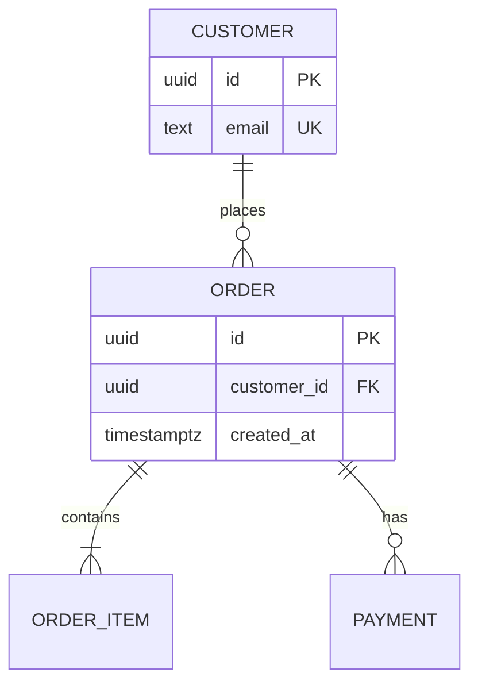
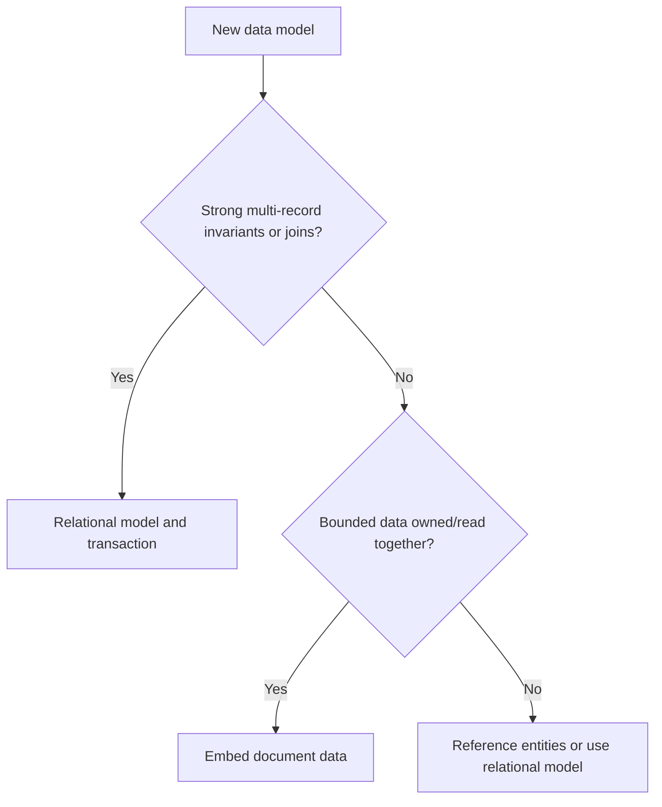
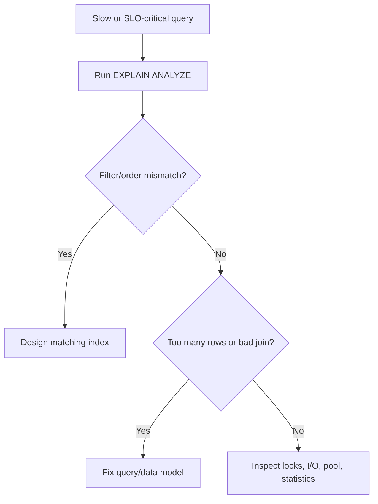

# Module 3: Databases — Full Revision Guide

This guide explains the Module 3 story: choose a data model from business invariants and access patterns, design a schema, write safe queries, make common queries fast with measured indexes, and preserve correctness under concurrent transactions.

## Essential Definitions

| Term | Meaning | Why it matters |
|---|---|---|
| Relational database | Data stored in related tables with constraints and SQL queries. | Strong fit for transactions, joins, and durable invariants. |
| NoSQL database | Broad family of non-relational stores, such as document/key-value/column/graph databases. | Useful when its data model or scale trade-offs fit the workload. |
| Schema | Structure, types, constraints, and relationships of stored data. | A schema is an executable version of business rules. |
| Primary key | Stable unique identifier for a row. | Enables identity, relations, and efficient lookup. |
| Foreign key | Constraint requiring a referenced row to exist. | Preserves referential integrity. |
| Normalization | Splitting facts to reduce duplication and update anomalies. | Makes writes and invariants easier to keep correct. |
| Denormalization | Intentionally duplicating/precomputing data for read performance. | Adds write/reconciliation complexity. |
| Index | Extra ordered/searchable structure over table data. | Speeds matching reads but costs writes, storage, and maintenance. |
| Selectivity | How strongly a predicate filters rows. | Selective predicates benefit more from ordinary indexes. |
| Query plan | Physical operations the database chooses to execute SQL. | The same SQL can be fast or slow depending on data and indexes. |
| Transaction | All-or-nothing unit of database work. | Protects a business invariant across multiple statements. |
| ACID | Atomicity, consistency, isolation, durability. | Vocabulary for database guarantees. |
| MVCC | Multiple versions of rows visible to concurrent readers/writers. | Lets many reads avoid blocking writes in PostgreSQL. |
| Isolation level | Rules for which concurrent changes a transaction may observe. | Determines anomalies and retry requirements. |
| Lock | Coordination mechanism that prevents conflicting operations. | Can protect correctness but can wait or deadlock. |
| Migration | Versioned schema/data change. | Lets databases evolve safely with application deployments. |
| ORM | Object-relational mapper that maps objects to SQL operations. | Speeds common work but does not remove query/transaction responsibility. |

---

## Part 1: Choosing a Database and Modeling Data

### SQL vs NoSQL

Choose from the workload, not a slogan.

| Need | Typical choice | Example |
|---|---|---|
| Payments, bookings, inventory | PostgreSQL | A unique payment id and transaction protect a ledger. |
| Flexible aggregate-shaped content | MongoDB | A product document embeds a frequently read, rarely changed specification. |
| Short-lived cache/rate limit/queue state | Redis | A token bucket counter has a TTL and atomic increment. |
| Large blobs | Object storage | An upload record lives in PostgreSQL; file bytes live in S3. |

### CAP and consistency

CAP applies **when a network partition exists**. A distributed store cannot simultaneously guarantee fully available responses and linearizable consistency under that partition.

- Choose stronger consistency for money, uniqueness, ownership, and safety-critical state.
- Accept eventual consistency for feeds, analytics, search indexes, notifications, and derived projections—when the product can show a pending/stale state.

### Schema design

Start with:

1. Entities: `customer`, `order`, `order_item`, `payment`.
2. Cardinality: one customer has many orders; one order has many items.
3. Ownership: an order owns its shipping address snapshot; a customer profile is shared.
4. Invariants: order number unique; quantity positive; payment amount non-negative.
5. Queries: newest orders by customer, lookup by payment provider ID, revenue by day.



### Normalization and denormalization

Normalize source-of-truth data:

```text
orders(order_id, customer_id, created_at)
order_items(order_id, sku, quantity, unit_price)
```

Do not copy customer email into every item unless a real historical/reporting need exists.

Denormalize only after measurement:

```text
daily_sales(day, tenant_id, gross_amount)
```

This projection makes dashboards cheap, but now a worker or refresh process must keep it correct and expose freshness.

**Shortcut:** normalize for correctness; denormalize for a measured read path with explicit ownership.

---

## Part 2: SQL Fundamentals

### DDL vs DML

- **DDL:** defines structure: `CREATE TABLE`, `ALTER TABLE`, constraints, indexes.
- **DML:** changes/query data: `INSERT`, `UPDATE`, `DELETE`, `SELECT`.

```sql
CREATE TABLE orders (
  id uuid PRIMARY KEY,
  customer_id uuid NOT NULL REFERENCES customers(id),
  status text NOT NULL CHECK (status IN ('pending', 'paid', 'cancelled')),
  created_at timestamptz NOT NULL DEFAULT now()
);
```

Constraints are not optional decoration. They make invalid states impossible even when multiple application replicas race.

### JOINs, subqueries, and aggregates

The main interview danger is **cardinality**.

```sql
SELECT o.id, count(oi.sku) AS line_count
FROM orders o
JOIN order_items oi ON oi.order_id = o.id
WHERE o.customer_id = $1
GROUP BY o.id;
```

Before writing a join, ask:

- Is this one-to-one, one-to-many, or many-to-many?
- Can the join duplicate facts?
- Does a missing related row need `INNER JOIN` or `LEFT JOIN`?

Use `EXISTS` for “does a related row exist?” when you do not need its columns:

```sql
SELECT c.id
FROM customers c
WHERE EXISTS (
  SELECT 1 FROM orders o WHERE o.customer_id = c.id AND o.status = 'paid'
);
```

### Window functions and CTEs

Window functions calculate across related rows without collapsing them:

```sql
SELECT customer_id, created_at,
       row_number() OVER (PARTITION BY customer_id ORDER BY created_at DESC) AS order_rank
FROM orders;
```

CTEs improve readability and recursion, but do not assume they improve performance; inspect the plan.

**Shortcut:** `GROUP BY` reduces rows; a window function keeps rows and adds context.

---

## Part 3: Indexes, Plans, and Query Optimization

### Index basics

A B-tree index is effective for equality, ranges, and compatible ordering.

```sql
CREATE INDEX orders_customer_created_idx
ON orders (customer_id, created_at DESC, id DESC);
```

This matches:

```sql
SELECT id, status, created_at
FROM orders
WHERE customer_id = $1
ORDER BY created_at DESC, id DESC
LIMIT 50;
```

### Composite and covering indexes

- Put equality predicates first.
- Then range/order columns.
- Use `INCLUDE` for projected columns when index-only scans are valuable.
- Remember: every index adds write amplification.

### Read the plan

```sql
EXPLAIN (ANALYZE, BUFFERS)
SELECT ...
```

Check:

- estimated rows vs actual rows;
- time and loops;
- sequential scan vs index scan;
- join algorithm;
- sort/hash memory and disk spill;
- shared buffer hits/reads.

Do not “fix” a sequential scan just because it appears. Reading most of a small table can be correct.

### Pagination

Offset:

```sql
SELECT ... ORDER BY created_at DESC LIMIT 50 OFFSET 10000;
```

Problems: deep scans and page drift while rows are inserted/deleted.

Keyset:

```sql
SELECT ...
FROM orders
WHERE customer_id = $1
  AND (created_at, id) < ($2, $3)
ORDER BY created_at DESC, id DESC
LIMIT 50;
```

The cursor encodes the last `(created_at, id)` pair. It needs a matching index and opaque signing/encoding at the API boundary.

---

## Part 4: Transactions and Concurrency

### ACID in product language

| Property | Practical meaning |
|---|---|
| Atomicity | An order and its inventory reservation both commit or neither does. |
| Consistency | Constraints/invariants hold at transaction boundaries. |
| Isolation | Concurrent operations do not observe prohibited intermediate states. |
| Durability | A committed payment survives a crash according to configured durability guarantees. |

### Atomic write beats read-check-write

Unsafe:

```text
read available = 1
if available > 0: update available = 0
```

Two requests can both read `1`.

Safe:

```sql
UPDATE inventory
SET available = available - $2
WHERE sku = $1 AND available >= $2
RETURNING available;
```

The predicate and update occur atomically.

### Isolation levels

- **Read committed:** PostgreSQL default; each statement sees committed data at statement start.
- **Repeatable read:** transaction sees a stable snapshot; serialization-style anomalies still need understanding.
- **Serializable:** database rejects transactions that could not have run as if serial; application retries the whole transaction.

### Locks and deadlocks

Locks are necessary, but transactions can deadlock:

```text
T1 locks order, waits for inventory
T2 locks inventory, waits for order
```

Prevent through a consistent lock order. Still handle database deadlock/serialization errors with bounded retries at the transaction boundary.

**Never:** hold a transaction open while calling an HTTP/payment/email service.

---

## Part 5: ORM, Migrations, and MongoDB

### ORM fundamentals

An ORM maps objects to SQL; it does not remove database behavior.

Watch for:

- N+1 queries from lazy loading;
- accidental huge result sets;
- hidden transaction boundaries;
- ORM-generated migrations that lock tables;
- treating an object graph as the database schema.

Enable SQL/query-duration logging in non-sensitive environments and inspect generated queries.

### Migrations

Use expand/backfill/contract:

1. Add nullable column/table/index compatible with old code.
2. Deploy code that writes both forms when necessary.
3. Backfill in bounded batches.
4. Switch reads.
5. Remove old field only after all old versions are gone.

### MongoDB document modeling

Embed when data is owned, bounded, and read together:

```json
{
  "_id": "order-1",
  "shipping_address": {"city": "Paris"},
  "items": [{"sku": "book-42", "quantity": 1}]
}
```

Reference when data is shared, independently updated, or unbounded:

```json
{"_id": "order-1", "customer_id": "customer-1"}
```

MongoDB still needs indexes, capacity limits, replication planning, and a clear consistency model.

---

## Module 3 Shortcuts

### Modeling

- Start with invariants, ownership, cardinality, and queries.
- Use constraints for durable rules.
- Normalize source-of-truth writes; denormalize measured read models.
- Choose SQL/NoSQL from workload and guarantees.

### SQL and performance

- Bind query parameters.
- Check join cardinality.
- Use `EXPLAIN (ANALYZE, BUFFERS)` with representative data.
- Composite index order follows equality, range, and sort use.
- Indexes speed reads and slow writes.
- Prefer keyset pagination for deep/mutable feeds.

### Transactions

- Keep transactions short.
- Use atomic statements/constraints for contested state.
- Retry deadlock/serialization errors safely.
- Do not call remote services while holding locks.
- Test restore, migration, concurrency, and failure paths.

## Next Files

- [Schema Design](05-Schema-Design.md)
- [SQL JOINs](10-SQL-JOINs.md)
- [Indexes](19-Indexes.md)
- [Query Execution Plans](22-Query-Execution-Plans.md)
- [Transactions](27-Transactions.md)
- [MongoDB Fundamentals](35-MongoDB-Fundamentals.md)

---

## Two-Minute Recap

- Model data from invariants, ownership, cardinality, and access patterns.
- Constraints are durable rules; application checks alone race across replicas.
- Normalize source-of-truth writes; denormalize only for measured read paths.
- Parameterize SQL; never concatenate user values into a query.
- Read join cardinality before trusting aggregate results.
- Index actual filter/order shapes; every index costs writes and storage.
- Use `EXPLAIN (ANALYZE, BUFFERS)` with representative data.
- Offset pagination scans/drifts at depth; cursor pagination needs stable ordering and an index.
- Keep transactions short and never call remote services while locks are held.
- Deadlocks and serialization failures are expected retry cases, not mysterious database bugs.
- Use expand/backfill/contract migrations for rolling deployments.
- ORMs map objects to SQL; they do not remove query-plan, transaction, or N+1 responsibility.

## Decision Trees

### SQL or document model?



| Choose | When | Watch for |
|---|---|---|
| PostgreSQL | Transactions, joins, constraints, reporting, evolving relationships | Bad query shapes, lock duration, migration compatibility |
| MongoDB document | Aggregate-shaped bounded data read/written together | Unbounded arrays, duplicated shared data, missing indexes |
| Redis | Cache, rate limit, ephemeral coordination, streams | Treating cache as source of truth or ignoring memory/TTL |

### Add an index?



Do not add an index because a column “looks important.” First identify the query, frequency, result size, plan, data distribution, write cost, and desired ordering.

## Interview Answer Templates

### 30-second database answer

> “The invariant is `<rule>`. I would enforce it with `<constraint/atomic update/transaction>`. The main concurrency risk is `<race/lock/lag>`, so I would `<mitigation>`. I would monitor `<plan/lock/pool/latency metric>`.”

Example:

> “Inventory cannot become negative. I would use an atomic conditional update plus a check constraint. The risk is concurrent reservation, so I avoid read-check-write. I would monitor lock waits, failed reservation rate, and query p99.”

### Two-minute query optimization answer

1. State the query’s user path and latency target.
2. Show the logical query and expected cardinality.
3. Inspect `EXPLAIN (ANALYZE, BUFFERS)` on representative data.
4. Explain plan bottleneck: scan, join, sort, estimates, I/O, lock, or result size.
5. Change query/index/schema only for that bottleneck.
6. Measure write cost, storage, and rollout/migration risk.

### Senior migration answer

> “I would use expand/backfill/contract: add compatible schema, deploy compatible writers/readers, backfill in bounded batches, verify, switch reads, then remove old state after all old versions are gone. I would measure lock duration, replication lag, backfill rate, errors, and keep rollback possible.”

## Failure Scenarios: Symptom → Investigation → Fix

| Symptom | Likely cause | Investigate | Safe fix |
|---|---|---|---|
| Slow endpoint after data growth | Sequential/deep scan or bad cardinality estimate | `EXPLAIN ANALYZE`, buffers, statistics, row counts | Adjust query/index/statistics; benchmark write cost |
| Negative inventory | Read-check-write race | Concurrent request traces and SQL sequence | Atomic conditional update plus constraint |
| Deadlock errors | Conflicting lock order | PostgreSQL deadlock log, transaction order | Standardize order; keep transactions short; retry victim |
| Connection timeouts | Pool exhaustion or slow transaction | Pool gauge, `pg_stat_activity`, query latency | Set timeout, reduce hold time, cap concurrency, tune pool |
| Dashboard wrong after denormalization | Projection update/replay failed | Compare source tables with projection freshness | Add replay/reconciliation and projection ownership |
| Migration blocks writes | Table rewrite/long lock | Migration plan, lock waits, release timing | Expand-contract, concurrent index where appropriate, maintenance plan |

## Common Anti-patterns

| Anti-pattern | Why it fails | Preferred approach |
|---|---|---|
| `SELECT *` in API path | Transfers/couples unnecessary columns | Select required fields explicitly |
| ORM lazy loop | N+1 queries scale with result count | Batch/eager load or use a set-based query |
| `OFFSET 100000` feed | Deep scan plus page drift | Keyset cursor with matching composite index |
| Index every column | Slow writes and bloated storage | Index measured high-value query shapes |
| Distributed transaction over HTTP | Long locks and uncertain remote state | Local transaction plus outbox/Saga/reconciliation |
| Big destructive migration | Breaks rolling versions and can lock data | Expand, backfill, validate, contract |

## Flashcards

| Question | Answer |
|---|---|
| What is selectivity? | How strongly a predicate filters rows. |
| Why does composite index order matter? | B-tree access follows leftmost-prefix/equality-range-order behavior. |
| What does `EXPLAIN ANALYZE` add? | Actual row counts, timing, loops, and execution evidence. |
| What protects a durable uniqueness rule? | A unique constraint, not a prior application lookup. |
| Why retry a deadlock? | The database aborts one correct transaction to break a wait cycle. |
| `GROUP BY` vs window function? | Grouping collapses rows; windows retain rows and add partition context. |
| Why keyset pagination? | Stable/deep pagination without scanning prior offsets. |
| What is MVCC? | Concurrent row versions that reduce reader/writer blocking. |
| When embed a document? | Data is bounded, owned, and read/written together. |
| Why does an ORM not remove database work? | It still emits SQL, uses transactions, and can produce N+1 queries. |

## When to Use / When Not to Use

| Technique | Use it when | Do not use it when |
|---|---|---|
| Normalization | Facts change independently and invariants matter | A measured read model needs a controlled duplicate projection |
| Materialized view | Expensive derived read can tolerate managed freshness | Users need latest source data per request |
| `EXISTS` | You only need to test related-row existence | You need columns from the related relation |
| Pessimistic lock | Contention is high and retry cost is unacceptable | Long business workflows include remote calls |
| Optimistic version check | Conflicts are rare and retries are cheap | Conflicts are common/high-cost |
| Stored procedure | Database-local logic/security/latency justify it | It hides broad application workflow and becomes hard to version/test |

## End-to-End Case Study: Reserve Inventory and Create an Order

1. API receives order request with idempotency key.
2. Service starts a short PostgreSQL transaction.
3. Atomic `UPDATE inventory ... WHERE available >= quantity` reserves stock.
4. Service inserts order; unique idempotency constraint protects retries.
5. Service inserts `order.created` outbox row.
6. Transaction commits; API returns order result.
7. Relay publishes outbox event; workers update projections/notifications idempotently.
8. Dashboard monitors transaction duration, lock waits, failed reservations, pool use, outbox lag, and projection freshness.

**Key lesson:** PostgreSQL protects the immediate invariant. Asynchronous projections can be eventually consistent because they are not the source of truth.

## Debugging Commands and Evidence

```sql
-- Find active work and waits
SELECT pid, state, wait_event_type, wait_event, query
FROM pg_stat_activity
WHERE state <> 'idle';

-- Inspect locks during contention
SELECT locktype, mode, granted, pid
FROM pg_locks;

-- Measure a real query plan
EXPLAIN (ANALYZE, BUFFERS)
SELECT id, created_at
FROM orders
WHERE customer_id = $1
ORDER BY created_at DESC, id DESC
LIMIT 50;
```

Collect query shape, parameter cardinality bucket, plan, actual rows, buffers, lock wait, pool use, deployment/migration version, and business impact before changing an index.

## Self-Test Checklist

You are ready to move on when you can:

- [ ] Model a small order/payment schema with keys, constraints, and cardinality.
- [ ] Explain normalization versus denormalization with an ownership/reconciliation rule.
- [ ] Write and reason about inner/left joins, aggregates, windows, and `EXISTS`.
- [ ] Read the important nodes of an `EXPLAIN ANALYZE` plan.
- [ ] Design a composite index for filter plus ordering.
- [ ] Explain transaction, isolation, lock, deadlock, and retry behavior.
- [ ] Plan an expand/backfill/contract migration.
- [ ] Defend PostgreSQL versus MongoDB for a stated access pattern.

## Cross-Module Study Links

- Module 2: [Service Layer Pattern](../Module-02-Core-Backend/13-Service-Layer-Pattern.md), [Asynchronous Processing](../Module-02-Core-Backend/19-Asynchronous-Processing.md)
- Module 4: [Race Conditions](../Module-04-Operating-Systems/13-Race-Conditions.md), [Deadlocks](../Module-04-Operating-Systems/18-Deadlocks.md)
- Module 5: [Hash Tables](../Module-05-Data-Structures-and-Algorithms/11-Hash-Tables.md), [Trees](../Module-05-Data-Structures-and-Algorithms/15-Trees.md)
- Module 7: [Data Modeling](../Module-07-Advanced-Backend-and-System-Design/13-Data-Modeling.md), [Replication](../Module-07-Advanced-Backend-and-System-Design/18-Replication.md)
- Module 9: [Integration Testing](../Module-09-Testing-and-Code-Quality/05-Integration-Testing.md)

## Interview Drills

1. **Design a booking system that must not double-book a room.** Explain schema, constraints, transaction/isolation choice, retry behavior, and monitoring.
2. **A query is fast in staging but slow in production.** Explain cardinality, data distribution, `EXPLAIN ANALYZE`, indexes, I/O, and safe rollout.
3. **Migrate a `users.email` field to a new identity table without downtime.** Explain expand/backfill/contract and rollback.
4. **Choose PostgreSQL versus MongoDB for an order system.** Explain relationships, transactions, reporting, document ownership, indexes, and operational trade-offs.
