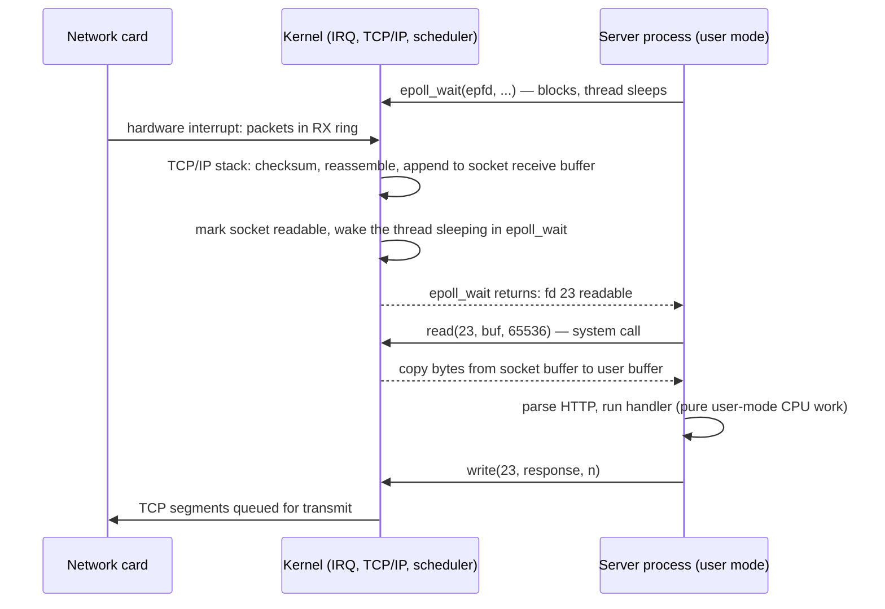

# Operating Systems Fundamentals

> **Module 04 · Operating Systems** · Prerequisites: [Module 04 overview](README.md) · Next: [Processes](02-Processes.md)

---

## ⏱ If You Only Have 2 Minutes

- The **kernel** is the only code that runs in privileged mode (ring 0 on x86-64, EL1 on ARM64). Your Node or Python server runs in **user mode** (ring 3 / EL0) and must ask the kernel, through a **system call**, for anything that touches hardware, another process, or shared state: files, sockets, memory, new processes.
- The kernel's jobs: schedule processes and threads, give each process its own virtual memory, run the file systems, drive devices, implement the TCP/IP stack, and enforce security (users, capabilities, seccomp, namespaces).
- There are three ways into the kernel: **system calls** (you ask), **exceptions** (your code caused something, such as a page fault) and **hardware interrupts** (a device or the timer needs attention). The timer interrupt is what lets the scheduler take the CPU away from a busy loop.
- Linux is the server OS. Its `/proc` and `/sys` file systems expose kernel state as text files, so `cat /proc/self/status` tells you what the kernel knows about a process.
- A **container is not a VM**. It is ordinary processes on the host kernel, isolated with **namespaces** (what a process can see) and limited with **cgroups** (what it can use). `uname -r` inside a container prints the host's kernel version.
- Exceeding the cgroup **memory** limit gets a process killed by the OOM killer (`SIGKILL`, exit code 137). Exceeding the **CPU** quota does not kill anything; the cgroup is **throttled** until the next period (100 ms by default), which shows up as p99 latency spikes.
- `os.cpu_count()` in Python and `os.cpus().length` in Node report the host's CPUs, not your container's quota. Read `/sys/fs/cgroup/cpu.max` before sizing a worker pool.

---

## 1. What It Is and Why It Exists

An **operating system** is the software layer between programs and hardware. It has two parts. The **kernel** is the privileged core that owns the CPU, memory and devices. **User space** is everything else: the C library (`glibc` or `musl`), the shell, system tools, and your Node or Python runtime.

**Analogy:** a large hotel. Guests (processes) each get a room (their own memory) and believe the building is theirs. They cannot walk into the kitchen, the boiler room, or another guest's room. When they need something, they call the front desk (a system call). The front desk checks who is calling, does the work, and decides whose request is handled next. The fire alarm (an interrupt) can stop the front desk mid-sentence.

**The problem it solves.** Without a kernel, every program would need its own network card driver, could overwrite any other program's memory, and could freeze the machine with one infinite loop. The kernel gives you three things:

- **Abstraction.** `write(fd, buf, n)` works the same for a file on NVMe, a TCP socket and a pipe.
- **Isolation and protection.** One process cannot read another's memory or a file it has no permission for. A crash kills one process, not the machine.
- **Multiplexing.** Hundreds of processes share a few CPU cores, one network card and one disk, and each gets a fair share.

For a backend engineer this is not theory. A "too many open files" error, an `OOMKilled` pod, a p99 spike from CPU throttling, and a process that ignores `SIGTERM` during a deploy are all kernel behaviour showing through your application.

---

## 2. How It Works

### Two privilege levels

The CPU itself enforces the boundary. x86-64 has four privilege rings; Linux uses only **ring 0** (kernel) and **ring 3** (user). ARM64 calls them exception levels: EL1 for the kernel, EL0 for applications. In user mode the CPU refuses privileged instructions, such as changing the page-table base register, disabling interrupts, or talking to device I/O ports. If user code tries, the CPU raises an exception and the kernel kills the process.

Memory is protected the same way. Each process has its own page tables, so it can only reach its own virtual addresses, and kernel memory is marked supervisor-only.

### Three ways into the kernel

| Entry | Trigger | Synchronous? | Backend example |
|---|---|---|---|
| System call | Program executes the `syscall` instruction on purpose | Yes | `read()` on a socket, `openat()` on a file, `clone()` for a new thread |
| Exception (fault or trap) | The current instruction caused a problem | Yes | Page fault on first touch of new heap memory; segmentation fault on a bad pointer |
| Hardware interrupt | A device or timer signals the CPU | No, arrives at any time | Network card says "packets arrived"; timer tick lets the scheduler preempt a thread |

### A system call, step by step

On x86-64 Linux, the C library wrapper for, say, `read()`:

1. Puts the system call number in register `rax` and the arguments in `rdi`, `rsi`, `rdx` (then `r10`, `r8`, `r9` if needed).
2. Executes the `syscall` instruction. The CPU switches to ring 0 and jumps to the kernel's entry point.
3. The kernel saves the user registers, looks up the handler in the system call table, **validates every argument** (is this file descriptor open? is this buffer really in the caller's memory?), and does the work.
4. It puts the result in `rax` and returns to user mode. A negative result is an error; glibc stores it in `errno` and returns `-1`.

Two details matter in practice. First, a system call costs far more than a function call, because of the mode switch and the security checks. That is why runtimes buffer writes and read in large chunks. Second, a few calls that only read data, such as `clock_gettime()`, are served by the **vDSO**: a small kernel-provided library mapped into every process, so they never enter the kernel. [System Calls](27-System-Calls.md) covers tracing and costs in depth.

### What happens when a request reaches your server

This sequence ties the pieces together. It shows an HTTP request arriving at a Node or Python (asyncio) server that is waiting in `epoll_wait`.



Notice where the work happens. TCP retransmission, checksums and buffering run in the **kernel**. HTTP parsing, JSON, and your handler run in **user space**. When your handler loops for 200 ms, the kernel is still accepting packets into the socket buffer; your process just isn't reading them.

### Interrupts and preemption

Interrupt handlers do the minimum and defer the rest to **softirqs**; network receive processing mostly runs there. Counters are in `/proc/interrupts` and `/proc/softirqs`.

The **timer interrupt** is why a `while (true) {}` in one process does not freeze the machine. The kernel regularly checks whether the running thread has used up its fair share and, if so, saves its registers and switches to another task. This is **preemptive multitasking**. [CPU Scheduling](07-CPU-Scheduling.md) and [Context Switching](08-Context-Switching.md) cover the details.

---

## 3. Key Concepts

### What the kernel manages

| Subsystem | What it does | Where you see it as a backend engineer | Observe with |
|---|---|---|---|
| Processes and threads | Creates tasks, schedules them on cores, delivers signals | Worker counts, `SIGTERM` on deploy, CPU usage | `ps`, `top -H`, `/proc/<pid>/status` |
| Memory | Virtual address spaces, page cache, swap, OOM killer | Container memory limits, `OOMKilled`, RSS growth | `free`, `vmstat`, `/proc/meminfo`, `/proc/<pid>/smaps_rollup` |
| File systems | VFS layer over ext4/xfs/overlayfs; caches file data in RAM | Log files, uploads, `fsync` durability, "No space left on device" | `df`, `lsof`, `/proc/<pid>/fd` |
| Devices | Drivers for disks, network cards, GPUs | Disk latency, NIC queue drops | `iostat`, `/proc/interrupts` |
| Networking | TCP/IP stack, sockets, routing, netfilter | Connection backlog, `TIME_WAIT`, retransmits | `ss -tanp`, `nstat` |
| Security | Users and groups, capabilities, seccomp filters, LSMs (SELinux, AppArmor), namespaces | Running as non-root, blocked system calls in containers | `/proc/<pid>/status` (`Uid`, `CapEff`, `Seccomp`) |

### Kernel space vs user space: what lives where

Knowing which side a feature lives on explains many production surprises:

| Lives in the kernel | Lives in user space |
|---|---|
| TCP/IP, socket buffers, retransmission | HTTP parsing, TLS (OpenSSL) in most setups |
| File systems and the page cache | JSON, ORMs, template rendering |
| The scheduler and thread creation | Node's event loop (libuv) and Python's asyncio loop |
| `epoll` readiness notification | The DNS resolver (`getaddrinfo` in glibc) |

The last row is why Node's `dns.lookup()` runs on the libuv thread pool: `getaddrinfo` is a blocking user-space library call, not a non-blocking kernel facility. See [Node Event Loop and Concurrency](../Module-02-Core-Backend/06-Node-Event-Loop-and-Concurrency.md).

### Linux as the server OS

Linux is a **monolithic kernel**: drivers, file systems and the network stack all run in ring 0 in one address space. That is fast, but a driver bug can crash the whole machine. Three Linux habits you will use daily:

- **Everything is a file descriptor.** Files, sockets, pipes, `epoll` instances, timers (`timerfd`) and event counters (`eventfd`) all appear as small integers in a process's fd table.
- **`/proc` and `/sys` are windows into the kernel.** They are not on disk; reading `/proc/self/status` asks the kernel to format live data. `/proc/self` always means "the process doing the reading".
- **Kernel version vs distribution.** `uname -r` is the kernel. `/etc/os-release` is the distribution (Ubuntu, Debian, Alpine). In a container these differ: the kernel is the host's, the distribution is the image's.

### Containers: processes with namespaces and cgroups

A container runtime (runc, used by Docker and containerd) starts your app as a normal process, then applies three kernel features:

**Namespaces** change what a process can see ([namespaces(7)](https://man7.org/linux/man-pages/man7/namespaces.7.html)):

| Namespace | Isolates | Effect in a container |
|---|---|---|
| PID | Process IDs | Your app sees itself as PID 1; the host sees it as, say, PID 48213 |
| Network | Interfaces, routes, ports | Own `eth0` and own port 8080 |
| Mount | Mount points | Own root file system (the image, via overlayfs) |
| UTS | Hostname | `hostname` returns the container ID or pod name |
| IPC | System V IPC, POSIX message queues | No shared memory with host processes by accident |
| User | UID/GID mappings | Root inside can map to an unprivileged UID outside (when enabled) |
| Cgroup | View of the cgroup tree | `/proc/self/cgroup` shows `0::/` |
| Time | Boot and monotonic clocks | Rarely used by backends |

**Control groups (cgroups v2)** limit what a group of processes can use. Files under `/sys/fs/cgroup/`:

| File | Meaning | Kubernetes source |
|---|---|---|
| `cpu.max` | `"<quota> <period>"` in µs. `200000 100000` = 2 CPUs. `max 100000` = no limit | `resources.limits.cpu` |
| `cpu.weight` | Relative share when CPUs are contended | `resources.requests.cpu` |
| `memory.max` | Hard limit in bytes, or `max` | `resources.limits.memory` |
| `memory.current` | Current usage, **including page cache** charged to the group | — |
| `pids.max` | Maximum number of tasks (processes + threads) | Pod PID limit |
| `cpu.stat`, `memory.events` | Throttling counters, OOM kill counters | — |

**Security filters** narrow the attack surface: dropped capabilities, a seccomp profile that blocks rarely-needed system calls, and often a read-only root file system.

There is no second kernel. Every system call from the container goes to the host kernel. That is why containers start in milliseconds, and also why a kernel vulnerability can be a container escape.

### What your runtime sees vs what the cgroup allows

| Question | Node.js | Python | Respects cgroup limit? |
|---|---|---|---|
| How many CPUs exist? | `os.cpus().length` | `os.cpu_count()` | No: host CPUs |
| How many CPUs may I run on? | `os.availableParallelism()` | `os.sched_getaffinity(0)`, `os.process_cpu_count()` (3.13+) | Affinity mask (cpuset) yes; CPU **quota** — do not assume it, read `cpu.max` |
| How much memory is there? | `os.totalmem()` | `os.sysconf("SC_PHYS_PAGES") * os.sysconf("SC_PAGE_SIZE")` | No: host RAM (so is `free -m` in a container) |
| What is my memory limit? | Read `/sys/fs/cgroup/memory.max` | Read `/sys/fs/cgroup/memory.max` | Yes |

A pod with `limits.cpu: 2` on a 64-core node still sees 64 CPUs, and a pool sized to 64 gets throttled for most of each period. Python 3.13 added `PYTHON_CPU_COUNT` (and `-X cpu_count`) to override what `os.cpu_count()` reports, which helps libraries that size pools from it.

---

## 4. Code Examples

Scenario: a service starts inside a container and prints what the kernel says about it, then derives a safe worker count and checks the heap limit against the memory limit.

### Shell

```bash
uname -a                       # kernel version: the HOST's kernel, even in a container
grep PRETTY_NAME /etc/os-release
grep -E '^(Name|Pid|PPid|Uid|Threads|CapEff|Seccomp|NSpid|voluntary_ctxt)' /proc/self/status
cat /proc/self/cgroup
cat /sys/fs/cgroup/cpu.max /sys/fs/cgroup/memory.max /sys/fs/cgroup/memory.current
readlink /proc/self/ns/pid /proc/self/ns/net
```

Illustrative output inside a container started with `docker run -it --cpus=2 --memory=512m --user 1000 node:22 bash`:

```text
Linux 3f9c2a1b7d4e 6.8.0-49-generic #49-Ubuntu SMP PREEMPT_DYNAMIC ... x86_64 GNU/Linux
PRETTY_NAME="Debian GNU/Linux 12 (bookworm)"
Name:   grep
Pid:    37
PPid:   1
Uid:    1000    1000    1000    1000
Threads:        1
CapEff: 0000000000000000
Seccomp:        2
NSpid:  37
voluntary_ctxt_switches:        1
0::/
200000 100000
536870912
41472000
pid:[4026532611]
net:[4026532614]
```

The kernel is Ubuntu's (the host's) while the distribution is Debian (the image's). `Seccomp: 2` means a seccomp filter is active, and `CapEff` is all zeros for a non-root user. On the **host**, `grep NSpid /proc/<pid>/status` for the same process shows two numbers, such as `NSpid: 48213 37`: its PID outside and inside the container.

### Node.js / TypeScript

```ts
// No npm packages — Node.js 22+, TypeScript 5, ESM (top-level await). Linux reference.
import { readFile } from "node:fs/promises";
import os from "node:os";
import v8 from "node:v8";

async function readText(path: string): Promise<string | null> {
  try {
    return (await readFile(path, "utf8")).trim();
  } catch {
    return null; // not Linux, cgroup v1, or controller not enabled for this cgroup
  }
}

// cpu.max is "<quota> <period>" in microseconds, or "max <period>" when unlimited.
function cpusFromCpuMax(cpuMax: string | null): number | null {
  if (!cpuMax) return null;
  const [quota, period] = cpuMax.split(" ");
  return quota === "max" ? null : Number(quota) / Number(period);
}

const status = (await readText("/proc/self/status")) ?? "";
const field = (name: string) => status.match(new RegExp(`^${name}:\\s*(.+)$`, "m"))?.[1] ?? "n/a";

const cgroupCpus = cpusFromCpuMax(await readText("/sys/fs/cgroup/cpu.max"));
const memMax = await readText("/sys/fs/cgroup/memory.max");
const memLimit = memMax && memMax !== "max" ? Number(memMax) : null;
const heapLimit = v8.getHeapStatistics().heap_size_limit;
const mib = (n: number | null) => (n === null ? "none" : `${Math.round(n / 2 ** 20)} MiB`);

console.table({
  pid: process.pid,
  ppid: process.ppid,
  uid: process.getuid?.() ?? "n/a", // undefined on Windows
  kernel: os.release(),
  threads: field("Threads"), // a "single-threaded" Node process has several
  cgroup: (await readText("/proc/self/cgroup")) ?? "n/a",
  "os.cpus().length": os.cpus().length, // host CPUs
  "os.availableParallelism()": os.availableParallelism(), // affinity-aware
  "cgroup CPU quota": cgroupCpus ?? "none",
  "cgroup memory.max": mib(memLimit),
  "host RAM (os.totalmem)": mib(os.totalmem()),
  "V8 heap_size_limit": mib(heapLimit),
});

// Size pools from the quota, not the host. Round down: 1.5 CPUs cannot run 2 busy workers.
const workers = Math.max(1, Math.floor(cgroupCpus ?? os.availableParallelism()));
console.log(`worker pool size: ${workers}`);

// The heap is only part of RSS: buffers, native modules and thread stacks live outside it.
if (memLimit !== null && heapLimit > memLimit * 0.75) {
  console.warn("V8 heap limit is close to the container limit: the kernel OOM killer will " +
    "SIGKILL the process before V8 can throw a heap-out-of-memory error. Set --max-old-space-size.");
}
```

### Python

```python
# No pip packages — Python 3.12+ (stdlib only). Linux reference; other OSes print "n/a".
import os
import platform
import resource
from pathlib import Path

CGROUP = Path("/sys/fs/cgroup")


def read_text(path: Path) -> str | None:
    try:
        return path.read_text().strip()
    except OSError:
        return None


def cpus_from_cpu_max(cpu_max: str | None) -> float | None:
    if not cpu_max:
        return None
    quota, period = cpu_max.split()
    return None if quota == "max" else int(quota) / int(period)


def proc_status() -> dict[str, str]:
    text = read_text(Path("/proc/self/status")) or ""
    return dict(line.split(":\t", 1) for line in text.splitlines() if ":\t" in line)


status = proc_status()
cgroup_cpus = cpus_from_cpu_max(read_text(CGROUP / "cpu.max"))
mem_max = read_text(CGROUP / "memory.max")
mem_limit = int(mem_max) if mem_max and mem_max != "max" else None
affinity = len(os.sched_getaffinity(0)) if hasattr(os, "sched_getaffinity") else None
soft_nofile, hard_nofile = resource.getrlimit(resource.RLIMIT_NOFILE)

report = {
    "pid / ppid": f"{os.getpid()} / {os.getppid()}",
    "uid / euid": f"{os.getuid()} / {os.geteuid()}",
    "kernel": platform.release(),
    "threads": status.get("Threads", "n/a").strip(),
    "cgroup": read_text(Path("/proc/self/cgroup")) or "n/a",
    "os.cpu_count()": os.cpu_count(),  # host CPUs
    "sched_getaffinity": affinity,  # cpuset/taskset aware, NOT quota aware
    "process_cpu_count()": getattr(os, "process_cpu_count", lambda: "n/a (<3.13)")(),
    "cgroup CPU quota": cgroup_cpus or "none",
    "cgroup memory.max": f"{mem_limit // 2**20} MiB" if mem_limit else "none",
    "RLIMIT_NOFILE": f"soft={soft_nofile} hard={hard_nofile}",  # max open fds/sockets
}
for key, value in report.items():
    print(f"{key:>22}: {value}")

# Same rule as in Node: the quota wins over the host CPU count.
workers = max(1, int(cgroup_cpus or affinity or os.cpu_count() or 1))
print(f"{'worker pool size':>22}: {workers}")
```

Illustrative output of the Python script in the same 2-CPU, 512 MiB container on a 16-CPU host:

```text
            pid / ppid: 52 / 1
            uid / euid: 1000 / 1000
                kernel: 6.8.0-49-generic
               threads: 1
                cgroup: 0::/
        os.cpu_count(): 16
     sched_getaffinity: 16
   process_cpu_count(): 16
      cgroup CPU quota: 2.0
     cgroup memory.max: 512 MiB
         RLIMIT_NOFILE: soft=1048576 hard=1048576
      worker pool size: 2
```

**Runtime difference to notice:** the same Node script prints `threads` as several (typically 7 or more), because V8 and libuv start helper threads even though your JavaScript runs on one. The Python process has exactly one thread until you create more. Python can also read its own file descriptor limit through `resource.getrlimit`; Node has no built-in API for that, so you check `ulimit -n` or `/proc/self/limits`.

---

## 5. Production Concerns

- **CPU throttling, not CPU starvation.** With `cpu.max = 200000 100000`, eight busy threads can use the 200 ms quota in 25 ms of wall time, and then every thread in the cgroup waits 75 ms. Average CPU looks fine; p99 latency does not. Watch `nr_throttled` and `throttled_usec` in `/sys/fs/cgroup/cpu.stat` (or `container_cpu_cfs_throttled_periods_total` in cAdvisor metrics). Fix it by sizing thread and worker pools to the quota, or by raising or removing the CPU limit for latency-sensitive services.
- **OOM kills are silent from inside.** When `memory.current` reaches `memory.max` and the kernel cannot reclaim enough (page cache is reclaimed first), the OOM killer sends `SIGKILL`. Your process gets no chance to log anything. Evidence lives outside: exit code 137, `OOMKilled` in `kubectl describe pod`, `oom_kill` in `/sys/fs/cgroup/memory.events`, and a line in the host's `dmesg`.
- **The V8 heap and the container limit are separate numbers.** If V8's old-space limit is larger than the room left in the cgroup, the kernel kills the process before V8 garbage-collects hard or reports "heap out of memory". Set `--max-old-space-size` (in MiB) with headroom for buffers, native memory and thread stacks. CPython has no heap cap at all, so the cgroup limit is the only ceiling. See [Memory Management](21-Memory-Management.md).
- **File descriptor limits.** Every socket is an fd. Under load, a low `RLIMIT_NOFILE` turns into `EMFILE: too many open files` on `accept()`. Containers usually inherit a high limit from the runtime, but bare VMs often default to a soft limit of 1024. See [File Systems Basics](30-File-Systems-Basics.md).
- **Shared kernel, shared risk.** Containers on one node share the kernel's page cache, connection-tracking table, and scheduler. A noisy neighbour can affect you in ways cgroups do not fully isolate. A kernel vulnerability is a potential escape for every container on the node. Run as a non-root user, keep Docker's default seccomp profile, drop capabilities, and patch host kernels.

---

## 6. Common Mistakes

- **Treating a container like a VM** — assuming it has its own kernel, its own memory accounting in `free -m`, or strong isolation — remember it is a process tree on the host kernel; read cgroup files for limits and harden it like any other process.
- **Sizing pools from the host CPU count** — `os.cpus().length` or `os.cpu_count()` returns 64 in a 2-CPU pod, so 64 workers fight over 2 CPUs and get throttled — compute the count from `cpu.max` (or pass it as an env var from the deployment).
- **No memory headroom for the runtime** — V8's heap limit or the Python process's natural growth exceeds `memory.max`, and the pod is `OOMKilled` without a log line — set `--max-old-space-size` below the limit and alert on `memory.current` approaching `memory.max`.
- **Running as root because "the container is isolated"** — root in the container is still UID 0 on the host kernel unless user namespaces are configured, so an escape is a host compromise — use a non-root `USER` in the image and drop capabilities.
- **Confusing CPU requests with limits** — a request sets `cpu.weight` (a share under contention), a limit sets `cpu.max` (a hard cap enforced every period) — use requests for scheduling, and limits only when you understand the throttling cost.

---

## 7. Comparison Table

| | Process on a host | Container | Virtual machine |
|---|---|---|---|
| Kernel | Host kernel | **Host kernel** (shared) | Its own guest kernel |
| Isolation boundary | Users, file permissions | Namespaces + cgroups + seccomp + capabilities | Hypervisor and hardware virtualization |
| `uname -r` shows | Host kernel | Host kernel | Guest kernel |
| Start time | Milliseconds | Milliseconds to about a second | Seconds to minutes (microVMs such as Firecracker: well under a second) |
| Memory overhead | None | Very small | A full guest OS |
| Resource limits | `ulimit`, systemd cgroups | cgroups (`cpu.max`, `memory.max`) | Virtual CPUs and RAM assigned to the VM |
| Escape risk | — | A kernel bug can break out | Requires a hypervisor bug |
| Typical use | Databases on dedicated hosts, daemons | Stateless APIs, workers, CI jobs | Multi-tenant isolation, different OS or kernel |

---

## 8. Interview Questions

**[Junior] What is the difference between kernel space and user space?**
Kernel space is memory and code that runs with full CPU privileges (ring 0): the scheduler, memory manager, file systems, drivers and network stack. User space is where applications run with restricted privileges (ring 3); they cannot touch hardware or other processes' memory directly. The CPU enforces the boundary, and the only controlled way across it is a system call (or an exception/interrupt). This is what stops one buggy program from corrupting the whole machine.

**[Junior] What is a system call? Name some a web server makes.**
A system call is a request from a user program to the kernel, made with a special CPU instruction that switches into kernel mode. A web server calls `socket`, `bind`, `listen` and `accept4` to accept connections, `epoll_wait` to wait for readiness, `read`/`write` (or `recvfrom`/`sendto`) to move bytes, `openat` and `fstat` for files, and `clone` to create threads. Libraries usually wrap them, so you rarely see them except through `strace`.

**[Mid] Walk through what the OS does when an HTTP request reaches your Node service.**
The network card writes packets to memory and raises an interrupt. The kernel's TCP/IP stack (mostly in softirq context) validates and reassembles them and appends the data to the socket's receive buffer. That marks the socket readable, which wakes the libuv thread blocked in `epoll_wait`. The event loop calls `read()` to copy the bytes into user space, the HTTP parser and your handler run as user-mode code, and `write()` hands the response back to the kernel for transmission.

**[Mid] Why does `os.cpu_count()` return 64 in a pod with a 2-CPU limit, and why does it matter?**
It reports the CPUs the kernel has, not the cgroup's CPU quota, which lives in `/sys/fs/cgroup/cpu.max`. Affinity-based APIs (`sched_getaffinity`, `os.availableParallelism()`) respect cpusets but should not be trusted to reflect the quota. If you size a thread or process pool from that number, dozens of workers compete for 2 CPUs' worth of time, the cgroup exhausts its quota early in each period, and every request waits for the next one. Derive the pool size from `cpu.max` or from an explicit configuration value.

**[Senior] A service's p99 latency spikes to over 100 ms, but its average CPU is 40% of its limit. What do you check?**
CPU throttling. The quota is enforced per period (100 ms by default), so a burst of parallel work can use the whole quota early in the period and then stall the entire cgroup until the next one; averages hide this. Check `nr_throttled` and `throttled_usec` in `cpu.stat`, and count runnable threads: GC threads, the libuv pool, and oversized worker pools all draw from the same quota. Fixes are to shrink pools to the quota, raise the limit, or drop the CPU limit and rely on requests, depending on how much you need to protect neighbours.

**[Senior] A pod keeps restarting with exit code 137 and no error in the application logs. Walk me through it.**
137 is 128 + 9, so the process was killed with `SIGKILL`, which cannot be caught or logged. The most common sender is the kernel OOM killer when the cgroup reaches `memory.max`; confirm with `OOMKilled` in the pod status, `oom_kill` in `memory.events`, or host `dmesg`. The other common sender is the kubelet killing the container after the termination grace period because it ignored `SIGTERM`. For OOM, compare the runtime's own limits (V8 old space, worker count × per-worker memory) to the container limit, look for leaks with heap snapshots, and remember that page cache and tmpfs writes are charged to the cgroup too.

**[Senior] What are the security implications of containers sharing the host kernel, and how do you reduce the risk?**
Every system call from every container reaches the same kernel, so a kernel bug reachable through an allowed system call can lead to a host compromise. Reduce the attack surface: run as a non-root user, drop all capabilities you do not need, keep a seccomp profile, use a read-only root file system, and avoid privileged containers and host mounts such as the Docker socket. For untrusted multi-tenant code, add a stronger boundary: user namespaces, gVisor (a user-space kernel that intercepts system calls), or microVMs such as Firecracker.

---

## 9. Cheat Sheet

```text
Kernel          ring 0 / EL1; owns CPU, memory, devices, network stack, security
User space      ring 3 / EL0; libc, runtimes, your code; enters kernel only via syscall/fault/interrupt
Syscall x86-64  number in rax, args rdi rsi rdx r10 r8 r9, `syscall`, result in rax (neg = -errno)
vDSO            clock_gettime/gettimeofday without entering the kernel
Interrupts      hard IRQ (minimal) → softirq (network RX); timer interrupt enables preemption
/proc/self      status, cgroup, limits, fd/, maps, ns/  — live kernel data as text
Container       processes + namespaces (pid net mnt uts ipc user cgroup time) + cgroups + seccomp
uname -r        always the host kernel, even inside a container
cpu.max         "200000 100000" = 2 CPUs per 100 ms; over quota → throttled, not killed
memory.max      over limit → OOM killer → SIGKILL → exit 137 / OOMKilled
CPU count       os.cpus().length / os.cpu_count() = host; read cpu.max for the quota
Memory          free -m / os.totalmem() = host RAM; read memory.max for the limit
V8              set --max-old-space-size below memory.max with headroom
Harden          non-root USER, drop caps, keep seccomp, read-only rootfs
```

---

## Related Topics

- [Processes](02-Processes.md) — what the kernel tracks for each process, and how `fork`/`exec` create one
- [System Calls](27-System-Calls.md) — the user/kernel boundary in depth, with `strace`
- [CPU Scheduling](07-CPU-Scheduling.md) — how the scheduler and cgroup CPU quotas decide who runs
- [Memory Management](21-Memory-Management.md) — RSS, page cache and OOM kills in containers
- [Node Event Loop and Concurrency](../Module-02-Core-Backend/06-Node-Event-Loop-and-Concurrency.md) — how `epoll` and the libuv thread pool sit on top of the kernel
- [Docker Containers](../Module-10-DevOps-and-Cloud/06-Docker-Containers.md) — running and limiting containers in practice
