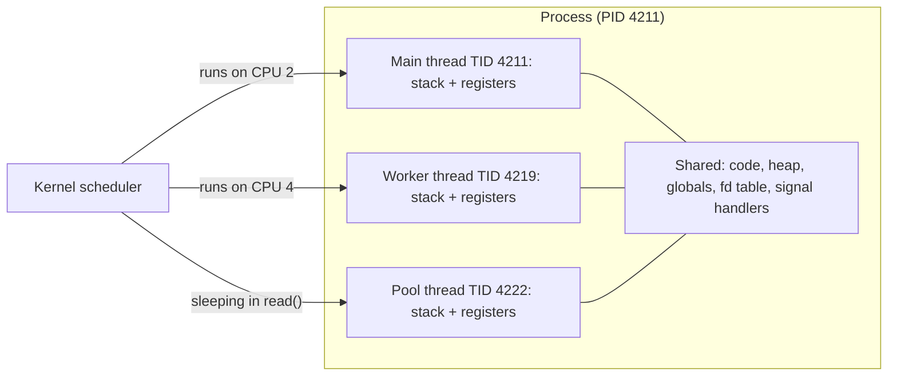

# Threads

> **Module 04 · Operating Systems** · Prerequisites: [Processes](02-Processes.md) · Next: [Process vs Thread](04-Process-vs-Thread.md)

---

## ⏱ If You Only Have 2 Minutes

- A **thread** is an independent flow of execution inside a process. Each thread owns a **stack**, **CPU registers** (including the program counter and stack pointer), a **thread ID**, a **signal mask** and **thread-local storage**. All threads of a process share the heap, global variables, code, open file descriptors, current directory and signal handlers.
- On Linux a thread is just another **task**: `pthread_create` calls `clone()` with flags such as `CLONE_VM | CLONE_FILES | CLONE_SIGHAND | CLONE_THREAD`, so the new task shares the parent's memory and descriptor table. The scheduler schedules threads, not processes.
- `getpid()` returns the thread-group ID (the same for every thread); `gettid()` returns the thread's own ID. In `ps -L` and `/proc/<pid>/task/`, the main thread's ID equals the PID.
- Linux pthreads are **1:1**: one user thread is one kernel thread. Go goroutines and Java virtual threads are **M:N**: a runtime multiplexes many lightweight threads onto a few OS threads.
- Node runs your JavaScript on one thread, but the process has several (libuv's thread pool, V8 helpers). `worker_threads` adds threads that each have their **own V8 isolate, heap and event loop**; they talk through `postMessage` (copies) or share a `SharedArrayBuffer` (with `Atomics`).
- In standard CPython, the **GIL** lets only one thread run Python bytecode at a time. Threads still speed up **I/O-bound** work, because blocking calls release the GIL, but not **pure-Python CPU** work. Free-threaded builds (experimental in 3.13, officially supported but optional in 3.14) remove the GIL.
- Shared memory makes threads cheap to coordinate and easy to break: data races, and a crash in any thread (a segfault, a native addon bug) kills the **whole process**.

---

## 1. What It Is and Why It Exists

A process gives a program its own memory and resources. A **thread** is a path of execution through that program. Every process starts with one thread. It can create more, and they all run the same code against the same memory, each at its own position.

**Analogy:** a shared kitchen with several cooks. They use the same fridge, pantry and order board (heap, globals, file descriptors), but each cook has their own cutting board and their own place in their recipe (stack and program counter). Adding a cook is cheaper than building a new kitchen, but two cooks can grab the same pan at once.

**The problem it solves.** Before threads, a program that wanted to do two things at once had to use several processes and pass data between them, paying for separate memory and IPC copies. Threads give you:

- **Parallelism within one address space.** Two threads can run on two cores at the same moment and work on the same data structures without copying.
- **Overlapping blocking calls.** While one thread waits in `read()` on a slow socket, another can keep working.
- **Cheaper creation and switching** than processes, because there is no new address space to build.

The cost is that nothing in the hardware protects one thread's data from another. Coordination becomes your job: see [Race Conditions](13-Race-Conditions.md) and [Mutex](14-Mutex.md).

---

## 2. How It Works

### What threads share and what each one owns

| Shared by all threads in the process | Owned by each thread |
|---|---|
| Virtual address space: code, heap, globals, memory maps | Stack (with a guard page below it) |
| File descriptor table: files, sockets, `epoll` | CPU registers: program counter, stack pointer, general registers |
| Signal **handlers** (dispositions) | Signal **mask** (which signals it blocks) |
| PID (thread-group ID), parent, credentials | Thread ID (TID) |
| Current directory, umask, resource limits | Thread-local storage (TLS), including C's `errno` |
| cgroup and namespaces | Scheduling state: priority, CPU affinity, running/sleeping |

### How Linux creates a thread

The kernel does not have a separate "thread" object. It has tasks (`task_struct`), and `clone()` lets the caller choose what the new task shares. `pthread_create` in glibc:

1. Allocates the new stack with `mmap`, plus a guard page that triggers a segmentation fault on overflow. The default size comes from `ulimit -s` (commonly 8 MiB). That is **virtual** memory; only the pages a thread actually touches use RAM.
2. Calls `clone()` (or `clone3()` on newer glibc) with `CLONE_VM | CLONE_FS | CLONE_FILES | CLONE_SIGHAND | CLONE_THREAD | CLONE_SYSVSEM | CLONE_SETTLS | …`. Each flag means "share this with the parent" (or, for `CLONE_SETTLS`, "set up this thread-local storage area").
3. The new task gets its own TID and starts running the thread function on its own stack. From now on the scheduler treats it like any other task: it can run on another core, be preempted, or sleep in a system call independently.

`fork()` is the same system call with almost no sharing flags. That is why Linux processes and threads are "the same thing with different sharing", which [Process vs Thread](04-Process-vs-Thread.md) uses to compare them.



### Observing threads

```bash
grep Threads /proc/4211/status            # how many threads the process has
ls /proc/4211/task                        # one directory per thread (TID)
ps -L -o pid,lwp,psr,pcpu,stat -p 4211    # LWP = thread ID, PSR = CPU it last ran on
top -H -p 4211                            # live per-thread CPU usage
```

Illustrative output for the Node example in section 4, while its worker is computing:

```text
Threads:        8

4211  4212  4213  4214  4215  4216  4217  4219

    PID     LWP PSR %CPU STAT
   4211    4211   2  1.5 Sl+
   4211    4212   0  0.0 Sl+
   4211    4213   5  0.1 Sl+
   4211    4214   1  0.1 Sl+
   4211    4215   7  0.0 Sl+
   4211    4216   3  0.0 Sl+
   4211    4217   6  0.0 Sl+
   4211    4219   4 99.0 Rl+
```

The main thread (LWP equal to the PID) is nearly idle: it only runs the event loop and a timer. One thread is at 99% on CPU 4: the worker. The rest are V8 and libuv helpers; the exact count varies by Node version. `l` in `STAT` means "multi-threaded", `R` running, `S` sleeping.

The same view of the Python example while four threads run the CPU task:

```text
    PID     LWP PSR %CPU STAT
   5120    5120   1  0.0 Sl+
   5120    5124   0 25.1 Sl+
   5120    5125   3 24.8 Rl+
   5120    5126   6 25.0 Sl+
   5120    5127   2 24.9 Sl+
```

Four threads, four different CPUs, but they **add up to one CPU**. Each is runnable, yet only the one holding the GIL makes progress, so they take turns. That picture is the GIL.

---

## 3. Key Concepts

### Threading models: 1:1, N:1 and M:N

| Model | Mapping | Examples | Trade-off |
|---|---|---|---|
| 1:1 | Each user thread is one kernel thread | Linux pthreads (NPTL), Java platform threads, Python `threading`, Node `worker_threads` | True parallelism and simple blocking calls; each thread costs a kernel task and a full stack |
| N:1 | Many user-level threads on one kernel thread | Early "green threads" | Cheap switching; no parallelism, and one blocking system call stalls them all |
| M:N | Many lightweight threads on a pool of kernel threads | Go goroutines, Java 21 virtual threads | Millions of tasks with small stacks; the runtime must handle blocking calls and scheduling itself |

Node's event loop and Python's asyncio are a different tool again: **cooperative** concurrency on one thread. Tasks switch only at `await`, and no kernel scheduling is involved. See [Concurrency](09-Concurrency.md).

### Thread-local storage

Some data must be per-thread even though memory is shared: C's `errno`, a database connection that is not thread-safe, a request ID for logging. TLS gives each thread its own copy of a variable.

- **C / pthreads:** `__thread` variables or `pthread_getspecific`.
- **Python:** `threading.local()`. In asyncio code use `contextvars.ContextVar` instead, because many coroutines share one thread.
- **Node:** each worker has its own globals because it has its own isolate, so ordinary module state is already per-thread. `AsyncLocalStorage` is **not** thread-local storage; it follows an asynchronous call chain within one thread.

### Node `worker_threads`

A `Worker` is a real OS thread, but it is heavier than a C thread because it runs a **separate V8 isolate** with its own heap, its own garbage collector, its own module cache and its own event loop.

- **Starting data:** `workerData` is copied into the worker with the structured clone algorithm.
- **Messages:** `postMessage` also copies (structured clone). Large payloads cost CPU twice: to serialize and to deserialize.
- **Transfer:** listing an `ArrayBuffer` or `MessagePort` in a `transferList` **moves** it; the sender's copy becomes unusable. A `MessageChannel` gives you a pair of ports, so you can open a private channel between any two threads.
- **Shared memory:** a `SharedArrayBuffer` is **not** copied. Both threads see the same bytes; use `Atomics` (`load`, `store`, `add`, `wait`, `notify`) to read and write it safely.
- **Limits:** `resourceLimits` caps each worker's heap (`maxOldGenerationSizeMb`) and stack (`stackSizeMb`, default 4).
- **Failure:** an uncaught exception in a worker emits `error` on the `Worker` object and ends that worker; the main thread keeps serving. `process.exit()` inside a worker ends only the worker. A native crash (a segfault in an addon) still kills the whole process.
- **OS-level sharing shows through:** workers share the process's file descriptors and current directory, which is why `process.chdir()` is not available inside a worker.

Starting a worker means booting a new isolate, so keep a **pool** of long-lived workers (the `piscina` library is the usual choice). [Thread Lifecycle](06-Thread-Lifecycle.md) covers starting, joining and terminating them.

Even without `worker_threads`, a Node process has more than one thread: the libuv thread pool (4 by default, `UV_THREADPOOL_SIZE`) runs file system, DNS lookup, crypto and zlib work, and V8 runs garbage collection and compilation helpers on its own threads. [Node Event Loop and Concurrency](../Module-02-Core-Backend/06-Node-Event-Loop-and-Concurrency.md) explains the pool.

### Python `threading` and the GIL

CPython's **Global Interpreter Lock** protects the interpreter's internal state, such as reference counts. A thread must hold it to run Python bytecode. It is released:

- around **blocking system calls**: socket reads, file I/O, `time.sleep`, `select`, waiting on a lock;
- by C extensions that release it during long computations: `hashlib` on large inputs, `zlib`, NumPy operations;
- on request, when another thread has waited for the **switch interval** (`sys.getswitchinterval()`, 5 ms by default).

Consequences for a backend:

| Workload | Threads help? | Why |
|---|---|---|
| Calling slow HTTP APIs, sync DB drivers, file reads | **Yes** | Each thread spends most of its time in the kernel without the GIL |
| Hashing, compression, NumPy on large arrays | Often yes | The C code releases the GIL while it works |
| Pure-Python loops, JSON of Python objects, template rendering | **No** | Every step needs the GIL; threads take turns on one core |

The GIL is **not** a thread-safety guarantee for your code. `counter += 1` is several bytecode instructions, and a switch can happen between them.

**Free-threaded CPython.** [PEP 703](https://peps.python.org/pep-0703/) added an optional build without the GIL. It shipped as experimental in 3.13 and became officially supported, but still not the default, in 3.14. It usually comes as a separate executable such as `python3.14t`; check with `sys._is_gil_enabled()`. In that build, CPU-bound threads can run in parallel; single-threaded code runs somewhat slower, and C extensions that are not marked as free-threading-safe can turn the GIL back on when imported. For production services in 2026, assume the GIL unless you have tested your whole dependency tree on the free-threaded build.

### Thread pools

Creating a thread costs a `clone()`, a stack mapping, and kernel bookkeeping. Tens of microseconds is cheap once, but not per request, and unbounded thread creation exhausts memory and the cgroup's `pids.max`. A **pool** keeps a fixed set of threads and a queue of work:

| Pool | Default size | Notes |
|---|---|---|
| libuv thread pool (Node) | 4 | `UV_THREADPOOL_SIZE`, set before start-up |
| `ThreadPoolExecutor` (Python) | `min(32, CPU count + 4)` | Used by `asyncio.to_thread` via the loop's default executor |
| AnyIO / FastAPI sync endpoints | 40 | Runs `def` endpoints and dependencies |
| `piscina` (Node) | Based on available CPUs | Pool of `worker_threads` |

Size CPU-bound pools to the CPUs you are actually allowed (the cgroup quota). Size I/O-bound pools to the concurrency the downstream can handle, not to the core count.

---

## 4. Code Examples

Scenario: count primes below a few million (a stand-in for any CPU-heavy job: image resizing, PDF parsing, report generation) without freezing a server, and compare how each runtime's threads handle CPU work and blocking I/O.

### Node.js / TypeScript

The heavy loop runs in a worker thread. A `SharedArrayBuffer` carries progress without messages, a `MessageChannel` carries log lines, and a timer on the main thread proves the event loop stays responsive.

```ts
// No npm packages — Node.js 22+, TypeScript 5, ESM. Compile with tsc, then: node dist/primes.js
import { MessageChannel, Worker, isMainThread, parentPort, threadId, workerData,
  type MessagePort } from "node:worker_threads";

interface Job { limit: number; progress: SharedArrayBuffer; port: MessagePort }

function countPrimes(limit: number, progress: Int32Array, port: MessagePort): number {
  let count = 0;
  for (let n = 2; n < limit; n++) {
    let prime = true;
    for (let d = 2; d * d <= n; d++) if (n % d === 0) { prime = false; break; }
    if (prime) count++;
    if (n % 100_000 === 0) Atomics.store(progress, 0, n); // shared memory: no message, no copy
    if (n % 2_000_000 === 0) port.postMessage(`thread ${threadId} checked ${n}`); // copied
  }
  return count;
}

if (isMainThread) {
  const LIMIT = 6_000_000;
  const progress = new SharedArrayBuffer(4); // one Int32 that both threads see
  const view = new Int32Array(progress);
  const { port1, port2 } = new MessageChannel();
  port1.on("message", (m) => console.log(`[log port] ${m}`));

  const worker = new Worker(new URL(import.meta.url), {
    workerData: { limit: LIMIT, progress, port: port2 } satisfies Job,
    transferList: [port2], // a MessagePort must be moved to the worker, not cloned
    resourceLimits: { maxOldGenerationSizeMb: 64 }, // each worker has its own V8 heap
  });

  // Proof the main event loop is free: this timer keeps firing while the worker burns CPU.
  const t0 = performance.now();
  const ticker = setInterval(() => {
    console.log(`[main] ${Math.round(performance.now() - t0)} ms, progress=${Atomics.load(view, 0)}`);
  }, 250);

  const primes = await new Promise<number>((resolve, reject) => {
    worker.once("message", resolve);
    worker.once("error", reject); // an exception thrown inside the worker lands here
    worker.once("exit", (code) => { if (code !== 0) reject(new Error(`worker exited with ${code}`)); });
  });
  clearInterval(ticker);
  port1.close();
  console.log(`[main] ${primes} primes below ${LIMIT} in ${Math.round(performance.now() - t0)} ms`);
} else {
  const { limit, progress, port } = workerData as Job;
  const result = countPrimes(limit, new Int32Array(progress), port);
  port.close();
  parentPort!.postMessage(result); // nothing else keeps the worker's loop alive, so it exits
}
```

Illustrative output:

```text
[main] 256 ms, progress=1500000
[log port] thread 1 checked 2000000
[main] 518 ms, progress=2900000
[main] 784 ms, progress=3900000
[log port] thread 1 checked 4000000
[main] 1046 ms, progress=4600000
[main] 1296 ms, progress=5400000
[main] 412849 primes below 6000000 in 1478 ms
```

Run the same `countPrimes` call directly on the main thread and the timer prints **nothing** for about 1.5 seconds; an HTTP server would stop answering for the same time.

### Python

A thread pool makes eight calls to a slow upstream (a local HTTP server that takes 300 ms per request) and then runs a pure-Python CPU task on four threads.

```python
# No pip packages — Python 3.12+ (stdlib only).
import sys
import threading
import time
from collections.abc import Callable
from concurrent.futures import ThreadPoolExecutor
from http.server import BaseHTTPRequestHandler, ThreadingHTTPServer
from urllib.request import urlopen


class SlowUpstream(BaseHTTPRequestHandler):
    def do_GET(self) -> None:
        time.sleep(0.3)  # simulates a slow dependency: 300 ms per call
        self.send_response(200)
        self.end_headers()
        self.wfile.write(b"ok")

    def log_message(self, *args: object) -> None:  # keep the demo output quiet
        pass


def fetch(url: str) -> int:
    # The thread blocks in recv() inside the kernel; CPython releases the GIL around that wait.
    with urlopen(url, timeout=5) as resp:
        return resp.status


def count_primes(start: int, stop: int) -> int:
    # Pure-Python bytecode: the thread must hold the GIL for every step.
    return sum(1 for n in range(max(start, 2), stop)
               if all(n % d for d in range(2, int(n**0.5) + 1)))


def timed(label: str, work: Callable[[], object]) -> None:
    t0 = time.perf_counter()
    work()
    print(f"{label:<18} {time.perf_counter() - t0:5.2f} s")


if __name__ == "__main__":
    upstream = ThreadingHTTPServer(("127.0.0.1", 0), SlowUpstream)
    threading.Thread(target=upstream.serve_forever, daemon=True).start()
    urls = [f"http://127.0.0.1:{upstream.server_address[1]}/"] * 8
    starts = [0, 100_000, 200_000, 300_000]
    stops = [s + 100_000 for s in starts]

    gil = getattr(sys, "_is_gil_enabled", lambda: True)()  # 3.13+; always True before
    print(f"GIL enabled: {gil}; main thread TID {threading.get_native_id()}")

    with ThreadPoolExecutor(max_workers=8) as pool:
        timed("I/O sequential", lambda: [fetch(u) for u in urls])
        timed("I/O 8 threads", lambda: list(pool.map(fetch, urls)))
        timed("CPU sequential", lambda: list(map(count_primes, starts, stops)))
        timed("CPU 4 threads", lambda: list(pool.map(count_primes, starts, stops)))
        tids = set(pool.map(lambda _: threading.get_native_id(), range(32)))
        print(f"pool threads are kernel tasks with TIDs: {sorted(tids)}")
    upstream.shutdown()
```

Illustrative output on a standard (GIL) CPython build:

```text
GIL enabled: True; main thread TID 5120
I/O sequential      2.45 s
I/O 8 threads       0.31 s
CPU sequential      0.85 s
CPU 4 threads       0.79 s
pool threads are kernel tasks with TIDs: [5124, 5125, 5126, 5127, 5128, 5129, 5130, 5131]
```

Eight blocking calls finish in about the time of one, because each thread waits in the kernel without the GIL. The CPU task gets no faster with four threads; it only adds switching. On a free-threaded build (`GIL enabled: False`), the "CPU 4 threads" line drops towards a quarter of the sequential time, given four free cores.

**Runtime difference to notice:** Node's worker gets real parallelism, but at the price of a separate heap: it cannot touch the main thread's objects, only copies, transferred buffers or a `SharedArrayBuffer`. Python's threads share every object directly, which makes I/O fan-out trivial, but in the standard build that sharing is exactly why CPU work cannot run in parallel. For CPU work in Python, use processes ([Process vs Thread](04-Process-vs-Thread.md)).

---

## 5. Production Concerns

- **Count threads against the CPU quota.** A 2-CPU container running 16 busy threads (a big worker pool, GC threads, the libuv pool) burns the quota early in each period and gets throttled. Size CPU pools from `cpu.max`, not from the host core count. [Operating Systems Fundamentals](01-Operating-Systems-Fundamentals.md) shows how to read it.
- **Threads count towards `pids.max`.** In Linux every thread is a task. A thread leak in a container ends with `pthread_create` failing (`EAGAIN`, "Resource temporarily unavailable"), even though memory and CPU look fine. Watch the `Threads:` line in `/proc/<pid>/status` as a metric.
- **Memory per thread.** Native threads mostly cost their touched stack pages, but each Node worker carries a whole V8 heap. Ten workers each with a 256 MB old-space limit can, in the worst case, need several gigabytes. Set `resourceLimits` and keep the pool small.
- **Blast radius.** An uncaught JavaScript exception in a worker kills only that worker, but memory corruption, a segfault in a native module, or `abort()` in any thread kills the whole process and every request it was serving. In Python, an unhandled exception in a plain `threading.Thread` prints a traceback (via `threading.excepthook`) and ends only that thread; inside a `ThreadPoolExecutor` it is stored in the `Future` and is lost if nobody calls `result()`.
- **Signals go to the process.** Signal handlers are shared, and the kernel delivers a process-directed signal to any thread that has not blocked it. Python always runs signal handlers on the main thread; Node delivers `SIGTERM` to the main thread's event loop. Design shutdown so the main thread tells workers to stop. See [Signals](29-Signals.md).
- **Debugging live threads.** `top -H -p <pid>` finds the hot thread; its TID matches a directory in `/proc/<pid>/task/`. For Python, `py-spy dump --pid <pid>` prints every thread's stack (needs `SYS_PTRACE` in a container). For Node, use `--cpu-prof` or the inspector, which can attach to workers too.

---

## 6. Common Mistakes

- **Using Python threads to speed up pure-Python CPU work** — four threads take as long as one, plus switching overhead — use `ProcessPoolExecutor`, a C extension that releases the GIL, or test a free-threaded build.
- **Believing the GIL makes your code thread-safe** — `balance += amount` or check-then-set on a dict can still interleave — protect shared state with `threading.Lock`, or avoid sharing it.
- **Starting one Node `Worker` per request** — each one boots a V8 isolate, adding tens of milliseconds and megabytes per request — keep a fixed pool of workers and send them jobs.
- **Sending huge objects with `postMessage`** — the structured clone costs CPU on both threads and doubles memory for a moment — transfer an `ArrayBuffer`, use a `SharedArrayBuffer`, or send a file path or ID instead.
- **Using `threading.local()` in asyncio code** — every coroutine on the loop sees the same "thread-local" value, so request data leaks between requests — use `contextvars`.
- **Unbounded thread creation** — a thread per incoming connection hits memory or `pids.max` under a traffic spike — use a bounded pool and a bounded queue in front of it.
- **Ignoring failed workers** — a worker or thread dies on an exception and nobody notices, so throughput quietly drops — listen for `error`/`exit` on Node workers, check `Future.exception()` in Python, and replace dead workers.

---

## 7. Comparison Table

| | OS thread (C/pthreads) | Node `worker_threads` | Python `threading` (GIL build) | Goroutine / virtual thread |
|---|---|---|---|---|
| Scheduled by | Kernel | Kernel | Kernel, but only the GIL holder runs bytecode | Language runtime on top of OS threads |
| Parallel CPU work | Yes | Yes | No (yes in free-threaded build) | Yes |
| Shares objects with other threads | Everything | Only `SharedArrayBuffer`; otherwise copies | Everything | Everything |
| Memory cost | Stack pages actually touched | A V8 isolate and heap per worker | Stack pages plus a small thread state | A few KiB, stack grows on demand |
| Creation cost | Tens of microseconds | Milliseconds (isolate boot) | Tens of microseconds plus Python bookkeeping | Very small |
| Good for | Native libraries, databases, runtimes themselves | CPU-heavy JavaScript off the event loop | Blocking I/O, wrapping sync libraries | Huge numbers of concurrent I/O tasks |

---

## 8. Interview Questions

**[Junior] What do threads in the same process share, and what does each one have to itself?**
They share the address space (code, heap, globals), the file descriptor table, signal handlers, PID, credentials and current directory. Each thread has its own stack, its own registers including the program counter, its own thread ID, its own signal mask, and thread-local storage. Because the heap is shared, two threads can access the same object at once, which is the source of race conditions.

**[Junior] Does Node.js use threads?**
Yes, though your JavaScript normally runs on one. libuv runs a thread pool (4 threads by default) for file system calls, `dns.lookup`, crypto and compression, and V8 uses helper threads for garbage collection and compilation. With `worker_threads` you can run JavaScript on additional threads, each with its own isolate and event loop, communicating by messages or `SharedArrayBuffer`.

**[Mid] How are threads implemented on Linux?**
As tasks created with `clone()`. A thread is a task that shares the memory descriptor, file table, signal handlers and thread group with its creator, chosen by flags such as `CLONE_VM`, `CLONE_FILES`, `CLONE_SIGHAND` and `CLONE_THREAD`. Linux's pthread library (NPTL) is 1:1, so each pthread is a kernel-scheduled task with its own TID. `getpid()` returns the thread-group ID, shared by all threads, and `/proc/<pid>/task/` lists each TID.

**[Mid] Why do Python threads speed up a web scraper but not an image filter written in pure Python?**
The scraper spends most of its time blocked in socket reads, and CPython releases the GIL during those blocking calls, so other threads run meanwhile. The pure-Python filter needs the GIL for every bytecode instruction, so threads only take turns on one core. Use a process pool for the filter, or a library like Pillow or NumPy whose C code releases the GIL. The free-threaded build changes this, but it is optional and needs compatible extensions.

**[Mid] How do Node worker threads communicate, and what does each method cost?**
`postMessage` uses the structured clone algorithm, so the data is serialized and copied; cost grows with payload size. Putting an `ArrayBuffer` or `MessagePort` in the transfer list moves ownership without copying, and the sender can no longer use it. A `SharedArrayBuffer` is visible to both threads at once with no copying, but you must coordinate with `Atomics` to avoid races. `workerData` is a one-time structured clone at start-up.

**[Senior] What happens to the whole process when one thread crashes, and how do you design around it?**
A fault such as a segmentation fault or `abort()` is delivered to the process, and the default action kills every thread, so all in-flight work is lost. A JavaScript exception in a Node worker or a Python exception in a thread is contained to that thread, but it can leave shared state half-updated or a pool short of workers. If a component is crash-prone (native image or PDF libraries, untrusted input parsers), run it in a separate process so a crash is a failed job rather than a dead server. Monitor worker `exit` events and restart workers, and make shared-state updates atomic or lock-protected.

**[Senior] Your service has a 2-CPU limit, runs a 16-thread pool, and shows high p99 latency at moderate load. What is going on?**
All threads draw from the same cgroup CPU quota. When many are runnable, the cgroup uses its 200 ms of CPU per 100 ms period in a fraction of the period and then every thread, including the request-handling ones, is throttled until the next period. The pool also adds context switches and cache misses. Check `cpu.stat` for throttling, then size CPU-bound pools to the quota (2 here), keep I/O-bound pools separate, and remember runtime threads (GC, libuv) count too.

**[Senior] Would you run a CPU-heavy Python service on the free-threaded build today?**
Only after testing. It removes the main reason to use processes for CPU work: threads can then share objects and run in parallel, which saves the memory and serialization cost of a process pool. But single-threaded performance is somewhat lower, every C extension in the dependency tree must support it or the GIL is re-enabled at import, and code that relied on the GIL to hide races may break. A reasonable path is to benchmark the real workload on the `t` build, check `sys._is_gil_enabled()` in production, and keep a process-pool fallback.

---

## 9. Cheat Sheet

```text
Thread owns     stack (+guard page), registers/PC/SP, TID, signal mask, TLS (errno)
Threads share   heap, globals, code, fd table, signal handlers, PID, cwd, creds, cgroup
Linux           thread = task from clone(CLONE_VM|CLONE_FILES|CLONE_SIGHAND|CLONE_THREAD|...)
IDs             getpid() = TGID (same for all), gettid() = TID; main thread TID == PID
Observe         /proc/<pid>/task/, Threads: in status, ps -L, top -H
Stack           default from ulimit -s (often 8 MiB virtual); only touched pages use RAM
Models          1:1 pthreads | M:N goroutines, Java virtual threads | asyncio/event loop = cooperative
Node            JS on 1 thread + libuv pool (4) + V8 helpers; worker_threads = isolate + heap + loop each
Node messaging  postMessage = copy; transferList = move; SharedArrayBuffer + Atomics = share
Python GIL      one thread runs bytecode; released on blocking I/O, by some C code, every 5 ms on request
Python use      threads for I/O; processes for pure-Python CPU; contextvars (not threading.local) in asyncio
Free-threaded   3.13 experimental, 3.14 supported but optional; sys._is_gil_enabled()
Pools           size CPU pools to cgroup quota; I/O pools to downstream capacity; threads count in pids.max
Crash           segfault in any thread kills the process; JS/Python exceptions end one thread
```

---

## Related Topics

- [Processes](02-Processes.md) — the container that threads live in, and `clone()`'s other use
- [Process vs Thread](04-Process-vs-Thread.md) — choosing between them for a backend workload
- [Thread Lifecycle](06-Thread-Lifecycle.md) — starting, joining, cancelling and cleaning up threads
- [Race Conditions](13-Race-Conditions.md) — what goes wrong when threads share memory
- [Context Switching](08-Context-Switching.md) — what it costs the CPU to switch between threads
- [Node Event Loop and Concurrency](../Module-02-Core-Backend/06-Node-Event-Loop-and-Concurrency.md) — the libuv thread pool and the GIL in a web-server context
