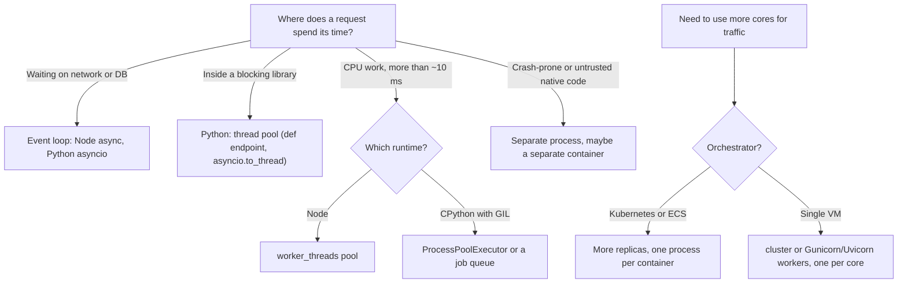

# Process vs Thread

> **Module 04 · Operating Systems** · Prerequisites: [Threads](03-Threads.md) · Next: [Process Lifecycle](05-Process-Lifecycle.md)

---

## ⏱ If You Only Have 2 Minutes

- On Linux both are tasks created by `clone()`. The difference is what they share: a **process** gets its own address space and file descriptor table; a **thread** shares its creator's. Everything else follows from that.
- **Processes** give isolation: a crash, a memory leak or corrupted state stays inside one process, and the OS reclaims everything when it exits. The price is more memory and **IPC** (pipes, sockets) with serialization for every message.
- **Threads** give cheap sharing: any thread can read any object, with no copying. The price is races, and a **blast radius** of the whole process: one segfault kills every request it was serving.
- Runtime effects decide most real choices. In standard CPython the **GIL** stops threads from running Python code in parallel, so CPU work needs **processes**. In Node there is no GIL, but each `worker_threads` worker is a separate **V8 isolate** with its own heap, so workers share only `SharedArrayBuffer`s.
- Creation cost: a native thread takes tens of microseconds; a Node worker takes milliseconds (isolate boot); a new Node or Python **process** takes tens of milliseconds or more (runtime start-up and imports). Always reuse them through a pool.
- Memory: summing **RSS** across forked workers double-counts shared pages. Use **PSS** (`/proc/<pid>/smaps_rollup`) to see each worker's fair share, and `memory.current` for the cgroup total that the OOM killer actually uses.
- In Kubernetes the default is **one process per container**, and you scale by adding replicas. Use in-process threads or worker pools to keep request latency low, and size them to the container's CPU quota, not the node's cores.

---

## 1. What It Is and Why It Exists

"Process or thread?" is really the question "**how much should these units of work share?**"

- Two **processes** share nothing by default. Each has its own memory, its own descriptors, its own runtime. They cooperate by sending bytes to each other.
- Two **threads** in one process share everything: memory, open files, sockets, the runtime's heap. They cooperate by touching the same objects.

**Analogy:** separate apartments versus roommates. Neighbours in separate apartments must knock and talk (IPC), each pays their own rent (memory), and a kitchen fire in one apartment does not burn the other. Roommates share the fridge and can hand things over instantly, but they can eat each other's food (races), and one fire burns the whole apartment.

**What goes wrong when you choose badly.** Every option below works well in the right place and causes an incident in the wrong one:

- Python threads for a CPU-heavy report generator: no speed-up, because of the GIL.
- A new Node process per request to "avoid blocking": hundreds of runtimes boot at once and the container runs out of memory.
- 16 Gunicorn workers in a 2-CPU pod: the workers fight over the CPU quota, each opens its own database pool, and PostgreSQL's connection limit is reached.
- A crash-prone native PDF library running in a thread of the API server: one malformed upload kills the entire server.

---

## 2. How It Works

### One mechanism, different sharing

Linux creates both with `clone()`. The flags decide what the new task shares with its creator:

| What is shared | `fork()` (new process) | `pthread_create` (new thread) |
|---|---|---|
| Address space (`CLONE_VM`) | No — copy-on-write copy | Yes |
| File descriptor table (`CLONE_FILES`) | No — a copy pointing at the same open files | Yes |
| Signal handlers (`CLONE_SIGHAND`) | No — a copy | Yes |
| Thread group / PID (`CLONE_THREAD`) | No — new PID | Yes — same PID, new TID |
| cwd, root, umask (`CLONE_FS`) | No — a copy | Yes |

### What the sharing costs and buys

**Creation.** A thread needs a stack mapping and a `task_struct`. A process created with `fork()` also needs its page tables copied. A *new runtime* process (Node's `child_process.fork`, Python's `spawn`/`forkserver` start methods, `uvicorn --workers`) then has to boot an interpreter and import your code, which dominates: tens to hundreds of milliseconds.

**Switching.** Switching between two threads of the same process keeps the same page tables, so the CPU's address-translation cache (the TLB) stays useful. Switching between processes changes the address space. Modern CPUs soften this with tagged TLB entries (PCID on x86), but the cache state of a different process is still cold. [Context Switching](08-Context-Switching.md) has the measurements.

**Communication.** Threads pass a pointer. Processes must copy bytes through the kernel (a pipe or Unix socket), and both sides serialize and deserialize: `pickle` for Python's `ProcessPoolExecutor`, JSON or the V8 serializer for Node's IPC. Shared memory between processes is possible (`mmap`, `multiprocessing.shared_memory`) but you then inherit all the synchronization problems of threads. See [Inter Process Communication](28-Inter-Process-Communication.md).

**Failure.** A process that crashes or leaks is cleaned up by the kernel: memory freed, descriptors closed, parent notified with `SIGCHLD`. A thread that corrupts memory or segfaults takes down its siblings.

### Choosing for a backend workload



### Measuring memory honestly: RSS vs PSS

**RSS** (resident set size) counts every page a process has in RAM, including pages it shares with other processes: the runtime binary, shared libraries, and copy-on-write pages inherited from a pre-forking parent. Add up RSS across eight workers and shared pages are counted eight times.

**PSS** (proportional set size) splits each shared page evenly among the processes that map it. Summing PSS gives a realistic total. **USS** (unique set size, the private pages) is what you would free by killing that one process.

```bash
ps -o pid,ppid,rss,cmd --ppid 1 -p 1                      # master + workers, RSS in KiB
grep -E '^(Rss|Pss|Shared_Clean|Shared_Dirty|Private_Clean|Private_Dirty)' /proc/8/smaps_rollup
cat /sys/fs/cgroup/memory.current                           # what the OOM killer compares to memory.max
```

Illustrative output for Gunicorn started with `--preload` and four workers:

```text
    PID    PPID   RSS CMD
      1       0  92340 /usr/local/bin/python /usr/local/bin/gunicorn --preload -w 4 app:app
      8       1 118204 /usr/local/bin/python /usr/local/bin/gunicorn --preload -w 4 app:app
      9       1 117960 /usr/local/bin/python /usr/local/bin/gunicorn --preload -w 4 app:app
     10       1 118532 /usr/local/bin/python /usr/local/bin/gunicorn --preload -w 4 app:app
     11       1 118010 /usr/local/bin/python /usr/local/bin/gunicorn --preload -w 4 app:app

Rss:              118204 kB
Pss:               57994 kB
Shared_Clean:      70112 kB
Shared_Dirty:       2140 kB
Private_Clean:      5636 kB
Private_Dirty:     40316 kB

287109120
```

Summed RSS says about 550 MiB. Summed PSS is about 265 MiB, which matches `memory.current` (287109120 bytes ≈ 274 MiB, which also includes some page cache). Without the shared pages, five copies of the app would need over 500 MiB.

The shared part shrinks over time in CPython. Reference counting writes to every object it touches, and the garbage collector writes to object headers, so pages inherited from the master become private one by one. Python's own documentation recommends `gc.disable()` early in the parent, `gc.freeze()` just before forking, and `gc.enable()` in the children, so the collector does not touch the inherited objects.

---

## 3. Key Concepts

### The comparison, dimension by dimension

| Dimension | Processes | Threads |
|---|---|---|
| Isolation | Separate address spaces; the kernel enforces it | None between threads; only your locks |
| Memory cost | Each has its own heap and runtime; shared pages only via fork/COW and shared libraries | One heap; each thread adds a stack (plus a whole V8 heap for a Node worker) |
| Creation cost | `fork()` plus runtime start-up: tens of ms or more | Tens of µs (native); a few ms for a Node worker |
| Communication | IPC: copy plus serialize every message | Shared objects; no copy |
| Crash blast radius | One process | The whole process, every thread |
| Leak recovery | Kill and restart the process; the OS frees everything | Usually means restarting the whole process |
| Python GIL | Each process has its own GIL: true parallelism | One GIL: no parallel Python bytecode (standard build) |
| Node | Each process has its own isolate and event loop | Each worker has its own isolate; sharing only via `SharedArrayBuffer` |
| Debugging | Separate PIDs, logs, metrics per process | One PID; need per-thread tools (`top -H`, thread dumps) |

### Node: event loop, `worker_threads`, or more processes

- **Event loop alone** handles thousands of concurrent I/O-bound requests on one thread. That is the default and it is enough for most APIs. ([Node Event Loop and Concurrency](../Module-02-Core-Backend/06-Node-Event-Loop-and-Concurrency.md))
- **`worker_threads`** move CPU-heavy work (image resizing, PDF generation, big JSON transforms) off the event loop, inside the same process. Use a fixed pool. Each idle worker costs on the order of 10 MB of extra RSS for its isolate, more as its heap grows.
- **Multiple processes** (`cluster`, PM2, or simply more containers) use more cores for **serving traffic**. Each is a full runtime with its own heap, its own caches and **its own database pool**.
- **`child_process`** is for running **other programs**, or isolating code you do not trust to stay up.

### Python: asyncio, threads, processes, workers

- **asyncio** (FastAPI `async def`, Uvicorn) handles many concurrent connections on one thread, as long as every library you call is async.
- **Threads** (`def` endpoints in FastAPI, `asyncio.to_thread`, `ThreadPoolExecutor`) wrap **blocking I/O** libraries. They do not speed up Python CPU work in the standard build.
- **`ProcessPoolExecutor`** runs CPU work in parallel. Arguments and results are pickled, so send IDs or small inputs, not large objects. Use `max_tasks_per_child` (3.11+) to recycle workers that leak memory. The start method matters: `fork` is fastest but unsafe with threads; `forkserver` became the Linux default in 3.14; `spawn` is the slowest and the default on macOS and Windows.
- **Server workers** (Gunicorn's pre-fork master, or `uvicorn --workers N`) are processes, each with its own event loop or thread pool. Gunicorn's documentation suggests `(2 × cores) + 1` sync workers as a starting point, but inside a container "cores" means the CPU **quota**.

### Kubernetes: one process per container

Containers are designed around one main process: the runtime watches that process, restarts the container when it exits, sends it `SIGTERM` on shutdown, and applies the cgroup limits to the container as a whole. This changes the old "one big server with many workers" design:

- **Scale out with replicas, not in-container workers.** Ten 1-CPU pods are easier to schedule, restart and observe than one 10-CPU pod with ten workers. Rolling deploys and autoscaling work at pod granularity.
- **When you do run several processes in one container** (Gunicorn, `cluster`), PID 1 must forward signals and reap children ([Process Lifecycle](05-Process-Lifecycle.md)), and all processes share one `memory.max`. Which process the OOM killer picks depends on configuration: by default the kernel picks the largest process in the cgroup, but if `memory.oom.group` is set the whole group is killed together.
- **Match workers to the quota.** A pod with `limits.cpu: 2` should run about 2 CPU-bound workers, however many cores the node has.
- **Connection budgets multiply.** Total database connections = replicas × processes per pod × pool size per process. With 10 pods × 4 workers × a pool of 10, you need 400 connections; PostgreSQL's default `max_connections` is 100.

### Free-threaded Python changes the Python column

In a free-threaded CPython build (supported but optional since 3.14), threads can run Python code in parallel, so CPU work no longer forces you into processes and pickling. The isolation trade-offs (shared heap, shared crash) remain exactly as for any threaded runtime. Until your dependencies support that build, plan for processes.

---

## 4. Code Examples

Scenario: four CPU-bound jobs (counting primes by trial division, a stand-in for report generation or image work). Each runtime runs them sequentially, on threads, and on processes, and also measures start-up cost alone by running the same fan-out with an empty job.

### Node.js / TypeScript

```ts
// No npm packages — Node.js 22+, TypeScript 5, ESM. Compile with tsc, then: node dist/bench.js
import { fork } from "node:child_process";
import { availableParallelism } from "node:os";
import { fileURLToPath } from "node:url";
import { Worker, isMainThread, parentPort, workerData } from "node:worker_threads";

const TASKS = 4;
const LIMIT = 3_000_000;

function countPrimes(limit: number): number {
  let count = 0;
  for (let n = 2; n < limit; n++) {
    let prime = true;
    for (let d = 2; d * d <= n; d++) if (n % d === 0) { prime = false; break; }
    if (prime) count++;
  }
  return count;
}

// One file, three roles, decided by how it was started.
if (!isMainThread) {
  parentPort!.postMessage(countPrimes(workerData as number));
} else if (process.argv[2] === "child") {
  process.once("message", (limit) => {
    process.send!(countPrimes(limit as number));
    process.disconnect(); // close the IPC channel so this process can exit
  });
} else {
  const self = fileURLToPath(import.meta.url);

  // Thread: a new V8 isolate inside this process. Data in and out is structured-cloned.
  const inThread = (limit: number) => new Promise<number>((resolve, reject) => {
    new Worker(self, { workerData: limit }).once("message", resolve).once("error", reject);
  });
  // Process: a whole new Node runtime, talking over an IPC pipe (JSON-serialized messages).
  const inProcess = (limit: number) => new Promise<number>((resolve, reject) => {
    const child = fork(self, ["child"]);
    child.once("message", (n) => resolve(n as number)).once("error", reject);
    child.send(limit);
  });

  const timed = async (label: string, run: () => Promise<unknown>) => {
    const t0 = performance.now();
    await run();
    console.log(`${label.padEnd(28)} ${Math.round(performance.now() - t0).toString().padStart(6)} ms`);
  };
  const fanOut = (start: (limit: number) => Promise<number>, limit: number) =>
    () => Promise.all(Array.from({ length: TASKS }, () => start(limit)));

  console.log(`availableParallelism=${availableParallelism()} tasks=${TASKS} limit=${LIMIT}`);
  await timed("sequential, main thread", async () => { for (let i = 0; i < TASKS; i++) countPrimes(LIMIT); });
  await timed(`${TASKS} worker threads`, fanOut(inThread, LIMIT));
  await timed(`${TASKS} child processes`, fanOut(inProcess, LIMIT));
  // A trivial job: what remains is start-up and teardown cost.
  await timed(`${TASKS} threads, empty job`, fanOut(inThread, 2));
  await timed(`${TASKS} processes, empty job`, fanOut(inProcess, 2));
}
```

### Python

```python
# No pip packages — Python 3.12+ (stdlib only).
import os
import sys
import time
from collections.abc import Callable
from concurrent.futures import Executor, ProcessPoolExecutor, ThreadPoolExecutor

TASKS = 4
LIMIT = 300_000


def count_primes(limit: int) -> int:
    return sum(1 for n in range(2, limit) if all(n % d for d in range(2, int(n**0.5) + 1)))


def fan_out(make_pool: Callable[[], Executor], limit: int) -> Callable[[], list[int]]:
    # The pool is created inside the timing on purpose: start-up cost is part of the comparison.
    def run() -> list[int]:
        with make_pool() as pool:
            return list(pool.map(count_primes, [limit] * TASKS))
    return run


def timed(label: str, work: Callable[[], object]) -> None:
    t0 = time.perf_counter()
    work()
    print(f"{label:<28} {(time.perf_counter() - t0) * 1000:6.0f} ms")


if __name__ == "__main__":  # required: spawn/forkserver children re-import this module
    gil = getattr(sys, "_is_gil_enabled", lambda: True)()
    print(f"cpus={os.cpu_count()} gil={gil} tasks={TASKS} limit={LIMIT}")
    timed("sequential", lambda: [count_primes(LIMIT) for _ in range(TASKS)])
    timed(f"{TASKS} threads", fan_out(lambda: ThreadPoolExecutor(TASKS), LIMIT))
    timed(f"{TASKS} processes", fan_out(lambda: ProcessPoolExecutor(TASKS), LIMIT))
    timed(f"{TASKS} threads, empty job", fan_out(lambda: ThreadPoolExecutor(TASKS), 2))
    timed(f"{TASKS} processes, empty job", fan_out(lambda: ProcessPoolExecutor(TASKS), 2))
```

### Illustrative results

Four tasks on a Linux machine with at least four idle cores and no CPU limit. Absolute times depend on the CPU; the ratios are what matter.

| Run | Node (limit 3,000,000) | Python 3.12, GIL (limit 300,000) |
|---|---|---|
| Sequential | ~2,100 ms | ~3,000 ms |
| 4 threads | ~600 ms (≈ 3.5× faster) | ~3,100 ms (no faster; often a little slower) |
| 4 processes | ~650 ms (≈ 3.2× faster) | ~850 ms (≈ 3.5× faster) |
| Start-up only, 4 threads | tens of ms | ~1 ms |
| Start-up only, 4 processes | tens to ~100 ms | tens of ms (much more on macOS/Windows, where `spawn` is used) |

What to read from it:

- **Node:** threads and processes both reach near-linear speed-up, because there is no GIL. Threads win slightly on start-up and memory, so `worker_threads` is the default for CPU offload inside a service.
- **Python:** threads give nothing for pure-Python CPU work; processes give near-linear speed-up minus pickling and start-up. On a free-threaded build, the "4 threads" row would approach the "4 processes" row.
- **Start-up cost is why pools exist.** If each job took 5 ms instead of 500 ms, process start-up would dominate. Create the pool once at service start and reuse it.
- **In a container,** the speed-up stops at the CPU quota. With `cpu.max` set to 2 CPUs, both "4 threads" (Node) and "4 processes" land near 2× and add throttling.

---

## 5. Production Concerns

- **Memory budget = processes × per-process private memory + shared.** Measure PSS, not RSS, when sizing a pre-forked server, and confirm with the cgroup's `memory.current`. For Node, each worker thread and each process has its own V8 heap limit, so cap them (`--max-old-space-size`, `resourceLimits`) so their sum fits under `memory.max` with headroom.
- **Connection and cache multiplication.** Each process opens its own database pool, Redis connections, HTTP keep-alive pools and in-memory caches. Moving from 1 to 8 workers multiplies all of them by 8. Budget connections across replicas × processes × pool size, or put PgBouncer in front of PostgreSQL.
- **Supervise and recycle.** Gunicorn's master restarts dead workers; `cluster` emits `exit` so you can fork a replacement; a `ProcessPoolExecutor` whose worker dies raises `BrokenProcessPool` and must be recreated. Recycling (`max_tasks_per_child`, Gunicorn's `--max-requests`) contains slow leaks that would otherwise grow until an OOM kill.
- **Shutdown propagates differently.** `SIGTERM` to a Gunicorn master or a `cluster` primary must be forwarded to workers, which must drain. Threads stop when the process stops, so in-flight thread work needs explicit draining before exit. See [Signals](29-Signals.md).
- **Metrics per process.** With multiple processes, an in-memory Prometheus registry in each worker reports only that worker's counters. Use `prometheus_client`'s multiprocess mode (`PROMETHEUS_MULTIPROC_DIR`) in Python, or `prom-client`'s `AggregatorRegistry` with `cluster` in Node. Add a `pid` or worker label to logs.
- **Isolate the dangerous code.** Run native parsers for untrusted input (images, PDFs, office documents) in a separate process or container with its own memory limit and timeout. A crash then fails one job instead of the API.

---

## 6. Common Mistakes

- **Python threads for CPU-bound work** — no speed-up, more latency from GIL hand-offs — use `ProcessPoolExecutor`, a C library that releases the GIL, or a job queue with worker processes.
- **A new process or worker per request** — start-up cost on every request and unbounded memory under load — create a fixed pool at start-up and queue work into it.
- **Worker count from the host's cores** — `gunicorn -w $((2 * $(nproc) + 1))` on a 64-core node in a 2-CPU pod gives 129 workers fighting over 2 CPUs and hundreds of DB connections — derive the count from the CPU limit and set it explicitly.
- **Summing RSS to size the container** — shared pages are counted once per process, so the estimate is far too high (or, after COW pages turn private, a "measured" baseline grows unexpectedly) — use PSS and `memory.current`.
- **Sending big objects to a process pool** — pickling a 200 MB DataFrame to each worker costs more than the computation — send a file path, an object-store key or a shared-memory name, and let the worker load the data.
- **Running several processes in one container without an init** — orphaned children become zombies and `SIGTERM` never reaches the workers — use a proper PID 1 (`tini`, `--init`) or let the master handle signals and reaping.
- **Putting crash-prone native code in a thread** — one malformed input segfaults the whole server — run it in a child process with a timeout and memory limit.

---

## 7. Comparison Table

| Workload | Node.js | Python (standard GIL build) |
|---|---|---|
| Many concurrent I/O requests | Event loop (default) | asyncio (`async def` + async drivers) |
| Blocking library with no async version | Avoid, or wrap in a worker | Thread pool (`def` endpoint, `asyncio.to_thread`) |
| CPU-heavy work inside a request | `worker_threads` pool (`piscina`) | `ProcessPoolExecutor`, or offload to a job queue |
| Long CPU jobs (minutes) | Job queue + separate worker service | Job queue (Celery, RQ) + worker processes |
| Use more cores for serving | More replicas; `cluster` on a single VM | More replicas; Gunicorn/Uvicorn workers on a single VM |
| Run an external program | `child_process.spawn` / `execFile` | `subprocess.run` / `asyncio.create_subprocess_exec` |
| Untrusted or crash-prone native code | Separate process or container | Separate process or container |

---

## 8. Interview Questions

**[Junior] What is the main difference between a process and a thread?**
A process has its own address space, file descriptor table and resources; a thread is an execution path inside a process that shares all of those with its sibling threads, while owning its own stack and registers. So processes are isolated and communicate by IPC, and threads communicate through shared memory. On Linux both are tasks created by `clone()` with different sharing flags.

**[Junior] If one thread crashes, what happens to the others? And if one process crashes?**
A fatal fault such as a segmentation fault kills the whole process, so all its threads die with it. A crashing process does not affect other processes; the kernel frees its memory and descriptors and notifies the parent, which can restart it. That containment is the main reason to put risky code in a separate process.

**[Mid] Why does a Python service use multiple worker processes instead of threads to use all cores?**
In the standard CPython build, the GIL allows only one thread at a time to execute Python bytecode, so threads cannot run Python code in parallel. Each process has its own interpreter and its own GIL, so N processes can use N cores. Threads are still used for blocking I/O inside each process, because blocking calls release the GIL.

**[Mid] Node has no GIL. Why not just use threads for everything?**
Node's threads (`worker_threads`) do run in parallel, but each one is a separate V8 isolate with its own heap and event loop. They cannot share ordinary JavaScript objects; data is copied by structured clone, transferred, or placed in a `SharedArrayBuffer`. For I/O-bound work the event loop is already enough, so workers are reserved for CPU-heavy tasks, and multiple processes or replicas are used to scale serving.

**[Mid] How do you measure the real memory cost of eight forked workers?**
Do not add up RSS, because pages shared between the master and workers (code, libraries, copy-on-write data) are counted once per process. Use PSS from `/proc/<pid>/smaps_rollup` (or `smem`), which divides shared pages among their users; the sum is a fair total. Check it against the cgroup's `memory.current`, which is what the OOM killer compares to the limit, and watch it over time, because CPython's reference counting gradually turns shared pages private.

**[Senior] You run a FastAPI app in Kubernetes. Do you use Gunicorn with several Uvicorn workers per pod, or one process per pod?**
The default is one process per pod with a small CPU limit, scaled by replicas: Kubernetes then handles restarts, rolling deploys and autoscaling at the process level, and metrics and logs are simpler. Several workers per pod make sense when per-pod overhead matters (sidecars, a large preloaded model you want to share copy-on-write) or when one pod must use several CPUs. Then size workers to the CPU limit, make PID 1 handle signals and reaping, budget database connections across all workers, and use multiprocess-aware metrics.

**[Senior] A Node service generates PDFs with a native library that occasionally segfaults. How do you design the execution model?**
Not on the event loop, and not in a worker thread either, because a segfault in any thread kills the whole process and every in-flight request. Run generation in a separate process: a pool of child processes managed by the service, or better, a separate worker service fed by a job queue, each with its own memory limit and timeout. The API process stays up, failed jobs are retried or reported, and the crash rate is visible as worker restarts.

**[Senior] What changes in this decision if your Python service moves to a free-threaded build?**
CPU-bound work can then run in parallel on threads, so you can replace a process pool with a thread pool and avoid pickling and per-process memory. Everything else about threads still applies: a shared heap means races in code that silently depended on the GIL, and a native crash takes down the whole process. In practice you would verify that every C extension supports the build (otherwise the GIL is re-enabled), benchmark single-thread overhead, and keep process isolation for crash-prone code.

---

## 9. Cheat Sheet

```text
Linux          both are clone() tasks; process = new mm + fd table; thread = shared mm + fd table
Isolation      process: kernel-enforced; thread: none (locks only)
Crash          segfault kills all threads of a process; other processes unaffected
Create cost    native thread ~tens of µs | Node worker ~ms | new Node/Python process ~tens of ms+
Communicate    threads: shared objects | processes: IPC + serialize (pickle, JSON, structured clone)
Python GIL     threads → I/O only; processes → CPU; free-threaded build changes this
Node           event loop → I/O; worker_threads → CPU; cluster/replicas → more cores for serving
Py executors   ThreadPoolExecutor (I/O), ProcessPoolExecutor (CPU, pickled args, max_tasks_per_child)
Start methods  fork (fast, unsafe with threads) | forkserver (Linux default 3.14) | spawn (macOS/Windows)
Memory         RSS double-counts shared pages; use PSS (smaps_rollup) and cgroup memory.current
CoW in Python  refcounts/GC dirty shared pages; gc.freeze() before fork
Kubernetes     one process per container; scale replicas; workers = CPU limit, not node cores
Budgets        DB conns = replicas × processes × pool size; Postgres default max_connections = 100
Pools          create once, reuse; recycle leaky workers (max_tasks_per_child, --max-requests)
```

---

## Related Topics

- [Threads](03-Threads.md) — what threads share, and how Node and Python implement them
- [Processes](02-Processes.md) — `fork`, `exec` and running child processes safely
- [Parallelism](10-Parallelism.md) — getting real multi-core speed-up, and Amdahl's law
- [Inter Process Communication](28-Inter-Process-Communication.md) — what processes use instead of shared objects
- [Memory Management](21-Memory-Management.md) — RSS, page cache and OOM kills in containers
- [Node Event Loop and Concurrency](../Module-02-Core-Backend/06-Node-Event-Loop-and-Concurrency.md) — when the event loop alone is enough
