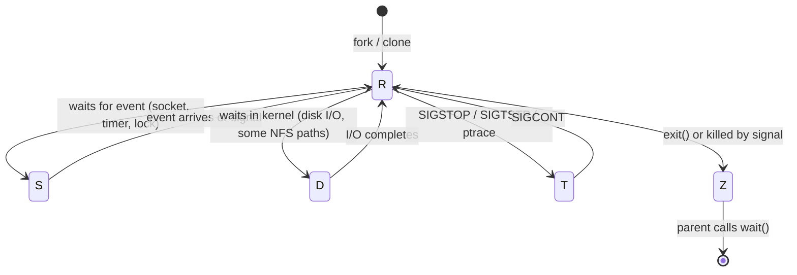
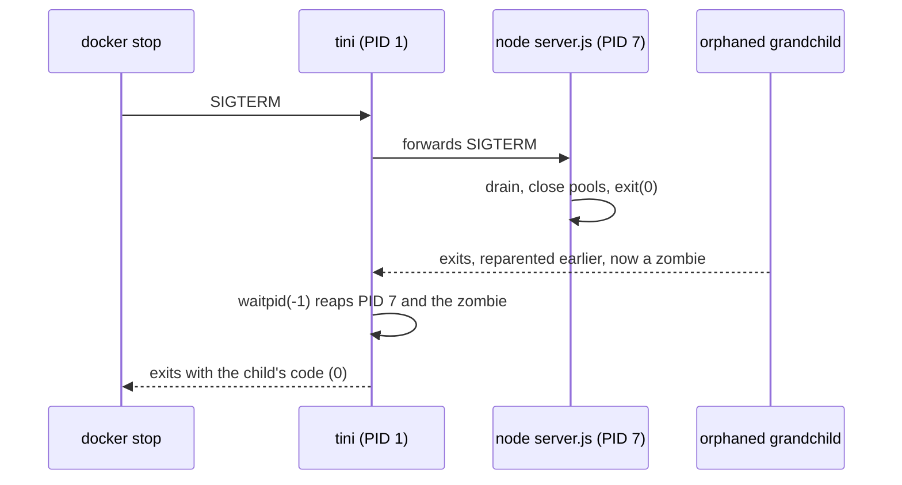

# Process Lifecycle

> **Module 04 · Operating Systems** · Prerequisites: [Process vs Thread](04-Process-vs-Thread.md) · Next: [Thread Lifecycle](06-Thread-Lifecycle.md)

---

## ⏱ If You Only Have 2 Minutes

- A Linux process moves through **R** (running or runnable), **S** (interruptible sleep), **D** (uninterruptible sleep), **T** (stopped) and **Z** (zombie). `ps -o pid,ppid,stat,cmd` shows the letter.
- The lifecycle is **fork → exec → exit → wait**. A child that has exited but has not been *waited for* by its parent is a **zombie**: no memory, no CPU, but it still holds a PID and its exit status.
- You cannot kill a zombie — it is already dead. You fix it by making the parent call `wait()`, or by killing the parent so the zombie is reparented to PID 1 (or a subreaper) that reaps it.
- An **orphan** is a live process whose parent died. The kernel reparents it to the nearest **child subreaper** or to PID 1.
- **PID 1 in a container is special:** the kernel does not apply the default "terminate" action to signals PID 1 has no handler for, and PID 1 is expected to reap orphans. Node and Python don't do that job. Use `docker run --init`, `tini` or `dumb-init`.
- Use the **exec form** `CMD ["node", "server.js"]`. The shell form `CMD npm start` makes `/bin/sh` PID 1, and your app may never see `SIGTERM`.
- Exit codes: a process killed by signal N shows as **128 + N** in shells, Docker and Kubernetes. **137** = SIGKILL (often the OOM killer or a stop timeout), **143** = SIGTERM. Python's `subprocess` reports the same death as **−N**.

---

## 1. What It Is and Why It Exists

A **process lifecycle** is the set of states a process passes through from creation to removal from the kernel's process table, and the rules for who cleans up after it.

**Analogy:** a hotel stay. Check-in is `fork`. Changing into your own clothes is `exec` — same room number (PID), new contents. Checking out is `exit`. But the room is only free once the front desk (the parent) has processed the bill (`wait`). If the desk never processes it, the room stays "occupied" with nobody inside — a zombie.

**The problem it solves.** The kernel must hand a child's exit status to the parent: "did the database migration succeed?" It cannot throw that status away when the child dies, because the parent may ask for it later. So it keeps a small record until the parent collects it. The lifecycle rules decide how long that record lives and who collects it when the parent is gone.

**What breaks without understanding it:**

- A deploy takes 10 extra seconds and then logs `exit code 137`, because the app ran as PID 1 and ignored `SIGTERM`.
- A container that shells out to `git` or `ffmpeg` slowly fills with `<defunct>` processes until `fork` fails with `EAGAIN` because the PID limit is reached.
- An on-call engineer runs `kill -9` on a process in state `D` and nothing happens.

Signal *handling* (handlers, graceful drain) is covered in [Signals](29-Signals.md) and [Node HTTP Server Concepts](../Module-02-Core-Backend/05-Node-HTTP-Server-Concepts.md). This chapter is about states, parents, reaping and exit codes.

---

## 2. How It Works

### The four system calls

1. **`fork()`** (on Linux, implemented with `clone()`) creates a copy of the calling process. The child gets a new PID; its parent PID (PPID) is the caller. Memory is shared copy-on-write, so the copy is cheap. Open file descriptors are inherited.
2. **`execve()`** replaces the program in the current process with a new one. The PID stays the same. File descriptors stay open unless marked close-on-exec. This is why `exec node server.js` in an entrypoint script makes Node take over the shell's PID.
3. **`exit()`** ends the process. The kernel closes its file descriptors, frees its memory, and turns it into a **zombie** holding only its PID, exit status and resource usage. The parent gets `SIGCHLD`.
4. **`wait()` / `waitpid()`** in the parent collects the exit status. Only now does the kernel delete the process-table entry and release the PID. This is called **reaping**.

Node's `child_process.spawn` and Python's `subprocess.Popen` both wrap a fork-then-exec style call. Both runtimes also reap their own children for you: Node (libuv) handles `SIGCHLD` and calls `waitpid` for each child it spawned, then emits `exit`; Python reaps when you call `wait()`, `poll()` or `communicate()`.

### States as `ps` shows them



| `STAT` | Name | Meaning | Can a signal wake/kill it? |
|---|---|---|---|
| `R` | Running / runnable | On a CPU, or in the run queue waiting for one. `ps` does not distinguish the two | Yes |
| `S` | Interruptible sleep | Waiting for an event: socket data, timer, `epoll_wait`, a futex. Most idle servers are here | Yes |
| `D` | Uninterruptible sleep | Waiting inside the kernel, usually for disk or network-filesystem I/O | No — not even `SIGKILL` until it returns |
| `T` / `t` | Stopped / traced | Stopped by job control (`Ctrl+Z`, `SIGSTOP`) or by a debugger | Only `SIGCONT` / `SIGKILL` |
| `Z` | Zombie (`<defunct>`) | Exited, waiting to be reaped | No — already dead |
| `I` | Idle kernel thread | Kernel threads that are idle; you will not see this for user processes | — |

Extra characters after the letter are flags: `s` session leader, `l` multi-threaded, `+` in the foreground process group, `<` high priority, `N` low priority (nice).

### Orphans and reparenting

If a parent dies first, its living children become **orphans**. The kernel reparents each one to the nearest ancestor marked as a **child subreaper** (set with `prctl(PR_SET_CHILD_SUBREAPER)`; `systemd` and `tini -s` use it), otherwise to PID 1 of the process's PID namespace. The new parent is then responsible for reaping it. Any zombies the dead parent left behind are reparented too, and a well-behaved PID 1 reaps them at once.

### PID 1 in a container

A container gets its own **PID namespace**. The first process started in it is PID 1 there, and it inherits two jobs that `init` normally does on a full Linux system:

1. **Signals.** Per [`pid_namespaces(7)`](https://man7.org/linux/man-pages/man7/pid_namespaces.7.html), the kernel only delivers signals to a namespace's init process if it has installed a handler for them. `SIGKILL` and `SIGSTOP` sent from the parent namespace are the exception. So `docker stop` sends `SIGTERM`; if PID 1 has no `SIGTERM` handler, nothing happens; after the grace period (10 s for `docker stop`, 30 s by default in Kubernetes) the runtime sends `SIGKILL`, and the container exits with 137.
2. **Reaping.** Every orphan in the container is reparented to PID 1. Node and Python only wait for children *they* spawned. A grandchild that gets orphaned — for example, a background process started by a shell script you ran — becomes a zombie that nobody reaps.



`tini` and `dumb-init` are tiny init programs that do exactly two things: forward signals to the child and reap every zombie. `docker run --init` injects tini for you. In Kubernetes, `shareProcessNamespace: true` makes the pod's `pause` container PID 1, and it reaps zombies.

### Exec form vs shell form

```dockerfile
# Shell form: Docker runs  /bin/sh -c "npm start"  → sh is PID 1, npm is its child, node a grandchild.
CMD npm start

# Exec form: node is PID 1 itself and receives SIGTERM directly.
CMD ["node", "server.js"]

# Exec form plus a real init: tini is PID 1, forwards signals and reaps zombies.
ENTRYPOINT ["tini", "--"]
CMD ["node", "server.js"]
```

With the shell form, `SIGTERM` goes to `sh`. A shell running as PID 1 has no `SIGTERM` handler and typically does not forward the signal, so your app never starts draining. `npm` adds another layer between the signal and your process; whether it forwards signals has varied across versions, so don't rely on it. If you need a shell entrypoint script, end it with `exec node server.js` so Node replaces the shell.

---

## 3. Key Concepts

### Exit status and exit codes

A process ends in one of two ways: it calls `exit(n)` (`n` is 0–255), or it is **killed by a signal**. `waitpid` returns a status word that encodes which one happened. Each layer reports it differently:

| Layer | Normal `exit(3)` | Killed by SIGTERM (15) | Killed by SIGKILL (9) |
|---|---|---|---|
| C `waitpid` | `WIFEXITED`, `WEXITSTATUS = 3` | `WIFSIGNALED`, `WTERMSIG = 15` | `WIFSIGNALED`, `WTERMSIG = 9` |
| Shell `$?`, Docker, Kubernetes | 3 | 143 | 137 |
| Node `child.on('exit', (code, signal))` | `code = 3, signal = null` | `code = null, signal = 'SIGTERM'` | `code = null, signal = 'SIGKILL'` |
| Python `Popen.returncode` | 3 | −15 | −9 |

Codes worth knowing: **130** = SIGINT (Ctrl+C), **137** = SIGKILL, **139** = SIGSEGV, **143** = SIGTERM. A **137 does not prove an OOM kill**: a stop timeout also ends in SIGKILL. Check `docker inspect --format '{{.State.OOMKilled}}'` or the `Last State: Terminated, Reason: OOMKilled` line in `kubectl describe pod`.

Note that a program can also `exit(137)` on purpose. The shell cannot tell that apart from a real signal death; `waitpid` can.

### Zombies

A zombie is a process-table entry, not a running program. It uses no CPU and no user memory. The harm is in numbers: each zombie holds a PID. The cgroup `pids.max` limit (Kubernetes sets a per-pod PID limit when configured) counts them, and so does the system-wide `kernel.pid_max`. When the limit is hit, `fork` fails with `EAGAIN` and your app can no longer spawn anything.

Ways to get rid of them:

| Fix | When |
|---|---|
| Make the parent call `wait`/`waitpid` (or let the runtime do it: `await` the child's `exit`, call `Popen.wait()`) | You own the parent's code |
| Kill the parent; the zombies are reparented and reaped by PID 1 | The parent is buggy and expendable |
| Run a real init as PID 1 (`--init`, `tini`, `dumb-init`) | Containers, always |
| Set `SIGCHLD` to `SIG_IGN` in the parent | C programs that never need exit codes; children are then reaped automatically |

### Orphans and subreapers

An orphan is alive and running; it simply has a new parent. This is how classic daemons "detach": fork, let the parent exit, and the child is adopted by init. Orphans are not a problem by themselves. They become one when the adopter never reaps them, or when a supervisor loses track of a child it was supposed to stop during shutdown.

### Uninterruptible sleep (`D`)

`D` means the task is inside the kernel in a state that must not be interrupted, typically waiting for a block-device or NFS response. Signals are queued but not acted on until it leaves that state, so `kill -9` appears to do nothing. Many `D` processes usually point to a storage problem — a hung NFS mount or a saturated disk — not to your code. On Linux, tasks in `D` also count toward the load average (see [CPU Scheduling](07-CPU-Scheduling.md)).

### Observing the lifecycle

```bash
ps -o pid,ppid,stat,cmd --forest -e        # tree view with states
ps -eo pid,ppid,stat,cmd | awk '$3 ~ /^Z/'  # all zombies and their parents
grep -E 'State|PPid' /proc/4211/status      # one process, from the kernel directly
cat /sys/fs/cgroup/pids.current /sys/fs/cgroup/pids.max   # PID usage vs limit in a container
```

Illustrative output:

```text
    PID    PPID STAT CMD
      1       0 Ss   node server.js
     27       1 Sl   node server.js
     41       1 Z    [convert] <defunct>
     44       1 Z    [convert] <defunct>
```

Here Node is PID 1. PIDs 41 and 44 were started by a shell script that has since exited; they were reparented to Node, and Node never reaps processes it did not spawn.

---

## 4. Code Examples

Scenario: spawn a child, reap it, read how it died, and deliberately create a zombie so you can see it in `ps`. The zombie trick works the same in both languages: `sh -c "sleep 0.1 & exec sleep 30"` starts a short `sleep` in the background, then `exec`s into a long `sleep` that never calls `wait` — so the short one becomes a zombie under it.

### Node.js / TypeScript

```ts
// No npm packages — Node.js 22+, TypeScript 5, ESM. Linux only (uses procps `ps`).
import { spawn, execFileSync } from "node:child_process";
import { once } from "node:events";
import { constants } from "node:os";
import { setTimeout as sleep } from "node:timers/promises";

type ExitInfo = [code: number | null, signal: NodeJS.Signals | null];

// Translate Node's (code, signal) pair into the 128+N convention used by shells, Docker and Kubernetes.
function shellExitCode([code, signal]: ExitInfo): number {
  if (signal) return 128 + ((constants.signals as Record<string, number>)[signal] ?? 0);
  return code ?? 1;
}

function ps(args: string[]): string {
  try {
    return execFileSync("ps", ["-o", "pid,ppid,stat,cmd", ...args], { encoding: "utf8" });
  } catch {
    return "(no matching process)\n"; // ps exits 1 when nothing matches, e.g. after reaping
  }
}

// 1. Normal lifecycle. libuv reaps the child on SIGCHLD and only then emits 'exit'.
const ok = spawn("sh", ["-c", "exit 3"]);
console.log("normal exit:", shellExitCode((await once(ok, "exit")) as ExitInfo)); // 3

// 2. Death by signal: code is null and signal is set — the shell would print 143.
const victim = spawn("sleep", ["30"]);
victim.kill("SIGTERM");
const info = (await once(victim, "exit")) as ExitInfo;
console.log(`signal=${info[1]} → shell sees ${shellExitCode(info)}`); // SIGTERM → 143

// 3. A zombie: the grandchild exits, but its parent (the exec'd `sleep 30`) never waits.
const parent = spawn("sh", ["-c", "sleep 0.1 & exec sleep 30"]);
await sleep(500);
const zombiePid = execFileSync("ps", ["-o", "pid=", "--ppid", String(parent.pid)], { encoding: "utf8" }).trim();
process.stdout.write(ps(["-p", `${parent.pid},${zombiePid}`]));

// Killing the parent orphans the zombie; PID 1 (or a subreaper) adopts and reaps it.
// Run this script as PID 1 in a container WITHOUT --init and the zombie stays, with PPID 1.
parent.kill("SIGKILL");
await once(parent, "exit");
await sleep(200);
process.stdout.write(ps(["-p", zombiePid]));
```

Illustrative output on a normal Linux host:

```text
normal exit: 3
signal=SIGTERM → shell sees 143
    PID    PPID STAT CMD
  51230   51190 S    sleep 30
  51232   51230 Z    [sleep] <defunct>
(no matching process)
```

### Python

```python
# Standard library only — Python 3.12+, Linux (uses procps `ps`).
import os
import signal
import subprocess
import time


def ps(*pids: int) -> str:
    # ps exits 1 when no PID matches; we just want to see the output.
    result = subprocess.run(["ps", "-o", "pid,ppid,stat,cmd", "-p", ",".join(map(str, pids))],
                            capture_output=True, text=True)
    return result.stdout


# 1. Forgetting to wait: the child exits and stays a zombie until we reap it.
child = subprocess.Popen(["sleep", "0.1"])
time.sleep(0.5)
print(ps(child.pid))            # STAT Z  [sleep] <defunct>
child.wait()                    # waitpid() collects the status; the kernel frees the PID
print("returncode:", child.returncode, "| after reaping:", ps(child.pid).strip())

# 2. Death by signal: Python reports -N, while shells and Docker report 128+N.
victim = subprocess.Popen(["sleep", "30"])
victim.send_signal(signal.SIGTERM)
rc = victim.wait()
print(f"returncode={rc} → shell sees {128 - rc}")   # -15 → 143

# 3. The raw calls: fork, exec, waitpid, and decoding the status word.
pid = os.fork()
if pid == 0:                     # child: replace this program; the PID stays the same
    os.execvp("sh", ["sh", "-c", "kill -KILL $$"])
_, status = os.waitpid(pid, 0)   # blocks until the child is a zombie, then reaps it
if os.WIFSIGNALED(status):
    print("killed by", signal.Signals(os.WTERMSIG(status)).name)   # SIGKILL
print("waitstatus_to_exitcode:", os.waitstatus_to_exitcode(status))  # -9

# 4. The same zombie trick as the Node example, observed from Python.
parent = subprocess.Popen(["sh", "-c", "sleep 0.1 & exec sleep 30"])
time.sleep(0.5)
zombie = int(subprocess.run(["ps", "-o", "pid=", "--ppid", str(parent.pid)],
                            capture_output=True, text=True).stdout)
print(ps(parent.pid, zombie))    # parent S, zombie Z
parent.kill()
parent.wait()                    # reap our own child; init adopts and reaps the zombie
time.sleep(0.2)
print("zombie after parent died:", ps(zombie).strip() or "gone")
```

**Runtime differences to notice:**

- Node reaps children **automatically** in the background and tells you through an event. Python reaps only when you call `wait()`, `poll()` or `communicate()`. A Python service that keeps a `Popen` object around without waiting on it leaves a zombie for as long as the object lives; dropped objects are only reaped when they are garbage-collected or when CPython's internal cleanup runs as the next `Popen` is created.
- Both runtimes wait only for **their own** children. Neither is a general-purpose reaper, which is exactly the job of PID 1.
- `os.fork()` in a process that already has threads now raises a `DeprecationWarning` (3.12+), because the child gets a copy of locks held by threads that do not exist in it. Prefer `subprocess` or `multiprocessing` with the `spawn` or `forkserver` start method.

---

## 5. Production Concerns

- **Always have an init as PID 1.** `docker run --init`, `ENTRYPOINT ["tini", "--"]`, or `dumb-init`. It costs almost nothing and fixes both signal delivery and zombie reaping. Even if your app never spawns children, a library or a health-check script might.
- **Still handle `SIGTERM` in the app.** An init forwards the signal; it does not drain your HTTP server. See [Signals](29-Signals.md) and the shutdown sequence in [Node HTTP Server Concepts](../Module-02-Core-Backend/05-Node-HTTP-Server-Concepts.md).
- **Watch the PID budget.** Alert on `pids.current` approaching `pids.max`, and on the zombie count (`ps -eo stat | grep -c '^Z'`). A slow climb in zombies points to a parent that never waits.
- **Log how children died.** For every child process, log the exit code *and* the signal. "Exited 1" and "killed by SIGKILL" mean very different things — the second is often the OOM killer or a supervisor timeout.
- **Bound child lifetimes.** Spawning `ffmpeg` or `git` without a timeout means a hung child holds a PID and file descriptors forever. Use Node's `spawn(cmd, args, { timeout, killSignal })` or `AbortSignal`, and Python's `subprocess.run(..., timeout=...)`, which kills **and reaps** the child on timeout.
- **Kill process groups, not just PIDs.** If a child starts its own children, killing only the child orphans the grandchildren. Start the child in its own process group (Node: `detached: true`; Python: `start_new_session=True`) and signal the group with a negative PID (`process.kill(-pid)`, `os.killpg`).
- **Investigate `D` states, don't fight them.** If tasks pile up in `D`, look at storage (`iostat`, NFS mounts, `dmesg` for hung-task warnings). Restarting the app will not help while the kernel is stuck.

---

## 6. Common Mistakes

- **`CMD npm start` (shell form)** — `sh` is PID 1, `SIGTERM` is not forwarded, every deploy waits for the timeout and ends in 137 — use `CMD ["node", "server.js"]` plus `--init`, or `exec` in the entrypoint script.
- **Assuming Node or Python as PID 1 is fine** — orphaned grandchildren pile up as zombies and unhandled signals are ignored — run `tini` / `dumb-init` / `--init` as PID 1.
- **`kill -9` on a zombie** — nothing happens, because it is already dead — reap it from the parent, or restart the parent.
- **Reading 137 as "out of memory"** — you chase memory when the real cause was a stop timeout — check the `OOMKilled` flag or reason, and the kernel log.
- **Fire-and-forget `subprocess.Popen` in Python** — zombies accumulate and the exit status is lost — call `wait()`/`communicate()`, or use `subprocess.run`.
- **Writing your own `waitpid(-1)` reaper inside an app** — it steals exit statuses that `subprocess` or libuv were waiting for, so their result is wrong — leave general reaping to a real init.
- **Killing only the direct child** — its own children are orphaned and keep running after shutdown — use process groups and signal the whole group.

---

## 7. Comparison Table

| PID 1 choice | Forwards signals | Reaps orphaned zombies | Notes |
|---|---|---|---|
| `/bin/sh -c` (shell form) | Typically no | Depends on the shell | Avoid |
| `node` / `python` directly (exec form) | n/a — it *is* the target; only handled signals arrive | Only its own children | Acceptable if the app installs `SIGTERM` handlers and never orphans processes |
| `tini` (`docker run --init`) | Yes | Yes | Tiny; the usual default |
| `dumb-init` | Yes (can rewrite signals) | Yes | Similar to tini; can signal the whole process group |
| `systemd` / full init | Yes | Yes | For VMs and "system containers", too heavy for one app |
| Kubernetes `shareProcessNamespace: true` | n/a — the runtime signals each container's main process, which is no longer PID 1 | Yes (the `pause` process) | Containers in the pod can see and signal each other's processes |

---

## 8. Interview Questions

**[Junior] What is a zombie process, and how do you get rid of one?**
A zombie is a process that has exited but whose parent has not yet called `wait()` to collect its exit status. It uses no CPU or memory, but it holds a PID and a process-table entry. You cannot kill it because it is already dead. You make the parent reap it, or you kill the parent so the zombie is reparented to PID 1, which reaps it.

**[Junior] A container exited with code 137. What does that mean?**
137 is 128 + 9, so the process was killed by `SIGKILL`. The two common causes are the kernel OOM killer (the container went over its memory limit) and a stop timeout: the runtime sent `SIGTERM`, the app did not exit within the grace period, and it was force-killed. Check the `OOMKilled` flag or Kubernetes' termination reason to tell them apart. 143 would mean it died from `SIGTERM` itself.

**[Mid] What is the difference between a zombie and an orphan?**
A zombie is dead but not yet reaped; an orphan is alive but has lost its parent. The kernel reparents an orphan to the nearest child subreaper or to PID 1, which becomes responsible for reaping it later. Orphans are normal (daemons are built that way); zombies are a bug when they accumulate.

**[Mid] Why does `docker stop` take exactly 10 seconds for this Node app?**
`docker stop` sends `SIGTERM` and waits 10 seconds before sending `SIGKILL`. If it always takes the full 10 seconds, the app never reacted to `SIGTERM`. Usual causes: the shell form `CMD npm start` makes `sh` PID 1 and the signal is not forwarded, or Node is PID 1 without a `SIGTERM` handler and the kernel does not apply the default action to PID 1. Fix: exec form plus `--init`, and a real shutdown handler.

**[Mid] Shell form vs exec form in a Dockerfile — what changes at runtime?**
The shell form wraps the command in `/bin/sh -c`, so the shell is PID 1 and your app is a child that may never receive the stop signal. The exec form runs the binary directly as PID 1, so it receives signals (if it handles them). With an entrypoint script, end it with `exec your-app` so the app replaces the shell and keeps PID 1.

**[Senior] A long-running container slowly accumulates hundreds of `<defunct>` processes and then fails with "fork: Resource temporarily unavailable". Walk through the diagnosis and fix.**
First, `ps -eo pid,ppid,stat,cmd` shows the zombies and their PPID. If the PPID is your app, the app spawns children and never waits — find the call site (a `Popen` that is never waited, a child whose `exit` is ignored) and fix it, and add timeouts. If the PPID is 1 and PID 1 is Node or Python, the zombies are orphaned grandchildren that only a real init would reap; add `--init`/`tini`. The fork failure is the cgroup `pids.max` or `kernel.pid_max` limit, because zombies still hold PIDs. Add an alert on `pids.current` and the zombie count so it is caught before it hits the limit.

**[Senior] A process is stuck and `kill -9` does nothing. What is going on?**
Check its state with `ps -o stat`. If it is `Z`, it is already dead and needs reaping by its parent. If it is `D`, it is in uninterruptible sleep inside the kernel, usually waiting for disk or network-filesystem I/O; the `SIGKILL` stays pending until the kernel call returns. Look at the storage side: hung NFS servers, a failing disk, `dmesg` hung-task warnings, `/proc/<pid>/stack` if you have permission. If it is `T`, it is stopped; `SIGKILL` still kills a stopped process, so in that case check whether the kill reached the right PID namespace.

**[Senior] You are writing a supervisor that runs N worker processes. What lifecycle duties does it have?**
It must reap every child (handle `SIGCHLD` or await each child's exit event) and record the code and signal of each death. It should restart crashed workers with exponential backoff so a crash loop does not burn CPU. On shutdown it forwards `SIGTERM` to each worker (or each worker's process group), waits up to a deadline, then sends `SIGKILL` and reaps them. Its own exit code should reflect failures, so the orchestrator sees them. If it runs as PID 1, it must also reap orphans it did not spawn — or it runs under `tini` so it does not have to.

---

## 9. Cheat Sheet

```text
States      R run/runnable · S sleep (interruptible) · D uninterruptible (I/O) · T stopped · Z zombie
Lifecycle   fork/clone → exec (same PID) → exit → zombie → parent wait() → gone
Zombie      dead, holds PID + status; can't be killed; fix the parent or kill it
Orphan      alive, parent died; reparented to nearest subreaper or PID 1
PID 1       only handled signals delivered (SIGKILL/SIGSTOP from parent ns excepted); must reap orphans
Containers  CMD ["node","server.js"] (exec form) + docker run --init / tini / dumb-init
Shell form  sh is PID 1 → SIGTERM not forwarded → stop timeout → 137
Exit codes  128+N for signals: 130 INT · 137 KILL (OOM or timeout) · 139 SEGV · 143 TERM
Node        child.on('exit', (code, signal)) — code null when killed; libuv reaps own children only
Python      Popen.returncode = -N when killed; must wait()/poll()/communicate() to reap
Observe     ps -o pid,ppid,stat,cmd --forest · /proc/<pid>/status · pids.current vs pids.max
Groups      detached:true / start_new_session=True, then kill(-pgid) to stop grandchildren too
```

---

## Related Topics

- [Processes](02-Processes.md) — what a process owns before it enters this lifecycle
- [Signals](29-Signals.md) — handling `SIGTERM`/`SIGINT` and writing a graceful shutdown
- [Thread Lifecycle](06-Thread-Lifecycle.md) — the same create/join/clean-up questions for threads
- [Memory Management](21-Memory-Management.md) — the OOM killer behind many 137 exit codes
- [Container Best Practices](../Module-10-DevOps-and-Cloud/11-Container-Best-Practices.md) — init processes, exec form and stop timeouts in images
