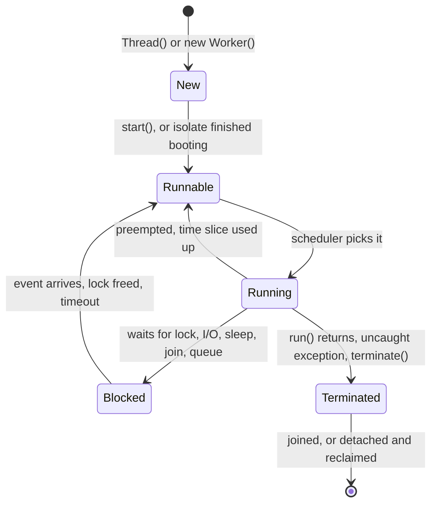

# Thread Lifecycle

> **Module 04 · Operating Systems** · Prerequisites: [Process Lifecycle](05-Process-Lifecycle.md) · Next: [CPU Scheduling](07-CPU-Scheduling.md)

---

## ⏱ If You Only Have 2 Minutes

- A thread moves through **new → runnable → running → blocked/waiting → terminated**. Linux has no "new" state: `clone()` makes a task that is runnable at once. "New" is a runtime object that has not been started yet (`threading.Thread` before `start()`, a `Worker` that is still booting its isolate).
- A finished thread must be **joined** (someone waits for it and collects its result) or **detached** (it cleans up after itself). An unjoined pthread keeps its stack and descriptor, much like a zombie process keeps its PID.
- **You cannot safely kill a thread.** Python has no API for it. Node's `worker.terminate()` exists, but it stops the worker's JavaScript wherever it is, and `finally` blocks do not run. Stopping a thread properly is **cooperative**: set a flag, and the thread checks it and exits by itself.
- Python **daemon threads** are stopped abruptly at interpreter exit. Their open files and transactions may not be cleaned up. Non-daemon threads make the interpreter **wait** at exit, so a thread that never stops makes shutdown hang.
- A Node `Worker` emits `online` → `message`* → (`error`) → `exit(code)`. Exit code 0 means its event loop ran empty, 1 means `terminate()` or an uncaught exception. `worker.unref()` lets the process exit while the worker is still running.
- A CPU loop in a Node worker never reads its message queue, so a "stop" **message** arrives only after the job ends. Use a `SharedArrayBuffer` flag (`Atomics.load`) for cancellation during the job.
- **Thread-local storage lives as long as the thread.** In a pool, the same thread runs many tasks, so stale thread-local values leak from one task into the next. In Python, `contextvars` follow the task instead.

---

## 1. What It Is and Why It Exists

The **thread lifecycle** is the sequence of states a thread goes through from creation to cleanup. It also covers the rules for three operations: starting a thread, waiting for it to finish (**join**), and asking it to stop (**cancellation**).

**Analogy:** a contractor you hire for a job. Signing the contract is *creating* the thread. The first day on site is *start*. Some days they wait for a delivery (*blocked*). When the job is done they hand you the keys and the invoice (*terminate*, and the result you *join* for). You cannot make a contractor vanish mid-task without leaving a half-built wall. You tell them "finish the current wall and go home" (*cooperative cancellation*), and you only call security (*terminate*) if they ignore you.

**The problem it solves.** Creating a thread is easy. Ending one correctly is hard, and the bugs show up at the worst moment, during a deploy:

- A Python service gets `SIGTERM`, but a non-daemon thread is stuck in a loop. The interpreter waits for it at exit, the orchestrator's grace period runs out, and the container is killed with exit code 137.
- The same service marks that thread `daemon=True` to "fix" the hang. Now the thread dies in the middle of writing a batch to the database, and half the batch is lost.
- A Node service calls `worker.terminate()` on shutdown. The worker was holding a temporary file and a lock row in PostgreSQL. Its `finally` block never runs, so the file and the lock row stay behind.
- A request handler stores the user ID in thread-local storage. The pool thread serves the next request with the previous user's ID.

This chapter covers the lifecycle of one thread, and how to start it, stop it and clean up after it in Node and Python. What threads *are* and what they share is in [Threads](03-Threads.md). Process states, zombies and PID 1 are in [Process Lifecycle](05-Process-Lifecycle.md).

---

## 2. How It Works

### The states



| State | Meaning | Linux `STAT` for the task | Python view | Node view |
|---|---|---|---|---|
| New | The object exists; no kernel task yet | — | `is_alive()` is `False`, `ident` is `None` | `new Worker()` returned; isolate still booting |
| Runnable / running | On a CPU, or in the run queue waiting for one | `R` | `is_alive()` is `True` | After `online` |
| Blocked / waiting | Sleeping until an event: socket data, a futex (lock), a timer, `epoll_wait` | `S` (interruptible), `D` (uninterruptible I/O) | `is_alive()` is `True` | Worker's loop idle in `epoll_wait` |
| Terminated | Its function returned or it was stopped | Gone from `/proc/<pid>/task/` | `is_alive()` is `False` | `exit` event emitted |

The kernel's own model is simpler than the runtime's. `clone()` creates a task that is runnable right away. "New" only exists in the runtime: the Python object before `start()`, or the few milliseconds while a Node worker boots its V8 isolate. "Running" versus "runnable" is a scheduler detail ([CPU Scheduling](07-CPU-Scheduling.md)): `ps` shows both as `R`.

### Start, join and detach

1. **Start.** `pthread_create` (used by both runtimes) allocates a stack, calls `clone()`, and the new task begins running the thread function. Python's `Thread.start()` waits until the new thread has actually started before it returns. A `Worker` reports `online` once the isolate is up and it begins executing JavaScript.
2. **Run.** The thread alternates between running and blocked, as the scheduler and its own waits decide.
3. **Terminate.** The function returns, an uncaught exception ends it, or it is stopped from outside. Its kernel task disappears, and its TID is gone from `/proc/<pid>/task/`.
4. **Join or detach.** In pthreads, a terminated *joinable* thread keeps its stack and exit value until another thread calls `pthread_join`. A *detached* thread (`pthread_detach`) releases them by itself, but nobody can wait for it. Python's `Thread.join()` and Node's `exit` event are the runtime versions of join. Python has no "detach" in the pthread sense; daemon threads are the closest thing.

There is one lifecycle quirk at the process level. If the **main thread** of a C program returns from `main()`, `exit()` runs and kills every other thread. If it calls `pthread_exit()` instead, the process keeps running. `ps` then shows the main thread as a zombie (`Z`) until the last thread ends. Runtimes hide this: Python's main thread waits for non-daemon threads before it exits, and Node keeps the process alive while a referenced `Worker` is running.

### How each runtime ends threads

**Python**

- When the main thread finishes, the interpreter calls `join()` on every **non-daemon** thread, then shuts down. One stuck thread means the process never exits.
- **Daemon** threads (`daemon=True`, set before `start()`) are not waited for. The Python docs warn that they "are abruptly stopped at shutdown. Their resources (such as open files, database transactions, etc.) may not be released properly."
- There is **no way to kill a thread**. There is a C-API function, `PyThreadState_SetAsyncExc`, that raises an exception in another thread. It only fires at the next bytecode boundary, so it cannot interrupt a blocking call or C code. Don't use it.
- An uncaught exception ends that thread only. `threading.excepthook` decides how it is reported (by default it prints a traceback).
- `ThreadPoolExecutor` threads are not daemon threads (since 3.9). Interpreter exit waits for queued work to finish unless you call `shutdown(cancel_futures=True)`.

**Node.js**

- A `Worker` has its own event loop. Like the main process, it **exits by itself when its loop has nothing left to do**, with exit code 0. A `parentPort.on("message")` listener keeps it alive. Removing the listener (or calling `parentPort.close()`) lets it finish.
- `process.exit(code)` inside a worker ends **only that worker**, with that code.
- `worker.terminate()` stops the worker's JavaScript "as soon as possible", even in the middle of a loop, and returns a promise for the exit code (1). Pending callbacks, `finally` blocks and async cleanup in the worker do **not** run.
- An uncaught exception emits `error` on the `Worker` in the main thread, then `exit` with code 1. Exceeding `resourceLimits` emits an `ERR_WORKER_OUT_OF_MEMORY` error.
- A running worker keeps the **process** alive. `worker.unref()` removes that hold, so the process can exit while the worker is still running. The worker is then torn down with the process.

### Observing thread states

```bash
ps -L -o pid,tid,stat,wchan:22,comm -p 4211     # every thread, its state and where it sleeps
cat /proc/4211/task/4219/status | grep -E 'State|ctxt'
py-spy dump --pid 5120                          # Python: each thread's current stack
```

Illustrative output for the Node example in section 4, while the worker runs a job:

```text
    PID     TID STAT WCHAN                  COMMAND
   4211    4211 Sl   do_epoll_wait          node
   4211    4212 Sl   futex_wait_queue       node
   4211    4213 Sl   futex_wait_queue       node
   4211    4219 Rl   -                      node
```

The main thread (TID = PID) sleeps in `epoll_wait` waiting for events. The V8 and libuv helpers sleep on futexes. The worker (TID 4219) is `R`, burning CPU. A thread stuck forever in `futex_wait…` usually waits on a lock or condition that nobody will signal, and that is the thread that blocks your shutdown. Kernel function names vary between kernel versions.

---

## 3. Key Concepts

### Join: waiting for a thread and collecting its result

Joining does two things. It **synchronizes**, because the caller waits until the thread has finished. It also **reclaims** the thread: its result or exception is collected, and in C its stack is freed.

| | C / pthreads | Python | Node `worker_threads` |
|---|---|---|---|
| Wait for exit | `pthread_join(t, &ret)` | `t.join(timeout=None)` | `once(worker, "exit")` or `worker.on("exit", …)` |
| With a time limit | `pthread_timedjoin_np` (GNU) | `t.join(timeout)`, then check `t.is_alive()` | Race the `exit` event against a timer |
| Get the result | Return value via `ret` | Not built in: use a `Future` (`ThreadPoolExecutor`) or a queue | `message` events before `exit` |
| Errors | — | `threading.excepthook`; `Future.exception()` | `error` event, then exit code 1 |
| Self-cleaning | `pthread_detach` | daemon thread (killed at exit, not cleaned) | `worker.unref()` (killed at exit) |

Two Python details catch people. `join(timeout)` **always returns `None`**, so you must call `is_alive()` to know whether it timed out. Calling `join()` from the thread itself raises `RuntimeError`, because it would wait forever.

### Daemon threads and process exit

A **daemon** thread is "background helper; don't wait for me". The name has nothing to do with Unix daemon processes.

| | Non-daemon thread (default) | Daemon thread |
|---|---|---|
| Interpreter exit | Waits for it | Does not wait |
| What happens to it at exit | It finishes normally | Stopped abruptly; no `finally`, no flush |
| Risk | A stuck thread hangs shutdown | Lost writes, half-finished transactions |
| Good for | Anything that writes data or holds external resources | Pure helpers you can lose at any moment: a heartbeat log, a metrics sampler, a cache warmer |

The right fix for "shutdown hangs" is almost never `daemon=True`. Make the thread cancellable and join it with a deadline.

Node's version of this choice is `ref()`/`unref()`. A referenced worker keeps the process alive, like a non-daemon thread. An unreferenced one dies with the process, like a daemon thread.

### Cooperative cancellation

Stopping a thread from outside is unsafe in every runtime. The thread may be holding a lock (and every other thread then deadlocks), or it may be halfway through updating a shared structure, or it may hold a file or socket. Instead, the thread **cooperates**: it checks a stop signal at safe points and returns by itself.

| Where the thread is | Python | Node worker |
|---|---|---|
| CPU loop | Check `stop.is_set()` every N iterations | Check `Atomics.load(flag, 0)` every N iterations (it cannot see messages) |
| Sleeping between jobs | `stop.wait(timeout)` instead of `time.sleep` | Timers from `node:timers/promises` with an `AbortSignal` |
| Waiting for a job | `queue.get(timeout=…)` in a loop, or a sentinel ("poison pill") value | `message` listener: a `{type: "stop"}` message works here |
| Blocked on a socket | Socket timeouts; or `sock.shutdown(SHUT_RDWR)` from another thread to wake the `recv` | Use non-blocking I/O, so the worker's loop stays free |
| Cannot cooperate (third-party CPU code) | Run it in a **process** and kill that | `worker.terminate()` |

In Node, the request-level `AbortSignal` from [Concurrency](09-Concurrency.md) does not cross into a worker by itself. Posted inside a message, an ordinary signal arrives as an empty object, with no error. `util.transferableAbortSignal(signal)` makes a signal you can put in the transfer list. The simpler bridge is `signal.addEventListener("abort", () => Atomics.store(flag, 0, 1))`, which also reaches a worker that is busy in a loop.

### Clean shutdown, in order

1. **Stop accepting new work.** Close the job queue, or stop sending jobs to workers.
2. **Signal stop.** Set the `Event` or the shared flag, and push a sentinel to wake any thread blocked on an empty queue.
3. **Decide: drain or cancel.** Either finish the queued jobs or drop them, and document which. The examples below cancel.
4. **Join with a deadline.** Choose it shorter than the orchestrator's grace period (`docker stop` waits 10 s, Kubernetes 30 s by default), and leave time for the rest of shutdown.
5. **Escalate.** Node: `worker.terminate()`. Python: log which thread is stuck (`py-spy dump`, `faulthandler.dump_traceback`), then exit anyway with `os._exit()`. You cannot kill the thread, but you can end the process.
6. **Release what the threads owned.** Close connections, flush buffers, remove temporary files, ideally in each thread's own `finally`.

In Python, signal handlers always run in the **main thread** ([Signals](29-Signals.md)). The main thread must therefore wait in a way that lets the handler run, such as `stop.wait()` or `join()`. The handler itself should only set a flag.

### Thread-local storage over a thread's life

Thread-local storage (TLS) gives each thread its own value for a variable. It is created the first time a thread touches it and destroyed when that thread exits. In C, `pthread_key_create` takes a destructor that runs at thread exit; in Python the thread's `threading.local` data is dropped when the thread ends. That lifecycle has two consequences:

- **Pools keep threads alive, so TLS outlives each task.** A value set during request A is still there when the same pool thread runs request B. Reset TLS at the start of every task, or use `contextvars`, which belong to the task's context rather than the thread.
- **Thread-affine resources must be created and closed in their own thread.** Python's `sqlite3` connections refuse to be used from another thread by default (`check_same_thread=True`). A per-thread connection created with `ThreadPoolExecutor(initializer=…)` cannot be closed by the main thread at shutdown. Own those threads yourself and close the resource in the thread's `finally`.

In Node, each worker's module-level variables are already per-thread, because each worker is its own isolate. They are created when the worker boots and freed when it exits. `AsyncLocalStorage` is not thread-local storage: it follows an async call chain inside one thread, and it does not cross `postMessage`.

---

## 4. Code Examples

Scenario: a background worker processes CPU-heavy jobs (a stand-in for report generation or image work). On `SIGTERM` it must stop **the job that is running now**, skip the queued ones, run its cleanup, and exit before the orchestrator's grace period ends. If it does not stop in time, the service escalates.

### Node.js / TypeScript

```ts
// No npm packages — Node.js 22+, TypeScript 5, ESM. Compile with tsc, then: node dist/lifecycle.js
import { setTimeout as sleep } from "node:timers/promises";
import { Worker, isMainThread, parentPort, workerData } from "node:worker_threads";

type Job = { type: "job"; id: number; n: number };
type Msg = Job | { type: "stop" };

function runJob(job: Job, stop: Int32Array): void {
  let acc = 0;
  for (let i = 0; i < job.n; i++) {
    // A busy loop never returns to the worker's event loop, so a "stop" *message* would wait
    // until the job ends. Shared memory is visible immediately, so poll it every 65,536 steps.
    if ((i & 0xffff) === 0 && Atomics.load(stop, 0) === 1) {
      parentPort!.postMessage({ id: job.id, cancelledAt: i });
      return;
    }
    acc = (acc + i * i) % 1_000_003;
  }
  parentPort!.postMessage({ id: job.id, result: acc });
}

if (!isMainThread) {
  const stop = new Int32Array(workerData.stop as SharedArrayBuffer);
  const onMessage = (msg: Msg): void => {
    if (msg.type === "job") return runJob(msg, stop);
    // Removing the last 'message' listener unrefs the port: the worker's loop is now empty,
    // so the thread finishes on its own with exit code 0. No process.exit() needed.
    parentPort!.off("message", onMessage);
  };
  parentPort!.on("message", onMessage);
} else {
  const stopBuf = new SharedArrayBuffer(4);
  const worker = new Worker(new URL(import.meta.url), { workerData: { stop: stopBuf } });
  // Not events.once(): that would reject if 'error' fires first. We want the exit code either way.
  const exited = new Promise<number>((resolve) => worker.once("exit", resolve));

  worker.on("online", () => console.log(`[main] worker ${worker.threadId} online`));
  worker.on("message", (m) => console.log("[main] worker says", m));
  worker.on("error", (err) => console.error("[main] worker crashed:", err.message)); // 'exit' follows

  for (let id = 1; id <= 3; id++) worker.postMessage({ type: "job", id, n: 2_000_000_000 } satisfies Msg);

  let shuttingDown = false;
  async function shutdown(signal: string, graceMs = 2_000): Promise<void> {
    if (shuttingDown) return;
    shuttingDown = true;
    console.log(`[main] ${signal}: asking the worker to stop`);
    Atomics.store(new Int32Array(stopBuf), 0, 1);  // reaches the job that is running now
    worker.postMessage({ type: "stop" } satisfies Msg); // queued behind jobs 2 and 3, which cancel at once

    const timeout = new AbortController();
    const outcome = await Promise.race([
      exited.then((code) => ({ code })),
      sleep(graceMs, null, { signal: timeout.signal }).then(() => null, () => null),
    ]);
    timeout.abort(); // do not keep the process alive for an unused timer

    if (outcome) {
      console.log(`[main] worker exited by itself, code ${outcome.code}`);
    } else {
      // Last resort: V8 stops the thread wherever it is. Its finally-blocks and async cleanup do not get to run.
      console.log(`[main] grace period over, terminate() -> code ${await worker.terminate()}`);
      process.exitCode = 1;
    }
  }

  process.once("SIGTERM", () => void shutdown("SIGTERM"));
  process.once("SIGINT", () => void shutdown("SIGINT"));
  setTimeout(() => process.kill(process.pid, "SIGTERM"), 300); // simulate `docker stop` for the demo
}
```

Output (run in a `node:22` container):

```text
[main] worker 1 online
[main] SIGTERM: asking the worker to stop
[main] worker says { id: 1, cancelledAt: 16384000 }
[main] worker says { id: 2, cancelledAt: 0 }
[main] worker says { id: 3, cancelledAt: 0 }
[main] worker exited by itself, code 0
```

Job 1 was 16 million steps into its loop when the flag flipped, and it stopped within one polling interval. Jobs 2 and 3 were still in the worker's message queue. They were delivered after job 1 returned and cancelled immediately. The `stop` message came last and removed the listener, so the worker's loop ran empty and it exited with code 0. If you delete the `Atomics.load` check, job 1 runs for several more seconds, the 2-second grace period expires, and `terminate()` returns 1.

### Python

```python
# No pip packages — Python 3.12+ (stdlib only). Linux reference; signals as on any POSIX system.
import logging
import os
import queue
import signal
import threading
import time

logging.basicConfig(level=logging.INFO, format="%(threadName)-10s %(message)s")
STOP = object()  # sentinel ("poison pill"): tells the worker there is no more work


class JobWorker(threading.Thread):
    def __init__(self, jobs: queue.Queue, stop: threading.Event) -> None:
        # daemon=False: interpreter exit waits for this thread instead of killing it mid-job.
        super().__init__(name="job-worker", daemon=False)
        self.jobs, self.stop = jobs, stop

    def run(self) -> None:
        logging.info("started, native TID %d", threading.get_native_id())
        try:
            while not self.stop.is_set():
                try:
                    job = self.jobs.get(timeout=0.5)  # wake up regularly to re-check the flag
                except queue.Empty:
                    continue
                if job is STOP:
                    break
                self.run_job(*job)
        finally:
            logging.info("cleanup: flush buffers, close connections")  # runs on every normal exit path

    def run_job(self, job_id: int, n: int) -> None:
        acc = 0
        for i in range(n):
            # Python cannot kill a thread from outside, so long work must check the flag itself.
            if i % 65_536 == 0 and self.stop.is_set():
                logging.info("job %d cancelled at step %d", job_id, i)
                return
            acc = (acc + i * i) % 1_000_003
        logging.info("job %d done: %d", job_id, acc)


def main(grace_s: float = 2.0) -> int:
    stop = threading.Event()
    jobs: queue.Queue = queue.Queue(maxsize=100)
    worker = JobWorker(jobs, stop)
    threading.excepthook = lambda a: logging.error("thread %s died: %r", a.thread.name, a.exc_value)

    # Handlers always run in the main thread, so the handler only flips a flag.
    for sig in (signal.SIGTERM, signal.SIGINT):
        signal.signal(sig, lambda signum, _frame: stop.set())

    worker.start()
    for job_id in (1, 2, 3):
        jobs.put((job_id, 50_000_000))
    threading.Timer(0.3, os.kill, (os.getpid(), signal.SIGTERM)).start()  # simulate `docker stop`

    stop.wait()  # sleep until a signal arrives; the main thread stays free to run the handler
    logging.info("stop requested, joining worker (grace %.1f s)", grace_s)
    try:
        jobs.put_nowait(STOP)  # wakes a worker blocked in get() now instead of after its 0.5 s timeout
    except queue.Full:
        pass  # the worker is busy anyway and will see the flag
    worker.join(timeout=grace_s)  # join() returns None either way: ask is_alive() what happened
    if worker.is_alive():
        logging.error("worker did not stop in time; exiting without it")
        logging.shutdown()
        os._exit(1)  # skips the interpreter's wait for non-daemon threads (and all other cleanup)
    return 0


if __name__ == "__main__":
    t0 = time.perf_counter()
    code = main()
    logging.info("exit %d after %.2f s", code, time.perf_counter() - t0)
    raise SystemExit(code)
```

Output (run in a `python:3.12` container):

```text
job-worker started, native TID 7
MainThread stop requested, joining worker (grace 2.0 s)
job-worker job 1 cancelled at step 2424832
job-worker cleanup: flush buffers, close connections
MainThread exit 0 after 0.32 s
```

Thread-local storage in a pool: a short demonstration of the stale-value problem, and of how `contextvars` differ.

```python
# No pip packages — Python 3.12+ (stdlib only).
import asyncio
import contextvars
import threading
from concurrent.futures import ThreadPoolExecutor

local = threading.local()  # one attribute namespace per thread, alive as long as the thread
request_id = contextvars.ContextVar("request_id", default="-")


def handle(req: str, sets_user: bool) -> str:
    if sets_user:
        local.user = f"user-of-{req}"
    user = getattr(local, "user", None)
    return f"{req}: thread={threading.current_thread().name} local.user={user} ctx={request_id.get()}"


async def main() -> None:
    with ThreadPoolExecutor(max_workers=1, thread_name_prefix="pool") as pool:
        print(pool.submit(handle, "req-1", True).result())
        # Same pooled thread, new task: it still sees req-1's thread-local value.
        print(pool.submit(handle, "req-2", False).result())

        request_id.set("req-3")
        # submit() does not copy the caller's contextvars into the pool thread...
        print(pool.submit(handle, "req-3", False).result())
        # ...unless you run the call inside a copy of the current context.
        print(pool.submit(contextvars.copy_context().run, handle, "req-3", False).result())
    # asyncio.to_thread copies the context for you (and uses the loop's default executor).
    print(await asyncio.to_thread(handle, "req-3", False))


if __name__ == "__main__":
    asyncio.run(main())
```

```text
req-1: thread=pool_0 local.user=user-of-req-1 ctx=-
req-2: thread=pool_0 local.user=user-of-req-1 ctx=-
req-3: thread=pool_0 local.user=user-of-req-1 ctx=-
req-3: thread=pool_0 local.user=user-of-req-1 ctx=req-3
req-3: thread=asyncio_0 local.user=None ctx=req-3
```

**Runtime differences to notice:**

- **Node can stop a thread; Python cannot.** `terminate()` is a real escape hatch for a worker that ignores you, at the cost of skipped cleanup. A Python thread that ignores its flag can only be abandoned. `os._exit()` ends the whole process, which is why truly uncancellable work belongs in a child process you can `kill()`.
- **Where the check lives differs.** The Python worker sees `stop.is_set()` from any thread, because all threads share the same objects. The Node worker cannot see the main thread's variables at all. It needs a `SharedArrayBuffer`, the only memory both isolates can read.
- **"Done" is detected differently.** The Node worker exits because its event loop ran empty, the same rule that ends a Node process. The Python thread exits because `run()` returned.

---

## 5. Production Concerns

- **Budget shutdown time end to end.** The orchestrator's grace period (Kubernetes `terminationGracePeriodSeconds`, 30 s by default) has to cover the HTTP drain, joining worker threads, and closing pools. Give the thread join an explicit deadline inside that budget, then log and escalate. Never call `join()` without a timeout in a shutdown path.
- **Make long jobs resumable rather than unkillable.** If a job can take minutes, check the stop flag between steps and record progress (a cursor, an offset, a job status row). Then a cancelled job can be picked up by the next process instead of being lost or blocking the deploy.
- **Detect dead workers.** A thread that dies from an exception does not take the service down, so throughput quietly drops. Count `exit` events with non-zero codes (Node) and `threading.excepthook` calls (Python) as metrics, and restart workers with backoff. A pool that is short of workers looks like "the queue is slowly growing".
- **Watch the thread count over time.** `grep Threads /proc/<pid>/status`, or the `process_threads` metric in some exporters. A count that only goes up means threads are started and never joined, or are blocked forever. Every thread is a task that counts against the cgroup `pids.max`, and the leak ends with `pthread_create` failing with `EAGAIN`.
- **Find the stuck thread before you kill it.** `py-spy dump --pid <pid>` prints every Python thread's stack. `faulthandler.dump_traceback_later(timeout)` can print stacks automatically if shutdown takes too long. For Node, `node --inspect` attaches to workers too. Kernel side: `ps -L -o tid,stat,wchan` shows which TID sleeps where.
- **Prefer pools with an explicit lifecycle.** Create the pool once at start-up, and shut it down in your lifespan hook (FastAPI `lifespan`, Node's shutdown handler). For Python, `shutdown(wait=True, cancel_futures=True)` drops queued work and waits only for running tasks. Creating executors per request leaks threads when an exception skips the `with` block's exit.

---

## 6. Common Mistakes

- **`daemon=True` to make shutdown "work"** — the hang disappears, but the thread now dies mid-write and corrupts or loses data — keep it non-daemon, make it check a stop `Event`, and join it with a timeout.
- **`time.sleep(60)` in a worker loop** — the thread cannot see the stop flag for up to a minute, so shutdown always times out — use `stop.wait(60)`, which returns as soon as the event is set.
- **Sending a "stop" message to a Node worker that is in a CPU loop** — the message waits in the queue until the loop finishes, so the stop arrives too late — poll a `SharedArrayBuffer` flag with `Atomics.load`, or split the job into chunks that yield between them.
- **Using `worker.terminate()` as the normal shutdown path** — `finally` blocks, temp-file cleanup and lock releases are skipped every deploy — ask first, wait with a deadline, and terminate only as an escalation.
- **Treating `join(timeout)`'s return value as success** — it always returns `None`, so a thread that is still running looks finished — check `is_alive()` afterwards.
- **Storing request data in `threading.local()` inside a pool** — the next task on that thread reads the previous request's user or tenant — reset it per task, or use `contextvars` (and `copy_context().run` when submitting to an executor).
- **Ignoring `error`/`exit` on Node workers** — a crashed worker's job never completes and its caller waits forever — reject the job's promise on `error` and on any `exit` that arrives before a result.

---

## 7. Comparison Table

| | Python `threading.Thread` | Python `ThreadPoolExecutor` | Node `Worker` | C pthread |
|---|---|---|---|---|
| Start | `t.start()` (once only) | Threads start lazily on `submit` | `new Worker(file)`; `online` when ready | `pthread_create` |
| Wait for it | `t.join(timeout)` + `is_alive()` | `future.result(timeout)`; `shutdown(wait=True)` | `exit` event (code) | `pthread_join` |
| Result and errors | Your own queue; `threading.excepthook` | `Future` holds result or exception | `message` / `error` events | Return value |
| Stop it from outside | Not possible | `cancel_futures=True` drops *queued* tasks only | `terminate()` (no cleanup) | `pthread_cancel` (hard to use safely) |
| Cooperative stop | `Event` checked by the thread | `Event` passed into the task | `SharedArrayBuffer` flag, or a message | A flag checked by the thread |
| Doesn't block exit | `daemon=True` | No (joined at exit) | `worker.unref()` | `pthread_detach` + `exit()` |
| Per-thread state | `threading.local()` | `initializer=` + `threading.local()` | Module globals inside the worker | `__thread`, `pthread_key_create` |

---

## 8. Interview Questions

**[Junior] What states does a thread go through?**
New (created, not started), runnable (ready, waiting for a CPU), running (on a CPU), blocked or waiting (sleeping on I/O, a lock, a timer, or a join), and terminated. On Linux the kernel only sees the last four: a thread is a task in state `R`, `S` or `D`, and "new" exists only as a runtime object before `start()`. After termination, the thread should be joined so its result is collected and its resources are freed.

**[Junior] What is a daemon thread in Python, and when should you use one?**
A thread the interpreter does not wait for at exit. When the main thread finishes, daemon threads are stopped abruptly, without running `finally` blocks or flushing anything. Use them only for helpers whose work you can lose at any moment, such as a metrics sampler. Anything that writes data should be a normal thread with a stop signal and a join.

**[Mid] How do you stop a running thread in Python?**
You can't force it. There is no kill API. You make it cooperative: share a `threading.Event`, have the thread check `is_set()` regularly and use `event.wait(timeout)` instead of `sleep`, and push a sentinel into its queue to wake it if it blocks on `get()`. Then call `join(timeout)` and check `is_alive()`. If the work cannot check a flag (third-party code in a long C call), run it in a separate process, which you can kill.

**[Mid] A Node worker is in a long synchronous loop. You post it a "stop" message. What happens?**
Nothing until the loop ends. Messages are delivered by the worker's event loop, and the loop does not run while synchronous JavaScript is executing. Options: have the loop poll a `SharedArrayBuffer` flag with `Atomics.load`, break the job into chunks that yield (for example with `setImmediate`) so messages can arrive, or, as a last resort, call `worker.terminate()`, which stops the JavaScript immediately but skips its cleanup.

**[Mid] What does joining a thread actually do, and what happens if you never join?**
Joining waits until the thread has finished and collects its result or exit status. In pthreads, a finished joinable thread keeps its stack and exit value until it is joined, a small leak per thread, like a zombie process. In Python, an unjoined finished thread mostly costs nothing, but you lose the moment where you would notice that it failed. For non-daemon threads, the interpreter joins them at exit anyway, which is why a stuck one hangs shutdown.

**[Senior] Design the shutdown of a service with an HTTP server and a pool of background worker threads, running in Kubernetes.**
On `SIGTERM`: mark the pod not-ready so traffic stops, stop accepting new HTTP requests and new jobs, and set the workers' stop signal. Decide per job type whether to drain or cancel. Cancellable jobs check the flag and save progress; short ones may finish. Join the workers with a deadline that leaves room inside `terminationGracePeriodSeconds` for closing database pools and flushing telemetry. If a worker misses the deadline, log its stack, terminate it (Node) or exit the process anyway (Python), and exit non-zero so the stuck job is visible. Make the job queue durable or the jobs idempotent, so anything cut off is retried by the next pod.

**[Senior] Why is killing a thread considered unsafe, while killing a process is routine?**
A process owns its resources, and the kernel cleans all of them up when it dies: memory, file descriptors, locks held via `flock`. A thread shares everything with its siblings. Killed at an arbitrary instruction, it may leave a mutex locked forever, a shared data structure half-updated, or a buffered write unflushed, and the surviving threads inherit the damage. That is why Python offers no thread kill, why `pthread_cancel` only acts at defined cancellation points, and why Node's `terminate()` is safe only because each worker has its own isolate and heap. Even then, external effects such as temp files or database locks stay behind.

**[Senior] A pooled request handler occasionally logs the wrong tenant ID. What do you suspect?**
State that outlives the task: a tenant ID stored in `threading.local()` (or a module global in a worker) during one request and read by the next request that lands on the same pool thread. It is intermittent because it depends on which thread picks up which task. Fix it by passing the tenant explicitly, or by using `contextvars`: copy the context when submitting to an executor (`copy_context().run`, or `asyncio.to_thread`, which does it for you), and reset any thread-local at the start of each task. In Node, use `AsyncLocalStorage` for request context, and remember it does not cross into workers.

---

## 9. Cheat Sheet

```text
States        new → runnable ⇄ running → blocked/waiting → terminated (kernel: R / S / D, then gone)
Join          wait + collect result; Python join(t) returns None → check is_alive()
Detach        pthread_detach: self-cleaning, can't be joined; Python ≈ daemon, Node ≈ unref()
Daemon        not waited for at exit; stopped abruptly (no finally/flush); only for losable helpers
Non-daemon    interpreter waits at exit → a stuck thread hangs shutdown → SIGKILL / 137
Kill          Python: impossible; Node: worker.terminate() → exit code 1, no finally/cleanup
Cancel        Python: Event + wait(timeout) + queue sentinel; Node: SharedArrayBuffer + Atomics.load
AbortSignal   plain signal posted to a worker arrives as {}; bridge it to a shared flag
Node worker   online → message* → (error) → exit(code); exits when its loop is empty (code 0)
Node exit     process.exit() in a worker ends only the worker; running worker keeps process alive
Signals       Python handlers run in the main thread → handler sets a flag, main waits on it
Shutdown      stop intake → signal → drain or cancel → join with deadline → escalate → release
TLS           lives as long as the thread; pools reuse threads → stale values; use contextvars
Context       submit() doesn't copy contextvars; copy_context().run / asyncio.to_thread does
Observe       ps -L -o tid,stat,wchan · /proc/<pid>/task/ · py-spy dump · Threads: in status
```

---

## Related Topics

- [Threads](03-Threads.md) — what a thread owns and shares, before you manage its lifecycle
- [Process Lifecycle](05-Process-Lifecycle.md) — the same create/wait/clean-up rules for processes, and zombies
- [Signals](29-Signals.md) — delivering `SIGTERM` to the main thread and turning it into a stop flag
- [Condition Variables](17-Condition-Variables.md) — the waiting primitive behind `Event.wait` and `queue.get`
- [Backend Concurrency Patterns](32-Backend-Concurrency-Patterns.md) — worker pools and bounded queues that use this lifecycle
- [Node HTTP Server Concepts](../Module-02-Core-Backend/05-Node-HTTP-Server-Concepts.md) — draining the HTTP side of the same shutdown
