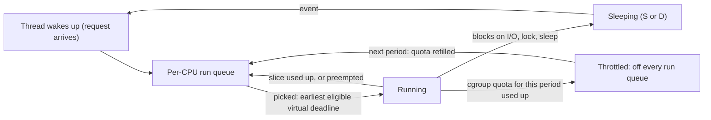

# CPU Scheduling

> **Module 04 · Operating Systems** · Prerequisites: [Thread Lifecycle](06-Thread-Lifecycle.md) · Next: [Context Switching](08-Context-Switching.md)

---

## ⏱ If You Only Have 2 Minutes

- The scheduler decides **which runnable task runs on which CPU, and for how long**. Linux schedules threads, not processes, and is **preemptive**: a timer interrupt or a more urgent wake-up can take the CPU away at almost any instruction.
- Each CPU has its own **run queue**. Load balancing moves tasks between queues. "Runnable" means in a queue waiting; `ps` shows both running and runnable as `R`.
- Normal tasks use the **fair class**. From 2.6.23 it was **CFS** (pick the task with the smallest virtual runtime). Since **Linux 6.6** the fair class uses **EEVDF** (Earliest Eligible Virtual Deadline First). Nice values and weights still work the same way.
- **Nice** runs from −20 to 19. Each step changes a task's weight by about 1.25×, which is about 10% of CPU between two competing tasks. Nice only matters **under contention**. Real-time classes (`SCHED_FIFO`, `SCHED_RR`) always beat normal tasks.
- **Load average** is the 1/5/15-minute decaying average of tasks that are **runnable plus uninterruptible (`D`)**. It is not divided by the CPU count, and inside a container it shows the **host's** value.
- A container CPU limit is a **cgroup quota**: `cpu.max = "50000 100000"` means 50 ms of CPU per 100 ms period (0.5 CPU). Eight busy threads use that up in about 6 ms. Then **every** thread in the container is **throttled** for the remaining ~94 ms. Average CPU looks fine, and p99 latency does not.
- Check `nr_throttled` and `throttled_usec` in `/sys/fs/cgroup/cpu.stat`. Size CPU-bound workers to `floor(quota)` (at least 1), not to `os.cpus().length` or `os.cpu_count()`, which report the host.

---

## 1. What It Is and Why It Exists

**CPU scheduling** is how the kernel shares a few CPUs among many threads that want to run. Whenever a CPU becomes free (its thread blocked, finished or used up its turn), the scheduler picks the next thread from that CPU's run queue. It also decides how long the thread may run before someone else gets a turn.

**Analogy:** a few checkout counters in a busy supermarket. Shoppers (threads) queue at each counter (per-CPU run queues). A shopper with a huge trolley must let others go after a while (time slices and preemption). A staff member moves people between queues when one is long and another empty (load balancing). Some customers have priority cards (nice values, real-time classes). In a container, the store manager has also said "this family may use the counters for 50 ms out of every 100 ms" (the cgroup quota). Once they use their time, they wait outside, even if counters are empty.

**The problem it solves.** A backend host runs hundreds of threads on a handful of cores: your app's threads, the runtime's GC and JIT threads, sidecars, the kernel's own work. Without a scheduler policy, one CPU-bound thread would starve everything else, and an interactive request would wait behind a batch job. The scheduler aims for three things at once:

- **Fairness:** each runnable thread gets CPU in proportion to its weight.
- **Latency:** a thread that wakes up (a request arrived) gets the CPU soon.
- **Throughput:** few switches, warm caches, all CPUs busy.

**Why backend engineers care.** Most "the service is slow but CPU is only 40%" incidents in containers are scheduling problems: CPU quota throttling, too many runnable threads for the quota, a noisy neighbour, or a process stuck in `D` that inflates the load average. You cannot fix them from application code until you can see them.

---

## 2. How It Works

### Preemption, run queues and time slices

1. A thread becomes **runnable** (it is created, or the I/O it waited for completes). The kernel puts it on a CPU's run queue, usually the CPU it last ran on, because that cache is still warm.
2. The scheduler on that CPU picks the next task: first by **scheduling class**, then by the class's own rule.
3. The task runs until it **blocks** (voluntary switch), its **slice** is used up, or a more deserving task wakes up and **preempts** it (involuntary switch). A periodic timer interrupt (the "tick") and wake-up events give the kernel its chances to decide.
4. **Load balancing** runs periodically and when a CPU goes idle. It pulls tasks from busy run queues to idle ones. That is a **migration**: the task's cached data stays behind on the old CPU.

Each switch has a cost, covered in [Context Switching](08-Context-Switching.md).

### Scheduling classes

The kernel checks classes in a fixed order. A runnable task in a higher class always runs before any task in a lower one.

| Class | Policies | Used for |
|---|---|---|
| Deadline | `SCHED_DEADLINE` | Hard periodic work with a runtime/period/deadline contract |
| Real-time | `SCHED_FIFO`, `SCHED_RR` (priority 1–99) | Audio, industrial control, some network appliances |
| Fair | `SCHED_OTHER` (also called `SCHED_NORMAL`), `SCHED_BATCH` | Everything else: your web servers, databases, runtimes |
| Idle | `SCHED_IDLE` | Work that should run only when nothing else wants the CPU |

Linux 6.12 also added **sched_ext**, which lets a scheduler written in BPF be loaded at runtime as an additional class. It is used for experiments and specialised fleets, not by default.

### The fair class: from CFS to EEVDF

**CFS** (Completely Fair Scheduler, Linux 2.6.23 to 6.5) gives each task a **virtual runtime** (`vruntime`). That is the CPU time it has used, scaled by its weight: a heavier (higher-priority) task's `vruntime` grows more slowly. CFS kept runnable tasks in a red-black tree ordered by `vruntime` and always ran the leftmost one, the task that had received the least weighted CPU so far.

**EEVDF** (Earliest Eligible Virtual Deadline First) became the fair class's algorithm in **Linux 6.6**. It keeps weights and virtual time, and adds two ideas:

- **Lag:** how much CPU a task is owed compared with a perfectly fair share. A task is **eligible** only if it is not ahead of its share.
- **Virtual deadline:** roughly "when this task should finish its next slice", based on its eligible time, its slice length and its weight.

The scheduler runs the eligible task with the **earliest virtual deadline**. The CPU share is still decided by weight, but a task with a shorter slice gets an earlier deadline, so it waits less each time it wakes. CFS needed a set of heuristics to get that latency behaviour. For backend work, nothing in your configuration changes: nice values, cgroup weights and quotas behave as before. Many tools and documents still say "CFS". In particular, the cgroup quota mechanism is still called **CFS bandwidth control**, because it belongs to the fair class.

### Weights and nice values

Each nice level maps to a weight. Nice 0 is 1024, and each step is about 1.25×:

| Nice | Weight | Two busy tasks on one CPU (vs a nice-0 task) |
|---|---|---|
| −5 | 3121 | 75% vs 25% |
| 0 | 1024 | 50% vs 50% |
| 1 | 820 | 44% vs 56% |
| 5 | 335 | 25% vs 75% |
| 19 | 15 | ~1.4% vs ~98.6% |

Weights only matter when tasks **compete for the same CPU**. A nice-19 task on an otherwise idle machine still gets a full core.

### CPU quotas: CFS bandwidth control

A container's CPU limit is enforced by the cgroup v2 `cpu` controller:

| File | Meaning | Kubernetes source |
|---|---|---|
| `cpu.weight` | Share under contention, 1–10000, default 100 | `resources.requests.cpu` |
| `cpu.max` | `"<quota> <period>"` in µs. `max 100000` = no limit | `resources.limits.cpu` × 100 ms period |
| `cpu.max.burst` | Unused quota a cgroup may carry into a later period | Not set by default |
| `cpu.stat` | `usage_usec`, `nr_periods`, `nr_throttled`, `throttled_usec`, `nr_bursts`, `burst_usec` | Exposed by cAdvisor as `container_cpu_cfs_*` metrics |
| `cpu.pressure` | PSI: share of time tasks in this cgroup waited for CPU | — |

How the quota is enforced:

1. At the start of each **period** (100 ms by default) the cgroup's runtime pool is refilled with `quota` microseconds.
2. Each CPU running the cgroup's threads takes small **slices** of that pool as it goes (5 ms by default, `kernel.sched_cfs_bandwidth_slice_us`).
3. When the pool is empty, the cgroup's run queue on each CPU is **throttled**: its tasks are removed from scheduling until the next refill, **even if the CPUs are idle**.

The quota is CPU time summed over **all** CPUs. That is why many threads hurt:

```text
cpu.max = 50000 100000            → 0.5 CPU = 50 ms of CPU time per 100 ms period
1 busy thread                     → runs 50 ms, throttled 50 ms
8 busy threads on 8 idle CPUs     → 50 ms / 8 = quota gone after ~6.25 ms of wall time
                                  → whole cgroup throttled for the remaining ~93.75 ms
A request that arrives at t=7 ms  → its handler cannot run until t=100 ms: +93 ms of latency
```



Averaged over a minute, the cgroup above used exactly its 0.5 CPU, so dashboards show "50% of limit". The damage is in the **distribution**: requests that land in the throttled part of a period wait up to 94 ms before their first instruction runs. GC threads, the libuv pool, and oversized worker pools all draw from the same quota, so they make it worse.

### Observing the scheduler

```bash
cat /sys/fs/cgroup/cpu.max /sys/fs/cgroup/cpu.weight
cat /sys/fs/cgroup/cpu.stat                # throttling counters for this container
cat /sys/fs/cgroup/cpu.pressure            # PSI for this cgroup
cat /proc/loadavg                          # 1/5/15-min load, runnable/total tasks, last PID
cat /proc/4211/schedstat                   # ns on CPU, ns runnable-but-waiting, timeslices
vmstat 1 5                                 # r = runnable tasks, b = blocked in D state
chrt -p 4211                               # scheduling policy and RT priority
taskset -pc 4211                           # CPU affinity list
nice -n 10 python batch.py                 # start with lower priority; renice -n 5 -p 4211 later
```

Illustrative output from a container started with `--cpus=0.5`, while two Python processes spin:

```text
50000 100000
100

usage_usec 585478
user_usec 547947
system_usec 37530
nr_periods 12
nr_throttled 11
throttled_usec 1511947
nr_bursts 0
burst_usec 0

some avg10=48.21 avg60=12.40 avg300=2.71 total=609544
full avg10=48.21 avg60=12.40 avg300=2.71 total=609544

0.48 0.66 0.50 3/660 17
270475800 748958800 24
pid 12's current scheduling policy: SCHED_OTHER
pid 12's current scheduling priority: 0
pid 12's current affinity list: 0-15
```

How to read it:

- 11 of 12 periods were throttled. `throttled_usec` (1.5 s) is larger than the wall time because it is **added up per CPU**: each CPU's throttled run queue counts separately.
- `cpu.pressure` "some" says tasks in this cgroup spent about half the recent time waiting for CPU. This is a better signal than load average.
- `/proc/loadavg` is the **host's** load (16 CPUs here). It says nothing about this container.
- The process's `schedstat` shows 270 ms on a CPU and 749 ms runnable but waiting. In this test, time spent throttled appears as waiting time.
- `taskset` shows `0-15`: the quota limits **time**, not **which** CPUs. The threads can run on any of the 16 CPUs, only for less time.

---

## 3. Key Concepts

### Voluntary vs involuntary switches as a scheduling signal

A thread that blocks gives up the CPU **voluntarily**. A thread taken off the CPU while it still wanted to run was **preempted** (involuntary). Many involuntary switches mean there is more runnable work than CPU: too many threads, a noisy neighbour, or a quota. `pidstat -w` shows both rates per task. [Context Switching](08-Context-Switching.md) measures them.

### Nice, priorities and real-time classes

| Tool | Effect | Who may use it |
|---|---|---|
| `nice -n 10 cmd`, `renice`, `os.nice()` (Python), `os.setPriority()` (Node) | Lower (or raise) the weight within the fair class | Anyone can lower their own priority; raising it needs `CAP_SYS_NICE` or `RLIMIT_NICE` |
| `chrt -f 50 cmd` (`SCHED_FIFO`) | Runs until it blocks or a higher RT priority wakes | `CAP_SYS_NICE` |
| `chrt -r 50 cmd` (`SCHED_RR`) | Like FIFO, but round-robin among equal priorities | `CAP_SYS_NICE` |
| `chrt -b 0 cmd` (`SCHED_BATCH`) | Fair class, but treated as CPU-bound: fewer wake-up preemptions | Anyone |
| `chrt -i 0 cmd` (`SCHED_IDLE`) | Runs only when nothing else wants the CPU | Anyone |

A busy `SCHED_FIFO` thread can starve everything else on its CPU. By default, the kernel's **RT throttling** keeps real-time tasks to 950 ms of every 1 s (`kernel.sched_rt_runtime_us` / `sched_rt_period_us`), so the system stays usable. Web services should not use real-time classes. Use `nice` or `SCHED_BATCH` to push batch jobs down, and cgroup weights to protect services from each other.

### CPU affinity and cpusets

**Affinity** limits which CPUs a thread may run on: `taskset`, `sched_setaffinity`, Python `os.sched_setaffinity`. A cgroup **cpuset** (`docker run --cpuset-cpus=0-3`, Kubernetes' static CPU manager policy for Guaranteed pods with whole-number CPU requests) does the same for a whole container. Affinity changes **where** threads run; the quota changes **how long**.

| | Quota (`cpu.max`) | Cpuset / affinity |
|---|---|---|
| Limits | CPU time per period | Which CPUs |
| 0.5 CPU possible? | Yes | No, only whole CPUs |
| Throttling stalls? | Yes, when the quota runs out | No; threads queue for the allowed CPUs instead |
| Cache locality | Threads may run on any CPU | Better: threads stay on the same cores |
| Visible to `os.availableParallelism()` / `os.sched_getaffinity()` | Partly (see below) | Yes |

Pinning helps latency-critical services (warm caches, no noisy neighbours on those cores). It hurts when the pinned set is busy while other CPUs sit idle.

### Load average, and what to use instead

Linux load average is an exponentially damped moving average, over 1, 5 and 15 minutes, of the number of tasks that are **runnable (`R`) or in uninterruptible sleep (`D`)**. Three consequences:

- **It is not a CPU metric.** A hung NFS mount with 40 tasks in `D` gives a load of 40 on an idle CPU.
- **It is not normalised.** A load of 8 is saturation on 8 CPUs and light on 64. Compare it with the CPU count.
- **It is not per container.** `/proc/loadavg` shows the host (unless the platform fakes it, as LXCFS does).

Better signals: `vmstat`'s `r` column (runnable now), per-cgroup `cpu.pressure` (PSI, Linux 4.20+), `cpu.stat` throttling, and run-queue wait from `/proc/<pid>/schedstat`.

### Sizing workers from the quota

The runtimes do not reliably report the quota:

| API | What it reports |
|---|---|
| Node `os.cpus().length` | Host CPUs |
| Node `os.availableParallelism()` | Affinity mask. In our test with Node 22.23 (libuv 1.51) it also returned `floor(quota)` for quotas of 1 CPU or more, but the full host count (16) for a 0.5-CPU quota. Older versions ignore the quota |
| Python `os.cpu_count()` | Host CPUs |
| Python `os.sched_getaffinity(0)`, `os.process_cpu_count()` (3.13+) | Affinity mask, not the quota |
| Python 3.13+ `PYTHON_CPU_COUNT=2` env var / `-X cpu_count=2` | Overrides both `os.cpu_count()` and `os.process_cpu_count()`, so executor defaults follow it |

A safe rule for **CPU-bound** pools: `workers = max(1, floor(min(quota, affinity)))`. For Node, that count includes the main thread's own JavaScript. With a quota of 1 CPU or less, one Node process already uses the whole quota, so extra `worker_threads` only move work around; they do not add CPU. **I/O-bound** pools (database connections, FastAPI's `def` endpoint threads) are sized by the downstream's capacity, not by the quota, because their threads mostly sleep.

Runtime helper threads count too. V8 runs garbage collection and compilation on background threads (Node's `--v8-pool-size` sets how many), and those threads draw from the same quota. Other runtimes have started to read the quota themselves (Go 1.25 made `GOMAXPROCS` respect it by default), so check what each runtime in your fleet actually does.

---

## 4. Code Examples

Scenario: a service starting in a container must (1) work out how many CPU-bound workers it may run, and (2) show what happens to a latency-sensitive task (the event loop, or a request thread) when more busy workers run than the quota allows.

### Shell

```bash
# Reproduce throttling: one container, 0.5 CPU, two busy loops.
docker run --rm --cpus=0.5 python:3.12-slim sh -c '
  for i in 1 2; do python -c "while True: pass" & done
  sleep 3; cat /sys/fs/cgroup/cpu.max /sys/fs/cgroup/cpu.stat'

# Lower a batch job's priority instead of limiting it; pin a process to CPUs 0-1.
nice -n 15 ./nightly-report.sh &
taskset -c 0,1 node server.js
chrt -p $(pgrep -f server.js)
```

### Node.js / TypeScript

```ts
// No npm packages — Node.js 22+, TypeScript 5, ESM. Linux, cgroup v2. Try: docker run --cpus=0.5 ...
import { readFile } from "node:fs/promises";
import { availableParallelism } from "node:os";
import { monitorEventLoopDelay } from "node:perf_hooks";
import { Worker } from "node:worker_threads";

const CGROUP = "/sys/fs/cgroup";
type CpuStat = Record<string, number>; // usage_usec, nr_periods, nr_throttled, throttled_usec, ...

async function quotaCpus(): Promise<number | null> {
  try {
    const [quota, period] = (await readFile(`${CGROUP}/cpu.max`, "utf8")).trim().split(" ");
    return quota === "max" ? null : Number(quota) / Number(period); // "50000 100000" → 0.5
  } catch {
    return null; // cgroup v1, or no cpu controller delegated to this cgroup
  }
}

async function cpuStat(): Promise<CpuStat> {
  const lines = (await readFile(`${CGROUP}/cpu.stat`, "utf8")).trim().split("\n");
  return Object.fromEntries(lines.map((l) => { const [k, v] = l.split(" "); return [k, Number(v)]; }));
}

// availableParallelism() follows the affinity mask (cpuset). Recent libuv also floors quotas of 1 CPU
// or more, but ignores smaller ones (0.5 CPU → host count), so apply the quota ourselves.
function cpuWorkers(quota: number | null): number {
  const cpus = Math.min(quota ?? Infinity, availableParallelism());
  return Math.max(1, Math.floor(cpus));
}

// Run `threads` workers that each do the same fixed CPU work, while the main loop measures its own delay.
async function burst(threads: number, iterations: number): Promise<void> {
  const before = await cpuStat();
  const lag = monitorEventLoopDelay({ resolution: 1 });
  lag.enable();
  const t0 = performance.now();
  const code = `let x = 0; for (let i = 0; i < ${iterations}; i++) x = (x + i * i) % 1_000_003;`;
  await Promise.all(Array.from({ length: threads }, () => new Promise((resolve, reject) => {
    new Worker(code, { eval: true }).once("exit", resolve).once("error", reject);
  })));
  lag.disable();
  const after = await cpuStat();
  const d = (k: string) => (after[k] ?? 0) - (before[k] ?? 0);
  console.log(`${String(threads).padStart(2)} busy threads | wall ${(performance.now() - t0).toFixed(0).padStart(5)} ms`
    + ` | throttled ${d("nr_throttled")}/${d("nr_periods")} periods, ${(d("throttled_usec") / 1000).toFixed(0)} ms`
    + ` | event-loop delay p99 ${(lag.percentile(99) / 1e6).toFixed(0)} ms, max ${(lag.max / 1e6).toFixed(0)} ms`);
}

const quota = await quotaCpus();
console.log(`cpu.max: ${quota ?? "no limit"} CPUs | availableParallelism(): ${availableParallelism()}`
  + ` | CPU workers to start: ${cpuWorkers(quota)}`);
for (const threads of [1, 2, 8]) await burst(threads, 15_000_000); // ≈ 200 ms of CPU each
```

Output on a 16-CPU host (`node:22` container, run three times with different limits; some lines trimmed):

```text
--- no limit
cpu.max: no limit CPUs | availableParallelism(): 16 | CPU workers to start: 16
 1 busy threads | wall   259 ms | throttled 0/0 periods, 0 ms | event-loop delay p99 2 ms, max 3 ms
 8 busy threads | wall   327 ms | throttled 0/0 periods, 0 ms | event-loop delay p99 2 ms, max 2 ms
--- docker run --cpus=2
cpu.max: 2 CPUs | availableParallelism(): 2 | CPU workers to start: 2
 2 busy threads | wall   283 ms | throttled 1/3 periods, 2 ms | event-loop delay p99 1 ms, max 4 ms
 8 busy threads | wall  1054 ms | throttled 11/11 periods, 6507 ms | event-loop delay p99 34 ms, max 72 ms
--- docker run --cpus=0.5
cpu.max: 0.5 CPUs | availableParallelism(): 16 | CPU workers to start: 1
 1 busy threads | wall   527 ms | throttled 5/5 periods, 350 ms | event-loop delay p99 1 ms, max 48 ms
 2 busy threads | wall  1000 ms | throttled 10/10 periods, 1641 ms | event-loop delay p99 2 ms, max 69 ms
 8 busy threads | wall  4475 ms | throttled 45/45 periods, 32157 ms | event-loop delay p99 49 ms, max 190 ms
```

The main thread did almost no work. Its timer was late only because the **whole cgroup** was throttled. With 2 CPUs and 2 workers there is almost no throttling. With 8 workers the same work takes four times as long, and the event loop stalls for up to 72 ms. At 0.5 CPU even one busy worker stalls the loop for 48 ms per period. Note also that `availableParallelism()` reports 2 for `--cpus=2`, but 16 for `--cpus=0.5`.

### Python

```python
# No pip packages — Python 3.12+ (stdlib only). Linux, cgroup v2. Try: docker run --cpus=0.5 ...
import os
import threading
import time
from concurrent.futures import ProcessPoolExecutor
from pathlib import Path

CGROUP = Path("/sys/fs/cgroup")


def quota_cpus() -> float | None:
    try:
        quota, period = (CGROUP / "cpu.max").read_text().split()
    except (FileNotFoundError, ValueError):
        return None  # cgroup v1, or the cpu controller is not enabled for this cgroup
    return None if quota == "max" else int(quota) / int(period)


def cpu_stat() -> dict[str, int]:
    return {k: int(v) for k, v in (line.split() for line in (CGROUP / "cpu.stat").read_text().splitlines())}


def cpu_workers(quota: float | None) -> int:
    # os.cpu_count() is the host. Affinity (cpuset) is better, but neither one knows about cpu.max.
    affinity = os.process_cpu_count() if hasattr(os, "process_cpu_count") else len(os.sched_getaffinity(0))
    return max(1, int(min(quota or float("inf"), affinity or 1)))


def spin(iterations: int) -> int:
    x = 0
    for i in range(iterations):
        x = (x + i * i) % 1_000_003
    return x


def burst(workers: int, iterations: int) -> None:
    worst_lag = 0.0
    done = threading.Event()

    def probe() -> None:  # stands in for a request handler that only needs a moment of CPU
        nonlocal worst_lag
        while not done.is_set():
            t = time.perf_counter()
            time.sleep(0.001)
            worst_lag = max(worst_lag, time.perf_counter() - t - 0.001)

    before, t0 = cpu_stat(), time.perf_counter()
    threading.Thread(target=probe).start()
    with ProcessPoolExecutor(max_workers=workers) as pool:  # child processes share the cgroup quota
        list(pool.map(spin, [iterations] * workers))
    done.set()
    after = cpu_stat()
    d = {k: after.get(k, 0) - before.get(k, 0) for k in after}
    print(f"{workers:2} busy processes | wall {(time.perf_counter() - t0) * 1000:5.0f} ms"
          f" | throttled {d['nr_throttled']}/{d['nr_periods']} periods, {d['throttled_usec'] / 1000:.0f} ms"
          f" | worst probe lag {worst_lag * 1000:.0f} ms")


if __name__ == "__main__":
    quota = quota_cpus()
    print(f"cpu.max: {quota or 'no limit'} CPUs | os.cpu_count(): {os.cpu_count()}"
          f" | CPU workers to start: {cpu_workers(quota)}")
    for n in (1, 2, 8):
        burst(n, 2_000_000)  # ≈ 150–200 ms of pure-Python CPU per process, unthrottled
```

Output (`python:3.12` container, `--cpus=0.5`, 16-CPU host):

```text
cpu.max: 0.5 CPUs | os.cpu_count(): 16 | CPU workers to start: 1
 1 busy processes | wall   331 ms | throttled 3/3 periods, 236 ms | worst probe lag 54 ms
 2 busy processes | wall   667 ms | throttled 7/7 periods, 1125 ms | worst probe lag 58 ms
 8 busy processes | wall  2821 ms | throttled 28/28 periods, 20085 ms | worst probe lag 96 ms
```

The 96 ms worst lag matches the arithmetic in section 2: eight runners use a 50 ms quota in about 6 ms, and everyone waits for the rest of the 100 ms period.

**Runtime differences to notice:**

- **Different units, same quota.** Node's CPU workers are threads in one process; Python's are processes (because of the GIL). The cgroup does not care: threads and child processes in the container all draw from the same `cpu.max`.
- **Neither runtime sizes itself from the quota.** Node's `availableParallelism()` partly does in recent versions, but not below 1 CPU. Python 3.12 does not at all. 3.13+ lets you override with `PYTHON_CPU_COUNT`, which also changes the default size of `ProcessPoolExecutor` and `ThreadPoolExecutor`. Pass the count explicitly from your deployment, or compute it as above.
- **What "lag" measures.** Node's `monitorEventLoopDelay` measures how late the event loop's timers fire. The Python probe thread measures how late a 1 ms sleep returns. Both are proxies for "how long a newly arrived request waits before it runs".

---

## 5. Production Concerns

- **Alert on throttling, not only on CPU usage.** Track `rate(container_cpu_cfs_throttled_periods_total) / rate(container_cpu_cfs_periods_total)` per container. If more than a few percent of periods are throttled on a latency-sensitive service, tail latency is being paid for it. CPU usage averaged per minute will look healthy at the same time.
- **Decide whether a latency-sensitive service needs a CPU limit at all.** Requests (`cpu.weight`) already protect neighbours under contention, without hard stalls. Many teams set requests on every pod and keep limits only for batch or untrusted workloads, or set `cpu.max.burst` where the platform allows it. This is a policy decision for the cluster: without limits, one runaway pod can use idle CPU that others expected to have.
- **Count every thread that burns CPU.** Your worker pool, plus V8 or CPython GC, the libuv pool (4 threads by default, more if `UV_THREADPOOL_SIZE` is raised), compression, and sidecars in the same cgroup. Ten "small" busy threads behave like the eight-thread example above.
- **Whole-number limits age better.** A 0.5-CPU limit means even a single busy thread is throttled for half of every period. If a service has a CPU-heavy path (TLS handshakes, JSON of large bodies, image work), give it at least 1 CPU, or move that work to a separate deployment.
- **Use `nice` for batch on shared VMs.** A nightly report on the same VM as an API should run at `nice 10–19` or `SCHED_IDLE`. It still uses idle CPU fully, but yields immediately when the API needs it. In Kubernetes, use separate pods with lower requests instead.
- **Don't read load average inside containers.** It is the host's number. Use `cpu.pressure` and `cpu.stat` for the container, and `vmstat` / node-level PSI for the host.
- **Beware `D` state in load spikes.** A load average that jumps while CPU stays idle usually means storage or NFS trouble, not a scheduling problem ([Process Lifecycle](05-Process-Lifecycle.md)).

---

## 6. Common Mistakes

- **Sizing pools from `os.cpus().length` or `os.cpu_count()` in a container** — 64 workers share a 2-CPU quota, burn it in a few milliseconds per period, and throttle every request — compute `floor(quota)` from `cpu.max` or pass the count in an environment variable.
- **Trusting `os.availableParallelism()` to mean "my quota"** — it reflects affinity, and recent libuv applies the quota only when it is at least 1 CPU; a 0.5-CPU pod still reports the host — read `cpu.max` yourself.
- **Reading "50% CPU of limit" as headroom** — usage is an average over the period, but throttling happens in bursts inside each 100 ms — check `nr_throttled` and p99 latency together.
- **Using load average as a CPU-saturation metric** — it includes `D`-state tasks, is not normalised per CPU, and is host-wide in containers — use run-queue length, PSI and throttling counters.
- **Raising priority to fix latency** — negative nice values or `SCHED_FIFO` in a web service starve the runtime's own helper threads and other tenants — fix the contention: fewer threads, more quota, or separate deployments.
- **Pinning (cpuset) and quota together without thought** — a 4-CPU quota pinned to 2 cores can never use its quota, and pinned cores may be busy while others idle — use one mechanism on purpose.
- **Assuming nice affects I/O** — nice changes CPU weight only; a low-priority backup can still saturate the disk — use `ionice` or cgroup I/O controls for that.

---

## 7. Comparison Table

| Mechanism | What it controls | Granularity | Effect when the machine is idle | Typical use |
|---|---|---|---|---|
| `nice` / `cpu.weight` | Share of CPU under contention | Relative weight | None: the task can use all idle CPU | Batch vs interactive; Kubernetes requests |
| `cpu.max` (quota) | Maximum CPU time per period | µs per period | Still enforced: throttled even if CPUs are idle | Hard caps; Kubernetes limits |
| Cpuset / affinity | Which CPUs | Whole CPUs | Threads stay off the other CPUs | Latency-critical pinning, NUMA locality |
| `SCHED_FIFO` / `SCHED_RR` | Absolute priority over the fair class | 1–99 | Runs whenever runnable | Real-time systems, not web services |
| `SCHED_IDLE` | Runs only when nothing else wants CPU | — | Gets all idle CPU | Background compaction, scavenging |

---

## 8. Interview Questions

**[Junior] What does it mean that Linux scheduling is preemptive?**
The kernel can take the CPU away from a running thread without the thread's cooperation: when its time slice is used up, or when a higher-priority or more deserving task wakes up. The thread is put back in the run queue and continues later. Cooperative systems, such as an event loop, switch only when the running code yields, so one long callback blocks everything.

**[Junior] What does the load average measure on Linux?**
An exponentially damped average, over 1, 5 and 15 minutes, of the number of tasks that are runnable or in uninterruptible sleep (`D`). It is not a percentage and not divided by the CPU count, so compare it with the number of CPUs. Because it includes `D`, a storage problem can raise it while the CPU is idle. Inside a container it shows the host's value.

**[Mid] How do nice values work in the fair scheduler?**
Each nice level maps to a weight. Nice 0 is 1024, and each step is roughly a factor of 1.25. When tasks compete for a CPU, each gets CPU time in proportion to its weight, so one nice step is about a 10% difference between two tasks. With no contention nice does nothing. Ordinary users can only make their processes nicer; raising priority needs `CAP_SYS_NICE`.

**[Mid] What changed when Linux replaced CFS with EEVDF?**
In Linux 6.6 the fair class switched its selection rule. CFS always ran the task with the smallest weighted virtual runtime. EEVDF tracks each task's lag (how much CPU it is owed) and a virtual deadline, and runs the eligible task with the earliest deadline. CPU shares are still set by weights, so nice and cgroup weights behave the same. EEVDF handles latency more cleanly, because a short-slice task gets an earlier deadline, and CFS needed heuristics for that. For application engineers the visible interfaces did not change, and quota enforcement is still called CFS bandwidth control.

**[Mid] Your container's CPU usage graph shows 40% of its limit, but p99 latency is bad. What do you check?**
Throttling: `nr_throttled` / `nr_periods` and `throttled_usec` in `/sys/fs/cgroup/cpu.stat`, or the cAdvisor `container_cpu_cfs_throttled_*` metrics. The quota is enforced per 100 ms period, so a burst of parallel work can use it all in a few milliseconds and stall the whole container for the rest of the period. Averages hide this. Then count busy threads: the worker pool size, GC threads and the libuv pool versus the quota.

**[Senior] Explain why a 0.5-CPU container running 8 worker threads shows 90 ms latency spikes, and how you fix it.**
The quota is 50 ms of CPU per 100 ms period, summed over all CPUs. With 8 runnable threads on 8 idle host CPUs, the cgroup uses its 50 ms in about 6 ms of wall time, then every thread in it, including the one that should answer the next request, is throttled for about 94 ms. Fixes, in order: size CPU-bound workers to `max(1, floor(quota))`, which here means one process and no extra workers; give the service at least one full CPU if it has CPU-heavy paths; consider removing the limit and relying on requests; or use `cpu.max.burst` where supported. Verify with `cpu.stat` and p99 latency, not with average CPU.

**[Senior] How should a Node or Python service decide its worker count at start-up?**
Read the quota from `cpu.max` (or receive it as configuration from the deployment), take the minimum with the affinity count, and floor it, with a minimum of 1. Use that for CPU-bound pools: `worker_threads` in Node (counting the main thread), or processes in CPython. Do not trust `os.cpus()` or `os.cpu_count()`, which report the host. `os.availableParallelism()` handles affinity and, in recent Node versions, quotas of at least one CPU, but not fractional ones. Size I/O-bound pools separately, from downstream capacity. Then confirm in production that throttling stays near zero.

**[Senior] When would you use CPU pinning instead of a quota?**
When a service needs predictable latency and warm caches, such as a latency-critical trading or ad-serving path, or a database. Kubernetes' static CPU manager gives Guaranteed pods with integer CPU requests exclusive cores. Pinning avoids both throttling stalls and noisy neighbours on those cores. The costs are whole-core granularity, wasted capacity when the pinned service is idle, and contention among its own threads if it runs more busy threads than pinned cores. For general web services, a quota or just requests are simpler.

---

## 9. Cheat Sheet

```text
Preemptive      kernel takes the CPU at slice end or on a more deserving wake-up
Run queues      one per CPU + load balancing (migrations lose warm cache)
Classes         deadline > real-time (FIFO/RR 1–99) > fair (OTHER/BATCH) > idle; sched_ext (6.12)
Fair class      CFS (2.6.23–6.5): smallest vruntime; EEVDF (6.6+): earliest eligible virtual deadline
Nice            -20..19; weight 1024 at 0, ×~1.25 per step ≈ 10% between two tasks; only under contention
RT throttle     RT tasks capped at 950 ms per 1 s by default
Load average    R + D tasks, 1/5/15 min decay, not per CPU, host-wide in containers → prefer PSI
cpu.weight      share under contention (requests); default 100
cpu.max         "quota period" µs; 50000 100000 = 0.5 CPU (limits); "max" = unlimited
Throttling      quota used → whole cgroup off-CPU until next period; 8 threads × 0.5 CPU → ~94 ms stall
cpu.stat        nr_periods, nr_throttled, throttled_usec (summed per CPU), usage_usec
Sizing          CPU workers = max(1, floor(min(quota, affinity))); I/O pools from downstream capacity
APIs            os.cpus()/cpu_count() = host; availableParallelism() = affinity (+ quota ≥ 1 in recent libuv)
Python 3.13+    os.process_cpu_count(), PYTHON_CPU_COUNT to override executor defaults
Tools           chrt -p · nice/renice · taskset -pc · vmstat (r, b) · /proc/<pid>/schedstat · cpu.pressure
```

---

## Related Topics

- [Context Switching](08-Context-Switching.md) — what each scheduling decision costs the CPU
- [Operating Systems Fundamentals](01-Operating-Systems-Fundamentals.md) — cgroups, namespaces and reading `cpu.max` in context
- [Parallelism](10-Parallelism.md) — why the quota, not the core count, caps your speed-up
- [Starvation](20-Starvation.md) — when priorities or unfair locks leave a thread without CPU
- [Process Lifecycle](05-Process-Lifecycle.md) — `R`, `S` and `D` states, and why `D` inflates load average
- [Container Best Practices](../Module-10-DevOps-and-Cloud/11-Container-Best-Practices.md) — setting CPU requests and limits for containers
