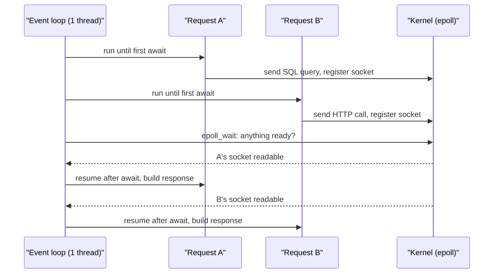

# Concurrency

> **Module 04 · Operating Systems** · Prerequisites: [Context Switching](08-Context-Switching.md) · Next: [Parallelism](10-Parallelism.md)

---

## ⏱ If You Only Have 2 Minutes

- **Concurrency is about structure, parallelism is about execution.** Rob Pike: "Concurrency is about *dealing with* lots of things at once. Parallelism is about *doing* lots of things at once." One CPU core can run a concurrent program; it just cannot run it in parallel.
- There are four common models: **threads sharing memory**, **processes passing messages**, **an event loop with async/await**, and **actors / CSP channels**. Node and asyncio use the event loop; Go uses CSP; Erlang and Akka use actors.
- Concurrent code is **non-deterministic**: two tasks of 3 steps each can interleave in 20 different orders. A bug that needs one rare order shows up once a week in production and never in tests.
- **I/O-bound** work (waiting on databases and HTTP) gains from concurrency even on one core. **CPU-bound** work only gains from parallelism on more cores.
- An event loop switches tasks only at `await`. Between two `await`s your code cannot be interrupted by another task — but anything can change *across* an `await`.
- **Structured concurrency**: a task never outlives the block that started it. `asyncio.TaskGroup` cancels the siblings when one task fails. `Promise.all` rejects on the first failure but **does not stop** the other promises — you need an `AbortController` for that.
- Always put a **cap** (how many at once) and a **deadline** (how long in total) on concurrent fan-out. Unbounded `Promise.all(urls.map(fetch))` is how you exhaust sockets and get rate-limited.

---

## 1. What It Is and Why It Exists

**Concurrency** means a program is made of several tasks whose lifetimes overlap. Task B starts before task A has finished. Whether A and B ever run at the *same instant* is a separate question — that is parallelism, covered in the [next chapter](10-Parallelism.md).

**Analogy:** a chef cooking three dishes alone. Pasta water is heating, the sauce is simmering, and the chef chops salad in between. Three dishes are in progress at once (concurrency), but there is one pair of hands (no parallelism). Hire a second chef and two things really happen at the same moment (parallelism). The kitchen layout and the order of steps — the *structure* — is the concurrency design. It works with one chef or five.

**The problem it solves.** A backend request spends most of its time waiting: 2 ms of CPU, then 40 ms for PostgreSQL, then 120 ms for a payment API. If the server handled one request at a time, the CPU would sit idle about 99% of the time. Concurrency lets the server start request B while request A waits, so one core can keep thousands of requests in flight.

**What breaks without it, or with it done badly:**

- **No concurrency:** throughput is capped at `1 / latency`. A 160 ms request means at most about 6 requests per second per worker, no matter how fast the CPU is.
- **Concurrency without limits:** a handler fans out to 5,000 URLs at once, opens 5,000 sockets, hits the file-descriptor limit (`EMFILE`), and gets rate-limited by the remote API.
- **Concurrency without cancellation:** the client gave up after 2 seconds, but the server keeps 30 background fetches running for another 28 seconds, using sockets and memory for an answer nobody will read.
- **Concurrency with shared state:** two tasks read-modify-write the same value and one update is lost. That is a [race condition](13-Race-Conditions.md).

---

## 2. How It Works

### The four models

| Model | Unit of work | How tasks communicate | Who decides when to switch | Examples |
|---|---|---|---|---|
| Threads + shared memory | OS thread | Read and write the same variables, protected by locks | The kernel scheduler, at any instruction (preemptive) | Java, C#, Python `threading`, Node `worker_threads` with `SharedArrayBuffer` |
| Processes + message passing | OS process | Pipes, sockets, queues; data is copied | The kernel scheduler | `multiprocessing`, Node `child_process`/`cluster`, Unix pipelines |
| Event loop + async/await | Task / coroutine / promise chain on one thread | Shared variables, but no switch except at `await` | The program itself, at each `await` (cooperative) | Node.js, Python `asyncio`, nginx |
| Actors / CSP | Actor with a mailbox, or a goroutine with channels | Messages only; no shared mutable state | A runtime scheduler (often preemptive) | Erlang/Elixir, Akka (actors); Go (CSP) |

**Actors and CSP in one paragraph each.** An **actor** owns its state privately and processes one message from its mailbox at a time, so its state never needs a lock. It can send messages, create actors and change how it handles the next message. **CSP** (Communicating Sequential Processes, Tony Hoare, 1978) uses anonymous processes connected by **channels**; in Go, an unbuffered channel send blocks until a receiver takes the value, so a send is also a synchronization point. Node's `worker_threads` with `postMessage` and Python's `multiprocessing.Queue` are close to these models: each worker owns its memory and talks through messages.

### Interleavings: why concurrent code is non-deterministic

When two tasks run concurrently, the scheduler can switch between them at many points. Suppose task A has steps `a1 a2 a3` and task B has `b1 b2 b3`. Each task keeps its own order, but the two can be mixed in

```text
(3 + 3)! / (3! · 3!) = 20 different interleavings
a1 a2 a3 b1 b2 b3
a1 b1 a2 b2 a3 b3
b1 a1 b2 b3 a2 a3
... 17 more
```

With threads, a "step" is a machine instruction, so a single line like `count += 1` (load, add, store) is three steps and the number of orders explodes. With an event loop, a step is the code between two `await`s, so there are far fewer switch points — but they still exist.

Most interleavings give the right answer. A bug that needs one specific order is a **heisenbug**: it disappears when you add logging (logging changes timing) and appears under production load.

### How an event loop runs many requests at once



The loop never waits for one request; it waits for *any* socket to become ready. The phase-by-phase detail of Node's loop and asyncio's ready queue is in [Node Event Loop and Concurrency](../Module-02-Core-Backend/06-Node-Event-Loop-and-Concurrency.md).

### Observing it on Linux

One Node process with eight requests in flight: many sockets, few threads.

```bash
pid=$(pgrep -f fetch-all.js)
grep Threads /proc/$pid/status
ss -tnp state established '( dport = :443 )' | grep -c "pid=$pid"
pidstat -w -p $pid 1 3     # voluntary context switches: the thread sleeps in epoll_wait
```

Illustrative output:

```text
Threads:        11
8
14:02:11      UID       PID   cswch/s nvcswch/s  Command
14:02:12     1000     48211    212.00      1.00  node
```

The 11 threads are the main JavaScript thread plus V8 helper threads and the libuv thread pool (used for DNS lookups here). None of them is "one per request" — the 8 connections are all served by the main thread. A high `cswch/s` (voluntary switches) with low `nvcswch/s` (involuntary) is the signature of I/O-bound work: the thread keeps going to sleep because it has nothing to do until a socket is ready.

---

## 3. Key Concepts

### Concurrency vs parallelism

| | Concurrency | Parallelism |
|---|---|---|
| Question it answers | How is the program *structured* into independent tasks? | How many tasks *execute* at the same instant? |
| Needs multiple cores? | No | Yes |
| Helps with | Waiting (I/O-bound work), responsiveness | Computing (CPU-bound work) |
| Main risk | Interleavings, shared state, forgotten tasks | Coordination overhead, serial bottlenecks |
| Node example | Many `await fetch()` calls on one thread | A `worker_threads` pool hashing on 8 cores |
| Python example | Many coroutines in `asyncio` | A `ProcessPoolExecutor` on 8 cores |

A well-structured concurrent program *can* be run in parallel by adding cores, without changing its design. That is Pike's point: get the structure right first.

### I/O-bound vs CPU-bound

A task is **I/O-bound** if it spends most of its time waiting for a device or the network, and **CPU-bound** if it spends most of its time computing. Measure, do not guess: compare wall-clock time with CPU time.

```text
wall = 180 ms, cpu = 4 ms     → I/O-bound: concurrency helps, more cores do not
wall = 900 ms, cpu = 880 ms   → CPU-bound: only parallelism (more cores) helps
```

Event loops are ideal for I/O-bound work: a waiting task costs a small object and a file descriptor, not a thread. CPU-bound work on an event loop blocks every other task, which is why it moves to workers or processes (see [Parallelism](10-Parallelism.md)).

### Cooperative vs preemptive switching

- **Preemptive** (threads, processes): the kernel can stop a thread after any instruction — when its time slice ends or a higher-priority thread wakes. You must assume a switch can happen anywhere.
- **Cooperative** (async/await): a task gives up control only at `await` (or `yield`). The code between two `await`s runs as one uninterrupted block.

Cooperative switching makes many races impossible, but adds two failure modes: a task that never awaits (a CPU loop, a blocking call) **freezes every other task**, and a check before an `await` can be stale after it.

### Structured concurrency

**Structured concurrency** means every concurrent task has an owner scope, and the scope does not exit until all its tasks have finished or been cancelled. The same idea as structured programming: control flow enters and leaves a block in one place. Benefits: no forgotten background tasks, errors always reach someone, and cancelling the parent cancels the children.

| Tool | Waits for | On first failure | Cancels the others? |
|---|---|---|---|
| `Promise.all` (JS) | All to fulfil | Rejects immediately | **No** — they keep running |
| `Promise.allSettled` (JS) | All to settle | Never rejects; returns `{status, value \| reason}` for each | No (nothing to cancel) |
| `Promise.race` / `Promise.any` (JS) | First to settle / first to fulfil | — | No |
| `asyncio.gather` (Python) | All | Raises the first exception | **No** (unless the gather itself is cancelled) |
| `asyncio.gather(..., return_exceptions=True)` | All | Returns exceptions as values | No |
| `asyncio.TaskGroup` (3.11+) | All | Raises `ExceptionGroup` | **Yes** — cancels siblings and waits for them |

JavaScript promises have no built-in cancellation. A promise is a *result*, not a handle on the work. To stop work you pass an `AbortSignal` into it and call `controller.abort()`. Node's `fetch`, `setTimeout` from `node:timers/promises`, `fs.readFile`, `events.once` and child processes accept a `signal` option.

Python tasks *can* be cancelled: `task.cancel()` raises `CancelledError` inside the coroutine at its current `await`. `TaskGroup`, `asyncio.timeout()` and `asyncio.wait_for` all use this mechanism.

### Cancellation and deadlines

A **timeout** says "this one operation may take at most 2 s". A **deadline** says "everything for this request must finish by 14:02:13.500". Deadlines compose: if a request has 3 s left and calls three services in sequence, each call gets whatever remains, not a fresh 3 s each.

- Node: `AbortSignal.timeout(ms)` creates a signal that aborts itself after `ms` with a `TimeoutError`. `AbortSignal.any([a, b])` aborts when any input aborts — the way to combine "client disconnected" with "deadline passed".
- Python: `async with asyncio.timeout(seconds):` (3.11+) cancels the enclosed block and raises `TimeoutError`. `asyncio.timeout_at(loop.time() + s)` takes an absolute deadline.

Cancellation must reach the I/O. A Node `fetch` without a `signal` keeps its socket open until the server answers, even after your code has stopped caring.

### Bounding concurrency

A cap on in-flight work protects you (sockets, memory, file descriptors) and the dependency (its rate limit and connection pool). Two common shapes:

- **N workers pulling from a shared list** — start N loops; each takes the next item until the list is empty. Simple and keeps exactly N busy.
- **A semaphore around each task** — start a task per item, but each must acquire one of N permits first (see [Semaphore](15-Semaphore.md)). With `asyncio.Semaphore` this is two lines.

Choose N from the dependency's limits (its rate limit, its connection pool, your socket budget), not from your CPU count — I/O-bound tasks barely use the CPU.

---

## 4. Code Examples

Scenario: an endpoint receives up to a few hundred URLs and must check them all. Requirements: at most 8 requests in flight, each request at most 2 s, the whole batch at most 5 s, every URL gets a result (success or reason), and when the deadline passes every in-flight request is actually cancelled.

### Node.js / TypeScript

```ts
// Node.js 22+, TypeScript 5, ESM — no npm packages (global fetch, AbortSignal)
type Result =
  | { url: string; ok: true; status: number; bytes: number; ms: number }
  | { url: string; ok: false; error: string; ms: number };

interface Options { limit?: number; perRequestMs?: number; deadlineMs?: number; signal?: AbortSignal }

export async function fetchAll(urls: string[], opts: Options = {}): Promise<Result[]> {
  const { limit = 8, perRequestMs = 2_000, deadlineMs = 5_000 } = opts;
  // One signal for the whole batch: the deadline, or the caller aborting (e.g. client disconnected).
  const batch = AbortSignal.any([AbortSignal.timeout(deadlineMs), ...(opts.signal ? [opts.signal] : [])]);
  const results: Result[] = new Array(urls.length);
  let next = 0;

  async function worker(): Promise<void> {
    // `next++` needs no lock: there is no await between reading and incrementing it.
    while (next < urls.length && !batch.aborted) {
      const i = next++;
      const url = urls[i];
      const started = performance.now();
      // Abort on this request's own timeout OR the batch signal, whichever fires first.
      const signal = AbortSignal.any([batch, AbortSignal.timeout(perRequestMs)]);
      try {
        const res = await fetch(url, { signal });
        const body = await res.arrayBuffer(); // the body download is covered by the same signal
        results[i] = { url, ok: true, status: res.status, bytes: body.byteLength, ms: performance.now() - started };
      } catch (err) {
        // TimeoutError = a timeout signal fired; AbortError = caller aborted; TypeError = network failure.
        const error = err instanceof Error ? err.name : "UnknownError";
        results[i] = { url, ok: false, error, ms: performance.now() - started };
      }
    }
  }

  // Each worker catches its own errors, so Promise.all here never rejects early and leaves orphans.
  await Promise.all(Array.from({ length: Math.min(limit, urls.length) }, () => worker()));

  for (let i = 0; i < urls.length; i++) {
    results[i] ??= { url: urls[i], ok: false, error: "NotStarted", ms: 0 }; // deadline hit before its turn
  }
  return results;
}

// Usage: node fetch-all.ts https://example.com https://example.org ...
const results = await fetchAll(process.argv.slice(2), { limit: 8, deadlineMs: 5_000 });
console.table(results.map((r) => ({ url: r.url, result: r.ok ? r.status : r.error, ms: Math.round(r.ms) })));
```

Why this shape works:

- **The cap** is the number of `worker()` loops. Exactly `limit` requests are in flight until the list runs out.
- **Cancellation reaches the socket.** When `batch` aborts, every in-flight `fetch` rejects with the signal's reason and undici closes the connection. The workers see `batch.aborted` and stop taking new URLs.
- **`Promise.all` is safe here** only because `worker()` never rejects. If a worker could throw, the other workers would keep running after `Promise.all` had already rejected — the classic orphaned-promise bug.

### Python

```python
# pip install httpx   — Python 3.12+
import asyncio
import sys
import time
from dataclasses import dataclass

import httpx


@dataclass(frozen=True, slots=True)
class Result:
    url: str
    ok: bool
    detail: str  # HTTP status, or the error type
    ms: float


async def fetch_one(client: httpx.AsyncClient, sem: asyncio.Semaphore, url: str, per_request_s: float) -> Result:
    async with sem:  # at most `limit` requests in flight
        started = time.perf_counter()
        try:
            # httpx timeouts are per phase (connect, read, ...), not total; this caps the whole request.
            async with asyncio.timeout(per_request_s):
                resp = await client.get(url)
            return Result(url, True, str(resp.status_code), (time.perf_counter() - started) * 1000)
        except (httpx.HTTPError, TimeoutError) as exc:
            return Result(url, False, type(exc).__name__, (time.perf_counter() - started) * 1000)
        # CancelledError is not caught: when the batch deadline fires it must propagate.


async def fetch_all(urls: list[str], limit: int = 8, per_request_s: float = 2.0, deadline_s: float = 5.0) -> list[Result]:
    sem = asyncio.Semaphore(limit)
    tasks: list[asyncio.Task[Result]] = []
    limits = httpx.Limits(max_connections=limit)  # the pool agrees with the semaphore
    async with httpx.AsyncClient(limits=limits, follow_redirects=True) as client:
        try:
            async with asyncio.timeout(deadline_s):
                async with asyncio.TaskGroup() as tg:
                    tasks = [tg.create_task(fetch_one(client, sem, u, per_request_s)) for u in urls]
        except TimeoutError:
            pass  # deadline: the TaskGroup has already cancelled AND awaited every unfinished task
    return [
        t.result() if t.done() and not t.cancelled() else Result(u, False, "DeadlineExceeded", deadline_s * 1000)
        for t, u in zip(tasks, urls)
    ]


async def main() -> None:
    for r in await fetch_all(sys.argv[1:]):
        print(f"{r.detail:>18}  {r.ms:7.0f} ms  {r.url}")


if __name__ == "__main__":
    asyncio.run(main())
```

**Runtime differences to notice:**

- **Cancellation is built into Python tasks, opt-in in Node.** When the deadline fires, `asyncio.timeout` cancels the block, and `TaskGroup` cancels every child at its current `await` — including the one inside `httpx`, which closes the connection. In Node, nothing stops unless you passed a `signal` all the way down to `fetch`.
- **TaskGroup is fail-fast.** If `fetch_one` raised an unexpected exception (a bug, not an HTTP error), the group would cancel the siblings and raise an `ExceptionGroup`, which you handle with `except*`. `Promise.all` would reject but leave the siblings running.
- **Two ways to cap.** Node uses N worker loops; Python creates one task per URL and gates them with a semaphore. Python's version creates more task objects (cheap — a few hundred bytes each) but reads more naturally with `TaskGroup`. Either shape works in either language.
- **Neither runtime needs a lock** for `next++` or the `results` list, because both run on one thread and switch only at `await`.

---

## 5. Production Concerns

- **Bound every fan-out.** Pick the cap from the dependency: its documented rate limit, its connection pool size, or your socket budget. Unbounded fan-out shows up as `EMFILE` / "Too many open files", `ECONNRESET` from the remote side, or HTTP 429.
- **Propagate the request deadline.** Read the remaining time budget at the edge (for example from a `grpc-timeout` header or your own SLA) and pass it down. A downstream call should never get more time than the caller has left. See [Timeout Pattern](../Module-07-Advanced-Backend-and-System-Design/37-Timeout-Pattern.md).
- **Cancel on client disconnect.** In Node, create an `AbortController`, call `abort()` from `req.on("close")` when the response has not finished, and pass its signal down. In ASGI servers, a disconnect cancels the request task, and `TaskGroup` passes that cancellation to the children.
- **Watch the event loop, not just CPU.** An I/O-bound service at 5% CPU can still be slow if one CPU-heavy callback blocks the loop. Track event-loop delay (Node `monitorEventLoopDelay`) or asyncio slow-callback warnings (`PYTHONASYNCIODEBUG=1`).
- **Count in-flight work.** Export a gauge of concurrent tasks per dependency and a counter of cancellations and timeouts by reason. A rising in-flight count with flat throughput means a dependency is slowing down and work is piling up.
- **Fire-and-forget tasks are a leak.** In asyncio, the loop keeps only a weak reference to tasks, so a task created with `create_task` and not stored can be garbage-collected mid-run. In Node, an un-awaited promise that rejects becomes an `unhandledRejection`, which crashes the process by default since Node 15. Store tasks in a `TaskGroup` or a set; attach `.catch` to every promise you do not await.
- **Containers.** Concurrency does not need more CPU, but it does need file descriptors and memory: check `ulimit -n` inside the container and the per-connection buffer memory when you raise caps.

---

## 6. Common Mistakes

- **`Promise.all(urls.map(fetch))` on user-sized input** — thousands of simultaneous sockets, remote rate limits, `EMFILE` — use a worker-loop or semaphore cap.
- **Assuming `Promise.all` cancels the rest on failure** — the remaining requests keep running and their results are thrown away — pass an `AbortSignal` and abort it in a `catch`, or use `Promise.allSettled` when you need every result.
- **Timeout without cancellation** — `Promise.race([fetch(url), sleep(2000)])` returns after 2 s, but the fetch keeps its socket until the server answers — give the fetch a `signal: AbortSignal.timeout(2000)`.
- **Swallowing `CancelledError` in Python** — `except Exception` is fine, but `except BaseException` or a bare `except:` that does not re-raise makes the task uncancellable and hangs `TaskGroup` shutdown — catch specific errors and let cancellation propagate.
- **Using `asyncio.gather` and expecting cleanup** — when one coroutine fails, the others keep running in the background — use `TaskGroup` for all-or-nothing work.
- **Calling blocking code inside `async def`** — `requests.get` or `time.sleep` stops every task on the loop — use an async client or `asyncio.to_thread`.
- **Thinking async code has no races** — a check before `await` can be stale after it — re-check after the `await`, or protect the sequence (see [Synchronization](11-Synchronization.md)).

---

## 7. Comparison Table

| | OS threads | Processes | Event loop (async/await) | Actors / CSP |
|---|---|---|---|---|
| Cost per task | 1 kernel thread, stack reserved (often 8 MB virtual, less resident) | A whole address space | A small heap object | Small (Erlang process ≈ a few hundred words; goroutine starts with a few KB of stack) |
| Practical count | Thousands | Tens to hundreds | 10,000s–100,000s | 100,000s–millions |
| Switch point | Any instruction (preemptive) | Any instruction | Only at `await` | Runtime-defined |
| Shared state | Yes, needs locks | No (copy or explicit shared memory) | Yes, but no switch between awaits | No (messages) |
| Uses many cores | Yes (except Python threads under the GIL) | Yes | No (one thread) | Yes |
| Blocking call | Blocks one thread | Blocks one process | Blocks **every** task | Usually handled by the runtime |
| Best for | Blocking libraries, mixed work | CPU work, isolation, crash containment | Many concurrent I/O waits | Large concurrent systems with clear ownership |

---

## 8. Interview Questions

**[Junior] What is the difference between concurrency and parallelism?**
Concurrency is a way of structuring a program as tasks whose lifetimes overlap; parallelism is actually executing more than one task at the same instant on different cores. A single-core machine can run a concurrent program by switching between tasks, but it cannot run anything in parallel. Node handles thousands of concurrent requests on one thread, which is concurrency without parallelism.

**[Junior] Why does concurrency help an I/O-bound service even on one CPU core?**
Because an I/O-bound request spends most of its time waiting for the database or network, not computing. While request A waits, the core can run request B's code. Throughput then depends on how many requests can wait at once, not on CPU speed. For CPU-bound work this does not help, because there is no waiting to overlap.

**[Mid] `Promise.all` vs `Promise.allSettled` — when do you use each, and what happens to the other promises when one rejects?**
`Promise.all` is for all-or-nothing: it rejects as soon as one input rejects. `Promise.allSettled` waits for every input and gives you each outcome, which is right for batch jobs where partial success is useful. In both cases the other operations are not cancelled — a promise is only a result. To stop them you pass a shared `AbortSignal` into each operation and call `abort()` when the first one fails.

**[Mid] Can you have a race condition in single-threaded async code?**
Yes. A task can be interrupted at every `await`, so a check before an `await` may be stale when the task resumes. For example, `if (!cache.has(k)) { const v = await load(k); cache.set(k, v) }` called twice at once loads the value twice. The fix is to keep check-and-act in one synchronous block, store the in-flight promise so later callers share it, or use an async lock.

**[Mid] What does structured concurrency mean, and how does Python support it?**
Every task belongs to a scope, and the scope does not finish until all its tasks have finished or been cancelled. That means no task outlives its caller, errors are never lost, and cancelling the parent cancels the children. Python 3.11 added `asyncio.TaskGroup`: if one child raises, it cancels the others, waits for them, and raises an `ExceptionGroup`. Combined with `asyncio.timeout`, it gives a deadline for a whole group of tasks.

**[Senior] A service fans out to 20 downstream calls per request. p99 latency is bad and the downstream team complains about load. What do you change?**
First, cap the fan-out per request and globally, so a burst of requests cannot produce thousands of simultaneous downstream calls. Second, propagate a deadline: give each call the remaining budget and cancel all outstanding calls when the budget is spent or the client disconnects, so abandoned work stops loading the downstream. Third, decide per call whether it is required (all-or-nothing, fail fast and cancel siblings) or optional (allSettled, degrade gracefully). Finally, measure in-flight count and per-call latency; p99 of a 20-way fan-out is dominated by the slowest call, so hedged requests or caching may matter more than raising the cap.

**[Senior] Compare threads, an event loop and actors for a chat server with 100,000 mostly idle connections.**
Threads cost a kernel thread and a stack each, so 100,000 threads means large memory and scheduler overhead for connections that are idle. An event loop costs a small object and a file descriptor per connection, which fits this workload well, but one CPU-heavy handler stalls every connection, so you run one process per core. Actors (Erlang, Akka) also scale to millions of lightweight processes, give each connection private state with no locks, and add supervision for crash recovery, at the cost of a different runtime and a message-passing programming style.

**[Senior] Why can a timeout without cancellation make an outage worse?**
The caller gives up and often retries, but the original work keeps running and holding resources: sockets, DB connections, memory. Each retry adds another copy of the same work, so load on the slow dependency multiplies exactly when it is struggling. Real cancellation — an `AbortSignal` passed to `fetch`, task cancellation reaching the `await` in asyncio, a statement timeout in the database — releases those resources and lets the dependency recover.

---

## 9. Cheat Sheet

```text
Pike            concurrency = dealing with many things (structure); parallelism = doing many (execution)
Models          threads+locks · processes+messages · event loop+await · actors / CSP channels
Interleavings   2 tasks × 3 steps = 6!/(3!·3!) = 20 orders → rare-order bugs (heisenbugs)
I/O-bound       wall ≫ cpu → concurrency helps on 1 core
CPU-bound       wall ≈ cpu → only more cores help (next chapter)
Event loop      switches only at await; blocking call freezes all tasks
Promise.all     rejects on first failure, does NOT cancel others
allSettled      all outcomes, never rejects
TaskGroup       3.11+; first failure cancels siblings → ExceptionGroup (except*)
gather          first failure does not cancel others; return_exceptions=True ≈ allSettled
Cancel (Node)   AbortController / AbortSignal.timeout(ms) / AbortSignal.any([...]) → pass signal to fetch
Cancel (Py)     task.cancel() · async with asyncio.timeout(s) · never swallow CancelledError
Cap             N worker loops or Semaphore(N); size N from the dependency, not CPU count
Observe         /proc/PID/status Threads · ss -tnp · pidstat -w (high cswch = waiting on I/O)
```

---

## Related Topics

- [Parallelism](10-Parallelism.md) — what changes when tasks really run at the same instant on several cores
- [Node Event Loop and Concurrency](../Module-02-Core-Backend/06-Node-Event-Loop-and-Concurrency.md) — loop phases, microtasks, and the libuv thread pool in detail
- [Process vs Thread](04-Process-vs-Thread.md) — the cost of each unit of concurrency
- [Semaphore](15-Semaphore.md) — the primitive behind a concurrency cap
- [Backend Concurrency Patterns](32-Backend-Concurrency-Patterns.md) — worker pools, bounded queues and backpressure built on these ideas
- [Timeout Pattern](../Module-07-Advanced-Backend-and-System-Design/37-Timeout-Pattern.md) — deadlines and timeouts across service calls
