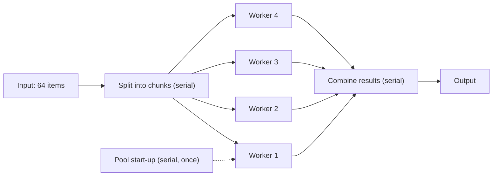

# Parallelism

> **Module 04 · Operating Systems** · Prerequisites: [Concurrency](09-Concurrency.md) · Next: [Synchronization](11-Synchronization.md)

---

## ⏱ If You Only Have 2 Minutes

- **Parallelism** means work really executes at the same instant on several cores. It only speeds up **CPU-bound** work. I/O-bound work needs [concurrency](09-Concurrency.md), not more cores.
- **Data parallelism**: the same operation on different pieces of data (hash 64 files on 8 cores). **Task parallelism**: different operations at once (resize the image while computing its checksum).
- **Amdahl's law:** with a parallel fraction `p` on `N` workers, speed-up = `1 / ((1 − p) + p / N)`. If 90% of a job parallelises, 8 workers give **4.7×**, and no number of workers gives more than **10×**.
- **Gustafson's law** is the optimistic view: if you grow the *problem* with the cores, the serial share shrinks, and scaled speed-up ≈ `N − s(N − 1)`.
- Real limits beyond the serial part: start-up cost, coordination and serialization, load imbalance, **memory bandwidth**, and hardware. SMT siblings ("16 vCPUs" may be 8 cores) and turbo clocks that drop as more cores work. Measure the curve; don't assume it is linear.
- **Node:** a `worker_threads` pool for CPU work inside a service, `cluster` or more replicas for serving traffic. **Python:** `ProcessPoolExecutor` (arguments and results are **pickled**), because the GIL stops threads from running Python bytecode in parallel. Exception: C code that releases the GIL (`hashlib` on large inputs, `zlib`, NumPy). Free-threaded builds (3.13 experimental, 3.14 supported but optional) remove the GIL.
- In a container, real parallelism stops at the **CPU quota**, not the host's core count. Beyond it, extra workers only add throttling and switching.

---

## 1. What It Is and Why It Exists

**Parallelism** is doing several pieces of work at literally the same moment, on separate CPU cores. A 2-second computation split cleanly over four cores can finish in about half a second, because four cores each do a quarter of it.

**Analogy:** painting a fence. One painter takes eight hours. Four painters working on different sections take about two, as long as each has their own brush. But if there is one shared paint bucket at the gate (a shared resource), or the job ends with one person inspecting the whole fence (a serial step), adding painters stops helping. Eventually painters spend more time walking to the bucket than painting.

**The problem it solves.** Single-core speed has grown slowly for years; core counts have grown a lot. A report that takes 40 seconds on one core is a bad user experience and holds a request open. A nightly batch that takes 9 hours on one core misses its window. Parallelism turns cores you already pay for into shorter wall-clock time.

**What goes wrong when it is misunderstood:**

- A team runs 16 Python threads on a pure-Python CPU job and sees no speed-up at all, because of the GIL.
- A Node service starts 16 worker threads in a container limited to 2 CPUs. The job is no faster than with 2, and every request now waits on CPU throttling ([CPU Scheduling](07-CPU-Scheduling.md)).
- A batch job is split into 10,000 tiny tasks for a process pool. Pickling and IPC overhead exceed the work, and the parallel version is slower than the loop.
- Someone promises "8 cores = 8× faster". The serial parts (reading input, merging results) cap it at 4×.

The difference between concurrency and parallelism is covered in [Concurrency](09-Concurrency.md). This chapter is about getting and measuring real multi-core speed-up.

---

## 2. How It Works

### Fork-join: the usual shape

Most backend parallel work follows the same pattern: split the input, process the pieces on workers, combine the results.



The parallel middle shrinks as you add workers. The serial edges do not: pool start-up, splitting, sending data to workers, the final combine, and writing output. They decide the ceiling.

### Amdahl's law, worked

Let `p` be the fraction of single-threaded run time that can run in parallel, and `N` the number of workers:

```text
speed-up(N) = 1 / ((1 − p) + p / N)          maximum as N → ∞ = 1 / (1 − p)
```

A concrete batch job takes **100 s** on one core: **10 s** reading and parsing the input file in one thread, **90 s** of independent per-record computation. So `p = 0.9`.

| Workers N | Time = 10 + 90 / N | Speed-up | Efficiency (speed-up / N) |
|---|---|---|---|
| 1 | 100 s | 1.0× | 100% |
| 2 | 55 s | 1.8× | 91% |
| 4 | 32.5 s | 3.1× | 77% |
| 8 | 21.25 s | 4.7× | 59% |
| 16 | 15.6 s | 6.4× | 40% |
| 64 | 11.4 s | 8.8× | 14% |
| ∞ | 10 s | 10× | — |

Going from 8 to 64 workers buys less than 2× more. If you want this job much faster, you must attack the 10 serial seconds (parse the input in parallel too, stream it, or pre-split the file), not add workers. With `p = 0.95` the ceiling is 20×, and with `p = 0.99` it is 100×. Small serial fractions matter a lot.

### Gustafson's law: grow the problem instead

Amdahl fixes the problem size. In practice, more cores often mean you process *more data* in the same time: more tenants per batch, higher-resolution images, more simulations. Gustafson's law measures the serial share `s` in the parallel run and asks how much bigger a problem `N` workers handle in the same wall time:

```text
scaled speed-up(N) = N − s · (N − 1)          s = 0.1, N = 8  →  8 − 0.7 = 7.3
```

Both laws are true; they answer different questions. "How much faster is this fixed job?" is Amdahl. "How much more work fits in the same time?" is Gustafson.

### Measuring the serial fraction: the Karp–Flatt metric

You rarely know `p` in advance. Rearranging Amdahl gives the **experimentally determined serial fraction** from a measured speed-up `S` on `N` workers:

```text
e = (1/S − 1/N) / (1 − 1/N)
```

If `e` stays roughly constant as `N` grows, you are limited by a fixed serial part. If `e` **rises** with `N`, overhead grows with the worker count: start-up, contention, memory bandwidth, or hardware limits. The code in section 4 prints it.

### Where speed-up is lost besides serial code

| Limit | What happens | How to spot it |
|---|---|---|
| Start-up | Each Node worker boots a V8 isolate; each Python process starts or forks an interpreter | Time an empty job; reuse pools |
| Serialization and IPC | `postMessage` clones data; `ProcessPoolExecutor` pickles arguments and results through a pipe | Time grows with payload size, not compute |
| Load imbalance | One chunk is slower; everyone waits for the straggler | Workers idle near the end; fix with smaller chunks and dynamic scheduling |
| Shared state | Locks, atomics on a shared counter, **false sharing** (two cores writing different variables on the same 64-byte cache line) | Speed-up flattens or reverses as `N` grows |
| Memory bandwidth | Memory-bound loops (scan, copy, sum of a big array) saturate RAM with a few cores | Adding cores stops helping long before `N` = core count |
| SMT (hyper-threading) | Two hardware threads share one core's execution units | Speed-up bends at the physical core count, not the vCPU count |
| Turbo frequency | Laptop and server CPUs clock down as more cores are busy | Per-worker speed drops as `N` grows |
| CPU quota | The cgroup allows only `quota` CPUs of time | Speed-up stops at `floor(quota)`; `nr_throttled` rises |

### Observing parallel execution

```bash
top -H -p 4211                   # one line per thread: are N threads each near 100%?
ps -L -o tid,psr,pcpu -p 4211    # PSR = CPU each thread last ran on
mpstat -P ALL 1                  # per-CPU utilisation: idle cores mean imbalance or a serial phase
cat /sys/fs/cgroup/cpu.stat      # throttling when workers exceed the quota
lscpu | grep -E 'Thread|Core|Socket'   # physical cores vs hardware threads
```

Illustrative `mpstat` output during the parallel phase and then the serial combine:

```text
14:20:01  CPU    %usr   %sys  %idle
14:20:02  all   49.6    0.7   49.7
14:20:02    0   99.0    1.0    0.0
14:20:02    1   99.0    0.0    1.0
...
14:20:02    8    0.0    0.0  100.0
14:20:04  all    6.3    0.1   93.6      ← combine step: one core busy, the rest idle
```

---

## 3. Key Concepts

### Data, task and pipeline parallelism

| Kind | Idea | Backend example | Scales with |
|---|---|---|---|
| Data parallelism | Same function, different data | Hash 10,000 uploaded files; render 500 PDF pages; derive keys for many records | Amount of data |
| Task parallelism | Different functions at once | For one upload: virus scan, thumbnail and checksum in parallel | Number of independent tasks (usually small) |
| Pipeline parallelism | Stages run at once on different items | Decode → resize → encode, each stage a worker, items flowing through | Number of stages; limited by the slowest stage |

Data parallelism is the one that scales to many cores, because the number of pieces grows with the input.

### Chunking and scheduling

How you split work matters as much as how many workers you have:

- **Too coarse** (one chunk per worker): one slow chunk leaves the other workers idle at the end.
- **Too fine** (one tiny item per message): per-task overhead (message, wake-up, pickling) exceeds the work.
- **Rule of thumb:** several chunks per worker (for example 4–10), each taking at least a few milliseconds. Use **dynamic scheduling**: each worker asks for the next chunk when it finishes, so fast workers take more. Python's `Executor.map(fn, items, chunksize=k)` batches `k` items per IPC round trip for process pools.
- **Move references, not data.** Send an index, a file path, a byte range or an object-store key, and let the worker load the data. For Node, a `SharedArrayBuffer` lets every worker read the same bytes without copying. For Python, `multiprocessing.shared_memory` does the same between processes.

### Node.js: real multi-core options

| Option | What runs in parallel | Use for |
|---|---|---|
| `worker_threads` pool (`piscina` is the usual library) | JavaScript in separate isolates, one OS thread each | CPU-heavy work inside a service: hashing, compression, parsing, image work |
| libuv thread pool | Async `crypto.pbkdf2`/`scrypt`, `zlib`, `fs`: 4 threads by default (`UV_THREADPOOL_SIZE`) | Built-in parallelism for those APIs: four async `pbkdf2` calls run at once with no extra code |
| `cluster` / more replicas | Whole Node processes, each with its own event loop | Serving more requests; the primary hands out connections to workers |
| `child_process` | Other programs | Running external tools in parallel |

Each worker has its own heap and event loop. Results come back through `postMessage` (a structured clone; a `Buffer` arrives as a `Uint8Array`), or are written into shared memory.

### Python: processes, the GIL, and the exceptions

- **`ProcessPoolExecutor` / `multiprocessing.Pool`** give each worker its own interpreter and its own GIL, so pure-Python code runs in parallel. Arguments, the function reference and results are **pickled** and sent over pipes. The function must be importable at module level, and the main script needs an `if __name__ == "__main__":` guard.
- **Start methods:** `fork` was the Linux default up to 3.13. From **3.14 the Linux default is `forkserver`** (checked in a `python:3.14` container). `spawn` is the default on macOS and Windows. `forkserver` and `spawn` children re-import your module and start without the parent's in-memory state, so start-up is slower than `fork`. Create the pool once.
- **Threads can be parallel when C code drops the GIL.** `hashlib` releases it for data larger than 2047 bytes (documented), and `zlib` and NumPy release it during heavy operations. In our test, `hashlib.pbkdf2_hmac` on 2, 4 and 8 threads also ran in parallel. Pure-Python loops never do on a GIL build.
- **Free-threaded CPython** (PEP 703): experimental in 3.13, officially supported but still optional in 3.14, usually as a separate `python3.14t` executable. Threads then run Python code in parallel without pickling. C extensions that are not marked compatible re-enable the GIL when imported. Check `sys._is_gil_enabled()` at start-up.
- **Subinterpreters:** 3.14 added `concurrent.futures.InterpreterPoolExecutor`, which runs tasks in isolated interpreters with their own GIL inside one process. It is new; treat it as an option to test, not a default.

### Containers cap real parallelism

A container with `cpu.max = "200000 100000"` gets 2 CPUs of time per period, whatever the host has. Up to 2 busy workers, speed-up is real. Beyond 2, the extra workers share the same 200 ms per period, so the job is no faster, and every thread in the container, including request handlers, is throttled once the quota is used. The measurements in section 4 show a Python job getting **slower** with 16 processes than with 2 under a 2-CPU limit. Compute the worker count from the quota ([CPU Scheduling](07-CPU-Scheduling.md)).

---

## 4. Code Examples

Scenario: a batch of 64 independent items, each needing an expensive, deterministic CPU computation. Here that is PBKDF2-HMAC-SHA256 with 200,000 rounds per item, about the cost of hashing 64 passwords. Run it on 1, 2, 4, 8 and 16 workers, include pool start-up and the final combine in the timing, and print speed-up, efficiency and the Karp–Flatt serial fraction. Both versions compute the same root hash, so you can check that the parallel result is correct.

### Node.js / TypeScript

```ts
// No npm packages — Node.js 22+, TypeScript 5, ESM. Compile with tsc, then: node dist/scale.js
import { createHash, pbkdf2Sync } from "node:crypto";
import { once } from "node:events";
import { availableParallelism } from "node:os";
import { Worker, isMainThread, parentPort } from "node:worker_threads";

const CHUNKS = 64;          // independent items: several per worker, so fast workers can take more
const ITERATIONS = 200_000; // PBKDF2-HMAC-SHA256 rounds per item: serial inside, parallel across items

// Pure CPU, deterministic, and the same function exists in Python's hashlib, so both print the same root.
const derive = (chunk: number): Buffer => pbkdf2Sync(`item-${chunk}`, "batch-salt", ITERATIONS, 32, "sha256");

async function run(workers: number): Promise<{ ms: number; root: string }> {
  const t0 = performance.now(); // pool start-up is inside the timing: it is part of the serial cost
  const pool = Array.from({ length: workers }, () => new Worker(new URL(import.meta.url)));
  const keys: Buffer[] = new Array(CHUNKS);
  let next = 0;
  await Promise.all(pool.map(async (w) => {
    // Dynamic scheduling: each worker asks for the next chunk when it finishes the last one.
    while (next < CHUNKS) {
      const chunk = next++;
      w.postMessage(chunk);
      const [key] = (await once(w, "message")) as [Uint8Array]; // Buffers arrive as Uint8Array
      keys[chunk] = Buffer.from(key);
    }
  }));
  await Promise.all(pool.map((w) => w.terminate()));
  // The combine step is the serial tail: one thread, after every chunk is done.
  const root = createHash("sha256").update(Buffer.concat(keys)).digest("hex");
  return { ms: performance.now() - t0, root };
}

if (!isMainThread) {
  parentPort!.on("message", (chunk: number) => parentPort!.postMessage(derive(chunk)));
} else {
  const cpus = availableParallelism();
  console.log(`availableParallelism=${cpus}  items=${CHUNKS}  iterations=${ITERATIONS}`);
  console.log(" N   time ms  speed-up  efficiency  serial fraction (Karp-Flatt)");
  let base = 0;
  for (const n of [1, 2, 4, 8, 16].filter((n) => n <= cpus)) {
    const { ms, root } = await run(n);
    if (n === 1) base = ms;
    const s = base / ms;
    const e = n === 1 ? NaN : (1 / s - 1 / n) / (1 - 1 / n); // measured serial share, from Amdahl rearranged
    console.log(`${String(n).padStart(2)} ${ms.toFixed(0).padStart(9)} ${s.toFixed(2).padStart(9)}`
      + ` ${(s / n * 100).toFixed(0).padStart(10)}% ${Number.isNaN(e) ? "" : e.toFixed(3).padStart(10)}   root=${root.slice(0, 12)}`);
  }
}
```

### Python

```python
# No pip packages — Python 3.12+ (stdlib only).
import hashlib
import os
import time
from concurrent.futures import ProcessPoolExecutor

CHUNKS = 64             # independent items: several per worker, so fast workers can take more
ITERATIONS = 200_000    # PBKDF2-HMAC-SHA256 rounds per item: serial inside, parallel across items


def derive(chunk: int) -> bytes:
    # Module-level function: worker processes must be able to import it by name.
    return hashlib.pbkdf2_hmac("sha256", f"item-{chunk}".encode(), b"batch-salt", ITERATIONS, 32)


def run(workers: int) -> tuple[float, str]:
    t0 = time.perf_counter()  # pool start-up is inside the timing: it is part of the serial cost
    with ProcessPoolExecutor(max_workers=workers) as pool:
        # Only an int goes in and 32 bytes come back, so pickling is negligible here.
        # chunksize=1 hands out one item at a time: best balance, one IPC round trip per item.
        keys = list(pool.map(derive, range(CHUNKS), chunksize=1))
    root = hashlib.sha256(b"".join(keys)).hexdigest()  # the serial tail: combine on one core
    return time.perf_counter() - t0, root


if __name__ == "__main__":
    cpus = os.process_cpu_count() if hasattr(os, "process_cpu_count") else len(os.sched_getaffinity(0))
    print(f"usable cpus={cpus}  items={CHUNKS}  iterations={ITERATIONS}")
    print(" N   time ms  speed-up  efficiency  serial fraction (Karp-Flatt)")
    base = 0.0
    for n in [n for n in (1, 2, 4, 8, 16) if n <= cpus]:
        secs, root = run(n)
        base = base or secs
        s = base / secs
        e = f"{(1 / s - 1 / n) / (1 - 1 / n):10.3f}" if n > 1 else " " * 10
        print(f"{n:2} {secs * 1000:9.0f} {s:9.2f} {s / n:10.0%} {e}   root={root[:12]}")
```

### Illustrative results

Measured in `node:22` and `python:3.12` containers on a laptop CPU with **8 physical cores and 16 hardware threads**. Both versions printed `root=7921df720ceb` on every run. Absolute times depend on the CPU; the shape of the curve is the lesson.

| Workers | Node time | Node speed-up | Node Karp–Flatt | Python time | Python speed-up | Python Karp–Flatt |
|---|---|---|---|---|---|---|
| 1 | 2,001 ms | 1.00× | — | 2,537 ms | 1.00× | — |
| 2 | 1,056 ms | 1.90× | 0.055 | 1,228 ms | 2.07× | ≈ 0 |
| 4 | 634 ms | 3.15× | 0.089 | 748 ms | 3.39× | 0.060 |
| 8 | 467 ms | 4.28× | 0.124 | 497 ms | 5.10× | 0.081 |
| 16 | 418 ms | 4.79× | 0.156 | 400 ms | 6.34× | 0.102 |

The same Python script with `docker run --cpus=2` (the container still reports 16 usable CPUs, so the script tries them all):

| Workers | Time | Speed-up |
|---|---|---|
| 1 | 2,604 ms | 1.00× |
| 2 | 1,308 ms | 1.99× |
| 4 | 1,351 ms | 1.93× |
| 8 | 1,513 ms | 1.72× |
| 16 | 2,104 ms | 1.24× |

What to read from it:

- **Near-linear up to 2–4 workers, then bending.** The work itself has no shared state, so the bend is overhead and hardware. The rising Karp–Flatt value says the "serial" share grows with `N`: worker start-up (isolates or processes) and, mostly, the CPU. Beyond 8 workers, pairs of workers share one physical core (SMT), and the laptop's clock drops as more cores are busy. 16 "CPUs" gave 5–6×, not 16×.
- **Node starts lower than Python here** because each `Worker` boots a V8 isolate inside the timing, and the main thread hands out items one message at a time. Python forks (3.12 on Linux), which is cheap. For long batches both costs vanish; for sub-second jobs, keep the pool alive between batches.
- **The quota caps everything at 2×.** Past 2 workers the job gets *slower*: more processes to start, more throttling, more switching, the same 200 ms of CPU per 100 ms. Sizing from `cpu.max` would have chosen 2.
- **Runtime difference:** Node runs the parallel work as threads in one process, with no GIL and small messages. Python needs processes, because a pure-Python version of this loop would not run in parallel on threads. This particular function (`pbkdf2_hmac`) releases the GIL, so threads would also scale here. Don't rely on that unless you have checked the specific function.

---

## 5. Production Concerns

- **Decide where the parallelism lives.** Inside a request (a `worker_threads` pool, a process pool) gives lower latency for one big request, but competes with every other request in the same container. Across requests, more replicas behind a load balancer is simpler and scales independently. Long jobs (minutes) belong in a job queue with dedicated worker deployments, sized and autoscaled on their own.
- **Pool size = usable CPUs, not host CPUs.** Use `max(1, floor(min(quota, affinity)))` for CPU-bound pools, and count the main thread in Node. On machines with SMT, test both the physical-core count and the hardware-thread count; for some workloads the extra hardware threads add little.
- **Bound the queue in front of the pool.** A pool with an unbounded queue turns overload into unbounded latency and memory. Reject or shed work when the queue is full (HTTP 503 with `Retry-After`), or apply backpressure upstream ([Backend Concurrency Patterns](32-Backend-Concurrency-Patterns.md)).
- **Watch memory, not only CPU.** Each Node worker has its own V8 heap, and each Python process its own interpreter and copies of whatever data it loads. Eight workers that each load a 500 MB model need 4 GB. Share read-only data (`SharedArrayBuffer`, `mmap`, `multiprocessing.shared_memory`, or `fork` with `gc.freeze()`), or use fewer, bigger workers.
- **Measure speed-up curves before choosing `N`.** Run the real workload at 1, 2, 4, … workers on the target instance type and container limit. Production CPUs differ from laptops: different SMT behaviour, memory bandwidth and clock behaviour under all-core load.
- **Make parallel results deterministic.** Workers finish in any order. Store results by index (as both examples do), and avoid floating-point reductions whose result depends on the order of summation if you need bit-identical output.
- **Handle worker failure.** A crashed Node worker emits `error`/`exit`; a dead Python process makes the whole pool raise `BrokenProcessPool`, and it must be recreated. Retry the affected items, not the whole batch.

---

## 6. Common Mistakes

- **Expecting linear speed-up** — 16 workers give 5×, and the plan assumed 16× — apply Amdahl to the serial parts, and measure the curve on real hardware, including SMT and turbo effects.
- **Python threads for pure-Python CPU work** — no speed-up, more GIL switching — use `ProcessPoolExecutor`, a C library that releases the GIL, or test a free-threaded build.
- **Sending big data to every worker** — pickling or structured-cloning hundreds of MB costs more than the work and doubles memory — send indices, paths or byte ranges, or use shared memory.
- **Tiny tasks** — 100,000 one-microsecond items each with a message and a wake-up run slower in parallel than in a loop — batch them into chunks of milliseconds (`chunksize`, arrays per message).
- **One chunk per worker** — the slowest chunk decides the finish time while other cores sit idle — split into several chunks per worker and schedule dynamically.
- **Sizing from host cores in a container** — 16 processes under a 2-CPU quota made the job slower than 2 — read `cpu.max`, or pass the worker count in configuration.
- **Creating the pool per request** — isolate boot or interpreter start-up dominates short jobs — create the pool once at start-up and reuse it.

---

## 7. Comparison Table

| | Node `worker_threads` | Node `cluster` / replicas | Python `ProcessPoolExecutor` | Python threads (GIL build) | Python free-threaded threads |
|---|---|---|---|---|---|
| Parallel CPU work | Yes | Yes (per process) | Yes | Only in C code that releases the GIL | Yes |
| Unit | Thread + V8 isolate | Process | Process | Thread | Thread |
| Passing data | Structured clone, transfer, `SharedArrayBuffer` | IPC or none (independent requests) | Pickle over pipes; `shared_memory` | Shared objects | Shared objects |
| Start-up | Milliseconds per worker | Tens of ms+ per process | `fork` fast; `forkserver`/`spawn` slower | Microseconds | Microseconds |
| Memory per worker | A V8 heap | A whole runtime | A whole interpreter | A stack | A stack |
| Best for | CPU tasks inside a service | Serving more traffic | CPU batches and CPU work in services | I/O, and C-heavy work | CPU work, if dependencies support it |

---

## 8. Interview Questions

**[Junior] What is the difference between parallelism and concurrency?**
Concurrency is structuring a program as tasks whose lifetimes overlap; it works on one core by interleaving them. Parallelism is executing tasks at the same instant on different cores. Concurrency helps I/O-bound work even on one core; only parallelism makes CPU-bound work finish faster.

**[Junior] How do you run CPU-heavy work in parallel in Node and in Python?**
In Node, use a pool of `worker_threads` (each runs JavaScript on its own thread and isolate). For serving more traffic, use `cluster` or more replicas. In standard CPython, use `ProcessPoolExecutor` or `multiprocessing`, because the GIL stops threads from running Python bytecode in parallel. Arguments and results are pickled, so send small inputs.

**[Mid] State Amdahl's law and apply it: 80% of a job is parallel. What do 4 and 16 workers give?**
Speed-up = `1 / ((1 − p) + p / N)`. With `p = 0.8`: 4 workers give `1 / (0.2 + 0.2) = 2.5×`, and 16 workers give `1 / (0.2 + 0.05) = 4×`. The ceiling is `1 / 0.2 = 5×`, however many workers you add. The practical lesson is to shrink the serial 20% before buying cores.

**[Mid] Why might 16 workers on a "16-vCPU" machine give only 5–6× speed-up on independent work?**
"16 vCPUs" is often 8 physical cores with SMT, and two hardware threads on one core share its execution units. Clock speed also drops when all cores are busy. On top of that come pool start-up, message passing, the serial combine step, and possibly memory bandwidth if the work touches a lot of data. Measure the curve; the knee is often at the physical core count.

**[Mid] What does `chunksize` do in `ProcessPoolExecutor.map`, and how do you choose it?**
It groups that many items into one task sent to a worker, so there is one pickle and one IPC round trip per chunk instead of per item. Larger chunks cut overhead but can leave workers idle at the end if chunks take uneven time. Choose it so each chunk takes at least a few milliseconds and there are still several chunks per worker.

**[Senior] A batch job got only 2× faster when moved from 1 to 16 workers. How do you investigate?**
First compute the Karp–Flatt fraction at several worker counts. A constant value points to a fixed serial part; a rising one points to overhead that grows with `N`. Then check the obvious caps: the container's `cpu.max` and throttling counters, the physical core count, and whether the workers are idle in `mpstat` because of a serial read or combine phase. Then look at overheads: payload size per task (pickling, cloning), task granularity, shared locks or counters, and memory bandwidth for data-heavy loops. Fix the biggest one: parallelise the input phase, send references instead of data, batch tasks, or reduce the worker count to the real CPUs.

**[Senior] Gunicorn workers, a ProcessPoolExecutor inside the app, or a job queue: how do you get parallelism for a CPU-heavy endpoint in a FastAPI service?**
Gunicorn/Uvicorn workers parallelise *across requests*: each process serves its own requests, which is enough if each request's CPU work is modest. A `ProcessPoolExecutor` inside the app speeds up *one* heavy request, but it shares the container's CPU quota with request handling, so size it to the quota and bound its queue. For work that takes seconds or longer, or must survive restarts, use a job queue with a separate worker deployment, return `202 Accepted`, and scale the workers independently. In Kubernetes, prefer replicas for request parallelism and keep each pod's process count matched to its CPU limit.

**[Senior] When would you consider the free-threaded Python build for parallel work?**
When CPU-bound work needs parallelism and processes are costly: large shared in-memory data that would be pickled or duplicated per process, or many short tasks where process overhead dominates. Threads on the free-threaded build share objects and run bytecode in parallel. The costs: it is optional and separately built, single-threaded code runs somewhat slower, every C extension must support it or the GIL comes back on import, and code that relied on the GIL to hide races may now break. Benchmark the real workload, check `sys._is_gil_enabled()` in production, and keep a process-pool fallback.

---

## 9. Cheat Sheet

```text
Parallelism     same instant on several cores; only helps CPU-bound work
Kinds           data (same op, many items) · task (different ops) · pipeline (stages)
Amdahl          S = 1 / ((1−p) + p/N); max 1/(1−p); p=0.9: N=8 → 4.7×, ceiling 10×
Gustafson       grow the problem: scaled S = N − s(N−1); s=0.1, N=8 → 7.3
Karp–Flatt      e = (1/S − 1/N)/(1 − 1/N); constant = serial part; rising = growing overhead
Limits          serial code, start-up, IPC/pickling, imbalance, locks/false sharing, RAM bandwidth, SMT, turbo, quota
Chunking        several chunks per worker, each ≥ a few ms; dynamic scheduling; send refs, not data
Node            worker_threads pool (piscina) for CPU; libuv pool (4) for async crypto/zlib; cluster/replicas for serving
Python          ProcessPoolExecutor (pickled args, module-level fn, __main__ guard, chunksize)
Start methods   Linux: fork (≤3.13) → forkserver (3.14); macOS/Windows: spawn
GIL exceptions  hashlib (>2047 bytes), zlib, NumPy release it → threads can scale there
Free-threaded   3.13 experimental, 3.14 supported but optional (python3.14t); sys._is_gil_enabled()
Containers      speed-up stops at floor(cpu quota); more workers → throttling, slower
Workers         CPU pool = max(1, floor(min(quota, affinity))); measure the curve on real hardware
```

---

## Related Topics

- [Concurrency](09-Concurrency.md) — overlapping work on one core, and why it is not the same thing
- [CPU Scheduling](07-CPU-Scheduling.md) — CPU quotas and throttling that cap real parallelism in containers
- [Process vs Thread](04-Process-vs-Thread.md) — the cost of each unit you parallelise with
- [Synchronization](11-Synchronization.md) — coordinating workers when they must share state
- [Backend Concurrency Patterns](32-Backend-Concurrency-Patterns.md) — worker pools, bounded queues and fan-out/fan-in
- [Node Event Loop and Concurrency](../Module-02-Core-Backend/06-Node-Event-Loop-and-Concurrency.md) — keeping CPU work off the event loop
