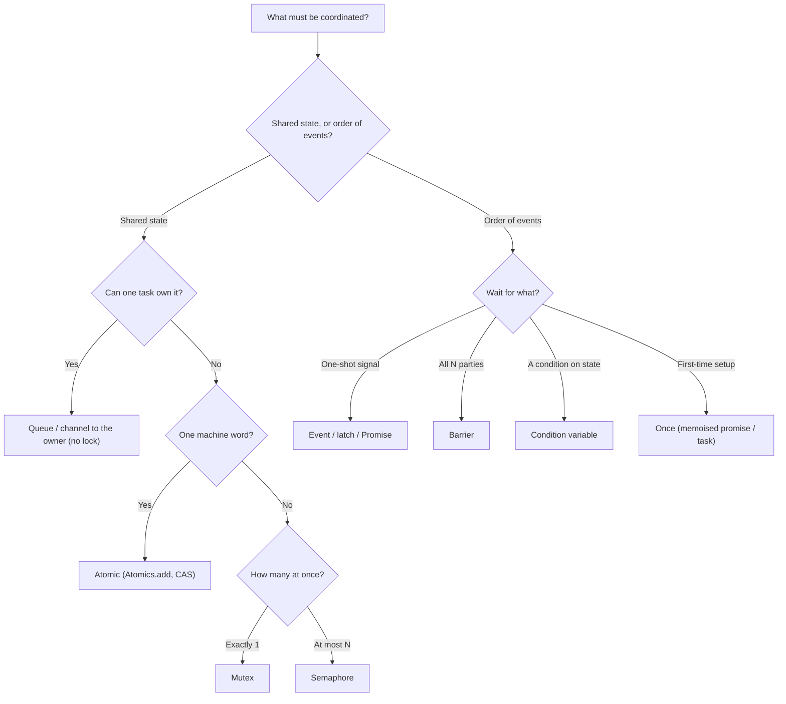

# Synchronization

> **Module 04 · Operating Systems** · Prerequisites: [Parallelism](10-Parallelism.md) · Next: [Critical Sections](12-Critical-Sections.md)

---

## ⏱ If You Only Have 2 Minutes

- **Synchronization** is how concurrent tasks agree on two things: **who may touch shared state right now** (mutual exclusion) and **what must happen before what** (ordering, or signalling).
- Name the problem first, then pick the primitive: one at a time → **mutex**; at most N → **semaphore**; wait until something is true → **condition variable**; N parties meet before continuing → **barrier**; wait for a one-shot signal → **event / latch**; update one word → **atomic**; run exactly once → **once**; hand data to someone else → **queue / channel**.
- Every primitive is built from two things: an **atomic CPU instruction** (compare-and-swap, fetch-and-add) for the fast path, and a way to **sleep and be woken** (the `futex` system call on Linux) for the slow path. An uncontended lock never enters the kernel.
- Synchronization also makes writes **visible**. Without it, another core may see a stale value, or see a "done" flag before the result it guards. Unlock → lock, `Event.set()` → `wait()` returns, an `Atomics` store → an `Atomics` load, `put()` → `get()` all create a **happens-before** edge.
- **Single-threaded async code needs synchronization too.** Every `await` is a switch point ([Race Conditions](13-Race-Conditions.md)). But code between two `await`s cannot be interrupted, so a synchronous check-and-claim often replaces a lock.
- **Prefer message passing.** One owner per piece of state plus a queue needs no lock. Node `worker_threads` already work this way: `postMessage` copies data.
- **Bound every wait.** A barrier or event with no timeout turns one crashed worker into a hung service.
- All of these work inside **one process**. Across replicas, synchronize in the database or Redis ([Database Locks](../Module-03-Databases/30-Database-Locks.md)).

---

## 1. What It Is and Why It Exists

**Synchronization** is the set of rules and tools that coordinate tasks running at the same time — threads, processes, or async tasks on one event loop — so that the result is correct whatever order the scheduler picks.

**Analogy:** a relay race and a single-lane bridge. On the bridge, only one car may cross at a time; that is **mutual exclusion**. In the relay, runner 2 must not start until runner 1 hands over the baton; that is **ordering**. Neither problem is about speed. Both are about making an unpredictable order safe.

**What breaks without it:**

- **Lost updates.** Two threads read-modify-write the same balance and one change disappears ([Race Conditions](13-Race-Conditions.md)).
- **Reading half-finished work.** A request handler reads a cache while another thread is halfway through rebuilding it.
- **Acting too early.** A worker starts phase 2 before every worker has finished phase 1, so it aggregates partial data. A request is served before the configuration has loaded.
- **Doing one-time work twice.** Two requests both see "no connection pool yet" and both open one.
- **Overloading a dependency.** 500 tasks call a partner API that allows 10 concurrent requests.

The operating system causes the problem and supplies the cure. The scheduler can pause a thread after any instruction, and on multicore machines threads really run at the same instant ([Parallelism](10-Parallelism.md)). The CPU and kernel also supply the building blocks every lock, semaphore and queue is made of.

---

## 2. How It Works

### Two building blocks under every primitive

1. **Atomic instructions.** The CPU can do a small read-modify-write as one indivisible step: compare-and-swap (CAS), fetch-and-add, exchange. "Take the lock" is one CAS: *if the lock word is 0, set it to 1*. If it succeeds, you own the lock, with no system call.
2. **Sleep and wake.** If the CAS fails, spinning would waste a core ([Spinlocks](16-Spinlocks.md)). Instead, the thread asks the kernel to sleep. On Linux this is the `futex` ("fast user-space mutex") system call: `FUTEX_WAIT` means "put me to sleep, but only if the word at this address still holds value V". Checking the value inside the kernel closes the gap between "I saw it locked" and "I went to sleep". The releasing thread calls `FUTEX_WAKE` only when someone may be waiting.

So an uncontended lock costs one atomic instruction. A contended one costs two system calls and a context switch ([Context Switching](08-Context-Switching.md)). glibc's mutexes, condition variables and POSIX semaphores are built this way. In CPython, `threading.Event`, `Semaphore`, `Condition` and `Barrier` are written in Python on top of `threading.Lock`. V8 implements `Atomics.wait` with its own wait list and an operating-system condition variable, which on Linux also ends in `futex`.

### Picking a primitive



### Observing it on Linux

Threads blocked on a lock, a barrier or a queue do not use CPU. They show state `S` (sleeping), and their wait channel points at the futex code:

```bash
pid=$(pgrep -f barrier_py.py)
ps -L -o tid,stat,wchan:22,pcpu,comm -p "$pid"   # one row per thread
strace -f -e trace=futex -p "$pid"               # who sleeps and who wakes whom
```

Illustrative output while three of four threads wait at a barrier:

```text
  TID STAT WCHAN                  %CPU COMMAND
 9120 Sl   futex_wait_queue        0.0 python3
 9121 Sl   futex_wait_queue        0.0 python3
 9122 Sl   futex_wait_queue        0.0 python3
 9123 Rl   -                      99.6 python3
[pid  9121] futex(0x7f3c5c000b70, FUTEX_WAIT_BITSET_PRIVATE, 0, {tv_sec=48217, tv_nsec=...}, FUTEX_BITSET_MATCH_ANY <unfinished ...>
[pid  9123] futex(0x7f3c5c000b70, FUTEX_WAKE_PRIVATE, 1) = 1
```

The kernel function name in `WCHAN` differs between kernel versions. What matters: waiting threads are asleep in the kernel, not spinning. If waiting threads show high `%CPU`, something is busy-waiting.

---

## 3. Key Concepts

### Coordination problems and their primitives

| Problem | Backend example | Primitive | Python | Node.js | Details |
|---|---|---|---|---|---|
| Mutual exclusion | Update one account's balance | Mutex | `threading.Lock`, `asyncio.Lock` | Promise-chain mutex; CAS lock on a `SharedArrayBuffer` | [Mutex](14-Mutex.md) |
| Limiting | At most 10 calls to a partner API | Semaphore | `Semaphore`, `BoundedSemaphore` (both modules) | A small semaphore class | [Semaphore](15-Semaphore.md) |
| Waiting for a condition | A consumer waits until the buffer is non-empty | Condition variable | `threading.Condition`, `asyncio.Condition` | `Atomics.wait` on a value; promises | [Condition Variables](17-Condition-Variables.md) |
| Meeting point | Phase 2 needs every worker's phase-1 result | Barrier | `threading.Barrier`, `asyncio.Barrier` (3.11+) | `Atomics` counter + `wait`/`notify` | This chapter |
| One-shot signal | "Ready" after warm-up; "shutting down" | Event / latch | `threading.Event`, `asyncio.Event` | A `Promise`; `AbortSignal` for cancellation | This chapter |
| Single-word update | A counter, a flag | Atomic | No public atomics; use a `Lock` | `Atomics.add`, `Atomics.compareExchange` | [Spinlocks](16-Spinlocks.md) |
| One-time init | Open the DB pool once | Once | Import lock (module level); a stored `Task` | A memoised `Promise` | This chapter |
| Handing over data | Producer → consumer | Queue / channel | `queue.Queue`, `asyncio.Queue`, `multiprocessing.Queue` | `postMessage`, `MessageChannel` | [Backend Concurrency Patterns](32-Backend-Concurrency-Patterns.md) |

### The primitives, one paragraph each

- **Mutex** — a lock with an owner: one holder at a time, and only the holder unlocks. The default answer to "protect this shared state". See [Mutex](14-Mutex.md).
- **Semaphore** — a counter of permits: `acquire` takes one or waits, `release` returns one. It limits *how many*, has no owner, and is the tool for protecting a dependency. See [Semaphore](15-Semaphore.md).
- **Condition variable** — lets a thread sleep until some state becomes true ("queue not empty"), always together with a mutex, always re-checking the condition in a loop. See [Condition Variables](17-Condition-Variables.md).
- **Atomic** — one indivisible operation on one machine word: increment, swap, compare-and-swap. No waiting, but only for a single value. See [Spinlocks](16-Spinlocks.md).
- **Barrier** — N parties call `wait()`; nobody continues until all N have arrived. It is reusable for the next phase. Python's `threading.Barrier(n, action=fn)` runs `fn` in one thread after everyone arrives and before anyone is released — a natural place for "aggregate the partial results".
- **Latch / event** — a one-shot gate. A **countdown latch** opens after N `countDown()` calls (Java's `CountDownLatch`); an **event** opens on one `set()`. Once open, it stays open, and later waiters pass at once. In JavaScript, a `Promise` *is* a one-shot event.
- **Once** — run an initialiser exactly once, even if many callers race (`pthread_once`, Go's `sync.Once`). In async code, store the *promise* or *task* of the first call and hand the same one to every caller. In Python, `functools.cached_property` stopped holding a lock in 3.12, so it no longer guarantees once-only execution across threads.
- **Queue / channel** — moves data *and* ownership: after `put`, the producer stops touching the object. It is usually the simplest correct design.

### Memory visibility and happens-before

Correctness needs more than "no two writers at once". Readers must also **see** writes, in the right order. Compilers reorder independent instructions, and CPUs buffer stores and read from per-core caches. A classic bug:

```text
worker:  result = compute()   # (1) plain write
         done = True           # (2) plain write
reader:  if done:              # may see (2) ...
             use(result)       # ... and still read the old result
```

The fix is a **happens-before** relation. If A happens-before B, B sees everything A wrote. Synchronization creates these edges:

| Edge | Meaning |
|---|---|
| `unlock(m)` → a later `lock(m)` | Everything written inside the critical section is visible to the next holder |
| `event.set()` → `event.wait()` returns | Everything written before `set` is visible after `wait` |
| `queue.put(x)` → `queue.get()` returns `x` | The object is fully built when the consumer receives it |
| `thread.start()` / `thread.join()` | The child sees the parent's earlier writes; the parent sees all the child's writes after `join` |
| `Atomics.store` / `Atomics.add` → an `Atomics.load` that reads that value (JS) | JavaScript `Atomics` are sequentially consistent, so plain writes made before the atomic write are visible after the atomic read |

Python does not publish a low-level memory model the way Java and C++ do. The practical rule is the same in both runtimes: share data only through the primitives above, never through a plain flag polled in a loop.

### Synchronization in single-threaded async code

On one event loop there are no data races, but there are still race conditions: every `await` lets other tasks run, so a check before an `await` can be stale after it ([Race Conditions](13-Race-Conditions.md) reproduces this). The other side of that rule is a gift: **code between two `await`s runs as one uninterrupted step.** "If nobody has started the refresh, start it and store its promise" needs no lock if it contains no `await`. You need an async lock (`asyncio.Lock`, or a promise-chain mutex in Node, which has none built in) only when the protected sequence itself must `await`. Two runtime details: asyncio's primitives are **not thread-safe** (signal a loop from another thread with `loop.call_soon_threadsafe`), and an `asyncio.Lock` does nothing for threads, while a `threading.Lock` held across an `await` blocks the whole loop.

### Prefer message passing to shared memory

Go's proverb: *don't communicate by sharing memory; share memory by communicating.* If one task owns the state and everyone else sends it messages, the state needs no lock at all. Node is built this way: `worker_threads` share nothing unless you opt in with a `SharedArrayBuffer`, and `postMessage` copies (structured clone) or transfers data. In Python, `queue.Queue` between threads and `multiprocessing.Queue` between processes do the same. The costs: copying, an extra hop of latency, a single owner that can become a bottleneck, and a queue that must be **bounded** or it hides overload. Use shared memory only when copying is too expensive.

---

## 4. Code Examples

Scenario 1: four workers each sum one shard of revenue. Then **each worker needs the grand total** to report its shard's share. A `join()` cannot express this, because the workers must keep running after the meeting point: it is a barrier.

Scenario 2: an async service must not serve requests until three warm-up tasks finish, and must open its database pool exactly once even if early requests race to open it.

### Shell

```bash
node barrier.ts && python barrier_py.py      # both print each shard's share; the shares sum to 100%
ps -L -o tid,stat,wchan:22,pcpu -p "$(pgrep -f barrier_py.py)"   # waiting threads are asleep, not spinning
```

### Node.js / TypeScript

Workers meet at a barrier built from `Atomics` on a `SharedArrayBuffer`; results come back to the main thread as messages.

```ts
// Node.js 22+, TypeScript 5, ESM. No packages. Run: node barrier.ts
// (Node 22.18+ strips types; on older 22.x add --experimental-strip-types)
import { Worker, isMainThread, parentPort, workerData } from "node:worker_threads";

const WORKERS = 4;
const ROWS_PER_SHARD = 250_000;
const ARRIVED = 0; // ctrl[0]: how many workers have published their partial sum
const RELEASED = 1; // ctrl[1]: 0 until the total is ready, then 1

interface Init { ctrl: SharedArrayBuffer; sums: SharedArrayBuffer; shard: number }

if (isMainThread) {
  const ctrl = new SharedArrayBuffer(2 * Int32Array.BYTES_PER_ELEMENT);
  const sums = new SharedArrayBuffer((WORKERS + 1) * Float64Array.BYTES_PER_ELEMENT); // last slot = total

  // Results come back as messages: no shared state to protect on the main thread.
  const shares = await Promise.all(
    Array.from({ length: WORKERS }, (_, shard) =>
      new Promise<number>((resolve, reject) => {
        const w = new Worker(new URL(import.meta.url), { workerData: { ctrl, sums, shard } satisfies Init });
        w.once("message", resolve);
        w.once("error", reject);
      }),
    ),
  );
  shares.forEach((s, i) => console.log(`shard ${i}: ${(s * 100).toFixed(2)}% of revenue`));
  console.log(`sum of shares: ${(shares.reduce((a, b) => a + b, 0) * 100).toFixed(2)}%`);
} else {
  const { ctrl, sums, shard } = workerData as Init;
  const c = new Int32Array(ctrl);
  const s = new Float64Array(sums);

  // Phase 1: each worker sums its own shard (stand-in for reading a partition).
  let revenue = 0;
  for (let row = 0; row < ROWS_PER_SHARD; row++) revenue += ((shard * 7 + row) % 100) + 1 + shard;
  s[shard] = revenue; // plain write...

  // ...made visible by this atomic: whoever later reads ARRIVED with an Atomics op also sees s[shard].
  if (Atomics.add(c, ARRIVED, 1) + 1 === WORKERS) {
    // Last to arrive aggregates (like threading.Barrier's `action`), then opens the gate for everyone.
    let total = 0;
    for (let i = 0; i < WORKERS; i++) total += s[i];
    s[WORKERS] = total;
    Atomics.store(c, RELEASED, 1);
    Atomics.notify(c, RELEASED); // wake every sleeper
  } else {
    // Sleeps without using CPU while ctrl[1] is 0; returns "not-equal" at once if the gate is already open.
    Atomics.wait(c, RELEASED, 0);
  }

  // Phase 2 needs the aggregate, which is why a barrier is needed and join() is not enough.
  parentPort!.postMessage(s[shard] / s[WORKERS]);
}
```

A Promise-based countdown latch for start-up readiness, and a memoised promise for once-only initialisation:

```ts
// Node.js 22+, TypeScript 5, ESM. No packages.
import { once } from "node:events";
import { setTimeout as sleep } from "node:timers/promises";

// A one-shot latch: `done` resolves after countDown() has been called `count` times.
class CountDownLatch {
  #count: number;
  readonly #opened = Promise.withResolvers<void>();
  readonly done: Promise<void> = this.#opened.promise;

  constructor(count: number) {
    this.#count = count;
    if (count === 0) this.#opened.resolve();
  }

  countDown(): void {
    // No await between the check and the decrement, so no other task can interleave here.
    if (this.#count > 0 && --this.#count === 0) this.#opened.resolve();
  }
}

// One-time init: the first caller starts the work, every caller shares the same promise.
let pool: Promise<string> | undefined;
function getPool(): Promise<string> {
  pool ??= sleep(50).then(() => "pg-pool#1").catch((err: unknown) => {
    pool = undefined; // do not cache a failure forever; the next caller retries
    throw err;
  });
  return pool;
}

const startup = new CountDownLatch(3);
const warmUp = async (name: string, ms: number) => {
  await sleep(ms); // load config, prime a cache, open the pool...
  console.log(`warm-up done: ${name}`);
  startup.countDown();
};
void warmUp("config", 30);
void warmUp("rates cache", 80);
void getPool().then(() => startup.countDown());

async function handleRequest(id: number): Promise<string> {
  // Requests that arrive early wait for readiness instead of failing; the deadline stops them waiting forever.
  const deadline = AbortSignal.timeout(1_000); // unref'd timer: never keeps the process alive
  await Promise.race([startup.done, once(deadline, "abort").then(() => { throw deadline.reason; })]);
  return `request ${id} served with ${await getPool()}`;
}

console.log(await Promise.all([1, 2, 3].map(handleRequest)));
```

### Python

```python
# Python 3.12+, stdlib only.
import threading

WORKERS = 4
ROWS_PER_SHARD = 250_000

sums = [0.0] * WORKERS
shares = [0.0] * WORKERS
total = 0.0


def aggregate() -> None:
    # Run by exactly one thread, after all WORKERS have arrived and before any is released.
    global total
    total = sum(sums)


barrier = threading.Barrier(WORKERS, action=aggregate, timeout=5.0)


def worker(shard: int) -> None:
    # Phase 1: sum this shard (stand-in for reading one partition).
    sums[shard] = float(sum(((shard * 7 + row) % 100) + 1 + shard for row in range(ROWS_PER_SHARD)))
    # If a peer crashes or the timeout passes, wait() raises BrokenBarrierError instead of hanging forever.
    barrier.wait()
    # Phase 2 needs the aggregate. Everything written before wait() is visible after it.
    shares[shard] = sums[shard] / total


threads = [threading.Thread(target=worker, args=(i,), name=f"shard-{i}") for i in range(WORKERS)]
for t in threads:
    t.start()
for t in threads:
    t.join()  # join() is the right tool for "wait until they finish"; the barrier is for "meet in the middle"

for i, share in enumerate(shares):
    print(f"shard {i}: {share:.2%} of revenue")
print(f"sum of shares: {sum(shares):.2%}")
```

The async version: an `asyncio.Event` as the readiness gate and a stored `Task` as "once":

```python
# Python 3.12+, stdlib only.
import asyncio

ready = asyncio.Event()  # not thread-safe: set it from the event loop's own thread
_pool_task: asyncio.Task[str] | None = None


async def _connect_pool() -> str:
    await asyncio.sleep(0.05)  # stands in for opening a database pool
    return "pg-pool#1"


def get_pool() -> asyncio.Task[str]:
    # One-time init: no await between the check and the assignment, so two coroutines cannot both start it.
    global _pool_task
    failed = _pool_task is not None and _pool_task.done() and (
        _pool_task.cancelled() or _pool_task.exception() is not None)
    if _pool_task is None or failed:  # a failed attempt is replaced, not cached forever
        _pool_task = asyncio.create_task(_connect_pool())
    return _pool_task


async def warm_up() -> None:
    async def load_config() -> None:
        await asyncio.sleep(0.03)
        print("warm-up done: config")

    async def prime_rates() -> None:
        await asyncio.sleep(0.08)
        print("warm-up done: rates cache")

    async def open_pool() -> None:
        await get_pool()  # shares the same task any early request may already have started

    async with asyncio.TaskGroup() as tg:  # waits for all three: the async version of a countdown latch
        tg.create_task(load_config())
        tg.create_task(prime_rates())
        tg.create_task(open_pool())
    ready.set()  # wakes every waiter at once; later wait() calls return immediately


async def handle_request(request_id: int) -> str:
    async with asyncio.timeout(1.0):  # never wait forever for readiness
        await ready.wait()
    return f"request {request_id} served with {await get_pool()}"


async def main() -> None:
    startup = asyncio.create_task(warm_up())
    print(await asyncio.gather(*(handle_request(i) for i in (1, 2, 3))))
    await startup


if __name__ == "__main__":
    asyncio.run(main())
```

**Runtime differences to notice:**

- **What is shared.** Python threads share every object, so `sums` is a plain list and the barrier provides both the waiting and the visibility. Node workers share only the `SharedArrayBuffer`. The partial sums must live there, and the `Atomics.add` that counts arrivals is also what makes each `s[shard]` write visible to the last worker.
- **Built-in vs hand-made.** Python ships `Barrier`, `Event`, `Condition` and `Semaphore` in both `threading` and `asyncio`. Node ships only the low-level `Atomics.wait`/`notify` for threads and promises for async code; higher-level primitives are small classes you write or import.
- **Blocking the right thing.** `Atomics.wait` blocks the calling thread, so it belongs in workers. On the main thread it would freeze the event loop (browsers forbid it there; Node allows it). The main thread waits for messages instead, or uses `Atomics.waitAsync`.
- **Failure handling.** With `timeout=5.0`, if one Python worker crashes, the others raise `BrokenBarrierError` instead of hanging. The hand-written Node barrier has none; production code would pass a timeout to `Atomics.wait`.

---

## 5. Production Concerns

- **Every wait needs a way out.** Give barriers, events and queue reads a timeout, and decide what happens when it fires: fail the job, return 503, or retry. A worker that dies before reaching a barrier otherwise hangs all the others, and the thread dump shows nothing but sleeping threads.
- **Shutdown must wake the waiters.** On `SIGTERM` ([Signals](29-Signals.md)), set the shutdown event, call `barrier.abort()`, and put a sentinel on each queue, so blocked threads wake up and exit. Otherwise the process waits until it is killed.
- **Measure waiting, not just running.** CPU graphs cannot show time spent blocked. Record how long tasks wait to acquire locks and permits, queue depth, and time-to-ready at start-up. On Linux, high voluntary context switches (`pidstat -w`) with low CPU means threads spend their time sleeping on something.
- **Readiness gates and Kubernetes.** A latch or event that opens after warm-up is exactly what a readiness probe should report. Serve `/ready` with 503 until it opens, so the load balancer sends no traffic to a pod that would make requests wait.
- **Thread-safety of async primitives.** An `asyncio.Event` set from a worker thread may not wake the loop at all. Use `loop.call_soon_threadsafe(event.set)`, or `asyncio.run_coroutine_threadsafe`.
- **One process is not the system.** Every primitive here coordinates tasks inside one process. With several replicas, "open the pool once" is fine (each replica needs its own pool), but "run the nightly job once" or "only one refresher" needs a database lock, a Redis lock with a fencing token, or a leader election ([Database Locks](../Module-03-Databases/30-Database-Locks.md), [Redis Deep Dive](../Module-07-Advanced-Backend-and-System-Design/15-Redis-Deep-Dive.md)).
- **Containers.** If the CPU quota throttles the thread holding a lock, every waiter waits out the throttled period too: latency spikes that line up with `nr_throttled` in `cpu.stat` ([CPU Scheduling](07-CPU-Scheduling.md)).

---

## 6. Common Mistakes

- **Polling a plain flag** — `while not done: time.sleep(0.01)` wastes CPU, adds latency, and without synchronization may read stale data — use an `Event`, a `Condition` or a queue.
- **Using a mutex for an ordering problem** — locking does not make B wait for A to *finish*, only stops them overlapping — use an event, latch, barrier or `join`.
- **Waiting forever** — `barrier.wait()`, `queue.get()` or `await ready.wait()` with no timeout hangs the service when one peer dies — pass a timeout and handle it.
- **Caching a failed once-initialiser** — a stored rejected promise or failed task makes every later call fail until restart — clear it on failure, as both examples do.
- **Mixing worlds** — a `threading.Lock` held across an `await` blocks the event loop; an `asyncio.Lock` used from threads protects nothing — match the primitive to the kind of concurrency.
- **Shared memory by default** — locks around every shared structure grow into contention and deadlocks — give state one owner and send it messages, and add locks only where copying is too costly.
- **Assuming the lock spans replicas** — an in-process lock lets every replica run the "once only" job — use the database or a distributed lock.

---

## 7. Comparison Table

| | Shared memory + locks | Atomics only | Message passing (queue / channel) |
|---|---|---|---|
| Unit of protection | Any data structure | One machine word | The whole state, by ownership |
| Cost when uncontended | One atomic instruction | One atomic instruction | A copy plus an enqueue / dequeue |
| Cost when contended | Sleep, wake, context switches | Retries (CAS loops), cache-line traffic | Queue grows; the owner is the bottleneck |
| Typical bugs | Forgotten lock, deadlock, holding too long | Subtle ordering bugs, ABA, livelock under contention | Unbounded queues, lost messages on crash |
| Node.js | `SharedArrayBuffer` + `Atomics` lock; async mutex | `Atomics.*` | `postMessage`, `MessageChannel` (the default) |
| Python | `threading.Lock`, `asyncio.Lock` | None public | `queue.Queue`, `asyncio.Queue`, `multiprocessing.Queue` |
| Use when | State is large and hot, copying is too costly | Counters, flags, building other primitives | Default for workers and pipelines |

---

## 8. Interview Questions

**[Junior] What is the difference between mutual exclusion and ordering?**
Mutual exclusion stops two tasks from being inside the same critical section at once; it does not care who goes first. Ordering makes one task wait until another has done something, such as finished phase 1 or loaded the configuration. A mutex solves the first. Events, latches, barriers, condition variables and `join` solve the second.

**[Junior] Why not just poll a boolean flag until another thread sets it?**
Polling burns CPU, or adds latency if you sleep between checks. Worse, without a synchronization primitive there is no guarantee the reader sees the write promptly, or sees the data written before the flag. An `Event` or condition variable sleeps in the kernel, wakes at once when signalled, and guarantees that writes made before the signal are visible after the wait.

**[Mid] When would you use a barrier instead of `join()`?**
`join()` waits for threads to end. A barrier makes running threads wait for each other at a point and then continue. Use it for phased work where phase 2 needs everyone's phase-1 output and the workers keep their state, such as each shard computing its share of a global total. Python's `Barrier(action=...)` runs the aggregation once, between the phases.

**[Mid] What does "happens-before" mean, and what creates it?**
If A happens-before B, B is guaranteed to see all of A's memory writes. Without such an edge, compilers and CPUs may reorder writes or serve stale cached values, so a reader can see a "done" flag before the result. Edges come from unlocking then locking the same mutex, `set()` then a returning `wait()`, `put()` then `get()`, thread start and join, and atomic operations (sequentially consistent in JavaScript).

**[Mid] Does single-threaded Node or asyncio code ever need synchronization?**
Yes, for logical races across `await`: two requests can both pass a check and both act. But code between two `await`s is never interrupted, so many cases are fixed by doing the check and the claim synchronously, for example storing the in-flight promise before awaiting it. An async mutex is needed only when the protected sequence itself contains `await`s, such as read, call the database, write.

**[Senior] How do you implement "initialise once" correctly in threads, in async code, and across replicas?**
In threads, use the runtime's once facility, or a lock with the "already done?" check inside it. In async code, store the promise or task of the first call synchronously, return it to everyone, and clear it on failure so a transient error is not cached. Across replicas, "once" needs a database row or unique constraint, a lock with a fencing token, or leader election, because in-process state cannot see other replicas.

**[Senior] A service hangs at start-up in production only. Threads are all asleep. How do you approach it?**
Sleeping threads mean someone is waiting for a signal that never comes, not a CPU problem. Take a thread dump (`py-spy dump`, or `ps -L`, `/proc/<pid>/task/*/wchan` and `strace -p` to see futex waits) and look for waits with no timeout: a barrier missing a party that crashed, an event never set because a warm-up task failed silently, or two locks taken in opposite orders ([Deadlocks](18-Deadlocks.md)). Fix the root cause, then add timeouts and make a failed warm-up task fail start-up loudly.

**[Senior] Shared memory with locks or message passing — how do you choose for a worker pool?**
Default to message passing: each worker owns its data, tasks and results travel through bounded queues, and there are no locks to forget or deadlock on. Choose shared memory when the data is large and read by many workers (copying would dominate), or for hot counters where atomics are far cheaper than messages. In Node that is a `SharedArrayBuffer` with `Atomics`; in Python, `multiprocessing.shared_memory` between processes. Keep the shared part as small and simple as possible.

---

## 9. Cheat Sheet

```text
Two problems     mutual exclusion (one at a time) · ordering (B waits for A)
One at a time    mutex (owner) · at most N → semaphore (no owner)
Wait for state   condition variable + mutex, re-check in a while loop
Meet up          barrier (reusable; Python action= runs once between phases)
One-shot         event / latch / Promise; stays open once set
Once             pthread_once / sync.Once / memoised promise or task; clear on failure
Single word      atomics: fetch-add, exchange, CAS (JS Atomics are seq-cst)
Hand off data    queue / channel; bound it; prefer one owner per state
Underneath       atomic CAS fast path + futex(WAIT/WAKE) slow path; uncontended = no syscall
Visibility       unlock→lock, set→wait, put→get, start/join, atomic store→load
Async            await = switch point; code between awaits is atomic; asyncio primitives not thread-safe
Node             Atomics.wait in workers only; no built-in async lock → promise chain
Observe          ps -L -o tid,stat,wchan · strace -f -e trace=futex · pidstat -w
Replicas         in-process primitives stop at the process boundary → DB / Redis locks
```

---

## Related Topics

- [Critical Sections](12-Critical-Sections.md) — how to keep the code inside a lock small
- [Race Conditions](13-Race-Conditions.md) — the bugs that synchronization prevents, reproduced in both runtimes
- [Mutex](14-Mutex.md) — the mutual-exclusion primitive in depth, including async and per-key locks
- [Condition Variables](17-Condition-Variables.md) — waiting for a condition on shared state
- [Backend Concurrency Patterns](32-Backend-Concurrency-Patterns.md) — queues and worker pools: synchronization by message passing
- [Database Locks](../Module-03-Databases/30-Database-Locks.md) — synchronization that works across replicas
