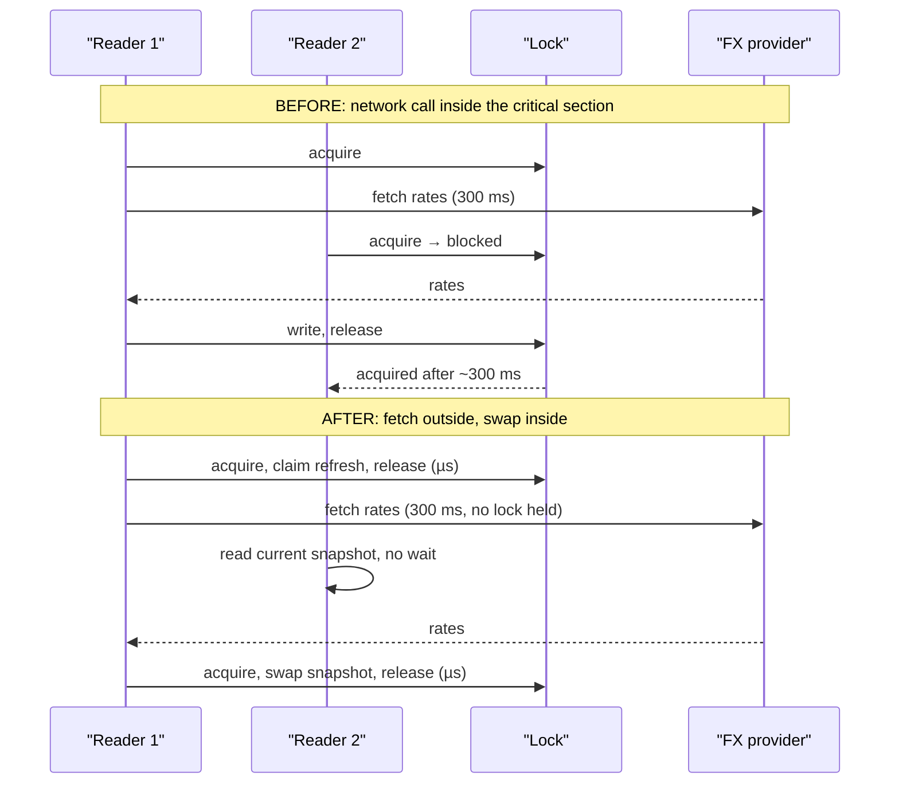

# Critical Sections

> **Module 04 · Operating Systems** · Prerequisites: [Synchronization](11-Synchronization.md) · Next: [Race Conditions](13-Race-Conditions.md)

---

## ⏱ If You Only Have 2 Minutes

- A **critical section** is code that reads or writes shared state and must not overlap with other code touching the same state. You find it from the **invariant** ("balance never negative", "one refresher at a time"), not from individual lines.
- A correct solution needs three properties: **mutual exclusion** (at most one task inside), **progress** (if nobody is inside, a task that wants in gets in), and **bounded waiting** (a waiting task cannot be overtaken forever).
- **Keep it small.** No network calls, database queries, disk I/O, remote logging or `sleep` inside. **Compute outside, publish inside**: build the new value without the lock, then take the lock only to check and swap.
- Lock hold time is pure serial time. If a lock is held for 300 ms per refresh, every task that needs it waits up to 300 ms, however many cores you have ([Amdahl's law](10-Parallelism.md)).
- **Granularity:** one coarse lock is simple but serialises everything; fine-grained locks (per account) allow parallelism but invite deadlock; **lock striping** (N locks, pick by `hash(key) % N`) is the middle ground.
- **Read-mostly data:** readers–writer locks, or better, an **immutable snapshot swapped by reference** (copy-on-write). Readers then need no lock at all.
- In async code, a critical section that spans an `await` holds the lock for the whole I/O wait. Code between two `await`s is already a critical section, for free.
- Across replicas the critical section moves to shared storage: `SELECT … FOR UPDATE`, advisory locks, or a Redis lock with a fencing token.

---

## 1. What It Is and Why It Exists

A **critical section** is a stretch of code that accesses a shared resource — a variable, a cache, a file, an account row — and that must not run at the same time as any other critical section on the same resource. The resource stays consistent only if each critical section runs as if it were alone.

**Analogy:** a shop with one fitting room and one key. Holding the key is the critical section. The rule "one person per room" keeps things decent. But if a customer takes the key, goes to a café to phone a friend, and comes back half an hour later, the room sits empty and the queue grows out of the door. The rule was obeyed; the *size* of the critical section was the problem.

This chapter is about both halves:

- **Without** a critical section, concurrent updates interleave and corrupt the state: lost updates, duplicate records, half-built objects ([Race Conditions](13-Race-Conditions.md)).
- **With an oversized one**, the program is correct but slow. Every task that needs the resource waits for the slowest thing done while holding it. On a backend, that is usually a network call, and it turns one slow dependency into latency for every request.

---

## 2. How It Works

### The classic structure

Textbooks describe every task that uses a shared resource as four parts:

```text
loop:
    entry section      ← acquire: lock(), sem.acquire(), async with lock
    critical section   ← touch the shared state
    exit section       ← release: unlock(), always, even on error
    remainder section  ← everything else; may run in parallel
```

The **entry** and **exit** protocol must give the three properties below. Early software-only solutions, like Peterson's algorithm for two threads, use only ordinary reads and writes. They assume memory operations happen in program order, which modern CPUs do not guarantee without memory barriers. Real systems therefore build the entry and exit from atomic instructions plus a kernel sleep/wake call ([Synchronization](11-Synchronization.md)).

### Why hold time is everything

While one task is inside, every other task that needs the same critical section is serialised. If the section takes `t` seconds, at most `1 / t` tasks per second can pass through it, whatever the number of cores. A cache that holds its lock for a 300 ms HTTP call can be refreshed only about three times per second, and **every reader** arriving during those 300 ms waits too.



### Observing it on Linux

A critical section that is too big shows up as threads asleep on futexes while the CPU is idle:

```bash
pidstat -w -t -p "$pid" 1                   # per-thread voluntary context switches: threads keep blocking
strace -f -c -w -e trace=futex -p "$pid"    # futex calls and wall time spent in them (Ctrl-C to print)
py-spy dump --pid "$pid"                    # Python: each thread's stack, ending at the `with lock:` line it waits on
```

Recent `perf` versions also have `perf lock contention`, which reports which kernel and user locks were waited on and for how long.

Illustrative `strace -c -w` summary (`-w` sums wall-clock time, so sleeping counts) after 10 s of the "before" cache under load with 20 threads:

```text
% time     seconds  usecs/call     calls    errors syscall
------ ----------- ----------- --------- --------- ----------------
100.00  183.402117     1834021       100        12 futex
```

A hundred futex calls averaging 1.8 s each: few acquisitions, very long waits. That is the signature of a lock held across slow I/O. A hot lock with tiny critical sections looks different: hundreds of thousands of short futex calls.

---

## 3. Key Concepts

### The three requirements

| Requirement | Meaning | Violated by |
|---|---|---|
| Mutual exclusion | At most one task inside the critical section at a time | No lock; a lock that covers the write but not the check |
| Progress | If nobody is inside, a task that wants in gets in; tasks in their remainder section cannot block the decision | A lock nobody releases (exception without `finally`); a "turn" variable that waits for a task that left |
| Bounded waiting | Once a task asks to enter, there is a limit on how many others enter before it | Unfair locks under heavy contention; readers–writer locks that let readers starve a writer |

Most mutexes give mutual exclusion and progress. Bounded waiting depends on fairness: `asyncio.Lock` wakes waiters in FIFO order, while `threading.Lock` makes no promise about which waiter goes next ([Starvation](20-Starvation.md)).

### What belongs inside, and what does not

| Inside (fast, touches shared state) | Outside (slow, or touches only local data) |
|---|---|
| Read, compare and write the shared fields | Network and database calls |
| Claim a job: set a "refreshing" flag | Disk I/O, including synchronous log handlers |
| Swap one reference to a new snapshot | JSON parsing, serialisation, compression |
| Increment a counter, append to a list | Expensive computation of the new value |
| — | Callbacks into code you do not control (it may take other locks → deadlock) |
| — | `sleep`, retries with back-off |

The rule is **compute outside, publish inside**. Build the new value from a copy without the lock, then enter the critical section only to check that nothing changed (or that you still own the job) and publish.

### Lock granularity

| Granularity | Example | Pros | Cons |
|---|---|---|---|
| Coarse | One lock for the whole cache | Simple; no lock-ordering issues | Every operation serialised; contention grows with cores |
| Fine | One lock per account or cache entry | Unrelated keys run in parallel | Many lock objects; deadlock risk when one operation needs two keys ([Deadlocks](18-Deadlocks.md)) |
| Striped | 64 locks; key `k` uses `locks[hash(k) % 64]` | Bounded memory, most of fine-grained parallelism | Unrelated keys sometimes share a stripe; multi-key operations must lock stripes in index order |

Java 7's `ConcurrentHashMap` is the textbook example of striping: the table was split into segments, each with its own lock. [Mutex](14-Mutex.md) shows a per-key async mutex that creates and deletes locks on demand.

### Read-mostly data: RW locks and copy-on-write snapshots

Configuration, feature flags, exchange rates and routing tables are read thousands of times per write.

- A **readers–writer lock** lets many readers in at once but a writer alone. Neither Python's stdlib nor Node ships one. It helps only when read sections are long, because acquiring it costs more than a plain mutex, and a steady stream of readers can starve writers unless it is writer-preferring.
- A **copy-on-write snapshot** is usually better. The data lives in an immutable object. Readers grab the current reference and use it with no lock. A writer builds a complete new object outside any lock and publishes it by replacing the reference. Readers holding the old snapshot keep a consistent view; the garbage collector frees it when the last one finishes. The Linux kernel's RCU (read-copy-update) applies the same idea to kernel data structures.

The snapshot pattern needs one thing to be atomic: replacing the reference. In JavaScript that is one assignment on one thread. In CPython, rebinding an attribute is a single operation, but keep any check-then-swap under a lock, as the example below does.

### Critical sections that span `await`

On an event loop, the code between two `await`s runs without interruption, so it is a critical section for free. A section that must include an `await` — read a row, call the database, write it back — needs an async lock (`asyncio.Lock`, or a promise-chain mutex in Node), and that lock stays held for the whole I/O wait. All the "keep it small" rules apply even more strongly, because async waits are often milliseconds to seconds, not microseconds. Two rules:

- Never hold a `threading.Lock` across an `await`: the loop thread blocks, and every task on the loop stops.
- Prefer a synchronous claim (set a flag or store a promise, no `await` in between) over a lock held across the I/O.

### Distributed critical sections

A critical section in one process does nothing for the copy of the same code in another replica. When the shared resource is a database row or an external system, the critical section must be enforced where the state lives:

- **Row lock:** `SELECT … FOR UPDATE` inside a transaction ([Database Locks](../Module-03-Databases/30-Database-Locks.md)).
- **Advisory lock:** PostgreSQL `pg_advisory_xact_lock(key)`, for "one job at a time" that is not tied to a row.
- **Optimistic check:** `UPDATE … WHERE version = $1`, retry on zero rows ([Optimistic vs Pessimistic Locking](../Module-03-Databases/32-Optimistic-vs-Pessimistic-Locking.md)).
- **Redis lock:** `SET key token NX PX 30000`, released by a script that deletes the key only if it still holds your token ([Redis Deep Dive](../Module-07-Advanced-Backend-and-System-Design/15-Redis-Deep-Dive.md)).

A lock with a time-to-live can expire while its holder is paused (GC pause, CPU throttling), so two holders can both be inside. A **fencing token** — a number that increases with every grant, checked by the storage on each write — makes the storage reject the late holder. And the "keep it small" rule matters even more: a database transaction held open across an HTTP call keeps its row locks for the duration of that call.

---

## 4. Code Examples

Scenario: an in-memory cache of FX rates with a 0.5 s time-to-live (short so the demo runs quickly). The provider call takes 300 ms. The "before" version refreshes while holding the lock; the "after" version claims the refresh inside a tiny critical section, fetches outside, and swaps a new immutable snapshot in. Readers that arrive during a refresh get the previous rates (stale-while-revalidate), which is acceptable for FX quotes. Each version is hit by 200 concurrent reads just after the data goes stale.

### Node.js / TypeScript

```ts
// Node.js 22+, TypeScript 5, ESM. No packages.
import { setTimeout as sleep } from "node:timers/promises";

const TTL_MS = 500;
type Rates = Record<string, number>;

async function fetchRates(): Promise<Rates> {
  await sleep(300); // stands in for `await fetch("https://fx.example.com/latest")`
  return { EUR: 0.92, GBP: 0.79 };
}

// A minimal async mutex: each caller chains onto the previous holder's promise.
class Mutex {
  #tail: Promise<void> = Promise.resolve();
  async run<T>(fn: () => Promise<T>): Promise<T> {
    const prev = this.#tail;
    let release!: () => void;
    this.#tail = new Promise<void>((r) => (release = r)); // set synchronously: the next caller waits for us
    await prev;
    try {
      return await fn();
    } finally {
      release(); // in finally: an exception in fn must not leave the mutex locked forever
    }
  }
}

// BEFORE: the critical section contains the network call.
class RatesLockedFetch {
  readonly #mutex = new Mutex();
  #rates: Rates = {};
  #fetchedAt = 0;
  get(currency: string): Promise<number | undefined> {
    return this.#mutex.run(async () => {
      if (Date.now() - this.#fetchedAt > TTL_MS) {
        this.#rates = await fetchRates(); // 300 ms with the mutex held: every request queues here
        this.#fetchedAt = Date.now();
      }
      return this.#rates[currency];
    });
  }
}

// AFTER: claim and swap are synchronous, so they are already atomic on the event loop; no mutex at all.
class RatesSnapshot {
  #snapshot: { rates: Rates; fetchedAt: number };
  #refreshing: Promise<void> | null = null;
  constructor(initial: Rates) {
    this.#snapshot = { rates: initial, fetchedAt: Date.now() };
  }
  async get(currency: string): Promise<number | undefined> {
    if (Date.now() - this.#snapshot.fetchedAt > TTL_MS && !this.#refreshing) {
      this.#refreshing = fetchRates()
        .then((rates) => { this.#snapshot = { rates, fetchedAt: Date.now() }; }) // the swap: one assignment
        .catch((err: unknown) => console.error("rates refresh failed; serving stale", err))
        .finally(() => { this.#refreshing = null; });
    }
    return this.#snapshot.rates[currency]; // never waits on the network
  }
}

async function slowReads(cache: { get(c: string): Promise<number | undefined> }): Promise<number> {
  await sleep(TTL_MS + 50);
  const waits = await Promise.all(
    Array.from({ length: 200 }, async () => {
      const t0 = performance.now();
      await cache.get("EUR");
      return performance.now() - t0;
    }),
  );
  return waits.filter((ms) => ms > 100).length;
}

console.log("RatesLockedFetch reads slower than 100 ms:", await slowReads(new RatesLockedFetch()), "of 200");
console.log("RatesSnapshot    reads slower than 100 ms:", await slowReads(new RatesSnapshot(await fetchRates())), "of 200");
```

Illustrative output:

```text
RatesLockedFetch reads slower than 100 ms: 200 of 200
RatesSnapshot    reads slower than 100 ms: 0 of 200
```

The mutex in the "before" version is correct and still harmful: it serialises 200 requests behind one HTTP call. The "after" version needs **no mutex at all**. Its claim (`!this.#refreshing` then assign) and its swap (one assignment) contain no `await`, so the event loop already runs each as one step. Keep an async mutex for critical sections that truly must contain an `await` ([Mutex](14-Mutex.md)).

### Python

Threads with `threading.Lock`: claim inside, fetch outside, swap inside.

```python
# Python 3.12+, stdlib only.
import threading
import time
from concurrent.futures import ThreadPoolExecutor
from dataclasses import dataclass

TTL_S = 0.5


def fetch_rates() -> dict[str, float]:
    time.sleep(0.3)  # stands in for an HTTP call to an FX-rate provider
    return {"EUR": 0.92, "GBP": 0.79}


class RatesCacheLockedFetch:
    """BEFORE: the network call is inside the critical section."""

    def __init__(self) -> None:
        self._lock = threading.Lock()
        self._rates: dict[str, float] = {}
        self._fetched_at = 0.0

    def get(self, currency: str) -> float:
        with self._lock:
            if time.monotonic() - self._fetched_at > TTL_S:
                self._rates = fetch_rates()  # 300 ms with the lock held: every reader queues here
                self._fetched_at = time.monotonic()
            return self._rates[currency]


@dataclass(frozen=True, slots=True)
class Snapshot:
    rates: dict[str, float]
    fetched_at: float


class RatesCache:
    """AFTER: claim inside, fetch outside, swap inside. Readers never wait for the network."""

    def __init__(self) -> None:
        self._lock = threading.Lock()
        self._snapshot = Snapshot(fetch_rates(), time.monotonic())  # warm at start-up, once
        self._refreshing = False

    def get(self, currency: str) -> float:
        snap = self._snapshot  # one reference read; the snapshot itself is never mutated
        if time.monotonic() - snap.fetched_at > TTL_S:
            self._refresh_if_nobody_else_is()
        return snap.rates[currency]  # stale-while-revalidate: serve the old value meanwhile

    def _refresh_if_nobody_else_is(self) -> None:
        with self._lock:  # critical section 1: a flag check and set, microseconds
            if self._refreshing:
                return
            self._refreshing = True
        try:
            rates = fetch_rates()  # outside any lock
            with self._lock:  # critical section 2: publish the new snapshot
                self._snapshot = Snapshot(rates, time.monotonic())
        finally:
            with self._lock:
                self._refreshing = False  # also on failure, or no one ever refreshes again


def slow_readers(cache: RatesCacheLockedFetch | RatesCache) -> int:
    def timed_get(_: int) -> float:
        t0 = time.perf_counter()
        cache.get("EUR")
        return time.perf_counter() - t0

    time.sleep(TTL_S + 0.05)  # let the data go stale, then hit it with 20 concurrent readers
    with ThreadPoolExecutor(max_workers=20) as pool:
        return sum(1 for wait in pool.map(timed_get, range(200)) if wait > 0.1)


if __name__ == "__main__":
    for cache in (RatesCacheLockedFetch(), RatesCache()):
        print(f"{type(cache).__name__:22} reads slower than 100 ms: {slow_readers(cache)} of 200")
```

Illustrative output:

```text
RatesCacheLockedFetch  reads slower than 100 ms: 20 of 200
RatesCache             reads slower than 100 ms: 1 of 200
```

The 20 slow reads are every pool thread queued behind the fetch. The single slow read in the fixed version is the reader that performed the refresh itself; move the refresh to a background thread to remove even that one.

The same cache on asyncio:

```python
# Python 3.12+, stdlib only.
import asyncio
import time

TTL_S = 0.5


async def fetch_rates() -> dict[str, float]:
    await asyncio.sleep(0.3)  # stands in for `await client.get(...)` with httpx
    return {"EUR": 0.92, "GBP": 0.79}


class AsyncRatesLockedFetch:
    """BEFORE: asyncio.Lock held across the await, so every request queues behind one HTTP call."""

    def __init__(self) -> None:
        self._lock = asyncio.Lock()
        self._rates: dict[str, float] = {}
        self._fetched_at = 0.0

    async def get(self, currency: str) -> float:
        async with self._lock:
            if time.monotonic() - self._fetched_at > TTL_S:
                self._rates = await fetch_rates()
                self._fetched_at = time.monotonic()
            return self._rates[currency]


class AsyncRates:
    """AFTER: no lock needed. Code between two awaits already runs as one uninterrupted step."""

    def __init__(self, rates: dict[str, float]) -> None:
        self._rates, self._fetched_at = rates, time.monotonic()
        self._refresh: asyncio.Task[None] | None = None

    async def get(self, currency: str) -> float:
        if time.monotonic() - self._fetched_at > TTL_S and self._refresh is None:
            # Check-and-claim with no await in between: atomic on the event loop.
            self._refresh = asyncio.create_task(self._do_refresh())
        return self._rates[currency]  # serve the current snapshot; never wait on the network

    async def _do_refresh(self) -> None:
        try:
            rates = await fetch_rates()
            self._rates, self._fetched_at = rates, time.monotonic()  # the swap: one synchronous step
        finally:
            self._refresh = None  # on failure too, so the next stale read retries


async def slow_reads(cache: AsyncRatesLockedFetch | AsyncRates) -> int:
    async def timed_get() -> float:
        t0 = time.perf_counter()
        await cache.get("EUR")
        return time.perf_counter() - t0

    await asyncio.sleep(TTL_S + 0.05)
    waits = await asyncio.gather(*(timed_get() for _ in range(200)))
    return sum(1 for w in waits if w > 0.1)


async def main() -> None:
    for cache in (AsyncRatesLockedFetch(), AsyncRates(await fetch_rates())):
        print(f"{type(cache).__name__:22} reads slower than 100 ms: {await slow_reads(cache)} of 200")
    await asyncio.sleep(0.4)  # let the background refresh finish before the loop closes


if __name__ == "__main__":
    asyncio.run(main())
```

```text
AsyncRatesLockedFetch  reads slower than 100 ms: 200 of 200
AsyncRates             reads slower than 100 ms: 0 of 200
```

**Runtime differences to notice:**

- **The threaded version still needs a lock; the async versions do not.** With threads, the scheduler can switch between `if self._refreshing` and `self._refreshing = True`, so the claim must be inside `with self._lock`. On an event loop, the same two lines with no `await` between them cannot be interleaved.
- **The fixed threaded reader takes no lock.** `snap = self._snapshot` reads one reference; the `Snapshot` object is never mutated afterwards, so a reader never sees half of an update.
- **Background work must be owned.** The asyncio version keeps a reference to the refresh task in `self._refresh`; the event loop holds only weak references to tasks, so an unreferenced task can be garbage-collected mid-flight. The Node version keeps the promise in `#refreshing` and attaches a `.catch`, so a failed refresh is logged instead of becoming an unhandled rejection.

---

## 5. Production Concerns

- **CPython lock convoys.** CPython switches threads only at certain points, such as Python function calls. If a hot lock's critical section contains a Python function call, the GIL can change hands while the lock is held; the other threads find the lock taken and sleep in the kernel, and every release becomes a wake-up across cores. We measured 4 threads × 100,000 increments in a `python:3.12` container on 16 vCPUs: **7.8–8.4 s** with a one-line helper function called inside the lock, **0.11–0.14 s** with the same call moved outside. Pinned to one CPU (`taskset -c 0`), the slow version took 0.19 s. Moving the call outside the critical section is the fix.
- **Measure hold time and wait time separately.** Wrap the lock to record how long each acquire waited and how long the section ran, as histograms. Long hold times point to I/O inside the section; long waits with short holds point to contention, which needs finer granularity or less sharing.
- **Timeouts belong outside.** A timeout on a call made inside a critical section caps the damage, but the lock is still held until it fires. Better to move the call out. If it cannot move, use a short timeout and `lock.acquire(timeout=…)` so waiters fail fast instead of piling up.
- **Pauses you do not control.** A stop-the-world GC pause, a page fault on swapped-out memory ([Paging](25-Paging.md)), or cgroup CPU throttling while a thread holds a lock stretches the critical section for every waiter. Small sections make these events rare; big ones make them likely.
- **Database transactions are critical sections too.** Row locks are held until `COMMIT`. A transaction that calls a payment API between `SELECT … FOR UPDATE` and `COMMIT` blocks every other writer to that row for the duration of the call ([Transactions](../Module-03-Databases/27-Transactions.md)). Do the external call before the transaction, or record an intent and call afterwards.
- **Logging inside the lock.** A synchronous log handler that writes to disk or the network puts I/O inside the critical section. Log after releasing, or use a queue-based handler (`logging.handlers.QueueHandler`).

---

## 6. Common Mistakes

- **Network call inside the lock** — every reader waits for the slowest dependency, and a provider outage freezes the service — fetch outside, take the lock only to swap the result in.
- **Locking only the write** — the check runs unprotected, so two tasks both decide to act — the critical section must cover the check *and* the act, or the act must re-check under the lock.
- **Mutating a shared object in place** — readers see half-updated state — build a new immutable snapshot and replace the reference.
- **One global lock for unrelated keys** — throughput stops scaling with cores — per-key locks or lock striping, keeping a fixed order when one operation needs two keys.
- **`threading.Lock` held across `await`** — the event loop thread blocks and every task stalls — use `asyncio.Lock`, or restructure so the section contains no `await`.
- **Forgetting the exit section on error** — an exception inside leaves the lock held forever — always `with` / `async with` / `try … finally`.
- **Assuming an in-process lock protects shared storage** — another replica enters the same critical section — move it to the database (`FOR UPDATE`, advisory lock, version check) or a fenced distributed lock.

---

## 7. Comparison Table

Ways to protect a shared, read-mostly structure such as a cache or config:

| Approach | Reader cost | Writer cost | Readers block during a write? | Best for |
|---|---|---|---|---|
| One mutex for everything | Lock + unlock | Lock + unlock | Yes | Small, rarely contended state |
| Readers–writer lock | Shared lock (more expensive than a mutex) | Exclusive lock; waits for readers to drain | Yes | Long read sections, rare writes |
| Copy-on-write snapshot | One reference read, no lock | Build a full copy, swap the reference | No | Read-mostly data that fits in memory twice |
| Lock striping | Lock one stripe | Lock one stripe | Only readers on the same stripe | Large maps with many independent keys |
| Single owner + messages | A message round trip | A message | Readers queue behind writes | State with complex invariants; actor-style designs |

---

## 8. Interview Questions

**[Junior] What is a critical section?**
It is code that accesses shared state and must not run concurrently with other code accessing the same state. You protect it with a lock or another primitive so that each execution sees and leaves the state consistent. You identify it from the invariant being protected, which often spans several statements, such as "check the balance, then subtract".

**[Junior] What three properties must a critical-section solution provide?**
Mutual exclusion: at most one task is inside. Progress: if none is inside, one that wants to enter can, and tasks not interested cannot block the decision. Bounded waiting: a waiting task cannot be overtaken an unlimited number of times, which is a fairness guarantee against starvation.

**[Mid] Why should you avoid I/O inside a critical section?**
Because the lock is held for the whole I/O wait, and every other task that needs the lock waits too. Throughput through the section drops to `1 / hold time`, and a slow or failing dependency now stalls unrelated requests. Do the I/O outside: fetch or compute the new value without the lock, then take it briefly to check and publish.

**[Mid] Coarse-grained vs fine-grained locking — what is the trade-off?**
A coarse lock is simple and cannot deadlock with itself, but it serialises all operations, so contention grows with load and cores. Fine-grained locks let unrelated operations run in parallel but add memory, complexity and deadlock risk when one operation needs several locks. Lock striping is a middle ground: a fixed array of locks chosen by key hash.

**[Mid] How do you share read-mostly configuration between threads without readers taking a lock?**
Keep it in an immutable object and publish updates by swapping a single reference. A writer builds a new complete object outside the lock and assigns it; readers read the reference once and use that snapshot. Readers never see a half-update, and old snapshots are freed by the GC when no one holds them. This is the same idea as RCU in the Linux kernel.

**[Senior] A cache refresh holds a lock during a 300 ms HTTP call, and p99 latency spikes every TTL. How do you redesign it?**
Split the critical section in two. Inside a short lock, check staleness and claim the refresh with a flag, so only one task refreshes. Release the lock, call the provider, then take the lock again just to swap in a new immutable snapshot and clear the flag, in a `finally` so a failure does not block future refreshes. Readers keep serving the previous snapshot meanwhile. Optionally refresh proactively in the background before expiry, and across replicas accept one refresh per replica or coordinate through Redis.

**[Senior] What changes when the critical section must span several services or replicas?**
Process-local locks no longer help, so the critical section must be enforced by shared storage: row locks or advisory locks in the database, conditional updates with a version column, or a Redis lock. Distributed locks have leases that can expire while the holder is paused, so add fencing tokens that the storage checks. Keep the protected section short, because database locks held across remote calls cause lock waits and deadlocks at the database level.

**[Senior] Can single-threaded async code need a lock, and what is the cost?**
Yes, when the protected sequence must contain an `await`, such as read, call the database, write. An async lock then serialises those sequences, but it is held for the whole I/O wait, so it can queue every request behind one slow call. Prefer a synchronous claim — set a flag or store an in-flight promise without awaiting in between — and use the async lock only where the multi-step sequence is unavoidable, ideally per key.

---

## 9. Cheat Sheet

```text
Critical section   code touching shared state; defined by the invariant, not by lines
Structure          entry (acquire) → critical → exit (release, in finally) → remainder
Requirements       mutual exclusion · progress · bounded waiting (fairness)
Throughput cap     max 1/hold_time per lock; hold time = serial fraction (Amdahl)
Rule               compute outside, publish inside; no I/O, logging I/O, sleep, unknown callbacks
Granularity        coarse (simple, contended) · fine (parallel, deadlock risk) · striped (hash % N)
Read-mostly        immutable snapshot + reference swap (RCU idea) > RW lock (writer starvation)
Async              code between awaits is atomic; lock across await = queue behind I/O
Never              threading.Lock held across await
CPython            Python call inside a hot lock → GIL hand-off while held → convoy (measured ~60x)
Observe            pidstat -w -t · strace -f -c -w -e trace=futex · py-spy dump · perf lock contention
Distributed        FOR UPDATE · pg_advisory_xact_lock · version check · Redis SET NX PX + fencing token
DB transactions    are critical sections: never call HTTP between FOR UPDATE and COMMIT
```

---

## Related Topics

- [Synchronization](11-Synchronization.md) — the map of coordination problems and primitives
- [Race Conditions](13-Race-Conditions.md) — what happens when a critical section is missing or too small
- [Mutex](14-Mutex.md) — the lock that guards most critical sections, including per-key locks
- [Deadlocks](18-Deadlocks.md) — the risk that grows with fine-grained locking
- [Database Locks](../Module-03-Databases/30-Database-Locks.md) — critical sections enforced by the database across replicas
- [Cache Invalidation](../Module-07-Advanced-Backend-and-System-Design/16-Cache-Invalidation.md) — refresh strategies for the cache in this chapter's example
