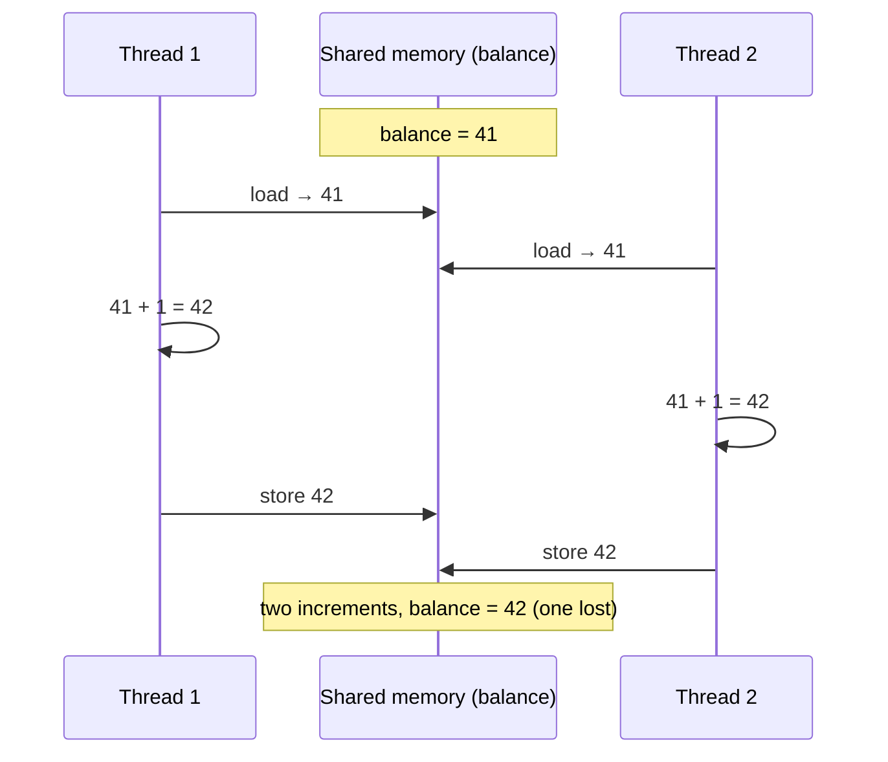

# Race Conditions

> **Module 04 · Operating Systems** · Prerequisites: [Critical Sections](12-Critical-Sections.md) · Next: [Mutex](14-Mutex.md)

---

## ⏱ If You Only Have 2 Minutes

- A **race condition** is a bug where the result depends on the timing or interleaving of concurrent operations. A **data race** is narrower: two threads touch the same memory at the same time, at least one writes, and nothing orders the accesses. You can have either one without the other.
- `counter += 1` is three steps: **load, add, store**. Two threads that both load 41 both store 42, and one increment is lost. This is the **lost update**.
- **Python's GIL does not save you.** The GIL makes single bytecodes atomic, not your read-modify-write. Put any function call between the read and the write and 4 threads lose hundreds of thousands of updates out of 2 million.
- **Single-threaded async code races too.** In Node or asyncio, every `await` is a point where other tasks run. "Check, `await`, act" lets five concurrent requests all pass the check. There is no data race, but there is a race condition.
- The two classic shapes: **read-modify-write** (lost update) and **check-then-act** (TOCTOU, time of check to time of use: two callers both see "not there yet" and both create it).
- Fixes: make the operation **atomic** (`Atomics.add`, one SQL statement), make it **mutually exclusive** (a lock around the check *and* the act), **single-flight** it (share one in-flight promise), or **give the state one owner** (a queue or actor).
- Races hide in tests because tests run one request at a time on an idle laptop. They appear under load, on more cores, and with slower dependencies. Find them with stress tests, forced interleavings and race detectors such as ThreadSanitizer.
- An in-process fix only covers one process. With several replicas you need the database or a distributed lock (see [Optimistic vs Pessimistic Locking](../Module-03-Databases/32-Optimistic-vs-Pessimistic-Locking.md)).

---

## 1. What It Is and Why It Exists

A **race condition** happens when the correctness of a program depends on the order in which concurrent operations happen to run, and some possible orders give a wrong answer. The code is not "sometimes wrong" by magic. One particular interleaving is wrong, and the scheduler picks that interleaving only now and then.

**Analogy:** two people share one bank card and one paper notebook that records the balance. Both read "100" in the notebook, both withdraw 80 at different ATMs, and both write "20" in the notebook. Each person followed the rules. The bank is 60 short because nobody's read-and-write was protected from the other's.

**Why races exist at all.** The operating system gives you concurrency through threads and processes (see [Concurrency](09-Concurrency.md)). The scheduler can pause a thread after *any* machine instruction and run another one, and on a multicore machine two threads run truly at the same time. Language runtimes add their own switch points: the Python interpreter hands the GIL to another thread between bytecodes, and an event loop runs another task at every `await`. Any code that reads shared state, makes a decision, and writes shared state assumes nothing changed in between. That assumption is the bug.

**What breaks without protection.** Lost updates on counters, balances and stock levels. Duplicate side effects: two customers created at the payment provider, two welcome emails, two shipments. Security holes: a file checked as safe and then replaced before it is opened. These bugs pass code review and unit tests, then show up in production as "the numbers don't add up".

### Data race vs race condition

They are often confused in interviews. They are different things.

| | Data race | Race condition |
|---|---|---|
| Definition | Two threads access the same memory location concurrently, at least one access is a write, and no synchronization orders them | The program's result depends on the interleaving, and some interleavings are wrong |
| Level | Memory model | Program logic |
| Detected by tools? | Yes, mechanically (ThreadSanitizer, Go `-race`) | Only by reasoning or by finding the bad interleaving in a test |
| Consequence | Undefined behaviour in C/C++; stale or unexpected values in Java and JavaScript | Wrong business result |

- **Race condition without a data race:** Node code that does `if (!map.has(k)) { await create(); map.set(k, …) }`. There is only one thread, so a data race is impossible, but five concurrent requests all pass the check. Another example: every access is locked, but the check takes the lock, releases it, and the act takes it again.
- **Data race without a wrong result:** a best-effort "last seen" timestamp written by many threads, where any recent value is acceptable. In C or C++ this is still undefined behaviour, so you fix it anyway with an atomic store.

---

## 2. How It Works

### Read-modify-write: the lost update

A CPU cannot add 1 to a value in memory as one step from the program's point of view unless you ask for an atomic instruction. The plain version is:

1. **Load** the value from memory (or cache) into a register.
2. **Add** 1 in the register.
3. **Store** the register back to memory.



Nothing failed and nothing was logged. The final value is plausible, which is what makes lost updates dangerous.

### Python and the GIL

In standard CPython, the **GIL** (Global Interpreter Lock) lets only one thread run Python bytecode at a time. People conclude that Python code is therefore thread-safe. It is not. The GIL protects the interpreter's own data structures and makes each **bytecode** atomic. `counter += 1` is several bytecodes:

```text
# dis.dis output for `counter += 1` (CPython 3.12; opcode names vary between versions)
LOAD_GLOBAL      0 (counter)   ← read
LOAD_CONST       1 (1)
BINARY_OP       13 (+=)        ← modify
STORE_GLOBAL     0 (counter)   ← write
```

The interpreter can hand the GIL to another thread between these steps. Since CPython 3.10 it only checks for a hand-off at certain points, such as function calls and loop back-edges, so a bare `counter += 1` in a tight loop often *happens* to give the right total. That is luck, not a guarantee. Add a function call between the read and the write — logging, a metric, a fee calculation — and the race appears at once (see the Python example in section 4). On the optional free-threaded build of CPython (PEP 703, added as experimental in 3.13) threads run bytecode in parallel and lose updates even more easily.

### Node.js and SharedArrayBuffer

Normal JavaScript objects are never shared between threads: each `worker_thread` has its own heap and receives *copies* of messages. The one exception is a `SharedArrayBuffer`, which every worker maps into memory. `view[0]++` on an `Int32Array` over a `SharedArrayBuffer` is a plain load, add and store, so it races exactly like C code. `Atomics.add(view, 0, 1)` is a single indivisible read-modify-write that the CPU performs with an atomic instruction.

### Check-then-act across `await`

An event loop runs one callback at a time, so a synchronous block of JavaScript or a coroutine between two `await`s is never interrupted. That is a real guarantee, and it is the fix for many async races. But every `await` gives the loop a chance to run other requests:

```text
request A: customerIds.get("u1")  → undefined   (check)
request A: await createCustomer()               ← loop switches
request B: customerIds.get("u1")  → undefined   (check: still missing)
request B: await createCustomer()
request A: customerIds.set("u1", "cus_1")       (act)
request B: customerIds.set("u1", "cus_2")       (act: overwrites, and cus_1 is orphaned)
```

asyncio behaves identically. The size of the window is the duration of the awaited call: a 20 ms HTTP call is a 20 ms window, which is enormous compared with the nanoseconds of a thread race.

### TOCTOU on files

**TOCTOU** (time of check to time of use) is check-then-act on an outside resource, usually the file system:

```python
if not os.path.exists(path):   # check
    with open(path, "w") as f: # use: another process may have created it, or a symlink, in between
        f.write(data)
```

On Linux the check and the use are two separate system calls, and another process can run between them. In the classic attack, a privileged program checks a path in `/tmp` with `access()` and then opens it, and an attacker swaps in a symlink to `/etc/passwd` in between. The Python docs warn about exactly this for `os.access()`. The fix is to let the kernel do the check and the act in **one system call**:

- Create only if absent: `open(path, "x")` in Python, `fs.open(path, "wx")` in Node — both map to `O_CREAT | O_EXCL`, which fails with `EEXIST` if the file exists.
- Do not follow symlinks: `O_NOFOLLOW`.
- Temporary files: `tempfile.mkstemp()` / `fs.mkdtemp()`, which pick an unpredictable name and create it atomically.
- Replace a file atomically: write a temporary file in the same directory, then `rename()` it over the target. `rename` within one file system is atomic on POSIX.

### Observing it on Linux

Races are about timing, so the tools that change timing are the tools that expose them. Pinning a process to one CPU with `taskset` removes true parallelism and usually makes a thread race much rarer. Adding CPU pressure or more cores makes it more common.

```text
$ nproc
8
$ node lost-update.ts              # 4 workers on 8 cores
plain ++    : 2298048 (lost 1701952)
Atomics.add : 4000000 (lost 0)
$ taskset -c 0 node lost-update.ts # same program, all threads on CPU 0
plain ++    : 3999871 (lost 129)
Atomics.add : 4000000 (lost 0)
```

*(Illustrative output. On one CPU, updates are lost only when the kernel pre-empts a thread between its load and its store, which is rare but not impossible.)*

---

## 3. Key Concepts

### Atomicity

An operation is **atomic** when no other thread can observe it half-done. Hardware gives you atomic loads and stores of aligned words, and atomic read-modify-write instructions (fetch-and-add, exchange, compare-and-swap; see [Spinlocks](16-Spinlocks.md)). Everything bigger — "read the balance, check it, write it back", "update two fields together" — is atomic only if you make it so with a lock or by having one owner.

### The two classic shapes

| Shape | Pattern | Typical bug | Fix |
|---|---|---|---|
| Read-modify-write | `x = read(); write(x + 1)` | Lost update on a counter, balance, stock level | Atomic operation, lock, or one SQL `UPDATE … SET n = n + 1` |
| Check-then-act | `if (!exists) create()` | Duplicate rows, duplicate external resources, double spend, TOCTOU | Do the check inside the lock, single-flight, a unique constraint, `O_EXCL` |

Check-then-act also includes "lazy initialization" (`if (!client) client = await connect()`), which can open two connection pools at startup.

### Critical section and invariant

A **critical section** is the code that must not overlap with itself (see [Critical Sections](12-Critical-Sections.md)). The question to ask is not "which line is shared?" but "which invariant must hold?". For "a user has at most one customer at the provider", the critical section is the whole sequence of check, create and record — including the `await` in the middle. Locking only the `set()` call fixes nothing.

### Visibility and memory ordering

On a multicore machine, a write by one core is not instantly visible to another, and the compiler and CPU may reorder independent loads and stores. Without synchronization, a thread can read a stale value or see two writes in a different order than they were made. Locks and atomic operations add the ordering guarantees (a *happens-before* relation) that make writes visible. In JavaScript, `Atomics` operations are sequentially consistent, which is the strongest ordering. [Spinlocks](16-Spinlocks.md) covers memory ordering in more depth.

### Why races hide in tests

- **One request at a time.** Most tests `await` each call before the next, so the interleaving never happens.
- **Tiny windows.** A thread race window may be a few nanoseconds. It needs millions of tries, or many cores, to hit.
- **Fast fakes.** A mocked provider that resolves at once shrinks a 20 ms window to almost nothing — unless calls start together, as with `Promise.all`.
- **Fewer cores.** A 2-core CI runner rarely runs threads truly in parallel; a 32-core production host does it constantly.
- **Low load.** Under production load, latency grows, so `await` windows widen and more requests overlap inside them.

### Finding races

| Technique | What it does | Notes |
|---|---|---|
| Stress test | Run the operation thousands of times concurrently and check the invariant (`total == expected`, one row per key) | Cheap; finds the common races; nondeterministic |
| Forced interleaving | Make the fake dependency wait on a barrier (`threading.Barrier`, an `asyncio.Event`, an unresolved promise) until every caller has passed the check | Deterministic; the best way to write a regression test for a race |
| ThreadSanitizer (TSan) | Compiler instrumentation (`-fsanitize=thread` in Clang/GCC; Go's `-race` uses it) that records every memory access and reports unsynchronized conflicting pairs with both stack traces | Finds data races, not logic races. The Clang docs quote roughly 5–15× slowdown. Relevant for native addons and C extensions |
| Load test on staging | Real concurrency against real dependencies, then reconcile counts | Finds races that only appear with real latency |
| Database constraints | A `UNIQUE` index turns a silent duplicate into a loud error | A safety net, not a detector, but it makes races visible |

---

## 4. Code Examples

Two scenarios. First, a lost update on a shared counter with real parallel threads. Second, a check-then-act race in single-threaded async code: "get or create this user's customer at the payment provider", where duplicates mean split billing history.

### Shell

```bash
# Expose a thread race by changing parallelism, not code.
nproc                                   # cores available (or the cgroup-limited view in a container)
node lost-update.ts                     # all cores
taskset -c 0 node lost-update.ts        # one core: the race becomes rare, which is why it hides on small CI runners
python race_threads.py

# Expose an async race against a running API: 50 concurrent calls for the same user.
seq 50 | xargs -P 50 -I{} curl -s -X POST localhost:3000/users/u1/customer -o /dev/null
curl -s localhost:3000/debug/provider-calls   # should be 1, not 50
```

### Node.js / TypeScript

Lost update across worker threads on a `SharedArrayBuffer`, fixed with `Atomics.add`:

```ts
// Node.js 22+, TypeScript 5, ESM. No packages. Save as lost-update.ts; run: node lost-update.ts
// (Node 22.18+ strips types; on older 22.x add --experimental-strip-types)
import { Worker, isMainThread, workerData } from "node:worker_threads";

const WORKERS = 4;
const PER_WORKER = 1_000_000;

if (isMainThread) {
  // Two 32-bit slots that every worker maps: [0] uses plain ++, [1] uses Atomics.add.
  const shared = new SharedArrayBuffer(2 * Int32Array.BYTES_PER_ELEMENT);
  const counters = new Int32Array(shared);

  await Promise.all(
    Array.from({ length: WORKERS }, () =>
      new Promise<void>((resolve, reject) => {
        const worker = new Worker(new URL(import.meta.url), { workerData: shared });
        worker.once("error", reject);
        worker.once("exit", (code) => (code === 0 ? resolve() : reject(new Error(`exit ${code}`))));
      }),
    ),
  );

  const expected = WORKERS * PER_WORKER;
  const plain = Atomics.load(counters, 0);
  const atomic = Atomics.load(counters, 1);
  console.log(`plain ++    : ${plain} (lost ${expected - plain})`);
  console.log(`Atomics.add : ${atomic} (lost ${expected - atomic})`);
} else {
  const counters = new Int32Array(workerData as SharedArrayBuffer);
  for (let i = 0; i < PER_WORKER; i++) {
    counters[0]++; // load, add, store: another core can store between our load and our store
  }
  for (let i = 0; i < PER_WORKER; i++) {
    Atomics.add(counters, 1, 1); // one indivisible read-modify-write; nothing can be lost
  }
}
```

Check-then-act across `await`, fixed with single-flight:

```ts
// Node.js 22+, TypeScript 5, ESM. No packages.
import { setTimeout as sleep } from "node:timers/promises";

let providerCalls = 0;

// Stands in for a POST to a payment provider: slow, and it creates a new customer every time.
async function createCustomerAtProvider(userId: string): Promise<string> {
  await sleep(20);
  providerCalls += 1;
  return `cus_${userId}_${providerCalls}`;
}

const customerIds = new Map<string, string>();

// BROKEN: one thread, no data race, still a race condition.
async function getCustomerUnsafe(userId: string): Promise<string> {
  const known = customerIds.get(userId);              // check
  if (known) return known;
  const id = await createCustomerAtProvider(userId);  // every concurrent caller reaches this line
  customerIds.set(userId, id);                        // act on a stale check; last writer wins
  return id;
}

// FIXED: single-flight. Concurrent callers for the same key share one in-flight promise.
const inFlight = new Map<string, Promise<string>>();

function getCustomer(userId: string): Promise<string> {
  const known = customerIds.get(userId);
  if (known) return Promise.resolve(known);
  let pending = inFlight.get(userId);
  if (!pending) {
    // Registered synchronously, before any await, so the very next caller sees it.
    pending = createCustomerAtProvider(userId)
      .then((id) => {
        customerIds.set(userId, id);
        return id;
      })
      .finally(() => inFlight.delete(userId)); // failures are not cached; the next call retries
    inFlight.set(userId, pending);
  }
  return pending;
}

const unsafe = await Promise.all(Array.from({ length: 5 }, () => getCustomerUnsafe("u1")));
console.log("unsafe:", new Set(unsafe).size, "customers,", providerCalls, "provider calls"); // 5, 5

providerCalls = 0;
customerIds.clear();
const safe = await Promise.all(Array.from({ length: 5 }, () => getCustomer("u1")));
console.log("single-flight:", new Set(safe).size, "customer,", providerCalls, "provider call"); // 1, 1
```

The fix works because the check (`inFlight.get`) and the act (`inFlight.set`) happen in the same synchronous run of JavaScript, with no `await` between them. The event loop cannot interleave anything there.

### Python

Lost update with threads despite the GIL, fixed with `threading.Lock`:

```python
# Python 3.12+, stdlib only. Save as race_threads.py
import threading
from collections.abc import Callable

THREADS = 4
PER_THREAD = 500_000


class Account:
    def __init__(self) -> None:
        self.balance = 0
        self.lock = threading.Lock()


def fee_for(amount: int) -> int:
    # Any call between the read and the write (logging, a metric, a lookup)
    # is a point where the interpreter may hand the GIL to another thread.
    return 0


def deposit_unsafe(acct: Account, amount: int) -> None:
    current = acct.balance                              # read
    acct.balance = current + amount - fee_for(amount)   # modify, then write a possibly stale value


def deposit_safe(acct: Account, amount: int) -> None:
    with acct.lock:  # other threads now see the read-modify-write as one step
        current = acct.balance
        acct.balance = current + amount - fee_for(amount)


def run(deposit: Callable[[Account, int], None]) -> int:
    acct = Account()

    def worker() -> None:
        for _ in range(PER_THREAD):
            deposit(acct, 1)

    threads = [threading.Thread(target=worker) for _ in range(THREADS)]
    for t in threads:
        t.start()
    for t in threads:
        t.join()
    return acct.balance


if __name__ == "__main__":
    expected = THREADS * PER_THREAD
    for deposit in (deposit_unsafe, deposit_safe):
        got = run(deposit)
        print(f"{deposit.__name__:15} {got:>9,}  lost {expected - got:,}")
# Illustrative output (CPython with the GIL; the loss changes every run):
# deposit_unsafe  1,353,067  lost 646,933
# deposit_safe    2,000,000  lost 0
```

Check-then-act across `await` in asyncio, fixed by doing the check inside an `asyncio.Lock`:

```python
# Python 3.12+, stdlib only.
import asyncio

provider_calls = 0
customer_ids: dict[str, str] = {}
create_lock = asyncio.Lock()


async def create_customer_at_provider(user_id: str) -> str:
    global provider_calls
    await asyncio.sleep(0.02)  # stands in for an HTTP POST to a payment provider
    provider_calls += 1
    return f"cus_{user_id}_{provider_calls}"


async def get_customer_unsafe(user_id: str) -> str:
    if (known := customer_ids.get(user_id)) is not None:   # check
        return known
    cid = await create_customer_at_provider(user_id)       # the loop runs other tasks here
    customer_ids[user_id] = cid                            # act on a stale check
    return cid


async def get_customer(user_id: str) -> str:
    if (known := customer_ids.get(user_id)) is not None:   # fast path, no lock needed
        return known
    async with create_lock:
        # Check again *inside* the lock: another task may have finished while we waited.
        if (known := customer_ids.get(user_id)) is not None:
            return known
        cid = await create_customer_at_provider(user_id)
        customer_ids[user_id] = cid
        return cid


async def main() -> None:
    global provider_calls
    ids = await asyncio.gather(*(get_customer_unsafe("u1") for _ in range(5)))
    print("unsafe:", len(set(ids)), "customers,", provider_calls, "provider calls")  # 5, 5

    provider_calls = 0
    customer_ids.clear()
    ids = await asyncio.gather(*(get_customer("u1") for _ in range(5)))
    print("locked:", len(set(ids)), "customer,", provider_calls, "provider call")    # 1, 1


if __name__ == "__main__":
    asyncio.run(main())
```

**Runtime differences to notice.** In Node, ordinary objects can never be touched by two threads, so the only thread race possible is on a `SharedArrayBuffer`; the everyday Node race is the async one. In Python, ordinary objects *are* shared between threads, so both kinds are common — and FastAPI runs plain `def` endpoints in a thread pool, so a module-level dict updated from a `def` endpoint has the thread race too. The single global `create_lock` above serializes creation for *all* users; [Mutex](14-Mutex.md) shows a per-key lock that serializes only calls for the same user. Single-flight and "check inside the lock" both work in both languages.

---

## 5. Production Concerns

- **Replicas break in-process fixes.** The `Map`, the single-flight table and the `asyncio.Lock` all live in one process. With 6 replicas, 6 customers can still be created. Back every in-process fix with a guarantee that spans processes: a `UNIQUE` constraint on `(user_id)`, an atomic SQL statement, `SELECT … FOR UPDATE` ([Database Locks](../Module-03-Databases/30-Database-Locks.md)), or an idempotency key sent to the provider ([Idempotency](../Module-07-Advanced-Backend-and-System-Design/32-Idempotency.md)). Treat the in-process fix as a way to avoid wasted work, and the shared guarantee as the source of correctness.
- **Races grow with latency.** The async window equals the awaited call's duration. When the provider slows from 20 ms to 2 s during an incident, ten times more requests overlap in the window, so duplicates spike exactly when you are already in trouble.
- **Retries create concurrency.** A client that times out after 1 s and retries sends a second request while the first is still running. Double-clicks and at-least-once message delivery do the same. Assume every endpoint will see duplicates of the same request at the same time.
- **Containers change parallelism.** A cgroup CPU quota limits total CPU *time*, not how many cores you run on at once: a container with a 2-CPU quota on a 32-core node can still run 8 threads truly in parallel for short bursts. A race that never fires on a 2-core laptop can fire constantly on a large production node.
- **Measure the invariant, not the code.** Reconcile counts on a schedule: sum of ledger entries vs stored balance, customers at the provider vs users with a `customer_id`. Alert on any mismatch. Log a correlation ID for both sides of a duplicate so you can see that they overlapped in time.
- **Security.** TOCTOU on files and on permission checks ("is this user allowed?" checked, then the object changed before use) is a known vulnerability class (CWE-367). Re-check authorization against the same snapshot you act on, and use `O_EXCL` / `O_NOFOLLOW` for files in shared directories.

---

## 6. Common Mistakes

- **"Python has a GIL, so my code is thread-safe"** — the GIL makes single bytecodes atomic, not your read-modify-write, so counters and dict check-then-act lose updates — wrap the whole sequence in a `threading.Lock` or hand the state to one thread.
- **"Node is single-threaded, so it has no races"** — every `await` lets other requests run between your check and your act — keep check and act in the same synchronous block, use single-flight, or lock across the `await`.
- **Locking only the write** — `if (!exists) { await create(); lock(); set(); unlock(); }` still runs `create` twice — the lock must cover the check, the work and the write as one critical section.
- **Checking a file and then opening it** — `exists()` followed by `open()` is a TOCTOU hole — use `open(path, "x")` / `"wx"` (`O_EXCL`), `mkstemp`, and atomic `rename`.
- **Trusting a passing test** — a sequential test or a single run proves nothing about concurrency — write a test that starts calls together and forces the bad interleaving with a barrier, and run it many times.
- **Fixing it in the process and calling it done** — the in-memory lock does nothing across replicas, workers or cron runs — add a database constraint or an atomic statement as the real guarantee.
- **Caching the failure in single-flight** — storing a rejected promise forever makes every later call fail — delete the in-flight entry in `finally`.

---

## 7. Comparison Table

| Fix | Covers | Cost | Works across processes? | Use when |
|---|---|---|---|---|
| Atomic operation (`Atomics.add`, CAS, SQL `SET n = n + 1`) | One read-modify-write on one value | Very low | Only the SQL form | A counter or a single field |
| Mutex around check-and-act | Any sequence of steps | Callers wait; can deadlock if misused | No ([Mutex](14-Mutex.md)) | Multi-step updates in one process |
| Single-flight | Duplicate concurrent work for the same key | Very low; callers share one result | No | Get-or-create, cache fills |
| One owner (queue, actor, partition by key) | All updates to that state | Adds a hop; throughput limited per key | Yes, if the queue is shared | Hot entities, ordered updates |
| Database constraint / conditional `UPDATE` | Rows in the database | A failed write to handle | Yes | The real source of truth for money and uniqueness |
| Optimistic version check | Read-think-write across a long gap | Retries under contention | Yes | Rare conflicts, long think time |

---

## 8. Interview Questions

**[Junior] What is a race condition? Give an example.**
A race condition is a bug where the outcome depends on the timing of concurrent operations. The classic example is two threads incrementing a shared counter: both read 41, both write 42, and one increment is lost. Another is two requests that both check "does this user have a customer record?", both see no, and both create one.

**[Junior] Is `counter += 1` atomic in Python?**
No. It compiles to a load, an add and a store, and CPython can switch threads between those bytecodes. On recent versions a tight loop often gets lucky because switches happen only at certain points, but any function call between the read and the write exposes the race. Use a `threading.Lock`, or keep the counter owned by one thread.

**[Mid] What is the difference between a data race and a race condition?**
A data race is a memory-level event: two threads access the same location concurrently, at least one writes, and no synchronization orders them. A race condition is a logic-level bug where some interleaving gives a wrong result. Async Node code has race conditions with no data races, because there is only one thread. A data race can be harmless to the business logic, but in C/C++ it is undefined behaviour, so you still remove it.

**[Mid] How can single-threaded Node.js code have a race condition? How do you fix it?**
Every `await` returns control to the event loop, which runs other requests' callbacks. If code checks state, awaits an I/O call, then acts on the check, other requests can pass the same check during the await. Fix it by keeping the check and the act in one synchronous block (register an in-flight promise before awaiting — single-flight), or by holding an async mutex across the await, and by backing it with a database constraint for multi-replica safety.

**[Mid] What is TOCTOU and how do you avoid it with files?**
Time of check to time of use: you check a property of a resource, then use it, and it changes in between. With files, `exists()` or `access()` followed by `open()` lets another process create the file or swap in a symlink. Avoid it by asking the kernel to do both in one call: `O_CREAT | O_EXCL` (`open(path, "x")`, `fs.open(path, "wx")`), `O_NOFOLLOW`, `mkstemp`, and write-then-`rename` for atomic replacement.

**[Senior] A counter in production is consistently a few percent lower than expected, but every test passes. How do you investigate?**
First identify every write path to that counter and look for read-modify-write in application code, including across `await`s and in thread-pool endpoints. Reproduce with a stress test that runs the operation concurrently many times and checks the total, and if that is flaky, force the interleaving with a barrier in a fake dependency. Check whether the count is spread across replicas, because an in-process lock cannot help there. The durable fix is usually an atomic database update (`SET n = n + 1`) or an append-only ledger summed on read, with a reconciliation job that alerts on drift.

**[Senior] You have fixed a get-or-create race with an in-process lock. Is that enough?**
Only if there is exactly one process and it never restarts mid-operation. With multiple replicas, workers or a retrying client, two processes can still both create the record. The in-process lock (or single-flight) is a performance optimisation that stops duplicate work inside one process. Correctness needs a shared guarantee: a unique constraint with "insert, and on conflict read the existing row", an idempotency key at the provider, or a distributed lock with fencing.

**[Senior] How would you write a test that reliably catches a check-then-act race?**
Do not rely on timing. Replace the slow dependency with a fake that blocks on a barrier until N callers have entered it, start N calls concurrently, release the barrier, and assert the invariant (one provider call, one row). Against the broken code this fails every time; against the fixed code it passes every time, because the second caller never reaches the fake. Run a separate stress test with many iterations for thread-level races, and use a race detector such as ThreadSanitizer for native code.

---

## 9. Cheat Sheet

```text
Race condition   result depends on interleaving; some orders are wrong (logic bug)
Data race        concurrent access, ≥1 write, no sync (memory-model bug; UB in C/C++)
Lost update      load → add → store interleaved; x += 1 is NOT atomic (Python GIL included)
Check-then-act   if (!exists) create()  →  duplicates; TOCTOU on files
Async race       every await is a switch point (Node, asyncio); sync code between awaits is not interrupted
Node threads     only SharedArrayBuffer is shared; fix with Atomics.add / Atomics.compareExchange
Python threads   all objects shared; fix with threading.Lock around the whole read-modify-write
Async fixes      single-flight (shared in-flight promise), check inside asyncio.Lock, claim before await
Files            open(path,"x") / "wx" = O_CREAT|O_EXCL; O_NOFOLLOW; mkstemp; write temp + rename
Replicas         in-process fix ≠ global fix → UNIQUE constraint, atomic SQL, idempotency key
Find them        stress test, forced interleaving (barrier), TSan / go -race, load test, reconcile
Hides because    sequential tests, tiny windows, fast mocks, few cores, low load
```

---

## Related Topics

- [Critical Sections](12-Critical-Sections.md) — how to find and shrink the code that must not overlap
- [Mutex](14-Mutex.md) — the standard fix, including async and per-key locks
- [Spinlocks](16-Spinlocks.md) — atomics and compare-and-swap, the hardware fix for read-modify-write
- [Optimistic vs Pessimistic Locking](../Module-03-Databases/32-Optimistic-vs-Pessimistic-Locking.md) — the same lost update, solved in the database
- [Database Locks](../Module-03-Databases/30-Database-Locks.md) — row locks and advisory locks that work across replicas
- [Idempotency](../Module-07-Advanced-Backend-and-System-Design/32-Idempotency.md) — making duplicated requests safe when races reach external systems
