# Mutex

> **Module 04 · Operating Systems** · Prerequisites: [Race Conditions](13-Race-Conditions.md) · Next: [Semaphore](15-Semaphore.md)

---

## ⏱ If You Only Have 2 Minutes

- A **mutex** (mutual-exclusion lock) lets **one** task at a time into a critical section. It has an **owner**: the task that locked it is the one that should unlock it.
- **Always release**, even on exceptions: `with lock:` / `async with lock:` in Python, `try { … } finally { release() }` in TypeScript. A missed release locks out everyone, forever.
- **Non-reentrant by default.** A thread that takes `threading.Lock` twice deadlocks itself. `threading.RLock` is reentrant: it counts nested acquires by the owner. `asyncio.Lock` is not reentrant.
- On Linux, an uncontended mutex is **one atomic instruction, no system call**. Only contention costs a `futex` sleep and wake-up plus context switches. Measure contention as *time waiting to acquire*, not as CPU.
- **Async mutexes** serialise sequences that contain `await` (`asyncio.Lock`; in Node, a small promise-chain mutex, because Node has none built in). They are held for the whole I/O wait, so keep them narrow.
- **Per-key locks** (a map of key → mutex) serialise work for the same account or order while different keys run in parallel. Delete the entry when the last user leaves, or the map leaks.
- **Priority inversion:** a low-priority holder is starved by medium-priority work while a high-priority task waits on the lock. Mars Pathfinder (1997) hit it; **priority inheritance** fixes it.
- An in-process mutex does **nothing across replicas**. For that you need row locks, advisory locks or a fenced Redis lock.

---

## 1. What It Is and Why It Exists

A **mutex** is an object with two operations: **lock** (acquire) and **unlock** (release). If the mutex is free, `lock` takes it and returns at once. If another task holds it, `lock` waits until it is released. Between lock and unlock, the holder is the only task running the protected code, so its read-modify-write sequence behaves as one step.

**Analogy:** the key to a single-person office. Whoever holds the key is inside; everybody else queues at the door. Only the person inside should hand the key back. A spare key (a second unlock by someone else) or a key taken home (an exception that skips the unlock) breaks the whole system.

**The problem it solves.** [Race Conditions](13-Race-Conditions.md) shows lost updates and check-then-act races. A mutex is the general fix when the protected sequence is longer than one machine word (so a single atomic cannot do it) and the state lives in one process. Without it, two withdrawals both read a balance of 100, both subtract 80, and the account goes to −60 in effect.

**What a mutex does not solve:** ordering (use an event or barrier, [Synchronization](11-Synchronization.md)), limiting to N (use a [Semaphore](15-Semaphore.md)), or anything across processes and machines (use the database).

---

## 2. How It Works

### Lock states

```mermaid
stateDiagram-v2
    [*] --> Unlocked
    Unlocked --> Locked: "lock(): CAS 0→1 succeeds (no syscall)"
    Locked --> Unlocked: "unlock(): nobody waiting (no syscall)"
    Locked --> Contended: "another lock() fails, marks 2, futex WAIT"
    Contended --> Contended: "more waiters sleep"
    Contended --> Locked: "unlock(): set 0, futex WAKE one; woken waiter takes it"
```



### Futex-based implementation on Linux

glibc's `pthread_mutex_t` keeps the lock in a 32-bit integer in user memory. A common design uses three values: **0** unlocked, **1** locked with no waiters, **2** locked and someone may be sleeping. `lock()` tries a compare-and-swap from 0 to 1; if that works, it is done without entering the kernel. If not, it sets the word to 2 and calls `futex(FUTEX_WAIT, 2)`, which sleeps only if the word still equals 2. That check inside the kernel means a wake-up cannot be lost between "I saw it locked" and "I went to sleep". `unlock()` swaps the word to 0, and only if the old value was 2 does it call `futex(FUTEX_WAKE, 1)`. The uncontended path never makes a system call. [Spinlocks](16-Spinlocks.md) implements this exact algorithm with `Atomics` in Node.

### Observing contention

Contention is invisible in CPU graphs: waiting threads sleep. Look for sleeping and waking instead:

```bash
grep ctxt /proc/"$pid"/status                # voluntary switches climb when threads block on locks
pidstat -w -t -p "$pid" 1                    # per-thread cswch/s
strace -f -c -w -e trace=futex -p "$pid"     # number of futex waits/wakes and time spent in them
py-spy dump --pid "$pid"                     # Python: which line each thread is blocked on
```

Illustrative output for a service whose worker threads fight over one lock:

```text
voluntary_ctxt_switches:        1843021
nonvoluntary_ctxt_switches:     3112
% time     seconds  usecs/call     calls    errors syscall
------ ----------- ----------- --------- --------- ----------------
100.00   96.118342          87   1101873    203114 futex
```

A million futex calls in the sampling window means the lock is contended constantly. The `errors` column is mostly `EAGAIN`: the lock word changed between the failed CAS and the `FUTEX_WAIT`, so the kernel returned at once instead of sleeping. A mostly-uncontended lock shows only a handful of futex calls for millions of acquisitions.

---

## 3. Key Concepts

### Ownership

A mutex has an owner; a semaphore does not ([Semaphore](15-Semaphore.md)). Ownership enables error checking (unlocking a mutex you do not hold is a bug), reentrancy, and priority inheritance (the kernel knows *whom* to boost). Not every API enforces it:

| Lock | Who may release | Reentrant |
|---|---|---|
| POSIX `pthread_mutex_t` (default type) | The owner; anything else is undefined behaviour (an error-checking type returns `EPERM`) | No |
| Python `threading.Lock` | **Any thread** (documented); ownership is your discipline | No |
| Python `threading.RLock` | Only the owner (others get `RuntimeError`) | Yes |
| Python `asyncio.Lock` | Not tracked per task | No |
| Promise-chain mutex (Node) | Whoever holds the `release` function | No |

### Reentrant vs non-reentrant

A **reentrant** (recursive) mutex can be locked again by the thread that already holds it; it counts the depth and is freed when the count returns to zero.

```python
import threading

lock = threading.RLock()  # with threading.Lock(), the nested `with` below would deadlock this thread forever

def transfer() -> None:
    with lock:
        audit()  # calls back into code that takes the same lock

def audit() -> None:
    with lock:  # RLock: depth 2, fine
        pass
```

Reentrancy hides a design smell: the callee cannot tell whether the caller left the state consistent before calling it. Prefer a non-reentrant lock and split functions into a public one that locks and a private `_unlocked` one that assumes the lock is held.

### Always release

Use the language construct, never a bare `acquire()` / `release()` pair:

- Python: `with lock:` and `async with lock:` release on return, exception and cancellation.
- TypeScript: `try { … } finally { release(); }`. Every `await` inside the `try` is a place an exception can come from.
- Release in the same function that acquired. A lock that is taken in one callback and released in another is very hard to audit.

### Contention and its cost

| Situation | What happens | Rough cost |
|---|---|---|
| Uncontended | One atomic CAS to lock, one atomic write to unlock | No system call |
| Briefly contended | Some implementations spin a little before sleeping ([Spinlocks](16-Spinlocks.md)) | CPU while spinning |
| Contended | `futex` wait + wake, two context switches, cache-line transfer between cores | Microseconds per hand-off, plus the wait itself |

Measure from the application: a histogram of **acquire wait time** and of **hold time** per lock (or per key). Long waits with short holds mean too many tasks share one lock: split it ([Critical Sections](12-Critical-Sections.md)). Long holds mean something slow is inside.

### Priority inversion

A high-priority task H waits for a mutex held by low-priority task L. A medium-priority task M, which needs no lock, keeps preempting L. L never finishes its critical section, so H waits behind M, which has *lower* priority than H. NASA's Mars Pathfinder lander hit this in 1997: a low-priority task held a mutex needed by a high-priority bus task, and the watchdog kept resetting the computer. The fix was to enable **priority inheritance** on that mutex: while L holds a lock that H wants, L runs at H's priority. Linux supports this with priority-inheritance futexes, used by `pthread_mutexattr_setprotocol(…, PTHREAD_PRIO_INHERIT)`. In backend services the same shape appears without real-time priorities: a background thread with a high `nice` value, or a container being CPU-throttled, holds a lock that request threads need.

### Async mutexes

On an event loop, a mutex is needed only when the protected sequence contains an `await`. `asyncio.Lock` provides `async with lock:`. It is fair (waiters acquire in arrival order), not reentrant, and not thread-safe. Node has no built-in async mutex. The usual implementation chains promises: each caller waits for the previous caller's promise and replaces it with its own. A waiting task holds no thread and burns no CPU; the cost is latency, since everyone queued behind a holder waits for its I/O.

### Per-key locks

One global lock serialises updates to *all* accounts. A **mutex map** (`key → lock`) serialises only updates to the *same* account:

- **Create on first use, delete when the last user leaves.** Count holders and waiters, not just holders, or you will delete a lock someone is queued on and the next caller will create a second one: two "exclusive" holders.
- **One key per operation, or a fixed order.** An operation that locks two keys (a transfer between accounts A and B) must lock them in a fixed order, such as sorted by ID, or two opposite transfers deadlock ([Deadlocks](18-Deadlocks.md)).
- **Alternatives:** lock striping (`locks[hash(key) % N]`, fixed memory) or a single-writer queue per key.

### A mutex stops at the process boundary

Two replicas each have their own mutex map, so both can run `withdraw("acc1")` at once. The in-process lock still helps — it removes duplicate work and contention inside one process — but correctness across replicas needs the database: `SELECT … FOR UPDATE`, a conditional `UPDATE … WHERE balance >= $1`, or `pg_advisory_xact_lock` ([Database Locks](../Module-03-Databases/30-Database-Locks.md), [Optimistic vs Pessimistic Locking](../Module-03-Databases/32-Optimistic-vs-Pessimistic-Locking.md)). A Redis lock (`SET key token NX PX ttl`) needs a fencing token, because its lease can expire while the holder is still working.

---

## 4. Code Examples

Scenario: withdrawals read a balance from a store, check it, and write the new balance, with `await`s in between. Updates to the **same account** must be serialised; updates to different accounts must still run concurrently. The lock map must not grow forever, and a failed or cancelled operation must not leave a key locked. Each language comes with a test that fails if the lock is removed.

### Shell

```bash
node --test keyed-mutex.test.ts            # Node 22.18+ runs .ts directly
python -m unittest -v test_keyed_lock.py
```

### Node.js / TypeScript

```ts
// Node.js 22+, TypeScript 5, ESM. No packages. Save as keyed-mutex.ts
export class KeyedMutex {
  // key -> promise that settles when the LAST holder queued for that key has released.
  readonly #tails = new Map<string, Promise<void>>();

  async runExclusive<T>(key: string, fn: () => Promise<T>): Promise<T> {
    const previous = this.#tails.get(key) ?? Promise.resolve();
    let release!: () => void;
    const mine = new Promise<void>((resolve) => (release = resolve));
    const tail = previous.then(() => mine);
    this.#tails.set(key, tail); // synchronous, before any await: the next caller queues behind us

    await previous; // never rejects: we only ever resolve these promises
    try {
      return await fn();
    } finally {
      release(); // always, even if fn throws, or this key is locked forever
      // Nobody queued behind us? Drop the entry, or the map grows with every account ever seen.
      if (this.#tails.get(key) === tail) this.#tails.delete(key);
    }
  }

  get size(): number {
    return this.#tails.size;
  }
}

// Usage: serialise balance changes per account; different accounts still run concurrently.
export interface AccountStore {
  getBalance(id: string): Promise<number>;
  setBalance(id: string, cents: number): Promise<void>;
}

const accountLocks = new KeyedMutex();

export function withdraw(store: AccountStore, accountId: string, cents: number): Promise<boolean> {
  return accountLocks.runExclusive(accountId, async () => {
    const balance = await store.getBalance(accountId); // read...
    if (balance < cents) return false;
    await store.setBalance(accountId, balance - cents); // ...write, with no other withdrawal in between
    return true;
  });
}

export { accountLocks };
```

```ts
// Node.js 22+, TypeScript 5. Run: node --test keyed-mutex.test.ts
import assert from "node:assert/strict";
import { test } from "node:test";
import { setTimeout as sleep } from "node:timers/promises";
import { accountLocks, withdraw, type AccountStore } from "./keyed-mutex.ts";

// A fake store with real awaits, so an unprotected read-modify-write WOULD interleave.
function fakeStore(initial: Record<string, number>): AccountStore {
  const rows = new Map(Object.entries(initial));
  return {
    async getBalance(id) { await sleep(5); return rows.get(id) ?? 0; },
    async setBalance(id, cents) { await sleep(5); rows.set(id, cents); },
  };
}

test("concurrent withdrawals on one account never overdraw", async () => {
  const store = fakeStore({ acc1: 100 });
  const results = await Promise.all(Array.from({ length: 10 }, () => withdraw(store, "acc1", 30)));
  assert.equal(results.filter(Boolean).length, 3); // 100 / 30: exactly three succeed
  assert.equal(await store.getBalance("acc1"), 10);
});

test("one account is serialised, different accounts run concurrently", async () => {
  const inner = fakeStore({ a: 1_000, b: 1_000 });
  let inFlight = 0;
  let maxInFlight = 0;
  const store: AccountStore = {
    ...inner,
    async getBalance(id) {
      maxInFlight = Math.max(maxInFlight, ++inFlight); // a critical section has started
      return inner.getBalance(id);
    },
    async setBalance(id, cents) {
      await inner.setBalance(id, cents);
      inFlight--; // ...and finished
    },
  };
  await Promise.all(["a", "a", "a", "b", "b", "b"].map((id) => withdraw(store, id, 1)));
  assert.equal(maxInFlight, 2); // one per account: never 1 (global lock), never more (no lock)
});

test("a throwing critical section releases the key and the map is cleaned up", async () => {
  const failing: AccountStore = { getBalance: async () => { throw new Error("db down"); }, setBalance: async () => {} };
  await assert.rejects(withdraw(failing, "acc9", 1), /db down/);
  assert.equal(await withdraw(fakeStore({ acc9: 5 }), "acc9", 1), true); // not stuck
  assert.equal(accountLocks.size, 0);
});
```

Removing the `await previous` line makes the first two tests fail: ten withdrawals of 30 all succeed against a balance of 100, and all six operations overlap.

### Python

```python
# Python 3.12+, stdlib only. Save as keyed_lock.py
import asyncio
from collections.abc import AsyncIterator
from contextlib import asynccontextmanager
from dataclasses import dataclass, field
from typing import Protocol


@dataclass
class _Entry:
    lock: asyncio.Lock = field(default_factory=asyncio.Lock)
    users: int = 0  # holders + waiters; the entry is deleted when this reaches 0


class KeyedLock:
    def __init__(self) -> None:
        self._entries: dict[str, _Entry] = {}

    @asynccontextmanager
    async def hold(self, key: str) -> AsyncIterator[None]:
        entry = self._entries.setdefault(key, _Entry())
        entry.users += 1  # counted before waiting, so cleanup never drops a lock someone is queued on
        try:
            async with entry.lock:  # FIFO: asyncio.Lock wakes waiters in arrival order
                yield
        finally:  # runs on success, on exceptions and on cancellation while waiting
            entry.users -= 1
            if entry.users == 0:
                del self._entries[key]

    def __len__(self) -> int:
        return len(self._entries)


class AccountStore(Protocol):
    async def get_balance(self, account_id: str) -> int: ...
    async def set_balance(self, account_id: str, cents: int) -> None: ...


account_locks = KeyedLock()


async def withdraw(store: AccountStore, account_id: str, cents: int) -> bool:
    async with account_locks.hold(account_id):  # only this account is serialised
        balance = await store.get_balance(account_id)
        if balance < cents:
            return False
        await store.set_balance(account_id, balance - cents)
        return True
```

```python
# Python 3.12+, stdlib only. Run: python -m unittest test_keyed_lock.py
import asyncio
import unittest

from keyed_lock import account_locks, withdraw


class FakeStore:
    """Real awaits between read and write, so an unprotected withdrawal WOULD interleave."""

    def __init__(self, **balances: int) -> None:
        self.rows = dict(balances)
        self.in_flight = 0
        self.max_in_flight = 0

    async def get_balance(self, account_id: str) -> int:
        self.in_flight += 1
        self.max_in_flight = max(self.max_in_flight, self.in_flight)
        await asyncio.sleep(0.005)
        return self.rows[account_id]

    async def set_balance(self, account_id: str, cents: int) -> None:
        await asyncio.sleep(0.005)
        self.rows[account_id] = cents
        self.in_flight -= 1


class KeyedLockTest(unittest.IsolatedAsyncioTestCase):
    async def test_no_overdraw_on_one_account(self) -> None:
        store = FakeStore(acc1=100)
        results = await asyncio.gather(*(withdraw(store, "acc1", 30) for _ in range(10)))
        self.assertEqual(sum(results), 3)  # 100 // 30
        self.assertEqual(store.rows["acc1"], 10)

    async def test_different_accounts_run_concurrently(self) -> None:
        store = FakeStore(a=1_000, b=1_000)
        await asyncio.gather(*(withdraw(store, key, 1) for key in "aaabbb"))
        self.assertEqual(store.max_in_flight, 2)  # one per account: not 1 (global lock), not 6 (no lock)

    async def test_cancelled_waiter_and_cleanup(self) -> None:
        store = FakeStore(acc9=5)
        first = asyncio.create_task(withdraw(store, "acc9", 1))
        waiter = asyncio.create_task(withdraw(store, "acc9", 1))
        await asyncio.sleep(0)  # both are now inside hold(); the waiter is queued on the lock
        waiter.cancel()
        self.assertTrue(await first)
        with self.assertRaises(asyncio.CancelledError):
            await waiter
        self.assertEqual(len(account_locks), 0)  # no entry left behind


if __name__ == "__main__":
    unittest.main()
```

**Runtime differences to notice:**

- **Where the queue lives.** Python reuses `asyncio.Lock`, which already keeps a FIFO of waiting tasks; the map only adds the reference count. Node builds the queue out of promises: each caller's `previous` is the one before it, so the chain *is* the queue.
- **Cancellation.** A cancelled Python task raises `CancelledError` at `async with entry.lock`, and the `finally` still decrements the count — the third test checks exactly this. JavaScript promises cannot be cancelled. If a Node caller stops caring, its turn still comes; pass an `AbortSignal` into `fn` to make the work itself stop early.
- **Thread-safety.** Both are correct only on one event loop. The Python version uses `asyncio.Lock`, which must not be shared between threads; the Node version relies on the map being touched only between `await`s. For worker threads, the shared state would have to live in a `SharedArrayBuffer` with an `Atomics`-based lock ([Spinlocks](16-Spinlocks.md)).

---

## 5. Production Concerns

- **Hot keys.** One busy account or tenant can queue hundreds of operations behind its lock while others are idle. Put a deadline on the wait and return 409 or 503 instead of letting the queue grow without limit. In Python, wrap the `hold` in `asyncio.timeout(2)`; cancellation already cleans up. In Node, reject the caller when its deadline passes and let its turn release immediately when it arrives.
- **Map size is a leak detector.** Export the number of live keys as a gauge. It should return to near zero when traffic stops. A steady climb means an exit path that does not clean up.
- **Hold time includes the I/O.** An async mutex around a database read and write is held for two round trips. Keep the section to the read-check-write and nothing else; no notifications or HTTP calls inside ([Critical Sections](12-Critical-Sections.md)).
- **Thread pools and async in one process.** FastAPI runs `def` endpoints in a thread pool and `async def` endpoints on the loop. Shared state touched from both needs a `threading.Lock` (never held across an `await`), or must be reached only from one side.
- **Multiple replicas.** Treat the in-process mutex as an optimisation and enforce correctness in the database. A conditional update (`UPDATE accounts SET balance = balance - $1 WHERE id = $2 AND balance >= $1`) is often enough and needs no lock at all.
- **Fork safety.** A process forked while another thread holds a lock gives the child a copy of that lock, still locked, with no thread to release it. Create locks and thread pools after forking, which `forkserver` and `spawn` start methods do for you ([Processes](02-Processes.md)).

---

## 6. Common Mistakes

- **`acquire()` without `finally`** — an exception leaves the mutex held and every later caller hangs — use `with` / `async with` / `try … finally`.
- **Taking a non-reentrant lock twice** — the thread deadlocks with itself — restructure into locked and `_unlocked` functions, or use `RLock` knowingly.
- **Releasing from another thread** — `threading.Lock` allows it, so the bug is silent — release in the same scope that acquired.
- **A per-key map that never shrinks** — memory grows with every key ever seen — reference-count holders *and* waiters and delete at zero.
- **Deleting a lock someone is waiting on** — the next caller creates a second lock and two holders run at once — count waiters before they start waiting.
- **Locking two keys in arbitrary order** — opposite transfers deadlock — lock in sorted key order.
- **Trusting the mutex across replicas** — each pod has its own lock, so double spending still happens — conditional SQL, row locks or a fenced distributed lock.

---

## 7. Comparison Table

| | `threading.Lock` / pthread mutex | `threading.RLock` | Async mutex (`asyncio.Lock`, promise chain) | Spinlock | DB row / advisory lock | Redis lock |
|---|---|---|---|---|---|---|
| Scope | Threads in one process | Threads in one process | Tasks on one event loop | Threads (or kernel code) | All clients of the database | All clients of Redis |
| Waiting | Sleeps (futex) | Sleeps | Suspends the task | Burns CPU | Blocks the DB session | Polling or retry |
| Reentrant | No | Yes | No | No | Per transaction | No |
| Released on crash | Process dies with it | Same | Same | Same | Yes, when the session ends | Only when the TTL expires |
| Typical use | Shared in-memory state | Recursive code paths | Read-await-write sequences | Very short sections, kernel | Money, inventory, uniqueness | Cross-service jobs, with fencing |

---

## 8. Interview Questions

**[Junior] What is a mutex, and how is it different from a binary semaphore?**
A mutex lets one task at a time into a critical section and has an owner: the task that locked it unlocks it. A binary semaphore also allows one at a time, but it has no owner, so any task may release it, which makes it suitable for signalling between tasks. Ownership is what allows reentrant locks, error checking and priority inheritance.

**[Junior] Why must you release a lock in `finally` or a `with` block?**
If an exception is raised between acquire and release, a plain release line never runs and the lock stays held. Every later caller then waits forever, which looks like a hung service. `with`, `async with` and `try … finally` release on every exit path, including cancellation in asyncio.

**[Mid] What is a reentrant lock, and when would you use one?**
A reentrant lock can be acquired again by the thread that already holds it, counting the depth and freeing it at zero. It allows locked functions to call other locked functions on the same object. It can hide inconsistent state, because the inner call runs while the outer one may be halfway through an update. Usually it is better to split into a locking public method and a private method that assumes the lock is held.

**[Mid] How does a mutex work on Linux, and why is an uncontended lock cheap?**
glibc stores the mutex as an integer in user memory. Locking is a compare-and-swap from 0 to 1; if it succeeds there is no system call. On contention, the thread marks the lock as having waiters and calls `futex(FUTEX_WAIT)`, which sleeps only if the value has not changed. Unlocking resets the value and calls `FUTEX_WAKE` only if waiters were marked. So the kernel is involved only when threads actually collide.

**[Mid] How do you serialise updates per account without one global lock?**
Use a map from account ID to an async mutex. Callers for the same ID queue behind each other while different IDs run concurrently. Create the entry on first use and delete it when the last holder and waiter leave, counting waiters so you never delete a lock someone is queued on. Operations on two accounts must lock them in a fixed order to avoid deadlock.

**[Senior] What is priority inversion, and how is it solved?**
A low-priority task holds a lock that a high-priority task needs, and medium-priority tasks keep preempting the low-priority one, so the high-priority task effectively waits for medium-priority work. Mars Pathfinder suffered resets from this in 1997. Priority inheritance raises the holder's priority to that of the highest waiter until it releases; Linux supports it through PI futexes and `PTHREAD_PRIO_INHERIT`. In backends, the similar problem is a throttled or low-priority thread holding a lock that request threads need: keep critical sections short and avoid sharing locks between batch and request paths.

**[Senior] Your per-account mutex works in tests, but production still sees double spending. Why?**
Production runs several replicas, and each has its own in-memory mutex map, so two pods can process withdrawals for the same account at once. Background workers or cron jobs may also update balances without going through the lock. Fix correctness in the database: a conditional `UPDATE … WHERE balance >= amount` and check the affected rows, `SELECT … FOR UPDATE` in a transaction, or a version column with retry. Keep the in-process lock only to reduce contention.

**[Senior] How would you detect and diagnose lock contention in a production service?**
From the inside: histograms of acquire wait time and hold time per lock, and a gauge of waiters, tagged by lock name or key. From the OS: rising voluntary context switches with modest CPU, many `futex` calls in `strace -c`, threads in state `S` in `ps -L`, and stack dumps (`py-spy dump`, `jstack`) showing many threads on the same acquire line. Then decide: long holds mean something slow is inside the section; short holds with long waits mean the lock is shared too widely and needs splitting or striping.

---

## 9. Cheat Sheet

```text
Mutex           one holder at a time; has an owner; lock/unlock
Release         with / async with / try…finally — never a bare release line
Reentrancy      Lock: no (self-deadlock) · RLock: yes, owner-only release · asyncio.Lock: no
threading.Lock  any thread may release it (documented) — ownership is your discipline
Linux           futex word 0/1/2; CAS fast path, no syscall; FUTEX_WAIT/WAKE only on contention
Contention      measure acquire-wait + hold time; ctxt switches, strace -c -w futex, py-spy dump
Async           asyncio.Lock (FIFO, not thread-safe); Node: promise-chain mutex
Per-key         Map<key, lock>; refcount holders+waiters; delete at 0; multi-key → sorted order
Priority inv.   low holds, medium preempts, high waits → priority inheritance (PI futex)
Fork            locks held at fork stay locked in the child → create after fork
Replicas        mutex is per process → conditional UPDATE, FOR UPDATE, advisory lock, fenced Redis lock
```

---

## Related Topics

- [Race Conditions](13-Race-Conditions.md) — the lost updates and check-then-act bugs a mutex fixes
- [Critical Sections](12-Critical-Sections.md) — what to keep inside the lock, and what to move out
- [Semaphore](15-Semaphore.md) — the owner-less counting cousin, for limits rather than exclusion
- [Spinlocks](16-Spinlocks.md) — the futex-style mutex built from `Atomics`, and when spinning wins
- [Deadlocks](18-Deadlocks.md) — what happens when two mutexes are taken in opposite orders
- [Database Locks](../Module-03-Databases/30-Database-Locks.md) — mutual exclusion that works across replicas
