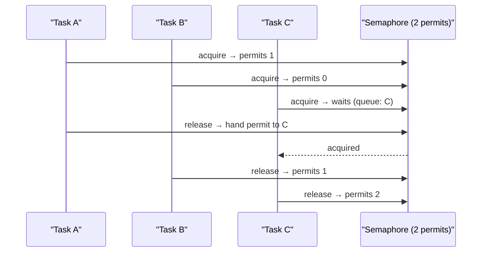

# Semaphore

> **Module 04 · Operating Systems** · Prerequisites: [Mutex](14-Mutex.md) · Next: [Spinlocks](16-Spinlocks.md)

---

## ⏱ If You Only Have 2 Minutes

- A **semaphore** is a counter of **permits**. `acquire` (Dijkstra's **P**, also `wait`) takes a permit or waits while the count is 0. `release` (**V**, also `signal` or `post`) returns one and wakes a waiter.
- **Counting** semaphores start at N and allow N holders at once. A **binary** semaphore counts 0–1.
- **A semaphore is not a mutex.** It has **no owner**: any task may release it. That makes it right for limits and signalling, and dangerous for exclusion, because nothing checks who releases.
- The main backend use is **limiting concurrency to protect a dependency**: at most 10 requests in flight to a partner API, at most 20 queries for a pool of 20 connections. Size N from the dependency's limits, not from your CPU count.
- **Little's law:** in-flight = arrival rate × latency. At 200 req/s and 50 ms, 10 calls are in flight. If the dependency slows to 2 s, 400 are in flight — unless a semaphore caps it.
- **Always release**, on success, error, timeout and cancellation: `async with sem:` or `try … finally`. A leaked permit is capacity lost until restart. `BoundedSemaphore` turns an extra release into an error instead of silently raising the limit.
- **One deadline covers waiting and working.** A caller that times out while queued must leave the queue without taking a permit.
- A semaphore is **per process**: 6 replicas × 10 permits = 60 concurrent calls at the partner. Divide the budget, or use a shared limiter.

---

## 1. What It Is and Why It Exists

A **semaphore** is an integer that never goes below zero, plus a queue of waiting tasks. Edsger Dijkstra introduced it in the 1960s with two operations, **P** and **V**, named after Dutch words (V for *verhogen*, "increase"). `P` decrements the counter if it is positive and otherwise blocks; `V` increments it, or hands the permit directly to a waiter.

**Analogy:** a car park with 10 spaces and a sign showing how many are free. A car may enter only if the sign shows at least 1; otherwise it waits at the barrier. When a car leaves, the next waiting car goes in. Nobody checks *which* car leaves — only that the count stays honest.

**The problem it solves.** Concurrency without a cap turns a traffic burst into a stampede on whatever sits behind you:

- A partner API allows 10 concurrent requests per client. A batch of 500 orders fans out with `Promise.all`, 490 calls get HTTP 429, and the retries make it worse.
- A service has a database pool of 20 connections. 300 concurrent requests each try to borrow one; 280 wait inside the pool, time out, and the error log fills with "timeout acquiring connection".
- A slow dependency makes every in-flight request last longer, so more pile up (Little's law), until memory or file descriptors run out.

A semaphore puts the limit in your code, at the point where you call the dependency, so excess work waits (or fails fast) in your process instead of overloading the dependency.

---

## 2. How It Works

### Acquire and release

```text
acquire():                         release():
  if permits > 0:                    if waiters not empty:
      permits -= 1; return               wake the first waiter (it now owns the permit)
  else:                              else:
      join waiters; sleep                permits += 1
```

Handing the permit directly to the next waiter (instead of incrementing and letting everyone race) keeps the queue FIFO and prevents a newcomer from overtaking a task that has waited longer.



### Semaphores in the kernel and in runtimes

- **POSIX semaphores** (`sem_wait`, `sem_post`, `sem_timedwait`): unnamed ones (`sem_init`) live in memory shared by threads or by processes via shared memory; named ones (`sem_open("/name")`) appear under `/dev/shm` on Linux. glibc implements them with an atomic counter and `futex`, so an uncontended `sem_wait` makes no system call.
- **System V semaphores** (`semget`, `semop`) are the older, kernel-resident API, listed by `ipcs -s`.
- **Python:** `threading.Semaphore` / `BoundedSemaphore` for threads, `asyncio.Semaphore` / `BoundedSemaphore` for tasks, `multiprocessing.Semaphore` across processes.
- **Node.js:** nothing built in for async code. The npm package `p-limit` is the usual choice; the example below writes a small one so you can see every part.

### Observing a concurrency limit

The limit is visible as open connections to the dependency and as a flat in-flight count under load:

```bash
ss -tn state established dst 203.0.113.10 | tail -n +2 | wc -l   # sockets to the partner: should be ≤ 10
ss -tnp state established '( dport = :5432 )' | grep -c "pid=$pid" # DB connections held by this process
```

Illustrative output during a 500-order batch, before and after adding the semaphore:

```text
before:  487      ← one socket per order; the partner answers most with 429
after:    10
```

In the application, export three numbers per semaphore: permits in use, tasks waiting, and the time each task waited for its permit.

---

## 3. Key Concepts

### Counting vs binary

| | Counting semaphore | Binary semaphore |
|---|---|---|
| Range | 0…N | 0…1 |
| Typical use | Limit concurrent work to N | Signal "something happened" from one task to another |
| Example | 10 calls in flight to a partner | An interrupt handler releases it; a worker thread acquires it to process the event |

A binary semaphore *started at 0* is a signal: the waiter blocks until someone releases. That signalling use is why semaphores have no owner.

### Semaphore vs mutex

| | Mutex | Semaphore |
|---|---|---|
| Question it answers | Who is inside? (one) | How many are inside? (up to N) |
| Owner | Yes; the holder unlocks | No; anyone may release |
| Reentrancy, priority inheritance | Possible (needs an owner) | Not possible |
| Typical bug | Forgetting to unlock | Releasing too often (limit grows) or too rarely (limit shrinks) |
| Backend use | Protect shared state | Protect a dependency's capacity |

A `Semaphore(1)` used as a lock works until someone calls `release()` twice or from the wrong task, and then two holders are inside with no error. Use a mutex for exclusion ([Mutex](14-Mutex.md)).

### Limiting concurrency to protect a dependency

Pick N from the thing you protect:

- **Connection pool:** N ≤ pool size, so callers wait in your semaphore (with your timeout and metrics) rather than inside the pool.
- **Partner API:** its documented concurrency limit, divided by the number of replicas.
- **CPU-bound helper (thread or process pool):** the pool size; more queued work only adds latency.

Concurrency limits and rate limits are different. A semaphore caps *simultaneous* calls; it does not stop 10 fast calls from becoming 2,000 requests per second. If the partner limits requests per second, add a rate limiter ([Rate Limiting](../Module-07-Advanced-Backend-and-System-Design/33-Rate-Limiting.md)). Some systems adjust N automatically from observed latency (adaptive concurrency limits, for example Netflix's `concurrency-limits` library); start with a fixed N.

### Bulkheads

One semaphore per dependency is a **bulkhead**: if the payment API slows down, at most its 10 permits are tied up, and calls to the inventory service keep their own capacity ([Bulkhead Pattern](../Module-07-Advanced-Backend-and-System-Design/38-Bulkhead-Pattern.md)). A single shared limit for all outbound calls lets one slow dependency consume everything.

### Guaranteed release and the leak bug

The classic bug:

```text
await sem.acquire()
resp = await client.get(url)     # raises on timeout, DNS failure, 5xx with raise_for_status...
sem.release()                    # ...so this never runs: one permit gone for good
```

After N such failures the semaphore is at 0 forever, and every later call waits until its timeout. It usually happens during an incident, when errors are frequent. Release in `finally` (or `async with`), make the release idempotent if it is a function you hand out, and use `BoundedSemaphore` so a double release raises `ValueError` instead of quietly raising the limit.

**Timeouts while waiting** are the other half. A caller whose deadline expires in the queue must be removed from the queue and must not later receive a permit it will never release. `asyncio.timeout()` around `async with sem:` handles this, because cancellation of a waiting `acquire()` leaves the queue. In a hand-written Node semaphore you must remove the waiter on `abort` yourself.

### Semaphores vs queues

| | Semaphore around each call | Bounded queue + N workers |
|---|---|---|
| Where waiting happens | Every caller holds its own task and memory while it waits | Items wait in the queue; only N workers run |
| Number of waiters | Unbounded unless you add a check | Bounded by the queue size |
| When full | Callers wait (or time out) | `put` blocks, or you reject (HTTP 429/503): **backpressure** |
| Good for | Fan-out inside one request; protecting a client library | Background jobs, pipelines, anything that must shed load |

A semaphore limits *running* work but lets waiting work grow without limit. When overload is possible, also cap the waiters, or use a bounded queue ([Backend Concurrency Patterns](32-Backend-Concurrency-Patterns.md)).

---

## 4. Code Examples

Scenario: a service calls a partner quote API that allows **10 concurrent requests**. Each call must finish (including time spent waiting for a permit) within its deadline, the permit must come back on every path, and callers that time out while queued must leave the queue. A local fake partner that takes 100 ms per request records the maximum overlap it sees.

### Shell

```bash
node outbound-demo.ts          # Node 22.18+ runs .ts directly
python outbound.py
ss -tn state established dst 203.0.113.10 | tail -n +2 | wc -l   # in production: connections to the partner
```

### Node.js / TypeScript

```ts
// Node.js 22+, TypeScript 5, ESM. No packages (global fetch, AbortSignal). Save as outbound.ts
export class Semaphore {
  #permits: number;
  readonly #waiters: Array<() => void> = []; // FIFO, so no caller starves

  constructor(permits: number) {
    this.#permits = permits;
  }

  get available(): number {
    return this.#permits;
  }

  /** Resolves to a release function. Rejects if `signal` aborts while still queued. */
  async acquire(signal?: AbortSignal): Promise<() => void> {
    signal?.throwIfAborted();
    if (this.#permits > 0) {
      this.#permits--;
    } else {
      await new Promise<void>((resolve, reject) => {
        const onAbort = () => {
          this.#waiters.splice(this.#waiters.indexOf(grant), 1); // leave the queue: we never got a permit
          reject(signal!.reason);
        };
        const grant = () => {
          signal?.removeEventListener("abort", onAbort);
          resolve();
        };
        this.#waiters.push(grant);
        signal?.addEventListener("abort", onAbort, { once: true });
      });
    }
    let released = false;
    return () => {
      if (released) return; // idempotent: a double release would silently raise the limit
      released = true;
      const next = this.#waiters.shift();
      if (next) next(); // hand the permit straight to the next waiter
      else this.#permits++;
    };
  }
}

export const outbound = new Semaphore(10); // the partner API allows 10 concurrent requests per client

export async function getJson(url: string, timeoutMs = 2_000): Promise<unknown> {
  const signal = AbortSignal.timeout(timeoutMs); // one budget for queueing AND the request
  const release = await outbound.acquire(signal);
  try {
    const res = await fetch(url, { signal });
    if (!res.ok) throw new Error(`HTTP ${res.status}`);
    return await res.json(); // the body read still holds the permit (and the socket)
  } finally {
    release(); // success, HTTP error, network error or timeout: the permit always comes back
  }
}
```

```ts
// Node.js 22+, TypeScript 5, ESM. Run: node outbound-demo.ts
import { once } from "node:events";
import { createServer } from "node:http";
import type { AddressInfo } from "node:net";
import { getJson, outbound } from "./outbound.ts";

// Demo: a local "partner API" that takes 100 ms and records how many requests overlap.
let inFlight = 0;
let maxInFlight = 0;
const server = createServer((_req, res) => {
  maxInFlight = Math.max(maxInFlight, ++inFlight);
  setTimeout(() => { inFlight--; res.setHeader("content-type", "application/json").end('{"ok":true}'); }, 100);
});
server.listen(0);
await once(server, "listening");
const url = `http://127.0.0.1:${(server.address() as AddressInfo).port}/quote`;

const t0 = performance.now();
const results = await Promise.allSettled([
  ...Array.from({ length: 50 }, () => getJson(url)),
  ...Array.from({ length: 5 }, () => getJson(url, 150)), // queued behind 50 others: time out while waiting
]);
const failed = results.filter((r) => r.status === "rejected").map((r) => (r.reason as Error).name);
console.log(`55 calls in ${Math.round(performance.now() - t0)} ms, max in flight at server: ${maxInFlight}`);
console.log(`failed: ${failed.length} (${[...new Set(failed)].join(", ")}), permits available after: ${outbound.available}`);
server.close();
```

Illustrative output:

```text
55 calls in 582 ms, max in flight at server: 10
failed: 5 (TimeoutError), permits available after: 10
```

Fifty calls of 100 ms with 10 permits take about 500 ms. The five calls with a 150 ms deadline time out while queued, leave the queue, and take no permit, so all 10 permits are free at the end.

### Python

```python
# pip install httpx   — Python 3.12+. Save as outbound.py
import asyncio
import time

import httpx

MAX_IN_FLIGHT = 10  # the partner API allows 10 concurrent requests per client
outbound = asyncio.BoundedSemaphore(MAX_IN_FLIGHT)  # Bounded: an extra release() raises ValueError


async def get_json(client: httpx.AsyncClient, url: str, timeout_s: float = 2.0) -> object:
    async with asyncio.timeout(timeout_s):  # one budget for queueing AND the request
        async with outbound:  # released on success, error, timeout and cancellation
            resp = await client.get(url)
            resp.raise_for_status()
            return resp.json()


async def get_json_leaky(client: httpx.AsyncClient, url: str) -> object:
    await outbound.acquire()
    resp = await client.get(url)  # BUG: if this raises, release() below never runs
    resp.raise_for_status()
    outbound.release()
    return resp.json()


# Demo: a fake "partner API" that takes 100 ms and records how many requests overlap.
in_flight = max_in_flight = 0


async def partner_api(request: httpx.Request) -> httpx.Response:
    global in_flight, max_in_flight
    in_flight += 1
    max_in_flight = max(max_in_flight, in_flight)
    try:
        await asyncio.sleep(0.1)
        return httpx.Response(503 if request.url.path == "/down" else 200, json={"ok": True})
    finally:
        in_flight -= 1


async def main() -> None:
    # Pool size agrees with the semaphore. (A custom transport, like this mock, ignores `limits`.)
    limits = httpx.Limits(max_connections=MAX_IN_FLIGHT)
    async with httpx.AsyncClient(transport=httpx.MockTransport(partner_api), limits=limits,
                                 base_url="https://partner.example") as client:
        t0 = time.perf_counter()
        results = await asyncio.gather(
            *(get_json(client, "/quote") for _ in range(50)),
            *(get_json(client, "/quote", timeout_s=0.15) for _ in range(5)),  # time out while queued
            return_exceptions=True,
        )
        errors = [type(r).__name__ for r in results if isinstance(r, BaseException)]
        print(f"55 calls in {(time.perf_counter() - t0) * 1000:.0f} ms, max in flight: {max_in_flight}")
        print(f"failed: {len(errors)} {sorted(set(errors))}, semaphore exhausted: {outbound.locked()}")

        await asyncio.gather(*(get_json_leaky(client, "/down") for _ in range(MAX_IN_FLIGHT)),
                             return_exceptions=True)
        print(f"after 10 failed leaky calls, semaphore exhausted: {outbound.locked()}")  # True: every later call hangs


if __name__ == "__main__":
    asyncio.run(main())
```

Illustrative output:

```text
55 calls in 541 ms, max in flight: 10
failed: 5 ['TimeoutError'], semaphore exhausted: False
after 10 failed leaky calls, semaphore exhausted: True
```

**Runtime differences to notice:**

- **Built in vs written by hand.** Python's `asyncio.BoundedSemaphore` already handles cancelled waiters and over-release. In Node, the queue, abort handling and idempotent release are your code (or `p-limit`'s).
- **How the timeout reaches the waiter.** In Python, `asyncio.timeout` cancels the task wherever it is suspended — in the semaphore queue or inside `client.get` — and `async with` releases if the permit was taken. In Node, the same `AbortSignal` goes to both `acquire` and `fetch`, because a promise cannot be cancelled from outside.
- **Two limits that must agree.** httpx's `max_connections` (default 100) is a limit too, as is undici's `connections` option if you set one. If the pool is smaller than the semaphore, callers holding a permit queue again inside the pool, outside your metrics.
- **Threads.** For blocking clients in threads (`requests` in a thread pool), use `threading.BoundedSemaphore` with `with sem:`; an `asyncio.Semaphore` must not be shared across threads.

---

## 5. Production Concerns

- **Replicas multiply the limit.** Each pod has its own semaphore. With an autoscaler going from 3 to 12 pods, a per-pod limit of 10 becomes 120 at the partner. Set the per-pod limit from `global_limit / max_replicas`, or use a shared limiter in Redis when the global number really matters.
- **Do not hold a permit while sleeping.** A retry loop with back-off inside `async with sem:` keeps a permit idle during the sleep. Release, sleep, then acquire again ([Retry Pattern](../Module-07-Advanced-Backend-and-System-Design/35-Retry-Pattern.md)).
- **Streaming responses hold the permit.** The permit (and the socket) stays taken until the body is fully read. Read or cancel bodies promptly; a forgotten unread response leaks both.
- **Bound the waiters too.** Under overload, thousands of tasks can queue on the semaphore, each holding request memory and a client connection. Reject when the waiter count passes a threshold, or when the expected wait exceeds the deadline (HTTP 503 with `Retry-After`).
- **Measure.** Permits in use (a flat line at N means you are at the limit), waiters, wait time per acquire, and timeouts while queued vs timeouts in the call. Time spent waiting for a permit should be visible in traces as its own span.
- **Leak detection.** If permits in use stays above zero when traffic is zero, something is not releasing. Alert on it.

---

## 6. Common Mistakes

- **`acquire()` … `release()` without `finally`** — each error leaks a permit until the limit reaches 0 and every call hangs — `async with sem:` / `try … finally`.
- **Timeout that covers only the HTTP call** — callers wait in the semaphore queue for as long as it takes — one deadline around acquire *and* call.
- **Using a semaphore as a mutex** — a stray `release()` lets two tasks in without any error — use a mutex for exclusion; use `BoundedSemaphore` for limits.
- **Sizing N from CPU count** — I/O calls barely use CPU, and the dependency's limit is what matters — size from the pool, the partner's limit and replica count.
- **One semaphore for all dependencies** — a slow dependency uses every permit — one semaphore per dependency (bulkheads).
- **Confusing concurrency with rate** — 10 in flight can still be 2,000 requests per second — add a rate limiter if the partner limits by time.
- **Holding the permit across retries' back-off** — capacity sits idle — release before sleeping.

---

## 7. Comparison Table

| | Semaphore | Mutex | Rate limiter (token bucket) | Bounded queue + N workers | Connection pool |
|---|---|---|---|---|---|
| Limits | Concurrent holders (N) | Concurrent holders (1) | Operations per unit of time | Running (N) and waiting (queue size) | Open connections |
| Owner | None | Yes | — | Workers own items | The borrower |
| Excess work | Waits (unbounded waiters) | Waits | Waits or rejected | Rejected or blocked at `put` (backpressure) | Waits inside the pool |
| Scope | One process | One process | One process, or global in Redis | One process, or global with a broker | One process |
| Use for | Protecting a dependency, fan-out caps | Shared state | Partner's requests-per-second quota | Background jobs, load shedding | Reusing TCP/DB connections |

---

## 8. Interview Questions

**[Junior] What is a semaphore?**
A counter of permits with two operations. `acquire` takes a permit, or waits if none are left; `release` returns one and wakes a waiter. A semaphore initialised to N lets at most N tasks hold permits at once. It is used to limit concurrent access to a resource, and in its binary form to signal between tasks.

**[Junior] What is the difference between a mutex and a binary semaphore?**
Both allow one holder at a time, but a mutex has an owner and only the owner should release it, while any task may release a semaphore. Ownership allows reentrant locks, error checking and priority inheritance. A semaphore's lack of ownership makes it suitable for signalling, but a bug that releases it twice silently lets two tasks in.

**[Mid] How would you limit a service to 10 concurrent calls to a partner API?**
Wrap each call in a semaphore with 10 permits, acquired with `async with` or released in `finally`, so every exit path returns the permit. Put one deadline around both waiting for the permit and the call, and make sure a timed-out waiter leaves the queue. Keep the HTTP client's connection pool at the same size, and divide the limit by the number of replicas, because each process has its own semaphore.

**[Mid] What is the "acquire without release" bug, and how do you prevent it?**
Code acquires a permit, then an exception or timeout skips the release line, so the permit is lost. After N failures the semaphore is permanently at zero and every call waits until it times out, usually during an incident when errors are common. Prevent it with `async with` or `try … finally`, an idempotent release function, `BoundedSemaphore` to catch double releases, and a metric that alerts when permits stay in use with no traffic.

**[Mid] Is a concurrency limit the same as a rate limit?**
No. A concurrency limit caps how many calls are in flight at once; a rate limit caps how many start per unit of time. With 10 permits and 5 ms calls, you can still send 2,000 requests per second. Use a semaphore to protect capacity such as connections and worker threads, and a token bucket for quotas defined per second or minute. Many integrations need both.

**[Senior] How do semaphores implement the bulkhead pattern, and where do they fall short?**
Each dependency gets its own semaphore, so a slow dependency can hold at most its own permits, and calls to others keep their capacity. That stops one slow service from exhausting all request-handling capacity. Semaphores fall short in that waiters are unbounded and each holds memory and a client connection, so under sustained overload you also need to cap the queue or reject early. They are also per process, so the effective limit scales with replica count.

**[Senior] When would you use a bounded queue with workers instead of a semaphore?**
When work can be decoupled from the caller and you need backpressure: background jobs, pipelines, or ingest that must shed load. A bounded queue caps both running and waiting work, and a full queue rejects or blocks the producer, which pushes back on the source. A semaphore suits request-scoped fan-out, where the caller must wait for the result anyway. Combining them is common: a queue in front, and a semaphore around each external dependency inside the workers.

**[Senior] A dependency slowed from 50 ms to 2 s and your service ran out of memory. How does a semaphore help, and what else do you need?**
By Little's law, in-flight requests grew 40× at the same arrival rate. A semaphore caps the in-flight calls to that dependency, but the excess callers now wait, still holding memory, so you also need deadlines so waiters give up, a cap on waiters or early rejection with 503, and a circuit breaker so you stop calling a dependency that is failing. Measuring wait time and permits in use shows the problem before memory does.

---

## 9. Cheat Sheet

```text
Semaphore       counter of permits + wait queue; P/acquire/wait, V/release/signal/post
Counting        0…N → limit concurrency     Binary 0…1 → signalling
vs mutex        no owner: anyone can release; no reentrancy, no priority inheritance
Sizing          from the dependency: pool size, partner limit / replicas — not CPU count
Little's law    in-flight = rate × latency (200/s × 50 ms = 10; × 2 s = 400)
Release         async with / try…finally; idempotent release fn; BoundedSemaphore catches over-release
Deadline        one timeout around acquire + call; timed-out waiters must leave the queue
Python          asyncio.(Bounded)Semaphore, threading.(Bounded)Semaphore, multiprocessing.Semaphore
Node            no built-in async semaphore → p-limit or a ~40-line class (FIFO hand-off)
Linux           POSIX sem_wait/sem_post (futex-based), named under /dev/shm; SysV semget (ipcs -s)
Bulkhead        one semaphore per dependency
Not a           rate limiter (per time) · bounded queue (caps waiters, backpressure)
Replicas        per-process limit × pods = global load
Observe         ss -tn dst <dep> | wc -l; permits in use, waiters, wait-time histogram
```

---

## Related Topics

- [Mutex](14-Mutex.md) — the owned, one-holder lock for protecting shared state
- [Concurrency](09-Concurrency.md) — bounding fan-out with caps and deadlines
- [Bulkhead Pattern](../Module-07-Advanced-Backend-and-System-Design/38-Bulkhead-Pattern.md) — one semaphore per dependency, as a resilience pattern
- [Rate Limiting](../Module-07-Advanced-Backend-and-System-Design/33-Rate-Limiting.md) — limiting requests per unit of time instead of in flight
- [Backend Concurrency Patterns](32-Backend-Concurrency-Patterns.md) — bounded queues, worker pools and backpressure
- [Timeout Pattern](../Module-07-Advanced-Backend-and-System-Design/37-Timeout-Pattern.md) — deadlines that cover waiting and working
