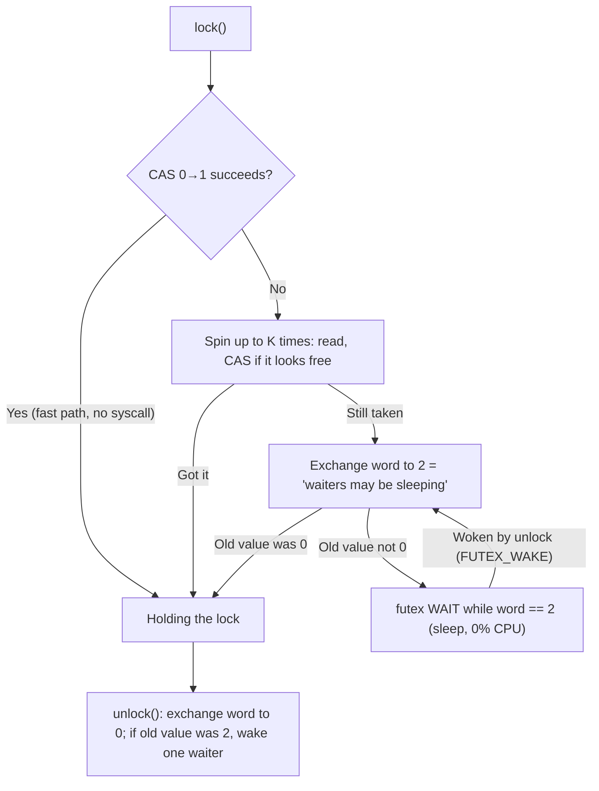

# Spinlocks

> **Module 04 · Operating Systems** · Prerequisites: [Semaphore](15-Semaphore.md) · Next: [Condition Variables](17-Condition-Variables.md)

---

## ⏱ If You Only Have 2 Minutes

- A **spinlock** waits by **busy-looping** on an atomic instruction ("is it free yet?") instead of asking the kernel to put the thread to sleep. It skips the cost of sleeping and waking, and pays with a CPU core that does no useful work while it waits.
- Spinning wins only when **the wait is shorter than a sleep/wake cycle** (a few microseconds), **the holder is running on another core right now**, and ideally **the waiter cannot sleep at all** — kernel code with interrupts or preemption disabled. That is where Linux uses `spin_lock`.
- In **user space**, spinlocks are usually wrong. The kernel can preempt the holder at any time; then every spinner burns its whole time slice waiting for a thread that is not running. With more threads than cores, or a container CPU quota, it gets worse.
- What production locks actually do: **spin briefly, then sleep**. glibc's adaptive mutex type, the Linux kernel's mutex, Go's `sync.Mutex` and Java's locks all spin a little before blocking. The `futex` system call makes the uncontended path free and the contended path a real sleep.
- **Compare-and-swap (CAS)** — "if the value is still A, set it to B" in one indivisible step — is the building block of spinlocks, mutexes and lock-free code. A **CAS retry loop** reads, computes, and retries if someone changed the value meanwhile.
- **Atomics also order memory.** A lock acquire has acquire semantics, a release has release semantics; JavaScript's `Atomics` are sequentially consistent, the strongest ordering.
- **Node** has real atomics on a `SharedArrayBuffer` (`Atomics.compareExchange`, `Atomics.wait`/`notify`). **Python** has no user-level atomics; `threading.Lock` already sleeps in the kernel, and the GIL makes a hand-written spinlock pointless.

---

## 1. What It Is and Why It Exists

A **spinlock** is a lock whose `lock()` is a loop: try to flip the lock word from "free" to "taken" with an atomic instruction; if that fails, try again, immediately, until it works. The thread never leaves the CPU.

**Analogy:** a single-person shop with the door locked while someone is inside. You can stand at the door and try the handle again and again (spinning), or take a ticket, sit down, and be called when it is your turn (sleeping). If the person inside leaves in two seconds, rattling the handle gets you in fastest. If they stay twenty minutes, you have wasted twenty minutes standing there — and blocked the doorway for everyone else.

**Why it exists.** Sleeping is not free. To block, a thread makes a system call, the kernel saves its state and schedules another thread, and on wake-up the kernel must schedule it again, often on a different core with cold caches ([Context Switching](08-Context-Switching.md)). That costs microseconds. If the critical section takes 50 nanoseconds, sleeping costs far more than the wait itself. And some code cannot sleep at all: an interrupt handler in the kernel has no thread context to put to sleep. For those cases, spinning is the only option.

**Why it is dangerous.** A spinner assumes the holder is making progress. If the holder has been preempted, descheduled or throttled, the spinner burns CPU — possibly the very CPU the holder needs to finish.

---

## 2. How It Works

### Test-and-set, then test-and-test-and-set

The simplest spinlock:

```text
lock():   while atomic_exchange(&word, 1) == 1: pass      # keep swapping 1 in until we see 0
unlock(): atomic_store(&word, 0)
```

Every failed exchange is a **write**, so the cache line holding `word` bounces between the cores of all spinners (each write needs exclusive ownership of the line). The better version, **test-and-test-and-set**, spins on a plain **read**, which can be served from each core's own cache, and attempts the atomic write only when the lock looks free. CPUs also provide a hint instruction for spin loops (x86 `PAUSE`, Arm `YIELD`) that reduces power use and helps the other hardware thread on the same core. The Linux kernel goes further with **queued spinlocks**: each waiter spins on its own cache line and the lock is handed over in FIFO order.

### Spin, then sleep: the adaptive lock



This is what real mutexes do. The spinning phase catches the common case where the holder is about to release; the sleeping phase stops the waste when it is not. The three states (0 free, 1 locked, 2 locked with possible sleepers) let `unlock()` skip the wake-up system call when nobody is asleep. Ulrich Drepper's paper *Futexes Are Tricky* derives this design.

### Observing spinning on Linux

A spinning thread looks busy but achieves nothing:

```bash
top -H -p "$pid"                          # waiting threads at ~100% CPU instead of ~0% → spinning
perf top -p "$pid"                        # hottest functions: your spin loop, or the kernel's spinlock slow path
strace -f -c -e trace=futex node spin.ts  # how often the slow path actually reached the kernel
```

Measured in a `node:22` container on 16 vCPUs, running the example below (4 workers, 800,000 lock acquisitions in total). `strace` slows the program down, which changes the timing, but the shape holds:

```text
% time     seconds  usecs/call     calls    errors syscall
------ ----------- ----------- --------- --------- ----------------
100.00    1.178745         800      1473       315 futex
```

About 1,500 futex calls in the whole process — including Node's own internal threads — for 800,000 lock acquisitions: more than 99% of lock operations never entered the kernel. The 315 errors are `EAGAIN` — the lock word changed between deciding to sleep and the kernel's check, so the thread did not sleep at all. If `perf top` shows `native_queued_spin_lock_slowpath` with high `%sys`, the contention is on a **kernel** spinlock, typically many threads hammering one shared kernel object.

---

## 3. Key Concepts

### Spinning vs sleeping

| | Spin | Sleep (futex) |
|---|---|---|
| Cost to wait | One core at 100% for the whole wait | Two system calls and a context switch, then 0% CPU |
| Wake-up latency | Nanoseconds after release | Microseconds: the scheduler must run the thread again |
| If the holder is preempted | Spinners waste whole time slices | Waiters just keep sleeping |
| More threads than cores | Disaster: spinners steal CPU from the holder | Fine |
| Used in | Kernel code that cannot sleep; very short sections on dedicated cores | Almost all user-space locks |

### When spinning wins

All of these should be true:

1. The critical section is **very short** — tens to hundreds of nanoseconds, no I/O, no allocation that might fault.
2. The holder is **running right now** on another core, so the lock will be released soon.
3. There are **no more runnable threads than cores**, so a spinner does not steal the holder's CPU.
4. Or the code **cannot sleep**: kernel interrupt handlers and code with preemption disabled. Linux's `spin_lock` disables preemption while held, which guarantees point 2, and `spin_lock_irqsave` also disables local interrupts.

High-frequency trading engines and some databases pin threads to dedicated cores, where these conditions hold. A typical web service with a thread pool larger than its CPU quota is the opposite case.

### Why user-space spinlocks are usually wrong

- **Preemption.** The kernel can stop the holder at any instruction when its time slice ends. Spinners then spin until the holder is scheduled again — possibly milliseconds.
- **Oversubscription.** With 32 threads on 8 cores, the spinners can occupy the cores while the holder waits in the run queue for one of them.
- **Containers.** Spinning consumes CPU quota. Once the quota for the period is used up, the cgroup is throttled, *including the holder* ([CPU Scheduling](07-CPU-Scheduling.md)).
- **The kernel cannot help.** A thread blocked on a futex tells the scheduler "I am waiting for this lock"; a spinning thread looks like useful work. Linus Torvalds made this argument publicly in a 2020 discussion of a user-space spinlock benchmark: do not use spinlocks in user space unless you really know what you are doing.

### Adaptive mutexes and the futex

Real locks combine both: a short bounded spin, then a futex sleep. glibc offers `PTHREAD_MUTEX_ADAPTIVE_NP`; the Linux kernel's `mutex` spins while the owner is running on a CPU ("optimistic spinning") and sleeps otherwise; Go's `sync.Mutex` and the JVM spin briefly before blocking. The **futex** ("fast user-space mutex") system call is what makes this cheap: the lock word lives in ordinary user memory, the fast path is one CAS, and `FUTEX_WAIT` sleeps only if the word still holds the expected value, so no wake-up can be lost ([Mutex](14-Mutex.md)).

### Atomics and compare-and-swap

An **atomic** operation is indivisible: no other core can see it half-done. The important ones:

| Operation | Meaning | JavaScript |
|---|---|---|
| Load / store | Read or write one word, with ordering guarantees | `Atomics.load`, `Atomics.store` |
| Exchange | Write a new value, return the old one | `Atomics.exchange` |
| Fetch-and-add | Add, return the old value | `Atomics.add`, `Atomics.sub` |
| Compare-and-swap | If the value equals `expected`, write `new`; always return the old value | `Atomics.compareExchange` |
| Wait / notify | Sleep while the value equals `v`; wake sleepers | `Atomics.wait`, `Atomics.notify` (`Int32Array` / `BigInt64Array` only) |

CAS turns any single-word update into a **retry loop**: read the current value, compute the new one, CAS; if the CAS fails, someone else won, so read again. This is optimistic concurrency, the same idea as `UPDATE … WHERE version = $1` in a database ([Optimistic vs Pessimistic Locking](../Module-03-Databases/32-Optimistic-vs-Pessimistic-Locking.md)). Its classic pitfall is the **ABA problem**: the value changes from A to B and back to A, and the CAS succeeds although the state changed. Pair the value with a version counter to detect it.

### Memory ordering, in one paragraph

Compilers and CPUs reorder memory operations that look independent; x86 reorders little, Arm reorders much more. Atomics carry ordering rules. **Acquire** (on a lock): later reads and writes cannot move before it. **Release** (on an unlock): earlier reads and writes cannot move after it. Together they guarantee that whatever the previous holder wrote inside the critical section is visible to the next holder. C, C++ and Rust let you choose weaker orderings (`relaxed`, `acquire`, `release`) for speed. JavaScript's `Atomics` are all **sequentially consistent**, the strongest kind, so plain reads and writes on a `SharedArrayBuffer` that are ordered by `Atomics` operations are safe ([Synchronization](11-Synchronization.md)).

### Lock-free counters

A counter shared by threads does not need a lock: one `Atomics.add` (fetch-and-add) is enough, and nobody ever waits. But every increment needs exclusive ownership of one cache line, so with many cores incrementing at once, the line ping-pongs and the counter becomes a bottleneck. The fix is **sharding**: each thread increments its own slot (padded to 64 bytes so slots do not share a cache line), and readers sum the slots. Java's `LongAdder` works this way, and so do most metrics libraries' per-thread counters.

---

## 4. Code Examples

Scenario: several workers increment a shared counter under a lock. In Node, the lock is built from `Atomics` on a `SharedArrayBuffer` exactly like a futex-based mutex: one CAS fast path, a bounded spin, then `Atomics.wait` (sleep) when spinning fails. The workers count which path each acquisition took. In Python, the honest version: show what a spinning waiter costs compared with a blocking `threading.Lock`, then compare an optimistic CAS-style retry loop with a plain lock.

### Shell

```bash
node spin.ts                                   # Node 22.18+ runs .ts directly
strace -f -c -e trace=futex node spin.ts       # how rarely the lock reaches the kernel
python spin_vs_block.py && python cas_vs_lock.py
taskset -c 0 python cas_vs_lock.py             # same program on one CPU
```

### Node.js / TypeScript

```ts
// Node.js 22+, TypeScript 5, ESM. No packages. Run: node spin.ts
import { Worker, isMainThread, parentPort, workerData } from "node:worker_threads";

const UNLOCKED = 0;
const LOCKED = 1; // held, nobody sleeping
const CONTENDED = 2; // held, and someone may be sleeping: unlock must notify
const SPINS = 100; // brief optimism before paying for a sleep and a wake-up
const WORKERS = 4;
const ROUNDS = 200_000;

interface Stats { fastPath: number; afterSpin: number; sleeps: number }

function lock(s: Int32Array, stats: Stats): void {
  if (Atomics.compareExchange(s, 0, UNLOCKED, LOCKED) === UNLOCKED) { stats.fastPath++; return; } // no syscall
  for (let i = 0; i < SPINS; i++) {
    // Read first, CAS only when it looks free: plain reads do not fight over the cache line.
    if (Atomics.load(s, 0) === UNLOCKED && Atomics.compareExchange(s, 0, UNLOCKED, LOCKED) === UNLOCKED) {
      stats.afterSpin++;
      return;
    }
  }
  // Give up spinning: mark the lock CONTENDED and sleep until the holder wakes us.
  while (Atomics.exchange(s, 0, CONTENDED) !== UNLOCKED) {
    stats.sleeps++;
    Atomics.wait(s, 0, CONTENDED); // like FUTEX_WAIT: sleeps only if the value is still CONTENDED
  }
}

function unlock(s: Int32Array): void {
  // Only pay for a notify (a futex wake syscall) if someone may be asleep.
  if (Atomics.exchange(s, 0, UNLOCKED) === CONTENDED) Atomics.notify(s, 0, 1);
}

if (isMainThread) {
  const shared = new SharedArrayBuffer(2 * Int32Array.BYTES_PER_ELEMENT); // [0] lock word, [1] counter
  const stats = await Promise.all(
    Array.from({ length: WORKERS }, () =>
      new Promise<Stats>((resolve, reject) => {
        const w = new Worker(new URL(import.meta.url), { workerData: shared });
        w.once("message", resolve);
        w.once("error", reject);
      }),
    ),
  );
  console.log(`counter = ${new Int32Array(shared)[1]} (expected ${WORKERS * ROUNDS})`);
  stats.forEach((s, i) => console.log(`worker ${i}: fast ${s.fastPath}, after spin ${s.afterSpin}, slept ${s.sleeps}`));
} else {
  const s = new Int32Array(workerData as SharedArrayBuffer);
  const stats: Stats = { fastPath: 0, afterSpin: 0, sleeps: 0 };
  for (let i = 0; i < ROUNDS; i++) {
    lock(s, stats);
    s[1]++; // a plain, non-atomic increment: correct only because the lock orders it
    unlock(s);
  }
  parentPort!.postMessage(stats);
}
```

Measured in a `node:22` container on 16 vCPUs (counts vary per run):

```text
counter = 800000 (expected 800000)
worker 0: fast 178491, after spin 19937, slept 3015
worker 1: fast 178031, after spin 19512, slept 4448
worker 2: fast 177335, after spin 21164, slept 2953
worker 3: fast 179486, after spin 18659, slept 3422
```

Each worker made 200,000 acquisitions. About 89% took the lock with one CAS, about 10% got it during the short spin, and the remaining ~1% fell through to the sleep path (some slept more than once, so `slept` is higher than that 1%). Without the spin phase, those 10% would also have paid for a sleep and a wake-up. Without the sleep phase, a worker whose holder was descheduled would spin for a whole time slice.

### Python

What a user-level spinlock costs in Python:

```python
# Python 3.12+, stdlib only. Save as spin_vs_block.py
import sys
import threading
import time
from collections.abc import Callable

HOLD_S = 0.5


def spin(lock: threading.Lock) -> None:
    while not lock.acquire(blocking=False):  # a user-level spinlock: try, fail, try again
        pass


def block(lock: threading.Lock) -> None:
    lock.acquire()  # sleeps in the kernel (a futex on Linux) until the holder releases


def waiter_cpu_seconds(acquire: Callable[[threading.Lock], None]) -> float:
    """CPU time one waiter burns while the main thread holds the lock for HOLD_S seconds."""
    lock = threading.Lock()
    lock.acquire()
    cpu: list[float] = []

    def waiter() -> None:
        t0 = time.thread_time()  # CPU time of this thread only, not wall-clock time
        acquire(lock)
        cpu.append(time.thread_time() - t0)
        lock.release()

    t = threading.Thread(target=waiter)
    t.start()
    time.sleep(HOLD_S)  # the "critical section" of the holder
    lock.release()
    t.join()
    return cpu[0]


if __name__ == "__main__":
    print(f"GIL enabled: {getattr(sys, '_is_gil_enabled', lambda: True)()}")
    print(f"spinning waiter: {waiter_cpu_seconds(spin):.2f} s CPU during a {HOLD_S} s wait")
    print(f"blocking waiter: {waiter_cpu_seconds(block):.3f} s CPU during a {HOLD_S} s wait")
```

Measured in a `python:3.12` container:

```text
GIL enabled: True
spinning waiter: 0.51 s CPU during a 0.5 s wait
blocking waiter: 0.000 s CPU during a 0.5 s wait
```

An optimistic CAS-style loop next to a plain lock:

```python
# Python 3.12+, stdlib only. Save as cas_vs_lock.py
import threading
import time
from collections.abc import Callable


class VersionedCell:
    """CAS-style API. Python has no compare-and-swap for plain objects, so a short lock backs it."""

    def __init__(self, value: int) -> None:
        self._value, self._lock = value, threading.Lock()

    def get(self) -> int:
        return self._value

    def compare_and_set(self, expected: int, new: int) -> bool:
        with self._lock:  # held only for one comparison and one assignment
            if self._value != expected:
                return False
            self._value = new
            return True


def next_value(current: int) -> int:
    return current + 1  # real code computes here; any Python call is a point where the GIL may switch


def cas_increment(cell: VersionedCell, retries: list[int]) -> None:
    for _ in range(100_000):
        while True:  # optimistic: read, compute without a lock, publish only if nobody changed it
            seen = cell.get()
            if cell.compare_and_set(seen, next_value(seen)):
                break
            retries[0] += 1  # lost the race: recompute from the fresh value


def locked_increment(state: dict[str, int], lock: threading.Lock) -> None:
    for _ in range(100_000):
        with lock:  # pessimistic: hold the lock across read, compute and write
            state["n"] = next_value(state["n"])


def run4(target: Callable[..., None], *args: object) -> float:
    threads = [threading.Thread(target=target, args=args) for _ in range(4)]
    t0 = time.perf_counter()
    for t in threads:
        t.start()
    for t in threads:
        t.join()
    return time.perf_counter() - t0


if __name__ == "__main__":
    cell, retries = VersionedCell(0), [0]
    secs = run4(cas_increment, cell, retries)
    print(f"CAS-style loop: {cell.get():,} in {secs:.2f} s, {retries[0]:,} retries")

    state, lock = {"n": 0}, threading.Lock()
    secs = run4(locked_increment, state, lock)
    print(f"plain Lock:     {state['n']:,} in {secs:.2f} s")
```

Measured in the same container, 16 vCPUs, then pinned to one CPU:

```text
CAS-style loop: 400,000 in 0.15 s, 6 retries
plain Lock:     400,000 in 9.41 s
$ taskset -c 0 python cas_vs_lock.py
CAS-style loop: 400,000 in 0.30 s, 6 retries
plain Lock:     400,000 in 0.21 s
```

**What this does and does not show:**

- **Spinning in Python only burns CPU.** The spinner used a full core for half a second. With the GIL, it also competes with the holder for the interpreter, so when the holder needs the GIL to finish its critical section, spinning slows it down. `threading.Lock` already blocks in the kernel on contention, which is what a good lock should do.
- **The CAS loop is not lock-free.** Python has no compare-and-swap for ordinary objects, so `compare_and_set` uses a lock internally. The pattern — read, compute outside, publish if unchanged, retry — is the lesson, and it is exactly what you write against a database with a version column.
- **The 60× gap is not about CAS.** The plain-lock version calls a Python function *while holding the lock*. On a multicore machine CPython can hand the GIL to another thread at that call; the other threads then find the lock taken and sleep, and every release turns into a cross-core wake-up — a lock convoy ([Critical Sections](12-Critical-Sections.md)). The CAS version holds its lock only for a comparison and an assignment, with no Python call inside. Pinned to one CPU, the convoy disappears and the plain lock is the faster of the two.
- **Free-threaded builds** (3.13+, optional) run threads truly in parallel, so a spinner no longer blocks the holder through the GIL, but there is still no public atomic API for user code. Use `threading.Lock`.
- **Node is different because it has real shared memory.** Workers share only the `SharedArrayBuffer`, and `Atomics` give genuine hardware atomics on it. Even so, the example sleeps when spinning fails; a pure spin would burn a core per waiting worker.

---

## 5. Production Concerns

- **Default to the platform's mutex.** It already spins briefly where that helps. A hand-written spinlock in application code needs a benchmark on the production machine type, under production thread counts, to justify it.
- **Containers turn spinning into throttling.** Spinning uses CPU quota without doing work, so the container hits `nr_throttled` sooner, and the throttled holder delays everyone. Watch `cpu.stat` alongside latency.
- **Symptoms of spinning:** high CPU with flat throughput; waiting threads at 100% in `top -H`; a spin function or `native_queued_spin_lock_slowpath` at the top of `perf top`; high `%sys` in `vmstat` for kernel spinlocks.
- **Never call `Atomics.wait` on Node's main thread.** Node allows it, but it blocks the event loop like any synchronous call. Waiting belongs in workers; the main thread receives messages or uses `Atomics.waitAsync`.
- **False sharing.** Two hot atomic counters on the same 64-byte cache line slow each other down although they are independent. Give each hot slot its own cache line (in a `SharedArrayBuffer`, space them 16 `Int32` slots apart).
- **Lock-free is not free of contention.** A CAS loop under heavy contention can retry many times, and the cache line still moves between cores. Measure retries; if they grow with load, a sleeping lock or sharding is better.

---

## 6. Common Mistakes

- **Writing a user-space spinlock for "performance"** — preempted holders and oversubscribed cores make spinners waste whole time slices — use the runtime's mutex, which spins briefly and then sleeps.
- **Spinning with plain reads and writes** — without atomics, two threads can both see "free" and both enter — use `Atomics.compareExchange` / CAS for the acquire and an atomic store or exchange for the release.
- **Spinning on CAS instead of on a read** — every failed CAS is a write that bounces the cache line — test with `Atomics.load` first, then CAS (test-and-test-and-set).
- **Unbounded spin with no fallback** — one descheduled holder freezes several cores — spin a bounded number of times, then sleep (`Atomics.wait`, futex).
- **Busy-waiting in Python** — `while not lock.acquire(False): pass` or `while not flag: pass` burns a core and fights the GIL — call `lock.acquire()`, or use an `Event`.
- **Ignoring ABA in CAS loops** — a value that went A → B → A passes the CAS although the state changed — add a version counter.
- **Assuming atomics make multi-field updates safe** — CAS covers one word; two related fields can still be seen half-updated — use a lock, or pack both into one word.

---

## 7. Comparison Table

| | Pure spinlock | Futex mutex (sleeping) | Adaptive mutex (spin, then sleep) | Lock-free atomic (CAS / fetch-add) | Async lock (`asyncio.Lock`, promise chain) |
|---|---|---|---|---|---|
| Waiter CPU | 100% while waiting | ~0% | Brief burst, then ~0% | Retries only on conflict | 0% (task suspended) |
| Hand-off latency | Lowest | Microseconds | Low if the holder is quick | No hand-off | One event-loop turn |
| Holder preempted | Spinners waste time slices | Harmless | Spin phase wasted, then harmless | Others keep progressing | Not applicable (one thread) |
| Protects | Any short section | Any section | Any section | One word | Sections containing `await` |
| Where | Kernel; pinned-core systems | Default user-space locks | glibc adaptive type, kernel mutex, Go, JVM | Counters, flags, lock implementations | Event-loop code |

---

## 8. Interview Questions

**[Junior] What is a spinlock, and how is it different from a mutex?**
A spinlock waits by looping on an atomic instruction until the lock is free, so the waiting thread keeps running on the CPU. A typical mutex puts the waiting thread to sleep in the kernel and wakes it on release. Spinning avoids the cost of sleeping and waking but wastes a core while waiting, so it only pays off for very short waits.

**[Junior] What is compare-and-swap?**
An atomic instruction that writes a new value to a memory location only if it still holds an expected value, and reports the value it found. It lets a thread update shared data without a lock: read, compute, CAS, and retry if another thread changed the value in between. Spinlocks, mutexes and lock-free data structures are built from it.

**[Mid] When does spinning beat sleeping?**
When the expected wait is shorter than the cost of a sleep and wake-up, a few microseconds, and the holder is running on another core so it will release soon. It also needs no more runnable threads than cores, or spinners steal CPU from the holder. In the kernel, code that cannot sleep, such as interrupt handlers, must spin. In user space, those conditions rarely hold for long, which is why mutexes spin only briefly before sleeping.

**[Mid] Why are user-space spinlocks usually a bad idea?**
The kernel can preempt the lock holder at any moment, and then every spinner burns its time slice waiting for a thread that is not running. With more threads than cores, spinners can even occupy the CPUs the holder needs. In containers, spinning uses up the CPU quota and gets everyone throttled. And the scheduler cannot tell a spinning thread from a working one, while a futex wait tells it exactly what the thread is waiting for.

**[Mid] What is the ABA problem?**
A CAS checks only that the value equals what you read earlier. If another thread changed it from A to B and back to A, your CAS succeeds, although the structure may have changed underneath, for example a node removed and re-inserted in a lock-free stack. The usual fix is to pair the value with a version counter that changes on every update, so A-with-version-1 differs from A-with-version-3.

**[Senior] How does a futex-based mutex combine spinning and sleeping?**
The lock word is an integer in user memory: 0 free, 1 locked, 2 locked with possible sleepers. `lock()` tries a CAS from 0 to 1; on failure it may spin briefly, then exchanges the word to 2 and calls `FUTEX_WAIT`, which sleeps only if the word is still 2, so a release in between cannot be missed. `unlock()` exchanges the word to 0 and calls `FUTEX_WAKE` only if the old value was 2. The uncontended case never enters the kernel, and the contended case sleeps instead of burning CPU.

**[Senior] What does memory ordering have to do with locks?**
CPUs and compilers reorder independent memory operations, so without ordering guarantees another core could see the lock as free before it sees the data written inside the critical section. Acquiring a lock has acquire semantics, so later accesses stay after it; releasing has release semantics, so earlier writes become visible before the lock looks free. That is why a correct lock must use atomics with at least acquire/release ordering, and why JavaScript's sequentially consistent `Atomics` make plain accesses between them safe.

**[Senior] A service on 8 vCPUs shows 100% CPU but low throughput after a library upgrade. How do you check whether spinning is the cause?**
Look at per-thread CPU with `top -H`: threads that should be waiting but sit near 100% suggest spinning. Run `perf top` or record a profile: a spin loop, `sched_yield`, or `native_queued_spin_lock_slowpath` (kernel lock contention) at the top confirms it. Compare thread count to the CPU quota and check `cpu.stat` for throttling, since spinning makes oversubscription much worse. Fixes are to reduce thread count to the cores available, configure the library's spin count or wait strategy, or replace the spinlock with a sleeping mutex.

---

## 9. Cheat Sheet

```text
Spinlock        loop on an atomic until free; never sleeps; burns a core while waiting
Wins when       section ≪ sleep/wake cost (µs) · holder running on another core · threads ≤ cores · can't sleep (kernel)
Linux kernel    spin_lock disables preemption; spin_lock_irqsave also disables IRQs; queued (MCS-style) spinlocks
User space      usually wrong: preemption, oversubscription, cgroup throttling; scheduler can't see it
Real mutexes    CAS fast path → brief spin → futex WAIT; unlock → FUTEX_WAKE only if waiters (word 0/1/2)
TTAS            spin on a plain read, CAS only when it looks free; PAUSE/YIELD hint
CAS             if *p == expected then *p = new; returns old; retry loop = optimistic concurrency
ABA             A→B→A fools CAS → add a version counter
Ordering        lock = acquire, unlock = release; JS Atomics = sequentially consistent
Counters        Atomics.add (lock-free); hot → shard per thread, pad to 64-byte cache lines (LongAdder)
Node            Atomics.compareExchange / exchange / wait / notify on Int32Array over SharedArrayBuffer; wait only in workers
Python          no user atomics; threading.Lock already sleeps (futex); spinning just fights the GIL
Observe         top -H (waiters at 100%) · perf top · strace -f -c -e futex · vmstat %sys
```

---

## Related Topics

- [Mutex](14-Mutex.md) — the sleeping lock that spins briefly first, and how to use it correctly
- [Context Switching](08-Context-Switching.md) — the cost that spinning tries to avoid
- [Race Conditions](13-Race-Conditions.md) — the lost updates that atomics and CAS prevent
- [CPU Scheduling](07-CPU-Scheduling.md) — preemption and cgroup quotas, the reasons spinning fails in user space
- [Condition Variables](17-Condition-Variables.md) — waiting for a condition without busy-waiting
- [Optimistic vs Pessimistic Locking](../Module-03-Databases/32-Optimistic-vs-Pessimistic-Locking.md) — the CAS retry loop, applied to database rows
