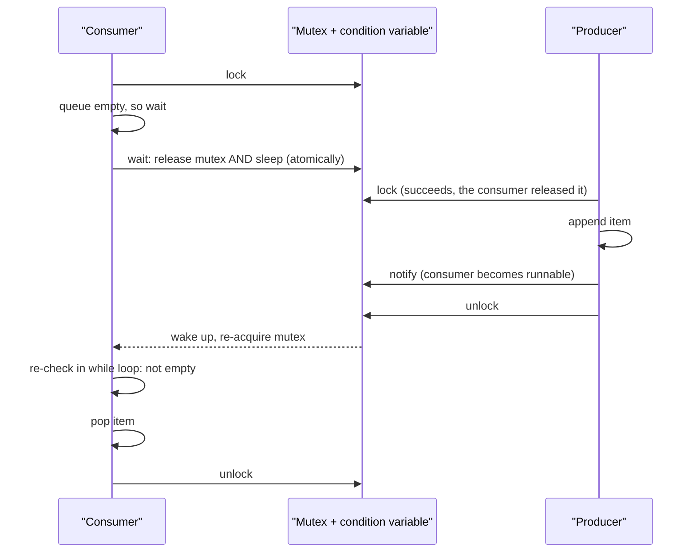

# Condition Variables

> **Module 04 · Operating Systems** · Prerequisites: [Spinlocks](16-Spinlocks.md) · Next: [Deadlocks](18-Deadlocks.md)

---

## ⏱ If You Only Have 2 Minutes

- A **condition variable** lets a thread **sleep until some shared state becomes true** ("the queue is not empty") without polling. It is always used together with a **mutex** that protects that state.
- `wait()` does three things: it **atomically releases the mutex and goes to sleep**, and before returning it **re-acquires the mutex**. The atomic release is what prevents a notification from slipping in between "I checked" and "I slept".
- **Always wait in a `while` loop**, never an `if`: `while not condition: cv.wait()`. A woken thread may find the condition false again — another thread got there first (a **stolen wakeup**), or the wait returned for no reason (a **spurious wakeup**, which POSIX explicitly allows).
- A condition variable has **no memory**. A `notify()` with nobody waiting is simply lost. That is why you check the state first and only wait if it is false — the state is the memory, not the signal.
- `notify()` wakes one waiter; `notify_all()` wakes all of them. Use `notify` when any waiter can make progress and all wait for the same thing; use `notify_all` when waiters wait for different conditions on one variable, or for shutdown.
- The canonical example is the **bounded buffer**: producers wait on "not full", consumers wait on "not empty". Python's `queue.Queue` is exactly this: one lock, two condition variables.
- Python: `threading.Condition` and `asyncio.Condition`, both with `wait_for(predicate)`. Node: `Atomics.wait`/`Atomics.notify` between workers, and Promise resolvers in async code — but most Node code passes messages instead.

---

## 1. What It Is and Why It Exists

A **condition variable** is a queue of sleeping threads attached to a question about shared state. A thread that finds the answer is "no" (the buffer is empty, the job is not finished, the pool has no free connection) calls `wait()` and goes to sleep. A thread that changes the state so the answer may now be "yes" calls `notify()`, and a sleeper wakes up to check again.

**Analogy:** a restaurant pager. You ask the host whether a table is free (check the state). If not, you take a pager and sit down (wait). You do not walk up to the desk every ten seconds (polling). When a table frees up, the host buzzes one pager (notify). You walk to the desk, and the host checks again — maybe a walk-in took the table while you were walking over, and you sit down again (the `while` loop).

**The problem it solves.** Without it, a thread that needs to wait for a condition has two bad choices:

- **Busy-wait:** `while queue.empty(): pass`. It burns a whole core doing nothing, and with Python's GIL it also slows down the thread that would make the condition true ([Spinlocks](16-Spinlocks.md)).
- **Sleep-poll:** `while queue.empty(): time.sleep(0.01)`. It wastes less CPU but adds up to 10 ms latency to every hand-off, and still wakes 100 times per second per idle thread.

A condition variable gives you a wait that uses **zero CPU** and wakes **immediately** when the state changes. A mutex alone cannot do this: a mutex answers "who may touch the state now", not "tell me when the state looks like X" ([Synchronization](11-Synchronization.md)).

---

## 2. How It Works

### The wait/notify protocol

Both sides follow a fixed protocol around one mutex:

```text
Waiter                                   Notifier
lock(m)                                  lock(m)
while not condition(state):              change state
    wait(cv, m)   # unlock m + sleep,    notify(cv)  (or notify_all)
                  # then re-lock m       unlock(m)
use state (condition is true, m held)
unlock(m)
```

The important line is `wait(cv, m)`. It must release the mutex **and** join the sleep queue as **one atomic step**. If it released the mutex first and then went to sleep, a notifier could take the mutex in between, change the state, notify an empty queue, and leave. The waiter would then sleep forever on a condition that is already true: the **lost wakeup**.



### Mesa semantics: why the condition can be false after a wake-up

There are two possible meanings of "notify". Under **Hoare semantics** the notifier hands the mutex straight to the woken thread, so the condition is guaranteed to still hold. Almost every real system — POSIX threads, Java, Python, Go — uses **Mesa semantics** instead: notify only makes the waiter *runnable*. The waiter must then compete for the mutex like everybody else. By the time it gets the mutex, any number of threads may have run, and one of them may have consumed the item. That is a **stolen wakeup**, and it is normal behaviour, not a bug.

On top of that, POSIX says `pthread_cond_wait` may return **spuriously**, with nobody having notified, because that makes the implementation simpler and faster. Both cases have the same fix: re-check the condition in a `while` loop.

### On Linux

glibc implements `pthread_cond_t` with **futexes**: a waiter unlocks the mutex and calls `futex(FUTEX_WAIT)` on a word inside the condition variable; `pthread_cond_signal` updates that word and calls `futex(FUTEX_WAKE)`. CPython's `threading.Condition` is written in Python on top of `threading.Lock`: each waiter allocates a small lock, holds it, and blocks trying to acquire it again; `notify()` releases that lock. Either way, waiting threads are asleep in the kernel:

```bash
ps -L -o tid,stat,wchan:22,pcpu,comm -p "$pid"   # waiters: state S, ~0% CPU, wchan in futex code
strace -f -e trace=futex -p "$pid"               # FUTEX_WAIT on wait(), FUTEX_WAKE on notify()
py-spy dump --pid "$pid"                          # Python: which wait() line each thread sleeps on
```

Illustrative `py-spy dump` output (Python 3.12) for a consumer from the example below, waiting on an empty queue:

```text
Thread 9121 (idle): "Thread-1 (consumer)"
    wait (threading.py:359)
    wait_for (threading.py:390)
    get (bounded_queue.py:36)
    consumer (bounded_queue.py:55)
```

`idle` and a `wait` frame are what you want to see. A waiting thread at 100% CPU in `top -H` means someone wrote a polling loop.

---

## 3. Key Concepts

### Always wait in a `while` loop

```python
with cv:
    if not items:        # WRONG: after a stolen or spurious wakeup, items may still be empty
        cv.wait()
    item = items.pop()   # IndexError, or worse, a silent bug
```

```python
with cv:
    while not items:     # RIGHT: re-check every time we wake up
        cv.wait()
    item = items.pop()
```

Python's `cv.wait_for(lambda: len(items) > 0, timeout)` writes the loop for you and returns `False` on timeout. `asyncio.Condition.wait_for` does the same for coroutines. A `while` loop also makes timeouts easy: compute the remaining time on each iteration.

### The lost-wakeup bug

A condition variable stores nothing. If `notify()` runs when nobody is waiting, the notification disappears. Two common ways to lose a wakeup:

- **Checking the state without holding the lock.** The consumer sees "empty", but before it calls `wait()`, the producer adds an item and notifies. The consumer then sleeps with an item in the queue. Holding the mutex across check *and* wait, with `wait()` releasing it atomically, closes this gap.
- **Signalling without changing state under the lock.** If the producer sets a plain flag outside the lock, the waiter can check the flag, see `False`, and miss the notification. Change the state while holding the same mutex the waiter uses.

This is the difference from a semaphore or an event: a semaphore counts releases, and an event stays set ([Semaphore](15-Semaphore.md)). A condition variable relies on the **state** to remember what happened.

### `notify` vs `notify_all`

| | `notify()` (signal) | `notify_all()` (broadcast) |
|---|---|---|
| Wakes | One waiter (in Python, the longest-waiting one) | Every waiter |
| Cost | One wake-up | N wake-ups; N−1 usually find the condition false and sleep again (**thundering herd**) |
| Safe when | All waiters wait for the same condition, and any one of them can use the change | Waiters wait for different conditions on one variable; the change can satisfy many; shutdown |
| Risk | Waking a waiter that cannot use the change, while the one that could keeps sleeping | Wasted CPU and lock contention |

The classic `notify` bug: producers and consumers share **one** condition variable. A consumer takes the last item and calls `notify()`, which wakes another consumer instead of a waiting producer. That consumer finds the queue empty and waits again. Now everyone is asleep. Fixes: use **two** condition variables (`not_full`, `not_empty`) on the same lock, so each `notify` reaches the right kind of waiter, or use `notify_all`.

### The bounded buffer

A bounded buffer (bounded blocking queue) is the textbook use. It needs one mutex and two conditions:

- `put()`: while the buffer is full, wait on `not_full`; append; `not_empty.notify()`.
- `get()`: while the buffer is empty, wait on `not_empty`; pop; `not_full.notify()`.

The bound is what gives **backpressure**: fast producers block instead of growing memory without limit. In production you rarely write this yourself. Python's `queue.Queue(maxsize=N)` is built from `threading.Condition`, and `asyncio.Queue(maxsize=N)` is the coroutine version. The point of knowing the internals is to recognise the pattern when you need a condition the standard queues do not offer, such as "wait until the in-flight count drops below N *and* the circuit is closed".

### Condition variables in Python

| | `threading.Condition` | `asyncio.Condition` |
|---|---|---|
| Waiter | A thread, asleep in the kernel | A task, suspended on the event loop |
| Lock | `Condition(lock)`; defaults to a new `RLock` | `Condition(lock)`; defaults to a new `asyncio.Lock` |
| Wait | `cv.wait(timeout)` returns `False` on timeout; `cv.wait_for(pred, timeout)` | `await cv.wait()`; `await cv.wait_for(pred)`; wrap in `asyncio.timeout()` |
| Notify | `notify(n=1)`, `notify_all()` | `notify(n=1)`, `notify_all()` |
| Must hold the lock | Yes, for `wait` and `notify` (else `RuntimeError`) | Yes (else `RuntimeError`) |
| Thread-safe | Yes | No: use it from the loop's own thread only |

Several condition variables may share one lock: pass the same `Lock` to each `Condition`, as `queue.Queue` does.

### Node.js: Atomics, Promises, and why messages usually win

Node has no condition variable class. It has two building blocks:

- **Between worker threads:** `Atomics.wait(int32, index, expected, timeoutMs)` sleeps while `int32[index] === expected`, and returns `"ok"`, `"not-equal"` or `"timed-out"`. `Atomics.notify(int32, index, count)` wakes up to `count` sleepers. Checking the value inside the wait is the same "release and sleep atomically" guarantee: if the value changed before you slept, you get `"not-equal"` instead of a lost wakeup. You still wait in a loop and re-check. `Atomics.wait` blocks the thread, so it belongs in workers; the main thread uses `Atomics.waitAsync` or messages ([Synchronization](11-Synchronization.md) builds a barrier this way).
- **Inside one event loop:** a waiter creates a Promise and stores its `resolve` function in a list; "notify" calls one of them. No mutex is needed, because code between two `await`s already runs without interruption. Mesa semantics still apply: the resumed task runs later, as a microtask, and code that ran in between may have changed the state. So the `while` loop stays.

In practice, most Node code avoids both. Workers communicate with `postMessage`, so each piece of state has one owner and nobody waits on shared memory. In async code, an `EventEmitter`, an async iterator over a stream, or a library queue usually expresses "wait until there is data" more directly than a hand-written condition.

---

## 4. Code Examples

Scenario: a bounded queue of capacity 5 between fast producers and slower consumers. Producers must block (not spin, not grow memory) while the queue is full; consumers must block while it is empty; shutdown uses a sentinel per consumer. Both versions count **re-waits**: times a woken producer found the queue full again, which is the case the `while` loop exists for.

### Shell

```bash
node queue-demo.ts          # Node 22.18+ runs .ts directly
python bounded_queue.py
ps -L -o tid,stat,wchan:22,pcpu -p "$(pgrep -f bounded_queue.py)"   # blocked threads: S, ~0% CPU
```

### Node.js / TypeScript

A Promise-based condition variable and the bounded queue built on it:

```ts
// Node.js 22+, TypeScript 5, ESM. No packages. Save as async-queue.ts
// A condition variable for one event loop. No mutex is needed: code between two awaits
// already runs without interruption, which is what the mutex guarantees in threaded code.
export class AsyncCondition {
  readonly #waiters: Array<() => void> = [];

  wait(): Promise<void> {
    return new Promise((resolve) => this.#waiters.push(resolve));
  }
  notify(): void {
    this.#waiters.shift()?.(); // wake the oldest waiter; it resumes later, as a microtask
  }
  notifyAll(): void {
    for (const wake of this.#waiters.splice(0)) wake();
  }
}

export class AsyncBoundedQueue<T> {
  readonly #items: T[] = [];
  readonly #notFull = new AsyncCondition();
  readonly #notEmpty = new AsyncCondition();
  readonly capacity: number;
  rewaits = 0; // woken, but the condition was false again when we got to run

  constructor(capacity: number) {
    this.capacity = capacity;
  }

  get size(): number {
    return this.#items.length;
  }

  async put(item: T): Promise<void> {
    let woken = false;
    // `while`, not `if`: between notify() and our resumption, someone else may take the slot.
    while (this.#items.length >= this.capacity) {
      if (woken) this.rewaits++;
      await this.#notFull.wait();
      woken = true;
    }
    this.#items.push(item);
    this.#notEmpty.notify(); // change the state first, then signal
  }

  async get(): Promise<T> {
    while (this.#items.length === 0) await this.#notEmpty.wait();
    const item = this.#items.shift()!;
    this.#notFull.notify();
    return item;
  }
}
```

Producers and consumers, then a deliberate stolen wakeup:

```ts
// Node.js 22+, TypeScript 5, ESM. Run: node queue-demo.ts
import { setTimeout as sleep } from "node:timers/promises";
import { AsyncBoundedQueue } from "./async-queue.ts";

// Demo 1: 3 fast producers, 2 slow consumers, capacity 5. The full queue throttles producers.
const q = new AsyncBoundedQueue<string | null>(5); // null = "no more work" sentinel
let maxSize = 0;
let consumed = 0;
const t0 = performance.now();
const consumers = [1, 2].map(async () => {
  for (let job = await q.get(); job !== null; job = await q.get()) {
    consumed++;
    await sleep(10); // slow downstream work
  }
});
await Promise.all([1, 2, 3].map(async (p) => {
  for (let i = 0; i < 10; i++) {
    await q.put(`p${p}-${i}`); // suspends while full: no CPU, no polling
    maxSize = Math.max(maxSize, q.size);
  }
}));
console.log(`producers done after ${Math.round(performance.now() - t0)} ms; max queue size ${maxSize}`);
for (const _ of consumers) await q.put(null); // one sentinel per consumer, behind the real work
await Promise.all(consumers);
console.log(`consumed ${consumed} in ${Math.round(performance.now() - t0)} ms`);

// Demo 2: a stolen wake-up. get() frees the slot and wakes the waiting producer, but this
// synchronous put() runs first and takes the slot. Only the while loop keeps size <= capacity.
const one = new AsyncBoundedQueue<string>(1);
await one.put("a");
const waiting = one.put("b"); // queue full: waits on notFull
void one.get(); // frees the slot, notify() wakes "b"...
void one.put("barger"); // ...but "barger" gets there first
await sleep(0);
console.log(`size ${one.size}/${one.capacity}, re-waits ${one.rewaits}`); // size 1/1, re-waits 1
void waiting; // "b" is still (correctly) waiting
```

Measured in a `node:22` container:

```text
producers done after 125 ms; max queue size 5
consumed 30 in 159 ms
size 1/1, re-waits 1
```

The queue never holds more than 5 items, so 30 jobs from fast producers cannot pile up in memory. In demo 2, with `if` instead of `while`, producer "b" would push without re-checking and the queue would hold 2 items with a capacity of 1.

### Python

```python
# Python 3.12+, stdlib only. Run: python bounded_queue.py
import threading
import time
from collections import deque


class BoundedBlockingQueue[T]:
    """What queue.Queue does inside: one lock, two condition variables sharing it."""

    def __init__(self, capacity: int) -> None:
        self._items: deque[T] = deque()
        self._capacity = capacity
        self._lock = threading.Lock()
        self._not_full = threading.Condition(self._lock)  # producers wait here
        self._not_empty = threading.Condition(self._lock)  # consumers wait here
        self.rewaits = 0  # woken, but the condition was false again once we held the lock

    def put(self, item: T, timeout: float | None = None) -> None:
        deadline = None if timeout is None else time.monotonic() + timeout
        with self._not_full:  # takes self._lock
            woken = False
            while len(self._items) >= self._capacity:  # re-check after every wake-up
                if woken:
                    self.rewaits += 1
                remaining = None if deadline is None else deadline - time.monotonic()
                if remaining is not None and remaining <= 0:
                    raise TimeoutError("queue full")
                self._not_full.wait(remaining)  # releases the lock while asleep, re-acquires before returning
                woken = True
            self._items.append(item)
            self._not_empty.notify()  # state changed under the lock, then signal one consumer

    def get(self, timeout: float | None = None) -> T:
        with self._not_empty:
            # wait_for() is the same while loop, written for you; it returns False on timeout.
            if not self._not_empty.wait_for(lambda: len(self._items) > 0, timeout):
                raise TimeoutError("queue empty")
            item = self._items.popleft()
            self._not_full.notify()
            return item


STOP = object()  # sentinel: tells a consumer to exit


def main() -> None:
    q: BoundedBlockingQueue[object] = BoundedBlockingQueue(capacity=5)
    done: list[int] = []

    def producer(pid: int) -> None:
        for i in range(200):
            q.put((pid, i))  # blocks (asleep in a futex, 0% CPU) while the queue is full

    def consumer() -> None:
        while (item := q.get(timeout=5)) is not STOP:
            time.sleep(0.0005)  # slow downstream work, releases the GIL
            done.append(1)  # list.append is atomic under the GIL and in free-threaded builds

    consumers = [threading.Thread(target=consumer) for _ in range(2)]
    producers = [threading.Thread(target=producer, args=(p,)) for p in range(4)]
    t0 = time.perf_counter()
    for t in consumers + producers:
        t.start()
    for t in producers:
        t.join()
    for _ in consumers:
        q.put(STOP)  # one sentinel per consumer, queued behind the real work
    for t in consumers:
        t.join()
    print(f"consumed {len(done)} items in {time.perf_counter() - t0:.2f} s")
    print(f"producers woken to find the queue full again: {q.rewaits}")


if __name__ == "__main__":
    main()
```

Measured in a `python:3.12` container on 16 vCPUs (counts vary per run):

```text
consumed 800 items in 0.25 s
producers woken to find the queue full again: 52
```

**Runtime differences to notice:**

- **Stolen wakeups happen on their own with threads.** Python's `notify()` only makes the waiter runnable; the woken producer must then re-acquire the lock, and a producer that was *not* waiting — it just returned from `put()` and called it again — often gets the lock first. Dozens of re-waits per run, with no deliberate trick. On one event loop the woken task resumes as the next microtask, so a steal needs code that runs in the same synchronous stretch, which is why the Node demo arranges one explicitly. Both need the `while` loop.
- **The lock is explicit vs implicit.** Python's waiter must hold `self._lock`, and `wait()` releases and re-acquires it. The Node version has no lock at all: the event loop's run-to-completion rule plays that role. Add an `await` between the check and the push, and the Node queue breaks.
- **Timeouts.** `threading.Condition.wait(timeout)` returns `False` on timeout, and the loop recomputes the remaining time on each pass. In async Python, wrap the whole operation in `asyncio.timeout()`; in Node, a production version would take an `AbortSignal` and remove the waiter from the list on abort, as the semaphore in [Semaphore](15-Semaphore.md) does.
- **Use the library in production.** `queue.Queue(maxsize=5)` and `asyncio.Queue(maxsize=5)` already implement both examples, including `task_done()`/`join()`.

---

## 5. Production Concerns

- **Every wait needs a deadline.** A consumer waiting on `not_empty` with no timeout cannot notice that the producer has died. Use `wait(timeout)` or `wait_for(pred, timeout)`, then decide: retry, exit, or report unhealthy.
- **Shutdown must wake every waiter.** Set a `closed` flag under the lock and call `notify_all()` on every condition, and make each wait loop check `closed` as part of its condition. Or put one sentinel per consumer, as the examples do. Without this, `SIGTERM` handling ([Signals](29-Signals.md)) hangs in `join()` until the process is killed.
- **Watch for the thundering herd.** `notify_all()` on a condition with 200 waiting threads wakes 200 threads to compete for one lock; 199 go back to sleep. On Linux it shows up as a burst of futex calls and context switches (`pidstat -w`). Prefer `notify()` with separate condition variables per kind of waiter.
- **Keep the work outside the lock.** Pop the item under the lock, release, then process it. Processing while holding the lock blocks every producer and consumer ([Critical Sections](12-Critical-Sections.md)).
- **Measure the queue, not just the threads.** Export queue depth, time items spend in the queue, and how long `put()` blocks. A `put()` that blocks a lot means consumers are the bottleneck: that is backpressure working, and the place to scale.
- **Containers.** Waiting threads use no CPU, so condition waits do not count against a cgroup CPU quota. But if the notifier is throttled, every waiter waits for the throttling period to end; look at `nr_throttled` in `cpu.stat` when hand-off latency spikes ([CPU Scheduling](07-CPU-Scheduling.md)).

---

## 6. Common Mistakes

- **`if` instead of `while` around `wait()`** — a stolen or spurious wakeup proceeds with the condition false (popping an empty queue, overfilling a full one) — always re-check in a loop, or use `wait_for`.
- **Checking or changing the state without the lock** — a notification lands between the check and the wait and is lost; the waiter sleeps forever — hold the same mutex for the check, the wait, and the state change.
- **Calling `wait()` or `notify()` without holding the lock** — Python raises `RuntimeError`; in C it is a lost-wakeup race — use `with cv:` / `async with cv:` around both.
- **One condition for two kinds of waiters with `notify()`** — a consumer wakes another consumer instead of a producer and everyone ends up asleep — use two conditions on one lock, or `notify_all()`.
- **Treating a notification as data** — "I was woken, so there must be an item" — the state is the truth; the notification only means "look again".
- **Using a condition where an event or queue fits** — a one-shot "ready" signal needs `Event` (it stays set); hand-off of items needs `queue.Queue` — reach for a raw condition only for custom predicates.
- **Mixing worlds** — an `asyncio.Condition` notified from a worker thread, or a `threading.Condition` waited on inside a coroutine (it blocks the whole event loop) — match the primitive to the kind of concurrency.

---

## 7. Comparison Table

| | Condition variable | Event | Semaphore | Queue (`queue.Queue`, `asyncio.Queue`) | Polling loop |
|---|---|---|---|---|---|
| Waits for | Any predicate on shared state | One flag becoming set | A permit (count > 0) | An item (or free space) | Anything |
| Remembers a signal sent with no waiter? | No (the state does) | Yes, stays set | Yes, counts it | Yes, the item is there | n/a |
| Needs a separate mutex | Yes | No | No | No (built in) | Usually |
| Wake-up latency | Immediate | Immediate | Immediate | Immediate | Up to the poll interval |
| Idle CPU | 0 | 0 | 0 | 0 | Wasted on every poll |
| Use for | Custom conditions, building queues and pools | Ready / shutdown flags | Limiting concurrency | Producer–consumer hand-off | Never, if one of the others fits |

---

## 8. Interview Questions

**[Junior] What is a condition variable used for?**
It lets a thread wait until some condition on shared state is true, such as "the queue is not empty", without burning CPU in a loop. The thread holds a mutex, checks the state, and if the condition is false it calls `wait()`, which releases the mutex and sleeps. Another thread changes the state under the same mutex and calls `notify()` to wake a waiter, which then re-checks the condition.

**[Junior] Why must you call `wait()` in a `while` loop?**
Because being woken does not mean the condition is true. With Mesa semantics, used by POSIX, Java and Python, a notified thread must re-acquire the mutex, and another thread may change the state first (a stolen wakeup). POSIX also allows spurious wakeups with no notify at all. Re-checking the predicate in a loop handles both.

**[Mid] Why does `wait()` take the mutex as an argument?**
It must release the mutex and start sleeping as one atomic step, and re-acquire it before returning. If the waiter released the mutex first and slept afterwards, a notifier could change the state and notify in between, and the notification would be lost while the waiter sleeps forever. Passing the mutex lets the implementation close that gap, which a separate unlock and sleep cannot.

**[Mid] What is the difference between `notify` and `notify_all`, and when is `notify` unsafe?**
`notify` wakes one waiter and `notify_all` wakes every waiter. `notify` is safe when all waiters wait for the same condition and any one of them can use the change. It is unsafe when different kinds of waiters share one condition variable, for example producers and consumers on a single `cv`: a consumer may wake another consumer, which goes back to sleep, and the producer that could proceed is never woken. Use separate condition variables or `notify_all`.

**[Mid] How would you build a bounded blocking queue?**
One mutex, a buffer, and two condition variables on that mutex: `not_full` and `not_empty`. `put` waits in a loop while the buffer is full, appends, and notifies `not_empty`; `get` waits while it is empty, pops, and notifies `not_full`. Add timeouts on both waits and a close flag that wakes everyone with `notify_all`. In Python this is `queue.Queue(maxsize=N)`, which is built exactly this way.

**[Senior] How does a condition variable differ from a semaphore, and could you build one from the other?**
A semaphore has a count, so a release with no waiter is remembered; a condition variable has no memory and relies on the shared state to record what happened. A condition variable can wait for any predicate, while a semaphore can only wait for "count > 0". You can build a semaphore from a mutex and a condition variable (a counter plus "wait while count == 0"), which is how CPython's `threading.Semaphore` works. Building a correct condition variable from semaphores alone is famously tricky, because you must avoid both lost wakeups and waking threads that started waiting after the notify.

**[Senior] A producer–consumer service occasionally hangs with all threads idle. What do you look for?**
All threads sleeping means everyone is waiting for a notification that never came. I would take a thread dump (`py-spy dump`, `jstack`, or `ps -L` with `wchan`) to see which condition each thread waits on, then look for a check done outside the lock, a state change made outside the lock, `notify` on a condition shared by different kinds of waiters, or a shutdown path that does not wake waiters. Then fix the protocol and add timeouts to every wait, so a future bug becomes an error instead of a hang.

**[Senior] How do you express "wait until a condition holds" in Node.js?**
Inside one event loop, store Promise resolvers in a list and resolve them when the state changes; no mutex is needed because code between `await`s is not interrupted, but the waiter still re-checks the condition in a loop when it resumes. Between worker threads, use `Atomics.wait` on an `Int32Array` over a `SharedArrayBuffer`, which only sleeps if the value is still the expected one, and `Atomics.notify` to wake sleepers. Most Node designs avoid both by giving state a single owner and sending it messages with `postMessage` or an async queue.

---

## 9. Cheat Sheet

```text
Condition var   sleep until a predicate on shared state is true; always paired with a mutex
Protocol        lock → while not pred: wait → use state → unlock | lock → change state → notify → unlock
wait(cv, m)     atomically: release m + sleep; re-acquire m before returning
while, not if   Mesa semantics (stolen wakeups) + POSIX spurious wakeups → always re-check
Lost wakeup     notify with no waiter is lost; check + wait under the lock; state is the memory
notify          one waiter; same-kind waiters only
notify_all      all waiters; mixed predicates, shutdown; beware thundering herd
Bounded buffer  1 lock + not_full + not_empty; = queue.Queue(maxsize) / asyncio.Queue(maxsize)
Python          threading.Condition(lock).wait(timeout)->bool, wait_for(pred, timeout); asyncio.Condition
                must hold the lock (else RuntimeError); asyncio version not thread-safe
Node            Atomics.wait/notify in workers ("ok" | "not-equal" | "timed-out"); Promise resolvers on the loop
                usually: postMessage / async queues instead
Linux           pthread_cond_* on futex; waiters S state, ~0% CPU; strace -e futex; py-spy dump
Production      timeouts on every wait; notify_all + closed flag on shutdown; work outside the lock
```

---

## Related Topics

- [Synchronization](11-Synchronization.md) — where condition variables sit among the other primitives
- [Mutex](14-Mutex.md) — the lock every condition variable is paired with
- [Semaphore](15-Semaphore.md) — a counter that remembers signals, built from a mutex and a condition
- [Deadlocks](18-Deadlocks.md) — what a mis-signalled wait turns into: everyone asleep, forever
- [Backend Concurrency Patterns](32-Backend-Concurrency-Patterns.md) — bounded queues, worker pools and backpressure in practice
