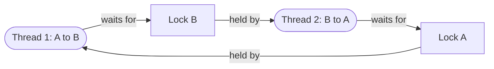

# Deadlocks

> **Module 04 · Operating Systems** · Prerequisites: [Condition Variables](17-Condition-Variables.md) · Next: [Livelocks](19-Livelocks.md)

---

## ⏱ If You Only Have 2 Minutes

- A **deadlock** is a set of tasks where each one waits for something that another task in the set holds. Nobody can move, nobody gives up, and the CPU is idle: a deadlocked service looks **healthy but silent**.
- It needs all four **Coffman conditions** (1971): **mutual exclusion**, **hold and wait**, **no preemption**, and **circular wait**. Break any one and deadlock is impossible.
- The everyday fix is a **global lock order**: if every code path takes locks in the same order (for example sorted by account ID), no cycle can form.
- The second fix is a **try-lock with a timeout**: if the second lock does not come in time, release the first and retry after a random delay. This breaks hold-and-wait. Without the random delay you can trade the deadlock for a [livelock](19-Livelocks.md).
- Never hold a lock while calling code you do not control: callbacks, I/O, another service, or anything that may take another lock.
- **Async code deadlocks too**: a task that holds an `asyncio.Lock` (or a promise-chain mutex) and then awaits something that needs the same lock waits forever. No thread is blocked, so a thread dump shows nothing.
- **Pool starvation deadlock:** a task running on a full pool waits for another task queued on the same pool, or a request holding one database connection waits for a second from the same pool.
- Databases detect deadlocks and abort a victim ([Database Deadlocks](../Module-03-Databases/31-Deadlocks.md)). Your in-process locks do not: the process just hangs, so you must prevent them and put timeouts on every wait.

---

## 1. What It Is and Why It Exists

A **deadlock** is a permanent wait. Task 1 holds resource A and waits for B. Task 2 holds B and waits for A. Each will release only after it finishes, and neither can finish. The resources can be mutexes, database rows, connections in a pool, threads in a pool, or permits in a semaphore — anything that one task holds while another waits for it.

**Analogy:** a four-way stop where four cars arrive at the same moment, and each driver follows the rule "wait for the car on your right". Every driver is waiting for someone else, everyone obeys the rules, and nobody moves until a person breaks the rule.

**What breaks.** Nothing crashes. Requests that touch the deadlocked resources hang until the client times out, their threads or connections stay occupied, and more requests queue behind them. CPU drops to near zero, the opposite of what most alerts look for. In a database, the deadlock detector turns the hang into an error after about a second. In application code, nothing does that for you: the process stays stuck until a health check kills it, and the next restart may deadlock again at the next traffic peak.

Deadlocks need an unlucky timing, so they pass unit tests and appear under load. Interviewers expect the four conditions, and which one each prevention technique breaks.

---

## 2. How It Works

### The four Coffman conditions with two locks

Two transfers run at the same time: `transfer(A → B)` and `transfer(B → A)`. Each locks the source account first, then the destination.

| Time | Thread 1: A → B | Thread 2: B → A |
|---|---|---|
| t1 | lock(A) ✔ | lock(B) ✔ |
| t2 | lock(B) … waits for thread 2 | lock(A) … waits for thread 1 |
| t3 | still waiting | still waiting — forever |

All four conditions hold:

| Condition | Here | How to break it in application code |
|---|---|---|
| **Mutual exclusion** — a resource is held by one task at a time | Each account lock has one holder | Avoid the lock: atomic operations, a single owner task with a queue, immutable data |
| **Hold and wait** — a task holds one resource while waiting for another | Thread 1 holds A while waiting for B | Acquire all locks at once, or release everything when the next lock is not available |
| **No preemption** — a resource cannot be taken away; only the holder releases it | Nobody can take A from thread 1 | Lock acquire with a timeout, so the waiter gives up its own locks (self-preemption) |
| **Circular wait** — a cycle of tasks, each waiting for the next | 1 waits for 2, 2 waits for 1 | A global lock order, so every path acquires in the same direction |

### Resource-allocation graphs

A **resource-allocation graph** has two kinds of nodes, tasks and resources. An edge from a resource to a task means "held by"; an edge from a task to a resource means "waiting for". The deadlock above is a cycle:



If every resource has exactly one instance (a mutex, a row lock), **a cycle means deadlock**. If a resource has several instances (a pool of 10 connections, a semaphore with 5 permits), a cycle is necessary but not enough: another holder may release an instance and break it. Removing the resource nodes gives the **wait-for graph** (task → task), which is what deadlock detectors search for cycles: PostgreSQL does this for row locks, and the JVM's `jstack` reports "Found one Java-level deadlock" from the same idea.

### Observing a deadlocked process on Linux

A deadlock looks like idleness. The process uses ~0% CPU, its threads sleep in the kernel, and throughput is zero while connections stay open:

```bash
top -H -p "$pid"                                   # threads at 0% CPU, but requests are not completing
ps -L -o tid,stat,wchan:22,comm -p "$pid"          # state S, waiting in futex code
grep . /proc/"$pid"/task/*/wchan                   # same, one line per thread
py-spy dump --pid "$pid"                           # Python: the line each thread is blocked on (needs ptrace rights)
kill -USR1 "$pid"                                  # Node: start the inspector on a running process, then attach DevTools
```

Illustrative `py-spy dump` for the example in section 4:

```text
Thread 812 (idle): "A->B"
    transfer_naive (deadlock.py:16)
Thread 813 (idle): "B->A"
    transfer_naive (deadlock.py:16)
Thread 814 (idle): "A->B"
    transfer_naive (deadlock.py:14)
Thread 815 (idle): "B->A"
    transfer_naive (deadlock.py:14)
```

Two threads wait at line 16 (`with locks[dst]`): each holds one lock and wants the other's — the cycle. Two more wait at line 14, queued behind it. A dump shows *where* each thread waits, not *who holds what*, which is why the Node example logs lock holders.

---

## 3. Key Concepts

### Prevention: break one condition by design

| Technique | Condition broken | How | Cost |
|---|---|---|---|
| **Global lock order** | Circular wait | Sort keys before locking (`sorted((src, dst))`), or give each lock a rank and only lock upwards (a **lock hierarchy**) | Every path must follow it; one exception reintroduces the bug |
| **Try-lock with timeout** | Hold and wait / no preemption | `lock.acquire(timeout=…)`; on failure release everything, back off with jitter, retry | Wasted work, and possible livelock without jitter |
| **Acquire all or none** | Hold and wait | One coarser lock for the group, or take all locks in one step before doing anything | Less concurrency |
| **Open calls** (no calls while holding a lock) | Hold and wait across components | Copy what you need, release, then call the callback, the HTTP client, or the other module | Must re-validate state after re-acquiring |
| **Remove the lock** | Mutual exclusion | Single owner + message queue, atomic update, conditional `UPDATE … WHERE` | Redesign |

Lock ordering is the one to name first in an interview. It is cheap, deterministic, and the same rule the database chapter uses for rows: [Database Deadlocks](../Module-03-Databases/31-Deadlocks.md) sorts product IDs before `SELECT … FOR UPDATE`. The per-key mutex in [Mutex](14-Mutex.md) needs it as soon as one operation locks two keys.

### Avoidance: the Banker's algorithm

**Avoidance** decides at run time whether granting a request is safe. Dijkstra's **Banker's algorithm** requires each task to declare in advance the maximum number of each resource it may need. Before granting a request, the system pretends to grant it and checks whether there is still some order in which every task could obtain its maximum and finish (a **safe state**). If not, the requester waits even though the resource is free. General-purpose operating systems and runtimes do not use it: tasks rarely know their maximum needs, and the check is expensive. Real systems prefer prevention plus timeouts.

### Detection and recovery

**Detection** lets deadlocks happen, finds the cycle in the wait-for graph, and **recovers** by aborting a victim and releasing its resources. Databases do exactly this, because a transaction can be rolled back and retried safely. Threads in your process cannot be aborted safely, so the OS does not detect deadlocks between user-space mutexes at all. What exists:

- **Error-checking mutexes** (`PTHREAD_MUTEX_ERRORCHECK`) return `EDEADLK` when a thread locks a mutex it already holds — only the one-thread case.
- **lockdep** in the Linux kernel, a debugging feature that records lock order and warns about possible cycles before they happen.
- **Timeouts and watchdogs** in your code: an acquire with a deadline turns a hang into an error you can log and count. A liveness probe that restarts the container is the last line of recovery, not a fix.

### Deadlocks in async code

An event loop has one thread, so it cannot have two threads waiting for each other, but it can have **tasks** waiting for each other:

- **Re-entering a non-reentrant async lock.** A handler holds `asyncio.Lock` and awaits `refresh()`, which also does `async with lock:`. The task waits for itself. `asyncio.Lock` and promise-chain mutexes are not reentrant.
- **Two async locks in opposite orders.** Exactly the thread case, with `await` as the switch point (the Node example in section 4).
- **Awaiting work that needs a lock you hold.** A task holds a lock and awaits a future that another task will complete, but that task first needs the same lock.
- **Blocking the loop while waiting for the loop.** In Python, calling `asyncio.run_coroutine_threadsafe(coro, loop).result()` from the loop's own thread blocks the only thread that could run `coro`. In Node, `Atomics.wait` on the main thread for a worker that is waiting for a message from the main thread.

These are harder to see than thread deadlocks. No thread is blocked; the stack of the event-loop thread is empty, because it is idle. A Node diagnostic report (`node --report-on-signal`, then `kill -USR2 <pid>`) shows libuv handles and resource usage, but its JavaScript stack is empty for an idle loop. A Node script that deadlocks at top level exits with code 13 and "Warning: Detected unsettled top-level await"; a server just hangs. Python 3.14 added `python -m asyncio ps <pid>`, which lists each task and its await chain, for example `Lock.acquire -> … -> refresh -> handler`. In older versions, an admin endpoint that prints `asyncio.all_tasks()` with `task.get_stack()` does the same job. The reliable defence is an **acquire timeout** on every async lock, with the holder's name in the error.

### Pool starvation deadlocks

A bounded pool is a resource with N instances. If a task holds one instance and waits for another from the same pool, N such tasks deadlock the pool:

```python
from concurrent.futures import ThreadPoolExecutor

pool = ThreadPoolExecutor(max_workers=2)

def load_price(sku: str) -> int:
    return len(sku)

def build_order(skus: list[str]) -> int:
    # Runs ON the pool, then waits for more work queued on the SAME pool.
    futures = [pool.submit(load_price, s) for s in skus]
    return sum(f.result(timeout=2) for f in futures)  # without timeout: hangs forever

orders = [pool.submit(build_order, ["a", "bb"]) for _ in range(2)]  # 2 orders fill both workers
print([o.result() for o in orders])  # TimeoutError after 2 s
```

Both workers run `build_order` and wait for `load_price` tasks that sit in the queue behind them. The same shape appears in backends as:

- **Connection-pool deadlock:** a request holds one connection (an open transaction) and asks the same pool for a second one (a helper that opens its own). With a pool of 10 and 10 concurrent requests, everyone holds one and waits for another.
- **A service calling itself synchronously:** FastAPI runs `def` endpoints in a thread pool (40 threads by default via AnyIO). If an endpoint makes a blocking HTTP call to the same service, under load all threads wait for requests that need a thread.
- **Nested `Promise.all` behind a concurrency limiter:** an outer task holds one of N permits and awaits inner tasks that need permits from the same limiter.

Fixes: never block on work submitted to the same pool (run it inline, or use a separate pool for each level), pass the existing connection down instead of borrowing a second, and keep pool sizes and timeouts explicit.

### Distributed deadlocks, briefly

The same four conditions apply across machines. Service A holds a Redis lock on `order:1` and waits on a lock that service B holds on `payment:9`, while B waits for `order:1`. Or two services call each other synchronously while each holds a database transaction open. There is no global wait-for graph, so nothing detects the cycle. The defences are the same ideas with a time limit on everything: lock in a global order, give distributed locks a TTL (a **lease**) with fencing tokens, put deadlines on every remote call ([Timeout Pattern](../Module-07-Advanced-Backend-and-System-Design/37-Timeout-Pattern.md)), and avoid synchronous call cycles between services.

---

## 4. Code Examples

Scenario: two transfers move money in opposite directions between accounts A and B, each holding one account's lock while it does a short awaited step (a database call). The naive version deadlocks. Two fixes follow: a **global lock order**, and a **timeout acquire** that releases everything and retries with jitter. Each program has a watchdog, so a deadlock is reported instead of hanging forever.

### Shell

```bash
python deadlock.py naive      # hangs; faulthandler dumps all thread stacks after 3 s and exits
python deadlock.py ordered    # finishes
python deadlock.py timeout    # finishes, possibly after a retry
py-spy dump --pid "$(pgrep -f 'deadlock.py naive')"            # inspect while it hangs
node deadlock.ts naive; node deadlock.ts ordered; node deadlock.ts timeout
node --report-on-signal server.js     # later: kill -USR2 <pid> writes a diagnostic report (report.*.json)
```

### Node.js / TypeScript

An async mutex that records its holder and can give up waiting:

```ts
// Node.js 22+, TypeScript 5, ESM. No packages. Save as mutex.ts
export class Mutex {
  readonly name: string;
  holder: string | null = null; // who holds it: the first thing you want to know when requests hang
  readonly #waiters: Array<() => void> = [];

  constructor(name: string) {
    this.name = name;
  }

  /** Resolves to a release function. Rejects if `signal` aborts while we are still queued. */
  async acquire(owner: string, signal?: AbortSignal): Promise<() => void> {
    signal?.throwIfAborted();
    if (this.holder === null) {
      this.holder = owner;
    } else {
      await new Promise<void>((resolve, reject) => {
        const onAbort = () => {
          this.#waiters.splice(this.#waiters.indexOf(grant), 1); // leave the queue without the lock
          reject(new Error(`${owner} timed out waiting for ${this.name} (held by ${this.holder})`));
        };
        const grant = () => {
          signal?.removeEventListener("abort", onAbort);
          this.holder = owner; // set during hand-over, so nobody can barge in before we resume
          resolve();
        };
        this.#waiters.push(grant);
        signal?.addEventListener("abort", onAbort, { once: true });
      });
    }
    let released = false;
    return () => {
      if (released) return;
      released = true;
      this.holder = null;
      this.#waiters.shift()?.(); // FIFO hand-over: the next waiter now holds it
    };
  }
}
```

The deadlock and both fixes:

```ts
// Node.js 22+, TypeScript 5, ESM. No packages. Run: node deadlock.ts naive | ordered | timeout
import { setTimeout as sleep } from "node:timers/promises";
import { Mutex } from "./mutex.ts";

const balances: Record<string, number> = { A: 100, B: 100 };
const locks: Record<string, Mutex> = { A: new Mutex("A"), B: new Mutex("B") };

async function transferNaive(src: string, dst: string, amount: number, who: string): Promise<void> {
  const releaseSrc = await locks[src].acquire(who);
  try {
    await sleep(10); // any await while holding a lock lets the other transfer take its first lock
    const releaseDst = await locks[dst].acquire(who); // opposite orders: circular wait
    try {
      balances[src] -= amount;
      balances[dst] += amount;
    } finally {
      releaseDst();
    }
  } finally {
    releaseSrc();
  }
}

async function transferOrdered(src: string, dst: string, amount: number, who: string): Promise<void> {
  const [first, second] = [src, dst].sort(); // one global order: no cycle is possible
  const r1 = await locks[first].acquire(who);
  try {
    const r2 = await locks[second].acquire(who);
    try {
      await sleep(10);
      balances[src] -= amount;
      balances[dst] += amount;
    } finally {
      r2();
    }
  } finally {
    r1();
  }
}

async function transferTimeout(src: string, dst: string, amount: number, who: string): Promise<void> {
  for (let attempt = 0; attempt < 5; attempt++) {
    const signal = AbortSignal.timeout(50); // bounded wait: never hold one lock forever
    const held: Array<() => void> = [];
    try {
      held.push(await locks[src].acquire(who, signal));
      await sleep(10);
      held.push(await locks[dst].acquire(who, signal));
      balances[src] -= amount;
      balances[dst] += amount;
      return;
    } catch (err) {
      console.log(`  ${(err as Error).message}; backing off`);
    } finally {
      held.reverse().forEach((release) => release()); // give back everything, then retry
    }
    await sleep(Math.random() * 20 * 2 ** attempt); // jitter, or both retry in lockstep (livelock)
  }
  throw new Error(`${who} gave up`);
}

const mode = process.argv[2] ?? "naive";
const transfer = { naive: transferNaive, ordered: transferOrdered, timeout: transferTimeout }[mode]!;

// Watchdog: an async deadlock leaves no blocked thread to dump, so report who holds what.
const watchdog = setTimeout(() => {
  for (const m of Object.values(locks)) console.error(`lock ${m.name} held by ${m.holder}`);
  process.exit(1);
}, 2_000);

await Promise.all([transfer("A", "B", 10, "t1 A->B"), transfer("B", "A", 20, "t2 B->A")]);
clearTimeout(watchdog);
console.log(`${mode}: done, balances ${JSON.stringify(balances)}`);
```

Measured in a `node:22` container:

```text
$ node deadlock.ts naive
lock A held by t1 A->B
lock B held by t2 B->A
$ node deadlock.ts ordered
ordered: done, balances {"A":110,"B":90}
$ node deadlock.ts timeout
  t1 A->B timed out waiting for B (held by t2 B->A); backing off
timeout: done, balances {"A":110,"B":90}
```

Without the watchdog, the naive run would print "Warning: Detected unsettled top-level await" and exit with code 13, because no timer or socket keeps the process alive. Inside a server the same deadlock would leave two requests hanging forever, with no error anywhere.

### Python

```python
# Python 3.12+, stdlib only. Run: python deadlock.py naive | ordered | timeout
import faulthandler
import random
import sys
import threading
import time
from contextlib import ExitStack

balances = {"A": 100, "B": 100}
locks = {"A": threading.Lock(), "B": threading.Lock()}


def transfer_naive(src: str, dst: str, amount: int) -> None:
    with locks[src]:  # hold src...
        time.sleep(0.01)  # (a DB call, a log flush: anything that widens the window)
        with locks[dst]:  # ...and wait for dst: hold-and-wait + circular wait = deadlock
            balances[src] -= amount
            balances[dst] += amount


def transfer_ordered(src: str, dst: str, amount: int) -> None:
    # Break circular wait: every thread locks accounts in the same global order (sorted IDs).
    first, second = sorted((src, dst))
    with locks[first], locks[second]:
        time.sleep(0.01)
        balances[src] -= amount
        balances[dst] += amount


def transfer_timeout(src: str, dst: str, amount: int, attempts: int = 5) -> None:
    # Break hold-and-wait: if the second lock does not come in time, release everything and retry.
    for attempt in range(attempts):
        with ExitStack() as held:
            if not locks[src].acquire(timeout=0.05):
                continue
            held.callback(locks[src].release)
            time.sleep(0.01)
            if locks[dst].acquire(timeout=0.05):
                held.callback(locks[dst].release)
                balances[src] -= amount
                balances[dst] += amount
                return
        time.sleep(random.uniform(0, 0.02 * 2**attempt))  # jitter, or both retry in lockstep (livelock)
    raise TimeoutError(f"transfer {src}->{dst} gave up after {attempts} attempts")


if __name__ == "__main__":
    mode = sys.argv[1] if len(sys.argv) > 1 else "naive"
    fn = {"naive": transfer_naive, "ordered": transfer_ordered, "timeout": transfer_timeout}[mode]
    # If we are still running in 3 s, print every thread's stack to stderr and exit.
    faulthandler.dump_traceback_later(3, exit=True)
    threads = [threading.Thread(target=fn, args=pair, name=f"{pair[0]}->{pair[1]}")
               for pair in [("A", "B", 10), ("B", "A", 20)] * 2]
    for t in threads:
        t.start()
    for t in threads:
        t.join()
    faulthandler.cancel_dump_traceback_later()
    print(f"{mode}: done, balances {balances}, total {sum(balances.values())}")
```

Measured in a `python:3.12` container (thread IDs shortened, `threading.py` frames removed):

```text
$ python deadlock.py naive
Timeout (0:00:03)!
Thread 0x...16c0 (most recent call first):
  File "/w/deadlock.py", line 14 in transfer_naive
Thread 0x...66c0 (most recent call first):
  File "/w/deadlock.py", line 14 in transfer_naive
Thread 0x...b6c0 (most recent call first):
  File "/w/deadlock.py", line 16 in transfer_naive
Thread 0x...06c0 (most recent call first):
  File "/w/deadlock.py", line 16 in transfer_naive
Thread 0x...e340 (most recent call first):
  File "/w/deadlock.py", line 57 in <module>
$ python deadlock.py ordered
ordered: done, balances {'A': 120, 'B': 80}, total 200
$ python deadlock.py timeout
timeout: done, balances {'A': 120, 'B': 80}, total 200
```

**Runtime differences to notice:**

- **What a dump shows.** Python threads really block, so `faulthandler` and `py-spy dump` point at the exact line where each thread waits. In Node, the deadlocked "tasks" are just pending promises; there is no stack to dump. That is why the Node mutex stores a `holder` name and the watchdog prints it.
- **Built-in timeouts.** `threading.Lock.acquire(timeout=0.05)` is built in. Node has no lock at all, so the timeout comes from an `AbortSignal` passed to a hand-written `acquire`, which must also remove the waiter from the queue.
- **`asyncio` is in between.** `asyncio.Lock` has no timeout parameter; wrap the acquire in `asyncio.timeout()`, and cancellation removes the waiter cleanly. On Python 3.14+, `python -m asyncio ps <pid>` shows each task's await chain, which is the async equivalent of a thread dump.
- **Production habit.** Register `faulthandler.register(signal.SIGUSR1)` at start-up in Python services, so `kill -USR1 <pid>` prints all thread stacks without stopping the process.

---

## 5. Production Concerns

- **Alert on silence, not only on errors.** A deadlock produces no errors and no CPU. Alert when requests in flight stay high while completions drop to zero, when a worker's heartbeat stops, or when a pool's "in use" gauge sits at its maximum.
- **Every lock wait has a deadline.** `acquire(timeout=…)`, `asyncio.timeout()`, an `AbortSignal`, `lock_timeout` in PostgreSQL. A timed-out acquire is an error you can count, log with the holder's name, and fix; a hang is a page at 3 a.m.
- **Make dumps possible before you need them.** In containers, `py-spy` and `strace` need the `SYS_PTRACE` capability. Enable `faulthandler.register(signal.SIGUSR1)` in Python and `--report-on-signal` in Node. Save a dump *before* restarting a hung pod, or the evidence is gone.
- **Document the lock order.** Write the order down in code ("always lock accounts in ascending ID; lock tenant before account"), and enforce it with a helper that takes all keys and sorts them, so callers cannot get it wrong.
- **Size pools for nested use, or forbid it.** If a request can hold two connections, the pool needs more than twice the concurrent requests, or a deadlock is possible at saturation. Better: pass the connection down so one request uses one connection.
- **Restarts are recovery, not a fix.** A liveness probe that kills a hung container hides deadlocks. Treat liveness-probe restarts as a bug signal.

---

## 6. Common Mistakes

- **Locking two resources in "natural" order** — `lock(src); lock(dst)` deadlocks when two transfers go in opposite directions — sort the keys, or follow a documented hierarchy.
- **Calling out while holding a lock** — a callback, event handler or HTTP call may take another lock or never return — copy the data, release, then call.
- **Re-entering a non-reentrant lock** — `threading.Lock`, `asyncio.Lock` and promise-chain mutexes deadlock a task against itself — split into a locking public function and an `_unlocked` helper.
- **Retrying a timed-out acquire immediately** — both tasks fail and retry in lockstep forever — release everything and back off with random jitter.
- **Blocking on a future from the same pool** — a full pool waits for tasks that cannot start — run sub-work inline or on a separate pool.
- **Borrowing a second connection inside a transaction** — N requests each hold one and wait for one — pass the existing connection or transaction down.
- **Waiting without a timeout "because it always completes"** — one deadlock becomes a permanent hang with no log line — put a deadline on every wait.

---

## 7. Comparison Table

| | Prevention | Avoidance | Detection and recovery | Timeouts |
|---|---|---|---|---|
| Idea | Make one Coffman condition impossible | Grant a request only if the system stays in a safe state | Let it happen, find the cycle, abort a victim | Give up waiting after a deadline |
| Example | Global lock order, all-or-none acquisition | Banker's algorithm | PostgreSQL `deadlock_timeout` + `40P01`, InnoDB detector | `acquire(timeout=…)`, `lock_timeout`, leases |
| Needs | Discipline in every code path | Each task's maximum needs, known in advance | Abortable work (transactions) | A safe way to release and retry |
| Cost | Some concurrency, design effort | Expensive checks, unrealistic inputs | Wasted work for the victim | False positives when work is just slow |
| Where used | Application code, kernels | Textbooks, some embedded and real-time systems | Databases | Everywhere, as the safety net |

---

## 8. Interview Questions

**[Junior] What is a deadlock?**
A deadlock is when two or more tasks each wait for a resource held by another task in the same group, so none of them can ever continue. The classic example is thread 1 holding lock A and waiting for B while thread 2 holds B and waits for A. The process does not crash; the affected work simply stops, usually with no CPU use and no error.

**[Junior] What are the four conditions for a deadlock?**
Mutual exclusion (a resource has one holder), hold and wait (a task holds one resource while requesting another), no preemption (a resource cannot be taken away from its holder), and circular wait (a cycle of tasks each waiting for the next). All four must hold. Prevention techniques each remove one of them.

**[Mid] How do you prevent deadlocks between two locks in application code?**
The main tool is a global lock order: every code path that needs both locks takes them in the same order, for example sorted by ID, so a cycle cannot form. Where that is impractical, acquire with a timeout and, on failure, release everything and retry after a random delay. Also avoid holding locks while calling external code, and keep the locked region small so fewer locks are ever held together.

**[Mid] Can single-threaded async code deadlock?**
Yes. A task holding an `asyncio.Lock` that awaits a function which takes the same lock waits for itself, because async locks are not reentrant. Two tasks taking two async locks in opposite orders, with an `await` in between, deadlock just like threads. And blocking the loop thread while waiting for work that only the loop can run hangs everything. These deadlocks leave no blocked thread to dump, so lock timeouts and holder tracking matter even more.

**[Mid] What is a thread-pool starvation deadlock?**
A task running on a bounded pool submits more work to the same pool and waits for it. If every worker is doing this, all workers wait for tasks that sit in the queue with no worker free to run them. The same shape appears with connection pools when a request holding a connection asks for a second one. Fix it by running sub-work inline, using a separate pool per level, or passing the existing connection down.

**[Senior] How do databases handle deadlocks differently from your application's mutexes, and why?**
Databases build a wait-for graph of transactions, search it for cycles, and abort one victim, rolling back its transaction so the others continue. That works because a transaction is atomic and can be retried safely. Threads holding mutexes cannot be rolled back, so killing one would leave shared memory half-updated; operating systems therefore do not detect user-space mutex deadlocks. In application code you must prevent them with lock ordering and contain them with timeouts, and in database code you prevent most and retry the rest.

**[Senior] A service stops responding under load, CPU is near zero, and it recovers after a restart. How do you investigate?**
Low CPU with stuck requests suggests waiting, not computing: a deadlock, pool exhaustion, or a dependency that never answers. Before restarting, capture evidence: `py-spy dump` or `faulthandler` for Python, a diagnostic report or inspector session for Node, `ps -L` with `wchan`, pool gauges, and `pg_stat_activity` for database waits. Look for threads waiting on locks held by other waiting threads, workers waiting on futures from their own pool, or requests holding one connection while waiting for another. Then fix the ordering or nesting, and add timeouts so the next occurrence produces an error with the holder's name.

**[Senior] Why is the Banker's algorithm not used in practice?**
It requires each task to declare its maximum resource needs in advance, which general-purpose programs and request handlers cannot know. It also runs a safety check on every request, which is costly with many tasks and resource types, and it can refuse requests even when resources are free, reducing utilisation. Real systems combine prevention (lock ordering), timeouts, and, in databases, detection with victim abort.

---

## 9. Cheat Sheet

```text
Deadlock        tasks wait for each other in a cycle; no CPU, no errors, no progress
Coffman         mutual exclusion · hold and wait · no preemption · circular wait (need all 4)
RAG             resource→task = held by; task→resource = waits for; cycle + single instances = deadlock
Prevent         global lock order (sort keys, hierarchy) · try-lock + timeout + jitter · all-or-none · open calls
Avoid           Banker's: grant only if a safe completion order still exists (needs max claims; rarely used)
Detect          wait-for graph + abort victim (databases); none for user mutexes; lockdep in the kernel
Async           non-reentrant asyncio.Lock / promise mutex re-entered; opposite-order async locks; no stack to dump
Pool deadlock   task on a full pool waits for work queued on the same pool; 2nd connection from same DB pool
Distributed     no global detector → order + leases (TTL) + deadlines on every remote call
Observe         ~0% CPU, threads S in futex; py-spy dump; faulthandler (SIGUSR1); Node --report-on-signal, kill -USR1
Python 3.14     python -m asyncio ps <pid> → each task's await chain
Node            top-level deadlock → exit 13 "unsettled top-level await"; in a server → silent hang
DB              PostgreSQL 40P01 after deadlock_timeout (1 s) → retry whole txn (see Module 03)
```

---

## Related Topics

- [Mutex](14-Mutex.md) — the locks that deadlock, and the per-key map that needs sorted key order
- [Livelocks](19-Livelocks.md) — what timeout-and-retry turns into when nobody adds jitter
- [Condition Variables](17-Condition-Variables.md) — waits that never get their notification look like deadlocks too
- [Database Deadlocks](../Module-03-Databases/31-Deadlocks.md) — row-lock cycles, detection, `40P01` and retrying the victim
- [Timeout Pattern](../Module-07-Advanced-Backend-and-System-Design/37-Timeout-Pattern.md) — deadlines that turn hangs into errors
- [Signals](29-Signals.md) — `SIGUSR1`/`SIGUSR2` handlers for on-demand stack dumps and reports
