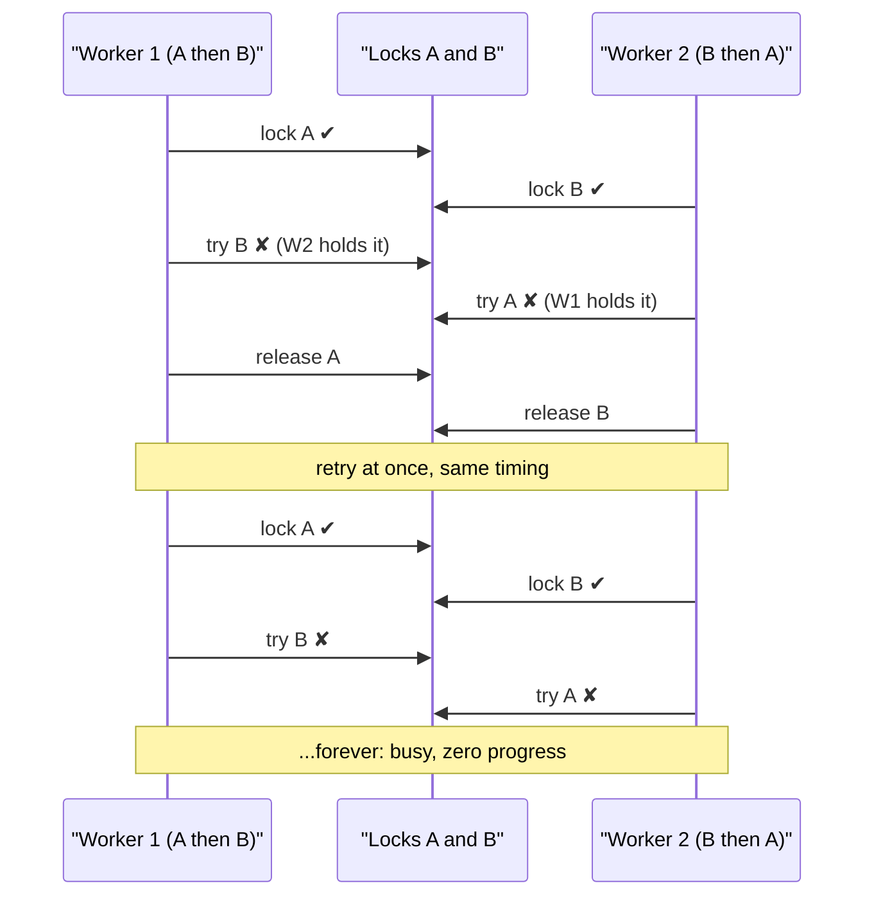

# Livelocks

> **Module 04 · Operating Systems** · Prerequisites: [Deadlocks](18-Deadlocks.md) · Next: [Starvation](20-Starvation.md)

---

## ⏱ If You Only Have 2 Minutes

- A **livelock** is when tasks keep running and keep changing state in response to each other, but **none of them makes progress**. In a deadlock everyone *waits*; in a livelock everyone *works* — uselessly.
- The textbook picture: two people meet in a corridor, both step aside to the same side, then both step back, forever. In code: two threads each take one lock, **try** the second, fail, **release and retry immediately** — in perfect lockstep.
- It usually appears as the **side effect of a deadlock fix**. "Never wait while holding a lock; release and retry" removes deadlock but, with symmetric and deterministic timing, the retries collide every time.
- The fix is to **break the symmetry**: **randomised backoff with jitter** (each side waits a random, growing delay), a **priority or ordering rule** (the lower ID always wins, the other yields), and a **retry limit** that turns an endless loop into an error.
- At system scale it is a **retry storm**: clients that retry on the same schedule keep a recovering service overloaded, so it never recovers. Same cure: exponential backoff with jitter, retry budgets, circuit breakers.
- **Detection:** activity without output. High CPU, many retries, conflicts or context switches — and flat throughput. Count *attempts* and *successes* separately; a livelock is a falling success ratio.
- Ethernet solved this in the 1970s: after a collision, each station waits a **random** number of slot times drawn from a range that doubles after every collision (binary exponential backoff).

---

## 1. What It Is and Why It Exists

A **livelock** is a state where two or more tasks are not blocked — they are running, using CPU, sending messages, taking and releasing locks — but their actions keep cancelling each other, so the useful work never completes.

**Analogy:** two polite people in a narrow corridor. Both step to the left to let the other pass. Both see the other in the way and step to the right. They keep moving and keep being polite, and neither gets through. A deadlock would be two people standing still, each waiting for the other to move first. What ends the dance is asymmetry: one of them waits a moment longer, or one says "you go first".

**Why it exists.** Livelock is usually created by code that tries to *avoid* deadlock. [Deadlocks](18-Deadlocks.md) breaks hold-and-wait with a rule: "if you cannot get the next lock, release what you hold and try again". That rule is correct, but it says nothing about *when* to try again. If both tasks fail at the same moment, release at the same moment, and retry after the same delay (or none), they meet again in exactly the same position. Deterministic, symmetric behaviour plus mutual reaction is the recipe.

**What breaks.** Throughput drops to zero or near zero, while every activity metric looks busy: CPU, lock operations, retries, conflicts, log lines. Because the system is not stuck, timeouts on individual waits never fire, and health checks that only ask "is the process alive and responsive?" keep passing.

---

## 2. How It Works

### Two workers, two locks, polite retry

Worker 1 needs locks A then B. Worker 2 needs B then A. Each uses a **try-lock** (acquire only if free, never wait) for the second lock and backs off by releasing the first:



Nothing in this loop is wrong locally. Each worker obeys a sensible rule. The failure is global: the two workers are synchronised, and every decision one makes is mirrored by the other at the same moment.

### What breaks the cycle

Any **asymmetry** ends it:

- **Randomness.** After a failure, each worker sleeps a random time. Soon one retries while the other is still asleep and gets both locks. If the random range grows after each failure (**exponential backoff**), the chance of colliding again drops quickly even with many contenders.
- **Ordering or priority.** A rule decides who yields: "lower worker ID keeps its lock and waits; higher ID releases". Or remove the need to back off at all with a global lock order ([Deadlocks](18-Deadlocks.md)): then nobody ever holds the "wrong" first lock.
- **A limit.** After N failed attempts, give up and report an error. This does not prevent livelock, but it turns an invisible endless loop into a visible failure.

### Livelock in the network stack

Operating systems have their own famous case: **receive livelock**. Under a flood of incoming packets, a kernel that does all its work in interrupt handlers spends 100% of its time taking interrupts and queuing packets, and never runs the code that processes them, so useful throughput falls towards zero as load rises. Mogul and Ramakrishnan described it in the 1990s. Linux's **NAPI** avoids it: after the first interrupt, the driver disables further receive interrupts and **polls** for packets in batches with a budget, then re-enables interrupts when the queue is empty.

### Observing it on Linux

Livelock is "busy but useless", so look for activity that does not turn into output:

```bash
pidstat -u -w -p "$pid" 1             # CPU and context switches stay high while throughput is flat
top -H -p "$pid"                      # the workers are running (R), not sleeping (S) as in a deadlock
perf top -p "$pid"                    # hot functions: retry loops, lock try/release, exception paths
strace -f -c -p "$pid"                # syscall mix: many futex / nanosleep calls, little real I/O
```

The decisive evidence comes from the application: counters for **attempts** and **completions**. In a healthy system the ratio is close to 1. During a livelock attempts climb and completions stay flat. If the retry path includes a sleep or an await, CPU may look normal; the success ratio is still the giveaway.

---

## 3. Key Concepts

### Livelock vs deadlock vs starvation

| | Deadlock | Livelock | Starvation |
|---|---|---|---|
| Are the tasks running? | No, all blocked | Yes, all busy | Most run; one or a few never get the resource |
| Does anyone make progress? | No | No (or almost none) | Yes, everyone except the victims |
| CPU | ~0% | Often high | Normal |
| Typical cause | Circular wait on locks | Symmetric, deterministic retry | Unfair scheduling or locking |
| Fix | Lock ordering, timeouts | Randomised backoff, ordering, limits | Fairness: FIFO, aging, fair queuing ([Starvation](20-Starvation.md)) |

### Classic shapes

- **Polite release-and-retry** on two locks, as above. The most common in code.
- **Mutual give-way protocols.** Two components both detect a conflict and both roll back — two optimistic transactions that keep invalidating each other's reads, or two leaders that both step down when they see each other.
- **Requeue loops.** A message consumer fails on a message and requeues it immediately (`nack` with `requeue=true` in RabbitMQ); the message comes straight back and fails again, consuming the consumer's time while other messages wait. Limit redeliveries and send the message to a dead-letter queue.
- **Retry storms.** The system-level version, below.

### Randomised backoff with jitter

The standard fix has three parts:

1. **Exponential growth.** The maximum delay doubles after each failure, up to a cap: `cap_n = min(max_delay, base * 2^n)`.
2. **Jitter.** The actual delay is random. With **full jitter**, `delay = random(0, cap_n)`. Random delays spread the retries out so they stop colliding; growth adapts to the number of contenders.
3. **A limit.** A maximum number of attempts, or a deadline, after which the operation fails.

Without jitter, exponential backoff alone does not break a livelock between identical workers: both wait 10 ms, then both 20 ms, then both 40 ms, and collide every time. The randomness is the part that removes symmetry. The general pattern, with formulas and trade-offs between jitter types, is in [Exponential Backoff](../Module-07-Advanced-Backend-and-System-Design/36-Exponential-Backoff.md) and [Retry Pattern](../Module-07-Advanced-Backend-and-System-Design/35-Retry-Pattern.md).

### Retry storms: livelock at system scale

A database restarts. Five thousand clients get errors at the same second and retry one second later, all together. The database, still warming its caches, is overloaded by the synchronised wave and fails again, so the clients retry again. Each retry wave keeps the service in the overloaded state it is trying to leave. Everyone is busy, nothing succeeds.

The fixes stack:

- **Jitter** spreads the waves into a steady trickle.
- **Retry budgets** cap retries to a fraction of normal traffic (for example, no more than 10% extra requests), so retries cannot multiply load.
- **Retry at one layer only.** If the API gateway, the service and the client library each retry 3 times, one failure turns into 27 attempts.
- **Circuit breakers** stop calling a failing dependency for a while ([Circuit Breaker](../Module-07-Advanced-Backend-and-System-Design/34-Circuit-Breaker.md)).
- **Respect server hints** such as HTTP `Retry-After`.

### Progress guarantees

Concurrent algorithms are classified by what progress they guarantee, and the classes map directly onto livelock:

| Guarantee | Meaning | Can it livelock? |
|---|---|---|
| **Wait-free** | Every task finishes in a bounded number of its own steps | No |
| **Lock-free** | At least one task always makes progress (a failed CAS means someone else's succeeded) | No, but an individual task can starve |
| **Obstruction-free** | A task makes progress if it runs alone for long enough | Yes, under contention — needs backoff |
| **Blocking (locks)** | Progress depends on the lock holder | Deadlock is the risk, not livelock |

A CAS retry loop ([Spinlocks](16-Spinlocks.md)) is lock-free: when your CAS fails, it is because another thread's CAS succeeded, so the system as a whole moves forward. The try-lock-and-release protocol in this chapter is not; both sides can fail at once, forever.

---

## 4. Code Examples

Scenario: two workers each need locks A and B, in opposite orders. Each takes its first lock, does a short preparation step (1 ms), **tries** the second lock, and on failure releases the first. The first run retries immediately; the second backs off for a random, growing delay. Both runs last 2 seconds and print how many attempts turned into finished jobs.

### Shell

```bash
node livelock.ts             # Node 22.18+ runs .ts directly
python livelock.py
pidstat -u -w -p "$(pgrep -f livelock.py)" 1   # busy threads, high switch rate, ~no completions
```

### Node.js / TypeScript

```ts
// Node.js 22+, TypeScript 5, ESM. No packages. Run: node livelock.ts
import { setTimeout as sleep } from "node:timers/promises";

// On one event loop, try-lock is a plain check-and-set: no await in between, so it is atomic.
class TryLock {
  #held = false;
  tryAcquire(): boolean {
    if (this.#held) return false;
    this.#held = true;
    return true;
  }
  release(): void {
    this.#held = false;
  }
}

interface Stats { attempts: number; done: number }

async function worker(
  first: TryLock, second: TryLock, stats: Stats, stop: AbortSignal, backoff: boolean,
): Promise<void> {
  let failures = 0;
  while (!stop.aborted) {
    stats.attempts++;
    if (!first.tryAcquire()) { await sleep(1); continue; } // the other worker holds both
    let gotSecond = false;
    try {
      await sleep(1); // prepare the job while holding the first resource (an awaited call)
      gotSecond = second.tryAcquire(); // polite: never wait while holding a lock
      if (gotSecond) {
        try {
          await sleep(1); // the real work, needs both
          stats.done++;
        } finally {
          second.release();
        }
      }
    } finally {
      first.release();
    }
    if (gotSecond) failures = 0;
    else if (backoff) await sleep(Math.random() * 2 ** Math.min(++failures, 5)); // full jitter, ms
    // Without backoff: retry at once. Both timers expire in the same loop turn, so the two
    // workers stay in perfect lockstep and collide every single time.
  }
}

async function run(backoff: boolean): Promise<void> {
  const a = new TryLock();
  const b = new TryLock();
  const stats: Stats[] = [{ attempts: 0, done: 0 }, { attempts: 0, done: 0 }];
  const stop = AbortSignal.timeout(2_000);
  await Promise.all([worker(a, b, stats[0], stop, backoff), worker(b, a, stats[1], stop, backoff)]);
  const attempts = stats[0].attempts + stats[1].attempts;
  const done = stats[0].done + stats[1].done;
  const label = backoff ? "random backoff " : "immediate retry";
  console.log(`${label}: ${attempts} attempts, ${done} jobs done (${Math.round((100 * done) / attempts)}% useful)`);
}

await run(false);
await run(true);
```

Measured in a `node:22` container (counts vary per run):

```text
immediate retry: 3595 attempts, 1 jobs done (0% useful)
random backoff : 2144 attempts, 715 jobs done (33% useful)
```

### Python

```python
# Python 3.12+, stdlib only. Run: python livelock.py
import random
import threading
import time

RUN_S = 2.0


def worker(first: threading.Lock, second: threading.Lock, stats: dict[str, int],
           stop: threading.Event, backoff: bool) -> None:
    failures = 0
    while not stop.is_set():
        stats["attempts"] += 1
        with first:
            time.sleep(0.001)  # prepare the job while holding the first resource
            got_second = second.acquire(blocking=False)  # polite: never wait while holding a lock
            if got_second:
                try:
                    time.sleep(0.001)  # the real work, needs both
                    stats["done"] += 1
                finally:
                    second.release()
        if got_second:
            failures = 0
        elif backoff:
            failures += 1
            # Randomised, growing pause: the two workers stop moving in lockstep.
            time.sleep(random.uniform(0, 0.001 * 2 ** min(failures, 5)))
        # Without backoff: release and retry at once, perfectly in step with the other worker.


def run(backoff: bool) -> None:
    a, b = threading.Lock(), threading.Lock()
    stats = [{"attempts": 0, "done": 0}, {"attempts": 0, "done": 0}]
    stop = threading.Event()
    threads = [  # opposite orders, like the two people in a corridor
        threading.Thread(target=worker, args=(a, b, stats[0], stop, backoff)),
        threading.Thread(target=worker, args=(b, a, stats[1], stop, backoff)),
    ]
    for t in threads:
        t.start()
    time.sleep(RUN_S)
    stop.set()
    for t in threads:
        t.join()
    attempts = sum(s["attempts"] for s in stats)
    done = sum(s["done"] for s in stats)
    label = "random backoff " if backoff else "immediate retry"
    print(f"{label}: {attempts:5d} attempts, {done:4d} jobs done ({done / attempts:.0%} useful)")


if __name__ == "__main__":
    run(backoff=False)
    run(backoff=True)
```

Measured in a `python:3.12` container on 16 vCPUs (counts vary per run):

```text
immediate retry:  3641 attempts,    1 jobs done (0% useful)
random backoff :  1594 attempts,  813 jobs done (51% useful)
```

**What to notice:**

- **Busy, not stuck.** In the immediate-retry run, the workers made over 3,500 attempts in 2 seconds and finished one job. A deadlock detector, a lock timeout or a thread dump would find nothing wrong: no thread waits for long, and every lock is free most of the time.
- **Fewer attempts, far more work.** Backoff *lowers* the attempt rate and raises completed work several hundred times. That is the signature of the fix: less activity, more output.
- **Same cause, different machinery.** Python's two OS threads stay in lockstep because both sleep for the same 1 ms and wake together. Node's two async tasks stay in lockstep because both timers have the same due time and fire in the same event-loop turn. The single job each immediate-retry run finishes happens at the very end: once one worker stops, the other finally gets both locks. Neither runtime gives you randomness for free — you have to add it.
- **The better fix is ordering.** If both workers took A before B, the second lock would be waited for, not tried, and there would be nothing to back off from ([Deadlocks](18-Deadlocks.md)). Use backoff where an order cannot be imposed: remote resources, optimistic transactions, network retries.

---

## 5. Production Concerns

- **Measure success ratio, not activity.** For every retry loop, export attempts, conflicts and completions. Alert when completions per attempt fall while attempts rise. CPU and request rate alone will tell you the system is "busy and healthy".
- **Every retry loop needs jitter, a cap and a limit.** Database serialization-failure retries, optimistic-lock retries, lock retries, HTTP retries, message redelivery: all of them. A retry without jitter is a livelock waiting for two clients that fail at the same moment.
- **Synchronised schedules are a hidden source of symmetry.** Cron jobs at `:00`, cache entries that all expire at the same TTL, pods that all start together after a deploy. Add a random offset (`sleep $((RANDOM % 60))` before a cron job, TTL ± 10%) so they do not collide on the same lock or row.
- **Cap redeliveries.** For queues, set a maximum delivery count and a dead-letter queue, and delay redelivery instead of requeueing instantly ([Message Queues](../Module-07-Advanced-Backend-and-System-Design/21-Message-Queues.md)).
- **Keep one retry layer.** Retries at the client, the gateway and the service multiply. Decide which layer retries, and make the others fail fast.
- **Containers.** A livelocked service consumes its CPU quota doing nothing, so the cgroup gets throttled and *other* work in the same container slows down too. A rising `nr_throttled` with flat throughput is a hint ([CPU Scheduling](07-CPU-Scheduling.md)).

---

## 6. Common Mistakes

- **Release-and-retry with no delay** — two workers fail and retry in lockstep forever — add a random, growing delay, or impose a lock order.
- **Exponential backoff without jitter** — identical clients double their delays identically and still collide — randomise the delay (full jitter).
- **Unlimited retries** — a livelock becomes an endless loop nobody notices — cap attempts or use a deadline, then fail loudly.
- **Monitoring only CPU and request rate** — a livelocked service looks busy and healthy — track completions per attempt.
- **Instant requeue of a failing message** — the consumer spins on one poison message — limit deliveries and dead-letter it.
- **Retrying at every layer** — one failure becomes dozens of calls in a synchronised wave — retry in one place, with a budget.
- **Fixing a deadlock by "releasing and trying again"** — a deadlock becomes a livelock — fix the lock order first; use backoff only where order is impossible.

---

## 7. Comparison Table

How each fix breaks a livelock:

| Fix | How it breaks symmetry | Strength | Weakness | Use for |
|---|---|---|---|---|
| Global lock order | Removes the need to back off | Deterministic, no wasted work | Needs all resources known and ordered | In-process locks, row locks |
| Priority rule (lower ID wins) | One side always yields | Deterministic, simple | The loser can starve | Two-party conflicts, leader election tie-breaks |
| Randomised backoff + jitter | Random delays desynchronise retries | Works with unknown and many contenders | Adds latency; only probabilistic | Network retries, optimistic transactions, lock retries |
| Retry limit / deadline | Stops the loop | Makes the failure visible | Does not create progress on its own | Every retry loop, together with backoff |
| Retry budget / circuit breaker | Reduces total retry volume | Protects a recovering service | Some requests fail fast | Client fleets, service-to-service calls |

---

## 8. Interview Questions

**[Junior] What is the difference between a deadlock and a livelock?**
In a deadlock the tasks are blocked, each waiting for a resource another one holds, so nothing runs and CPU is near zero. In a livelock the tasks keep running and keep changing state in reaction to each other, but none of them completes its work. A deadlock looks frozen; a livelock looks busy, with flat throughput.

**[Junior] Give an example of a livelock.**
Two threads need locks A and B in opposite orders. Each takes its first lock, tries the second without waiting, fails because the other thread holds it, releases its first lock, and retries immediately. Because they run with the same timing, they collide on every attempt and neither ever holds both locks.

**[Mid] How do you fix a livelock?**
Break the symmetry. The usual fix is randomised exponential backoff: after each failure, wait a random time whose range grows, so the contenders stop retrying at the same moment. Alternatives are a priority rule that decides who yields, or removing the retry loop with a global lock order. Add a retry limit so that if it still happens, it becomes a visible error.

**[Mid] Why does exponential backoff need jitter?**
Without jitter, clients that failed together compute the same delays and retry together again, so the collisions repeat at growing intervals. Jitter randomises each delay, which spreads the retries out and breaks the synchronisation. With full jitter, the delay is a random value between zero and the exponential cap.

**[Mid] How would you detect a livelock in production?**
Look for activity without output: high CPU, lock operations, conflicts or retries, while completed work stays flat. The clearest signal is a counter of attempts next to a counter of successes; a falling success ratio under steady load means work is being thrown away. Thread dumps are not helpful because threads are running, not waiting.

**[Senior] What is a retry storm and how do you prevent one?**
A retry storm happens when many clients fail at once and retry on the same schedule, so each wave of retries overloads the dependency again and it cannot recover. It is a livelock across a fleet. Prevent it with exponential backoff and jitter, a retry budget that caps retries to a small fraction of traffic, retries at only one layer, circuit breakers, and honouring `Retry-After`. Also stagger synchronised schedules such as cron jobs and cache expiry.

**[Senior] Can lock-free algorithms livelock?**
A lock-free algorithm guarantees that some thread always makes progress: a failed CAS means another thread's CAS succeeded, so the system as a whole cannot livelock, although an unlucky thread can starve. Weaker obstruction-free algorithms only guarantee progress for a thread that runs without interference, and they can livelock under contention, so they rely on backoff. Wait-free algorithms guarantee every thread finishes in bounded steps.

**[Senior] You replaced blocking lock acquisition with try-lock-and-release to fix a deadlock, and now throughput collapses under load. What happened and what would you do?**
The change removed hold-and-wait, but under contention the workers now fail, release and retry together, so they keep invalidating each other: a livelock. I would confirm it with attempt and success counters. The better fix is to restore blocking acquisition with a global lock order, which prevents the deadlock without retries. If an order is impossible, add randomised exponential backoff and a retry limit, and measure the success ratio again.

---

## 9. Cheat Sheet

```text
Livelock        everyone busy, nobody progresses (deadlock: everyone waits)
Recipe          symmetric + deterministic + reacting to each other (release-and-retry in lockstep)
Classic         corridor dance; try-lock B fails → release A → retry at once
Signs           high CPU / retries / conflicts, flat completions; threads R not S; dumps look fine
Measure         attempts vs completions per loop; success ratio
Fix #1          global lock order → nothing to retry
Fix #2          randomised exponential backoff: delay = random(0, min(cap, base·2^n))  (full jitter)
Fix #3          priority rule (lower ID wins) · retry limit / deadline (fail loudly)
No jitter       identical clients double identically → still collide
Retry storm     fleet-wide livelock; jitter + retry budget + one retry layer + circuit breaker + Retry-After
Requeue loop    poison message nack/requeue forever → max deliveries + DLQ + delayed redelivery
Kernel          receive livelock (interrupt flood) → NAPI polling with a budget
Progress        wait-free > lock-free (no livelock) > obstruction-free (can livelock) > blocking
Ethernet        binary exponential backoff with random slot choice after collisions
```

---

## Related Topics

- [Deadlocks](18-Deadlocks.md) — the problem whose "release and retry" fix causes most livelocks
- [Starvation](20-Starvation.md) — the third liveness failure: some tasks progress, one never does
- [Exponential Backoff](../Module-07-Advanced-Backend-and-System-Design/36-Exponential-Backoff.md) — growth, caps and jitter formulas
- [Retry Pattern](../Module-07-Advanced-Backend-and-System-Design/35-Retry-Pattern.md) — which errors to retry, how often, and at which layer
- [Circuit Breaker](../Module-07-Advanced-Backend-and-System-Design/34-Circuit-Breaker.md) — stopping retries against a dependency that is down
- [Spinlocks](16-Spinlocks.md) — CAS retry loops and why lock-free code cannot livelock
