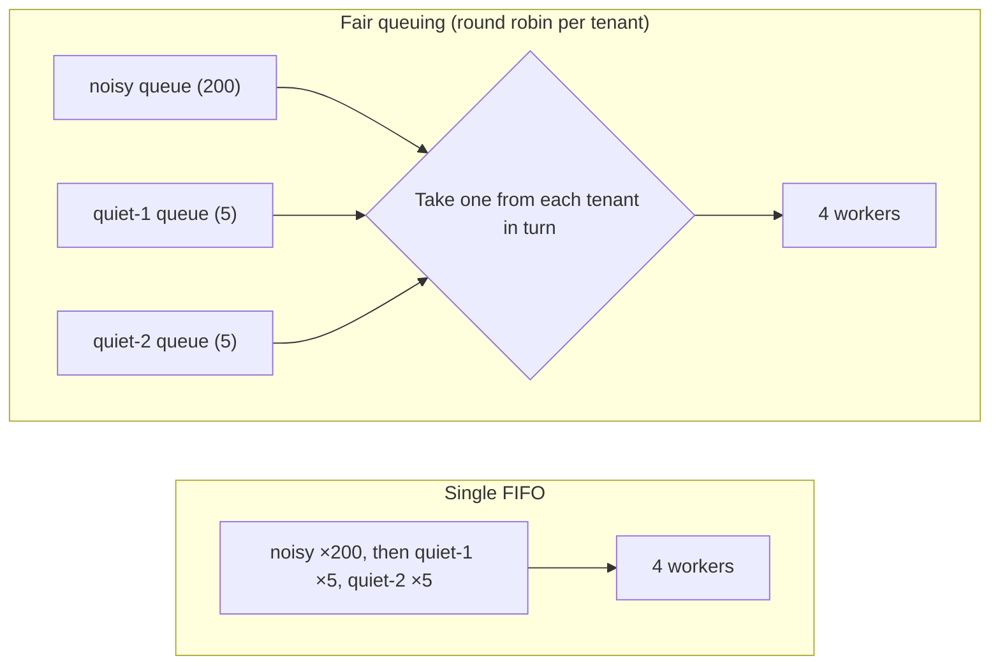

# Starvation

> **Module 04 · Operating Systems** · Prerequisites: [Livelocks](19-Livelocks.md) · Next: [Memory Management](21-Memory-Management.md)

---

## ⏱ If You Only Have 2 Minutes

- **Starvation** is when a task is ready and the resource it needs keeps becoming available, but it is **always given to someone else**. The system as a whole makes progress; the victim waits indefinitely.
- It is a **fairness** failure, not a correctness failure. Common causes: **unfair locks** (a newcomer "barges" ahead of waiters), **strict priority** scheduling, **reader-preferring read-write locks** that starve writers, **greedy consumers**, and **one hot tenant** filling a shared FIFO queue or pool.
- Fixes: **FIFO / ticket locks**, **aging** (priority grows with waiting time), **fair queuing** (one queue per tenant or flow, served in turn), **weighted round robin** when tenants pay for different shares, and **per-tenant caps** on concurrency.
- Fairness costs throughput. Fair locks force hand-offs and context switches, so most mutexes (glibc, Java's default `ReentrantLock`) are **not** FIFO. `asyncio.Lock` is FIFO; `threading.Lock` makes no promise about which waiter goes next.
- **Event-loop starvation:** one long synchronous task, or an endless chain of microtasks (`process.nextTick`, resolved promises), stops timers and I/O on Node's single thread. In asyncio, a coroutine that never `await`s starves every other task. Yield (`setImmediate`, `await asyncio.sleep(0)`) or move CPU work off the loop.
- **Thread-pool starvation:** slow tasks occupy every thread in a shared pool (libuv's 4 threads, FastAPI's 40), and quick tasks queue behind them. Separate pools per kind of work.
- Detect it with **per-class wait times** (per tenant, per priority, readers vs writers) and the **age of the oldest waiting item** — averages hide it.

---

## 1. What It Is and Why It Exists

**Starvation** (also **indefinite postponement**) happens when a scheduler — the kernel, a lock, a queue, an event loop — keeps choosing other tasks over one task that is ready to run. Unlike a deadlock, the resource is not stuck: it is busy serving others. Unlike a livelock, most work completes. One tenant's jobs, one low-priority thread, or one writer just never gets its turn, or gets it far too late.

**Analogy:** a bakery where the staff serve whoever shouts loudest instead of using a ticket machine. The bakery sells plenty of bread; the quiet customer at the back leaves without any. A ticket machine (FIFO) fixes it. A separate counter for regulars (priority) makes it worse for everyone else.

**Why it exists.** Schedulers are tuned for throughput, and unfairness is often faster:

- Letting the thread that is already running take a just-released lock avoids waking a sleeping thread.
- Serving a high-priority class first keeps important latency low.
- Letting readers join an active read lock maximises parallel reads.
- Processing a queue in arrival order is simple and cache-friendly.

Each choice is reasonable alone. Under sustained load, each one can leave a victim waiting without limit.

**What breaks.** In a backend it shows up as one customer's requests timing out while dashboards look green, a nightly reconciliation job that never finishes because interactive jobs always outrank it, a config writer that cannot take the write lock while readers stream in, or health checks that time out because the event loop is busy. Average latency barely moves; the tail for one class explodes.

---

## 2. How It Works

### Shared FIFO vs per-tenant fair queuing

Four workers serve one queue. Tenant "noisy" enqueues 200 jobs; a moment later two quiet tenants enqueue 5 each. With one FIFO, the quiet tenants' jobs sit behind all 200. With one queue per tenant, served round robin, each tenant gets a turn every few jobs:



The total work and the total time are the same in both. Fair queuing only changes **who waits**: the noisy tenant waits a little longer, and the quiet ones stop waiting behind it.

### How the Linux scheduler avoids starving threads

The default Linux scheduler for normal threads (CFS, replaced by **EEVDF** in kernel 6.6) is built to prevent starvation: each runnable thread accumulates **virtual runtime**, and the scheduler favours the thread that has had the least, weighted by its nice value. A nice-19 thread gets a small share, but it still runs. Real-time policies are different: a `SCHED_FIFO` thread runs until it blocks or yields, and can starve every normal thread on its CPU. Linux limits this with **RT throttling**: by default real-time tasks may use 950,000 µs of every 1,000,000 µs (`/proc/sys/kernel/sched_rt_runtime_us` and `sched_rt_period_us`), leaving 5% for everyone else ([CPU Scheduling](07-CPU-Scheduling.md)).

### Observing it

```bash
cat /proc/"$pid"/schedstat         # ns on CPU, ns waiting in the run queue, number of time slices
perf sched record -- sleep 10 && perf sched latency   # max scheduling delay per task
pidstat -w -t -p "$pid" 1          # per-thread context switches: a starved thread barely switches
```

Illustrative `/proc/<pid>/task/<tid>/schedstat` for two CPU-bound threads of one process — the change over a 10 s window, with the thread ID added for readability:

```text
tid 4101: 9820000000 12000000 4012    ← ran 9.8 s, waited 0.01 s for a CPU
tid 4102:   15000000 9950000000 37    ← ran 0.015 s, waited 9.95 s for a CPU: starved
```

Kernel-level starvation is rare for normal threads. Most backend starvation lives in **your** schedulers: queues, pools, locks, the event loop. For those, the evidence comes from application metrics: per-tenant or per-priority **queue wait time** (p99 and max, not the mean), the **age of the oldest waiting item**, and the **share of work** each class receives.

---

## 3. Key Concepts

### Causes of starvation

| Cause | Who starves | Typical backend example | Fix |
|---|---|---|---|
| Unfair lock (barging) | A sleeping waiter | Hot mutex in a thread pool; one thread re-acquires in a loop | FIFO / ticket lock, or shorter critical sections |
| Strict priority | Low-priority work | Batch jobs never run while interactive jobs keep arriving | Aging, or reserved capacity per class |
| Reader-preferring RW lock | Writers | Config reload never gets the write lock under constant reads | Writer-preferring or fair RW lock; copy-on-write swap |
| Greedy consumer | Other consumers, or other messages | A consumer with unlimited prefetch takes every message | Prefetch limit (e.g. RabbitMQ `basic.qos`), smaller batches |
| One hot tenant on a shared queue | Every other tenant | Bulk import of 1M rows ahead of everyone's small jobs | Per-tenant queues + round robin, per-tenant concurrency caps |
| Event loop monopolised | Every other task, timers, I/O | `JSON.parse` of 50 MB; recursive `process.nextTick` | Yield, chunk, or move to a worker |
| Shared pool full of slow tasks | Quick tasks | libuv pool busy with `fs` and `crypto.pbkdf2`, so `dns.lookup` waits | Separate pools per kind of work (bulkheads) |

### Fair locks: FIFO and ticket locks

An **unfair** lock lets whoever asks at the moment of release take it, even if others have waited longer. That is faster: the running thread continues without a context switch. But under constant contention, a thread that went to sleep may keep losing to threads that are already awake.

A **FIFO lock** hands the lock to the longest waiter. The simplest form is the **ticket lock**: two counters, `next_ticket` and `now_serving`. To lock, take a ticket with an atomic fetch-and-add and wait until `now_serving` equals it; to unlock, increment `now_serving`. Order of arrival is order of service, like a deli counter. The Linux kernel used ticket spinlocks before moving to queued (MCS-style) spinlocks, which are also FIFO ([Spinlocks](16-Spinlocks.md)).

| Lock | Ordering |
|---|---|
| glibc `pthread_mutex_t` | No FIFO guarantee |
| Java `ReentrantLock()` / `ReentrantLock(true)` | Unfair by default / fair when asked |
| Python `threading.Lock` | Which waiter proceeds is "not defined" (documented) |
| Python `asyncio.Lock` | FIFO |
| Promise-chain mutex in Node ([Mutex](14-Mutex.md)) | FIFO by construction |

Fair locks have a cost: every release must wake a specific sleeping thread, and if that thread is descheduled, the lock sits idle while others wait (a **convoy**). The practical fix for lock starvation is usually a shorter critical section, not a fair lock.

### Reader-writer locks

A **read-write lock** allows many readers or one writer. If new readers may join while any reader holds the lock (**reader preference**), a steady stream of overlapping readers keeps the lock in read mode forever and a writer never gets in. glibc's `pthread_rwlock_t` prefers readers by default. **Writer preference** blocks new readers once a writer waits, which can starve readers instead; **fair** (phase-fair) designs alternate. Neither Python's standard library nor Node ships an RW lock. In backends the common way out is to avoid the lock: build a new immutable config or cache object and swap a single reference, so readers never block.

### Priorities and aging

Strict priority — always serve the highest-priority work first — starves low priority whenever high-priority work arrives faster than it is served. **Aging** raises a waiting task's effective priority the longer it waits, so eventually it wins. Classic Unix schedulers did this by decaying recent CPU use; in job queues, you can compute `effective = priority + wait_seconds / k`, or reserve a fixed share of workers for each priority class so the low class always moves.

### Fair queuing and weighted round robin

**Fair queuing** gives each flow (tenant, user, API key) its own queue and serves the queues in turn, so one flow's backlog cannot delay the others. Variants:

- **Round robin:** one item per non-empty queue per turn. Fair in *items*, not in *cost*: a tenant whose jobs take 10× longer gets 10× the worker time.
- **Weighted round robin:** a tenant on a bigger plan gets 3 turns for every 1 of a free tenant.
- **Deficit round robin (DRR):** each queue earns a "quantum" of credit per turn and spends it by job cost (bytes, estimated milliseconds), so fairness is in *work*, not item count.

Combine with **per-tenant concurrency caps** (at most 10 jobs in flight per tenant) and rate limits ([Rate Limiting](../Module-07-Advanced-Backend-and-System-Design/33-Rate-Limiting.md)), so one tenant cannot hold every worker even with long jobs.

### Event-loop starvation in Node and asyncio

Node runs JavaScript on one thread. Anything that keeps that thread busy starves every timer, socket and request:

- **Long synchronous work:** a big `JSON.parse`, a sync crypto call, a regex with catastrophic backtracking.
- **Microtask floods:** the `process.nextTick` queue and the Promise job queue are drained completely after every callback, before the loop moves on. Recursive `nextTick` or a loop of `await`s on already-resolved promises never lets the loop reach timers or I/O. [Node Event Loop and Concurrency](../Module-02-Core-Backend/06-Node-Event-Loop-and-Concurrency.md) explains the phases.

asyncio has the same weakness without the microtask twist: tasks switch only at `await` points that actually suspend. A coroutine that loops over a million rows without awaiting holds the loop for the whole loop. `asyncio.run(main(), debug=True)` logs any callback or task step that takes longer than `loop.slow_callback_duration` (100 ms by default), which finds these quickly.

The fixes are the same in both: split work into chunks and yield between them (`setImmediate` in Node, `await asyncio.sleep(0)` in Python), or move CPU-bound work to a worker thread or process pool.

### Thread-pool starvation

A shared pool is a queue in front of N threads, so it starves the same way. Node's libuv pool has **4 threads** by default (`UV_THREADPOOL_SIZE`) and serves `fs`, `dns.lookup`, `zlib` and some `crypto` calls; a burst of slow `pbkdf2` calls makes every file read and DNS lookup wait. FastAPI runs every `def` endpoint and dependency in AnyIO's pool of 40 threads, so 40 slow synchronous calls block all other `def` endpoints. The fix is **bulkheads**: separate pools or semaphores per kind of work, sized independently ([Bulkhead Pattern](../Module-07-Advanced-Backend-and-System-Design/38-Bulkhead-Pattern.md)).

---

## 4. Code Examples

Scenario 1: four async workers serve jobs of 5 ms each. Tenant "noisy" enqueues 200 jobs just before tenants "quiet-1" and "quiet-2" enqueue 5 each. Compare a single FIFO with a round-robin scheduler that keeps one queue per tenant, and print each tenant's worst wait.

Scenario 2: a loop that does not yield starves a timer (Node) or a heartbeat task (Python), then the same loop with periodic yields.

### Shell

```bash
node fair.ts && node flood.ts         # Node 22.18+ runs .ts directly
python fair.py && python hog.py
cat /proc/"$pid"/task/*/schedstat     # per-thread: ns on CPU, ns waiting for a CPU, slices
```

### Node.js / TypeScript

```ts
// Node.js 22+, TypeScript 5, ESM. No packages. Run: node fair.ts
import { setTimeout as sleep } from "node:timers/promises";

interface Job { tenant: string; enqueuedAt: number }
interface Scheduler { push(job: Job): void; next(): Job | undefined }

class FifoScheduler implements Scheduler {
  readonly #queue: Job[] = [];
  push(job: Job): void { this.#queue.push(job); }
  next(): Job | undefined { return this.#queue.shift(); }
}

// One queue per tenant; take one job from each tenant in turn.
class RoundRobinScheduler implements Scheduler {
  readonly #queues = new Map<string, Job[]>(); // Map iteration order = rotation order

  push(job: Job): void {
    const q = this.#queues.get(job.tenant);
    if (q) q.push(job);
    else this.#queues.set(job.tenant, [job]); // a new tenant joins at the back of the rotation
  }

  next(): Job | undefined {
    const first = this.#queues.entries().next();
    if (first.done) return undefined;
    const [tenant, q] = first.value;
    const job = q.shift()!;
    this.#queues.delete(tenant);
    if (q.length > 0) this.#queues.set(tenant, q); // delete + set = move to the back
    return job;
  }
}

async function run(name: string, scheduler: Scheduler): Promise<void> {
  const t0 = performance.now();
  // One noisy tenant dumps 200 jobs a moment before two quiet tenants send 5 each.
  for (let i = 0; i < 200; i++) scheduler.push({ tenant: "noisy", enqueuedAt: t0 });
  for (const tenant of ["quiet-1", "quiet-2"]) {
    for (let i = 0; i < 5; i++) scheduler.push({ tenant, enqueuedAt: t0 });
  }

  const waits = new Map<string, number[]>();
  const worker = async (): Promise<void> => {
    for (let job = scheduler.next(); job; job = scheduler.next()) {
      if (!waits.has(job.tenant)) waits.set(job.tenant, []);
      waits.get(job.tenant)!.push(performance.now() - job.enqueuedAt); // time queued before a worker took it
      await sleep(5); // the job itself (I/O-bound)
    }
  };
  await Promise.all([worker(), worker(), worker(), worker()]); // 4 concurrent workers

  console.log(name);
  for (const [tenant, w] of waits) {
    const max = Math.max(...w).toFixed(0).padStart(4);
    console.log(`  ${tenant.padEnd(8)} jobs ${String(w.length).padStart(3)}  max wait ${max} ms`);
  }
}

await run("FIFO", new FifoScheduler());
await run("Round robin per tenant", new RoundRobinScheduler());
```

Measured in a `node:22` container:

```text
FIFO
  noisy    jobs 200  max wait  260 ms
  quiet-1  jobs   5  max wait  271 ms
  quiet-2  jobs   5  max wait  276 ms
Round robin per tenant
  noisy    jobs 200  max wait  271 ms
  quiet-1  jobs   5  max wait   16 ms
  quiet-2  jobs   5  max wait   16 ms
```

A microtask flood starving a 1 ms timer:

```ts
// Node.js 22+, TypeScript 5, ESM. No packages. Run: node flood.ts
import { setImmediate as yieldToLoop } from "node:timers/promises";

async function sumAll(n: number, yieldEvery: number): Promise<number> {
  let sum = 0;
  for (let i = 0; i < n; i++) {
    sum += await Promise.resolve(i); // looks async, but a resolved await is only a microtask
    if (yieldEvery > 0 && i % yieldEvery === 0) await yieldToLoop(); // macrotask: timers and I/O get a turn
  }
  return sum;
}

for (const yieldEvery of [0, 10_000]) {
  const t0 = performance.now();
  const timer = new Promise<number>((resolve) => setTimeout(() => resolve(performance.now() - t0), 1));
  await sumAll(3_000_000, yieldEvery);
  const doneAt = (performance.now() - t0).toFixed(0);
  const timerAt = (await timer).toFixed(0);
  console.log(`yieldEvery=${yieldEvery}: 1 ms timer ran at ${timerAt} ms, loop finished at ${doneAt} ms`);
}
```

Measured in a `node:22` container:

```text
yieldEvery=0: 1 ms timer ran at 311 ms, loop finished at 311 ms
yieldEvery=10000: 1 ms timer ran at 3 ms, loop finished at 256 ms
```

Every `await` in `sumAll` looks like a chance for other work to run, but awaiting an already-resolved promise only queues a microtask, and microtasks are drained before the loop goes back to timers or I/O. Without `setImmediate`, the 1 ms timer — standing in for every socket and request in a server — waited 311 ms.

### Python

```python
# Python 3.12+, stdlib only. Run: python fair.py
import asyncio
import time
from collections import defaultdict, deque
from dataclasses import dataclass


@dataclass
class Job:
    tenant: str
    enqueued_at: float


class FifoScheduler:
    def __init__(self) -> None:
        self._queue: deque[Job] = deque()

    def push(self, job: Job) -> None:
        self._queue.append(job)

    def next(self) -> Job | None:
        return self._queue.popleft() if self._queue else None


class RoundRobinScheduler:
    """One queue per tenant, served in turn. dict insertion order is the rotation order."""

    def __init__(self) -> None:
        self._queues: dict[str, deque[Job]] = {}

    def push(self, job: Job) -> None:
        self._queues.setdefault(job.tenant, deque()).append(job)

    def next(self) -> Job | None:
        tenant = next(iter(self._queues), None)
        if tenant is None:
            return None
        queue = self._queues.pop(tenant)
        job = queue.popleft()
        if queue:
            self._queues[tenant] = queue  # re-insert = move to the back of the rotation
        return job


async def run(name: str, scheduler: FifoScheduler | RoundRobinScheduler) -> None:
    t0 = time.perf_counter()
    for _ in range(200):  # one noisy tenant enqueues a burst just before the quiet ones
        scheduler.push(Job("noisy", t0))
    for tenant in ("quiet-1", "quiet-2"):
        for _ in range(5):
            scheduler.push(Job(tenant, t0))

    waits: dict[str, list[float]] = defaultdict(list)

    async def worker() -> None:
        # No await between next() and the bookkeeping, so workers never take the same job.
        while (job := scheduler.next()) is not None:
            waits[job.tenant].append(time.perf_counter() - job.enqueued_at)
            await asyncio.sleep(0.005)  # the job itself (I/O-bound)

    async with asyncio.TaskGroup() as tg:
        for _ in range(4):  # 4 concurrent workers
            tg.create_task(worker())

    print(name)
    for tenant, w in waits.items():
        print(f"  {tenant:<8} jobs {len(w):3d}  max wait {max(w) * 1000:4.0f} ms")


if __name__ == "__main__":
    asyncio.run(run("FIFO", FifoScheduler()))
    asyncio.run(run("Round robin per tenant", RoundRobinScheduler()))
```

Measured in a `python:3.12` container: FIFO gives the quiet tenants a worst wait of 271 and 277 ms; round robin gives them 16 ms each, while the noisy tenant's worst wait moves from 261 to 277 ms.

A coroutine that never awaits:

```python
# Python 3.12+, stdlib only. Run: python hog.py
import asyncio
import time


async def heartbeat(lags: list[float]) -> None:
    while True:
        t = time.perf_counter()
        await asyncio.sleep(0.01)
        lags.append(time.perf_counter() - t - 0.01)  # how late the loop woke us up


async def checksum(rows: int, yield_every: int) -> int:
    total = 0
    for i in range(rows):
        total = (total + i * i) % 1_000_003  # pure CPU: no await, so no other task can run
        if yield_every and i % yield_every == 0:
            await asyncio.sleep(0)  # a yield point: give the loop a turn
    return total


async def main() -> None:
    for yield_every in (0, 10_000):
        lags: list[float] = []
        hb = asyncio.create_task(heartbeat(lags))
        await asyncio.sleep(0.02)
        await checksum(3_000_000, yield_every)
        await asyncio.sleep(0.02)  # let the heartbeat record its last (late) wake-up
        hb.cancel()
        print(f"yield_every={yield_every}: worst heartbeat lag {max(lags) * 1000:.0f} ms")


if __name__ == "__main__":
    asyncio.run(main())
```

Measured in a `python:3.12` container:

```text
yield_every=0: worst heartbeat lag 312 ms
yield_every=10000: worst heartbeat lag 7 ms
```

**Runtime differences to notice:**

- **Where the scheduler lives.** In both runtimes the fair scheduler is ordinary code: Node's `Map` and Python's `dict` both iterate in insertion order, so delete-and-reinsert moves a tenant to the back of the rotation. No lock is needed because `next()` contains no `await`.
- **What counts as a yield.** In Node, `await` on a resolved promise does *not* yield to I/O; only a macrotask (`setImmediate`, a timer, I/O) does. In asyncio, `await asyncio.sleep(0)` does yield to other ready tasks, while awaiting a coroutine that never suspends does not. Neither runtime preempts a running task.
- **Threads behave differently.** With `threading`, the OS (and the GIL's switch interval, 5 ms by default) preempts a CPU-bound thread, so other threads still run, only slower. The event loop has no preemption at all, which is why one coroutine can starve the whole process.
- **Production schedulers** add weights, per-tenant in-flight caps, and a cost-based variant (deficit round robin) when job sizes differ widely.

---

## 5. Production Concerns

- **Measure per class, at the tail.** Export queue wait time per tenant and per priority (p99 and max), the age of the oldest queued item per class, and the share of worker time per tenant. A healthy mean with one tenant at 30 s p99 is starvation.
- **Multi-tenant queues need fairness by design.** Per-tenant queues (or partition keys) plus round robin, a per-tenant in-flight cap, and admission control that rejects or delays a tenant over its quota with HTTP 429. Do not wait for the first big import to discover it.
- **Priorities need a floor.** Reserve a minimum share of workers or time for low-priority work, or apply aging. Alert on the oldest low-priority job's age.
- **Watch the event loop.** Track event-loop lag in Node (`perf_hooks.monitorEventLoopDelay`) and asyncio (a heartbeat task like the example, or debug mode in staging). Lag above tens of milliseconds means something holds the loop.
- **Split pools by workload.** Give slow or CPU-heavy work its own thread pool, process pool or worker threads, so it cannot occupy threads that quick requests need. In Node, raise `UV_THREADPOOL_SIZE` only after confirming the pool is the bottleneck.
- **Containers.** A CPU quota throttles the whole cgroup, so a CPU-hungry background thread can make request threads wait for the next quota period. Run batch work in a separate container or deployment with its own limits ([CPU Scheduling](07-CPU-Scheduling.md)).

---

## 6. Common Mistakes

- **One FIFO queue for all tenants** — a single bulk upload delays every other customer — per-tenant queues with round robin, plus per-tenant caps.
- **Strict priorities with no floor** — low-priority jobs never run during busy periods — aging or reserved capacity.
- **Looking only at average latency** — the starved minority disappears in the mean — per-class p99, max and oldest-item age.
- **"It's async, so it doesn't block"** — a loop of `await`s on resolved promises or a coroutine with no real `await` starves the loop — chunk the work and yield, or move it to a worker.
- **Recursive `process.nextTick` for "fast" scheduling** — it runs before any I/O, so the server stops answering — use `setImmediate` to let the loop breathe.
- **Holding a read lock while doing slow work** — writers starve behind overlapping readers — swap immutable snapshots instead of locking, or use a writer-preferring lock.
- **One shared pool for fast and slow work** — slow calls fill it and fast ones queue — separate pools or semaphores per kind of work.

---

## 7. Comparison Table

| | Single FIFO | Strict priority | Priority + aging | Round robin per tenant | Weighted / deficit round robin |
|---|---|---|---|---|---|
| Fair across tenants | No: order of arrival | No | No | Yes, per item | Yes, per weight or per cost |
| Can starve | Small tenants behind a burst | Low priority | No (eventually) | No | No |
| Protects urgent work | No | Yes | Mostly | No | Via weights |
| Complexity | Lowest | Low | Medium | Low | Medium |
| Use for | One tenant, uniform jobs | Hard real-time-ish classes | Background vs interactive jobs | Multi-tenant job queues | Paid tiers, mixed job sizes |

---

## 8. Interview Questions

**[Junior] What is starvation, and how is it different from deadlock?**
Starvation is when a task is ready to run but is repeatedly passed over because the scheduler or lock keeps choosing others. In a deadlock, nothing in the cycle progresses because everyone waits for everyone else. With starvation the system is busy and most work completes; only the victim waits, possibly forever.

**[Junior] How can a Node.js server starve its own requests?**
Node runs JavaScript on one thread. A long synchronous computation, or a stream of microtasks such as recursive `process.nextTick` or a loop over already-resolved promises, keeps that thread busy, so the loop never reaches timers or network I/O. Requests sit unanswered until the work finishes. Fix it by chunking work with `setImmediate` between chunks, or moving it to a worker thread.

**[Mid] What is a fair lock, and why are most locks not fair?**
A fair lock grants the lock in the order threads asked for it, as a ticket lock does with its "next ticket" and "now serving" counters. Most locks let a running thread take a just-released lock instead, because waking a sleeping waiter costs a context switch and can leave the lock idle while it wakes up. Unfair locks give more throughput but can starve a waiter under constant contention; Java offers both through `ReentrantLock(fair)`.

**[Mid] How can a read-write lock starve writers?**
With reader preference, a new reader may enter while other readers hold the lock. If readers keep overlapping, the lock never becomes free and a waiting writer never gets in. Writer-preferring locks block new readers once a writer waits, at the risk of starving readers. In services, replacing the lock with an immutable snapshot that writers swap in atomically avoids both.

**[Mid] What is aging?**
Aging raises the effective priority of a waiting task as its wait time grows, so even the lowest-priority task eventually outranks newer high-priority work. It keeps the benefit of priorities for short waits while guaranteeing a bounded wait. In a job queue you can implement it by sorting on priority plus a term proportional to time waited, or by reserving capacity for each class.

**[Senior] Design a job queue for a multi-tenant SaaS so one tenant's bulk import cannot delay everyone else.**
Keep one logical queue per tenant and have workers pick tenants in round-robin or weighted round-robin order, so each tenant gets regular turns regardless of backlog. Add a per-tenant in-flight cap so a tenant with long jobs cannot occupy every worker, and use deficit round robin if job costs vary widely. Apply admission control per tenant (quota, 429) so the backlog itself is bounded, and measure p99 wait and oldest-job age per tenant. In brokers without per-tenant queues, partition by tenant and give big tenants their own lane.

**[Senior] Your p50 latency is fine, but a few customers report timeouts. How do you test for starvation?**
Break latency and queue wait down by tenant, endpoint and priority, and look at p99, max and the oldest waiting item per class instead of the overall mean. If one class waits far longer while overall throughput is normal, find the scheduler between them: a shared FIFO queue, a pool shared with slow work, priority ordering, a read-write lock, or event-loop lag. Confirm with the queue's composition at the time of the incident, then add fairness at that point and alert on per-class tails.

**[Senior] Why do fairness mechanisms reduce throughput, and when is that acceptable?**
Fairness forces the scheduler to serve the next waiter even when another candidate would be cheaper to run: a fair lock wakes a sleeping thread instead of letting the running one continue, and round robin switches between tenants instead of streaming one tenant's similar jobs. The cost is context switches, idle gaps during hand-off, and lost locality. It is acceptable wherever tail latency for every client matters more than peak throughput — almost always in multi-tenant request paths — and less so for single-tenant batch work.

---

## 9. Cheat Sheet

```text
Starvation      ready task always passed over; system progresses, victim waits indefinitely
vs deadlock     deadlock: nobody progresses · livelock: everybody busy, nobody progresses
Causes          unfair locks (barging) · strict priority · reader-preferring RW lock · greedy consumer
                · hot tenant on shared FIFO · monopolised event loop · shared pool full of slow work
Fair locks      FIFO / ticket lock (next_ticket, now_serving); fair = more context switches
Ordering        glibc mutex: no FIFO · Java ReentrantLock: unfair default · threading.Lock: undefined · asyncio.Lock: FIFO
RW locks        glibc rwlock prefers readers → writers starve; fix: writer preference or immutable snapshot swap
Priorities      aging (priority grows with wait) or reserved share per class
Fair queuing    queue per tenant + round robin; weighted RR for tiers; DRR for variable job cost; per-tenant caps
Linux           CFS/EEVDF: vruntime → normal threads don't starve; SCHED_FIFO can → RT throttling 950/1000 ms
Node            sync work or nextTick/promise floods starve timers + I/O → setImmediate chunks, worker_threads
asyncio         no await = no switch; debug=True flags steps > 100 ms; await asyncio.sleep(0) to yield
Pools           libuv 4 threads (UV_THREADPOOL_SIZE); FastAPI/AnyIO 40 → separate pools per workload
Measure         per-class p99/max wait, oldest-item age, share of work — never just the mean
Observe         /proc/<pid>/task/*/schedstat · perf sched latency · event-loop lag
```

---

## Related Topics

- [Livelocks](19-Livelocks.md) — the other liveness failure, where everyone is busy and nobody progresses
- [CPU Scheduling](07-CPU-Scheduling.md) — how CFS/EEVDF, nice values and cgroup quotas share CPU time fairly
- [Node Event Loop and Concurrency](../Module-02-Core-Backend/06-Node-Event-Loop-and-Concurrency.md) — loop phases, microtasks, and why a flood starves I/O
- [Mutex](14-Mutex.md) — FIFO async locks and priority inversion, a cousin of starvation
- [Bulkhead Pattern](../Module-07-Advanced-Backend-and-System-Design/38-Bulkhead-Pattern.md) — separate pools so one workload cannot starve another
- [Rate Limiting](../Module-07-Advanced-Backend-and-System-Design/33-Rate-Limiting.md) — per-tenant quotas that bound a noisy tenant's backlog
