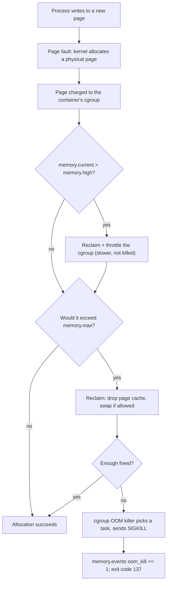

# Memory Management

> **Module 04 · Operating Systems** · Prerequisites: [Processes](02-Processes.md) · Next: [Heap Memory](22-Heap-Memory.md)

---

## ⏱ If You Only Have 2 Minutes

- The OS does four memory jobs for a process: **allocate** pages, **protect** them from other processes, **share** what can be shared (libraries, page cache, copy-on-write pages), and **reclaim** memory when RAM runs short.
- **VSZ** is how much address space a process has reserved. **RSS** is how much of it is in RAM right now. RSS counts shared pages in full for every process, so summing RSS over 8 workers over-counts. **PSS** splits shared pages fairly; **USS** is what you would get back by killing the process.
- Linux uses spare RAM as **page cache**. A small `free` column is normal. Look at `available` on the host, and remember that inside a container the page cache is **charged to the container's cgroup**.
- `malloc` succeeding does not mean RAM exists. Linux **overcommits**: physical pages are given out on first write. The failure comes later, as an **OOM kill**, not as a `NULL` or `MemoryError`.
- In a container, crossing cgroup v2 `memory.max` triggers the cgroup OOM killer. The process gets `SIGKILL`, so the exit code is **137** (128 + 9), Kubernetes shows `OOMKilled`, and `memory.events` increments `oom_kill`. No handler runs, no log line is written.
- Node's V8 heap has its own limit. If it is larger than the container limit, the kernel kills the process before V8 ever garbage-collects hard. Set `--max-old-space-size` to roughly 70–80% of the container limit and verify `heap_size_limit` inside the container.
- Python has no heap limit. Your memory budget is **workers × per-worker RSS** (plus the master process). Four Gunicorn workers at 350 MiB do not fit in a 1 GiB pod.

---

## 1. What It Is and Why It Exists

**Memory management** is the part of the operating system that decides which process gets which physical RAM, keeps processes from reading each other's memory, shares memory when that is safe, and takes memory back when there is not enough.

**Analogy:** a hotel. Every guest gets a room number that looks the same in every booking ("room 1"), but the front desk maps it to a real room. Rooms are only cleaned and assigned when a guest actually arrives (not when they book). Breakfast is a shared room everyone uses. And when the hotel is overbooked, the manager evicts a guest — usually the one using the most space.

**The problem it solves.** Without memory management, one bug in one process could overwrite another process's data or the kernel itself, and the machine could only run as many programs as fit in physical RAM at their worst-case size. The kernel solves this with virtual memory (each process gets a private address space, covered in [Virtual Memory](24-Virtual-Memory.md)) plus a set of policies: lazy allocation, overcommit, page cache, reclaim, and — as a last resort — the OOM killer.

**Why backend engineers care.** The most common memory incident is not a segfault. It is a container that restarts every few hours with exit code 137, no stack trace, and a dashboard that showed "memory at 60%" a minute earlier. Understanding which number the kernel actually enforces, and which number your runtime is managing, is how you debug that.

---

## 2. How It Works

### The four jobs

| Job | Mechanism | What you see |
|---|---|---|
| Allocate | `brk`/`mmap` system calls reserve address ranges; physical pages are assigned on first touch (a *page fault*) | VSZ jumps at once; RSS grows as memory is written |
| Protect | Per-process page tables; each page has read/write/execute bits | Touching unmapped or read-only memory → `SIGSEGV` |
| Share | Same physical page mapped into many processes (shared libraries, page cache, copy-on-write after `fork`) | RSS counts the page in every process; PSS divides it |
| Reclaim | Drop clean page cache, write back dirty pages, swap anonymous pages, and finally kill a process | `available` falls, page faults rise, then OOM kill |

### Process memory layout (64-bit Linux, simplified)

```text
high addresses
┌──────────────────────────────┐
│ kernel space (not accessible) │
├──────────────────────────────┤
│ stack (main thread)  ↓ grows  │  locals, return addresses — see ch. 23
│ ...                           │
│ mmap region                   │  shared libraries, thread stacks, large malloc
│                               │  blocks, V8 heap pages, mmap'd files
│ ...                           │
│ heap (brk)          ↑ grows   │  small malloc() allocations — see ch. 22
├──────────────────────────────┤
│ BSS                           │  zero-initialised globals (no space in the file)
│ data                          │  initialised globals
│ text                          │  machine code, read-only + executable
└──────────────────────────────┘
low addresses
```

For a Node or Python process, most of the interesting memory lives in the mmap region and the heap: V8 reserves its heap in chunks with `mmap`, and CPython's object allocator takes arenas from `malloc`/`mmap`. The text segment is the `node` or `python3` binary itself.

### What happens when memory runs out in a container



Two things to notice. First, the kernel tries to **reclaim page cache** before it kills anyone, which is why a container whose "memory usage" includes lots of cache can sit near its limit for days without being killed. Second, the kill is `SIGKILL`: it cannot be caught, so the application never logs anything. The evidence is in the kernel log and the cgroup counters.

### Observing it

```bash
ps -o pid,rss,vsz,cmd -p $(pgrep -d, -f "node server.js")   # sizes in KiB
```

```text
# illustrative output
    PID   RSS    VSZ CMD
   4182 187432 11348096 node server.js
```

The VSZ of ~11 GiB is normal for Node: V8 and libuv reserve large address ranges they never touch. RSS (~183 MiB) is the real number.

```bash
grep -E 'VmPeak|VmSize|VmHWM|VmRSS|RssAnon|RssFile|VmSwap' /proc/4182/status
```

```text
# illustrative output
VmPeak:	11415656 kB
VmSize:	11348096 kB
VmHWM:	  201876 kB      # peak RSS ("high water mark")
VmRSS:	  187432 kB
RssAnon:	  148204 kB  # heap, stacks: only freed by the process or swapped
RssFile:	   39228 kB  # mapped files (the node binary, libraries): can be dropped and re-read
VmSwap:	       0 kB
```

```bash
free -h
```

```text
# illustrative output
               total        used        free      shared  buff/cache   available
Mem:            15Gi       5.1Gi       1.2Gi       210Mi       9.4Gi        10Gi
```

Only 1.2 GiB is "free", but 10 GiB is **available**: most of the 9.4 GiB of page cache can be dropped instantly. Alerting on `free` instead of `available` is a classic false alarm.

---

## 3. Key Concepts

### VSZ, RSS, PSS and USS

| Metric | Meaning | Where to read it | Use it for |
|---|---|---|---|
| VSZ / VmSize | All mapped virtual address space, touched or not | `ps -o vsz`, `/proc/<pid>/status` | Almost nothing; huge for Node, Go, Java |
| RSS / VmRSS | Pages of this process currently in RAM, shared pages counted fully | `ps -o rss`, `/proc/<pid>/status` | Single-process alerts; what most tools show |
| PSS | RSS where each shared page is divided by the number of processes sharing it | `/proc/<pid>/smaps_rollup` | Summing memory across pre-forked workers |
| USS | Private pages only | Sum of `Private_*` in `smaps_rollup` | "How much would I free by killing this one?" |
| VmHWM | Peak RSS over the process lifetime | `/proc/<pid>/status` | Sizing limits from real peaks |

Example: 4 Gunicorn workers each show RSS 300 MiB, of which 120 MiB is shared with the master after `fork`. Summing RSS says 1.2 GiB. The real footprint is about 4 × 180 MiB private + 120 MiB shared once ≈ 840 MiB, which summing PSS gives you. [Virtual Memory](24-Virtual-Memory.md) explains why the sharing exists and why it erodes over time.

### Page cache and "used" memory

The kernel keeps recently read and written file data in RAM (the page cache) because a RAM hit is far cheaper than a disk read. Clean cache pages can be dropped at any time; dirty ones must be written back first. On a host, `free` puts cache under `buff/cache`, and `available` estimates what can be handed to new allocations without swapping.

In a container, file pages your process reads or writes are **charged to its cgroup** and appear in `memory.current`. A service that writes large log files or reads big uploads can show `memory.current` close to `memory.max` while its RSS is small. That is usually harmless, because the kernel reclaims the cache before it OOM-kills. Kubernetes and cAdvisor use a *working set* metric (usage minus inactive file pages) for this reason; it is closer to what the OOM killer actually cares about than raw usage.

### Overcommit

Linux lets processes reserve more memory than exists, because most reservations are never fully used (thread stacks, V8's reserved ranges, sparse arrays). The policy is `vm.overcommit_memory`:

| Value | Policy | Effect |
|---|---|---|
| 0 (default) | Heuristic | Refuses only obviously impossible requests |
| 1 | Always | Every request succeeds; used by some databases and Redis recommends it for `fork` snapshots |
| 2 | Strict | Total commitments limited to swap + `overcommit_ratio`% of RAM; `malloc` can return `NULL` |

With the default, the failure happens when a page is **first written**, not when it is allocated. There is nothing to return an error to, so the kernel kills something instead. That is why Python rarely raises `MemoryError` on Linux: you get killed first.

### The OOM killer and `oom_score`

When the whole system, or one cgroup, cannot reclaim enough memory, the kernel picks a victim. The score is based mainly on how much memory the process uses (RSS, swap, page tables), adjusted by `oom_score_adj`:

- `/proc/<pid>/oom_score` — the current badness score; higher means more likely to be killed.
- `/proc/<pid>/oom_score_adj` — from `-1000` (never kill) to `1000` (kill first). Kubernetes sets this per pod based on QoS class, so `BestEffort` pods die before `Guaranteed` ones under node pressure.

A host-level OOM can kill a process that is not the one leaking. A cgroup OOM only picks from inside the cgroup that hit its limit. With one process per container, it is your process.

### cgroup v2 memory controls

| File | Meaning |
|---|---|
| `memory.max` | Hard limit in bytes, or `max` for none. Crossing it after reclaim fails → OOM kill |
| `memory.high` | Soft limit: above it the cgroup is throttled and aggressively reclaimed, but not killed |
| `memory.current` | Current usage: anonymous memory + page cache + kernel memory charged to the cgroup |
| `memory.events` | Counters: `low`, `high`, `max`, `oom`, `oom_kill` |
| `memory.stat` | Breakdown: `anon`, `file`, `kernel`, `sock`, `shmem`, and more |
| `memory.swap.max` | Swap limit for the cgroup |

On cgroup v1 hosts the equivalents are `memory.limit_in_bytes`, `memory.usage_in_bytes` and `memory.oom_control`. `docker run --memory=512m` and a Kubernetes `resources.limits.memory` both end up as `memory.max`.

### Runtime heap limits vs the container limit

| Runtime | Who limits memory | What happens at the limit |
|---|---|---|
| Node.js | V8 old-generation limit (`--max-old-space-size`, in MiB) **and** the cgroup | Near the V8 limit: GC works harder, then `FATAL ERROR: ... JavaScript heap out of memory` (a crash with a log). At the cgroup limit: silent `SIGKILL` |
| Python | Only the cgroup (and any `RLIMIT_AS` you set) | Silent `SIGKILL`, or `MemoryError` only under strict overcommit / `RLIMIT_AS` |

V8 sizes its default heap from the memory it thinks the machine has. Older Node versions looked at host RAM, so a 512 MiB container on a large host could get a heap limit far above 512 MiB, and the kernel killed the process long before V8 tried hard to collect garbage. Newer Node versions can read the cgroup limit (it is exposed as `process.constrainedMemory()`), but this behaviour has changed across releases. The safe rule: **set `--max-old-space-size` explicitly** (for example `NODE_OPTIONS=--max-old-space-size=384` for a 512 MiB limit) and confirm `v8.getHeapStatistics().heap_size_limit` inside the running container. Leave headroom: Buffers (`external`/`arrayBuffers`), the young generation, compiled code, thread stacks and native libraries all live outside the old-space limit.

---

## 4. Code Examples

Scenario: a `/debug/memory` endpoint that reports the process's own memory, reads the container's cgroup limit, and warns before the OOM killer acts.

### Shell

```bash
# Per-process sizes (KiB). VSZ is reservation, RSS is real.
ps -o pid,rss,vsz,cmd -C node,python3,gunicorn

# Peak and current resident memory, anonymous vs file-backed
cat /proc/<pid>/status | grep -E 'VmHWM|VmRSS|RssAnon|RssFile|VmSwap'

# Fair share when workers share pages after fork
grep -E '^(Rss|Pss|Private_Dirty)' /proc/<pid>/smaps_rollup

# Inside the container (cgroup v2)
cat /sys/fs/cgroup/memory.max        # e.g. 536870912, or "max"
cat /sys/fs/cgroup/memory.current
cat /sys/fs/cgroup/memory.events     # watch oom_kill
grep -E '^(anon|file) ' /sys/fs/cgroup/memory.stat

# On the host (needs privileges): who was killed and why
dmesg -T | grep -i -E 'out of memory|oom-kill|killed process'
# illustrative output:
# Memory cgroup out of memory: Killed process 4182 (node) total-vm:11348096kB,
#   anon-rss:520112kB, file-rss:39228kB, shmem-rss:0kB, UID:1000 oom_score_adj:0

# After the fact
docker inspect --format '{{.State.OOMKilled}} {{.State.ExitCode}}' <container>   # true 137
```

### Node.js / TypeScript

```ts
// Node.js 22+, TypeScript 5, ESM. Built-in modules only.
import { createServer } from "node:http";
import { readFile } from "node:fs/promises";
import v8 from "node:v8";

const MiB = 1024 * 1024;
const toMiB = (b: number) => Math.round(b / MiB);

async function cgroupFile(name: string): Promise<string | null> {
  try {
    return (await readFile(`/sys/fs/cgroup/${name}`, "utf8")).trim();
  } catch {
    return null; // not Linux, cgroup v1, or no cgroup mounted
  }
}

export async function memoryReport() {
  const mem = process.memoryUsage(); // rss covers heap + Buffers + code + stacks
  const heap = v8.getHeapStatistics();
  const [max, current, events] = await Promise.all(
    ["memory.max", "memory.current", "memory.events"].map(cgroupFile),
  );
  const limit = max && max !== "max" ? Number(max) : null;
  const oomKills = Number(events?.match(/^oom_kill (\d+)$/m)?.[1] ?? 0);

  const warnings: string[] = [];
  if (limit) {
    // If V8 may grow past the container limit, the kernel kills us before V8 collects hard.
    if (heap.heap_size_limit > 0.8 * limit) {
      warnings.push(`V8 heap limit ${toMiB(heap.heap_size_limit)} MiB is >80% of the ` +
        `container limit ${toMiB(limit)} MiB; set --max-old-space-size`);
    }
    if (mem.rss > 0.85 * limit) warnings.push("RSS above 85% of memory.max: OOM kill risk");
  }
  if (oomKills > 0) warnings.push(`${oomKills} OOM kill(s) recorded in this cgroup`);

  return {
    rssMiB: toMiB(mem.rss),
    heapUsedMiB: toMiB(mem.heapUsed),
    heapLimitMiB: toMiB(heap.heap_size_limit),
    externalMiB: toMiB(mem.external),        // Buffers etc., outside --max-old-space-size
    arrayBuffersMiB: toMiB(mem.arrayBuffers),
    cgroupLimitMiB: limit ? toMiB(limit) : null,
    cgroupCurrentMiB: current ? toMiB(Number(current)) : null, // includes page cache
    oomKills,
    warnings,
  };
}

// Check once at startup: a misconfigured heap limit is a deploy bug, not a runtime surprise.
const startup = await memoryReport();
for (const w of startup.warnings) console.warn(`[memory] ${w}`);

createServer(async (req, res) => {
  if (req.url === "/debug/memory") {
    res.writeHead(200, { "content-type": "application/json" });
    res.end(JSON.stringify(await memoryReport()));
    return;
  }
  res.writeHead(404).end();
}).listen(3000);
```

`process.memoryUsage()` walks V8's heap spaces to fill in the heap fields. For a cheap, frequent RSS metric use `process.memoryUsage.rss()`, which skips that work, and keep the full report for a debug endpoint or a periodic gauge.

### Python

```python
# Python 3.12+, Linux, stdlib only.
import json
import os
import resource
import tracemalloc
from http.server import BaseHTTPRequestHandler, ThreadingHTTPServer
from pathlib import Path

MiB = 1024 * 1024
CGROUP = Path("/sys/fs/cgroup")


def proc_status_kib(field: str) -> int:
    # /proc/self/status gives *current* RSS; getrusage only gives the peak.
    for line in Path("/proc/self/status").read_text().splitlines():
        if line.startswith(field + ":"):
            return int(line.split()[1])
    return 0


def cgroup_value(name: str) -> str | None:
    try:
        return (CGROUP / name).read_text().strip()
    except OSError:
        return None


def memory_report() -> dict:
    rss = proc_status_kib("VmRSS") * 1024
    peak = resource.getrusage(resource.RUSAGE_SELF).ru_maxrss * 1024  # KiB on Linux
    raw_max = cgroup_value("memory.max")
    limit = int(raw_max) if raw_max and raw_max != "max" else None
    events = dict(line.split() for line in (cgroup_value("memory.events") or "").splitlines())

    report = {
        "rss_mib": rss // MiB,
        "peak_rss_mib": peak // MiB,
        "cgroup_limit_mib": limit // MiB if limit else None,
        "cgroup_current_mib": int(cgroup_value("memory.current") or 0) // MiB,
        "oom_kills": int(events.get("oom_kill", 0)),
        "warnings": [],
    }
    # Only meaningful if tracemalloc.start() ran (it slows allocation, so enable it on demand).
    if tracemalloc.is_tracing():
        current, traced_peak = tracemalloc.get_traced_memory()
        report["python_objects_mib"] = current // MiB
        report["python_objects_peak_mib"] = traced_peak // MiB

    if limit:
        if rss > 0.85 * limit:
            report["warnings"].append("RSS above 85% of memory.max: OOM kill risk")
        # Every worker pays its own RSS; this is the budget a pre-fork server must fit in.
        workers = int(os.environ.get("WEB_CONCURRENCY", "1"))
        if workers * peak > 0.8 * limit:
            report["warnings"].append(
                f"{workers} workers x {peak // MiB} MiB peak exceeds 80% of {limit // MiB} MiB")
    if report["oom_kills"]:
        report["warnings"].append(f"{report['oom_kills']} OOM kill(s) in this cgroup")
    return report


class Handler(BaseHTTPRequestHandler):
    def do_GET(self) -> None:
        if self.path != "/debug/memory":
            self.send_error(404)
            return
        body = json.dumps(memory_report()).encode()
        self.send_response(200)
        self.send_header("content-type", "application/json")
        self.send_header("content-length", str(len(body)))
        self.end_headers()
        self.wfile.write(body)


if __name__ == "__main__":
    ThreadingHTTPServer(("0.0.0.0", 8000), Handler).serve_forever()
```

**Runtime difference to notice:** Node has a heap ceiling you must configure, and hitting it produces a logged fatal error. Python has no ceiling at all, so the only limit is the cgroup, and hitting it is always a silent kill. In Python the important number is per-worker peak RSS multiplied by the worker count. `tracemalloc` only counts memory allocated through Python's allocator, so its total is usually well below RSS (the interpreter, C extensions and fragmentation are not in it).

---

## 5. Production Concerns

- **Alert on the right number.** For containers, alert on working set or RSS relative to `memory.max`, and on any increase of `memory.events` `oom_kill`. Raw `memory.current` includes reclaimable page cache and will page you for nothing. On hosts, use `MemAvailable`, not `MemFree`.
- **OOM kills leave no application logs.** Export restart reasons (`OOMKilled`, exit code 137) and kernel OOM messages to your log pipeline. Exit code 137 alone only means `SIGKILL`; confirm with `memory.events` or `docker inspect`, because a manual `kill -9` or a failed liveness probe timeout looks similar.
- **Size limits from peaks, not averages.** Use `VmHWM` or `ru_maxrss` from a load test with real payload sizes. A JSON endpoint that parses a 50 MB request body needs several times that in RAM while parsing.
- **Node: set the heap limit per container size.** Put `--max-old-space-size` in `NODE_OPTIONS` next to the memory limit in the deployment file, so they change together. Watch `external`/`arrayBuffers`: large `Buffer` use (file uploads, image processing) is outside the V8 limit.
- **Python: budget workers.** `workers × peak RSS + master` must fit under the limit with headroom. Gunicorn's `--max-requests` with `--max-requests-jitter` recycles workers to cap slow growth from fragmentation or small leaks. That is a mitigation, not a fix — see [Heap Memory](22-Heap-Memory.md).
- **`memory.high` as an early brake.** Setting `memory.high` below `memory.max` makes the kernel throttle and reclaim before killing. Latency rises instead of the process dying, which can be the better failure mode for a stateful worker. Alert on the `high` counter.
- **Swap in containers.** Many orchestrators run without swap. With swap, a leaking process gets slow (page faults to disk) instead of killed, which can hide the leak and hurt tail latency. Decide on purpose.

---

## 6. Common Mistakes

- **Alerting on VSZ** — Node shows 10+ GiB VSZ at idle and pages fire constantly — alert on RSS/working set; VSZ is reservation, not use.
- **Summing RSS across workers** — capacity plans double-count shared pages and over-provision (or panic) — sum PSS from `smaps_rollup`.
- **Not setting `--max-old-space-size` in containers** — V8 thinks it has more memory than the cgroup allows, so the kernel kills the process with no heap-OOM log — set it to ~70–80% of the limit and check `heap_size_limit` in the container.
- **Setting `--max-old-space-size` equal to the container limit** — Buffers, code, stacks and the young generation push RSS over `memory.max` before the heap limit triggers — leave headroom.
- **Treating exit 137 as a crash bug in the code** — engineers search application logs that cannot contain anything — check `memory.events`, `OOMKilled`, and the kernel log first.
- **Relying on `MemoryError` in Python** — with default overcommit the process is killed before Python sees a failed allocation — limit input sizes and worker counts; use `RLIMIT_AS` only with care, because it limits virtual size and breaks programs that reserve large ranges.
- **Raising `WEB_CONCURRENCY` to fix latency** — each extra worker adds a full private heap — check `workers × RSS` against the limit before scaling workers.

---

## 7. Comparison Table

How the same memory pressure ends, depending on where the limit is hit:

| Limit hit | Signal / error | Logged by app? | Where to look |
|---|---|---|---|
| V8 heap limit (`--max-old-space-size`) | `FATAL ERROR: ... JavaScript heap out of memory`, process aborts | Yes, on stderr | Container logs; `--heapsnapshot-near-heap-limit` |
| cgroup `memory.high` | None; throttled and reclaimed | No (slow, not dead) | `memory.events` `high`, latency |
| cgroup `memory.max` | `SIGKILL` from cgroup OOM killer, exit 137 | No | `memory.events` `oom_kill`, `OOMKilled`, `dmesg` |
| Host out of memory | `SIGKILL` from global OOM killer, highest `oom_score` wins | No | `dmesg`, node events; victim may be another pod |
| Strict overcommit / `RLIMIT_AS` | `malloc` returns `NULL`; Python `MemoryError`, Node crash | Usually | App logs |

---

## 8. Interview Questions

**[Junior] What is the difference between RSS and VSZ?**
VSZ is the total virtual address space the process has mapped, including memory it reserved but never touched. RSS is the part currently held in physical RAM. A Node process can have a VSZ of 10 GiB and an RSS of 150 MiB, because V8 reserves large ranges up front. Monitor RSS, not VSZ.

**[Junior] A container keeps restarting with exit code 137. What does that mean?**
137 is 128 + 9, so the process was killed by `SIGKILL`. In a container the usual cause is the cgroup OOM killer after the process crossed `memory.max`. Confirm with `docker inspect` (`OOMKilled: true`), the pod status `OOMKilled`, or the `oom_kill` counter in `memory.events`. The app cannot log anything because `SIGKILL` cannot be caught.

**[Mid] `free` shows only 500 MB free on a 16 GB server. Is the server out of memory?**
Probably not. Linux uses idle RAM as page cache, which shows up under `buff/cache`. The `available` column estimates how much can be given to applications by dropping clean cache, and that is the number to watch. You worry when `available` is low and page-fault or swap rates are rising.

**[Mid] Why does a Node service in a 512 MiB container get OOM-killed without any "heap out of memory" error?**
V8 decides its heap limit from the memory it believes it has. If that limit is above the cgroup limit, the heap keeps growing, the kernel sees the cgroup cross `memory.max`, and sends `SIGKILL` before V8 runs out of heap. Set `--max-old-space-size` to around 70–80% of the container limit so V8 collects more aggressively and, if it truly runs out, fails with a visible error. Leave headroom because Buffers and native memory are outside that limit.

**[Mid] What is memory overcommit and why does it matter for error handling?**
Linux lets processes allocate more virtual memory than physically exists, because most reserved memory is never fully used. Physical pages are assigned on first write. So `malloc` normally succeeds and the failure happens later, at a page fault, where no error can be returned — the OOM killer ends a process instead. That is why application code almost never sees allocation failures on Linux and why input-size limits matter more than `try/except MemoryError`.

**[Senior] You run 8 Gunicorn workers in a 4 GiB pod. Summed RSS says 4.4 GiB, but the pod is not being killed. Explain, and how do you size it properly?**
RSS counts shared pages in every process. With `--preload`, code and data loaded in the master are shared copy-on-write by all workers, so summing RSS counts them 8 times. Sum PSS from `/proc/<pid>/smaps_rollup` instead, or read the cgroup's `memory.current`/working set, which counts each physical page once. Size from peak PSS per worker under realistic load, plus the master, plus headroom; and expect sharing to erode as CPython touches reference counts — [Virtual Memory](24-Virtual-Memory.md) covers `gc.freeze()` for that.

**[Senior] How do you decide between `memory.high` and `memory.max`, and what about swap?**
`memory.max` is a hard wall: crossing it after reclaim means a kill. `memory.high` makes the kernel throttle and reclaim the cgroup above a threshold, so the service slows instead of dying. For a stateless web tier, a fast kill and restart is often better than a slow zombie, so `max` alone is fine. For workers holding in-flight jobs, a `high` below `max` gives you an alertable warning stage. Swap trades kills for latency and can hide leaks; if you allow it, alert on swap-in rates and keep it small.

**[Senior] The OOM killer on a shared host killed your database instead of the leaking batch job. Why, and how do you prevent it?**
The global OOM killer picks by score, which is mostly memory size adjusted by `oom_score_adj`. A large database with a big buffer pool can easily score higher than the job that caused the pressure. Prevent it by putting each workload in its own cgroup with a memory limit, so the leaking job hits its own `memory.max` and only it is killed. Lower `oom_score_adj` for critical processes (Kubernetes does this through QoS classes: `Guaranteed` pods get the lowest), and make sure requests and limits reflect real usage.

---

## 9. Cheat Sheet

```text
OS jobs         allocate (lazy, on first write) · protect · share · reclaim
Layout          text | data | BSS | heap(brk)↑ ... mmap region ... ↓stack
Metrics         VSZ = reserved · RSS = in RAM (shared counted fully) · PSS = fair share · USS = private
Read them       ps -o pid,rss,vsz,cmd · /proc/<pid>/status (VmRSS, VmHWM) · /proc/<pid>/smaps_rollup (Pss)
Host            free -h → watch "available", not "free"; buff/cache is reclaimable
Overcommit      vm.overcommit_memory 0 heuristic (default) · 1 always · 2 strict
OOM killer      SIGKILL, picks highest oom_score; oom_score_adj -1000..1000
cgroup v2       memory.max (kill) · memory.high (throttle) · memory.current (incl. page cache) · memory.events oom_kill
Exit 137        128 + SIGKILL(9) → check OOMKilled / memory.events / dmesg
Node            --max-old-space-size ≈ 70–80% of limit; verify v8.getHeapStatistics().heap_size_limit
                process.memoryUsage(): rss, heapUsed, external, arrayBuffers
Python          no heap cap; budget = workers × peak RSS + master; resource ru_maxrss is KiB on Linux
                tracemalloc totals < RSS (only Python allocator)
Recycling       gunicorn --max-requests + --max-requests-jitter (mitigation, not fix)
```

---

## Related Topics

- [Heap Memory](22-Heap-Memory.md) — what is inside RSS: allocators, garbage collection and leaks
- [Virtual Memory](24-Virtual-Memory.md) — address spaces, `mmap` and copy-on-write sharing behind PSS
- [Paging](25-Paging.md) — page faults, swap and how reclaim works page by page
- [Processes](02-Processes.md) — what a process owns, including its address space
- [Docker Containers](../Module-10-DevOps-and-Cloud/06-Docker-Containers.md) — where `--memory` limits are set
- [Monitoring](../Module-02-Core-Backend/22-Monitoring.md) — exporting RSS, heap and OOM-kill metrics
