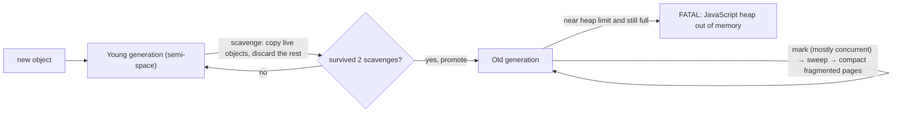

# Heap Memory

> **Module 04 · Operating Systems** · Prerequisites: [Memory Management](21-Memory-Management.md) · Next: [Stack Memory](23-Stack-Memory.md)

---

## ⏱ If You Only Have 2 Minutes

- The **stack** holds a function's locals and is freed automatically when the function returns. The **heap** holds anything whose lifetime is not tied to one call — every JavaScript object and every Python object lives there.
- Native code allocates heap with `malloc`/`free`. glibc's allocator keeps freed memory in its own free lists and **rarely gives it back to the OS**, so RSS often stays high after a spike even with no leak.
- glibc creates extra **arenas** for multi-threaded programs (up to 8 × CPU cores on 64-bit). Many arenas mean more fragmentation; `MALLOC_ARENA_MAX=2` or swapping in **jemalloc** often cuts RSS of threaded services.
- **V8** is generational: new objects go to the small **young generation**, collected by a fast copying **scavenge**; survivors are promoted to the **old generation**, collected by **mark-sweep-compact**.
- **CPython** frees most objects instantly through **reference counting**; a separate **cycle collector** (`gc` module) handles reference cycles.
- A garbage-collected leak is memory that is still **reachable**: unbounded caches and maps, listeners never removed, closures holding large objects, global request arrays, intervals never cleared.
- Find leaks by **comparing two snapshots** taken after load: Node heap snapshots (`--inspect`, `v8.writeHeapSnapshot()`, `--heapsnapshot-near-heap-limit`); Python `tracemalloc` snapshot diffs or `objgraph`.
- Every cache needs a **maximum size** and usually a TTL. "We'll only cache a few keys" is how most production leaks start.

---

## 1. What It Is and Why It Exists

The **heap** is the region of a process's memory used for data whose size or lifetime is decided at run time. You ask for a block, use it for as long as you need, and later give it back — either explicitly (`free` in C) or automatically, when a garbage collector decides nothing can reach it any more.

**Analogy:** the stack is a pile of plates in a cafeteria — you can only add or remove the top one, and that makes it very fast. The heap is a self-storage warehouse — you can rent a unit of any size for any length of time, but someone has to track which units are free, and the warehouse ends up with awkward gaps between rented units.

**The problem it solves.** A request handler that builds a list of 10,000 orders cannot know that size at compile time, and a cache must outlive the request that filled it. Neither fits on the stack. The heap gives flexible sizes and lifetimes.

**The cost.** Flexibility brings three problems that backend engineers meet in production:

1. **Allocation is not free.** The allocator must find a fitting block, and the garbage collector must periodically pause or share CPU with your code.
2. **Fragmentation.** Free memory can be split into pieces that are too small or in the wrong place, so the process holds memory it is not using.
3. **Leaks.** In garbage-collected languages, memory is only freed when it becomes unreachable. One forgotten reference from a long-lived object keeps a whole graph alive.

The OS view of all this — RSS, cgroup limits, OOM kills — is in [Memory Management](21-Memory-Management.md). This chapter is about what happens inside the process.

---

## 2. How It Works

### Layer by layer

```text
Your code:        const order = { id, items }          order = Order(id, items)
                          │                                     │
Runtime heap:     V8 heap (young + old generation)      CPython object allocator (pymalloc)
                  takes pages from the OS with mmap      small objects ≤ 512 bytes in pools/arenas;
                          │                              larger ones from malloc
Native allocator: glibc malloc for Buffers, native addons, the interpreter's own C structures
                          │
Kernel:           brk / mmap give address space; pages become RSS when first written
```

Freeing works in the reverse direction, and every layer may keep the memory for reuse instead of returning it. That is why "heap used" in your runtime can drop while RSS stays flat.

### V8: generational garbage collection

Most objects in a web server die young: request bodies, intermediate arrays, promise objects. V8 exploits this.



- **Scavenge (minor GC).** The young generation is split into two halves. Live objects are copied from one half to the other; everything left behind is garbage, freed in one step. Cost is proportional to *live* objects, so it is fast when most objects are dead. It runs often.
- **Mark-sweep-compact (major GC).** For the old generation, V8 marks everything reachable from the roots (globals, the stack, handles), sweeps unmarked objects into free lists, and compacts fragmented pages by moving objects. Much of the marking runs concurrently on helper threads, but there are still main-thread pauses, and they grow with the size of the live old generation.
- **Roots** are where reachability starts: global variables, module-level variables, the current call stack, active closures, timers and pending callbacks registered with libuv.

### CPython: reference counting plus a cycle collector

Every CPython object has a reference count. When it drops to zero, the object is freed immediately — no pause, no waiting. This is why a large list built in a function usually disappears the moment the function returns.

Reference counting cannot free cycles (`a.parent = b; b.child = a`). For those, the `gc` module runs a generational cycle collector over container objects (lists, dicts, class instances). It triggers based on the number of allocations minus deallocations; `gc.get_threshold()` shows the settings and `gc.get_count()` the current counters.

Small objects (512 bytes or less) come from **pymalloc**, which carves big arenas into pools of same-sized blocks. An arena goes back to the OS only when **every** object in it is freed. A long-lived object left in a mostly empty arena pins the whole arena — a common reason a Python worker's RSS never falls after a large request.

### glibc malloc: arenas and fragmentation

- Small requests come from the main heap (grown with `brk`) or from additional **arenas**. To reduce lock contention, glibc gives threads separate arenas, up to 8 × CPU cores on 64-bit systems by default.
- Large requests (above a threshold that starts at 128 KiB and adjusts dynamically) get their own `mmap` and are returned to the OS on `free`.
- Freed small chunks go back on free lists. Memory at the very top of the `brk` heap can be trimmed, but a single live chunk near the top keeps everything below it resident.

`MALLOC_ARENA_MAX=2` limits arenas and often reduces RSS for threaded programs (Python with many threads, Node with native addons or heavy libuv thread-pool work) at some cost in lock contention. Replacing the allocator with **jemalloc** (`LD_PRELOAD=/usr/lib/x86_64-linux-gnu/libjemalloc.so.2`, the path varies by distro) is another common fix; it tends to return memory to the OS more readily.

### Observing it

```bash
node --trace-gc server.js            # one line per GC: type, heap before → after, pause time
```

```text
# illustrative output
[4182:0x5a1c]   3021 ms: Scavenge 41.2 (52.1) -> 33.8 (52.6) MB, 1.9 / 0.0 ms  (average mu = 0.991, current mu = 0.982) allocation failure;
[4182:0x5a1c]  18774 ms: Mark-Compact 212.5 (231.9) -> 198.3 (229.4) MB, 142.7 / 0.0 ms  (average mu = 0.903, current mu = 0.611) allocation failure; scavenge might not succeed
```

A Mark-Compact that frees only 14 MB out of 212 MB means almost everything in the old generation is still reachable. If that "after" number climbs with every major GC, you have a leak.

```bash
python3 -X tracemalloc=25 app.py     # start tracemalloc at boot, 25 frames per traceback
grep -E 'RssAnon|VmHWM' /proc/<pid>/status
```

---

## 3. Key Concepts

### Heap vs stack

| | Stack | Heap |
|---|---|---|
| What lives there | Return addresses, locals of native frames, saved registers | All JS objects, all Python objects, Buffers, native allocations |
| Lifetime | Ends when the function returns | Until freed or unreachable |
| Allocation cost | Move a pointer | Search free lists; GC work later |
| Size | Small, fixed per thread (MiBs) | Limited by runtime limit, cgroup, RAM |
| Failure | Stack overflow ([Stack Memory](23-Stack-Memory.md)) | Heap OOM, cgroup OOM kill, GC thrash |

In Node and Python, even a "local variable" holding an object is just a reference on the stack (or in a frame object) pointing into the heap.

### Why RSS doesn't drop after freeing

- The GC freed objects, but the **runtime keeps the pages** for future allocations (V8 holds on to some empty pages; pymalloc keeps arenas that still contain one live object).
- **malloc keeps freed chunks** in free lists, and fragmentation stops trimming.
- The pages were **swapped or shared** and are counted differently.

So a flat RSS after a spike is not proof of a leak. A leak is **post-GC heap usage that keeps rising under steady load**. Glibc's `malloc_trim(0)` can release free memory back to the OS; Python can call it through `ctypes` as a diagnostic, but it treats the symptom.

### Common backend leaks

| Pattern | Node.js example | Python example | Fix |
|---|---|---|---|
| Unbounded cache / map | `const cache = new Map()` keyed by user ID or URL | module-level `dict`, `functools.lru_cache(maxsize=None)` | Max size + TTL |
| Listeners never removed | `emitter.on("data", fn)` per request; Node warns after 10 listeners | signal/callback registries, `logging.addHandler` per request | `once`, remove in `finally`, `AbortSignal` |
| Closures holding big objects | A callback stored for later captures the whole request body | A lambda in a registry captures `self` with large state | Capture only the fields you need |
| Global request arrays | `recentRequests.push(req)` for debugging | `history.append(request)` | Ring buffer of fixed length, or metrics |
| Timers | `setInterval` never `clearInterval`'d keeps its closure alive | `threading.Timer` / asyncio tasks never cancelled | Clear on shutdown or when owner closes |
| Cached methods | — | `@lru_cache` on a method keeps every `self` alive | Cache at module level by key, or per-instance |
| Stored exceptions | Error objects with large attached context | Exceptions keep their traceback → frames → all locals | Store `str(exc)` / formatted text, not the exception |

### Weak references

A **weak reference** points to an object without keeping it alive.

- JavaScript: `WeakMap`/`WeakSet` (keys are held weakly; good for "extra data about an object owned elsewhere"), `WeakRef` and `FinalizationRegistry` (ES2021). GC timing is not guaranteed, so never use them for correctness, only for memory.
- Python: `weakref.ref`, `WeakValueDictionary`, `WeakKeyDictionary`, `WeakSet`. Plain `int`, `str`, `list` and `dict` instances cannot be weakly referenced; your own class instances can.

Weak references fit object identity caches ("the `User` instance for ID 42 if someone else still holds it"). They do not fit "cache this computed result", because the result is dropped as soon as nobody else holds it. That needs a bounded LRU.

### Finding leaks

| Tool | Runtime | What it shows | Cost |
|---|---|---|---|
| Chrome DevTools via `node --inspect` | Node | Heap snapshots, "objects allocated between snapshots", retainer chains | Snapshot pauses the process |
| `v8.writeHeapSnapshot()` / `--heapsnapshot-signal=SIGUSR2` | Node | `.heapsnapshot` file to open in DevTools | Blocks the event loop; needs about 2× heap memory |
| `--heapsnapshot-near-heap-limit=1` | Node | Snapshot written automatically just before heap OOM | Same; may itself push a container over its limit |
| `tracemalloc` snapshot `compare_to` | Python | Lines of code whose allocations grew | Slows allocation; enable on demand |
| `objgraph.show_growth()` (third-party) | Python | Object types whose counts grew | Walks `gc.get_objects()` |
| `memray` (third-party) | Python | Native + Python allocations, flame graphs | Separate run or attach |

The standard method is the **three-snapshot technique**: warm up, take snapshot 1; run load; take snapshot 2; run the same load again; take snapshot 3. Objects allocated between 1 and 2 that are **still alive in 3** are your leak candidates. Then read the **retainer chain**: the path from a GC root to the object tells you exactly which map, closure or listener holds it.

### GC tuning knobs (use rarely)

- Node: `--max-old-space-size` (old generation limit, MiB), `--max-semi-space-size` (young generation; larger can mean fewer scavenges for allocation-heavy servers at the cost of memory).
- Python: `gc.set_threshold()`, `gc.disable()` around a bulk load, `gc.freeze()` before `fork` (see [Virtual Memory](24-Virtual-Memory.md)).

Fix the allocation pattern before turning knobs. A tuned GC on top of a leak only changes when you crash.

---

## 4. Code Examples

Scenario: a product-pricing endpoint caches computed prices per `(productId, currency, couponCode)`. Coupon codes come from users, so the key space is unbounded — a textbook leak. Then a heap-growth check that warns when post-GC heap keeps rising.

### Node.js / TypeScript

```ts
// Node.js 22+, TypeScript 5. Built-in modules only.

// LEAK: one entry per distinct key, forever. Random coupon codes grow this without limit.
const leakyCache = new Map<string, number>();
export function priceLeaky(key: string, compute: () => number): number {
  if (!leakyCache.has(key)) leakyCache.set(key, compute());
  return leakyCache.get(key)!;
}

// FIX: bounded LRU with TTL. A Map iterates in insertion order, so the first key
// is the least recently used if we re-insert on every hit.
export class LruTtlCache<K, V> {
  private readonly entries = new Map<K, { value: V; expiresAt: number }>();
  private readonly maxEntries: number;
  private readonly ttlMs: number;

  constructor(maxEntries: number, ttlMs: number) {
    this.maxEntries = maxEntries;
    this.ttlMs = ttlMs;
  }

  get(key: K): V | undefined {
    const entry = this.entries.get(key);
    if (!entry) return undefined;
    this.entries.delete(key);
    if (entry.expiresAt <= Date.now()) return undefined; // expired: drop it, report a miss
    this.entries.set(key, entry);                         // move to most-recent position
    return entry.value;
  }

  set(key: K, value: V): void {
    this.entries.delete(key);
    this.entries.set(key, { value, expiresAt: Date.now() + this.ttlMs });
    while (this.entries.size > this.maxEntries) {
      // Evict the oldest key; size can never exceed maxEntries, whatever users send.
      const oldest = this.entries.keys().next().value as K;
      this.entries.delete(oldest);
    }
  }

  get size(): number {
    return this.entries.size;
  }
}

const prices = new LruTtlCache<string, number>(10_000, 60_000);
export function price(productId: string, currency: string, coupon: string): number {
  const key = `${productId}:${currency}:${coupon}`;
  const hit = prices.get(key);
  if (hit !== undefined) return hit;
  const value = computePrice(productId, currency, coupon);
  prices.set(key, value);
  return value;
}

declare function computePrice(productId: string, currency: string, coupon: string): number;
```

Heap-growth check. It reads heap usage right after each major GC, which is the baseline that matters (before GC, heap usage includes garbage):

```ts
// Node.js 22+, TypeScript 5. Built-in modules only.
import { PerformanceObserver, constants } from "node:perf_hooks";
import v8 from "node:v8";

const MiB = 1024 * 1024;
const samples: number[] = [];
const WINDOW = 10; // number of major GCs to compare

const observer = new PerformanceObserver((list) => {
  for (const entry of list.getEntries()) {
    // GC entries carry `detail` at runtime, but @types/node only declares it on marks/measures.
    const kind = (entry as { detail?: { kind?: number } }).detail?.kind;
    if (kind !== constants.NODE_PERFORMANCE_GC_MAJOR) continue;

    samples.push(v8.getHeapStatistics().used_heap_size);
    if (samples.length > WINDOW) samples.shift();
    if (samples.length < WINDOW) continue;

    // Every post-GC sample higher than the last means live data is only growing.
    const rising = samples.every((v, i) => i === 0 || v > samples[i - 1]);
    const growth = (samples.at(-1)! - samples[0]) / MiB;
    if (rising && growth > 50) {
      console.warn(`[heap] post-GC heap grew ${growth.toFixed(0)} MiB over ${WINDOW} major GCs`, {
        pauseMs: entry.duration.toFixed(1),
        heapLimitMiB: Math.round(v8.getHeapStatistics().heap_size_limit / MiB),
      });
      // Opt-in only: writing a snapshot blocks the event loop and needs ~2x heap memory.
      if (process.env.HEAP_SNAPSHOT_ON_GROWTH === "1") {
        console.warn(`[heap] wrote ${v8.writeHeapSnapshot()}`);
      }
      samples.length = 0;
    }
  }
});
observer.observe({ entryTypes: ["gc"] });
```

### Python

```python
# Python 3.12+, stdlib only.
import time
from collections import OrderedDict
from typing import Callable, Generic, Hashable, TypeVar

K = TypeVar("K", bound=Hashable)
V = TypeVar("V")

# LEAK: grows by one entry per distinct (product, currency, coupon), forever.
_leaky_cache: dict[tuple[str, str, str], float] = {}


def price_leaky(product_id: str, currency: str, coupon: str) -> float:
    key = (product_id, currency, coupon)
    if key not in _leaky_cache:
        _leaky_cache[key] = compute_price(product_id, currency, coupon)
    return _leaky_cache[key]


# FIX: bounded LRU with TTL. functools.lru_cache bounds size but has no TTL,
# and lru_cache(maxsize=None) is exactly the leak above.
class LruTtlCache(Generic[K, V]):
    def __init__(self, max_entries: int, ttl_seconds: float) -> None:
        self._data: OrderedDict[K, tuple[V, float]] = OrderedDict()
        self._max = max_entries
        self._ttl = ttl_seconds

    def get(self, key: K) -> V | None:
        item = self._data.get(key)
        if item is None:
            return None
        value, expires_at = item
        if expires_at <= time.monotonic():  # monotonic: immune to wall-clock jumps
            del self._data[key]
            return None
        self._data.move_to_end(key)
        return value

    def set(self, key: K, value: V) -> None:
        self._data[key] = (value, time.monotonic() + self._ttl)
        self._data.move_to_end(key)
        while len(self._data) > self._max:
            self._data.popitem(last=False)  # evict least recently used

    def get_or_compute(self, key: K, compute: Callable[[], V]) -> V:
        cached = self.get(key)
        if cached is None:
            cached = compute()
            self.set(key, cached)
        return cached


_prices: LruTtlCache[tuple[str, str, str], float] = LruTtlCache(10_000, 60.0)


def price(product_id: str, currency: str, coupon: str) -> float:
    return _prices.get_or_compute(
        (product_id, currency, coupon), lambda: compute_price(product_id, currency, coupon))


def compute_price(product_id: str, currency: str, coupon: str) -> float:
    return 9.99  # stands in for a real pricing calculation
```

Heap-growth check with `tracemalloc`. It compares snapshots against a baseline and reports the source lines whose allocations grew the most:

```python
# Python 3.12+, stdlib only.
import gc
import logging
import threading
import tracemalloc

log = logging.getLogger("heap")


def start_heap_watch(interval_s: float = 300.0, alert_mib: float = 50.0) -> threading.Event:
    """Log the top growing allocation sites. tracemalloc slows allocation, so
    enable this in one canary instance or behind a flag, not on every pod."""
    tracemalloc.start(10)  # keep 10 frames so the culprit's callers are visible
    gc.collect()           # baseline without garbage that would be freed anyway
    baseline = tracemalloc.take_snapshot()
    stop = threading.Event()

    def loop() -> None:
        while not stop.wait(interval_s):
            gc.collect()
            snapshot = tracemalloc.take_snapshot().filter_traces(
                [tracemalloc.Filter(False, tracemalloc.__file__)])
            diff = snapshot.compare_to(baseline, "lineno")
            grown = sum(stat.size_diff for stat in diff if stat.size_diff > 0) / 2**20
            current, peak = tracemalloc.get_traced_memory()
            if grown < alert_mib:
                continue
            log.warning("traced heap grew %.0f MiB since baseline (current %.0f MiB, peak %.0f MiB)",
                        grown, current / 2**20, peak / 2**20)
            for stat in diff[:5]:
                log.warning("  %s", stat)  # e.g. "app/pricing.py:21: size=48.2 MiB (+48.2 MiB), count=401234"

    threading.Thread(target=loop, name="heap-watch", daemon=True).start()
    return stop
```

**Runtime difference to notice:** in Node, the growth signal comes from the GC itself (`PerformanceObserver` on `gc` entries) and the diagnosis tool is a heap snapshot with retainer chains, which tells you *who holds* the object. In Python, most memory is freed by reference counting without any GC event, so the watcher uses `tracemalloc`, which tells you *which line allocated* the memory — then `gc.get_referrers()` or `objgraph.show_backrefs` answers who holds it.

---

## 5. Production Concerns

- **GC pauses show up in p99.** A large old generation in V8 means longer major-GC pauses on the event loop; every in-flight request waits. Keep long-lived data (big caches, lookup tables) out of the request process when it gets large — move it to Redis or a shared store — or keep it in `Buffer`/typed arrays, which V8 does not need to trace object by object.
- **Heap snapshots can kill the pod.** A snapshot needs roughly twice the heap's memory and blocks the event loop for seconds. Take it on one instance pulled out of the load balancer, or set the container limit high enough when using `--heapsnapshot-near-heap-limit`.
- **Fragmentation looks like a leak.** RSS rising while post-GC heap is flat points to the native allocator, not your objects. Try `MALLOC_ARENA_MAX=2` or jemalloc and compare RSS under the same load before rewriting code.
- **Cache size is a memory budget.** Bound caches by entry count *and* know the average entry size: 10,000 entries of 50 KB is 500 MB. For variable-size values, bound by approximate bytes.
- **Metrics to export.** Node: `heapUsed`, `heapTotal`, `external`, GC pause durations by kind. Python: RSS, `gc.get_count()`, `gc.get_stats()` collections, and cache sizes. Graph post-GC heap over days, not minutes — leaks are slopes.
- **Worker recycling is a seatbelt.** Gunicorn `--max-requests` or a Node process restart after N hours hides slow leaks. Keep it, but also track the slope so the leak gets fixed.
- **Security.** Any cache or map keyed by user-controlled input (headers, query strings, coupon codes, tenant names) is a memory-exhaustion DoS vector unless bounded.

---

## 6. Common Mistakes

- **Unbounded `Map`/`dict` caches** — memory grows with every distinct key until OOM — LRU with max size and TTL, or an external cache.
- **`@lru_cache` on instance methods** — the cache holds `self` for every instance ever called, so request-scoped objects never die — cache a module-level function keyed by plain values, or store the cache on the instance.
- **Adding event listeners per request** — `MaxListenersExceededWarning`, then the emitter retains every handler and its closure — use `once`, remove listeners in `finally`, or pass an `AbortSignal`.
- **Raising `--max-old-space-size` to "fix" a leak** — the crash moves from hours to days and GC pauses grow — find the retainer with a heap snapshot.
- **Calling `gc.collect()` per request in Python** — burns CPU walking every container object and fixes nothing if objects are still referenced — find the reference; let the GC run on its thresholds.
- **Storing exceptions or request objects for "later debugging"** — each one keeps frames, locals or the full body alive — store small, formatted summaries in a fixed-size ring buffer.
- **Concluding "no leak" from `heapUsed` alone** — Buffers and native allocations are outside the V8 heap — check `external`, `arrayBuffers` and RSS too.

---

## 7. Comparison Table

| | V8 (Node.js) | CPython |
|---|---|---|
| Primary mechanism | Tracing GC, generational | Reference counting |
| Cycles | Collected naturally by tracing | Separate cycle collector (`gc`) |
| When memory is freed | At the next scavenge / major GC | Immediately at refcount 0 (cycles: at next `gc` pass) |
| Pauses | Scavenges (short, frequent), major GC (longer; partly concurrent) | Usually none; cycle-collection pauses grow with tracked objects |
| Hard limit | `--max-old-space-size` | None (cgroup only) |
| Small-object allocator | Bump allocation in young generation | pymalloc pools/arenas (≤ 512 bytes) |
| Leak tooling | Heap snapshots + retainers (DevTools) | `tracemalloc` diffs, `gc.get_referrers`, `objgraph`, `memray` |
| Typical leak cause | Reachable via closure, listener, global map | Reachable via module global, cache, stored traceback |

---

## 8. Interview Questions

**[Junior] What is the difference between the stack and the heap?**
The stack stores data for active function calls — return addresses and locals — and is freed automatically when a function returns; it is small and fast. The heap stores data with flexible size and lifetime, such as objects and buffers, and is freed explicitly or by a garbage collector. In Node and Python, all objects live on the heap; the stack only holds references to them.

**[Junior] How can a garbage-collected language leak memory?**
The GC only frees objects that are unreachable. If a long-lived object — a module-level map, an event emitter, a timer callback — still references something, it stays alive forever. Typical cases are unbounded caches, listeners added per request and never removed, and global arrays used for debugging.

**[Mid] Explain V8's generational garbage collector.**
New objects are allocated in a small young generation. A scavenge copies the live objects from one semi-space to the other and frees the rest at once, which is cheap because most objects die young. Objects that survive two scavenges are promoted to the old generation, which is collected by mark-sweep-compact: mark everything reachable from roots, sweep the rest into free lists, and compact fragmented pages. Marking is mostly concurrent, but major GCs still pause the main thread, and the pause grows with the live old-generation size.

**[Mid] How does CPython free memory, and why does it still need a garbage collector?**
Every object has a reference count, and the object is freed as soon as it reaches zero. Reference counting cannot free cycles — two objects that refer to each other always have a count of at least one — so a generational cycle collector in the `gc` module periodically finds groups of container objects reachable only from each other and frees them. You can inspect it with `gc.get_count()`, `gc.get_threshold()`, and force it with `gc.collect()`.

**[Mid] A Python worker's RSS stays at 1.2 GB after a large request finishes. Is it leaking?**
Not necessarily. Freed objects go back to pymalloc arenas and glibc free lists, and an arena is returned to the OS only when it is completely empty, so fragmentation keeps RSS high. Check whether RSS keeps climbing under steady, repeated load and whether `tracemalloc` shows growing allocation sites. If RSS is flat at a high plateau, reduce peak allocation (stream the data instead of loading it), recycle workers, or try `MALLOC_ARENA_MAX`/jemalloc.

**[Senior] Walk me through finding a memory leak in a production Node service.**
First confirm it is a heap leak: post-major-GC `heapUsed` rising under steady traffic, not just RSS or `external`. Reproduce in staging with the same traffic, or take one production instance out of rotation. Use the three-snapshot technique with `--inspect` or `v8.writeHeapSnapshot()`, look at objects allocated between snapshots 1 and 2 that survive in 3, and follow the retainer chain to the root — usually a `Map`, a listener array or a closure. Fix the owner (bound it, remove the listener), then verify with a long load test that the post-GC baseline is flat. Keep `--heapsnapshot-near-heap-limit` and container headroom so the next leak leaves evidence.

**[Senior] RSS of a multi-threaded service grows to twice its heap size. What do you suspect and what do you do?**
I suspect native allocator fragmentation: glibc creates an arena per thread up to 8 × cores, and freed memory in those arenas is not returned to the OS. Confirm by comparing runtime heap metrics (flat) with RSS (rising), and by checking `/proc/<pid>/smaps` for many anonymous regions of similar size. Try `MALLOC_ARENA_MAX=2` or preload jemalloc and compare RSS under the same load test. If a native addon or a library is allocating per request, fix it there.

**[Senior] When would you use a WeakMap or `weakref.WeakValueDictionary` instead of an LRU cache?**
Use a weak structure when the cache is *metadata about objects owned elsewhere* — for example, extra data for a socket or request object — so the entry disappears when the owner is collected. Use an LRU when you cache *computed results* that nobody else holds, because a weak cache would drop them immediately. Weak references give no timing guarantees, so they control memory, never correctness.

---

## 9. Cheat Sheet

```text
Heap vs stack    heap = flexible size/lifetime, all JS/Python objects · stack = per-call frames, auto-freed
Layers           runtime heap (V8 / pymalloc) → malloc (glibc arenas) → kernel (brk/mmap)
RSS stays high   runtime keeps pages · malloc free lists · fragmentation → not proof of a leak
Leak signal      post-GC heap rising under steady load
glibc            arenas up to 8×cores · MALLOC_ARENA_MAX=2 · malloc_trim(0) · or LD_PRELOAD jemalloc
V8               young: scavenge (copying) · survive 2 → old: mark-sweep-compact
                 --max-old-space-size · --max-semi-space-size · --trace-gc
CPython          refcount → free at 0 · gc module for cycles · gc.get_count/get_threshold/freeze
Leak patterns    unbounded Map/dict · listeners per request · closures · global arrays · setInterval
                 lru_cache on methods · stored exceptions/tracebacks
Node tools       --inspect + DevTools · v8.writeHeapSnapshot() (~2× heap, blocks) · --heapsnapshot-near-heap-limit
Python tools     tracemalloc.start(); snapshot.compare_to(old, "lineno") · objgraph · memray
Method           3 snapshots → survivors → retainer chain → fix owner
Caches           max entries + TTL · WeakMap/weakref only for metadata about objects owned elsewhere
```

---

## Related Topics

- [Memory Management](21-Memory-Management.md) — RSS, cgroup limits and what happens when the heap outgrows the container
- [Stack Memory](23-Stack-Memory.md) — the other half of a process's working memory
- [Virtual Memory](24-Virtual-Memory.md) — how `mmap` hands heap pages to the runtime, and copy-on-write after `fork`
- [LRU Cache](../Module-05-Data-Structures-and-Algorithms/43-LRU-Cache.md) — the data structure behind the bounded cache
- [Caching Fundamentals](../Module-07-Advanced-Backend-and-System-Design/14-Caching-Fundamentals.md) — when an in-process cache should become a shared one
- [Node Event Loop and Concurrency](../Module-02-Core-Backend/06-Node-Event-Loop-and-Concurrency.md) — why GC pauses block every request in a Node process
