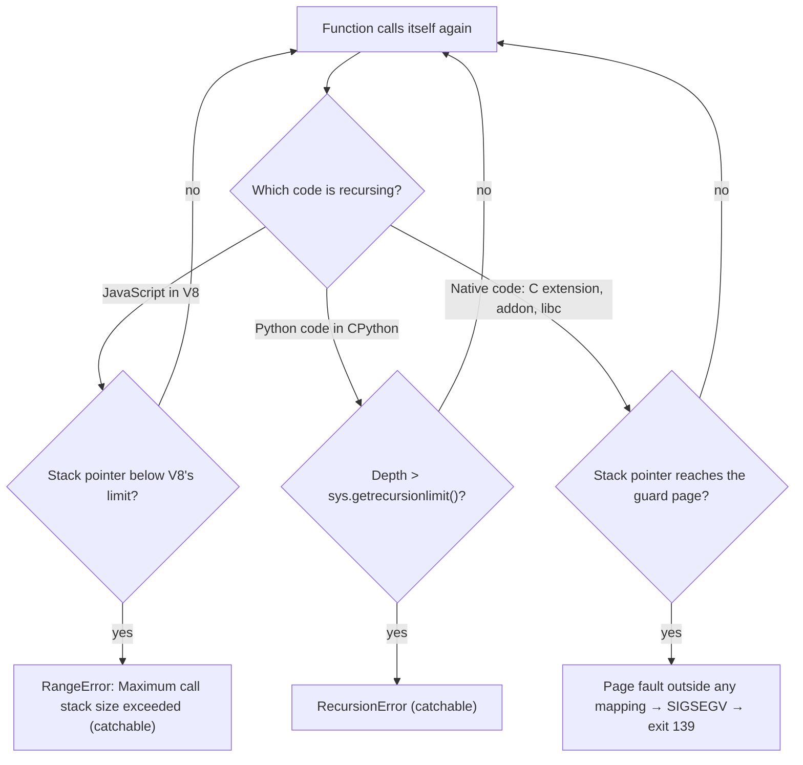

# Stack Memory

> **Module 04 · Operating Systems** · Prerequisites: [Heap Memory](22-Heap-Memory.md) · Next: [Virtual Memory](24-Virtual-Memory.md)

---

## ⏱ If You Only Have 2 Minutes

- Every **thread** has its own **call stack**. Each function call pushes a **frame**: the return address, saved registers and the function's local variables. Returning pops the frame. Allocating a frame costs one pointer move, and it is freed automatically.
- On Linux the main thread's stack grows on demand up to `ulimit -s`, which is commonly **8 MiB**. glibc uses that same limit as the default size for new threads. musl (Alpine) gives new threads only **128 KiB**.
- V8 has its **own** stack limit, about 1 MB on 64-bit (`--stack-size`, in KiB). Going past it throws `RangeError: Maximum call stack size exceeded`. On Node 22 that is about 12,500 frames of a trivial function (measured). Worker threads get `resourceLimits.stackSizeMb`, which defaults to **4**.
- CPython counts Python frames against `sys.getrecursionlimit()`, which defaults to **1000**. Going past it raises `RecursionError`. Since 3.11, Python-to-Python calls do not use the C stack, so the limit protects you from runaway logic rather than from a crash.
- A **real** stack overflow in native code hits the guard page and kills the process with `SIGSEGV` (exit status **139**). No `try/catch` and no `except` can catch it.
- If user input decides how deep your code recurses, an attacker decides when it fails. A 1.5 MB JSON body nested 50,000 levels deep is enough to break a recursive walker.
- The fix has two parts. **Limit depth at the boundary**, then **walk with an explicit stack**, which is an array on the heap.
- Async stack traces are partial. V8 shows `at async` frames only along an `await` chain, and `Error.stackTraceLimit` is 10 by default. Python tracebacks stop at task boundaries.

---

## 1. What It Is and Why It Exists

The **stack** is a region of memory that each thread uses to keep track of the function calls it is in the middle of. When function `a` calls `b`, the thread must remember where to continue in `a`, and `b` needs room for its own variables. Both go into a new **stack frame** on top of `a`'s frame. When `b` returns, its frame is discarded and `a` carries on.

**Analogy:** reading a book with footnotes inside footnotes. Each time you jump to a footnote, you put a bookmark in the page you left. When you finish the footnote, you take the top bookmark and go back. The pile of bookmarks is the stack. It only ever changes at the top, so it is fast and needs no bookkeeping. But if a footnote sends you to another footnote 50,000 times, you run out of bookmarks.

**The problem it solves.** Function calls happen millions of times per second. Each one needs a little memory that lives exactly as long as the call. A last-in, first-out region fits this perfectly. Allocating a frame means moving the **stack pointer** register down by a fixed amount. Freeing it means moving the pointer back. There are no free lists and no garbage collector. Compare that with the [heap](22-Heap-Memory.md), where every allocation is a search and every object needs a lifetime decision.

**The cost.** The stack is small and fixed in size per thread, because the kernel must reserve a contiguous range of addresses for it up front. Code that calls itself too deeply runs past the end. What happens then depends on who notices first. The hardware might fault, the runtime might throw, or the interpreter's counter might trip. Backend engineers meet this in three ways:

- a recursive function fed hostile input
- a native library crashing only on Alpine images
- a confusing stack trace from async code

---

## 2. How It Works

### A frame on x86-64 Linux

```text
higher addresses
┌──────────────────────────────┐
│ caller's frame                │
│   ... locals of a()           │
│   return address into a()     │ ← pushed by the CALL instruction
├──────────────────────────────┤
│ saved frame pointer (rbp)     │ ← b()'s prologue (if frame pointers are kept)
│ saved callee-saved registers  │   rbx, r12–r15 if b() uses them
│ locals of b()                 │
│ spilled temporaries           │
│ outgoing stack arguments      │   only beyond the 6th argument
├──────────────────────────────┤ ← stack pointer (rsp)
│ (free stack, grows downward)  │
│ guard page / guard gap        │ ← touching it raises SIGSEGV
lower addresses
```

The System V x86-64 calling convention passes the first six integer arguments in registers (`rdi`, `rsi`, `rdx`, `rcx`, `r8`, `r9`), so small functions often keep their arguments off the stack entirely. `CALL` pushes the return address and `RET` pops it. Everything else in the frame is the compiler's choice. Frame size therefore depends on the function: a function with a large local array uses far more stack per call than one with two integers.

### Where stacks live

- **Main thread.** The kernel sets up the `[stack]` mapping near the top of the address space. It grows down on demand, one page fault at a time, up to the `RLIMIT_STACK` soft limit (`ulimit -s`). Below it the kernel keeps a **guard gap**, a range of addresses that may not be mapped. That way an overflow faults instead of silently writing into the next mapping.
- **Other threads.** `pthread_create` allocates each thread's stack with `mmap` as a fixed-size region with a guard page at the low end. The region is only virtual memory until it is touched. A thousand threads with 8 MiB stacks add 8 GiB of VSZ but only a few MiB of RSS (see [Memory Management](21-Memory-Management.md)).

### How each runtime detects "too deep"



- **V8** runs JavaScript frames on the thread's native stack. Every function entry compares the stack pointer with a limit that V8 sets well inside the real stack, and throws a `RangeError` when it is crossed. That limit comes from V8's `--stack-size` flag, not from `ulimit -s`. If you raise `--stack-size` above the real stack size, V8 stops protecting you and the process dies with `SIGSEGV` instead.
- **CPython 3.11+** keeps Python frames in a per-thread "data stack" made of heap-allocated chunks. A Python function calling another Python function does not recurse in C. The recursion limit is a plain counter. Recursion that goes **through C code** does use the C stack and has its own guard. Examples are `json` encoding and decoding, `repr` of nested containers, `pickle`, and callbacks from C extensions.
- **Native code** has no check at all. The guard page is the only safety net.

### Observing stacks

```bash
ulimit -s                                  # soft limit for this shell, in KiB (8192 is common)
grep -i stack /proc/<pid>/limits           # what the running process actually got
grep VmStk /proc/<pid>/status              # current size of the main thread's stack
grep '\[stack\]' /proc/<pid>/maps          # the main stack mapping; thread stacks are anonymous maps
ls /proc/<pid>/task | wc -l                # thread count: each one has its own stack
```

Illustrative output from a container (8 MiB soft limit, unlimited hard limit, which is Docker's usual default):

```text
8192
Max stack size            8388608              unlimited            bytes
VmStk:       132 kB
7ffead810000-7ffead831000 rw-p 00000000 00:00 0                          [stack]
```

To see what a stuck process is doing, dump its stacks. Node: `node --inspect` plus the DevTools "Pause" button, or `kill -USR2` with `--report-on-signal`, which writes a diagnostic report that includes the JavaScript stack. Python: `faulthandler.register(signal.SIGUSR1)` at startup, then `kill -USR1 <pid>` prints every thread's stack. `gdb -p <pid>` with `thread apply all bt` shows the native frames.

---

## 3. Key Concepts

### Stack size defaults

| Stack | Default | How to change it |
|---|---|---|
| Linux main thread | `ulimit -s` soft limit, commonly 8 MiB; grows on demand | `ulimit -s`, `docker run --ulimit stack=…`, systemd `LimitSTACK=` |
| glibc threads (`pthread_create`) | The `RLIMIT_STACK` value at program start, if it is not unlimited | `pthread_attr_setstacksize`, or the rlimit before start |
| musl threads (Alpine) | 128 KiB | Set it in code, or link-time options in the binary |
| V8 JavaScript (main thread) | About 1 MB on 64-bit (`--stack-size` is in KiB) | `node --stack-size=…`. Never set it above the real thread stack |
| Node worker thread | `resourceLimits.stackSizeMb: 4` | `new Worker(file, { resourceLimits: { stackSizeMb } })` |
| CPython recursion limit | 1000 Python frames | `sys.setrecursionlimit(n)`, a bandage, not a fix |
| Python `threading` threads | 0 = platform default | `threading.stack_size(bytes)` (minimum 32 KiB) before creating the thread |

Measured on Node 22 in a Debian container, with a trivial recursive function: about 12,500 frames on the main thread, about 50,000 with `--stack-size=4000`, about 50,000 in a default worker, and about 10,000 in a worker with `stackSizeMb: 1`. Real functions have bigger frames, so they get fewer.

### Three ways to fail

| | Node `RangeError` | Python `RecursionError` | Native stack overflow |
|---|---|---|---|
| Who detects it | V8's stack-limit check | CPython's depth counter (or the C-recursion guard) | The CPU, when it touches the guard page |
| Message | `Maximum call stack size exceeded` | `maximum recursion depth exceeded` | `Segmentation fault`, exit 139 |
| Catchable | Yes, but you are still near the limit while handling it | Yes | No. The process is gone |
| Typical cause | Recursive walkers, `JSON.stringify` of deep objects, accidental infinite recursion | Recursive walkers, deep `json.loads` / `json.dumps`, `__getattr__` loops | A C extension or native addon recursing, a small musl thread stack, `--stack-size` set too high |

Catching a `RangeError` is legitimate at a request boundary: turn it into a 400 or 500 and move on. Retrying the same work after catching it is pointless, because the same input fails the same way.

### Recursion depth is an attack surface

The depth of a recursive walk over parsed input is chosen by whoever wrote the input. Common places this happens in backends:

- **Nested JSON.** Comment threads, category trees, rule engines, JSON Schema `$ref` expansion. V8's `JSON.parse` does not recurse, so parsing a 50,000-level document succeeds and your code fails later. Python's `json.loads` refuses with `RecursionError` once the nesting is deep enough.
- **Serializing it back.** `JSON.stringify` recurses. Logging a hostile object can throw inside your error handler.
- **GraphQL queries.** Nested selections recurse in resolvers. Use a query-depth limit.
- **Recursive data in the database.** A `parent_id` cycle makes a recursive walker loop until the stack runs out. Track visited IDs.

A request-body size limit helps but is not enough. Each nesting level costs only 2–30 bytes, so 100 KB buys thousands of levels.

### Recursion to iteration

Every recursive walk can become a loop over an **explicit stack**, which is an array you push and pop. The pending work then lives on the heap, and its size is limited by memory and by whatever depth rule you enforce. Three details matter:

1. **Keep the order.** To visit children in the same order as the recursive pre-order walk, push them in reverse.
2. **Carry the depth** with each stack entry, so you can enforce a limit and render indentation.
3. **Track visited nodes** if the data can contain cycles.

Neither V8 nor CPython eliminates tail calls, so rewriting into "tail-recursive style" does not help. Breadth-first traversal with a queue (`collections.deque`, or an array with a head index) is the other common iterative shape.

### Async stack traces

An `await` suspends a function and returns to the event loop, so its frame is no longer on the native stack. V8 rebuilds the chain for errors thrown along `await` chains and shows those frames as `at async fn (...)`. This is on by default and costs nothing at runtime. It does **not** connect callbacks registered elsewhere: `setTimeout`, `EventEmitter` listeners and `.then()` chains started in another function show only the frames since the callback began. `Error.stackTraceLimit` (default 10) cuts traces short. Raising it helps debugging but makes every `new Error()` more expensive. Use `AsyncLocalStorage` to carry a request ID instead of relying on the stack.

In Python, an exception's traceback follows the chain of coroutines that awaited each other. It stops at a `Task` boundary, because `asyncio.create_task` starts a fresh chain. Python 3.14 added `asyncio` call-graph introspection (`asyncio.print_call_graph()`) for "who is awaiting this task?".

---

## 4. Code Examples

Scenario: a discussion service stores comment threads as nested JSON and renders them as an indented list. An attacker posts a reply chain 50,000 levels deep. The recursive renderer fails. The iterative one walks it safely and enforces a product rule of at most 64 levels.

### Node.js / TypeScript

```ts
// No npm packages — Node.js 22+, TypeScript 5. Run: tsc && node dist/comments.js
interface Comment { id: number; text: string; replies: Comment[] }
interface Line { id: number; depth: number; text: string }

const MAX_DEPTH = 64; // product rule: deeper replies are rejected at write time

// Naive: one JS frame per nesting level. Input depth controls stack depth.
function flattenRecursive(c: Comment, depth = 0, out: Line[] = []): Line[] {
  out.push({ id: c.id, depth, text: c.text });
  for (const r of c.replies) flattenRecursive(r, depth + 1, out);
  return out;
}

class TooDeepError extends Error {}

// Iterative: the pending work lives in a heap array, so a deep thread costs
// array slots, not stack frames. Same pre-order output as the recursive version.
function flattenIterative(root: Comment, maxDepth = MAX_DEPTH): Line[] {
  const out: Line[] = [];
  const stack: Array<[Comment, number]> = [[root, 0]];
  while (stack.length > 0) {
    const [node, depth] = stack.pop()!;
    if (depth > maxDepth) throw new TooDeepError(`replies nested deeper than ${maxDepth}`);
    out.push({ id: node.id, depth, text: node.text });
    // Push children in reverse so the first reply is popped (rendered) first.
    for (let i = node.replies.length - 1; i >= 0; i--) stack.push([node.replies[i], depth + 1]);
  }
  return out;
}

// What an attacker posts: a chain of replies nested `depth` levels deep (~30 bytes per level).
function nestedThread(depth: number): string {
  return '{"id":0,"text":"x","replies":['.repeat(depth) + '{"id":1,"text":"leaf","replies":[]}' + "]}".repeat(depth);
}

for (const depth of [10, 50_000]) {
  const body = nestedThread(depth);
  const tree = JSON.parse(body) as Comment; // V8's JSON.parse does not recurse, so this succeeds
  console.log(`depth ${depth} (${(body.length / 1024).toFixed(0)} KiB body)`);
  try {
    console.log(`  recursive: ${flattenRecursive(tree).length} lines`);
  } catch (err) {
    if (!(err instanceof RangeError)) throw err;
    console.log(`  recursive: RangeError: ${err.message}`); // catchable, but the request is lost
  }
  try {
    console.log(`  iterative: ${flattenIterative(tree).length} lines`);
  } catch (err) {
    if (!(err instanceof TooDeepError)) throw err;
    console.log(`  iterative: rejected (${err.message}) -> respond 400`);
  }
  console.log(`  unlimited iterative: ${flattenIterative(tree, Infinity).length} lines`);
}
```

Output (measured, Node 22 in a Debian container):

```text
depth 10 (0 KiB body)
  recursive: 11 lines
  iterative: 11 lines
  unlimited iterative: 11 lines
depth 50000 (1563 KiB body)
  recursive: RangeError: Maximum call stack size exceeded
  iterative: rejected (replies nested deeper than 64) -> respond 400
  unlimited iterative: 50001 lines
```

The last line shows that the iterative walk is not limited by the stack at all. The 64-level cap is a product decision you enforce on purpose, not a crash you hope for.

### Python

```python
# No pip packages — Python 3.12+ (stdlib only). Run: python3 comments.py
import json
import sys
from typing import Any

MAX_DEPTH = 64  # product rule: deeper replies are rejected at write time
Comment = dict[str, Any]  # {"id": int, "text": str, "replies": [Comment, ...]}


def flatten_recursive(c: Comment, depth: int = 0, out: list | None = None) -> list:
    out = [] if out is None else out
    out.append((c["id"], depth, c["text"]))
    for reply in c["replies"]:
        flatten_recursive(reply, depth + 1, out)  # one Python frame per nesting level
    return out


class TooDeepError(ValueError):
    pass


def flatten_iterative(root: Comment, max_depth: float = MAX_DEPTH) -> list:
    out = []
    stack = [(root, 0)]  # pending work lives in a list on the heap, not in frames
    while stack:
        node, depth = stack.pop()
        if depth > max_depth:
            raise TooDeepError(f"replies nested deeper than {max_depth}")
        out.append((node["id"], depth, node["text"]))
        stack.extend((r, depth + 1) for r in reversed(node["replies"]))  # keep reply order
    return out


def nested_thread(depth: int) -> str:
    return ('{"id":0,"text":"x","replies":[' * depth
            + '{"id":1,"text":"leaf","replies":[]}' + "]}" * depth)


def parse_body(body: str) -> Comment:
    try:
        return json.loads(body)
    except RecursionError:  # the C decoder guards its own recursion
        raise TooDeepError("JSON nested too deeply") from None


print(f"recursion limit: {sys.getrecursionlimit()}")
for depth in (10, 2_000, 50_000):
    print(f"depth {depth}")
    try:
        tree = parse_body(nested_thread(depth))
    except TooDeepError as exc:
        print(f"  parse: rejected ({exc}) -> respond 400")
        continue
    try:
        print(f"  recursive: {len(flatten_recursive(tree))} lines")
    except RecursionError as exc:
        print(f"  recursive: RecursionError: {exc}")
    try:
        print(f"  iterative: {len(flatten_iterative(tree))} lines")
    except TooDeepError as exc:
        print(f"  iterative: rejected ({exc}) -> respond 400")
    print(f"  unlimited iterative: {len(flatten_iterative(tree, float('inf')))} lines")
```

Output (measured, Python 3.12):

```text
recursion limit: 1000
depth 10
  recursive: 11 lines
  iterative: 11 lines
  unlimited iterative: 11 lines
depth 2000
  recursive: RecursionError: maximum recursion depth exceeded
  iterative: rejected (replies nested deeper than 64) -> respond 400
  unlimited iterative: 2001 lines
depth 50000
  parse: rejected (JSON nested too deeply) -> respond 400
```

**Runtime difference to notice:** the two parsers fail in different places. V8's `JSON.parse` accepts the 50,000-level document (it also accepted 1,000,000 levels in testing), so in Node the danger moves to your own walkers and to `JSON.stringify`. CPython's C decoder refuses deep input itself with `RecursionError`, so Python code must catch that at the parse step. In this test, 2,000 levels parsed fine but broke the recursive walker at the 1000-frame limit. In both runtimes the iterative walker is limited only by the rule you choose.

---

## 5. Production Concerns

- **Validate depth where input enters.** Pair a body-size limit (Express's `express.json()` defaults to `100kb`) with a depth check in the validation layer, and reject with 400 before any business logic runs. Do the same for stored data you re-read: an old row written before the rule existed can still be 10,000 levels deep.
- **Error paths recurse too.** Loggers, error serializers and APM agents often call `JSON.stringify` or `repr` on request bodies. A deep object that broke your handler can break the error handler as well. Log a truncated summary of untrusted input, never the whole structure.
- **Alpine changes native stack sizes.** musl gives new threads 128 KiB where glibc gives the `ulimit -s` value (often 8 MiB). A C extension, native addon or embedded library that recurses on a worker thread can run fine on `-slim` (Debian) images and crash with `SIGSEGV` on `-alpine` images. If you see exit 139 only on Alpine, suspect this first.
- **Don't "fix" it by raising limits.** `sys.setrecursionlimit(100_000)` moves the failure from a catchable `RecursionError` to a possible C-stack `SIGSEGV` when the recursion passes through C code. `node --stack-size` above the real thread stack does the same in Node. Raise limits only for trusted, bounded input, and only alongside an explicit depth check.
- **Thread count × stack size is address space, not RAM.** Stacks are mapped lazily, so 200 threads with 8 MiB stacks add 1.6 GiB of VSZ but only the touched pages to RSS. It matters when `vm.overcommit_memory = 2` (strict accounting), or under `RLIMIT_AS`, where large stack reservations can make thread creation fail.
- **Containers inherit rlimits from the runtime.** `ulimit -s` inside a container comes from the Docker daemon or containerd configuration. Docker exposes `--ulimit stack=…`. The Kubernetes pod spec has no rlimit field, so you set it in the image entrypoint or at the node level. Check `/proc/<pid>/limits` in the running container rather than assuming.
- **What to log.** Count `RangeError` and `RecursionError` by route; a sudden rise is often a probe. Record the rejected depth (not the payload) when the depth rule fires. Keep `faulthandler` enabled in Python services so a native overflow leaves a Python traceback in stderr before the process dies.

---

## 6. Common Mistakes

- **Recursing over user-controlled structures** — a 1.5 MB payload throws `RangeError` or `RecursionError` on every request that touches it — enforce a depth limit at input and walk with an explicit stack.
- **Assuming `JSON.parse` is the safety check** — in Node it accepts arbitrarily deep input, and the failure happens later in your code or in `JSON.stringify` — validate depth after parsing, before use.
- **Raising `sys.setrecursionlimit` or `--stack-size` to make an error go away** — the catchable error turns into a `SIGSEGV` that kills the process — fix the algorithm, and raise limits only for trusted, bounded input.
- **Catching `RangeError` and retrying** — the same input fails the same way, and the retries multiply the cost — treat it as a client error (400) or a bug (500), never as transient.
- **Large local buffers in native code on small thread stacks** — a 256 KiB array on a 128 KiB musl thread stack crashes instantly — allocate large buffers on the heap, or set the thread stack size explicitly.
- **Expecting a full stack trace from async code** — the trace stops at `setTimeout`, an emitter or a task boundary, and the bug seems to come from nowhere — propagate a request ID with `AsyncLocalStorage` or `contextvars`, and log at boundaries.
- **Following parent links without a visited set** — a cycle in `parent_id` data recurses until the stack runs out — keep a `Set` of visited IDs and a maximum depth.

---

## 7. Comparison Table

Ways to handle deep structures:

| | Plain recursion | Explicit stack (iteration) | Raise the runtime limit | Depth limit at input |
|---|---|---|---|---|
| Code clarity | Highest | Slightly more code | Unchanged | Separate validation step |
| Limited by | Thread stack / recursion counter | Heap memory and your rule | A bigger stack, still finite | Your rule |
| Failure on hostile input | `RangeError` / `RecursionError`, or `SIGSEGV` in native code | Clean, explicit error | Same failures, later, and possibly a crash | 400 before any work |
| Keeps traversal order | Naturally | Push children in reverse | Naturally | Not applicable |
| Use when | Depth is small and bounded by your own data model | Depth comes from input or data you don't control | A trusted batch job with known depth | Always, for untrusted input |

In practice you combine the last two columns with the second: validate depth at the boundary, then walk iteratively.

---

## 8. Interview Questions

**[Junior] What is stored in a stack frame?**
The return address, so the CPU knows where to continue in the caller. Then the saved frame pointer and any callee-saved registers the function uses, its local variables, temporaries the compiler spilled from registers, and stack-passed arguments beyond those passed in registers. The frame is created on entry and discarded on return by moving the stack pointer. That is why stack allocation is so cheap and why locals disappear when a function returns.

**[Junior] What is the difference between `RecursionError` in Python and `RangeError: Maximum call stack size exceeded` in Node?**
Both are the runtime stopping recursion before it crashes the process, and both are catchable exceptions. CPython counts Python frames against `sys.getrecursionlimit()` (1000 by default). V8 checks the native stack pointer against its own limit, about 1 MB on 64-bit, controlled by `--stack-size`. A real overflow in native code is different: it hits the guard page and the process dies with `SIGSEGV`.

**[Mid] Why might a service crash with exit code 139 only on Alpine images?**
139 is 128 + 11, a `SIGSEGV`. Alpine uses musl, whose default stack for new threads is 128 KiB, while glibc uses the `ulimit -s` value, often 8 MiB. Native code running on a non-main thread with deep recursion or large stack buffers fits in 8 MiB but overflows 128 KiB. Confirm with a core dump or `faulthandler` output, then set the thread stack size explicitly, move large buffers to the heap, or use a glibc-based image.

**[Mid] How do you turn a recursive tree walk into an iterative one?**
Replace the call stack with an array. Push the root, then loop: pop a node, process it, push its children. Push them in reverse order if you need the same pre-order as the recursive version. Store the depth with each entry so you can enforce a maximum and render indentation, and keep a visited set if the data can contain cycles. The memory now comes from the heap, so depth is limited by your rule rather than by the thread's stack.

**[Mid] Does raising the recursion limit fix a `RecursionError`?**
Only for trusted input of known depth. Since 3.11, Python-to-Python calls don't consume C stack, so a moderately higher limit is usually safe. But recursion that passes through C (json, pickle, repr, C extensions) still uses the C stack, and a very high limit can turn the exception into a segfault. For untrusted input the depth is the attacker's choice, so any limit can be reached. Iterate and validate instead.

**[Senior] An endpoint accepts nested JSON. How do you protect it from depth-based denial of service in Node and Python?**
First cap the body size at the server or proxy. Then validate depth after parsing in Node, because `JSON.parse` is iterative and accepts any depth. In Python, catch `RecursionError` from `json.loads` and return 400. Write every walker over the structure iteratively with a depth limit, and make sure logging and error serialization never `JSON.stringify` or `repr` the whole untrusted object. Finally, check stored data, add metrics for rejections, and apply the same rule to other recursive inputs such as GraphQL query depth.

**[Senior] What are async stack traces, and where do they break down?**
After an `await`, the caller's frame is gone from the native stack, so a plain stack trace would show only the event loop. V8 reconstructs the chain of awaiting async functions and shows them as `at async` frames, which works well for linear `await` chains. It does not cross callback boundaries such as timers, emitters, or promise chains started elsewhere, and `Error.stackTraceLimit` (10) truncates long chains. Python tracebacks similarly stop at task boundaries. In production you rely on request IDs propagated through `AsyncLocalStorage` or `contextvars`, plus structured logs, rather than on the trace alone.

**[Senior] A process with 2,000 threads shows 16 GiB VSZ but 400 MiB RSS. Is the stack size a problem?**
Usually not for RAM, because each 8 MiB thread stack is reserved address space and only touched pages count toward RSS. It becomes a problem under strict overcommit (`vm.overcommit_memory = 2`) or an `RLIMIT_AS` cap, where reservations count and thread creation fails. It also signals a design problem: 2,000 threads means a lot of scheduling and context-switch overhead. I would lower the per-thread stack size if the threads are shallow, and more importantly reduce the thread count with a pool or async I/O.

---

## 9. Cheat Sheet

```text
Frame            return address · saved rbp/callee-saved regs · locals · spills · extra args
Cost             push/pop = move rsp; freed on return; one stack per thread
Main thread      [stack] grows on demand up to ulimit -s (often 8 MiB); guard gap below
Threads          glibc: RLIMIT_STACK value · musl/Alpine: 128 KiB · mmap'd, guard page
V8               ~1 MB (--stack-size, KiB) → RangeError: Maximum call stack size exceeded
                 ~12.5k trivial frames on Node 22 (measured) · Worker stackSizeMb default 4
CPython          sys.getrecursionlimit() = 1000 → RecursionError; 3.11+ Python calls skip C stack
Native overflow  guard page → SIGSEGV → exit 139; uncatchable
Parsers          V8 JSON.parse iterative (any depth) · JSON.stringify recursive · json.loads raises RecursionError
DoS rule         body size limit + depth limit at the boundary + iterative walkers + visited set
Iterate          stack = [(root, 0)]; pop; process; push children reversed with depth+1
No TCO           neither V8 nor CPython eliminates tail calls
Async traces     V8 "at async" along await chains · Error.stackTraceLimit = 10 · Python stops at Task
Observe          ulimit -s · /proc/PID/limits · VmStk · [stack] in maps · faulthandler · gdb bt
```

---

## Related Topics

- [Heap Memory](22-Heap-Memory.md) — where objects live, and where an explicit stack's entries go
- [Virtual Memory](24-Virtual-Memory.md) — how stacks are mapped lazily, and why VSZ counts them in full
- [Segmentation](26-Segmentation.md) — why a native stack overflow shows up as `SIGSEGV`
- [Threads](03-Threads.md) — one stack per thread, and what threads share
- [Recursion](../Module-05-Data-Structures-and-Algorithms/23-Recursion.md) — recursive algorithms and converting them to iteration
- [Node Event Loop and Concurrency](../Module-02-Core-Backend/06-Node-Event-Loop-and-Concurrency.md) — why async frames leave the native stack
