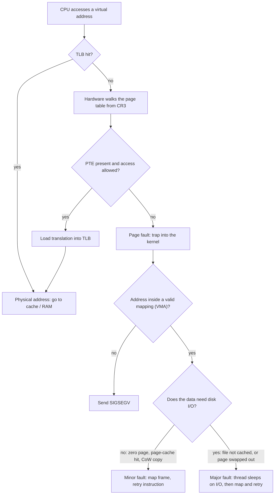

# Paging

> **Module 04 · Operating Systems** · Prerequisites: [Virtual Memory](24-Virtual-Memory.md) · Next: [Segmentation](26-Segmentation.md)

---

## ⏱ If You Only Have 2 Minutes

- Paging splits virtual memory into fixed-size **pages** and physical RAM into **frames** of the same size. On x86-64 Linux a base page is **4 KiB**. Huge pages are **2 MiB** (and 1 GiB).
- x86-64 translates addresses with a **4-level page table**: 9 bits per level plus a 12-bit offset gives 48-bit virtual addresses. The **TLB** caches recent translations. A TLB miss costs a page-table walk, not a page fault.
- A **page fault** is the CPU asking the kernel for help with a page. **Minor fault**: no disk I/O (first touch of fresh memory, or the page is already in the page cache). **Major fault**: the kernel must read from disk or swap, which takes microseconds to milliseconds.
- Linux uses **demand paging**. Allocating 1 GiB costs almost nothing until you write to it. RSS grows when pages are touched, not when they are allocated.
- **Swap** lets the kernel push anonymous memory (heap, stacks) to disk. On a latency-sensitive server, a swap-in shows up as a p99 spike. Watch `si`/`so` in `vmstat` and the major-fault rate.
- **Thrashing** happens when the working set is bigger than RAM, so the system spends its time moving pages in and out. In a container, hitting `memory.max` causes reclaim first, then an OOM kill.
- The **page cache** keeps file data in otherwise unused RAM. It counts toward a cgroup's memory usage, but the kernel can reclaim it, so "free" memory looks low on a healthy server.
- **Transparent Huge Pages (THP)** reduce TLB misses but can cause latency spikes (memory compaction) and memory bloat. Redis warns at startup when THP is `always`. Many database vendors recommend `madvise` or `never`.

---

## 1. What It Is and Why It Exists

**Paging** is how the kernel and the CPU implement [virtual memory](24-Virtual-Memory.md). Every process sees a large, private, contiguous address space. Behind it, the space is chopped into equal-size **pages**, and physical RAM into equal-size **frames**. A per-process **page table** records which page lives in which frame. The CPU's **memory management unit (MMU)** uses that table on every memory access.

**Analogy:** a hotel where every room is the same size. Each guest has a booking that says "my room 3". The front desk's register (the page table) says guest A's "room 3" is really room 714. The clerk remembers the last few lookups without opening the register (the TLB). Guests who have not shown up yet have no room assigned (demand paging). When the hotel is full, the luggage of a guest who has not been seen for a while goes to a storage unit across town (swap), and fetching it back is slow.

**The problem it solves.** Without paging, a process needs one contiguous block of physical memory. Free memory breaks into holes of awkward sizes (**external fragmentation**), and a 1 GiB request fails even when 2 GiB is free in pieces. Because every page has the same size, any free frame can hold any page, so this problem disappears. Paging also makes these things possible:

- **Lazy loading.** Only the pages of a binary or library that are actually used get read from disk.
- **Sharing.** One physical copy of `libc` or of the `node` binary is mapped into every process.
- **Copy-on-write `fork`.** Parent and child share frames until one of them writes.
- **Overcommit and swap.** The kernel can promise more memory than it has, and move cold pages to disk.

The cost is a translation step on every memory access, and an extra failure mode: a fault that needs disk I/O can stall a request thread for milliseconds.

---

## 2. How It Works

### Address translation on x86-64

A 48-bit virtual address is split into five fields:

```text
 47        39 38        30 29        21 20        12 11            0
+------------+------------+------------+------------+---------------+
| PML4 index | PDPT index |  PD index  |  PT index  |  page offset  |
|   9 bits   |   9 bits   |   9 bits   |   9 bits   |    12 bits    |
+------------+------------+------------+------------+---------------+
```

1. The **CR3** register holds the physical address of the current process's top-level table. The kernel changes CR3 when it switches to a different process.
2. Each table is one 4 KiB page holding 512 eight-byte entries. Each 9-bit index selects one entry, which points to the next table.
3. The last entry, the **page table entry (PTE)**, holds the frame number and flag bits: *present*, *writable*, *user-accessible*, *accessed*, *dirty* and *no-execute*.
4. The physical address is the frame's base plus the 12-bit offset.

A **2 MiB huge page** is mapped directly by a page-directory entry, skipping the last level. The 21 low bits become the offset. A **1 GiB page** is mapped one level higher still. Newer CPUs support **5-level paging** (57-bit addresses), which Linux enables only on hardware that has it.

Four memory reads per translation would be far too slow, so the MMU first checks the **translation lookaside buffer (TLB)**, a small cache of recent translations.



### What the kernel does on a page fault

1. The CPU stops the faulting instruction and jumps to the kernel's fault handler. The faulting address is saved in the CR2 register.
2. The kernel looks up the **VMA** (virtual memory area, one line of `/proc/<pid>/maps`) that covers the address. If there is none, or the access breaks the VMA's permissions, the process gets `SIGSEGV` (see [Segmentation](26-Segmentation.md)).
3. It needs a free frame. If free memory is below the zone's watermark, it reclaims some first (described below).
4. It fills the frame:
   - **Anonymous memory, first touch:** zero the frame. This is a minor fault.
   - **File-backed, page already in the page cache:** just map it. Minor fault.
   - **Write to a copy-on-write page after `fork`:** copy the frame. Minor fault.
   - **File page not cached, or page in swap:** start disk I/O and put the thread to sleep. Major fault.
5. It writes the PTE and returns. The CPU re-runs the instruction, which now succeeds.

The thread that faulted is blocked for the whole time. In Node that thread might be the event-loop thread. In Python it might be the thread holding the GIL. In both cases, a major fault stalls every request that thread serves.

### Reclaim, in one paragraph

Linux keeps file and anonymous pages on LRU-style lists. The background thread **`kswapd`** wakes up when free memory drops below the *low* watermark and reclaims until it reaches the *high* watermark. If an allocation finds memory below the *min* watermark, the allocating thread does **direct reclaim** itself, which adds latency to that request. Clean page-cache pages are the cheapest to reclaim (just drop them). Dirty pages must be written back first. Anonymous pages can only be reclaimed by writing them to swap. With no swap, anonymous memory can only be freed by killing a process.

---

## 3. Key Concepts

### Page sizes

| Page size | How you get it | TLB reach with, say, 1,536 entries | Typical use |
|---|---|---|---|
| 4 KiB | Default for everything | 6 MiB | All normal allocations |
| 2 MiB (explicit) | `hugetlbfs`, `vm.nr_hugepages`, `MAP_HUGETLB` | 3 GiB | PostgreSQL `huge_pages`, JVMs, DPDK |
| 2 MiB (transparent) | THP: kernel promotes or allocates automatically | 3 GiB | General apps when `enabled` is `always` or `madvise` |
| 1 GiB | Reserved at boot (`hugepagesz=1G`) | Very large | Large in-memory databases, VMs |

`getconf PAGESIZE` prints the base page size. arm64 kernels can also be built with 16 KiB or 64 KiB base pages, so do not hard-code 4096 in tools that must run everywhere.

### The TLB and why process switches cost more than thread switches

The TLB holds a limited number of translations. **TLB reach** is the number of entries times the page size. A service with a 20 GiB heap that jumps around randomly misses the TLB often, and every miss is a page-table walk. Huge pages exist mainly to increase TLB reach.

Threads of the same process share one page table, so switching between them keeps the TLB useful. Switching to a different process loads a new CR3, which invalidates the old translations. CPUs with **PCID** (process-context identifiers) can tag entries so that not everything is thrown away. This is one concrete reason a [context switch](08-Context-Switching.md) between processes costs more than one between threads.

### Minor faults vs major faults

| | Minor fault | Major fault |
|---|---|---|
| Disk I/O | No | Yes (file read or swap-in) |
| Typical cost | Around a microsecond | Tens of microseconds (fast NVMe) to many milliseconds |
| Common causes | First touch of `malloc`/`mmap` memory, CoW after `fork`, mapping a page that is already cached | First access to an uncached file mapping (including code pages of a binary), swap-in |
| Where to count it | `minflt` in `/proc/<pid>/stat`, `ru_minflt`, `minorPageFault` | `majflt`, `ru_majflt`, `majorPageFault`, `vmstat` `si` |
| Is it a problem? | Normal. Millions per second is fine, but a big burst at startup is visible | A steady rate on a hot server means memory pressure or cold files |

A `read()` system call on an uncached file is **not** a major fault in your process. The kernel copies the data into your buffer, and the time shows up as I/O wait. Major faults come from memory-mapped files (including the executable and shared libraries) and from swap.

### Demand paging, overcommit and RSS

`malloc(1 GiB)` or `mmap` only creates a VMA. No frames are used until you touch the pages, so **VSZ** (virtual size) grows immediately and **RSS** (resident set size) grows page by page. Linux's default `vm.overcommit_memory = 0` uses a heuristic that allows most such promises. The bill arrives later: when the process actually touches the memory and the machine (or the cgroup) has none left, the OOM killer runs. This is how a container that "only allocated" 2 GiB ends up OOM-killed during a traffic peak, when the buffers finally fill.

Each runtime behaves a little differently:

- **Node:** large `Buffer`/`ArrayBuffer` allocations live outside the V8 heap. A zero-filled allocation usually comes straight from fresh `mmap` pages, so it does not raise RSS until you write to it.
- **Python:** `bytearray(n)` zero-fills its memory when it is created, so it pays all the faults immediately. `mmap.mmap(-1, n)` does not.

### Page replacement: LRU approximations and the clock algorithm

When a frame is needed and none is free, the kernel must pick a **victim** page. The ideal is "the page used furthest in the future", which nobody knows. True LRU would need a timestamp update on every memory access, which is far too expensive. So kernels approximate it with the hardware **accessed bit** in each PTE:

- **Clock (second chance):** frames sit in a circle and a "hand" sweeps over them. If a page's accessed bit is 1, clear it and move on (it gets a second chance). If it is 0, evict that page.
- **Linux:** a two-list design. Pages start on an *inactive* list and are promoted to the *active* list if they are referenced again. Separate lists exist for file and anonymous pages. Linux 6.1 added **multi-gen LRU (MGLRU)**, which sorts pages into several "generations" by age. Distributions decide whether to turn it on.
- **`vm.swappiness`** (default 60) tells the kernel how willing it is to reclaim anonymous pages (to swap) compared with file pages.

### Swap and thrashing

Swap gives anonymous pages somewhere to go. A little swap lets the kernel move truly cold pages (startup code, unused heap) out of RAM and use the space for page cache. Under real pressure, though, the pages being swapped out are ones you still need. Every swap-in is a major fault on a request path.

**Thrashing** is the end state: the combined working set does not fit, so the CPU mostly waits for page-ins, throughput collapses and latency grows by orders of magnitude. Signs: high `si`/`so`, high `wa` (I/O wait) in `vmstat`, rising `majflt/s` in `sar -B`, and high values in `/proc/pressure/memory` (pressure stall information). The fix is less memory use or more RAM, not a faster disk.

**Kubernetes:** for years the kubelet refused to start on a node with swap enabled unless you overrode `failSwapOn`. That is why "turn swap off" became standard advice for nodes. Newer Kubernetes versions support swap as an opt-in node feature with explicit configuration. Check the documentation for your version before you enable it.

### Transparent Huge Pages (THP)

THP lets the kernel back ordinary anonymous memory with 2 MiB pages without any code changes. Settings live in `/sys/kernel/mm/transparent_hugepage/`:

- `enabled`: `always` (every eligible region), `madvise` (only regions the program marks with `madvise(MADV_HUGEPAGE)`), or `never`.
- `defrag`: how hard the kernel tries, including whether a page fault may stall on **compaction** (moving pages around to free a contiguous 2 MiB block).

Why databases and caches often turn it off:

- **Latency spikes.** Compaction during a page fault, plus the background `khugepaged` thread collapsing small pages into huge ones.
- **Memory bloat.** A sparse allocator that touches one byte in a 2 MiB region still uses 2 MiB of RAM.
- **Fork plus copy-on-write.** Redis forks for `BGSAVE`. With huge pages, every write in the parent copies 2 MiB instead of 4 KiB, so RSS and latency jump during snapshots.

Advice changes between versions (some databases now recommend THP with newer allocators), so follow your database's current documentation. Explicit huge pages (PostgreSQL's `huge_pages = try` plus `vm.nr_hugepages`) avoid most of these problems, because they are reserved up front and are never compacted or split.

---

## 4. Code Examples

Scenario: measure how many page faults a process takes when it allocates and then touches a 256 MiB buffer, and (in Python) when it reads a cold file through `mmap`.

### Shell

```bash
# Per-process fault counters (cumulative since the process started)
ps -o pid,min_flt,maj_flt,rss,vsz,cmd -p "$(pgrep -f 'node dist/server.js')"

# Fields 10 and 12 of /proc/<pid>/stat are minflt and majflt (see proc(5)).
# Split after the last ')' because field 2, the command name, may contain spaces.
awk '{ sub(/.*\) /, ""); print "minflt=" $8, "majflt=" $10 }' /proc/1234/stat

# Count faults for a whole run
perf stat -e page-faults,minor-faults,major-faults -- python3 faults.py

# System-wide: si/so = swap-in/out per second, wa = % CPU time waiting on I/O
vmstat 1
# fault/s and majflt/s, plus page scanning (pgscank/s = kswapd, pgscand/s = direct reclaim)
sar -B 1

# Huge pages and THP mode
cat /sys/kernel/mm/transparent_hugepage/enabled
grep -E 'AnonHugePages|HugePages_(Total|Free)|Hugepagesize' /proc/meminfo

# Inside a cgroup v2 container: faults and reclaim for this container only
grep -E '^(anon|file|pgfault|pgmajfault|pgscan|pgsteal) ' /sys/fs/cgroup/memory.stat
cat /proc/pressure/memory
```

Illustrative output of `vmstat 1` on a node that has started swapping:

```text
procs -----------memory---------- ---swap-- -----io---- -system-- ------cpu-----
 r  b   swpd   free   buff  cache   si   so    bi    bo   in   cs us sy id wa st
 3  4 812344  61220   2104 190812 4120 6388  5240  6612 8120 9921 12 18 21 49  0
 2  6 845100  58004   1980 176440 5832 7012  6904  7180 8630 1043 10 20 17 53  0
```

High `si`/`so`, a shrinking `cache` and `wa` near 50% together mean this machine is thrashing.

### Node.js / TypeScript

```ts
// No packages — Node.js 22+, TypeScript 5, Linux. Build with tsc, run: node dist/faults.js
import { readFileSync } from "node:fs";

const PAGE = 4096; // check with `getconf PAGESIZE`; arm64 kernels may use 16 or 64 KiB
const SIZE = 256 * 1024 * 1024;

type Snapshot = { minor: number; major: number; maxRssMiB: number };

function snapshot(): Snapshot {
  // resourceUsage() wraps getrusage(2); maxRSS is reported in KiB.
  const r = process.resourceUsage();
  return { minor: r.minorPageFault, major: r.majorPageFault, maxRssMiB: Math.round(r.maxRSS / 1024) };
}

function step(label: string, before: Snapshot): Snapshot {
  const now = snapshot();
  console.log(
    `${label.padEnd(26)} minor +${String(now.minor - before.minor).padEnd(6)}` +
      ` major +${now.major - before.major}  maxRSS ${now.maxRssMiB} MiB`,
  );
  return now;
}

function procStatFaults(): { minflt: number; majflt: number } {
  // Split after the last ")" because field 2 (comm) may contain spaces.
  // The remaining array starts at field 3, so field N is at index N - 3.
  const stat = readFileSync("/proc/self/stat", "utf8");
  const fields = stat.slice(stat.lastIndexOf(")") + 2).split(" ");
  return { minflt: Number(fields[10 - 3]), majflt: Number(fields[12 - 3]) };
}

let s = snapshot();

// Lives outside the V8 heap. The zeroed memory comes from fresh mmap pages,
// so the kernel has only reserved address space — no frames yet.
const buf = new Uint8Array(SIZE);
s = step("allocate 256 MiB", s);

// The first write to each page is a minor fault: the kernel zeroes a frame and maps it.
for (let i = 0; i < SIZE; i += PAGE) buf[i] = 1;
s = step("touch every page", s);

// The pages are mapped now, so writing again costs no faults.
for (let i = 0; i < SIZE; i += PAGE) buf[i] = 2;
s = step("touch every page again", s);

console.log("cross-check /proc/self/stat:", procStatFaults());
```

Illustrative output (THP set to `madvise`, so 4 KiB pages are used):

```text
allocate 256 MiB           minor +4      major +0  maxRSS 47 MiB
touch every page           minor +65541  major +0  maxRSS 303 MiB
touch every page again     minor +0      major +0  maxRSS 303 MiB
cross-check /proc/self/stat: { minflt: 77408, majflt: 0 }
```

256 MiB / 4 KiB = 65,536 pages, so the second line shows about one fault per page. With THP `always`, the same loop typically shows only a few hundred faults, because each fault maps a 2 MiB page. Node has no built-in `mmap` for files, and `fs.readFile` uses `read()`, so cold file reads appear as I/O wait rather than major faults. The Python example shows major faults directly.

### Python

```python
# stdlib only — Python 3.12+, Linux. Run: python3 faults.py
import mmap
import os
import resource
import tempfile

PAGE = mmap.PAGESIZE
SIZE = 256 * 1024 * 1024


def report(label: str, before: resource.struct_rusage) -> resource.struct_rusage:
    now = resource.getrusage(resource.RUSAGE_SELF)  # ru_maxrss is in KiB on Linux
    print(f"{label:<34} minor +{now.ru_minflt - before.ru_minflt:<6} "
          f"major +{now.ru_majflt - before.ru_majflt:<4} maxRSS {now.ru_maxrss // 1024} MiB")
    return now


s = resource.getrusage(resource.RUSAGE_SELF)

anon = mmap.mmap(-1, SIZE)  # anonymous mapping (MAP_SHARED by default in Python): a VMA only, no frames yet
s = report("mmap 256 MiB anonymous", s)
for off in range(0, SIZE, PAGE):
    anon[off] = 1           # first write per page -> one minor fault
s = report("touch every page", s)
anon.close()

blob = bytearray(SIZE)      # bytearray zero-fills on creation, so it faults right here
s = report("bytearray(256 MiB)", s)
del blob

# Major faults need a file mapping whose pages are NOT in the page cache.
# Use /var/tmp: /tmp is often tmpfs, which lives in RAM and never "reads from disk".
with tempfile.NamedTemporaryFile(dir="/var/tmp") as f:
    f.write(os.urandom(64 * 1024 * 1024))
    f.flush()
    os.fsync(f.fileno())    # dirty pages cannot be dropped, so write them out first
    os.posix_fadvise(f.fileno(), 0, 0, os.POSIX_FADV_DONTNEED)  # evict this file's cached pages
    with mmap.mmap(f.fileno(), 0, access=mmap.ACCESS_READ) as m:
        s = resource.getrusage(resource.RUSAGE_SELF)
        checksum = 0
        for off in range(0, len(m), PAGE):
            checksum ^= m[off]
        report("read 64 MiB cold file via mmap", s)
```

Illustrative output:

```text
mmap 256 MiB anonymous             minor +1      major +0    maxRSS 10 MiB
touch every page                   minor +65537  major +0    maxRSS 266 MiB
bytearray(256 MiB)                 minor +65538  major +0    maxRSS 266 MiB
read 64 MiB cold file via mmap     minor +912    major +118  maxRSS 266 MiB
```

The cold file is 16,384 pages but costs only about 1,000 faults. On a major fault the kernel **reads ahead** (fetches neighbouring pages in the same I/O), and on later faults **fault-around** maps several already-cached neighbours at once. Sequential access through a mapping is therefore cheap. Random access to a cold file is where major faults hurt. Exact numbers depend on the kernel version, the storage, and readahead settings.

**Runtime difference to notice:** both runtimes read the same kernel counters (`getrusage`). Node's `process.resourceUsage()` returns them all in one object, while Python's `resource` module returns a `struct_rusage`. The Python version can also show major faults, because the standard library includes `mmap` for files. Node core has no file `mmap`.

---

## 5. Production Concerns

- **Swap on latency-sensitive services.** A request that touches a swapped-out page waits for disk. Many teams run API and database nodes with no swap, or a small amount with low `vm.swappiness`, and rely on memory limits plus the OOM killer to fail fast. In cgroup v2, `memory.swap.max` controls swap per container. If you enable swap, alert on sustained `si` > 0, not only on how much swap is used: a large but idle swap area is harmless.
- **Container memory includes page cache.** In cgroup v2, `memory.current` counts both anonymous and file pages. A service that writes large log files or reads big files can look close to its limit when most of that is reclaimable cache. Kubernetes uses the **working set** (usage minus inactive file pages) for eviction decisions. When you investigate, compare `anon` and `file` in `memory.stat` before you blame a leak.
- **Reclaim inside a container.** Hitting `memory.high` throttles the cgroup and forces reclaim. Hitting `memory.max` makes allocations reclaim directly, and if that fails, the OOM killer runs inside the cgroup. Rising `pgscan` and `pgsteal` in `memory.stat`, and `some` values in `memory.pressure`, warn you before the OOM kill.
- **Size the V8 heap below the container limit.** `--max-old-space-size` limits the V8 heap, not `Buffer` memory, thread stacks or native allocations. Leave headroom, or the cgroup OOM-kills the process before V8 ever reports "heap out of memory".
- **THP is host-wide.** An unprivileged container cannot change `/sys/kernel/mm/transparent_hugepage/enabled`. Set it on the node (or node image), or have the process opt out for itself with `prctl(PR_SET_THP_DISABLE)`. Check `AnonHugePages` in `/proc/meminfo` to see how much THP is in use.
- **Copy-on-write in pre-fork servers.** Gunicorn with `--preload` loads the app once and forks workers that share pages. In CPython, reading an object updates its reference count, which is a write, so shared pages slowly get copied and each worker's RSS grows towards a full copy. Calling `gc.freeze()` before forking keeps the garbage collector from touching those objects, which reduces the copying. Count the per-worker growth (`Private_Dirty` in `/proc/<pid>/smaps_rollup`), not RSS, which counts shared pages in every process.
- **Cold starts after a deploy.** A new container must fault in its binary, its libraries and its data files. The first requests are slow because of major faults and a cold page cache. Warm-up requests before marking the pod ready hide this from users.
- **What to measure:** `majflt/s` per process (from `pidstat -r 1`), swap-in rate, PSI memory pressure, cgroup `pgmajfault`, and OOM-kill events (`memory.events` field `oom_kill`).

---

## 6. Common Mistakes

- **Reading `free` as "available"** — the "free" column looks tiny and someone adds RAM — Linux fills idle RAM with page cache on purpose. Look at the `available` column of `free -h`, and at `anon` vs `file` in a cgroup.
- **Allocating a big buffer to "reserve" memory** — RSS does not move and the OOM kill happens later, under load, when the buffer fills — size limits on real use (bounded queues, streaming) and load-test with realistic data.
- **Confusing a TLB miss with a page fault** — "page faults are slow" leads to the wrong fix — a TLB miss is a hardware table walk (nanoseconds). A minor fault is a kernel entry (microseconds). Only major faults involve disk.
- **Leaving THP on `always` under Redis or a database** — periodic latency spikes and RSS jumps during `fork` snapshots — set `madvise` or `never` on the node image, as your database's docs recommend.
- **Treating `/tmp` or `/dev/shm` in a container as disk** — files there are memory pages charged to the container — a large temporary file causes an OOM kill — write large temporary files to a real volume.
- **Benchmarking with a warm page cache** — the test reads files from RAM, then production cold starts or bigger datasets fault from disk — drop caches between runs on a test box (`echo 3 > /proc/sys/vm/drop_caches`) or use datasets bigger than RAM.
- **Enabling swap to "fix" OOM kills** — the OOM kill turns into minutes of thrashing in which every request times out — fix the memory use, or raise the limit. A fast, clean failure is easier to recover from than a slow one.

---

## 7. Comparison Table

Page-size options for a memory-heavy service:

| | 4 KiB base pages | Transparent Huge Pages | Explicit huge pages (hugetlbfs) |
|---|---|---|---|
| Setup | None | Kernel setting (`always` / `madvise`) | Reserve with `vm.nr_hugepages`; the app must request them |
| TLB reach | Small | Large | Large |
| Memory overhead | Minimal | Can bloat sparse heaps | Reserved up front, even if unused |
| Latency risk | Lowest | Compaction stalls, `khugepaged` work | Low: never compacted or swapped |
| Swappable | Yes | Split, then swapped | No |
| Best for | Default for most services | Large dense heaps whose software supports it | PostgreSQL shared buffers, JVMs, large caches |

---

## 8. Interview Questions

**[Junior] What is the difference between a page and a frame?**
A page is a fixed-size block of *virtual* memory in a process's address space. A frame is a block of the same size in *physical* RAM. The page table maps pages to frames. On x86-64 Linux both are normally 4 KiB, so any free frame can hold any page, which avoids external fragmentation.

**[Junior] What is a page fault, and is it an error?**
It is an exception the MMU raises when a page-table entry is missing or forbids the access. Usually it is not an error: the kernel maps a frame (first touch, copy-on-write, page-cache hit) and the instruction re-runs. A minor fault needs no disk I/O. A major fault needs a disk read. Only an access outside any valid mapping, or one that breaks permissions, becomes `SIGSEGV`.

**[Mid] Your Node service's RSS is 300 MiB but it called `Buffer.alloc` for 1 GiB at startup. Why?**
Linux uses demand paging. The allocation created a virtual mapping, but frames are assigned only when pages are first written, so RSS counts only touched pages. VSZ shows the full gigabyte. The danger is that RSS will climb to 1 GiB when the buffer fills, possibly past the container limit, long after startup.

**[Mid] What is the TLB, and why do huge pages help?**
The TLB is a small cache in the MMU that maps virtual pages to frames, so most accesses avoid a multi-level page-table walk. Its reach is entries times page size. With 2 MiB pages, each entry covers 512 times more memory, so a large in-memory dataset has far fewer TLB misses. The trade-off is coarser memory use and, for THP, compaction costs.

**[Mid] How would you tell whether a slow server is swapping?**
`vmstat 1`: non-zero `si`/`so` that stays there, plus high `wa`. `sar -B 1` shows `majflt/s` and page scanning. `pidstat -r 1` shows which processes take major faults. `/proc/pressure/memory` shows time spent stalled on memory. In a container, check `pgmajfault` and `memory.pressure` in its cgroup. The amount of swap used alone does not prove anything, because idle pages can sit in swap harmlessly.

**[Senior] Why do Redis and many databases recommend disabling Transparent Huge Pages?**
With `enabled=always`, page faults may stall while the kernel compacts memory to build a 2 MiB page, and `khugepaged` uses CPU in the background. Both show up as latency spikes. Redis forks for snapshots. After the fork, every write in the parent copies a whole 2 MiB page instead of 4 KiB, so memory and latency jump during `BGSAVE`. Sparse allocations also waste memory. Using explicit huge pages, or `madvise` mode so only software that asks for them gets them, keeps the TLB benefit without the surprises.

**[Senior] A container is OOM-killed, but the app's own heap metrics look fine. How do you investigate?**
The cgroup limit counts everything: V8 or CPython heap, off-heap buffers, native allocations, thread stacks, tmpfs files and page cache. I would read `memory.stat` (`anon` vs `file`, `shmem`), `memory.events` (`oom_kill`, `high`), and compare the process's RSS with the runtime's heap statistics. A big `anon` total that the heap does not explain points to native memory or buffers. A big `shmem` points to `/dev/shm` or tmpfs. Then I would fix the source, or raise the limit and keep the runtime heap cap well below it.

**[Senior] Should Kubernetes nodes run with swap?**
For years the kubelet refused to start with swap on by default, so the standard answer was "swap off", and memory limits plus OOM kills became the failure mode. Newer versions support swap as an opt-in, configured node feature. It can absorb short spikes and move cold pages out, but it makes latency unpredictable and can hide leaks. For latency-sensitive services I would keep swap off or tightly limited, and use it only on nodes where batch workloads can tolerate slowdowns, after checking the behaviour of the cluster version.

---

## 9. Cheat Sheet

```text
Page / frame    4 KiB base (x86-64); huge 2 MiB / 1 GiB; getconf PAGESIZE
Translation     CR3 → PML4 → PDPT → PD → PT → frame + 12-bit offset (48-bit VA)
TLB             caches translations; miss = HW walk; reach = entries × page size
Process switch  new CR3 → TLB entries invalid (PCID softens it); thread switch keeps TLB
Minor fault     no disk: first touch, CoW, page-cache hit      → µs
Major fault     disk: cold mmap'd file, code pages, swap-in    → 10s of µs to ms
read() on cold file = I/O wait, not majflt
Demand paging   malloc/mmap → VSZ now, RSS on first touch; overcommit → OOM later
Reclaim         kswapd (low→high watermark); direct reclaim below min = request latency
Replacement     accessed bit; clock/second chance; Linux active/inactive lists, MGLRU (6.1+)
Swap            vm.swappiness=60 default; watch vmstat si/so, not swap used
Thrashing       working set > RAM: high si/so, wa, majflt/s, PSI memory
THP             /sys/kernel/mm/transparent_hugepage/enabled = always|madvise|never
Observe         ps -o min_flt,maj_flt · /proc/PID/stat f10/f12 · perf stat -e major-faults · sar -B
Containers      memory.stat anon/file/pgmajfault · memory.events oom_kill · page cache counts
```

---

## Related Topics

- [Virtual Memory](24-Virtual-Memory.md) — address spaces, `mmap` and copy-on-write, which paging implements
- [Memory Management](21-Memory-Management.md) — RSS vs VSZ and OOM kills in containers
- [Segmentation](26-Segmentation.md) — the older scheme paging replaced, and where `SIGSEGV` comes from
- [Context Switching](08-Context-Switching.md) — why switching address spaces costs TLB entries
- [File Systems Basics](30-File-Systems-Basics.md) — the page cache, dirty pages and `fsync`
