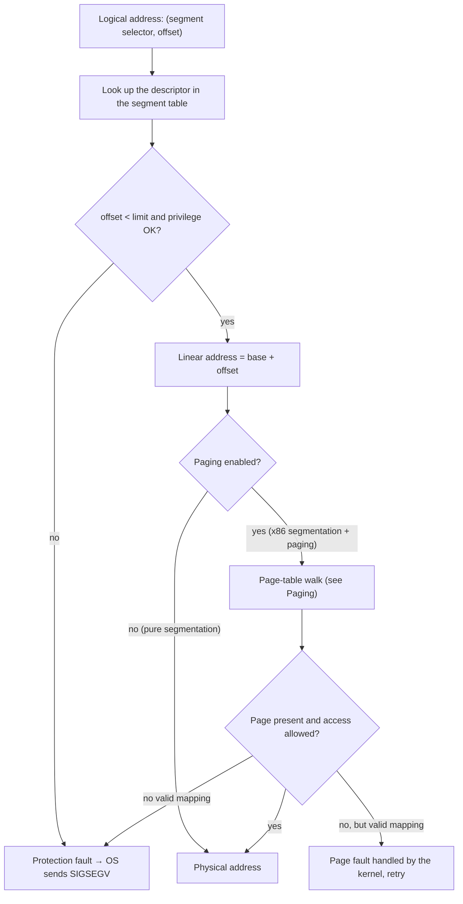

# Segmentation

> **Module 04 · Operating Systems** · Prerequisites: [Paging](25-Paging.md) · Next: [System Calls](27-System-Calls.md)

---

## ⏱ If You Only Have 2 Minutes

- **Segmentation** splits a program's memory into variable-size **segments** (code, data, stack), each described by a **base** and a **limit**. An address is *(segment, offset)*. The hardware checks `offset < limit`, then adds `base`.
- Its weakness is **external fragmentation**. Segments have different sizes, so free memory breaks into holes that are too small to use, and the OS must move segments around (compaction). Paging, with its fixed-size pages, removed the problem.
- 32-bit x86 offered **segmentation with paging**: segments first produced a "linear" address, then paging translated that to physical memory. Linux and other mainstream OSes used a **flat model** (every segment has base 0 and covers the whole space) and relied on paging alone.
- In x86-64 64-bit mode, the bases of CS, DS, ES and SS are treated as 0 and their limits are not checked. Only **FS and GS** can have a non-zero base. Linux uses **FS for user-space thread-local storage** (glibc), and the kernel uses GS for per-CPU data.
- "Segmentation fault" outlived segmentation. Today **any** invalid access caught by the page tables raises `SIGSEGV` (signal 11): an unmapped address such as NULL, a write to read-only memory, executing a no-execute page, or a stack overflow into the guard page.
- A process killed by `SIGSEGV` exits with status **139** (128 + 11), and by default dumps core. It cannot be caught usefully: the process is in an unknown state.
- In a Node or Python service, a segfault almost always comes from **native code**: a C extension, a native addon, `ctypes`/FFI misuse, or a native stack overflow. Get evidence with `faulthandler`, core dumps and the kernel log. Node's diagnostic reports cover V8 fatal errors, not `SIGSEGV`.
- Not to be confused with **TCP segmentation**, which is splitting a byte stream into TCP segments (see [TCP](../Module-06-Networking-and-Distributed-Basics/08-TCP.md)).

---

## 1. What It Is and Why It Exists

**Segmentation** is a memory-management scheme in which a program's address space is a set of named, variable-size pieces called segments: one for code, one for global data, one for the stack, perhaps one per large array. Each address the program uses names a segment and an offset inside it. The hardware keeps a table that says where each segment starts in physical memory (its **base**) and how long it is (its **limit**). It rejects any offset past the limit.

**Analogy:** a binder with tabbed sections. "Section 3, page 12" means: find where section 3 starts, then count 12 pages in. If section 3 has only 10 pages, the request is wrong, and you notice at once. Sections can be any length, so you can lend someone the whole "code" section without exposing "data". But when you remove a 7-page section and want to insert a 9-page one, the gap is too small. Eventually the binder is full of small gaps no section fits in.

**The problem it solved.** Early machines needed three things:

- **Relocation.** A program should run wherever it is loaded, because the OS can just change the base.
- **Protection.** Writes past the end of an array, or into the code, should be caught by hardware.
- **Sharing.** Two processes running the same program should be able to share one copy of the code segment.

Segments match how programmers think about memory, so they delivered all three with very little hardware.

**Why it lost.** Variable sizes cause **external fragmentation**: free memory exists, but not in one piece big enough for the next segment. Fixing that means compaction, which means copying memory around while programs wait. Growing a segment such as a heap or stack can also require moving it. Paging divides memory into equal 4 KiB frames, so any free frame fits any page. Combined with per-page protection bits, it does everything segmentation did, more flexibly. Segmentation survives today in two places: the FS/GS registers on x86-64 and the name of the most famous crash in Unix.

**Why a backend engineer should care.** You will not program segment registers. But "Segmentation fault (core dumped)" and exit status 139 will show up in your crash loops, and you need to know what they mean, where they come from in a Node or Python service, and how to collect evidence. Interviewers also like "segmentation vs paging" as a fundamentals question.

---

## 2. How It Works

### Translating a segmented address



A worked example with three segments:

| Segment | Base | Limit | Permissions |
|---|---|---|---|
| 0: code | `0x10000` | `0x4000` (16 KiB) | read + execute |
| 1: data | `0x30000` | `0x2000` (8 KiB) | read + write |
| 2: stack | `0x50000` | `0x1000` (4 KiB) | read + write |

- `(1, 0x0123)` → `0x0123 < 0x2000`, so physical `0x30000 + 0x0123 = 0x30123`.
- `(1, 0x2400)` → past the 8 KiB limit, so a fault.
- A write to `(0, 0x0010)` → the code segment is not writable, so a fault.

The check costs one comparison and one addition. The segment table is tiny, one entry per segment, compared with a page table that has one entry per page.

### Fragmentation in pictures

```text
Physical memory after a few programs come and go (KiB):

| A code 40 | free 12 | B data 64 | free 20 | A stack 16 | free 18 | C code 30 |

Total free: 50 KiB. A new 32 KiB segment does not fit anywhere.
Options: compact (copy B and A's stack down to merge the holes), or swap a segment out.
```

With paging, those 50 KiB would be about 12 free 4 KiB frames, and a 32 KiB region needs 8 of them. They do not have to be next to each other.

### The x86 story

| Era | Mode | How addresses work |
|---|---|---|
| 8086 (1978) | Real mode | `segment × 16 + offset`, 1 MiB total, no protection. Segments let 16-bit registers reach 20-bit addresses |
| 80286 | 16-bit protected mode | Selectors index descriptor tables (GDT/LDT) holding base, limit and privilege. Segments are at most 64 KiB |
| 80386 | 32-bit protected mode | Segments up to 4 GiB, **plus** optional paging under them: segmentation with paging |
| x86-64 | 64-bit (long) mode | Flat. CS/DS/ES/SS bases are treated as 0 and limits are ignored. FS and GS keep a usable base |

Even on the 80386, Linux chose a flat model. Every code and data segment had base 0 and a 4 GiB limit, so the "linear" address was just the offset. All real protection came from paging. Portability was one reason (other CPUs had no segments), and simplicity was another (one pointer is just one number). AMD made that choice permanent in x86-64 by removing segment bases and limits for the common registers.

### What is left on x86-64 Linux: FS and GS

- **FS → thread-local storage (TLS) in user space.** glibc sets each thread's FS base to point at that thread's control block. It does this with `arch_prctl(ARCH_SET_FS)` for the first thread and through `clone`'s TLS argument for new threads. Code like `__thread` variables, `errno`, and the stack-protector canary is read relative to FS. That is why compiled C on x86-64 Linux is full of instructions like `mov %fs:0x28,%rax`, which loads the stack canary.
- **GS → per-CPU data in the kernel.** On entry to the kernel, the `swapgs` instruction switches GS to the current CPU's data area.
- Since Linux 5.9, user programs can read and write the FS/GS bases directly with the `FSGSBASE` instructions on CPUs that support them. Before that, they needed `arch_prctl`.

So when someone says "Linux doesn't use segmentation", the precise version is: it uses no segment bases or limits for protection or translation. It does use the FS and GS bases as cheap per-thread and per-CPU pointers.

### Why "segmentation fault" still exists

The name stuck from the days when an out-of-bounds access really was a segment-limit violation. Today the path is:

1. A thread touches an address. The MMU finds no valid page-table entry, or the entry forbids the access.
2. The CPU raises a page fault. The kernel looks for a VMA (one line of `/proc/<pid>/maps`) covering the address.
3. If there is no such VMA, or the VMA forbids the access (write to `r-x`, execute from a no-execute page), the kernel sends **`SIGSEGV`** to the thread, with `si_code` set to `SEGV_MAPERR` (no mapping) or `SEGV_ACCERR` (bad permissions).
4. The default action terminates the process and writes a core dump if `ulimit -c` and `core_pattern` allow it. A shell or container reports **139**.

The kernel also logs a line like this (illustrative):

```text
python3[4321]: segfault at 0 ip 00007f3c2a8b1e2d sp 00007ffd5c1b0a48 error 4 in libc.so.6[7f3c2a828000+155000]
```

- `at 0` is the faulting address (here a NULL dereference).
- `ip` is the instruction pointer.
- `error 4` decodes as a user-mode (bit 2) read (bit 1 = 0) of a page that was not present (bit 0 = 0). `error 6` would be a write to a missing page. `error 7` would be a write to a present but read-only page.
- `in libc.so.6[...]` names the library containing `ip`, which is often the most useful clue.

---

## 3. Key Concepts

### Segmentation vs paging

| | Segmentation | Paging |
|---|---|---|
| Unit | Variable-size segment (logical: code, data, stack) | Fixed-size page (4 KiB; 2 MiB / 1 GiB huge pages) |
| Address | (segment, offset), checked against a limit | Virtual page number + offset, through page tables |
| Fragmentation | External (holes between segments) | Internal (unused tail of the last page) |
| Protection granularity | Per segment | Per page |
| Sharing | Whole segments (e.g. a code segment) | Any page (libraries, copy-on-write, page cache) |
| Growth | May need to move or compact the segment | Map more pages anywhere |
| Table size | One entry per segment | One entry per page (multi-level to save space) |
| Visible to programmers | Yes (selectors, far pointers) | No (flat addresses) |
| Status on x86-64 Linux | Only FS/GS bases remain | The real mechanism |

### Signals that look like segfaults

| Signal | Exit status | Typical cause in a backend |
|---|---|---|
| `SIGSEGV` (11) | 139 | NULL or dangling pointer in native code, write to read-only memory, native stack overflow |
| `SIGBUS` (7) | 135 | Access to a page of an `mmap`ed file beyond its end (file truncated), or a full tmpfs or `/dev/shm` backing a mapping |
| `SIGABRT` (6) | 134 | `abort()`: a failed assertion, glibc detecting heap corruption (`double free or corruption`), V8 fatal errors such as heap out of memory |
| `SIGILL` (4) | 132 | A binary built for a newer CPU (e.g. AVX-512 instructions) running on older hardware, or a deliberate trap |
| `SIGFPE` (8) | 136 | Integer division by zero in native code |
| `SIGKILL` (9) | 137 | Not a crash: the OOM killer or an orchestrator (see [Signals](29-Signals.md)) |

Reading the exit status correctly is the first step of every crash investigation. 137 sends you to memory limits, 139 to native code, and 134 to the stderr message printed just before the abort.

### Where segfaults come from in Node and Python services

Pure JavaScript and pure Python cannot segfault the runtime in normal operation. Out-of-range array access returns `undefined` or raises `IndexError`, and null access throws `TypeError` or `AttributeError`. When a service exits with 139, look at native code:

- **Native addons and C extensions.** Image processing, compression, database drivers, XML parsers, crypto, ML libraries. They can be fed input they mishandle, or used from threads they don't support.
- **Wrong binary for the platform.** A prebuilt module compiled against glibc and copied into an Alpine (musl) image, or built for a different CPU feature level. This often shows as `SIGILL` or a load error rather than `SIGSEGV`.
- **FFI misuse.** `ctypes` or `cffi` with the wrong argument types, a freed buffer, or a callback object that was garbage-collected while C still holds a pointer to it.
- **Native stack overflow.** Deep recursion in C code, which is more likely on small musl thread stacks (see [Stack Memory](23-Stack-Memory.md)).
- **Runtime bugs.** Rare, but they happen in JITs and interpreters. Upgrading the runtime is sometimes the fix.
- **`fork()` in a threaded process** followed by native code that uses a lock another thread held. This can deadlock, or crash if the library's state is inconsistent.

### Containing native crashes

A segfault kills the **whole process**, including every request in flight on it. If a feature depends on risky native code, such as parsing user-uploaded images or documents, run that code in a **child process** or a separate service. The crash then costs one child, the parent sees exit status 139, and it can return an error for that one request and restart the helper. The code examples below show exactly that parent-side handling. Worker threads do **not** contain segfaults, because they share the process.

---

## 4. Code Examples

Scenario: a service runs native work in a child process. When the child dies, the parent must tell a native crash (`SIGSEGV`) from an abort or a normal error, log the evidence, and carry on.

### Shell

```bash
# Is a core dump allowed, and where does it go? core_pattern is host-wide, not per container.
ulimit -c; cat /proc/sys/kernel/core_pattern
ulimit -c unlimited                      # allow cores for processes started from this shell

# Kernel log line for the crash (needs privileges on the host)
dmesg -T | grep -i segfault

# systemd hosts: list and debug captured cores
coredumpctl list
coredumpctl gdb <pid>                    # then: bt, info sharedlibrary, thread apply all bt

# Plain core file with gdb (a Node core: also try llnode for JS frames)
gdb /usr/local/bin/python3.12 core.4321 -ex bt -ex quit

# Exit status after the fact
docker inspect --format '{{.State.ExitCode}}' <container>     # 139
kubectl get pod <pod> -o jsonpath='{.status.containerStatuses[0].lastState.terminated.exitCode}'
```

### Node.js / TypeScript

A real `SIGSEGV` in Node comes from native code. Here the child sends `SIGSEGV` to itself, which produces exactly what a native crash looks like to the parent. A second child exhausts a tiny heap to show the difference between a segfault and a V8 fatal error.

```ts
// No npm packages — Node.js 22+, TypeScript 5, Linux.
import { spawn } from "node:child_process";
import { mkdir, readdir, readFile } from "node:fs/promises";
import { constants } from "node:os";

const REPORT_DIR = "/tmp/node-reports";

// Child programs. A real SIGSEGV in Node comes from native code (an addon, a bug in a
// library); here the child sends SIGSEGV to itself so the parent sees the same exit.
const CHILDREN: Record<string, string> = {
  segv: "process.kill(process.pid, 'SIGSEGV')",
  heapOom: "const keep = []; for (;;) keep.push(new Array(1e5).fill(Math.random()))",
};

function run(name: string, code: string): Promise<void> {
  return new Promise((resolve) => {
    const child = spawn(process.execPath, [
      "--report-on-fatalerror",          // V8/Node fatal errors (heap OOM) write a JSON report
      `--report-directory=${REPORT_DIR}`,
      "--max-old-space-size=32",          // small heap so the OOM case is quick
      "-e", code,
    ], { stdio: ["ignore", "ignore", "pipe"] });
    let stderr = "";
    child.stderr.on("data", (c: Buffer) => { stderr += c.toString(); });

    // "close" gets the same (code, signal) as "exit" but also waits for stderr to drain.
    child.on("close", (code, signal) => {
      // Killed by a signal: code is null, signal is the name. A shell or container shows 128 + N.
      const status = signal ? 128 + constants.signals[signal] : code;
      const kind = signal === "SIGSEGV" ? "native crash: get a core dump, check addons"
        : signal === "SIGABRT" ? "abort (V8 fatal error or a failed assertion)"
        : signal ? "killed by a signal" : code === 0 ? "clean exit" : "error exit";
      console.log(`${name}: code=${code} signal=${signal} shell-status=${status} -> ${kind}`);
      const fatal = stderr.split("\n").find((l) => l.includes("FATAL ERROR"));
      if (fatal) console.log(`  ${fatal.trim()}`);
      resolve();
    });
  });
}

await mkdir(REPORT_DIR, { recursive: true });
for (const [name, code] of Object.entries(CHILDREN)) await run(name, code);

// Reports are JSON: JS stack, native stack, heap stats, libuv handles, env, resource limits.
for (const file of await readdir(REPORT_DIR)) {
  const report = JSON.parse(await readFile(`${REPORT_DIR}/${file}`, "utf8"));
  console.log(`report ${file}: event="${report.header.event}" trigger=${report.header.trigger}`);
}
```

Output (measured, Node 22):

```text
segv: code=null signal=SIGSEGV shell-status=139 -> native crash: get a core dump, check addons
heapOom: code=null signal=SIGABRT shell-status=134 -> abort (V8 fatal error or a failed assertion)
  FATAL ERROR: Reached heap limit Allocation failed - JavaScript heap out of memory
report report.20261125.182912.33.0.001.json: event="Allocation failed - JavaScript heap out of memory" trigger=OOMError
```

Only the heap-OOM child left a diagnostic report. `--report-on-fatalerror` covers errors that V8 and Node detect themselves. A segfault in native code kills the process before any JavaScript-level reporting can run. For those you need a core dump, opened with `gdb` (and `llnode` for JavaScript frames). Two related flags: `--report-uncaught-exception` writes a report on an unhandled exception, and `--report-on-signal` writes one on demand when you send `SIGUSR2`, which is useful for a live but stuck process.

### Python

```python
# No pip packages — Python 3.12+, Linux. Run: python3 crash.py
import signal
import subprocess
import sys

# The child dereferences address 0 through ctypes: the same failure a buggy C extension
# produces. Without faulthandler you would only see "Segmentation fault" (from the shell).
CHILD = """
import ctypes, faulthandler, sys
faulthandler.enable()          # same as `python -X faulthandler` or PYTHONFAULTHANDLER=1

def parse_row(raw):
    return ctypes.string_at(0)  # read from NULL -> no mapping -> page fault -> SIGSEGV

print("worker started", flush=True)
parse_row(b"...")
"""


def run_worker() -> None:
    proc = subprocess.run([sys.executable, "-c", CHILD], capture_output=True, text=True, timeout=30)
    print(proc.stdout.strip())
    if proc.returncode < 0:  # subprocess reports "killed by signal N" as -N
        sig = signal.Signals(-proc.returncode)
        print(f"worker killed by {sig.name}; a shell or container would show {128 + sig.value}")
        # faulthandler wrote the Python stack to stderr before the default action ran.
        for line in proc.stderr.splitlines():
            if line.startswith(("Fatal Python error", "  File")):
                print("  " + line.strip())
    else:
        print(f"worker exited with {proc.returncode}")


if __name__ == "__main__":
    run_worker()
```

Output (measured, Python 3.12):

```text
worker started
worker killed by SIGSEGV; a shell or container would show 139
  Fatal Python error: Segmentation fault
  File "/usr/local/lib/python3.12/ctypes/__init__.py", line 525 in string_at
  File "<string>", line 6 in parse_row
  File "<string>", line 9 in <module>
```

`faulthandler` installs a handler for `SIGSEGV`, `SIGFPE`, `SIGABRT`, `SIGBUS` and `SIGILL`. Using only async-signal-safe writes, it prints the Python stack of every thread to stderr, then restores the default action, so the process still dies with the original signal and exit status. That traceback is what turns "exit 139" into "crashed in `parse_row` calling into ctypes".

**Runtime difference to notice:** Python can print the *Python-level* stack at the moment of a native crash, thanks to `faulthandler`. Node has no built-in equivalent for `SIGSEGV`, so its crash evidence is a core dump plus symbols. Its diagnostic reports cover V8 fatal errors, uncaught exceptions and on-demand signals instead. In both runtimes, the parent sees the same thing, "killed by signal 11", only encoded differently: `signal === "SIGSEGV"` in Node, `returncode == -11` in Python, 139 in a shell.

---

## 5. Production Concerns

- **Turn on crash evidence before you need it.** Set `PYTHONFAULTHANDLER=1` (or `-X faulthandler`) in every Python service image: it costs nothing until a crash. For Node, add `--report-on-fatalerror --report-directory=<volume>` to `NODE_OPTIONS`, and log the exit code and signal from your supervisor.
- **Core dumps in containers are a host decision.** `/proc/sys/kernel/core_pattern` is global to the host. On systemd hosts it usually pipes to `systemd-coredump`, so cores land on the node, not in your container. Decide with the platform team where cores go, cap their size, and remember they contain memory contents: secrets, tokens and user data. Treat them as sensitive.
- **Alert on exit status 139 separately from 137.** A crash loop with 139 is a native-code bug, a bad binary, or poisoned input. 137 is memory or orchestration. `CrashLoopBackOff` with 139 right after a deploy usually means a native dependency changed (new base image, Alpine vs Debian, a new addon version).
- **Isolate risky native parsing.** Image, PDF, archive and document parsers have long histories of memory-safety bugs. A segfault on crafted input can also be an exploitable memory-corruption vulnerability, not just a crash. Run them in a child process or a separate service with resource limits, a timeout and low privileges, and map a 139 to a 4xx/5xx for that request only.
- **Pin and match native builds.** Build native modules inside the same base image you deploy (same libc, same CPU baseline). After a Node major upgrade, rebuild addons. N-API addons are ABI-stable across versions, but older `nan`-based ones must be recompiled.
- **Don't try to keep running after `SIGSEGV`.** Installing a handler that logs and continues returns to the faulting instruction, which faults again, or leaves corrupted state behind. Log, dump, exit, and let the supervisor restart.

---

## 6. Common Mistakes

- **Reading "segmentation fault" as "out of memory"** — someone raises the memory limit and the crash continues — a segfault is an invalid access. OOM kills show up as 137 or `OOMKilled`.
- **Saying Linux x86-64 uses segmentation for protection** — interviewers expect "flat model, paging does protection" — say that segment bases are 0 except FS/GS, which hold the TLS and per-CPU pointers.
- **Running a native parser in a worker thread to "contain" crashes** — a segfault kills the whole process, every thread included — use a child process or a separate service.
- **No `faulthandler` and no core dumps** — the only evidence is "exited with 139" — enable `PYTHONFAULTHANDLER`, configure core dumps, and log signal names from supervisors.
- **Copying `node_modules` or wheels built on another OS or libc into the image** — crashes or `SIGILL` on startup — install dependencies inside the target image (multi-stage builds), and match glibc vs musl.
- **Catching `SIGSEGV` and resuming** — the faulting instruction re-runs or state is corrupt — let the process die after writing diagnostics.
- **Confusing memory segmentation with TCP segmentation** — an interview answer about MSS and TSO when the question was about memory — clarify which one is meant.

---

## 7. Comparison Table

| | Pure segmentation | Pure paging | Segmentation + paging (x86-32) | Flat model on paging (Linux, x86-64) |
|---|---|---|---|---|
| Address the program uses | (segment, offset) | One flat virtual address | (selector, offset) → linear → physical | One flat virtual address; FS/GS for TLS |
| Fragmentation | External | Internal, small | Internal (paging hides the holes) | Internal, small |
| Protection unit | Segment | Page | Both | Page |
| Hardware cost per access | Limit check + add | TLB lookup or page-table walk | Both | TLB lookup or page-table walk |
| Used by | Early systems, 16-bit x86 software | Most CPUs (ARM, RISC-V, x86-64) | Some 32-bit x86 OSes | Linux, Windows, macOS today |
| Why choose it | Simple hardware, logical units | No external fragmentation, flexible sharing | Compatibility with segmented software | Simplicity and portability |

---

## 8. Interview Questions

**[Junior] What is segmentation, and how does it differ from paging?**
Segmentation divides memory into variable-size logical units (code, data, stack), each with a base and a limit, and addresses are a segment plus an offset checked against the limit. Paging divides memory into fixed-size pages mapped through page tables. Segmentation suffers external fragmentation because holes of odd sizes appear between segments. Paging avoids it because any free frame can hold any page, at the cost of a little internal fragmentation. Modern OSes use paging for translation and protection.

**[Junior] What does "Segmentation fault (core dumped)" mean, and what is exit status 139?**
The process accessed memory it may not access: an unmapped address such as NULL, a write to read-only memory, or a jump into a no-execute page. The kernel sent `SIGSEGV`, whose default action terminates the process and writes a core dump if allowed. A shell or container reports a death by signal *N* as 128 + *N*, and `SIGSEGV` is 11, so 139.

**[Mid] Why is it still called a segmentation fault if Linux doesn't use segmentation?**
The name dates from systems where an out-of-bounds access was a segment-limit violation. Linux uses a flat segment model and catches invalid accesses through page tables and the kernel's list of mappings, but it kept the signal name `SIGSEGV` for compatibility. The kernel even reports whether the cause was a missing mapping (`SEGV_MAPERR`) or a permission violation (`SEGV_ACCERR`).

**[Mid] What are FS and GS used for on x86-64 Linux?**
In 64-bit mode the bases of CS, DS, ES and SS are treated as zero, so segmentation no longer translates addresses. FS and GS still have usable bases. Linux user space uses FS to point at the current thread's thread-local storage block (glibc reads `errno`, `__thread` variables and the stack canary at `%fs:offset`). The kernel uses GS, via `swapgs`, to find the current CPU's per-CPU data.

**[Mid] A Python service exits with 139. How do you find the cause?**
139 means `SIGSEGV`, so the culprit is native code: a C extension, `ctypes`/`cffi`, or the interpreter itself. Enable `faulthandler` (`PYTHONFAULTHANDLER=1`) so the next crash prints the Python stack of every thread, which usually names the extension and the call. Check the kernel log line for the faulting library. Capture a core dump and run `gdb` on it for the native backtrace. Then check for a recent dependency or base-image change, or libc mismatches.

**[Senior] Your Node API crashes with `SIGSEGV` when processing certain uploaded images. How do you fix it short-term and long-term?**
Short-term, I would move image processing out of the API process into a child process or a separate service, so a crash costs one request instead of every request on that instance. The parent maps the child's `SIGSEGV` to an error response and restarts the helper. I would also capture a core dump and the offending input, if possible. Long-term: identify the native library and version from the core or the kernel log, upgrade or patch it, and add the input to a regression test. Because a crash on crafted input may be exploitable memory corruption, the helper should also run with low privileges, a timeout and resource limits.

**[Senior] Why did paging win over segmentation, and is there anything segmentation did better?**
Paging wins on allocation: fixed-size frames remove external fragmentation and compaction, make growth trivial, and allow fine-grained sharing and copy-on-write per page. Segmentation was better at expressing logical units with exact bounds. A segment limit catches an overflow at the exact end of an object, while a page only catches it at the next page boundary. It also needs tiny tables. Modern systems recover some of that precision with guard pages, sanitizers and memory tagging on some CPUs, instead of hardware segments.

**[Senior] What's the difference between `SIGSEGV`, `SIGBUS` and `SIGABRT` in a crash investigation?**
`SIGSEGV` is an invalid access: no mapping, or a permission violation. `SIGBUS` means the mapping exists but cannot be backed. The typical backend case is touching an `mmap`ed file past its end after it was truncated, or a full tmpfs. `SIGABRT` is the program aborting itself: a failed assertion, glibc detecting heap corruption, or V8's fatal "heap out of memory". The exit statuses are 139, 135 and 134. Each points to a different first step: native-code debugging, file-replacement practices, or the stderr message printed before the abort.

---

## 9. Cheat Sheet

```text
Segmentation    variable-size segments; (segment, offset); check offset < limit; addr = base + offset
Weakness        external fragmentation → compaction; growth may move segments
Paging won      fixed frames, no external fragmentation, per-page protection & sharing
x86 history     8086 seg*16+off · 286 descriptors (GDT/LDT) · 386 segments + paging · x86-64 flat
x86-64 Linux    CS/DS/ES/SS base 0, no limits · FS = user TLS (glibc, %fs:0x28 canary) · GS = kernel per-CPU
SIGSEGV today   any invalid access via page tables/VMAs: unmapped (MAPERR) or forbidden (ACCERR)
Exit codes      139 SEGV · 135 BUS · 134 ABRT · 132 ILL · 136 FPE · 137 KILL (OOM, not a crash)
Kernel log      "segfault at ADDR ip ... error 4 in lib.so" — 4 user read missing · 6 user write missing · 7 write read-only
Sources         native addons, C extensions, ctypes/FFI, wrong libc/CPU build, native stack overflow
Python          PYTHONFAULTHANDLER=1 → Python stack of all threads on SEGV/BUS/ABRT/ILL/FPE
Node            exit/close event: code=null, signal="SIGSEGV"; --report-on-fatalerror (V8 fatal only)
Evidence        ulimit -c · core_pattern (host-wide) · coredumpctl gdb · gdb bt · llnode
Contain         run risky native code in a child process, not a worker thread
Not this        TCP segmentation = splitting a byte stream into TCP segments
```

---

## Related Topics

- [Paging](25-Paging.md) — the mechanism that replaced segmentation and now raises the faults
- [Virtual Memory](24-Virtual-Memory.md) — VMAs, protection bits, and `SIGBUS` on mapped files
- [Signals](29-Signals.md) — `SIGSEGV` among the other signals, and exit status 128 + N
- [Stack Memory](23-Stack-Memory.md) — native stack overflow, one common source of `SIGSEGV`
- [Processes](02-Processes.md) — child processes, exit statuses, and isolating crashes
- [TCP](../Module-06-Networking-and-Distributed-Basics/08-TCP.md) — the other meaning of "segmentation"
