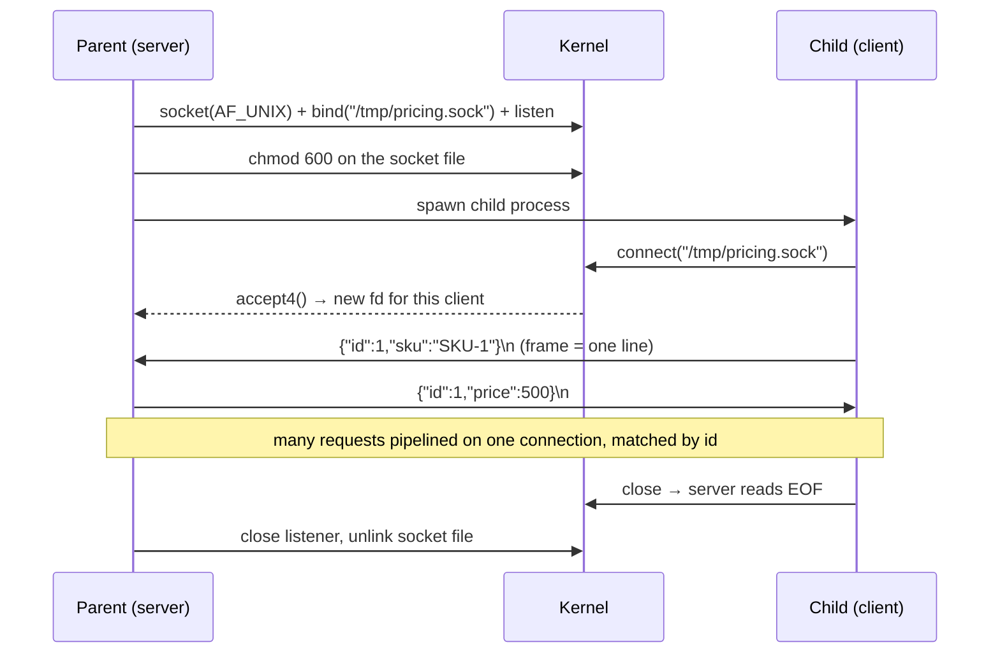

# Inter Process Communication

> **Module 04 · Operating Systems** · Prerequisites: [Processes](02-Processes.md), [System Calls](27-System-Calls.md) · Next: [Signals](29-Signals.md)

---

## ⏱ If You Only Have 2 Minutes

- Processes do not share memory, so they talk through channels the kernel provides: **pipes**, **FIFOs**, **Unix domain sockets**, **TCP on loopback**, **shared memory**, **message queues** and **signals**. Across machines, the channel is the network, usually through a database, Redis or a message broker.
- A **pipe** is a one-way byte stream with a kernel buffer (64 KiB by default on Linux). The writer blocks when it is full. Writes of up to `PIPE_BUF` (4096 bytes) are atomic. The reader sees EOF only when **every** write end is closed, and writing with no reader left gives `SIGPIPE`/`EPIPE`.
- A **Unix domain socket** uses the socket API with a file-system path instead of an IP and port. It is bidirectional, serves many clients, skips the TCP/IP stack, is protected by **file permissions**, can report the peer's UID/PID (`SO_PEERCRED`), and can pass open file descriptors. PostgreSQL's local connections and `/var/run/docker.sock` both use it.
- Stream channels have **no message boundaries**. You must frame messages yourself, for example with newline-delimited JSON or a length prefix, and cap the frame size.
- **Shared memory** is the fastest option (no copying) but needs synchronization. On Linux it lives in `/dev/shm`, which is RAM charged to the container's memory limit. Docker gives `/dev/shm` only **64 MiB** by default. In Node, `SharedArrayBuffer` is shared only between `worker_threads` of **one** process.
- Node's `child_process.fork()` gives you an IPC channel (a socket pair) carrying JSON, or structured clone with `serialization: "advanced"`. Python's `multiprocessing.Pipe`/`Queue` **pickle** objects, so never receive from a peer you don't trust.
- Serialization often costs more than the transport: `JSON.stringify`/`json.dumps`, pickling and copying. Send less, and send it in batches.
- Choose by scope. Parent and child on one host: pipe or socket pair. Local daemon with many clients: Unix socket. Another host: TCP. Big read-mostly data: shared memory or a file. Work that must survive a crash: a durable queue.

---

## 1. What It Is and Why It Exists

**Inter-process communication (IPC)** is any mechanism that lets separate processes exchange data or coordinate. The kernel gives each process a private address space ([Virtual Memory](24-Virtual-Memory.md)), and that isolation is the point: one crashing worker cannot corrupt another. But processes still need to cooperate. A master hands out work, a web server talks to a local database, a sidecar ships logs, a supervisor tells workers to stop.

**Analogy:** an office where everyone works in a locked room. You can slide notes under a door into one specific room (a pipe), use an intercom that anyone with the right badge can call (a Unix socket), phone another building (TCP), share a whiteboard in a glass room both of you can see (shared memory, where you need a rule about who writes when), leave letters in a mail room (a message queue), or pull a fire alarm that carries no words at all (a signal).

**What breaks without the right choice:**

- **Deadlock.** Two processes write into full pipe buffers and both wait forever.
- **Corrupted messages.** Two writers interleave bytes on one stream, or a reader assumes one `read` equals one message.
- **Security holes.** A socket file anyone can open, or unpickling data from an untrusted peer, which runs arbitrary code.
- **Memory surprises.** Shared memory or `/dev/shm` files silently count toward a container's limit.

Backends use IPC everywhere, mostly hidden: Gunicorn's master and workers, Node's `cluster`, `subprocess` pipes to `ffmpeg`, `psql` connecting to `/var/run/postgresql`, the Docker CLI talking to `dockerd`, and nginx forwarding to an app over a Unix socket.

---

## 2. How It Works

### Pipes and FIFOs

`pipe2()` creates a kernel buffer with two file descriptors: a read end and a write end. After `fork`, the parent keeps one end and the child the other. This is how a shell builds `a | b`, and how `subprocess`/`child_process` capture a child's stdout.

- **Capacity.** 64 KiB by default (`pipe(7)`). It can be resized with `fcntl(F_SETPIPE_SZ)` up to `/proc/sys/fs/pipe-max-size`. When the buffer is full, the writer blocks (or gets `EAGAIN` if non-blocking). That is **backpressure** built into the kernel.
- **Atomicity.** Writes of up to `PIPE_BUF` (4096 bytes on Linux) are never interleaved with other writers' data. Larger writes can be.
- **EOF.** The reader sees EOF only when all write ends are closed in **every** process. A forgotten copy of the write end, inherited by a child, keeps the reader waiting forever.
- **FIFO** (named pipe). `mkfifo /run/app/cmd` creates a pipe with a path, so unrelated processes can open it. Opening blocks until both a reader and a writer are present.

### Unix domain sockets

`socket(AF_UNIX, SOCK_STREAM, 0)`, then `bind()` to a path such as `/run/app/pricing.sock`, `listen()`, `accept()`: the same calls as TCP, but the address is a file. The kernel moves data directly from one socket buffer to the other. There are no IP headers, checksums, sequence numbers, ACKs or congestion control. Three socket types exist:

- `SOCK_STREAM`: a byte stream, like TCP.
- `SOCK_DGRAM`: reliable on Linux, with message boundaries kept.
- `SOCK_SEQPACKET`: connection-oriented with message boundaries.

Extra features that TCP does not have:

- **Permissions.** Connecting needs write permission on the socket file, so `chmod 600` or a group restricts who may connect.
- **Peer credentials.** `SO_PEERCRED` gives the connecting process's PID, UID and GID, trusted because the kernel supplies them. PostgreSQL's `peer` authentication uses this to log in OS user `postgres` as database role `postgres` without a password.
- **Passing descriptors.** `SCM_RIGHTS` messages hand an open file or socket to another process. Node's `cluster` uses handle passing over its IPC channel. Zero-downtime reload tools use it to hand over a listening socket.
- **Limits.** The path must fit in `sun_path`, 108 bytes on Linux, so a socket deep inside a long directory path cannot be created. Keep socket paths short. Linux also has an **abstract namespace** (a name starting with a NUL byte): no file and no permissions, scoped to the network namespace.



### Shared memory

Two processes map the same physical pages:

- **POSIX shared memory.** `shm_open("/name")` creates `/dev/shm/name` on a tmpfs, then `mmap(MAP_SHARED)` maps it. Python offers this as `multiprocessing.shared_memory.SharedMemory`.
- **A shared mapping of a regular file** (`mmap` with `MAP_SHARED`).
- **System V shared memory** (`shmget`). This is legacy, but still visible with `ipcs -m`.

Nothing is copied: a write by one process is immediately visible to the other. That is why you need **synchronization**: atomics, a process-shared mutex or semaphore, or a single-writer protocol. tmpfs pages are RAM (or swap), and they are charged to the cgroup like any other memory.

### Message queues

POSIX message queues (`mq_open`, under `/dev/mqueue`) keep discrete, prioritized messages in the kernel, but neither Node core nor the Python standard library exposes them. In backend practice, "message queue" means a broker such as RabbitMQ, Kafka, SQS or Redis streams, which adds durability, acknowledgements and fan-out (see [Message Queues](../Module-07-Advanced-Backend-and-System-Design/21-Message-Queues.md)).

### Observing IPC on Linux

```bash
ss -xlp                              # listening Unix sockets with owning processes
ss -xp | grep pricing                # connected Unix sockets
lsof -U -a -p <pid>                  # a process's Unix sockets
ls -l /proc/<pid>/fd                 # pipe:[inode], socket:[inode], /dev/shm/... targets
df -h /dev/shm; ls -l /dev/shm       # shared memory usage
ipcs -m                              # System V shared memory segments
strace -f -e trace=%net,read,write -p <pid>   # watch the traffic
```

Illustrative `ss -xlp` output on a host running PostgreSQL, Docker and a Gunicorn app behind nginx:

```text
Netid State  Recv-Q Send-Q Local Address:Port                         Peer Address:Port Process
u_str LISTEN 0      244    /var/run/postgresql/.s.PGSQL.5432 41822         * 0     users:(("postgres",pid=812,fd=7))
u_str LISTEN 0      4096   /run/docker.sock 23011                          * 0     users:(("dockerd",pid=1104,fd=4))
u_str LISTEN 0      2048   /run/gunicorn.sock 51877                        * 0     users:(("gunicorn",pid=2201,fd=5))
```

For a listening socket, `Recv-Q` is the number of connections waiting to be accepted, and `Send-Q` is the backlog limit.

---

## 3. Key Concepts

### The mechanisms side by side

| Mechanism | Direction | Who can use it | Message boundaries | Copies | Typical backend use |
|---|---|---|---|---|---|
| Anonymous pipe | One-way | Related processes (inherited fd) | No (byte stream) | User → kernel → user | Child stdout/stderr, shell pipelines |
| FIFO | One-way | Any process with file access | No | Same | Simple command channels, legacy tools |
| Unix domain socket | Two-way | Any process with file permission | Stream: no; DGRAM/SEQPACKET: yes | Same, but no TCP/IP stack | PostgreSQL, Docker, nginx → app, sidecars, local agents |
| TCP loopback | Two-way | Anything that can reach the port | No | Same, plus the full TCP stack | Services that might move to another host; containers in one pod |
| Shared memory | Both (shared) | Processes that map it | You define them | None | Large data between workers, PostgreSQL buffers, ML tensors |
| POSIX message queue | One-way per queue | Processes with access to the name | Yes, with priorities | Through the kernel | Rare in web backends |
| Signals | One-way notification | Same user, root, or orchestrator | Just a number | None | Stop, reload, dump state ([Signals](29-Signals.md)) |
| DB / Redis / broker | Any | Anything on the network | Yes | Serialization + network + storage | Work queues, events, shared state between services |

### Framing and serialization

A byte stream delivers bytes, not messages. One `write` of 2 KiB can arrive as two `read`s of 1 KiB, and two small writes can arrive in one `read`. Every stream protocol therefore defines **framing**:

- **Newline-delimited JSON (NDJSON).** Easy to debug with `socat` or `nc -U`. JSON escapes newlines inside strings, so a raw `\n` always ends a frame. Cap the line length.
- **Length prefix.** A 4-byte big-endian length, then the payload. It handles binary data. Validate the length before allocating a buffer for it.
- **Self-delimiting formats.** HTTP/1.1 headers plus `Content-Length`, the PostgreSQL and Redis protocols.

Serialization is usually the real cost of IPC. Encoding to JSON and parsing it back can dominate a local round trip, and pickle is fast but **executes code on load**. Options:

| Format | Node | Python | Notes |
|---|---|---|---|
| JSON | Built in | Built in | Universal, slow for large numeric data, no binary type |
| Structured clone | `serialization: "advanced"`, `v8.serialize` | — | Supports `Map`, `Set`, `BigInt`, typed arrays; Node-only |
| pickle | — | Built in (`multiprocessing` uses it) | Python-only; **never** unpickle untrusted bytes |
| MessagePack / Protobuf | Libraries | Libraries | Compact and cross-language; Protobuf adds a schema |
| Raw shared buffers | `SharedArrayBuffer` (threads only) | `shared_memory`, `mmap` | No serialization at all; you design the layout |

### Unix sockets in practice

- **PostgreSQL** listens on a socket file named `.s.PGSQL.5432` in `unix_socket_directories` (`/var/run/postgresql` on Debian/Ubuntu packages, `/tmp` in a default source build). `psql` with no host uses it, and `pg_hba.conf` `local … peer` authenticates by the kernel-reported UID. Drivers connect to it when you give a directory as the host (`host=/var/run/postgresql`).
- **Docker.** The CLI talks HTTP to `dockerd` over `/var/run/docker.sock`. Whoever can open that socket can start a privileged container, so membership in the `docker` group, or mounting the socket into a container, is equivalent to **root on the host**.
- **App behind a local proxy.** Gunicorn `--bind unix:/run/gunicorn.sock` with nginx `proxy_pass http://unix:/run/gunicorn.sock;`. This avoids exposing a port and is a little cheaper than loopback TCP.
- **Between containers in a pod.** Containers share the network namespace, so `127.0.0.1` works. A Unix socket needs a shared volume (`emptyDir`) mounted in both containers.

### Runtime-level IPC

**Node.js**

- `child_process.fork()` starts a new Node process with an extra file descriptor: a Unix socket pair used as the **IPC channel**. `child.send()` / `process.on("message")` carry JSON (default) or structured-clone data. `send()` can also pass a server or socket handle.
- `cluster` is built on this. The primary process accepts connections and hands them to workers round-robin (the default everywhere except Windows), or lets workers accept on a shared socket.
- `worker_threads` are **not** IPC. They are threads in one process, sharing memory through `SharedArrayBuffer` and transferring `ArrayBuffer`s with `postMessage`. Processes cannot share a `SharedArrayBuffer`.

**Python**

- `multiprocessing.Pipe()` returns two `Connection` objects (a socket pair on Unix when duplex). `send()`/`recv()` pickle the objects.
- `multiprocessing.Queue` is a pipe plus a background **feeder thread** that pickles and writes, plus a lock. Large items and unconsumed queues can make `join()` hang.
- `multiprocessing.shared_memory.SharedMemory` (3.8+) creates a named block in `/dev/shm`. Someone must `unlink()` it.
- `Manager()` starts a server process and proxies objects over sockets. It is convenient but slow per operation.
- **Gunicorn** coordinates its workers with signals plus a heartbeat file per worker that the master checks. Its docs recommend `--worker-tmp-dir /dev/shm` in Docker, so the heartbeat doesn't block on a slow disk.

### Choosing

Decide by scope and durability first, then performance:

1. **Must survive a crash or reach another host?** A database, Redis or a broker. Local IPC loses in-flight data.
2. **Parent and child only?** Pipes or the runtime's channel (`fork`, `multiprocessing.Pipe`).
3. **Local daemon, many clients?** A Unix domain socket, with permissions as access control.
4. **Large read-mostly data on one host?** Shared memory or a shared `mmap`ed file ([Virtual Memory](24-Virtual-Memory.md)), plus small control messages over a socket.
5. **Only "stop", "reload" or "dump state"?** Signals.

---

## 4. Code Examples

Scenario: a pricing helper runs as a separate process next to the main server. The parent listens on a Unix domain socket restricted to its user, starts the child, and the child sends 10,000 pipelined NDJSON requests over one connection. Then a short comparison of each runtime's built-in parent–child channel.

### Node.js / TypeScript

```ts
// No npm packages — Node.js 22+, TypeScript 5, Linux/macOS. Run: node dist/uds.js
import { createServer, createConnection, type Socket } from "node:net";
import { createInterface } from "node:readline";
import { spawn } from "node:child_process";
import { chmodSync, rmSync } from "node:fs";
import { once } from "node:events";

const SOCK = "/tmp/pricing.sock";
type Req = { id: number; sku: string };
type Res = { id: number; price?: number; error?: string };

// Newline-delimited JSON: a stream socket has no message boundaries, so "\n" is the frame.
function lines(sock: Socket, onLine: (line: string) => void): void {
  createInterface({ input: sock, crlfDelay: Infinity }).on("line", onLine);
}

async function server(): Promise<void> {
  rmSync(SOCK, { force: true }); // a socket file left by a crashed run makes listen() fail with EADDRINUSE
  const srv = createServer((conn) => {
    lines(conn, (line) => {
      let res: Res;
      try {
        const req = JSON.parse(line) as Req;
        res = { id: req.id, price: req.sku.length * 100 };
      } catch {
        res = { id: -1, error: "bad json" };
      }
      conn.write(JSON.stringify(res) + "\n");
    });
  });
  srv.listen(SOCK);
  await once(srv, "listening");
  chmodSync(SOCK, 0o600); // access control is file permissions: only this user may connect

  const child = spawn(process.execPath, [process.argv[1], "client"], { stdio: "inherit" });
  const [code] = await once(child, "exit");
  srv.close();
  rmSync(SOCK, { force: true });
  console.log(`server: client exited with ${code}`);
}

async function client(): Promise<void> {
  const sock = createConnection(SOCK);
  await once(sock, "connect");
  const pending = new Map<number, (r: Res) => void>();
  lines(sock, (line) => {
    const res = JSON.parse(line) as Res;
    pending.get(res.id)?.(res); // responses are matched by id, so requests can be pipelined
    pending.delete(res.id);
  });
  const ask = (req: Req) => new Promise<Res>((resolve) => {
    pending.set(req.id, resolve);
    sock.write(JSON.stringify(req) + "\n");
  });
  const t0 = performance.now();
  const results = await Promise.all(Array.from({ length: 10_000 }, (_, i) => ask({ id: i, sku: `SKU-${i}` })));
  console.log(`client: ${results.length} round trips in ${(performance.now() - t0).toFixed(0)} ms, e.g.`, results[42]);
  sock.end();
}

await (process.argv[2] === "client" ? client() : server());
```

Output (measured, Node 22, Docker on a laptop):

```text
client: 10000 round trips in 45 ms, e.g. { id: 42, price: 600 }
server: client exited with 0
```

Node's `readline` has no maximum line length. For a socket that untrusted processes can reach, use a framer that rejects lines over a cap, or a length-prefixed protocol.

The built-in parent–child channel, for comparison:

```ts
// No npm packages — Node.js 22+, TypeScript 5. Run: node dist/forkipc.js
import { fork } from "node:child_process";
import { once } from "node:events";

type Job = { id: number; rows: number[] };

if (process.argv[2] === "worker") {
  // A brand-new Node process (not fork(2)): it shares no memory, only this channel.
  process.on("message", (job: Job) => {
    process.send!({ id: job.id, sum: job.rows.reduce((a, b) => a + b, 0) });
  });
  process.on("disconnect", () => process.exit(0)); // parent gone: stop
} else {
  // "advanced" uses the structured clone algorithm (Map, Set, BigInt, typed arrays);
  // the default "json" cannot carry those.
  const worker = fork(process.argv[1], ["worker"], { serialization: "advanced" });
  worker.send({ id: 1, rows: Array.from({ length: 1_000 }, (_, i) => i) } satisfies Job);
  const [reply] = await once(worker, "message");
  console.log("parent got", reply); // { id: 1, sum: 499500 }
  worker.disconnect();
}
```

Inside the child, `/proc/self/fd/3` is a `socket:[…]`: the IPC channel is a Unix socket pair that Node frames for you.

### Python

```python
# No pip packages — Python 3.12+, Linux/macOS. Run: python3 uds.py
import asyncio
import json
import os
import sys
import time

SOCK = "/tmp/pricing.sock"
MAX_LINE = 64 * 1024  # StreamReader limit: a longer line raises instead of growing forever


async def handle(reader: asyncio.StreamReader, writer: asyncio.StreamWriter) -> None:
    try:
        while line := await reader.readline():  # b"" means the peer closed
            try:
                req = json.loads(line)
                res = {"id": req["id"], "price": len(req["sku"]) * 100}
            except (ValueError, KeyError):
                res = {"id": -1, "error": "bad request"}
            writer.write(json.dumps(res).encode() + b"\n")
            await writer.drain()  # backpressure: wait if the client is not reading
    except ValueError:  # line longer than MAX_LINE
        pass
    finally:
        writer.close()


async def server() -> None:
    if os.path.exists(SOCK):
        os.unlink(SOCK)  # stale file from a crashed run would make bind() fail
    srv = await asyncio.start_unix_server(handle, path=SOCK, limit=MAX_LINE)
    os.chmod(SOCK, 0o600)  # who may connect is decided by file permissions
    child = await asyncio.create_subprocess_exec(sys.executable, __file__, "client")
    code = await child.wait()
    srv.close()
    await srv.wait_closed()
    os.unlink(SOCK)
    print(f"server: client exited with {code}")


async def client() -> None:
    reader, writer = await asyncio.open_unix_connection(SOCK, limit=MAX_LINE)
    n = 10_000

    async def read_replies() -> list[dict]:
        return [json.loads(await reader.readline()) for _ in range(n)]

    t0 = time.perf_counter()
    # Read while writing: if both sides only write, both socket buffers fill and they deadlock.
    replies = asyncio.create_task(read_replies())
    for i in range(n):  # pipelined; one connection keeps replies in request order
        writer.write(json.dumps({"id": i, "sku": f"SKU-{i}"}).encode() + b"\n")
        await writer.drain()
    results = await replies
    print(f"client: {n} round trips in {(time.perf_counter() - t0) * 1000:.0f} ms, e.g. {results[42]}")
    writer.close()
    await writer.wait_closed()


if __name__ == "__main__":
    asyncio.run(client() if sys.argv[1:] == ["client"] else server())
```

Output (measured, Python 3.12, same machine):

```text
client: 10000 round trips in 277 ms, e.g. {'id': 42, 'price': 600}
server: client exited with 0
```

The first version of this client wrote all 10,000 requests before reading any replies, and took about a second. Nobody read the replies until every request was written, so they piled up in socket buffers and the server kept stalling in `drain()`. With larger messages, or a server that stops reading while it is blocked on writing, that pattern becomes a true **deadlock**. Reading concurrently with writing, as above, avoids it.

The built-in parent–child channel:

```python
# No pip packages — Python 3.12+. Run: python3 pipe.py
from multiprocessing import Pipe, Process
from multiprocessing.connection import Connection


def worker(conn: Connection) -> None:
    # Stop on an explicit sentinel. Waiting for EOF is fragile: with the "fork" start method
    # the child also inherits the parent's end of the pipe, so EOF may never arrive.
    while (job := conn.recv()) is not None:  # recv() unpickles: only use with a trusted peer
        conn.send({"id": job["id"], "sum": sum(job["rows"])})


if __name__ == "__main__":  # required: "spawn"/"forkserver" start methods re-import this module
    parent_end, child_end = Pipe()  # duplex; a socketpair on Unix
    p = Process(target=worker, args=(child_end,))
    p.start()
    parent_end.send({"id": 1, "rows": list(range(1_000))})
    print("parent got", parent_end.recv())  # {'id': 1, 'sum': 499500}
    parent_end.send(None)
    p.join(timeout=5)
```

The sentinel is there because of a real bug hit while testing this example. An earlier version closed `parent_end` and waited for the worker to see `EOFError`. It hung forever, because the forked child held its own inherited copy of `parent_end`, so the channel never reached EOF. This is the pipe rule from section 2: EOF needs **every** write end closed in **every** process.

**Runtime difference to notice:** Node's `fork()` always starts a fresh interpreter and talks over a socket pair with JSON or structured clone. Nothing is inherited except what you pass. Python's `multiprocessing` with the `fork` start method (the Linux default before 3.14) copies the parent, including open pipe ends. That is convenient for sharing preloaded data, and the source of the hang above. Both runtimes' high-level channels serialize every message (JSON, structured clone, pickle). For large data, send a reference instead: a file path, a shared-memory name, or a database key.

---

## 5. Production Concerns

- **Put socket files in a private directory.** Use `/run/<app>/` (created with the right owner and mode) rather than `/tmp`, which is world-writable and is cleaned by `systemd-tmpfiles` on many hosts. Set the mode right after `bind`, or create the socket under a restrictive `umask`, so there is no window where anyone can connect.
- **Clean up stale socket files.** A crash leaves the file behind, and the next `bind` fails with `EADDRINUSE`. Remove it at startup, but only after confirming nothing is listening (try to connect first), or you may steal another running instance's address.
- **Never expose `docker.sock` casually.** Mounting it into a CI job or monitoring container gives that container root on the host. Prefer a socket proxy that allows only the read-only API calls you need.
- **Backpressure and deadlocks.** Pipes and sockets have finite buffers. A parent that reads a child's stdout to the end while the child blocks on a full stderr pipe deadlocks, so read both concurrently (see [Processes](02-Processes.md)). In your own protocols, read while you write, honour `write()` returning `false` in Node, and `await drain()` in Python.
- **Cap message sizes.** Unbounded lines or length prefixes from a peer are a memory-exhaustion vector. Python's `StreamReader` has a `limit` (64 KiB by default). Node's `readline` does not, so enforce one in your framer.
- **Don't unpickle across trust boundaries.** `multiprocessing` connections, pickled cache values or a `Manager` port reachable by others mean remote code execution. Use JSON or Protobuf for anything that crosses a security boundary. If you must use `multiprocessing.connection.Listener`, set an `authkey`.
- **Size `/dev/shm`.** Docker's default is 64 MiB. PostgreSQL parallel queries, browsers (headless Chrome) and ML data loaders that use shared memory fail with `No space left on device` or crash with `SIGBUS` when it is full. Raise it with `--shm-size`, or in Kubernetes mount an `emptyDir` with `medium: Memory` at `/dev/shm`. That memory counts against the pod's limit.
- **Local IPC is not durable.** Messages in a pipe, socket buffer or `multiprocessing.Queue` are lost when either process dies. For jobs that must not be lost, use a broker with acknowledgements, and make handlers idempotent.
- **What to measure.** Accept-queue depth on listening sockets (`ss -xl` `Recv-Q`), request latency and error codes per local dependency (`ECONNREFUSED` = helper down, `EPIPE`/`ECONNRESET` = helper died mid-request), `/dev/shm` usage, and queue lengths.

---

## 6. Common Mistakes

- **Treating one `read` as one message** — messages get split or merged under load and JSON parsing fails at random — frame messages (newline or length prefix) and buffer until a frame is complete.
- **Both sides writing before reading** — socket or pipe buffers fill and both processes block forever — read concurrently with writing, or alternate strictly request/response.
- **Waiting for EOF while another process still holds a write end** — the reader hangs — close unused ends in every process (or use close-on-exec), or use an explicit end-of-stream message.
- **Leaving the socket file world-accessible** — any local user or compromised container can call internal admin APIs — restrict with `chmod 600`/group ownership in a private directory, and check `SO_PEERCRED` for sensitive operations.
- **Unpickling data from other processes you don't control** — arbitrary code execution — use JSON/Protobuf across trust boundaries, and pickle only between processes of the same program.
- **Expecting `SharedArrayBuffer` to work between Node processes** — it only shares memory between `worker_threads` of one process — use worker threads, or share through files, a database or a native shared-memory addon.
- **Using in-memory IPC for work that must survive a deploy** — in-flight jobs disappear on restart — use a durable queue with acknowledgements.

---

## 7. Comparison Table

| | Pipe / socket pair | Unix domain socket | TCP loopback | Shared memory | Message broker (RabbitMQ, Redis, Kafka) |
|---|---|---|---|---|---|
| Scope | Parent and child | Any local process with permission | Local, and the same code works across hosts | Local processes that map it | Any host |
| Setup | Automatic with `spawn`/`fork` | A socket file | A port | Name + size + synchronization | A separate service to run |
| Access control | Inherited descriptors | File permissions + `SO_PEERCRED` | Network policy / auth | File permissions on `/dev/shm` | Credentials, TLS |
| Relative overhead | Low | Low (no TCP/IP stack) | Higher (full TCP stack) | Lowest (no copies) | Highest (network + persistence) |
| Message boundaries | No (stream) | Stream: no; SEQPACKET/DGRAM: yes | No | You design them | Yes |
| Durability | None | None | None | Until unlinked or reboot (tmpfs) | Yes, if configured |
| Node | `spawn` stdio, `fork` channel | `net` with a path | `net` | Not in core across processes | Client libraries |
| Python | `subprocess`, `multiprocessing.Pipe` | `asyncio.start_unix_server`, `socket.AF_UNIX` | `asyncio`, `socket` | `multiprocessing.shared_memory`, `mmap` | Client libraries |

---

## 8. Interview Questions

**[Junior] Why do PostgreSQL and Docker use Unix domain sockets for local connections?**
They skip the TCP/IP stack, so local round trips are a little cheaper. More importantly, access is controlled by file permissions on the socket, and the server can ask the kernel who the client is (`SO_PEERCRED`). PostgreSQL uses that for `peer` authentication without passwords. Docker restricts its root-equivalent API to members of the `docker` group. Neither exposes a network port by default.

**[Mid] What is the difference between a pipe and a Unix domain socket?**
A pipe is one-way, has no addressing, and is normally shared between related processes through inherited descriptors. A FIFO adds a path but stays one-way. A Unix socket is bidirectional, has a listening address so many unrelated clients can connect, keeps one connection per client, and can carry message boundaries (SEQPACKET/DGRAM), peer credentials and even open file descriptors. Pipes are perfect for a child's stdout; sockets are for a local service.

**[Mid] Two processes exchange JSON over a socket and occasionally fail to parse messages under load. Why?**
Stream sockets carry bytes, not messages, so a `read` can return half a message or two messages together. The code assumed one read equals one JSON document. Add framing — newline-delimited JSON or a length prefix — accumulate bytes until a full frame is available, and cap the frame size. Libraries like Node's `readline` or Python's `StreamReader.readline` do the accumulation for newline framing.

**[Mid] How does Node's `child_process.fork()` IPC differ from Python's `multiprocessing.Pipe`?**
`fork()` starts a fresh Node process and connects it with a Unix socket pair. Messages are JSON by default, or structured clone with `serialization: "advanced"`, and handles such as sockets can be passed. `multiprocessing.Pipe` gives two `Connection` objects over a socket pair or pipe, and messages are pickled, which handles most Python objects but must never be used with untrusted peers. With the `fork` start method the Python child also inherits the parent's memory and open descriptors, which helps share preloaded data but can keep pipe ends open unexpectedly.

**[Senior] When would you use shared memory between processes, and what are the risks?**
When processes on one host must exchange large data repeatedly — images, tensors, big lookup tables — and copying through a socket would dominate. You map the same pages in each process and send only small control messages over a socket. The risks are synchronization (you need atomics, a process-shared lock or a single-writer protocol), lifecycle (someone must unlink the segment, and crashes leak it), and capacity (`/dev/shm` is RAM charged to the cgroup, only 64 MiB by default in Docker). Node cannot share memory between processes without a native addon.

**[Senior] A sidecar and the main app in a Kubernetes pod need to talk. TCP on localhost or a Unix socket?**
Containers in a pod share a network namespace, so `127.0.0.1:port` works with no setup and the code is identical if the sidecar later moves out of the pod. A Unix socket needs a shared `emptyDir` volume. In exchange it gives file-permission access control (other processes listening on localhost can't impersonate it), peer credentials and a little less overhead. I would use a Unix socket for security-sensitive local APIs such as a secrets agent or an auth proxy, and loopback TCP for convenience otherwise. Either way: framing, timeouts and a size cap.

**[Senior] Your Python service uses `multiprocessing.Queue` to send results from workers to a parent, and shutdowns sometimes hang. What's going on?**
A `multiprocessing.Queue` uses a pipe plus a background feeder thread in each producer. A process that has put items on the queue will not exit until the feeder has flushed them into the pipe. If the parent stops reading and joins the workers first, the workers block forever on a full pipe. The fix is to drain the queue before joining, send an explicit sentinel per worker, and use timeouts on `join`. Large results should go through files or shared memory, with only a reference sent through the queue.

---

## 9. Cheat Sheet

```text
Pipe            one-way byte stream; 64 KiB buffer; PIPE_BUF 4096 atomic; EOF = all write ends closed
                no reader → SIGPIPE/EPIPE (Node, CPython: EPIPE); FIFO = mkfifo path
Unix socket     AF_UNIX + path; bidirectional; perms on file; SO_PEERCRED; SCM_RIGHTS passes fds
                sun_path 108 bytes; abstract namespace (Linux, no file); remove stale file before bind
Who uses it     PostgreSQL .s.PGSQL.5432 (peer auth) · /var/run/docker.sock (= root) · gunicorn ↔ nginx
TCP loopback    full TCP stack; same code works cross-host; pods share localhost
Shared memory   shm_open → /dev/shm (tmpfs = RAM, cgroup-charged); Docker default 64 MiB (--shm-size)
                needs sync; Python multiprocessing.shared_memory; Node SAB only within one process
Framing         NDJSON or length prefix; cap frame size; one read ≠ one message
Serialization   JSON · structured clone (Node advanced) · pickle (trusted only!) · protobuf/msgpack
Node            fork() → socket pair IPC, process.send; cluster passes handles; worker_threads ≠ IPC
Python          Pipe (pickle over socketpair) · Queue (pipe + feeder thread) · Manager (server process)
Deadlocks       both sides writing; unread stderr; extra inherited write ends → read concurrently, close ends
Durability      local IPC loses in-flight data → broker with acks for jobs that matter
Observe         ss -xlp · lsof -U · /proc/PID/fd (pipe:[…] socket:[…]) · df -h /dev/shm · ipcs -m
```

---

## Related Topics

- [Processes](02-Processes.md) — spawning children and wiring their stdin/stdout pipes
- [Signals](29-Signals.md) — the smallest form of IPC, used for stop and reload
- [Virtual Memory](24-Virtual-Memory.md) — shared mappings and copy-on-write behind shared memory
- [System Calls](27-System-Calls.md) — `EPIPE`, `ECONNRESET` and tracing socket traffic with `strace`
- [Ports and Sockets](../Module-06-Networking-and-Distributed-Basics/07-Ports-and-Sockets.md) — the socket API over the network
- [Message Queues](../Module-07-Advanced-Backend-and-System-Design/21-Message-Queues.md) — durable IPC between services
