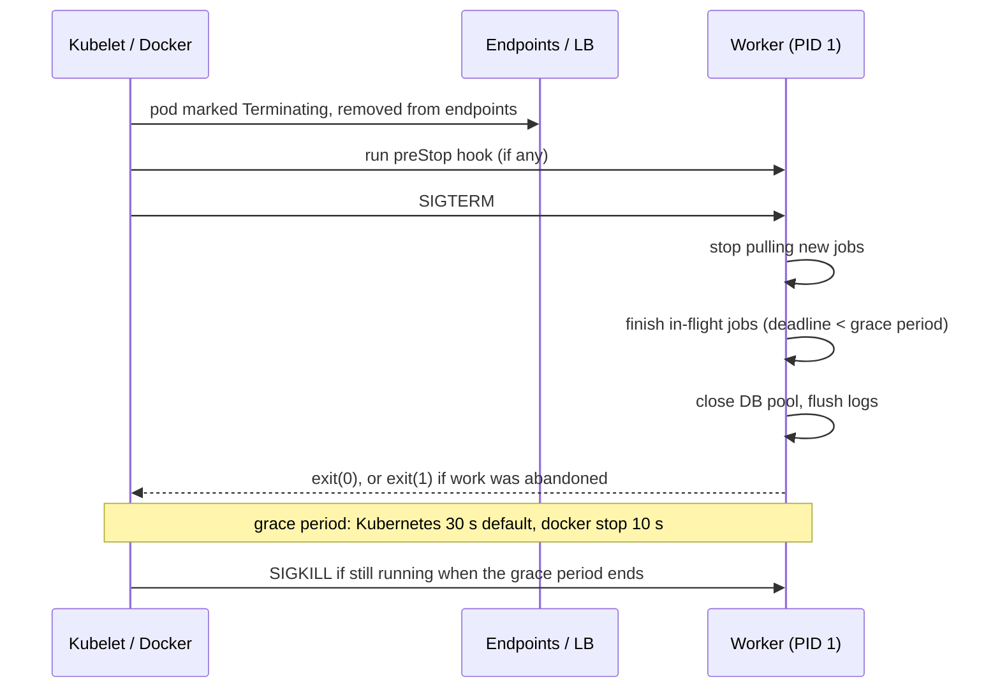

# Signals

> **Module 04 · Operating Systems** · Prerequisites: [Process Lifecycle](05-Process-Lifecycle.md), [Inter Process Communication](28-Inter-Process-Communication.md) · Next: [File Systems Basics](30-File-Systems-Basics.md)

---

## ⏱ If You Only Have 2 Minutes

- A **signal** is a small, asynchronous notification the kernel delivers to a process: just a number, no payload. Each signal has a **disposition**: the default action, ignore, or a handler you install.
- `SIGTERM` (15) means "please shut down" and can be caught. `SIGKILL` (9) and `SIGSTOP` cannot be caught, blocked or ignored — no cleanup code runs.
- A process killed by signal *N* exits with status **128 + N**: `SIGINT` → 130, `SIGTERM` → 143, `SIGKILL` → 137. A container showing exit code 137 was SIGKILLed (by the OOM killer or after the grace period).
- `docker stop` sends `SIGTERM`, waits 10 s, then sends `SIGKILL`. Kubernetes runs the `preStop` hook, sends `SIGTERM`, and sends `SIGKILL` after `terminationGracePeriodSeconds` (default **30 s**).
- **PID 1 in a container gets no default signal actions.** If your app is PID 1 and installs no `SIGTERM` handler, `SIGTERM` is silently dropped and every deploy waits for the `SIGKILL`. Add a handler or run behind `tini` (`docker run --init`).
- A real handler stops taking new work, finishes in-flight work under a deadline shorter than the grace period, closes connections, and exits — `0` if it drained cleanly, non-zero if it had to abandon work.
- Node: `process.on('SIGTERM', fn)` runs on the event loop; adding a listener removes Node's default "exit" behaviour, and `SIGUSR1` is reserved for starting the inspector. Python: `signal.signal()` handlers run **in the main thread, between bytecodes**; asyncio code uses `loop.add_signal_handler()`.
- `SIGHUP` is the conventional "reload your config" signal (nginx, PostgreSQL, Gunicorn). Reload into a new object and keep the old one if parsing fails.

---

## 1. What It Is and Why It Exists

A signal is the kernel's way to tap a process on the shoulder. Something happened — a user pressed Ctrl-C, a child process exited, the process wrote to a closed pipe, an orchestrator wants the container gone — and the kernel interrupts whatever the process was doing to tell it. The message is only a number (`SIGTERM` is 15 on Linux). There is no body, no reply, and no guarantee about *when* in your code it lands.

**Analogy:** a fire alarm in an office. It carries one bit of information, it interrupts whatever you are doing, and the building has a rule for what happens if you ignore it. A sensible office has a plan: stop taking calls, save your work, walk out. Some alarms (`SIGKILL`) are not alarms at all; they are the building being demolished.

**The problem it solves.** Processes need a way to receive control events that do not arrive through their normal input. A web server blocked in `epoll_wait` or a worker blocked on a queue read is not reading from a "control channel", but it still has to learn that it should stop, reload configuration, or reap a child. Signals give every process that channel for free, with a standard vocabulary that shells, `kill`, systemd, Docker and Kubernetes all speak.

**What breaks without handling them.** Most of the production pain is about shutdown. During a rolling deploy, every old pod receives `SIGTERM`. A process that ignores it (or never receives it, because it is PID 1) keeps running until `SIGKILL` arrives 30 seconds later. Jobs are cut in half, database transactions roll back, open files are left half-written, and the deploy takes 30 seconds per pod for no reason. A process that exits *immediately* on `SIGTERM` is just as bad: in-flight HTTP requests fail and half-done jobs must be retried. Handling signals well is what makes deploys invisible to users.

---

## 2. How It Works

### Generation, pending, delivery

1. **Generation.** A signal is raised by another process (`kill(2)`), by the terminal driver (Ctrl-C → `SIGINT` to the foreground process group), or by the kernel itself (a bad memory access → `SIGSEGV`, a child exit → `SIGCHLD` to the parent, a write to a pipe with no reader → `SIGPIPE`).
2. **Pending.** The kernel sets a bit in the target's pending set. Standard signals are **not queued**: if `SIGTERM` arrives twice before it is handled, it is delivered once. (Real-time signals, `SIGRTMIN`–`SIGRTMAX`, are queued, but backends rarely use them.)
3. **Blocking.** Each thread has a **signal mask**. A blocked signal stays pending until unblocked.
4. **Delivery.** The next time a thread that does not block the signal returns from the kernel to user space, the kernel acts on the disposition: run the default action, do nothing (ignored), or push a frame onto the thread's stack and jump to the handler. A blocking system call that was interrupted returns `EINTR` or is restarted, depending on flags.

A process-directed signal (from `kill`) goes to **any one thread** that does not block it. A fault such as `SIGSEGV` goes to the thread that caused it.

Dispositions are inherited across `fork()`. Across `execve()`, signals you *handled* reset to their default (your handler code no longer exists), while *ignored* signals stay ignored — a classic surprise when a parent ignored `SIGPIPE` and the child inherits that.

### How a container is stopped



The grace period starts counting when the pod is deleted, so time spent in `preStop` comes out of your shutdown budget. Plan your in-process deadline as `grace period − preStop − a few seconds of margin`. The HTTP-specific part — failing readiness and keeping the listener open briefly while the load balancer catches up — is covered in [Node HTTP Server Concepts](../Module-02-Core-Backend/05-Node-HTTP-Server-Concepts.md).

### Observing signals on Linux

`/proc/<pid>/status` shows the signal sets as hex bitmasks, where signal *N* is bit *N − 1*:

```text
$ grep ^Sig /proc/$(pgrep -f worker.js)/status      # illustrative output (Node 22)
SigQ:   1/62377
SigPnd: 0000000000000000      # pending for this thread
SigBlk: 0000000000000000      # blocked
SigIgn: 0000000001001000      # ignored: bit 12 = SIGPIPE (13), bit 24 = SIGXFSZ (25)
SigCgt: 0000000100004602      # caught: SIGINT (2), SIGUSR1 (10), SIGSEGV (11), SIGTERM (15), and 33
```

Signal 33 is an internal real-time signal used by glibc. If `SIGTERM` (bit 14, `0x4000`) is missing from `SigCgt` on your PID 1, `docker stop` will hang until the timeout. Other useful commands:

```bash
kill -l                         # list names and numbers
kill -TERM 4242                 # same as kill 4242; SIGTERM is the default
kill -0 4242 && echo alive      # signal 0: permission/existence check, nothing is delivered
kill -TERM -4242                # negative PID = the whole process group 4242
strace -e trace=none -e signal=all -p 4242   # print each signal as it arrives
docker kill --signal=HUP my-api # send any signal to the container's PID 1
```

---

## 3. Key Concepts

### The signals a backend engineer meets

Numbers are for x86-64 and ARM Linux; some differ on other architectures and on macOS, so use names in code.

| Signal | No. | Default action | Typical source and meaning |
|---|---|---|---|
| `SIGHUP` | 1 | Terminate | Terminal closed. Daemons use it as **"reload config"** |
| `SIGINT` | 2 | Terminate | Ctrl-C in a terminal |
| `SIGQUIT` | 3 | Core dump | Ctrl-\\. The JVM and Go print thread/goroutine dumps; nginx and PostgreSQL treat it as a shutdown request |
| `SIGKILL` | 9 | Terminate | Uncatchable. OOM killer, `docker kill`, end of grace period |
| `SIGUSR1` / `SIGUSR2` | 10 / 12 | Terminate | Application-defined: reopen logs, dump state. Node reserves `SIGUSR1` for the inspector |
| `SIGSEGV` | 11 | Core dump | Invalid memory access — a native bug, not something to "handle" |
| `SIGPIPE` | 13 | Terminate | Write to a pipe or socket whose reader is gone. Node and CPython ignore it, so you get `EPIPE` instead |
| `SIGTERM` | 15 | Terminate | Polite stop request: `kill`, `docker stop`, Kubernetes, systemd |
| `SIGCHLD` | 17 | Ignore | A child exited or stopped. The parent must `wait()` for it, or it stays a [zombie](05-Process-Lifecycle.md) |
| `SIGSTOP` / `SIGCONT` | 19 / 18 | Stop / continue | Uncatchable pause (`docker pause` uses the cgroup freezer instead) |

Only `SIGKILL` and `SIGSTOP` cannot be caught, blocked or ignored. Everything else is a request your process can honour, reinterpret, or (unwisely) ignore.

### Async-signal-safety

A C-level handler runs **in the middle of whatever the thread was doing** — possibly inside `malloc` while it holds the allocator's lock. If the handler calls `malloc` (or `printf`, which may allocate), it can deadlock or corrupt memory. POSIX therefore lists a small set of **async-signal-safe** functions (see `signal-safety(7)`): `write`, `_exit`, `kill` and a few dozen others. The standard pattern is to do almost nothing in the handler: set a `volatile sig_atomic_t` flag, or write one byte to a **self-pipe** that the event loop is watching. Linux also offers `signalfd(2)`, which turns signals into a readable file descriptor. Node (via libuv) and CPython both do this for you: their C handler records the signal and wakes the loop, and your JavaScript or Python handler runs later on the normal thread, where any code is safe. The cost is that **your handler cannot run while the thread is blocked** — a CPU-bound loop in Node delays `SIGTERM` handling until it finishes.

### PID 1 and signal forwarding

The first process in a PID namespace is treated like `init`. The kernel does not apply **default** actions to it for signals sent from inside the namespace, and from outside only `SIGKILL` and `SIGSTOP` are forced. So `SIGTERM` reaches PID 1 only if PID 1 has installed a handler. A Node or Python app run directly as PID 1 with no handler ignores `docker stop` and is killed 10 seconds later with exit code 137. The same image run with `docker run --init` (which puts `tini` at PID 1) exits immediately with 143.

Two more traps:
- **Shell-form `CMD node worker.js`** runs under `/bin/sh -c`. Depending on the shell, `sh` may stay as PID 1, and it does not forward `SIGTERM` to your app. Use exec form (`CMD ["node", "worker.js"]`) or `exec node worker.js` in entrypoint scripts.
- **Wrappers** such as `npm start` add a process between the signal and your app. Run `node` directly in production.

In a terminal, Ctrl-C sends `SIGINT` to the whole foreground **process group**, so child processes stop too. `docker stop` and Kubernetes signal only PID 1. A process that spawns children must forward the signal itself. Zombies and reaping are covered in [Process Lifecycle](05-Process-Lifecycle.md).

### Node.js signal handling

- `process.on("SIGTERM", handler)` registers a listener that runs on the event loop. On Linux, `SIGINT` and `SIGTERM` have default handlers that exit with code 128 + signal number; **installing a listener removes that default**, so your handler must eventually exit.
- `SIGUSR1` is reserved for starting the inspector (debugger). Use `SIGUSR2` for your own "dump state" hook; `node --heapsnapshot-signal=SIGUSR2` writes a heap snapshot on that signal.
- `SIGPIPE` is ignored by default, so writes to a closed socket surface as `EPIPE` errors.
- `SIGKILL` and `SIGSTOP` cannot have listeners. Listeners for `SIGSEGV`, `SIGBUS`, `SIGFPE` and `SIGILL` raised by real faults are not safe to rely on: the process is already in a broken state.
- `process.kill(pid, "SIGTERM")` sends a signal; it is how you test your handler.

### Python signal handling

- `signal.signal(signal.SIGTERM, handler)` sets the disposition. Python's C-level handler only sets a flag; the Python handler runs **in the main thread of the main interpreter, at the next bytecode boundary**. A thread blocked in a long C call (a huge regex, a C extension) delays it. Only the main thread may call `signal.signal()`.
- Defaults: `SIGINT` raises `KeyboardInterrupt`; `SIGPIPE` and `SIGXFSZ` are ignored at startup (so you get `BrokenPipeError`); `SIGTERM` keeps the **OS default**. An unhandled `SIGTERM` kills the interpreter on the spot: no `finally` blocks, no `atexit`, no context-manager cleanup.
- Since Python 3.5 (PEP 475), system calls interrupted by a signal are retried automatically unless the handler raises.
- In asyncio, use `loop.add_signal_handler(sig, callback)` (Unix only). The callback runs as a normal loop callback, so it can touch loop objects such as `asyncio.Event`. Since 3.11, `asyncio.run()` handles Ctrl-C by cancelling the main task.
- A synchronous worker usually sets a `threading.Event` from the handler and checks it between jobs:

```python
import signal
import threading

stop = threading.Event()
signal.signal(signal.SIGTERM, lambda signum, frame: stop.set())
# worker loop:  while not stop.is_set(): job = queue.get(timeout=1.0); ...
```

- `faulthandler.register(signal.SIGUSR1)` prints every thread's Python stack on `SIGUSR1` — useful for "why is this worker stuck?" in production.

### SIGHUP: reload without restart

Long-running daemons repurpose `SIGHUP` as "re-read your configuration": nginx starts new workers with the new config and gracefully retires the old ones, PostgreSQL re-reads `postgresql.conf` (`pg_ctl reload`), and Gunicorn reloads its workers. Rules for your own reload handler:

- Parse the new config into a **new object** and swap it in only if it validates. A typo in a config file must not take down a running service.
- Some settings (listen port, pool sizes) cannot change live. Log that they were ignored.
- In Kubernetes, a changed ConfigMap does not send `SIGHUP`. You need a file watcher, a reloader controller, or a sidecar that signals the app (it can see the app's process only with `shareProcessNamespace: true`).

---

## 4. Code Examples

Scenario: a queue worker runs four jobs at a time. On `SIGTERM` or `SIGINT` it stops taking new jobs, gives in-flight jobs up to 20 seconds (below the 30-second Kubernetes grace period), cancels whatever is still running so the queue can redeliver it, and exits `0` after a clean drain or `1` if it had to abandon work. A second signal means "exit now". `SIGHUP` reloads the concurrency setting from a JSON file. The queue client is a small stand-in; with BullMQ or Celery the same shape applies (see [Background Workers](../Module-02-Core-Backend/17-Background-Workers.md)).

### Node.js / TypeScript

```ts
// worker.ts — Node.js 22+, TypeScript 5, no dependencies.  Run: node worker.ts
import { readFileSync } from "node:fs";
import { constants } from "node:os";
import { setTimeout as sleep } from "node:timers/promises";

type Job = { id: number; ms: number };
const GRACE_MS = Number(process.env.SHUTDOWN_GRACE_MS ?? 20_000); // < terminationGracePeriodSeconds
let concurrency = 4;

// Stand-in for a queue client's long poll. The signal lets shutdown abandon the wait.
async function nextJob(signal: AbortSignal): Promise<Job> {
  await sleep(200, undefined, { signal });
  return { id: Math.floor(Math.random() * 1e6), ms: 500 + Math.random() * 4_000 };
}
async function runJob(job: Job, signal: AbortSignal): Promise<void> {
  await sleep(job.ms, undefined, { signal }); // real work must also honour the signal
}

const stopIntake = new AbortController(); // fired on the first SIGTERM
const abortWork = new AbortController();  // fired when the drain deadline passes
const inFlight = new Set<Promise<void>>();

async function intakeLoop(): Promise<void> {
  while (!stopIntake.signal.aborted) {
    if (inFlight.size >= concurrency) { await Promise.race(inFlight); continue; }
    let job: Job;
    try { job = await nextJob(stopIntake.signal); }
    catch (err) { if (stopIntake.signal.aborted) return; throw err; }
    const p: Promise<void> = runJob(job, abortWork.signal)
      .then(() => console.log(`job ${job.id} done`))
      .catch(() => console.warn(`job ${job.id} aborted; nack it so another worker retries`))
      .finally(() => inFlight.delete(p));
    inFlight.add(p);
  }
}

let shuttingDown = false;
async function shutdown(sig: NodeJS.Signals): Promise<void> {
  if (shuttingDown) process.exit(128 + constants.signals[sig]); // second signal: exit now
  shuttingDown = true;
  console.log(`${sig}: no new jobs, ${inFlight.size} in flight`);
  stopIntake.abort();
  await intake;
  const drained = Promise.allSettled([...inFlight]).then(() => true);
  const clean = await Promise.race([drained, sleep(GRACE_MS, false, { ref: false })]);
  if (!clean) {
    abortWork.abort();                        // jobs see the abort and release their leases
    await Promise.allSettled([...inFlight]);
  }
  // close DB pools / queue connections here, then exit explicitly so open handles cannot keep us alive
  process.exit(clean ? 0 : 1);
}

process.on("SIGTERM", shutdown);
process.on("SIGINT", shutdown);
process.on("SIGHUP", () => {
  try {
    const cfg = JSON.parse(readFileSync("worker-config.json", "utf8")) as { concurrency?: unknown };
    if (!Number.isInteger(cfg.concurrency) || (cfg.concurrency as number) < 1) throw new Error("bad concurrency");
    concurrency = cfg.concurrency as number;
    console.log(`config reloaded: concurrency=${concurrency}`);
  } catch (err) {
    console.error(`reload failed, keeping concurrency=${concurrency}: ${(err as Error).message}`);
  }
});

const intake = intakeLoop();
```

The `ref: false` timer does not keep the process alive by itself, and the handlers run on the event loop, so they are ordinary JavaScript. That also means a synchronous CPU loop inside `runJob` would delay `SIGTERM` handling until it finished.

### Python

```python
# worker.py — Python 3.12+, stdlib only. Unix only: loop.add_signal_handler is not available on Windows.
import asyncio
import json
import os
import random
import signal
import sys
from pathlib import Path

GRACE_S = float(os.environ.get("SHUTDOWN_GRACE_S", "20"))  # < terminationGracePeriodSeconds
config = {"concurrency": 4}


def reload_config() -> None:
    try:
        new = json.loads(Path("worker-config.json").read_text())
        if not isinstance(new.get("concurrency"), int) or new["concurrency"] < 1:
            raise ValueError("bad concurrency")
        config.update(concurrency=new["concurrency"])
        print(f"config reloaded: {config}", flush=True)
    except (OSError, ValueError) as exc:  # keep the last good config
        print(f"reload failed, keeping {config}: {exc}", flush=True)


async def next_job() -> dict:  # stand-in for a queue client's long poll
    await asyncio.sleep(0.2)
    return {"id": random.randrange(10**6), "seconds": random.uniform(0.5, 4.5)}


async def run_job(job: dict) -> None:
    try:
        await asyncio.sleep(job["seconds"])
        print(f"job {job['id']} done", flush=True)
    except asyncio.CancelledError:
        print(f"job {job['id']} cancelled; nack it so another worker retries", flush=True)
        raise


async def main() -> int:
    loop = asyncio.get_running_loop()
    stop = asyncio.Event()

    def on_stop(sig: signal.Signals) -> None:
        if stop.is_set():
            os._exit(128 + sig)  # second signal: skip cleanup, exit now
        print(f"{sig.name}: no new jobs, {len(in_flight)} in flight", flush=True)
        stop.set()

    for sig in (signal.SIGTERM, signal.SIGINT):
        loop.add_signal_handler(sig, on_stop, sig)
    loop.add_signal_handler(signal.SIGHUP, reload_config)

    in_flight: set[asyncio.Task] = set()
    stopped = asyncio.create_task(stop.wait())
    while not stop.is_set():
        if len(in_flight) >= config["concurrency"]:
            await asyncio.wait(in_flight | {stopped}, return_when=asyncio.FIRST_COMPLETED)
            continue
        poll = asyncio.create_task(next_job())
        await asyncio.wait({poll, stopped}, return_when=asyncio.FIRST_COMPLETED)
        if not poll.done():
            poll.cancel()  # abandon the long poll; no job was taken
            break
        task = asyncio.create_task(run_job(poll.result()))
        in_flight.add(task)
        task.add_done_callback(in_flight.discard)

    if not in_flight:
        return 0
    _, pending = await asyncio.wait(in_flight, timeout=GRACE_S)
    for task in pending:
        task.cancel()  # raises CancelledError at the job's current await
    await asyncio.gather(*pending, return_exceptions=True)
    # close DB pools / queue connections here
    return 1 if pending else 0


if __name__ == "__main__":
    sys.exit(asyncio.run(main()))
```

**Runtime differences to notice.** In both runtimes the OS-level handler only records the signal; your code runs later on the main thread. Node gives you no other choice. Python lets you call `signal.signal()` directly, but in asyncio code you should use `loop.add_signal_handler()`: a plain `signal.signal()` handler runs between bytecodes at an arbitrary point in the loop's own code, and calling most loop methods from there is unsafe. Cancellation also differs. A Python task can be cancelled at any `await` (a `CancelledError` appears there), while a Node promise cannot be cancelled at all — the job must accept an `AbortSignal` and check it.

---

## 5. Production Concerns

- **Budget the grace period.** In-process drain deadline < `terminationGracePeriodSeconds` − `preStop` duration − a few seconds for closing pools and flushing logs. For jobs that can run longer than that, raise the grace period for that Deployment *and* make jobs checkpoint, so that a `SIGKILL` (which can always happen: node failure, OOM) costs progress, not correctness.
- **Exit codes are telemetry.** `0` = clean drain. `1` = abandoned work. `137` = something SIGKILLed you; check `kubectl describe pod` for `OOMKilled` versus a grace-period timeout. `143` = you were stopped by `SIGTERM` without a handler (fine for tools, suspicious for servers). Alert on a rising rate of 137s during deploys: it means drains are not finishing.
- **Verify PID 1 in the image.** `docker run` the image, then `docker exec <c> cat /proc/1/status | grep SigCgt` or simply time `docker stop`. A stop that always takes exactly 10 s (Docker) or 30 s (Kubernetes) means `SIGTERM` is being dropped.
- **Child processes.** If your app spawns workers (`child_process`, `multiprocessing`, `cluster`), the parent must forward `SIGTERM`, wait for children with its own deadline, and reap them. Otherwise children are killed by `SIGKILL` when the container's PID 1 exits, mid-job.
- **Blocked event loops delay shutdown.** A Node process stuck in a synchronous loop, or a Python main thread stuck in a long C call, cannot run its handler. Log the moment the signal handler starts; a gap between "pod Terminating" and that log line points at a blocked loop.
- **Logging on shutdown.** Log the signal name, in-flight count, drain duration and outcome. Flush asynchronous loggers (pino transports, Python `QueueHandler`) before `exit`, or the most useful lines are lost.
- **`SIGHUP` reload safety.** Validate before swapping, log the old and new values, and emit a metric (`config_reload_total{result="ok|failed"}`) so a broken ConfigMap shows up as an alert rather than as silently stale behaviour.

---

## 6. Common Mistakes

- **Running the app as PID 1 with no `SIGTERM` handler** — every deploy waits for `SIGKILL`, and in-flight work dies — install a handler, or use `docker run --init` / `tini` / `dumb-init` as the entrypoint.
- **Exiting immediately in the handler** (`process.on("SIGTERM", () => process.exit(0))`) — requests and jobs in flight are cut off — stop intake, drain under a deadline, then exit.
- **Draining with no deadline** — a stuck job keeps the process alive until `SIGKILL`, so cleanup code never runs — race the drain against a timer shorter than the grace period.
- **Shell-form `CMD` or `npm start` in the Dockerfile** — the signal goes to `sh` or `npm`, not your app — use exec form `CMD ["node", "dist/worker.js"]`.
- **Doing real work inside a C-level handler** (or `signal.signal()` handlers that call asyncio APIs) — deadlocks or corrupted state at random — set a flag or an event and do the work in the main loop.
- **Assuming Python cleans up on `SIGTERM`** — without a handler, `finally` and `atexit` never run — install a `SIGTERM` handler that triggers the same path as `KeyboardInterrupt`.
- **Using `SIGUSR1` for an app feature in Node** — it starts the inspector, opening a debugger port — use `SIGUSR2` or an admin endpoint.

---

## 7. Comparison Table

Signals are one of several ways to send a control command to a running process.

| | Signals | Admin HTTP endpoint | IPC message (pipe, socket) | Config file watch |
|---|---|---|---|---|
| Payload | None (only a number) | Any | Any | The file itself |
| Works when the app is wedged | Default actions and `SIGKILL` do; handlers need a responsive loop | No | No | No |
| Who can send | Same user or root (`kill`), Docker, Kubernetes | Anyone with network access (needs auth) | Process holding the other end | Anyone who can write the file |
| Standard tooling | `kill`, `docker stop`, Kubernetes, systemd | curl, scripts | Custom | Kubernetes ConfigMap updates, inotify |
| Typical use | Stop, reload, dump diagnostics | Feature toggles, cache flush | Parent–child coordination | Live config in Kubernetes |

Use signals for lifecycle events, because the platform already speaks them. Use richer channels when the command needs arguments or a reply.

---

## 8. Interview Questions

**[Junior] What is the difference between `SIGTERM` and `SIGKILL`?**
`SIGTERM` is a request to terminate. The process can catch it, clean up and exit in its own time, or even ignore it. `SIGKILL` cannot be caught, blocked or ignored; the kernel ends the process immediately, so no cleanup code runs. Orchestrators send `SIGTERM` first and `SIGKILL` only after a grace period.

**[Junior] A container's exit code is 137. What happened?**
137 is 128 + 9, so the process was killed by `SIGKILL`. The two usual causes are the kernel OOM killer (Kubernetes shows `OOMKilled` as the reason) and the end of the termination grace period after `SIGTERM` was not handled in time. 143 (128 + 15) would mean it died from an unhandled `SIGTERM`.

**[Mid] Why does `docker stop` take exactly 10 seconds for some Node or Python images?**
The app is PID 1 in its PID namespace, and the kernel does not apply default signal actions to PID 1. If the app installs no `SIGTERM` handler, the signal is dropped, so Docker waits its 10-second timeout and sends `SIGKILL`. The fixes are to handle `SIGTERM` in the app or to run a tiny init such as `tini` (`docker run --init`) as PID 1, which forwards signals and reaps zombies. Shell-form `CMD` can cause the same symptom because `sh` receives the signal instead of the app.

**[Mid] What does a good `SIGTERM` handler for a queue worker do?**
It stops pulling new jobs first, including aborting a long poll that is waiting. Then it waits for in-flight jobs, bounded by a deadline shorter than the grace period. Jobs still running at the deadline are cancelled and released so the queue redelivers them, which is safe only if handlers are idempotent. Finally it closes connections, flushes logs and exits with `0` for a clean drain or non-zero if work was abandoned.

**[Mid] Where does a Python signal handler run, and what does that imply?**
The C-level handler only sets a flag. The Python handler runs in the main thread at the next bytecode boundary. So worker threads never run handlers and must be told via an `Event`, a long-running C call delays the handler, and only the main thread can install handlers. In asyncio you use `loop.add_signal_handler`, which wakes the loop through a self-pipe and runs the callback as a normal loop callback.

**[Senior] What does "async-signal-safe" mean and how do runtimes cope with it?**
A signal handler can interrupt a thread anywhere, including inside `malloc` or `printf` while they hold internal locks. Calling a non-reentrant function from the handler can deadlock or corrupt state, so POSIX lists a small set of safe functions such as `write` and `_exit`. Runtimes install a minimal C handler that records the signal and writes to a self-pipe (or use `signalfd`), and they run your JavaScript or Python handler later from the event loop. The trade-off is latency: if the loop is blocked, the handler waits.

**[Senior] Your rolling deploys cause a burst of failed jobs and 502s even though you handle `SIGTERM`. How do you investigate?**
First check timings: does the handler start promptly (log it), and how long does the drain take compared with `terminationGracePeriodSeconds` minus `preStop`? Exit codes of 137 during deploys mean drains are being cut off. For 502s, check whether the app closes its listener before the load balancer has removed the pod; Kubernetes removes endpoints and sends `SIGTERM` concurrently, so a short `preStop` sleep or a readiness-failing delay is needed. For jobs, check that intake really stops, that long jobs checkpoint, and that cancelled jobs are released rather than lost. Also confirm the signal reaches the right process (PID 1, exec-form `CMD`, child processes receive it).

**[Senior] How would you implement live config reload, and what can go wrong?**
Handle `SIGHUP` (or watch the file) by parsing the new config into a fresh object, validating it, and swapping a reference atomically, keeping the old config on any error. Settings that are bound at startup, such as the listen port or pool size, should be rejected or logged as needing a restart. Risks: partial reads of a file being written (Kubernetes ConfigMap volumes avoid this with an atomic symlink swap), reloads racing with in-flight requests that read config twice, and silent failures, which you catch with a reload metric. In Kubernetes nothing sends `SIGHUP` for you; you need a watcher or a reloader.

---

## 9. Cheat Sheet

```text
Signal            async kernel notification; only a number; disposition = default | ignore | handler
Uncatchable       SIGKILL (9), SIGSTOP (19)
Exit status       128 + N   → SIGINT 130, SIGTERM 143, SIGKILL 137
Common            HUP=reload  INT=Ctrl-C  QUIT=dump/core  TERM=stop  CHLD=child exited
                  PIPE=write to closed reader (ignored by Node/CPython → EPIPE)  USR1/USR2=app-defined
Docker            docker stop: STOPSIGNAL (default SIGTERM) → 10 s → SIGKILL
Kubernetes        preStop → SIGTERM → terminationGracePeriodSeconds (30 s, includes preStop) → SIGKILL
PID 1             no default actions → unhandled SIGTERM is dropped → use a handler or tini (--init)
Dockerfile        exec form CMD ["node","worker.js"]; no npm start, no sh -c wrapper
Handler           stop intake → drain with deadline → cancel + release leftovers → close → exit 0 / 1
Node              process.on('SIGTERM') removes default exit; SIGUSR1 = inspector; runs on event loop
Python            signal.signal → main thread, between bytecodes; asyncio → loop.add_signal_handler
                  unhandled SIGTERM = no finally/atexit
Observe           /proc/PID/status SigBlk/SigIgn/SigCgt (bit N-1), kill -l, strace -e signal=all
```

---

## Related Topics

- [Process Lifecycle](05-Process-Lifecycle.md) — zombies, orphans, `SIGCHLD` and why PID 1 is special
- [Node HTTP Server Concepts](../Module-02-Core-Backend/05-Node-HTTP-Server-Concepts.md) — graceful HTTP shutdown, readiness and keep-alive on `SIGTERM`
- [Background Workers](../Module-02-Core-Backend/17-Background-Workers.md) — idempotent jobs and lease expiry that make abandoned work safe
- [Inter Process Communication](28-Inter-Process-Communication.md) — richer control channels, and pipes that raise `SIGPIPE`
- [Backend Concurrency Patterns](32-Backend-Concurrency-Patterns.md) — cancellation propagation that a shutdown deadline relies on
