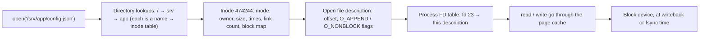

# File Systems Basics

> **Module 04 · Operating Systems** · Prerequisites: [System Calls](27-System-Calls.md), [Signals](29-Signals.md) · Next: [I/O Operations](31-I-O-Operations.md)

---

## ⏱ If You Only Have 2 Minutes

- A file is an **inode** (metadata plus pointers to data blocks). A file *name* is only a directory entry that points at an inode number. `ls -i` shows the number, and `stat` shows the link count.
- A **hard link** is a second name for the same inode (same file system only). A **symbolic link** is a tiny file that holds a path. It can cross file systems and can dangle.
- `rm` calls `unlink`, which removes a **name**. The space comes back only when the link count is 0 **and** no process still has the file open. A deleted log that a process still writes to keeps filling the disk. Find it with `lsof +L1`.
- A **file descriptor** is a small integer index into the process's FD table. The table points at an open file description (offset and flags), which points at the inode. Sockets, pipes and epoll instances use FDs too. The per-process cap is `ulimit -n` (`RLIMIT_NOFILE`). Hitting it gives `EMFILE`.
- `write()` returning means the data is in the **page cache** (RAM), not on disk. A power cut can lose it. `fsync(fd)` waits until the file's data and metadata are on stable storage. `fdatasync` skips metadata that isn't needed to read the data back.
- **Atomic replace:** write a temp file in the same directory → `fsync` it → `rename` over the target → `fsync` the directory. Readers see the old file or the new one, never a half-written one.
- In a container, the root file system is an **overlayfs** writable layer that disappears with the container. Anything that must survive goes to a volume or to external storage.
- Measured on a laptop SSD (Docker): a plain 4 KiB write took 213 µs per file; the atomic version with two `fsync`s took 3.1 ms. Durability is not free, so batch it.

---

## 1. What It Is and Why It Exists

A **file system** turns a raw block device (a disk that only knows "read block 81,234") into named files in nested directories, with owners, permissions and timestamps. Linux shows every file system through one tree. ext4, XFS, overlayfs, tmpfs and procfs are mounted at different points of the same `/`, and the kernel's **VFS** (virtual file system) layer gives them all the same API: `open`, `read`, `write`, `rename`, `fsync`.

**Analogy:** a library. The catalogue cards are directory entries: a title and a shelf number. The shelf slot is the inode: it holds the book's details and where its pages are. Two catalogue cards can point at the same slot (hard links). A card that says "see the card for *Moby-Dick*" is a symlink. Throwing away every card does not empty the shelf while somebody is still reading the book at a desk (an open file descriptor).

**The problems it solves for a backend**, and the ones it creates:

- Config files, uploads, SQLite databases, caches, logs and exports need names, permissions and a way to survive a restart.
- The kernel caches file data in RAM, so writes return in microseconds, but "write succeeded" does not mean "on disk". Without `fsync`, a crash can lose data the user was told was saved.
- A crash in the middle of overwriting a file leaves it half-written. Atomic replacement prevents this.
- Every open file and socket uses a descriptor from a finite table. Leaks end with `EMFILE` and a service that can't accept connections.

---

## 2. How It Works

### From a path to bytes



1. **Path resolution.** The kernel walks the path one component at a time. Each directory is a list of `name → inode number` entries. To pass through a directory you need execute (`x`) permission on it.
2. **Inode.** Holds everything about the file *except its name*: type, permission bits, owner UID/GID, size, timestamps, link count and where the data blocks are. Each file system has a fixed or limited number of inodes. `df -i` shows usage, and running out gives `ENOSPC` even when `df -h` shows free space.
3. **Open file description.** `open()` creates a kernel object that holds the current offset and the status flags. It is shared after `fork()` or `dup()`, which is why a parent and child that write to the same inherited descriptor share one offset.
4. **File descriptor.** The lowest free slot in the process's FD table points at that description. 0, 1 and 2 are stdin, stdout and stderr.
5. **Page cache.** `read()` copies from cached pages, loading them from disk on a miss. `write()` copies into cached pages, marks them **dirty** and returns. Kernel flusher threads write dirty pages back later: by default, pages older than about 30 s (`vm.dirty_expire_centisecs = 3000`), checked every 5 s. Writers are throttled if too much of memory becomes dirty (`vm.dirty_ratio`).
6. **`fsync(fd)`** forces this file's dirty pages and its inode out to the device, and asks the device to flush its own volatile cache. It returns only when that is done, or with an error.

### Atomic file replacement

```mermaid
sequenceDiagram
    participant A as App
    participant K as Kernel (page cache)
    participant D as Disk
    A->>K: open(".config.json.a1b2.tmp", O_CREAT|O_EXCL)
    A->>K: write(new bytes)
    A->>K: fsync(tmp fd)
    K->>D: flush data + inode
    A->>K: rename(tmp, "config.json")
    Note over K: directory entry now points at the new inode in one step
    A->>K: open(dir) + fsync(dir fd)
    K->>D: flush the directory block
    Note over A,D: a crash before rename leaves the old file; after it, the complete new one
```

`rename(2)` is atomic within one file system. Any process that opens the path sees either the old inode or the new one. Readers that already had the old file open keep reading the old inode until they close it. The two `fsync` calls close the durability gaps. Without the first, the rename can reach the disk before the data, and after a crash the new name points at an empty or partial file. Without the second, the rename itself may be lost and the old version comes back.

### Observing it on Linux

Measured output from a Debian container (Docker Desktop):

```text
$ ls -li config.*
474244 -rw-r--r-- 2 root root  3 Nov 25 18:42 config.hard      ← same inode, link count 2
474244 -rw-r--r-- 2 root root  3 Nov 25 18:42 config.json
474245 lrwxrwxrwx 1 root root 11 Nov 25 18:42 config.soft -> config.json

$ ls -l /proc/self/fd
lrwx------ 1 root root 64 Nov 25 18:42 0 -> /dev/null
l-wx------ 1 root root 64 Nov 25 18:42 1 -> pipe:[123452]
l-wx------ 1 root root 64 Nov 25 18:42 2 -> pipe:[123453]
lr-x------ 1 root root 64 Nov 25 18:42 3 -> /proc/253/fd

$ lsof +L1                      # open files whose link count is 0 (deleted but still open)
COMMAND PID USER FD   TYPE DEVICE  SIZE/OFF NLINK   NODE NAME
sleep   242 root 0r   REG   8,64 209715200     0 532309 /srv/big.log (deleted)

$ grep -E ' / ' /proc/self/mounts
overlay / overlay rw,relatime,lowerdir=/var/lib/.../snapshots/4379/fs:...
```

Other commands worth knowing:

```bash
stat -c '%n inode=%i links=%h mode=%A size=%s' file   # inode, link count, permissions
df -h /srv; df -i /srv               # blocks used vs inodes used
cat /proc/<pid>/limits | grep 'open files'   # soft and hard RLIMIT_NOFILE
ls /proc/<pid>/fd | wc -l            # open descriptors right now
cat /proc/sys/fs/file-nr             # system-wide: allocated, unused, max
grep -E 'Dirty|Writeback:' /proc/meminfo     # page cache waiting to be written
findmnt -T /srv                      # which file system and mount a path is on
```

---

## 3. Key Concepts

### Hard links vs symbolic links

| | Hard link | Symbolic (soft) link |
|---|---|---|
| What it is | Another directory entry for the same inode | A small file whose content is a path |
| Across file systems | No (`EXDEV`) | Yes |
| To a directory | Not allowed | Allowed |
| Target deleted | Data stays; the other names still work | Link dangles; `open` gives `ENOENT` |
| Typical use | Atomic snapshots with `rsync --link-dest`, keeping a file alive | `current -> releases/2026-11-25` for deploys, `/etc/alternatives` |

Release directories use the symlink trick for atomic deploys: create `current.tmp -> releases/v42`, then `rename("current.tmp", "current")`. Every new request resolves `current` to either the old release or the new one.

### Permissions and umask

Each inode has read/write/execute bits for **user**, **group** and **other**, written in octal: `640` = `rw-r-----`. On a directory, `r` lists names, `w` creates or deletes entries, and `x` allows passing through, so deleting a file needs write permission on the **directory**. New files get the mode the program asks for (usually `0666` for files, `0777` for directories) minus the process **umask**. The common umask `022` gives `644` files and `755` directories, as the measured container showed. Create secrets with an explicit `0600` mode rather than tightening them with `chmod` afterwards. In containers, ownership is stored as **numeric UIDs**: a volume written by UID 0 is not writable by an image running as UID 1000.

### File descriptors and limits

| Limit | Where | Error when reached |
|---|---|---|
| Per process, soft | `ulimit -n`, `RLIMIT_NOFILE`, `/proc/<pid>/limits`; often 1024 in a login shell | `EMFILE` |
| Per process, hard | Ceiling an unprivileged process can raise its soft limit to | — |
| Service manager | systemd `LimitNOFILE=`, Docker `--ulimit nofile=…`, Kubernetes inherits from the container runtime | `EMFILE` |
| System-wide | `fs.file-max` (`/proc/sys/fs/file-nr`) | `ENFILE` |

The measured Docker Desktop containers in this chapter had a soft limit of 1,048,576. Don't assume production matches: read the value at startup and log it.

Files, sockets, pool connections, pipes, epoll and inotify instances all use descriptors. [System Calls](27-System-Calls.md) shows the `EMFILE` error. The question here is **who closes it?** A leak is a descriptor opened on one path and not closed on another, usually the error path. It shows up as a count that rises with traffic and never falls back. `ls -l /proc/<pid>/fd` tells you the kind: many `socket:[…]` entries plus `CLOSE_WAIT` in `ss -tanp` means you never closed after the peer did, and many paths means files opened per request. Node and CPython open with `O_CLOEXEC`, so child processes don't inherit descriptors.

### Page cache, `fsync` and durability

| Call | Guarantees on return | Cost |
|---|---|---|
| `write` | Data is in the page cache; other processes can read it | Microseconds |
| `fdatasync` | File data, plus metadata needed to read it (such as a size change), on stable storage | One device flush |
| `fsync` | Data and all inode metadata (including timestamps) on stable storage | One device flush, sometimes more |
| `fsync` on the directory | Creation, deletion or rename of entries in it is durable | One more flush |
| `O_SYNC` / `O_DSYNC` on open | Every `write` behaves like `write` + `fsync` / `fdatasync` | A flush per write |
| `sync` / `syncfs` | Flushes everything / one file system | Can take seconds on a busy host |

Two facts interviewers like. First, `close()` does not flush to disk. Second, **an `fsync` error is not safely retryable.** After a failed writeback, Linux may mark the pages clean and report the error only once, so a second `fsync` can "succeed" while the data is gone. PostgreSQL found this in 2018 ("fsyncgate") and now crashes and recovers from its WAL instead ([ACID](../Module-03-Databases/28-ACID.md)). Treat it as a failed write.

The page cache also counts against a container's memory cgroup. It is reclaimable, but it makes "memory used" graphs look higher than the heap ([Memory Management](21-Memory-Management.md)).

### Container file systems

| Storage | Lives where | Survives | Use for |
|---|---|---|---|
| Image layers | overlayfs `lowerdir`, read-only, shared by containers | Forever (part of the image) | Code and static assets |
| Writable layer | overlayfs `upperdir`, one per container | Only until the container is removed | Scratch files; ideally nothing |
| Named volume / bind mount | Host directory, bypasses overlayfs | Container removal | Database files, uploads on a single host |
| `emptyDir` (Kubernetes) | Node disk, or RAM with `medium: Memory` | Container restarts, not pod deletion | Shared scratch space between containers in a pod |
| tmpfs (`/dev/shm`, `medium: Memory`) | RAM, charged to the memory limit | Nothing | Small, fast, secret scratch files |

Overlayfs works by **copy-up**: the first write to a file from the image copies the whole file into the writable layer, and deleting an image file only adds a "whiteout" entry, saving no space. Writable layers and `emptyDir` count towards Kubernetes `ephemeral-storage` limits, and going over gets the pod **evicted**. `readOnlyRootFilesystem: true` plus an `emptyDir` at `/tmp` makes such writes explicit. See [Docker Volumes](../Module-10-DevOps-and-Cloud/07-Docker-Volumes.md).

### `ENOSPC` and deleted-but-open files

Disk full has four common causes: data blocks (`df -h`), inodes from millions of tiny files (`df -i`), the inotify watch limit ([System Calls](27-System-Calls.md)), and **space held by deleted files**. The last is the classic incident: `logrotate` or a person deletes `app.log` while the service still has it open. `du` no longer counts it, but `df` shows the disk filling, because the inode lives on with link count 0. Fixes, best first: signal the app to reopen its log ([Signals](29-Signals.md)); `copytruncate`, which can lose a few lines; restart; or in an emergency truncate it through `/proc` with `: > /proc/<pid>/fd/<n>`. In containers, log to stdout and let the runtime rotate.

---

## 4. Code Examples

Scenario: a service keeps its feature-flag snapshot in `/srv/state/flags.json`. It refreshes the file every minute, and other processes read it. A crash must never leave a half-written file, and a successful return must mean the data is on disk. The service also exports its descriptor count so an FD leak is caught before it hits `EMFILE`.

### Node.js / TypeScript

```ts
// No npm packages — Node.js 22+, TypeScript 5, Linux.
import { open, rename, unlink } from "node:fs/promises";
import { dirname, basename, join } from "node:path";
import { randomBytes } from "node:crypto";

/**
 * Replace `path` so that readers see either the old file or the new one, never a mix,
 * and the new content survives a power cut once this function returns.
 */
export async function atomicWriteFile(path: string, data: string | Uint8Array, mode = 0o640): Promise<void> {
  const dir = dirname(path);
  // Same directory = same file system, so rename(2) is atomic (across mounts it fails with EXDEV).
  const tmp = join(dir, `.${basename(path)}.${randomBytes(6).toString("hex")}.tmp`);
  const fh = await open(tmp, "wx", mode); // "wx" = O_CREAT|O_EXCL: never reuse someone else's file
  try {
    await fh.writeFile(data);
    await fh.sync();          // fsync(2): data + metadata on stable storage before the rename
  } catch (err) {
    await fh.close();
    await unlink(tmp).catch(() => {});
    throw err;                // a failed fsync is final: do not retry and assume success
  }
  await fh.close();
  await rename(tmp, path);    // atomic swap of the directory entry
  const dh = await open(dir, "r");
  try {
    await dh.sync();          // fsync the directory so the rename itself is durable
  } finally {
    await dh.close();
  }
}

await atomicWriteFile("/srv/state/flags.json", JSON.stringify({ version: 42 }) + "\n");
```

Counting descriptors to catch a leak:

```ts
// No npm packages — Node.js 22+, TypeScript 5, Linux (/proc).
import { readdirSync, readFileSync, readlinkSync, openSync, closeSync, readSync } from "node:fs";

function fdLimit(): number {
  // Node has no getrlimit(); /proc/self/limits shows the soft limit ("ulimit -n").
  const line = readFileSync("/proc/self/limits", "utf8").split("\n").find((l) => l.startsWith("Max open files"));
  return Number(line?.split(/\s+/)[3]);
}

function fdSnapshot(): { count: number; byKind: Record<string, number> } {
  const byKind: Record<string, number> = {};
  const fds = readdirSync("/proc/self/fd"); // also lists the fd readdir used, already closed
  let count = 0;
  for (const fd of fds) {
    let target: string;
    try { target = readlinkSync(`/proc/self/fd/${fd}`); } catch { continue; } // closed meanwhile
    count++;
    // "socket:[123]", "pipe:[456]", "anon_inode:[eventpoll]" or a path
    const kind = target.startsWith("/") ? "file" : target.split(":")[0];
    byKind[kind] = (byKind[kind] ?? 0) + 1;
  }
  return { count, byKind };
}

// A leaky handler: the error path skips close(). A raw fd number is never closed by GC.
function leakyHandler(fail: boolean): void {
  const fd = openSync("/etc/hostname", "r");
  readSync(fd, Buffer.alloc(64));
  if (fail) throw new Error("validation failed"); // fix: try { ... } finally { closeSync(fd) }
  closeSync(fd);
}

console.log("limit", fdLimit(), "start", fdSnapshot());
for (let i = 0; i < 500; i++) {
  try { leakyHandler(i % 5 === 0); } catch { /* request failed; the fd stays open */ }
}
const snap = fdSnapshot();
console.log("after 500 requests", snap, `usage=${((snap.count / fdLimit()) * 100).toFixed(1)}%`);
```

Output (measured, Node 22, `ulimit -n 1024`):

```text
limit 1024 start { count: 17, byKind: { file: 1, pipe: 10, anon_inode: 6 } }
after 500 requests { count: 118, byKind: { file: 102, pipe: 10, anon_inode: 6 } } usage=11.5%
```

Even an idle Node process holds 17 descriptors: stdio pipes, epoll and eventfd instances (`anon_inode`) and libuv's internal pipes. Every fifth request leaked one file, so 100 leaked after 500 requests. In production, export `count` as a gauge and alert when it passes about 80% of the limit or keeps rising while traffic is flat.

### Python

```python
# No pip packages — Python 3.12+, Linux.
import os
import resource
import tempfile


def atomic_write(path: str, data: bytes, mode: int = 0o640) -> None:
    """Readers see the old file or the new one, never half of each; durable once this returns."""
    directory = os.path.dirname(os.path.abspath(path))
    # mkstemp uses O_CREAT|O_EXCL in the target directory, so the rename stays on one file system.
    fd, tmp = tempfile.mkstemp(dir=directory, prefix=f".{os.path.basename(path)}.", suffix=".tmp")
    try:
        os.fchmod(fd, mode)  # mkstemp creates 0600; set the final mode before the file appears
        view = memoryview(data)
        while view:  # os.write may write fewer bytes than asked
            view = view[os.write(fd, view):]
        os.fsync(fd)  # data and metadata on stable storage before the rename
    except BaseException:
        os.close(fd)
        os.unlink(tmp)
        raise  # a failed fsync is final: do not retry and assume the data is safe
    os.close(fd)
    os.replace(tmp, path)  # rename(2): atomic on POSIX, replaces an existing target
    dir_fd = os.open(directory, os.O_RDONLY | os.O_DIRECTORY)
    try:
        os.fsync(dir_fd)  # persist the directory entry change itself
    finally:
        os.close(dir_fd)


def open_fds() -> dict[str, int]:
    kinds: dict[str, int] = {}
    for fd in os.listdir("/proc/self/fd"):
        try:
            target = os.readlink(f"/proc/self/fd/{fd}")
        except FileNotFoundError:  # the fd listdir itself used, already closed
            continue
        kind = "file" if target.startswith("/") else target.split(":")[0]
        kinds[kind] = kinds.get(kind, 0) + 1
    return kinds


if __name__ == "__main__":
    atomic_write("/srv/state/flags.json", b'{"version": 42}\n')
    soft, _hard = resource.getrlimit(resource.RLIMIT_NOFILE)
    leaked = [open("/etc/hostname") for _ in range(100)]  # held references: never closed
    counts = open_fds()
    print(f"limit={soft} open={sum(counts.values())} {counts}")
```

Output (measured, Python 3.12 in Docker):

```text
limit=1048576 open=103 {'file': 101, 'pipe': 2}
```

Measured cost of durability on the same machine (Docker Desktop on a laptop SSD, 500 writes of 4 KiB; your storage will differ):

```text
write only:                 213 µs per file
atomic (fsync x2 + rename): 3115 µs per file
```

**Runtime difference to notice:** both runtimes clean up *some* forgotten descriptors, and neither cleanup is something to rely on. In Node, a `FileHandle` from `fs.promises.open` that is garbage-collected while open is closed with a warning ("Closing file descriptor N on garbage collection") plus deprecation `DEP0137`, which says this will become an error. A raw descriptor number from `fs.openSync` is never closed for you, which is why the leak demo uses one. In CPython, reference counting closes a file object as soon as the last reference disappears and emits a `ResourceWarning` (visible with `python -X dev`). But a file kept in a list, a cache or an exception traceback stays open. Use `with` in Python and `try/finally` (or `await using` with `FileHandle`, which supports `Symbol.asyncDispose`) in Node. There is also no `fsync`-safe atomic write in either standard library: Node's `fs.writeFile` and Python's `Path.write_text` truncate the target in place. npm's `write-file-atomic` package implements temp-file-plus-rename for Node.

---

## 5. Production Concerns

- **Durability has a latency budget.** Each `fsync` waits for the device. On cloud block storage that can be milliseconds, and it varies with the volume's IOPS limit. Don't `fsync` per request on a hot path. Batch writes (group commit), or let a database own durability. Measure the real cost with `fio` or PostgreSQL's `pg_test_fsync`.
- **Know what your storage promises.** Network file systems (NFS, SMB, some FUSE mounts) may not make `rename` atomic across clients, and may weaken locking and `fsync`. Object storage (S3) is not a file system: there is no rename and no append. Keep SQLite and other databases on local block storage.
- **Watch FDs as a saturation metric.** Export the open-descriptor count against the limit. Alert on sustained growth, not only on the ratio. Raise `nofile` for services with many connections, but only after ruling out a leak.
- **Plan for `ENOSPC`.** Alert on block and inode usage (for example at 80% and 90%). Make log and temp-file growth bounded. On `ENOSPC`, fail the write clearly and keep serving reads. A half-written file from a failed write must not replace a good one, which the atomic pattern guarantees.
- **Secure file creation.** Explicit modes (`0600` for secrets), `O_EXCL`/`mkstemp` for temp files in shared directories (a planted symlink can redirect a careless write), and resolve user-supplied paths and check they stay under the base directory.
- **Containers.** Treat the root file system as read-only and disposable. Uploads written to the writable layer vanish at the next deploy.

---

## 6. Common Mistakes

- **Overwriting a file in place (`writeFile(path)`) for config or state** — a crash or full disk leaves a truncated or half-written file — write to a temp file, `fsync`, `rename`, `fsync` the directory.
- **Treating a successful `write()` or `close()` as durable** — the data sits in the page cache and is lost on power failure — `fsync` (or `fdatasync`) before telling anyone it is saved.
- **Retrying a failed `fsync`** — the second call can succeed after the kernel has already dropped the dirty pages — treat the write as failed and rebuild from the source of truth.
- **Creating the temp file in `/tmp` and renaming into place** — `/tmp` is often a different file system, so `rename` fails with `EXDEV`, or code falls back to a non-atomic copy — create the temp file in the destination directory.
- **Deleting a log file to free space** — the process keeps writing to the unlinked inode and the disk stays full — signal the app to reopen its logs, or truncate it; check with `lsof +L1`.
- **Closing descriptors only on the success path** — every failed request leaks one until `EMFILE` — `try/finally`, `with` or `await using`, and an FD-count metric.
- **Writing persistent data inside the container's root file system** — it vanishes when the container is replaced — use a volume, a database or object storage.

---

## 7. Comparison Table

Ways to update a file that other processes read:

| | Overwrite in place | Temp + rename (no fsync) | Temp + fsync + rename + dir fsync | Append-only log + fsync | Let a database do it |
|---|---|---|---|---|---|
| Reader sees a partial file | Yes, during the write | No | No | Must handle a torn last record | No |
| Survives process crash | Maybe corrupt | Yes | Yes | Yes | Yes |
| Survives power loss | Maybe corrupt | May come back empty or old | Yes | Up to the last fsync | Yes (with sync commit) |
| Cost per update | 1 write | 1 write + rename | 2 fsyncs | 1 fsync (can be batched) | One commit |
| Good for | Scratch files | Caches you can rebuild | Config, state snapshots, small files | Event logs, WALs | Anything with concurrent writers |

---

## 8. Interview Questions

**[Junior] What is an inode, and what's the difference between a hard link and a symbolic link?**
An inode is the file system's record of a file: its type, permissions, owner, size, timestamps, link count and the location of its data. It doesn't include the name. Directory entries map names to inode numbers. A hard link is another directory entry for the same inode, so both names are equal and the data lives until the last link and last open descriptor are gone. A symbolic link is a separate small file holding a path. It can cross file systems or point at a directory, and it breaks if the target is removed.

**[Junior] What is a file descriptor?**
A small non-negative integer that indexes the process's FD table. The entry points at a kernel open file description, which holds the offset and flags and points at the inode or socket. Files, sockets, pipes, epoll instances and timers all use descriptors, and the process limit is `ulimit -n`. Running out gives `EMFILE`.

**[Mid] `write()` returned successfully. Is the data on disk?**
No. It is in the page cache and marked dirty. The kernel writes it back later, by default within about 30 seconds. A process crash doesn't lose it, because the kernel still has it, but a kernel crash or power loss can. `fsync` or `fdatasync` blocks until the data is on stable storage. To make a new file's existence or a rename durable, you also `fsync` the directory.

**[Mid] How do you update a config file so readers never see a half-written version?**
Write the new content to a temp file in the same directory, opened with `O_EXCL`. `fsync` it, then `rename` it over the old name, then `fsync` the directory. `rename` replaces the directory entry in one step, so a reader opens either the old inode or the new one. The temp file must be on the same file system, otherwise `rename` fails with `EXDEV`. Processes that already had the old file open keep reading the old content until they reopen it.

**[Mid] `df` says the disk is full but `du` finds only half of that. What's going on?**
Most likely a deleted file is still held open: `rm` removed the name, but the inode and its blocks stay allocated while a process has a descriptor to it. `du` walks names and can't see it, and `df` counts blocks. `lsof +L1` or `ls -l /proc/*/fd | grep deleted` finds the process. Fix it by making the process reopen its file (log-rotation signal), restarting it, or truncating via `/proc/<pid>/fd/<n>`. Other causes: files hidden under a mount point, or reserved blocks on ext4.

**[Senior] A service's open FD count climbs slowly until it fails with `EMFILE` every few days. How do you find and fix it?**
Graph the `/proc/<pid>/fd` count against traffic: growth that doesn't fall back in quiet hours is a leak. Classify with `ls -l /proc/<pid>/fd`. Sockets point to connection handling, so check `ss -tanp` for `CLOSE_WAIT` (we never closed after the peer did) or clients created per request. Paths point to files opened on an error path, and the names tell you which code. Fix with `finally`/`with`/`await using`, idle-socket timeouts and shared clients, then alert at about 80% of the limit.

**[Senior] What can go wrong with `fsync`, and how does PostgreSQL deal with it?**
`fsync` can be slow (it waits for the device), can lie if the disk's write cache has no power-loss protection, and can fail on I/O errors. After a failed writeback, Linux may clear the dirty state and report the error only once, so a retried `fsync` can return success with the data lost. PostgreSQL learned this in 2018 and now panics on an `fsync` failure and recovers from the WAL. Application code should treat it as a failed write, never retry and assume success.
---

## 9. Cheat Sheet

```text
Inode           metadata + block map, no name · names are dir entries → inode number · ls -i, stat
Links           hard = same inode, same FS, no dirs · symlink = path, can dangle, crosses FS
Delete          unlink removes a name; space freed at links=0 AND no open fds → lsof +L1
Permissions     rwx user/group/other · dir x = traverse, w = create/delete · umask 022 → 644/755
FD              int → open file description (offset, flags) → inode/socket · 0/1/2 stdio
Limits          ulimit -n / RLIMIT_NOFILE → EMFILE · fs.file-max → ENFILE · /proc/<pid>/limits
Leak check      ls /proc/<pid>/fd | wc -l over time · ls -l for kinds · ss -tanp CLOSE_WAIT
Page cache      write = RAM, dirty; writeback ~30 s (dirty_expire_centisecs=3000)
Durability      fsync = data+metadata · fdatasync = data+needed metadata · fsync dir for rename/create
fsync error     not retryable; treat as a failed write (PostgreSQL panics)
Atomic replace  tmp in same dir (O_EXCL) → write → fsync → rename → fsync dir · EXDEV across FS
Measured        4 KiB file: 213 µs plain vs 3.1 ms with 2 fsyncs (laptop SSD, Docker)
ENOSPC          df -h blocks · df -i inodes · deleted-but-open · inotify watches
Containers      overlayfs: image layers (ro) + writable layer (dies with container) · copy-up
                volumes/PVs for data · emptyDir + writable layer → ephemeral-storage eviction
```

---

## Related Topics

- [System Calls](27-System-Calls.md) — `openat`, `write`, errno values such as `EMFILE` and `ENOSPC`, and write buffering
- [I/O Operations](31-I-O-Operations.md) — why file reads block, the thread pool, and streaming files to clients
- [ACID](../Module-03-Databases/28-ACID.md) — how PostgreSQL builds durability on WAL and `fsync`
- [Memory Management](21-Memory-Management.md) — the page cache inside the container memory limit
- [Signals](29-Signals.md) — `SIGHUP`-style log reopening after rotation
- [Docker Volumes](../Module-10-DevOps-and-Cloud/07-Docker-Volumes.md) — persistent storage outside the container's writable layer
