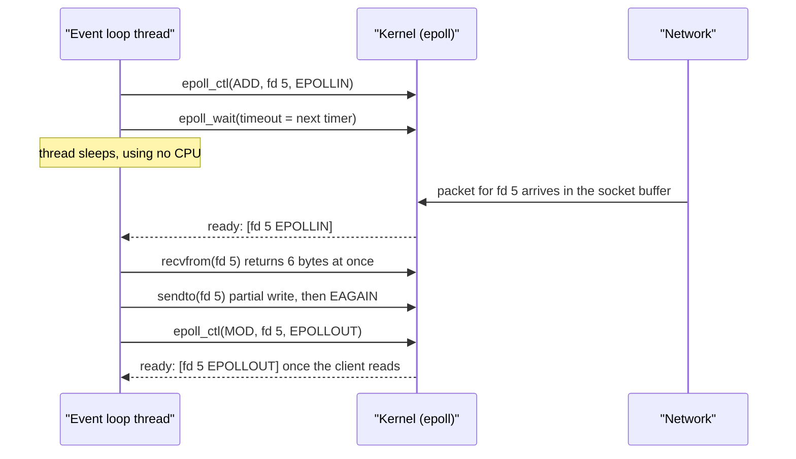

# I/O Operations

> **Module 04 · Operating Systems** · Prerequisites: [System Calls](27-System-Calls.md), [File Systems Basics](30-File-Systems-Basics.md) · Next: [Backend Concurrency Patterns](32-Backend-Concurrency-Patterns.md)

---

## ⏱ If You Only Have 2 Minutes

- **Blocking I/O:** the thread sleeps in the kernel until the operation finishes. **Non-blocking:** the call returns at once with data or `EAGAIN`. **Asynchronous (completion):** you submit the operation and are told later that it is *done*.
- **Readiness model** (`select`, `poll`, `epoll`, kqueue): the kernel tells you "fd 7 can be read now", and you make the `read`. **Completion model** (Windows IOCP, `io_uring`): the kernel does the read into your buffer and tells you it finished.
- `select` is capped at fd 1024 and scans every fd on every call. `poll` has no cap but still passes and scans the whole list. `epoll` registers fds once (`epoll_ctl`) and `epoll_wait` returns only the ready ones, so its cost grows with activity, not with idle connections.
- **Regular files are never "not ready".** `epoll_ctl` rejects them with `EPERM`, and `O_NONBLOCK` has no effect on disk reads. That is why libuv sends `fs` work to its thread pool (4 threads by default), why sockets use epoll, and why asyncio has no non-blocking file API.
- `io_uring` (Linux 5.1+) uses two shared-memory rings for submissions and completions, and works for files and sockets. Today neither runtime uses it for file I/O by default: libuv (Node) has defaulted to the thread pool since 1.49, and CPython's stdlib does not use it. Docker's default seccomp profile blocks it (measured: `EPERM`).
- **Backpressure** means a slow consumer slows the producer down. Node: `write()` returns `false` → wait for `'drain'`, which `stream.pipeline()` does for you. asyncio: `await writer.drain()`. Without it, a slow client makes you buffer the whole response in RAM.
- `sendfile(2)` copies file → socket inside the kernel, with no trip through user space. Python has `socket.sendfile()`. Node core has no `sendfile` API, so put large static files behind nginx or a CDN.
- Observe with `iostat -x 1` (device latency `r_await`/`w_await`, queue size), `pidstat -d 1` / `iotop` (per process), `/proc/<pid>/io`, and `strace -e epoll_wait,epoll_pwait` (what the loop waits on).

---

## 1. What It Is and Why It Exists

**I/O** is any transfer between your process and something outside its memory: a socket, a disk file, a pipe, a terminal. Almost all of a backend request's time is I/O wait: reading the request, waiting for PostgreSQL, calling another service, writing the response. The CPU work in between is often under a millisecond. *How* a program waits decides how many requests one process can serve.

**Analogy:** ordering at food stalls. **Blocking:** you stand at one stall until your food is ready, then queue at the next. **Non-blocking with readiness:** you take a buzzer from every stall, sit down, and go to whichever stall buzzes. When you get there, you still collect the food yourself. **Completion:** a runner brings the food to your table and taps you on the shoulder when it's there.

**The problem it solves.** The classic design is one thread per connection with blocking calls. It is simple and works up to a few thousand connections. Beyond that, every thread costs a stack, scheduling and context switches while mostly sleeping. The "C10K problem" (Dan Kegel, 1999) pushed operating systems to add scalable readiness APIs: `epoll` on Linux, kqueue on the BSDs and macOS, IOCP on Windows. libuv, asyncio, nginx and Redis are built on them: one thread waits on 100,000 sockets and handles only those with something to do.

---

## 2. How It Works

### Readiness: one event loop over epoll



1. Every socket is put into **non-blocking** mode (`O_NONBLOCK`; `accept4(..., SOCK_NONBLOCK)` does it at accept time).
2. The loop registers interest in each fd once with `epoll_ctl`. The kernel keeps the interest list and a **ready list** for the epoll instance.
3. `epoll_wait` sleeps until something is on the ready list or the timeout expires. The timeout is how timers work: the loop sleeps until the earliest one is due.
4. For each ready fd the loop makes the actual `read`/`write`. Those return at once. A non-blocking `write` may accept only part of the buffer, and the rest waits for `EPOLLOUT`.
5. By default epoll is **level-triggered**: an fd stays ready while unread data remains. With `EPOLLET` (edge-triggered) you are told once per change and must read until `EAGAIN`, or you will never hear about that data again.

Measured `strace -tt` of the Python `selectors` echo server in section 4 serving one client (trimmed):

```text
18:50:36.003850 epoll_wait(3, [{events=EPOLLIN, data=0x7fff00000004}], 1, -1) = 1     ← listening socket ready
18:50:36.585459 accept4(4, {sa_family=AF_INET, sin_port=htons(46328), ...}, [16], SOCK_CLOEXEC) = 5
18:50:36.587012 epoll_ctl(3, EPOLL_CTL_ADD, 5, {events=EPOLLIN, ...}) = 0
18:50:36.587233 epoll_wait(3, [{events=EPOLLIN, data=0x7fff00000005}], 2, -1) = 1
18:50:36.587961 recvfrom(5, "hello\n", 65536, 0, NULL, NULL) = 6
18:50:36.588616 sendto(5, "hello\n", 6, 0, NULL, 0) = 6
18:50:36.590137 recvfrom(5, "", 65536, 0, NULL, NULL) = 0                             ← EOF
18:50:36.590638 epoll_ctl(3, EPOLL_CTL_DEL, 5, ...) = 0
```

### Why files go to a thread pool

A disk read can't be "ready" in the epoll sense. The data is either in the page cache, and the `read` copies it, or it isn't, and the `read` sleeps until the device delivers it. The man page for `epoll_ctl` says it returns `EPERM` for regular files and directories. `select` and `poll` always report them as readable. So event loops do file work on other threads:

| Work | Node (libuv) | Python asyncio |
|---|---|---|
| TCP, Unix sockets, pipes | Non-blocking + epoll on the loop thread | Non-blocking + epoll (`SelectorEventLoop`) |
| `fs.*` / file reads and writes | libuv thread pool, 4 threads by default (`UV_THREADPOOL_SIZE`) | No async file API: `asyncio.to_thread()`, `loop.run_in_executor()`, or `aiofiles` (which also uses threads) |
| DNS via `getaddrinfo` | Thread pool (`dns.lookup`) | `loop.getaddrinfo()` uses the default executor |
| CPU work such as `zlib`, async `crypto` | Thread pool | Your choice: threads or processes |

[Node Event Loop and Concurrency](../Module-02-Core-Backend/06-Node-Event-Loop-and-Concurrency.md) covers the loop phases and thread-pool sizing. The consequence here: four slow NFS reads can occupy the whole libuv pool, and `dns.lookup` and `crypto.scrypt` calls then queue behind them.

Measured in Node 22.23 (libuv 1.51): `strace -f` of `fs.readFile` on a 50 MiB file showed 100 `read` calls, spread 25 each over the four pool threads, and none on the main thread.

### io_uring: what runtimes really use today

`io_uring` gives each process a **submission queue** and a **completion queue** in memory shared with the kernel. The app writes request entries (read fd 7 at offset X into buffer B, send on fd 9), and one `io_uring_enter` call submits a batch and can wait for completions. With `SQPOLL`, a kernel thread polls the submission queue, so submitting needs no syscall at all. It is a true completion model for files *and* sockets. What the runtimes use today:

- **libuv / Node:** libuv 1.45 (2023) started sending some file operations to `io_uring`. Since **1.49** the documentation says Linux "by default will be using the threadpool again"; `io_uring` for files must be switched on per loop (`UV_LOOP_USE_IO_URING_SQPOLL`). libuv still creates small rings at startup to batch `epoll_ctl` calls. Under Docker's default seccomp profile, `io_uring_setup` returned `EPERM` in a measured run and libuv quietly fell back.
- **Python:** asyncio's default loop on Linux uses `selectors`/epoll. Nothing in the standard library uses `io_uring`.
- **Security:** many recent kernel privilege-escalation bugs were in `io_uring`, which is why container runtimes block it by default.

So describe io_uring as the direction Linux I/O is going, and be precise that Node and Python servers today run on epoll plus thread pools.

---

## 3. Key Concepts

### The I/O models

| Model | Call pattern | Who copies the data | Example |
|---|---|---|---|
| Blocking | `read()` sleeps until data or EOF | Your thread, inside the call | `requests.get`, `fs.readFileSync`, `psycopg` sync |
| Non-blocking | `read()` returns data or `EAGAIN` at once | Your thread | Sockets in every event loop |
| Multiplexed readiness | Wait on many fds, then non-blocking calls on the ready ones | Your thread, after the wake-up | libuv, asyncio, nginx, Redis |
| Signal-driven | `SIGIO` when an fd is ready | Your thread | Rare in servers |
| Asynchronous / completion | Submit, get notified when finished | The kernel, into your buffer | IOCP, `io_uring`, POSIX AIO |

"Async" in `async def` or `async function` is a programming model on top of one of these. An `await` on a socket in asyncio is readiness-based underneath, and an `await fs.promises.readFile` in Node is a blocking `read` on a pool thread.

### select, poll, epoll, kqueue, IOCP

| API | Platforms | Cost per wait | Limits and quirks |
|---|---|---|---|
| `select` | Everywhere | O(highest fd), bitmaps copied in and out each call | `FD_SETSIZE` = 1024: an fd ≥ 1024 corrupts memory |
| `poll` | POSIX | O(number of fds), array copied each call | No fd cap; still slow with 10k mostly idle sockets |
| `epoll` | Linux | O(ready fds); the interest list lives in the kernel | Level- or edge-triggered; `EPOLLONESHOT`; `EPOLLEXCLUSIVE` avoids waking every process that waits on one listening socket |
| kqueue | macOS, FreeBSD | O(ready events) | Also watches files, processes, signals and timers |
| IOCP | Windows | Completion queue | Completion-based; libuv uses it on Windows |
| `io_uring` | Linux 5.1+ | Shared rings, batched submissions | Files and sockets; often restricted for security |

Python's `selectors.DefaultSelector` picks the best one available (`EpollSelector` on Linux). libuv picks per platform.

### Buffering layers and `O_DIRECT`

Data passes through your user-space buffer, the kernel socket buffers or page cache, and the device or NIC queue. Each layer smooths bursts and adds memory and delay ([System Calls](27-System-Calls.md) covers user-space buffering, [File Systems Basics](30-File-Systems-Basics.md) the page cache). `O_DIRECT` skips the page cache: I/O goes straight between your buffer and the device, with buffers, offsets and lengths aligned to the block size. Databases with their own cache use it (InnoDB's `innodb_flush_method=O_DIRECT`) to avoid caching pages twice. Application code almost never should.

### Zero-copy `sendfile`

Serving a file the ordinary way copies the data twice through user space: `read()` copies from the page cache into your buffer, then `write()` copies it into the socket buffer. `sendfile(out_socket, in_file, offset, count)` asks the kernel to move it directly, with no user-space copy and fewer syscalls.

- Python: `socket.sendfile(file)` uses `os.sendfile` when it can, and asyncio has `loop.sendfile()` for plain (non-TLS) transports.
- Node: no core `sendfile`. `pipeline(fs.createReadStream(f), res)` reads 64 KiB chunks into Buffers on the thread pool and writes them back out.
- TLS defeats it, because encryption needs the bytes in user space, unless kernel TLS (kTLS) is set up.

That is why large static files belong on nginx (`sendfile on;`), a CDN or object-storage pre-signed URLs, not in the app process.

### Backpressure in streams

Every queue between a fast producer and a slow consumer needs a limit and a way to push back:

| Layer | Signal | How the producer waits |
|---|---|---|
| Kernel socket send buffer | Non-blocking `send` returns `EAGAIN` | Wait for `EPOLLOUT` |
| Node writable stream | `write()` returns `false` above `highWaterMark` | `once(stream, "drain")`; `stream.pipeline()` does it |
| Node readable → writable | `pipe`/`pipeline` pauses the source | Automatic |
| asyncio `StreamWriter` | Transport buffer above its high-water mark | `await writer.drain()` |
| ASGI `send()` (uvicorn) | Transport writing paused | `await send(...)` doesn't return until it can write |

Kernel buffers absorb a lot before the push-back reaches you. In the measured echo test below, a client that never read managed to send about 5.4 MiB before the server stopped reading from it. Loopback socket buffers on both sides held most of it.

### Measuring I/O

```bash
iostat -x 1                 # per device: r/s w/s rkB/s wkB/s r_await w_await aqu-sz %util
pidstat -d 1                # per process: kB_rd/s kB_wr/s, and iodelay
iotop -o                    # live per-process disk I/O (needs root)
cat /proc/<pid>/io          # rchar/wchar = all read/write calls; read_bytes/write_bytes = hit storage
strace -f -T -e trace=epoll_wait,epoll_pwait -p <pid>    # how long the loop sleeps between events
ss -tm                      # socket memory: send/receive queue sizes per connection
```

Illustrative `iostat -x 1` from a database volume under a burst of writes:

```text
Device   r/s     w/s   rkB/s    wkB/s  r_await  w_await  aqu-sz  %util
nvme1n1  85.0  2410.0   680.0  38560.0     0.41     4.87   11.80  97.60
```

`w_await` is the average time per write including queueing (about 5 ms here), and `aqu-sz` the average requests in flight. `%util` near 100% only means the device was busy every sample. SSDs and NVMe serve many requests in parallel, so it does **not** mean saturated: use await times and the volume's IOPS limits. In `/proc/<pid>/io`, `rchar` far above `read_bytes` means reads came from the page cache.

---

## 4. Code Examples

Scenario: an API serves generated CSV exports of up to several GiB to slow mobile clients. Memory per download must stay flat, a client that disconnects must stop the disk reads and free the file descriptor, and the event loop must keep serving other requests. Then a minimal readiness-based server shows what event loops do underneath.

### Node.js / TypeScript

```ts
// npm i express   — Node.js 22+, TypeScript 5, ESM
import express from "express";
import { createReadStream } from "node:fs";
import { stat } from "node:fs/promises";
import { pipeline } from "node:stream/promises";
import { resolve, sep } from "node:path";

const EXPORT_DIR = resolve(process.env.EXPORT_DIR ?? "/srv/exports");
const app = express();
let inFlight = 0; // open download streams: each holds a file fd and a socket fd

app.get("/exports/:name", async (req, res) => {
  // Resolve and re-check the prefix so "../../etc/passwd" cannot escape the directory.
  const path = resolve(EXPORT_DIR, String(req.params.name));
  if (!path.startsWith(EXPORT_DIR + sep)) {
    res.status(400).json({ error: "bad_name" });
    return;
  }
  let size: number;
  try {
    const st = await stat(path); // runs on the libuv thread pool, not epoll
    if (!st.isFile()) throw new Error("not a file");
    size = st.size;
  } catch {
    res.status(404).json({ error: "not_found" });
    return;
  }

  res.setHeader("Content-Type", "application/octet-stream");
  res.setHeader("Content-Length", String(size));
  // 64 KiB reads on the thread pool. pipeline() pauses reading when res.write() returns false
  // (the socket's send buffer and Node's queue are full) and resumes on 'drain'.
  const source = createReadStream(path, { highWaterMark: 64 * 1024 });
  inFlight++;
  const started = performance.now();
  try {
    await pipeline(source, res);
    console.log(`sent ${size} bytes in ${(performance.now() - started).toFixed(0)} ms`);
  } catch (err) {
    // Client went away (ERR_STREAM_PREMATURE_CLOSE) or a read failed: pipeline already
    // destroyed both streams, so the file descriptor is closed and nothing keeps reading.
    console.warn(`download aborted: ${(err as NodeJS.ErrnoException).code ?? err}`);
  } finally {
    inFlight--;
  }
});

app.get("/healthz", (_req, res) => {
  res.json({ ok: true, inFlight, rssMiB: Math.round(process.memoryUsage().rss / 2 ** 20) });
});

app.listen(3000);
```

Measured in Docker with a 200 MiB file and `curl --limit-rate 20M` as the slow client:

```text
{"ok":true,"inFlight":0,"rssMiB":61}          ← before
{"ok":true,"inFlight":1,"rssMiB":85}          ← mid-download: ~24 MiB more, not 200
sent 209715200 bytes in 9670 ms               ← paced by the client, not the disk
{"ok":true,"inFlight":0,"rssMiB":73}
download aborted: ERR_STREAM_PREMATURE_CLOSE  ← curl --max-time 1 hung up; the stream was destroyed
```

Express also has `res.sendFile()`, which streams the same way and handles `Range` and caching headers. Use it unless you need custom control. The hand-written version shows where the backpressure and clean-up happen.

### Python

```python
# pip install fastapi uvicorn   — Python 3.12+. Run: uvicorn stream_api:app
import asyncio
import os
from collections.abc import AsyncIterator
from pathlib import Path

from fastapi import FastAPI, HTTPException
from fastapi.responses import StreamingResponse

EXPORT_DIR = Path(os.environ.get("EXPORT_DIR", "/srv/exports")).resolve()
CHUNK = 64 * 1024
app = FastAPI()


async def read_chunks(path: Path) -> AsyncIterator[bytes]:
    # Regular files are always "ready" to epoll, so asyncio has no non-blocking file read.
    # Each read runs in the default thread pool; the event loop keeps serving other sockets.
    f = await asyncio.to_thread(path.open, "rb")
    try:
        while chunk := await asyncio.to_thread(f.read, CHUNK):
            # Starlette awaits send() for each chunk; uvicorn's send() waits while the
            # transport's write buffer is above its high-water mark. That await is the
            # backpressure: a slow client slows down our reads instead of filling RAM.
            yield chunk
    finally:
        # Runs on normal end and when the client disconnects (the generator is closed).
        await asyncio.to_thread(f.close)


@app.get("/exports/{name}")
async def download(name: str) -> StreamingResponse:
    path = (EXPORT_DIR / name).resolve()
    if not path.is_relative_to(EXPORT_DIR) or path == EXPORT_DIR:
        raise HTTPException(400, "bad_name")
    try:
        st = await asyncio.to_thread(path.stat)  # stat is a blocking syscall too
    except FileNotFoundError:
        raise HTTPException(404, "not_found") from None
    if not path.is_file():
        raise HTTPException(404, "not_found")
    return StreamingResponse(
        read_chunks(path),
        media_type="application/octet-stream",
        headers={"Content-Length": str(st.st_size)},
    )
```

Measured in Docker with the same 200 MiB file: the uvicorn process RSS went from 47 MiB before the download to 49 MiB during it, and the slow client took 10.0 s. After a client hung up mid-download, `ls -l /proc/<pid>/fd` showed no descriptor left open on the file. Starlette's `FileResponse` does this thread-offloaded chunked reading for you, plus `Range` support.

A readiness-based server written directly on `selectors`, the layer asyncio is built on:

```python
# No pip packages — Python 3.12+. Readiness-based echo server: one thread, many sockets.
import selectors
import socket

MAX_PENDING = 256 * 1024  # per-connection outbound buffer cap: our backpressure limit
sel = selectors.DefaultSelector()  # EpollSelector on Linux, KqueueSelector on macOS


class Conn:
    def __init__(self, sock: socket.socket) -> None:
        self.sock = sock
        self.outbox = bytearray()
        self.events = selectors.EVENT_READ


def close(conn: Conn) -> None:
    sel.unregister(conn.sock)  # epoll_ctl(EPOLL_CTL_DEL)
    conn.sock.close()


def service(conn: Conn, mask: int) -> None:
    try:
        if mask & selectors.EVENT_READ:
            data = conn.sock.recv(64 * 1024)  # ready, so this returns at once
            if not data:  # EOF: the peer closed its side
                close(conn)
                return
            conn.outbox += data
        if conn.outbox:  # try now; wait for EVENT_WRITE only if the kernel send buffer is full
            del conn.outbox[: conn.sock.send(conn.outbox)]  # partial writes are normal
    except BlockingIOError:  # EAGAIN: buffer full (or a stale readiness report)
        pass
    except (ConnectionResetError, BrokenPipeError):
        close(conn)
        return
    events = selectors.EVENT_WRITE if conn.outbox else 0
    if len(conn.outbox) < MAX_PENDING:
        events |= selectors.EVENT_READ  # stop reading from a client that won't read our replies
    if events != conn.events:  # epoll_ctl(EPOLL_CTL_MOD) only when interest changes
        sel.modify(conn.sock, events, conn)
        conn.events = events


server = socket.create_server(("0.0.0.0", 9000), backlog=512)
server.setblocking(False)
sel.register(server, selectors.EVENT_READ, None)
while True:
    for key, mask in sel.select():  # epoll_wait: sleeps until at least one fd is ready
        if key.data is None:
            sock, _addr = server.accept()
            sock.setblocking(False)  # recv/send now return or raise EAGAIN immediately
            sel.register(sock, selectors.EVENT_READ, Conn(sock))
        else:
            service(key.data, mask)
```

Measured `strace` when a client floods the server and never reads the echoes (trimmed):

```text
recvfrom(5, "xxxxxxxx"..., 65536, 0, NULL, NULL) = 65536
sendto(5, "xxxxxxxx"..., 303616, 0, NULL, 0) = -1 EAGAIN (Resource temporarily unavailable)
epoll_ctl(3, EPOLL_CTL_MOD, 5, {events=EPOLLOUT, ...}) = 0     ← outbox ≥ 256 KiB: stop reading
epoll_wait(3, [{events=EPOLLOUT|EPOLLERR|EPOLLHUP, ...}], 2, -1) = 1
sendto(5, "xxxxxxxx"..., 303616, 0, NULL, 0) = -1 ECONNRESET    ← client gave up; server closes it and carries on
```

**Runtime difference to notice:** Node gives you the completion *style* for everything. `await readFile()` and `await pipeline()` look the same whether the work runs on epoll or on the thread pool, because libuv always offloads files for you. asyncio exposes the split: sockets have first-class `await` support, but there is no async file API, so you must remember `asyncio.to_thread()` yourself. A plain `f.read()` inside `async def` blocks every other request in that worker. Both hidden pools are small and shared: libuv's 4 threads, and the asyncio default executor (`min(32, os.cpu_count() + 4)` threads) that `to_thread` uses.

---

## 5. Production Concerns

- **Size the hidden pools for file-heavy work.** In Node, `fs`, `dns.lookup`, `zlib` and async `crypto` share 4 threads. A burst of slow disk or NFS reads delays DNS lookups for outgoing HTTP calls. Raise `UV_THREADPOOL_SIZE` (set it before the process starts) or move heavy file processing elsewhere. In Python, `to_thread` and `run_in_executor(None, …)` share the default executor, so give heavy file work its own `ThreadPoolExecutor`.
- **Never block the loop with file or socket calls.** `fs.readFileSync` in an Express handler, or `open().read()`, `requests` or `time.sleep` inside `async def`, stall every connection in that process. Watch event-loop lag (`perf_hooks.monitorEventLoopDelay`; asyncio debug mode logs callbacks slower than 100 ms).
- **Bound every buffer.** Streaming responses need backpressure. Request bodies need a size cap. Per-connection outbound queues (WebSockets, SSE, the echo server above) need a maximum, after which you drop the slow client. A single slow consumer must not be able to grow your memory without limit.
- **Clean up on disconnect.** A client that hangs up must stop the work it caused: destroy the read stream, cancel the database cursor, close the file. Check the open-fd count and in-flight streams under a test where clients abort.
- **Know your storage limits.** Cloud volumes have IOPS and throughput caps, and burst credits that run out. When `w_await` climbs while the app's write rate stays flat, the volume is throttled. Container disk I/O can also be limited by cgroup `io.max`.
- **Offload big static content.** Large files served by the app cost user-space copies, pool threads, memory and an fd for the whole slow download. Use nginx with `sendfile`, a CDN, or pre-signed object-storage URLs, and let the app only authorise.

---

## 6. Common Mistakes

- **Calling blocking file or HTTP APIs inside `async def` / the Node loop** — one slow disk or vendor call freezes every request in the process — use `asyncio.to_thread`, async clients, Node's async `fs`, or a plain `def` FastAPI endpoint.
- **Reading a whole file into memory to send it** (`readFile` then `res.send`, `f.read()` then return) — memory grows with file size × concurrent downloads, and the first byte waits for the last — stream it with `pipeline`, `StreamingResponse` or `FileResponse`.
- **Ignoring `write()`'s return value or skipping `drain()`** — a slow client makes the server buffer the whole response — use `pipeline()`, or `await once(stream, "drain")` / `await writer.drain()`.
- **Assuming `O_NONBLOCK` makes disk reads non-blocking** — the read still sleeps on a cache miss, inside the event loop — use a thread pool (or `io_uring` deliberately).
- **Using `select()` in code that can see high fd numbers** — fds ≥ 1024 overflow the `fd_set` and corrupt memory — use `poll`, `epoll` or `selectors.DefaultSelector`.
- **Treating `EAGAIN` or a partial write as an error** — data is lost or the connection is dropped — keep the unsent bytes and wait for writability.
- **Reading `%util` = 100% on an NVMe disk as "saturated"** — you scale the wrong thing — look at `r_await`/`w_await`, queue size and the volume's provisioned limits.

---

## 7. Comparison Table

| | Thread per connection, blocking | Event loop + readiness (epoll) | Event loop + thread pool for files | Completion (`io_uring`, IOCP) |
|---|---|---|---|---|
| Connections per process | Thousands (memory, scheduling) | 100k+ mostly idle sockets | Same as epoll for sockets | 100k+ |
| Disk I/O | Blocking, simple | Not supported for regular files | Pool threads (small, shared) | Native |
| Programming model | Straight-line code | Callbacks / `async`-`await` | Same, with hidden offloading | Submit / complete, usually wrapped |
| Main risk | Memory and context switches at scale | One blocking call stalls everything | Pool saturation | Kernel security exposure, newer APIs |
| Examples | Gunicorn sync workers (one request per worker), classic Java servlet containers | nginx, Redis, asyncio sockets | Node (libuv), asyncio + `to_thread` | Windows libuv, newer Linux servers and databases |

---

## 8. Interview Questions

**[Junior] What's the difference between blocking and non-blocking I/O?**
A blocking call puts the thread to sleep in the kernel until the operation can complete, for example `read` on a socket with no data. A non-blocking call returns at once: data if there is some, otherwise `EAGAIN`. Non-blocking calls are only useful together with a way to learn when to retry, such as epoll. That combination is what lets one thread serve thousands of connections.

**[Junior] What is backpressure in a stream, and how do Node and asyncio expose it?**
Backpressure is the consumer slowing the producer down when it can't keep up, instead of letting a buffer grow without limit. In Node, `writable.write()` returns `false` once the internal buffer passes `highWaterMark`, and the producer should wait for `'drain'`. `stream.pipeline()` does that automatically and cleans up on errors. In asyncio, `StreamWriter.write()` only buffers, and `await writer.drain()` waits until the transport's buffer drops below its high-water mark.

**[Mid] Why is epoll faster than select or poll for many connections?**
`select` and `poll` take the whole set of descriptors on every call, copy it into the kernel and scan it, so each wait costs O(n) even if only one socket is active. `select` is also limited to fds below 1024. epoll keeps the interest list in the kernel, registered once with `epoll_ctl`, and the kernel adds fds to a ready list as events arrive. `epoll_wait` returns only those, so the cost tracks activity, not the number of idle connections.

**[Mid] Why does Node use a thread pool for file system calls but not for sockets?**
Sockets have a real "not ready" state, so they can be non-blocking and watched with epoll. Regular files don't: a read either copies from the page cache or sleeps until the disk delivers, `O_NONBLOCK` doesn't change that, and `epoll_ctl` refuses regular files with `EPERM`. So libuv runs file operations as blocking calls on its thread pool (4 threads by default) and posts the result back to the loop. The same is true for `dns.lookup`, which calls the blocking `getaddrinfo`.

**[Mid] What is the difference between readiness and completion models?**
In a readiness model (epoll, kqueue) the kernel tells you an fd *can* be read or written, and you then make the call yourself, which might still do partial work. In a completion model (IOCP, io_uring) you hand the kernel the whole operation with a buffer, and it tells you when it has *finished* and how many bytes moved. Completion works for files too and can batch many operations into one syscall. Readiness is simpler and has been the Unix default for decades.

**[Senior] What is io_uring, and should a Node or Python backend care today?**
io_uring is a Linux interface (5.1+) where process and kernel share a submission ring and a completion ring. You queue reads, writes, accepts or sends and collect results with very few syscalls, or none in `SQPOLL` mode. It helps heavy file I/O and very high request rates. Today libuv uses the thread pool for files by default (since 1.49) and io_uring only to batch epoll updates where allowed; CPython's stdlib doesn't use it; and Docker's default seccomp profile blocks it because of its record of kernel vulnerabilities. For typical services the practical levers are still pool sizing, streaming and offloading.

**[Senior] A Node service's p99 latency jumps whenever a nightly export job runs in the same process. What's happening and how do you fix it?**
The export probably saturates the 4-thread libuv pool with large `fs` reads and writes, so `dns.lookup` for outgoing HTTP calls, async `crypto` and other file reads queue behind it, which looks like random slowness everywhere. Any `*Sync` calls or big in-memory transforms also block the loop. Confirm with event-loop delay metrics, `strace -f` showing pool threads busy in `read`/`write`, and `iostat`. Fix by streaming with backpressure, moving the export to a separate worker process or job queue, and raising `UV_THREADPOOL_SIZE` if contention remains.
---

## 9. Cheat Sheet

```text
Models          blocking (sleep in kernel) · non-blocking (EAGAIN) · readiness (epoll) · completion (IOCP, io_uring)
select          FD_SETSIZE 1024, O(n) per call · poll: no cap, O(n) · epoll: register once, O(ready)
epoll           epoll_create1 · epoll_ctl ADD/MOD/DEL · epoll_wait(timeout = next timer) · LT default, EPOLLET
Files           never "not ready"; epoll_ctl → EPERM; O_NONBLOCK no effect → thread pool
Node            sockets on epoll; fs/dns.lookup/zlib/crypto on libuv pool (4, UV_THREADPOOL_SIZE)
Python          asyncio = selectors/epoll; no async files → asyncio.to_thread / aiofiles (threads)
io_uring        SQ + CQ shared rings, files + sockets · libuv: pool for files by default since 1.49
                CPython stdlib: not used · Docker default seccomp: EPERM (measured)
Partial writes  normal for non-blocking sockets: keep the rest, wait for EPOLLOUT
Backpressure    Node write()=false → 'drain' · pipeline() · asyncio await writer.drain() · ASGI await send()
Measured        200 MiB download to a slow client: Node RSS +24 MiB, uvicorn +2 MiB
sendfile        file → socket in kernel · Python socket.sendfile · Node: none → nginx/CDN · TLS needs kTLS
O_DIRECT        bypass page cache, aligned I/O · databases only
Observe         iostat -x 1 (await, aqu-sz; %util misleads on NVMe) · pidstat -d · iotop · /proc/<pid>/io
                strace -f -T -e epoll_wait,epoll_pwait · ss -tm
```

---

## Related Topics

- [Node Event Loop and Concurrency](../Module-02-Core-Backend/06-Node-Event-Loop-and-Concurrency.md) — loop phases, the libuv thread pool, and blocking the loop
- [Node HTTP Server Concepts](../Module-02-Core-Backend/05-Node-HTTP-Server-Concepts.md) — `res.write()`/`drain`, `pipeline` and server timeouts
- [System Calls](27-System-Calls.md) — `read`, `writev`, `EAGAIN`, `strace`, and fewer syscalls through buffering
- [File Systems Basics](30-File-Systems-Basics.md) — the page cache, file descriptors and `fsync`
- [Backend Concurrency Patterns](32-Backend-Concurrency-Patterns.md) — bounded queues and load shedding built on backpressure
- [Ports and Sockets](../Module-06-Networking-and-Distributed-Basics/07-Ports-and-Sockets.md) — what a socket is at the network level
