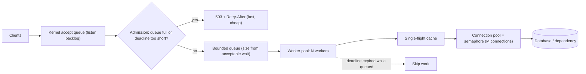

# Backend Concurrency Patterns

> **Module 04 · Operating Systems** · Prerequisites: [I/O Operations](31-I-O-Operations.md), [Semaphore](15-Semaphore.md) · Next: [Module 05: Data Structures and Algorithms](../Module-05-Data-Structures-and-Algorithms/README.md)

---

## ⏱ If You Only Have 2 Minutes

- **Little's law: L = λ × W.** Work in progress = arrival rate × time in system. At 300 req/s with a 40 ms database call, 12 connections are busy on average. If the database slows to 400 ms, you need 120. A pool of 20 then caps throughput at 20 ÷ 0.4 s = 50 req/s, and everything above that must queue or be rejected.
- **Size pools by the kind of work.** CPU-bound: about one worker per CPU you are actually allowed to use (the cgroup quota, not the host's core count). I/O-bound: λ × W plus headroom, capped by what the dependency can take.
- **Every queue needs a bound.** An unbounded queue just turns overload into memory growth and latency nobody waits for. Choose the size from the wait you can accept: queue = throughput × acceptable wait (20 jobs/s × 0.4 s = 8).
- **Shed load early and cheaply.** When the queue is full, reply **503 + `Retry-After`** in milliseconds, before parsing bodies or touching the database. Use **429** when one client is over its own quota.
- **Single-flight** (request coalescing): when 100 requests miss the cache for the same key, one loads it and 99 wait for that result. This stops cache stampedes. Don't cache failures, and give the shared load its own deadline.
- **Fan-out multiplies tail latency.** If each of 10 parallel calls is slow 1% of the time, 1 − 0.99¹⁰ ≈ 9.6% of requests hit a slow call. Set a deadline for the whole fan-out and decide up front which parts may be missing.
- **Deadlines, not just timeouts.** Pass the remaining budget down (`AbortSignal`, `asyncio.timeout`, gRPC deadlines). Cancel queued work whose caller has gone, and never start work nobody is waiting for.
- A **connection pool is a semaphore** with resources attached. Pool size × replicas must fit the database's `max_connections`.

---

## 1. What It Is and Why It Exists

The earlier chapters gave you the parts: processes and threads, the event loop, locks, semaphores, condition variables, non-blocking I/O and backpressure. **Backend concurrency patterns** are the standard ways to put those parts together, so that a service stays fast at normal load and *degrades in a controlled way* under overload instead of collapsing.

**Analogy:** a busy restaurant kitchen. A fixed number of cooks (a worker pool) work from a ticket rail that holds at most 15 orders (a bounded queue). When the rail is full, the host says "come back in 45 minutes" (load shedding with `Retry-After`) rather than seating guests to starve. Ten tables ordering the daily special share one pot (single-flight), and a big order is split between stations and plated together (fan-out/fan-in).

**What breaks without these patterns.** The usual overload story goes like this:

1. A dependency slows from 40 ms to 400 ms. By Little's law, ten times as many requests are now in flight.
2. Every in-flight request holds memory, a socket, maybe a database connection. Requests queue inside the connection pool with no limit.
3. Clients time out after 2 s and **retry**, adding more arrivals while the original requests still run.
4. The process spends its time on work whose callers have already gone. Memory grows, the event loop or thread pool saturates, health checks fail and the orchestrator restarts healthy-but-busy instances.

Bounded pools, bounded queues, early rejection, deadline propagation and coalescing each stop one step of that story.

---

## 2. How It Works

### The shape of a well-behaved request path



Each box is a bounded resource with its own metrics: how many items are in it, how long they wait, and how many are rejected. The kernel's **listen backlog** is the first queue. Connections that finished the TCP handshake wait there until the process calls `accept`. Its limit is the `backlog` argument, capped by `net.core.somaxconn` (4096 by default since Linux 5.4). When it overflows, the kernel drops connections and counts them in `ListenOverflows`.

### Little's law, worked through

Little's law holds for any stable system: **L = λW**, where L is the average number of items inside, λ the arrival rate and W the average time each spends inside.

| Situation | λ | W (DB call) | L = connections busy | Pool of 20 |
|---|---|---|---|---|
| Normal | 300 req/s | 40 ms | 12 | 60% used, fine |
| Database slows 10× | 300 req/s | 400 ms | 120 needed | Max throughput 20 ÷ 0.4 = 50 req/s; 250 req/s excess |
| Excess with an unbounded wait queue | — | — | Queue grows by 250 per second | After 10 s: 2,500 waiting, each waiting 50+ s |
| Excess with a queue of 20 and shedding | — | — | 20 busy + 20 queued | 50 req/s served within ~0.8 s; 250 req/s get a fast 503 |

Two lessons follow. First, a pool size should come from **λ × W at peak, plus headroom**, not from a guess. Second, no pool size survives a dependency that slows down enough. Only a bound plus rejection keeps latency for the requests you do accept.

Queue size follows the same law: **max queue = throughput × acceptable wait.** With 4 workers each taking 200 ms (20 jobs/s) and a latency budget that allows 400 ms of waiting, the queue holds 8. The code examples use exactly those numbers.

### Observing it on Linux

```bash
ss -lnt 'sport = :3000'        # LISTEN row: Recv-Q = connections waiting for accept, Send-Q = backlog limit
nstat -az TcpExtListenOverflows TcpExtListenDrops     # accept queue overflows since boot
ss -tn state established '( dport = :5432 )' | tail -n +2 | wc -l   # DB connections actually open
grep Threads /proc/<pid>/status                        # threads in the process (pools included)
pidstat -t -p <pid> 1                                  # per-thread CPU: is the pool CPU-bound?
```

Illustrative output from a saturated service:

```text
$ ss -lnt 'sport = :3000'
State   Recv-Q  Send-Q  Local Address:Port  Peer Address:Port
LISTEN  511     511     0.0.0.0:3000        0.0.0.0:*         ← accept queue full: the process isn't accepting fast enough
$ nstat -az TcpExtListenOverflows
TcpExtListenOverflows           18342              0.0
```

The OS can only show the outer layers. The application must export the inner ones: queue depth, **time spent queued** (the most useful single overload signal), pool utilisation, rejections per reason, and single-flight hits.

---

## 3. Key Concepts

### Worker pools and how to size them

| Work type | What limits it | Starting size | Runtime tools |
|---|---|---|---|
| CPU-bound (image resize, PDF render, bcrypt) | CPU time | CPUs you may use: the cgroup quota (`cpu.max`), not the host count | Node: `worker_threads` pool (e.g. piscina). Python: `ProcessPoolExecutor` (the GIL), or free-threaded 3.13+ builds with care |
| I/O-bound (HTTP calls, DB queries) | The dependency's latency and limits | λ × W at peak × 1.2–1.5, capped by the dependency's limit | Node: async calls + a semaphore. Python: asyncio tasks + `asyncio.Semaphore`; threads for blocking clients |
| Mixed | Whichever saturates first | Split into two pools | Separate pools per kind of work, so one can't starve the other |

More CPU workers than CPUs only adds context switches and quota throttling ([CPU Scheduling](07-CPU-Scheduling.md)). `os.availableParallelism()` and `os.cpu_count()` are not reliable under a quota, so read `cpu.max` or use configuration.

### Producer–consumer with bounded queues

A queue decouples producers from consumers, so bursts are absorbed and N consumers work at their own pace. Every queue must decide what happens when it is full:

| Policy | Producer sees | Good for |
|---|---|---|
| **Block** the producer | `await queue.put()` waits | Internal pipelines, where waiting slows the upstream stage (backpressure) |
| **Reject** new work | Error now → HTTP 503 + `Retry-After` | Request handling: the client can retry elsewhere or later |
| **Drop oldest** | Nothing; stale items vanish | Telemetry, live prices, anything where newest matters most |
| **Expire by age** | Items older than their deadline are skipped | Any queue between a caller with a timeout and a worker |

In-memory queues die with the process. If a job must survive a crash or a deploy, use a durable queue with acknowledgements and idempotent handlers ([Background Workers](../Module-02-Core-Backend/17-Background-Workers.md)).

### Backpressure and load shedding

Backpressure pushes "slow down" upstream: inside a process by awaiting `drain` or a blocking `put`, across a network only by slower responses or explicit rejection. Shedding rules that work:

- **Reject at the door,** before parsing a large body or opening a transaction. If rejecting is expensive, shedding becomes its own overload.
- **503 vs 429.** `503 Service Unavailable` means the *server* is overloaded. `429 Too Many Requests` (RFC 6585) means *this client* is over its quota ([Rate Limiting](../Module-07-Advanced-Backend-and-System-Design/33-Rate-Limiting.md)). Both may carry `Retry-After` (RFC 9110), in seconds or as a date.
- **Reject work that can't finish in time:** if the remaining deadline is shorter than expected queue wait plus service time, fail now.
- **Prioritise.** Shed background traffic first, and keep health checks and payments on their own capacity ([Bulkhead Pattern](../Module-07-Advanced-Backend-and-System-Design/38-Bulkhead-Pattern.md)).
- **Control retries:** backoff with jitter, respect `Retry-After`, and cap retries with a budget (for example at most 10% extra traffic), or rejected work returns as more load.

### Fan-out/fan-in and pipelines

**Fan-out/fan-in** runs independent calls in parallel and combines the results: a product page that needs price, stock, reviews and recommendations. Total latency is the *slowest* call, so tail latency grows with the number of calls. Decide which parts are required and which are optional:

| Need | Node | Python |
|---|---|---|
| All must succeed; fail fast and cancel the rest | `Promise.all` + a shared `AbortController` you abort on the first error (`Promise.all` alone doesn't cancel) | `asyncio.TaskGroup` (3.11+): the first failure cancels the siblings |
| Take what succeeded, degrade the rest | `Promise.allSettled` | `asyncio.gather(..., return_exceptions=True)` |
| One deadline for the whole fan-out | `AbortSignal.timeout(ms)` passed to every call | `async with asyncio.timeout(s):` around the group |
| Bound the parallelism (500 items) | A semaphore or the pool below | `asyncio.Semaphore` or a bounded queue + N workers |

A **pipeline** chains stages (download → resize → upload), each with its own pool, joined by bounded queues. Throughput is set by the slowest stage. Bounded queues between stages make a slow stage push back on the faster ones instead of collecting an unbounded backlog in memory.

### Single-flight and per-key serialisation

A **cache stampede** (thundering herd) happens when a hot key expires and every concurrent request misses and queries the database for the same value. **Single-flight** keeps a map of in-progress loads: the first miss starts the load, later misses await the same promise or task, and the entry is removed when the load settles. Share errors with current waiters but don't cache them. Add **TTL jitter** so keys don't expire together, and consider **stale-while-revalidate** for very hot keys. Single-flight is per process: six replicas can still make six loads, which is usually fine.

**Per-key serialisation** is the write-side cousin: operations on the same account run one at a time, different keys in parallel. Use a map of per-key mutexes or queues and delete idle entries ([Mutex](14-Mutex.md)). Across replicas it needs a row lock or partitioning by key, such as a Kafka partition per key.

### Timeouts, deadlines and cancellation

A **timeout** is a duration per operation. A **deadline** is an absolute time for the whole request, and each step gets *what is left*: if the gateway allows 2 s and 300 ms are gone, the database call must not start a fresh 2 s timeout.

- **Node:** `AbortSignal.timeout(ms)` and `AbortSignal.any([deadline, clientGone])`, passed to `fetch` and your own functions. Promises can't be cancelled from outside, so code must check `signal.aborted`.
- **Python:** `asyncio.timeout()` raises `CancelledError` at the task's current `await`, and `TaskGroup` cancels siblings. Blocking calls in threads can't be cancelled, only abandoned.
- **Cancel queued work** whose deadline has passed. It is the cheapest load shedding there is.
- **Cancel downstream too.** Closing an HTTP connection doesn't stop a running SQL query: use PostgreSQL's `statement_timeout` or a cancel request.

### Connection pools as semaphores

A pool of M connections is a counting semaphore whose permits are live sockets ([Semaphore](15-Semaphore.md)). Set an **acquire timeout** shorter than the request deadline, size M from peak λ × query time, and check **M × replicas × processes per replica ≤ `max_connections`** minus a reserve for admin work. PostgreSQL's default is 100; 8 replicas × 4 workers × a pool of 10 is already 320, which is why PgBouncer exists. Hold a connection only for the query or transaction, never across an outbound HTTP call.

---

## 4. Code Examples

Scenario: a reporting API. Price lookups are cached with single-flight so a cold key reaches the database once. Report rendering (200 ms each) runs in a bounded pool of 4 workers with a queue of 8. Excess requests get `503` with `Retry-After` in milliseconds, and requests whose 1 s deadline passes while queued are never rendered.

### Node.js / TypeScript

```ts
// No npm packages — Node.js 22+, TypeScript 5.
type Loader<V> = (key: string, signal: AbortSignal) => Promise<V>;

export class SingleFlightCache<V> {
  private readonly cache = new Map<string, { value: V; expiresAt: number }>();
  private readonly inflight = new Map<string, Promise<V>>();

  constructor(
    private readonly loader: Loader<V>,
    private readonly ttlMs: number,
    private readonly loadTimeoutMs: number,
  ) {}

  get(key: string): Promise<V> {
    const hit = this.cache.get(key);
    if (hit && hit.expiresAt > Date.now()) return Promise.resolve(hit.value);

    // Coalesce: every caller that misses while a load is running shares that one promise.
    const running = this.inflight.get(key);
    if (running) return running;

    // The load has its own deadline, so one impatient caller cannot abort it for everyone.
    const load = this.loader(key, AbortSignal.timeout(this.loadTimeoutMs))
      .then((value) => {
        // ±10% jitter so keys filled together don't all expire in the same millisecond.
        const ttl = this.ttlMs * (0.9 + Math.random() * 0.2);
        this.cache.set(key, { value, expiresAt: Date.now() + ttl });
        return value;
      })
      .finally(() => this.inflight.delete(key)); // errors are shared but never cached
    this.inflight.set(key, load);
    return load;
  }
}

// Demo: 100 concurrent requests for a cold key reach the origin once.
let originCalls = 0;
const prices = new SingleFlightCache<number>(async (sku, signal) => {
  originCalls++;
  await new Promise((r) => setTimeout(r, 200));      // a slow database query
  signal.throwIfAborted();
  return sku.length * 10;
}, 30_000, 1_000);

const results = await Promise.all(Array.from({ length: 100 }, () => prices.get("sku-42")));
console.log({ requests: results.length, originCalls, value: results[0] });
// measured: { requests: 100, originCalls: 1, value: 60 }
```

A bounded worker pool that sheds load:

```ts
// npm i express   — Node.js 22+, TypeScript 5, ESM
import express from "express";

export class QueueFullError extends Error {}

type Job = { run: () => void; reject: (e: unknown) => void; signal: AbortSignal };

export class BoundedPool {
  private running = 0;
  private readonly queue: Job[] = [];

  constructor(readonly concurrency: number, readonly maxQueue: number) {}

  get stats() { return { running: this.running, queued: this.queue.length }; }

  run<T>(task: (signal: AbortSignal) => Promise<T>, signal: AbortSignal): Promise<T> {
    // Reject at the door: no promise, no closure, no memory for work we cannot do in time.
    if (this.running >= this.concurrency && this.queue.length >= this.maxQueue) {
      return Promise.reject(new QueueFullError("queue full"));
    }
    return new Promise<T>((resolve, reject) => {
      const job: Job = {
        signal,
        reject,
        run: () => {
          this.running++;
          task(signal).then(resolve, reject).finally(() => { this.running--; this.next(); });
        },
      };
      // A caller whose deadline passes while queued leaves the queue and never runs.
      signal.addEventListener("abort", () => {
        const i = this.queue.indexOf(job);
        if (i >= 0) { this.queue.splice(i, 1); reject(signal.reason); }
      }, { once: true });
      this.queue.push(job);
      this.next();
    });
  }

  private next(): void {
    while (this.running < this.concurrency && this.queue.length > 0) {
      const job = this.queue.shift()!;
      if (job.signal.aborted) { job.reject(job.signal.reason); continue; }
      job.run();
    }
  }
}

// Little's law: 4 workers x 200 ms each = 20 jobs/s. A queue of 8 means at most 400 ms waiting.
const pool = new BoundedPool(4, 8);
const app = express();

app.post("/reports", async (req, res) => {
  const clientGone = new AbortController();
  res.on("close", () => { if (!res.writableFinished) clientGone.abort(); });
  const signal = AbortSignal.any([AbortSignal.timeout(1_000), clientGone.signal]);
  try {
    const report = await pool.run(async (s) => {
      await new Promise((r) => setTimeout(r, 200)); // stands in for a 200 ms render
      s.throwIfAborted();
      return { id: crypto.randomUUID() };
    }, signal);
    res.status(201).json(report);
  } catch (err) {
    if (err instanceof QueueFullError) {
      res.status(503).set("Retry-After", "1").json({ error: "overloaded", ...pool.stats });
      return;
    }
    res.status(503).json({ error: "deadline_exceeded" });
  }
});

app.listen(3000);
```

Measured with 40 simultaneous `POST /reports` requests (Node 22, Docker):

```text
201 Retry-After=None:  12 requests, latency 215-625 ms     ← 4 running + 8 queued, all inside the deadline
503 Retry-After=1:     28 requests, latency 5-24 ms        ← rejected at the door
```

The rejected requests were answered an order of magnitude faster than a served one, and the slowest served request (625 ms) stayed inside the 1 s deadline. That is what the queue size of 8 was chosen for.

### Python

```python
# No pip packages — Python 3.12+.
import asyncio
import random
import time
from collections.abc import Awaitable, Callable


class SingleFlightCache[V]:
    def __init__(self, loader: Callable[[str], Awaitable[V]], ttl: float, load_timeout: float) -> None:
        self._loader = loader
        self._ttl = ttl
        self._load_timeout = load_timeout
        self._cache: dict[str, tuple[float, V]] = {}
        self._inflight: dict[str, asyncio.Task[V]] = {}

    async def get(self, key: str) -> V:
        hit = self._cache.get(key)
        if hit is not None and hit[0] > time.monotonic():
            return hit[1]
        task = self._inflight.get(key)
        if task is None:
            # A Task, not a bare coroutine: it runs once no matter how many callers await it.
            task = asyncio.create_task(self._load(key))
            self._inflight[key] = task
            task.add_done_callback(lambda _t: self._inflight.pop(key, None))
        # shield(): a caller that times out or disconnects is cancelled alone; without it,
        # cancelling the first awaiter would cancel the shared load for every other caller.
        return await asyncio.shield(task)

    async def _load(self, key: str) -> V:
        async with asyncio.timeout(self._load_timeout):  # the load's own deadline
            value = await self._loader(key)
        ttl = self._ttl * random.uniform(0.9, 1.1)  # jitter: spread out expiries
        self._cache[key] = (time.monotonic() + ttl, value)  # failures are not cached
        return value


async def main() -> None:
    origin_calls = 0

    async def load_price(sku: str) -> int:
        nonlocal origin_calls
        origin_calls += 1
        await asyncio.sleep(0.2)  # a slow database query
        return len(sku) * 10

    prices = SingleFlightCache(load_price, ttl=30, load_timeout=1)
    impatient = asyncio.create_task(prices.get("sku-42"))
    await asyncio.sleep(0.05)
    impatient.cancel()  # one caller gives up; the others must still get the value
    results = await asyncio.gather(*(prices.get("sku-42") for _ in range(100)))
    print({"requests": len(results), "origin_calls": origin_calls, "value": results[0],
           "impatient_cancelled": impatient.cancelled()})


asyncio.run(main())
# measured: {'requests': 100, 'origin_calls': 1, 'value': 60, 'impatient_cancelled': True}
```

A bounded worker pool with `asyncio.Queue`:

```python
# pip install fastapi uvicorn   — Python 3.12+. Run: uvicorn pool_api:app
import asyncio
import uuid
from collections.abc import AsyncIterator, Awaitable, Callable
from contextlib import asynccontextmanager
from typing import Any

from fastapi import FastAPI
from fastapi.responses import JSONResponse

Job = tuple[Callable[[], Awaitable[Any]], asyncio.Future[Any]]


class BoundedPool:
    def __init__(self, workers: int, max_queue: int) -> None:
        self.queue: asyncio.Queue[Job] = asyncio.Queue(maxsize=max_queue)
        self.workers = workers
        self._tasks: list[asyncio.Task[None]] = []

    def start(self) -> None:
        self._tasks = [asyncio.create_task(self._worker()) for _ in range(self.workers)]

    async def stop(self) -> None:
        for t in self._tasks:
            t.cancel()
        await asyncio.gather(*self._tasks, return_exceptions=True)

    def submit(self, fn: Callable[[], Awaitable[Any]]) -> asyncio.Future[Any]:
        fut: asyncio.Future[Any] = asyncio.get_running_loop().create_future()
        self.queue.put_nowait((fn, fut))  # raises asyncio.QueueFull: reject, don't wait
        return fut

    async def _worker(self) -> None:
        while True:
            fn, fut = await self.queue.get()
            try:
                if fut.cancelled():  # the caller's deadline passed while queued: skip the work
                    continue
                result = await fn()
                if not fut.done():
                    fut.set_result(result)
            except Exception as exc:
                if not fut.done():
                    fut.set_exception(exc)
            finally:
                self.queue.task_done()


# Little's law: 4 workers x 200 ms each = 20 jobs/s. A queue of 8 means at most 400 ms waiting.
pool = BoundedPool(workers=4, max_queue=8)


@asynccontextmanager
async def lifespan(_app: FastAPI) -> AsyncIterator[None]:
    pool.start()
    yield
    await pool.stop()


app = FastAPI(lifespan=lifespan)


async def render_report() -> dict[str, str]:
    await asyncio.sleep(0.2)  # stands in for a 200 ms render
    return {"id": str(uuid.uuid4())}


@app.post("/reports", status_code=201)
async def create_report() -> Any:
    try:
        fut = pool.submit(render_report)
    except asyncio.QueueFull:
        return JSONResponse({"error": "overloaded", "queued": pool.queue.qsize()},
                            status_code=503, headers={"Retry-After": "1"})
    try:
        async with asyncio.timeout(1.0):  # cancels fut on expiry, so a worker skips it
            return await fut
    except TimeoutError:
        return JSONResponse({"error": "deadline_exceeded"}, status_code=503)
```

Measured with the same 40 simultaneous requests (Python 3.12, uvicorn, Docker):

```text
201 Retry-After=None:  12 requests, latency 232-699 ms
503 Retry-After=1:     28 requests, latency 14-106 ms
```

**Runtime difference to notice:** cancellation. A JavaScript promise can't be cancelled, so the Node cache can hand one promise to every caller safely; an impatient caller just stops listening. Cancellation must be passed as an `AbortSignal`, and the pool removes aborted jobs itself. In asyncio, cancellation is built in and **spreads through `await`**: awaiting the shared task directly would let the first caller's timeout cancel the load for all 100 waiters, hence `asyncio.shield()`. Likewise `asyncio.timeout()` around `await fut` cancels the future, and the worker sees `fut.cancelled()` and skips the job. Neither version stops a job *already running* unless the task checks its signal or reaches an `await`. For CPU-bound rendering, swap the sleep for a `worker_threads` pool or a `ProcessPoolExecutor`; the bounded queue in front stays the same.

---

## 5. Production Concerns

- **Measure queue time, not only queue length.** Time from enqueue to start is the clearest overload signal, and it's what the user feels. Export queue depth, queue time (p50/p99), pool utilisation, rejections by reason, and deadline expiries. Alert on rising queue time before rejections start.
- **Choose limits per replica, check them globally.** Every limit in this chapter is per process. 10 replicas × pool 20 = 200 database connections. A partner limit of 50 concurrent calls divided across 10 replicas is 5 each. Recompute when autoscaling changes the replica count.
- **Make shedding cheap and visible.** The 503 path must not allocate much, log a stack trace per request or touch the database. Log rejections as counters. Load balancers and clients must treat 503 + `Retry-After` as "back off", not "retry immediately on the next instance".
- **Autoscaling is not backpressure.** New instances take tens of seconds to minutes to arrive. Shedding protects you during that gap, and a database can't autoscale its connection limit at all.
- **Graceful shutdown drains the pools.** On `SIGTERM`, stop admitting, let queued and running jobs finish within the grace period, and reject or hand off the rest ([Signals](29-Signals.md)). In-memory queues lose their contents when the process dies. Anything that matters belongs in a durable queue.
- **Containers change CPU math.** A CPU pool sized from the host core count inside a 2-CPU quota causes throttling and long tails. Export `nr_throttled` from `cpu.stat`.

---

## 6. Common Mistakes

- **Unbounded queues or `Promise.all` over unbounded input** — overload becomes memory growth and minutes of latency, then an OOM kill — bound the queue, bound the parallelism, and reject when full.
- **Sizing pools by guessing ("let's use 100 threads")** — too small wastes capacity, too large overloads the dependency and causes context-switch and throttling overhead — use Little's law at peak, the dependency's limits and the CPU quota.
- **Retrying immediately on 503/timeouts** — rejected work comes straight back, often multiplied by several layers of retries — exponential backoff with jitter, respect `Retry-After`, keep a retry budget.
- **Independent timeouts at every layer** — inner calls keep running after the caller has given up — propagate one deadline (`AbortSignal`, `asyncio.timeout`) and skip work whose caller has gone.
- **Cache without stampede protection** — a hot key expires and 1,000 identical queries hit the database at once — single-flight, TTL jitter, stale-while-revalidate.
- **Letting one caller's cancellation kill shared work** — in asyncio, a timed-out request cancels the shared load for all waiters — `asyncio.shield()` around shared tasks, and an independent deadline for the load.
- **Holding a pooled connection across slow work** (an HTTP call inside a transaction) — the pool empties while the database sits idle — acquire late, release early, and never wait on the network while holding a connection or lock.

---

## 7. Comparison Table

| Pattern | Problem it solves | Bound it adds | Failure if missing | Typical tool |
|---|---|---|---|---|
| Worker pool | Too many concurrent executions | N running | CPU thrash, dependency overload | `worker_threads`/piscina, `ProcessPoolExecutor`, `ThreadPoolExecutor` |
| Bounded queue | Bursts arrive faster than workers | M waiting | Memory growth, latency nobody waits for | Array + check, `asyncio.Queue(maxsize)` |
| Load shedding | Sustained overload | Admission rate | Every request slow instead of some rejected | 503 + `Retry-After`, adaptive concurrency limits |
| Rate limiting | One client takes too much | Requests per client per time | Noisy neighbour | Token bucket, 429 |
| Semaphore / bulkhead | One dependency takes all capacity | Concurrency per dependency | One slow dependency stalls everything | `asyncio.Semaphore`, `p-limit` |
| Single-flight | Duplicate concurrent loads | 1 load per key per process | Cache stampede | Map of promises / tasks |
| Per-key serialisation | Concurrent writes to one entity | 1 operation per key | Lost updates, double processing | Keyed mutex, partition by key |
| Deadline propagation | Work outliving its caller | Time | Wasted work, retry amplification | `AbortSignal`, `asyncio.timeout`, gRPC deadlines |

---

## 8. Interview Questions

**[Junior] What is Little's law and how do you use it for pool sizing?**
L = λW: the average number of items in a system equals the arrival rate times the average time each item spends there. If a service gets 300 req/s and each makes a 40 ms database call, about 12 connections are busy on average. Size the pool for peak λ and realistic W with some headroom, for example 20. It also tells you that if W grows tenfold, so does the concurrency you need, which is why a bound plus rejection is required.

**[Mid] What's the difference between returning 429 and 503, and what does `Retry-After` do?**
429 Too Many Requests means this particular client exceeded its quota, so other clients are unaffected. 503 Service Unavailable means the server as a whole is overloaded or down for maintenance. Both can carry `Retry-After` with a delay in seconds or an HTTP date, which well-behaved clients and SDKs use to back off instead of retrying immediately. Shedding with 503 should happen before expensive work, so rejecting is much cheaper than serving.

**[Mid] What is a cache stampede and how does single-flight prevent it?**
When a hot key expires, every concurrent request misses and recomputes or queries the same value, so the database gets hundreds of identical queries at once. Single-flight keeps a map of in-progress loads per key. The first miss starts the load, and the others await the same promise or task, so one query serves all. Combine it with TTL jitter, stale-while-revalidate for very hot keys, a timeout on the load, and no caching of errors. It works per process, so N replicas can still make N loads.

**[Mid] How do you handle partial failure in a fan-out?**
Decide in advance which results are required. For required parts, fail fast and cancel the siblings (`TaskGroup` in Python, an `AbortController` with `Promise.all` in Node). For optional parts (recommendations, reviews), use `allSettled` or `gather(return_exceptions=True)` and render a degraded response. Put one deadline on the whole fan-out, bound its parallelism, and remember tail amplification: the more calls, the more likely one is slow.

**[Senior] A dependency slows from 50 ms to 2 s. Walk through what happens to an unprotected service and what you would put in place.**
By Little's law, in-flight requests grow 40×, each holding memory, sockets and maybe pooled connections. The pool's wait queue grows without limit, client timeouts trigger retries, and the service burns resources on requests whose callers have gone, until health checks fail. Protection: a per-dependency semaphore (bulkhead) with a bounded wait shorter than the request deadline, a circuit breaker to fail fast, deadline propagation so abandoned work stops, and admission control returning 503 + `Retry-After`. Monitor queue time and rejections per dependency.

**[Senior] How would you propagate deadlines through a service that calls three others and a database?**
Set the deadline once at the edge and carry it in the request context. Each outbound call gets `remaining − a safety margin`: an `AbortSignal` in Node, `asyncio.timeout` in Python, a gRPC deadline or a header for HTTP, and `statement_timeout` or a cancel for the database. Before expensive work, check enough budget remains and fail fast if not, and skip queued jobs whose deadline has passed. This stops wasted work after the caller has gone and keeps retries from piling on top of still-running originals.

**[Senior] Design the concurrency for a thumbnail service that downloads images, resizes them and uploads results.**
It is a three-stage pipeline: download (I/O-bound), resize (CPU-bound), upload (I/O-bound), with bounded queues between stages so a slow stage pushes back. The resize pool is sized to the CPU quota and runs in `worker_threads` (Node) or a process pool (Python). The I/O stages use async concurrency limits derived from λ × W and the storage service's limits. The input should be a durable queue with acknowledgements, so a crash doesn't lose jobs, and handlers must be idempotent, for example a deterministic output key. Watch queue time per stage to find the bottleneck, then scale that stage or the number of replicas.

---

## 9. Cheat Sheet

```text
Little's law     L = λ × W · 300 req/s × 40 ms = 12 busy · W ×10 → need ×10 or shed
Pool size        CPU: = CPU quota (cpu.max), not host cores · I/O: peak λ×W × 1.2–1.5, ≤ dependency limit
Queue size       throughput × acceptable wait (20/s × 0.4 s = 8) · always bounded
When full        block (internal backpressure) · reject 503 + Retry-After (requests) · drop oldest (telemetry)
429 vs 503       429 = this client over quota · 503 = server overloaded · Retry-After = seconds or date
Shed early       before body parsing / DB · rejection ≪ cost of serving (measured: 5–106 ms vs 215–699 ms)
Fan-out          tail: 1 − 0.99^10 ≈ 9.6% · TaskGroup / Promise.all + abort · allSettled / gather(return_exceptions)
Pipeline         stages + bounded queues · slowest stage sets throughput
Single-flight    map key → in-flight promise/task · delete on settle · don't cache errors · TTL jitter
                 asyncio: shield() the shared task · per process (N replicas = N loads)
Per-key          keyed mutex or queue · delete idle keys · across replicas: row lock / partition by key
Deadlines        absolute budget, pass remaining · AbortSignal.any / asyncio.timeout · skip expired queued jobs
Conn pool        semaphore with sockets · acquire timeout < deadline · pool × replicas ≤ max_connections
Observe          queue time p99 · depth · rejections · ss -lnt Recv-Q · nstat ListenOverflows · cpu.stat throttling
```

---

## Related Topics

- [Semaphore](15-Semaphore.md) — the primitive behind concurrency limits and connection pools
- [Mutex](14-Mutex.md) — per-key locks for serialising work on one entity
- [Background Workers](../Module-02-Core-Backend/17-Background-Workers.md) — durable queues when in-memory pools are not enough
- [Rate Limiting](../Module-07-Advanced-Backend-and-System-Design/33-Rate-Limiting.md) — per-client limits and 429 responses
- [Bulkhead Pattern](../Module-07-Advanced-Backend-and-System-Design/38-Bulkhead-Pattern.md) — separate capacity per dependency or traffic class
- [I/O Operations](31-I-O-Operations.md) — backpressure at the stream and socket level
