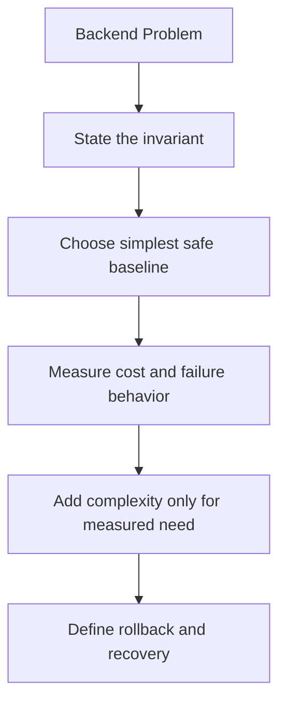

# Module 4: Operating Systems & Concurrency — Full Revision Guide

This guide connects the module into one study story: how backend code consumes CPU, memory, threads, sockets, files, and shared resources under Linux and containers.

## Essential Definitions

| Term | Meaning |
|---|---|
| Process | Isolated running program with its own address space. |
| Thread | Scheduled execution unit sharing its process memory. |
| Race condition | Outcome depends on unsafe timing of concurrent work. |
| Deadlock | Workers wait cyclically for resources. |
| Virtual memory | Address translation and paging layer seen by a process. |

## Module Map

- [Operating Systems Fundamentals](01-Operating-Systems-Fundamentals.md)
- [Processes](02-Processes.md)
- [Threads](03-Threads.md)
- [Process vs Thread](04-Process-vs-Thread.md)
- [Process Lifecycle](05-Process-Lifecycle.md)
- [Thread Lifecycle](06-Thread-Lifecycle.md)
- [CPU Scheduling](07-CPU-Scheduling.md)
- [Context Switching](08-Context-Switching.md)
- [Concurrency](09-Concurrency.md)
- [Parallelism](10-Parallelism.md)
- [Synchronization](11-Synchronization.md)
- [Critical Sections](12-Critical-Sections.md)
- [Race Conditions](13-Race-Conditions.md)
- [Mutex](14-Mutex.md)
- [Semaphore](15-Semaphore.md)
- [Spinlocks](16-Spinlocks.md)
- [Condition Variables](17-Condition-Variables.md)
- [Deadlocks](18-Deadlocks.md)
- [Livelocks](19-Livelocks.md)
- [Starvation](20-Starvation.md)
- [Memory Management](21-Memory-Management.md)
- [Heap Memory](22-Heap-Memory.md)
- [Stack Memory](23-Stack-Memory.md)
- [Virtual Memory](24-Virtual-Memory.md)
- [Paging](25-Paging.md)
- [Segmentation](26-Segmentation.md)
- [System Calls](27-System-Calls.md)
- [Inter Process Communication](28-Inter-Process-Communication.md)
- [Signals](29-Signals.md)
- [File Systems Basics](30-File-Systems-Basics.md)
- [I O Operations](31-I-O-Operations.md)
- [Backend Concurrency Patterns](32-Backend-Concurrency-Patterns.md)

## Two-Minute Recap

- A process-local lock does not coordinate API replicas.
- Bound workers, queues, memory, connections, and time.
- Deadlocks need consistent lock order plus retry.
- SIGTERM should trigger draining, not instant abandonment.
- Container memory limit and Python heap are not the same metric.

## Decision Tree



**Decision rule:** Use async I/O for waiting work; use a bounded thread pool for blocking I/O; use processes/workers for CPU-heavy work; use database constraints for cross-replica correctness.

## Interview Answer Templates

### 30-second answer

> “`<concept>` solves `<problem>` with `<mechanism>`. The important trade-off is `<cost/risk>`. I would validate it using `<test/metric/trace>`.”

### Two-minute answer

1. State the user/business invariant.
2. Describe normal request or execution flow.
3. Name the likely failure or edge case.
4. Explain the protection, limit, or recovery path.
5. Finish with metrics, rollout, and trade-off.

## Failure Scenarios

| Symptom | Investigation | Safe response |
|---|---|---|
| Latency increases | Trace slow path; inspect saturation/queueing | Add deadline/bounds; remove bottleneck after evidence |
| Duplicate/inconsistent effect | Check retry, concurrency, and durable state | Add idempotency/constraint/ownership rule |
| Release regression | Compare deployment/config/version and SLOs | Roll back or disable safely; preserve evidence |
| Capacity exhaustion | Inspect resource, cardinality, and growth | Backpressure, scale, partition, or reduce work |

## Common Anti-patterns

| Anti-pattern | Why it fails | Better approach |
|---|---|---|
| Tool-first design | Hides requirement and invariant | State problem, baseline, and measured trigger first |
| Unbounded resource | Turns overload into outage | Bound time, memory, pools, queues, and retries |
| Local-only correctness | Breaks under replicas/restart | Use durable ownership/constraints/idempotency |
| Green happy path | Misses production failures | Test timeout, retry, restart, concurrency, and recovery |

## Flashcards

| Question | Answer |
|---|---|
| What comes before selecting a tool? | The invariant, requirements, and constraints. |
| What makes a retry safe? | Idempotency plus a bounded policy and durable outcome. |
| What should every production design include? | Limits, observability, deployment/rollback, and recovery. |
| What makes an interview answer senior-level? | Explicit trade-offs, failure modes, evidence, and ownership. |

## When to Use / When Not to Use

| Use | When | Avoid when |
|---|---|---|
| Simpler baseline | It meets stated requirements | A measured invariant/SLO requires more |
| Async workflow | Work is slow, retryable, or fan-out | Caller needs final invariant immediately |
| Cache/optimization | Evidence shows a bottleneck | Source-of-truth rules are unclear |
| Abstraction | It protects a real boundary | It only adds indirection |

## End-to-End Case Study

A report worker streams records instead of loading them all, caps concurrency with a semaphore, records job state durably, handles SIGTERM by stopping intake and draining, and requeues unfinished leased jobs.

## Debugging Commands and Evidence

Focus on: `top`, `ps`, `ss`, `/proc`, `docker stats`, event-loop lag, RSS, page faults, file descriptors, runnable threads, queue depth, and database lock waits.

```bash
# Capture deployment/runtime evidence first
docker compose logs -f
docker stats
curl -i http://localhost:8000/healthz
```

## Self-Test Checklist

- [ ] I can explain the module’s core terms in plain English.
- [ ] I can choose an approach from an invariant and stated constraints.
- [ ] I can name a likely failure, how to investigate it, and safe recovery.
- [ ] I can give a 30-second and two-minute interview answer.
- [ ] I can connect this module to APIs, data, operations, and testing.

## Cross-Module Study Links

- [Core Backend](../Module-02-Core-Backend/module-summary.md)
- [Databases](../Module-03-Databases/module-summary.md)
- [Operating Systems](../Module-04-Operating-Systems/module-summary.md)
- [Networking](../Module-06-Networking-and-Distributed-Basics/module-summary.md)
- [System Design](../Module-07-Advanced-Backend-and-System-Design/module-summary.md)
- [Testing](../Module-09-Testing-and-Code-Quality/module-summary.md)
- [DevOps](../Module-10-DevOps-and-Cloud/module-summary.md)
- [Interview Preparation](../Module-11-Interview-Preparation/module-summary.md)

## Interview Drills

1. Why can a mutex fix a local race but not duplicate payments across replicas?
2. A pod is OOMKilled during exports. Explain diagnosis and streaming/backpressure fix.
3. Two transactions deadlock. Explain lock order, retry, and observability.

## Shortcuts

- A process-local lock does not coordinate API replicas.
- Bound workers, queues, memory, connections, and time.
- Deadlocks need consistent lock order plus retry.
- SIGTERM should trigger draining, not instant abandonment.
- Container memory limit and Python heap are not the same metric.
