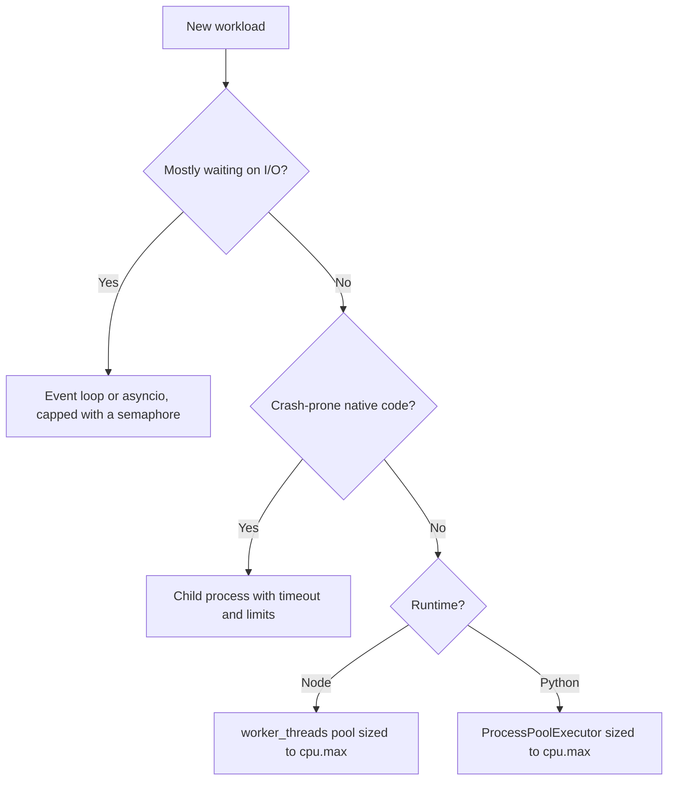
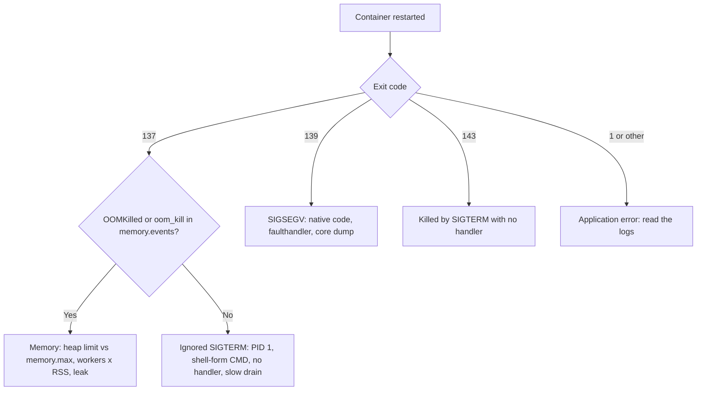

# Module 4: Operating Systems & Concurrency — Full Revision Guide

This guide tells Module 4 as one story. Your Node or Python service is a process on a Linux kernel, usually inside a container. The kernel schedules its threads under a CPU quota, gives it virtual memory under a memory limit, and carries its I/O through system calls and file descriptors. On top of that, your code runs many tasks at once and must coordinate them without races, deadlocks or starvation. Most production incidents are one of these layers failing, so learn to name the layer first.

## Essential Definitions

| Term | Meaning | Why it matters |
|---|---|---|
| Kernel | Privileged core that owns CPU, memory, devices and the network stack. | Your code reaches hardware only through system calls. |
| Process | Running program with its own address space, fd table, PID and threads. | The unit of isolation: a crash or leak stays inside it. |
| Thread | Flow of execution inside a process, with its own stack and registers. | Cheap sharing, but a race or segfault affects the whole process. |
| Container | Processes on the host kernel, isolated by namespaces and limited by cgroups. | Not a VM: runtimes see host CPUs and RAM, not your limits. |
| `cpu.max` | CPU quota per period, e.g. `"50000 100000"` = 0.5 CPU. | Over quota, the whole container is throttled until the next period. |
| `memory.max` | Hard memory limit for the container, page cache included. | Over it, the OOM killer sends `SIGKILL`: exit code 137. |
| Context switch | The kernel swaps the running thread on a CPU. | Microseconds plus cold caches; many involuntary ones mean too many threads. |
| System call | User code asking the kernel for a privileged operation. | A mode switch, not a context switch; batching reduces the cost. |
| GIL | CPython lock that lets one thread run bytecode at a time. | Threads for I/O, processes for pure-Python CPU work. |
| Race condition | The result depends on how concurrent operations interleave. | Happens in Node and asyncio too, at every `await`. |
| Mutex / semaphore | One holder with an owner / N permits with no owner. | Exclusion vs limiting concurrency to a dependency. |
| Deadlock / livelock / starvation | All wait / all busy, no progress / one task always passed over. | Each has its own signature and fix. |
| RSS / PSS | Memory in RAM (shared counted fully) / fair share of shared pages. | Summing RSS over workers over-counts. |
| Signal | Small async notification from the kernel: just a number. | `SIGTERM` starts graceful shutdown; `SIGKILL` can't be caught. |
| Little's law | Work in progress = arrival rate × time in system. | Sizes pools and queues. |

---

## Part 1: The Kernel, Processes and Threads

The kernel runs in privileged mode. Your runtime runs in user mode and enters the kernel in three ways: **system calls** (you ask), **exceptions** (your code caused something, like a page fault) and **interrupts** (a device or the timer). The timer interrupt is what lets the scheduler take the CPU away from a busy loop.

A **process** owns an address space, a file descriptor table, a PID, credentials, environment and signal handlers. A **thread** owns only a stack, registers, a thread ID, a signal mask and thread-local storage. On Linux both are tasks made by `clone()`, so the real question is always "what is shared?".

- `fork()` clones the caller (copy-on-write) and returns twice; `exec()` replaces the program but keeps the PID and open descriptors.
- A dead child is a **zombie** until its parent calls `wait()`. An **orphan** is reparented to PID 1 or a subreaper.
- **PID 1 in a container is special:** unhandled signals get no default action, and it must reap orphans. Node and Python don't do that job, so use `docker run --init` or `tini`, and the exec form `CMD ["node", "server.js"]`.
- Exit status **128 + N** means "killed by signal N": 130 `SIGINT`, 137 `SIGKILL`, 139 `SIGSEGV`, 143 `SIGTERM`. Node reports `code === null, signal === "SIGKILL"`; Python reports `returncode == -9`.
- You cannot safely kill a thread. Stopping is **cooperative**: set a flag or an `Event`, and the thread checks it.

| Workload | Node | Python |
|---|---|---|
| Many waiting connections (I/O-bound) | Event loop | asyncio, or threads for blocking libraries |
| CPU work inside a service | `worker_threads` pool | `ProcessPoolExecutor` (GIL), or C code that releases it |
| More cores for serving | `cluster` or more replicas | Gunicorn/Uvicorn workers or more replicas |
| Crash-prone native code | Child process | Child process |

**Interview shortcut:** threads share memory and blast radius; processes buy isolation with IPC and memory.

---

## Part 2: Scheduling, CPU Quotas and Context Switches

Linux schedules **threads**, preemptively, with one run queue per CPU. Normal tasks use the fair class (CFS, and EEVDF since Linux 6.6). Nice values matter only when CPUs are contended.

A container CPU limit is a **quota per 100 ms period**. Eight busy threads under a 0.5-CPU quota use the 50 ms budget in about 6 ms, then the **whole container** is throttled for ~94 ms. Average CPU looks fine; p99 latency does not. Check `nr_throttled` and `throttled_usec` in `/sys/fs/cgroup/cpu.stat`.

`os.cpus().length` and `os.cpu_count()` report the host's cores, so read `cpu.max` yourself:

```ts
import { readFileSync } from "node:fs";
import { availableParallelism } from "node:os";

function cpuWorkers(): number {
  let quota = Infinity;
  try {
    const [q, period] = readFileSync("/sys/fs/cgroup/cpu.max", "utf8").trim().split(" ");
    if (q !== "max") quota = Number(q) / Number(period); // "200000 100000" → 2
  } catch { /* cgroup v1, or no cpu controller */ }
  return Math.max(1, Math.floor(Math.min(quota, availableParallelism())));
}
```

```python
import os
from pathlib import Path


def cpu_workers() -> int:
    quota = float("inf")
    try:
        q, period = Path("/sys/fs/cgroup/cpu.max").read_text().split()
        if q != "max":
            quota = int(q) / int(period)  # "200000 100000" -> 2.0
    except (FileNotFoundError, ValueError):
        pass  # cgroup v1, or no cpu controller
    return max(1, int(min(quota, len(os.sched_getaffinity(0)))))
```

A **context switch** gives the CPU to another task. A **system call is not one**: it is a mode switch in the same thread. **Voluntary** switches mean the thread blocked; **involuntary** ones mean it was preempted, so there is more runnable work than CPU. An event loop hands off between requests with a function call. Measure with `pidstat -w` and `/proc/<pid>/task/*/status` (`/proc/<pid>/status` covers the main thread only).

**Parallelism has a ceiling.** Amdahl's law: speed-up = `1 / ((1 − p) + p / N)`. With 90% parallel work, 8 workers give 4.7×, and nothing gives more than 10×. Start-up, serialization, load imbalance and the CPU quota cut it further.

**Interview shortcut:** throttling is invisible in average CPU; look at `cpu.stat`.

---

## Part 3: Concurrency and Synchronization

**Concurrency** is many tasks in progress at once; it helps I/O-bound work even on one core. **Parallelism** is work at the same instant on several cores; it helps only CPU-bound work.

Races exist even with one thread. `counter += 1` is load, add, store, and the GIL does not make it atomic. In Node and asyncio, every `await` is a switch point, so "check, `await`, act" lets five requests all pass the check. The two shapes are **read-modify-write** and **check-then-act**. Fixes: make it **atomic** (one SQL statement, `Atomics.add`), make it **exclusive** (a lock around the check *and* the act), **single-flight** it, or give the state **one owner** (a queue). Across replicas, only the database or a distributed lock helps.

Single-flight claims the slot *before* the first `await`, so no other task can slip in:

```ts
const inFlight = new Map<string, Promise<number>>();

function getPrice(id: string): Promise<number> {
  let p = inFlight.get(id);
  if (!p) {
    p = loadPriceFromDb(id).finally(() => inFlight.delete(id)); // never cache a failure
    inFlight.set(id, p); // same synchronous block as the check
  }
  return p;
}
```

```python
import asyncio

in_flight: dict[str, asyncio.Task] = {}


async def get_price(product_id: str) -> int:
    task = in_flight.get(product_id)
    if task is None:
        task = asyncio.create_task(load_price_from_db(product_id))
        in_flight[product_id] = task
        task.add_done_callback(lambda _t: in_flight.pop(product_id, None))
    return await asyncio.shield(task)  # one caller's timeout must not cancel the shared load
```

Pick the primitive from the problem:

| Problem | Primitive | Watch for |
|---|---|---|
| One at a time | Mutex (`threading.Lock`, `asyncio.Lock`, a promise-chain mutex in Node) | Release in `finally`; no I/O inside; not reentrant |
| At most N calls to a dependency | Semaphore (`asyncio.Semaphore`, `p-limit`) | Per process; one deadline over waiting and calling |
| Wait until shared state is true | Condition variable + mutex | `while`, not `if`; same mutex for check and change |
| One-shot "ready" signal | Event / latch / promise | A timeout on the wait |
| Update one word | Atomic (`Atomics.add`, compare-and-swap) | Only one word at a time |
| Hand work to someone else | Bounded queue | What happens when it is full |

Underneath, every primitive is an atomic instruction on the fast path plus a `futex` sleep and wake on the slow path, so an uncontended lock never enters the kernel. Rules: define a critical section by its **invariant**; **compute outside, publish inside** (no network, queries, disk I/O or `sleep` under a lock); never hold a `threading.Lock` across an `await`; leave spinlocks to the kernel, because the runtime's mutex already spins briefly and then sleeps.

**Interview shortcut:** name the problem (exclusion, limit, ordering, hand-off) before naming the primitive.

---

## Part 4: When Coordination Fails

| | Who progresses | CPU | Typical cause | Fix |
|---|---|---|---|---|
| Deadlock | Nobody, all wait | ~0% | Locks in opposite orders; a pool waiting on itself | Global lock order; timeouts on every wait |
| Livelock | Nobody, all busy | High | Release-and-retry in lockstep | Random backoff with jitter, priority rule, retry limit |
| Starvation | Everyone but the victim | Normal | Unfair locks, strict priority, hot tenant, blocked event loop | FIFO locks, aging, fair queuing, separate pools |

Deadlock needs all four **Coffman conditions**: mutual exclusion, hold and wait, no preemption, circular wait. A global lock order removes the cycle:

```ts
async function transfer(a: Account, b: Account, amount: number): Promise<void> {
  const [first, second] = [a, b].sort((x, y) => x.id - y.id); // global lock order
  const release1 = await first.lock.acquire();
  try {
    const release2 = await second.lock.acquire();
    try { a.balance -= amount; b.balance += amount; } finally { release2(); }
  } finally { release1(); }
}
```

```python
def transfer(a: Account, b: Account, amount: int) -> None:
    first, second = sorted((a, b), key=lambda acc: acc.id)  # global lock order
    with first.lock, second.lock:
        a.balance -= amount
        b.balance += amount
```

These are in-process locks. Databases detect deadlocks and abort a victim; your own mutexes just hang. With several replicas, the real balance update belongs in the database.

**Event-loop starvation:** one long synchronous task, or an endless chain of `process.nextTick` or resolved promises, stops timers and I/O in Node. In asyncio, a coroutine that never `await`s does the same. Yield (`setImmediate`, `await asyncio.sleep(0)`) or move CPU work to workers. Shared pools starve too: libuv has 4 threads, and FastAPI's sync endpoints share AnyIO's 40.

**Interview shortcut:** low CPU and no progress is deadlock; high CPU and no progress is livelock; good averages and one angry tenant is starvation.

---

## Part 5: Memory

- **VSZ** is reserved address space (don't alert on it). **RSS** is what is in RAM, with shared pages counted fully. **PSS** is the fair share. In a container, the OOM killer compares `memory.current` with `memory.max`, and page cache and tmpfs files (`/dev/shm`) count too.
- Linux **overcommits** and hands out pages on first write. A big allocation succeeds; the failure comes later as an **OOM kill**: `SIGKILL`, exit 137, `OOMKilled`, `oom_kill` in `memory.events`. No handler runs and nothing is logged.
- **Node:** V8's heap limit can be larger than the container limit, so the kernel kills the process first. Set `--max-old-space-size` to about 70–80% of the limit. **Python:** no heap cap, so the budget is workers × peak RSS, plus the master.
- **Heap leaks** are objects that are still reachable: unbounded caches, listeners added per request, `@lru_cache` on methods. RSS staying high after a spike is often just allocator behaviour; the leak signal is the post-GC heap rising under steady load. Compare snapshots (Node heap snapshots, Python `tracemalloc`).
- **Stacks** are small: about 1 MB in V8 (`RangeError`) and a recursion limit of 1000 in CPython (`RecursionError`). Never let input decide recursion depth.
- **Virtual memory** gives each process its own address space; shared libraries are in RAM once. After `fork()`, pages are copy-on-write, but CPython's refcount writes un-share them, so use `gc.freeze()` before forking.
- **Paging:** 4 KiB pages, a TLB that caches translations, minor faults (no disk) and major faults (disk or swap). Swap turns an OOM kill into slow thrashing.
- **Segmentation** is history on x86-64, but `SIGSEGV` (exit 139) still means an invalid access. In Node or Python it almost always comes from native code.

**Interview shortcut:** 137 is a kill, 139 is a crash; find out which before changing anything.

---

## Part 6: Kernel Interface, Signals and I/O

**System calls.** A backend mostly calls `accept4`, `epoll_wait`, `read`, `write`/`writev`, `openat`, `futex`, `mmap` and `clone`. Errors come back as errno: Node shows `err.code` (`"EMFILE"`), Python raises `OSError` subclasses. Buffer and batch: 100,000 one-line writes took 207 ms in Node; buffered into 79 writes they took 96 ms. `strace -f -c` shows the mix, but slows the process a lot.

**Files.** A file descriptor indexes the process's table of open files, sockets and pipes; leaks end in `EMFILE`. `rm` only removes a name, so a deleted file that is still open keeps using disk (`lsof +L1`). `write()` returning means the data is in the **page cache**; only `fsync` puts it on disk. To replace a file atomically: temp file in the same directory → `fsync` → `rename` → `fsync` the directory. A failed `fsync` is not retryable.

**IPC.** Pipes (one-way, 64 KiB buffer), Unix sockets (local, permission-protected), TCP (cross-host), shared memory (fastest, needs synchronization) and durable queues (survive crashes). Stream channels have no message boundaries, so frame your messages.

**I/O models.** Blocking, non-blocking (`EAGAIN`), readiness (`epoll`) and completion (`io_uring`). `epoll` scales with active connections, not idle ones. Regular files are always "ready", so Node sends `fs` work to libuv's 4-thread pool and asyncio uses `to_thread`. **Backpressure** keeps a slow client from filling RAM: Node `pipeline()` or waiting for `'drain'`, asyncio `await writer.drain()`.

**Signals and graceful shutdown.** Kubernetes sends `SIGTERM`, waits `terminationGracePeriodSeconds` (30 s), then sends `SIGKILL`. A good handler stops intake, drains under a deadline shorter than the grace period, cancels what is left, and exits 0 or 1.

```ts
const server = app.listen(3000);
let shuttingDown = false;

process.on("SIGTERM", () => {
  if (shuttingDown) return;
  shuttingDown = true;
  server.close(() => process.exit(0));                // stop accepting, finish in-flight requests
  setTimeout(() => process.exit(1), 20_000).unref();  // deadline below the 30 s grace period
});
```

```python
import asyncio
import signal


async def main() -> int:
    loop = asyncio.get_running_loop()
    stop = asyncio.Event()
    loop.add_signal_handler(signal.SIGTERM, stop.set)
    in_flight: set[asyncio.Task] = set()
    intake = asyncio.create_task(intake_loop(in_flight, stop))
    await stop.wait()
    await intake  # the loop sees `stop` and takes no new work
    if not in_flight:
        return 0
    _, pending = await asyncio.wait(in_flight, timeout=20)  # below the 30 s grace period
    for task in pending:
        task.cancel()  # the queue will redeliver these jobs
    return 1 if pending else 0
```

**Interview shortcut:** sockets on `epoll`, files on threads, backpressure on every stream, `fsync` before "saved".

---

## Part 7: Backend Concurrency Patterns

- **Little's law** sizes everything: 300 req/s × 40 ms = 12 busy connections. If the query slows to 400 ms, you need 120.
- **Worker pools:** CPU-bound = the CPU quota; I/O-bound = peak λ × W with headroom, capped by the dependency.
- **Bounded queues:** size = throughput × acceptable wait. When full, reject early with `503 + Retry-After` (`429` when one client is over quota).
- **Fan-out:** tail latency multiplies (10 calls, each slow 1% of the time → about 9.6% of requests slow). Use one deadline for the whole fan-out.
- **Semaphores per dependency:** a partner allowing 50 concurrent calls across 6 replicas gets 8 permits per replica.
- **Deadlines, not just timeouts:** pass the remaining budget down (`AbortSignal`, `asyncio.timeout`) and skip queued work whose caller has gone.
- **A connection pool is a semaphore:** pool × processes × replicas ≤ `max_connections`.

---

## Two-Minute Recap

- A container is processes on the host kernel, with namespaces and cgroups.
- Process = isolation; thread = sharing; on Linux both come from `clone()`.
- Exit 128 + N means killed by signal N: 137 `SIGKILL` (OOM or stop timeout), 139 `SIGSEGV`, 143 `SIGTERM`.
- PID 1 gets no default signal actions: use `tini`/`--init` and exec-form `CMD`.
- A CPU quota throttles the whole container per 100 ms period; size workers to it.
- A system call is a mode switch, not a context switch.
- The GIL does not make Python code thread-safe; one thread does not make Node code race-free.
- Mutex for exclusion, semaphore for limits, condition variable in a `while` loop, queue for hand-off.
- Deadlock: order the locks. Livelock: add jitter. Starvation: add fairness.
- OOM kills are silent `SIGKILL`s; leave headroom for the runtime.
- Little's law sizes pools; every queue needs a bound; shed load early.

## Decision Trees

### Process, thread or async?



### Why did the container exit?



## Interview Answer Templates

**30-second OS answer:**

> "The symptom is `<X>`. At the OS level that means `<mechanism>`. I would confirm it with `<command or file>`, fix it with `<change>`, and watch `<metric>`."

Example: "p99 spikes while CPU looks fine. That usually means quota throttling: the container uses its 100 ms budget early and stalls. I'd confirm with `nr_throttled` in `cpu.stat`, size the pool to `cpu.max`, and graph throttled periods next to p99."

**Two-minute concurrency answer:** name the shared state and its invariant → show the bad interleaving → pick the fix (atomic operation, lock, single-flight, one owner, database constraint) → say what it costs and where it stops (the process boundary) → say how you would test it (start calls together, force the interleaving).

**Senior incident answer:** "Before restarting, I'd capture the exit code and reason, `memory.events`, `cpu.stat` and a thread or task dump. Then I'd name the layer (CPU, memory, coordination or I/O), fix the root cause, and add the metric that would have caught it earlier."

## Failure Scenarios: Symptom → Investigation → Fix

| Symptom | Likely cause | Investigate | Safe fix |
|---|---|---|---|
| p99 spikes, average CPU fine | CPU quota throttling | `cpu.stat` `nr_throttled`, `pidstat -w` | Workers = quota; move batch work |
| Exit 137, no log line | OOM kill or stop timeout | `OOMKilled`, `memory.events`, deploy timing | Heap limit below `memory.max`; fewer workers; fix shutdown |
| Every deploy takes 30 s | `SIGTERM` not handled or not forwarded | Who is PID 1; Dockerfile `CMD` form | Exec form, `--init`, a real handler |
| Silent at ~0% CPU | Deadlock or a wait without timeout | `py-spy dump`, Node report, `ps -L -o wchan` | Lock order; separate pools; timeouts |
| High CPU, flat throughput | Livelock or retry storm | Attempts vs successes | Jittered backoff, retry limits |
| One tenant slows everyone | Starvation in a shared FIFO | Per-tenant wait p99, oldest-item age | Fair queuing, per-tenant caps |
| Duplicates or lost updates | Race condition | Stress test with forced interleaving | Atomic SQL, unique constraint, single-flight |
| Post-GC heap keeps rising | Leak through reachable objects | Heap snapshots, `tracemalloc` diffs | Bound caches; remove listeners |
| `EMFILE` | Descriptor leak | `/proc/<pid>/fd` count over time, `CLOSE_WAIT` | Close in `finally`; cap concurrency |
| Event-loop lag | Sync work on the loop, or a full libuv pool | Event-loop delay metric | Workers, `to_thread`, separate pools |

## Flashcards

| Question | Answer |
|---|---|
| What does exit code 137 mean? | Killed by `SIGKILL` (128 + 9): OOM kill or stop timeout. |
| What is special about PID 1? | Unhandled signals get no default action; it must reap orphans. |
| What happens over `cpu.max`? | The container is throttled until the next period, not killed. |
| Mutex vs semaphore? | A mutex has one holder and an owner; a semaphore has N permits and no owner. |
| Why `while` around `cv.wait()`? | Stolen and spurious wakeups; the state is the truth. |
| The four Coffman conditions? | Mutual exclusion, hold and wait, no preemption, circular wait. |
| How do you break a livelock? | Randomised backoff with jitter, a priority rule, a retry limit. |
| Minor vs major page fault? | Minor needs no disk; major reads from disk or swap. |
| Is data on disk when `write()` returns? | No, it is in the page cache until `fsync`. |
| Why do file reads use a thread pool? | Regular files are always "ready", so `epoll` can't help. |

## End-to-End Case Study: A Well-Behaved Queue Worker in Kubernetes

1. The image uses exec-form `CMD`, runs under `tini`, and runs as a non-root user.
2. At start-up the worker reads `cpu.max` and `memory.max`, starts CPU workers equal to the quota, and sets the Node heap limit (or the Python worker count) to fit the memory limit with headroom.
3. It pulls jobs into a **bounded** queue and stops pulling when the queue is full.
4. Partner API calls go through a per-replica **semaphore**, with one deadline over waiting and calling.
5. Shared caches use **single-flight**, a maximum size and a TTL.
6. Results go to the database, or to files written with atomic replace and `fsync`.
7. On `SIGTERM` it stops intake, drains within 20 s, cancels the rest so the queue redelivers them, and exits 0 or 1.
8. Dashboards show throttled periods, `memory.current` vs `memory.max`, event-loop lag, queue depth and age, semaphore wait time, fd count, and exit codes per restart.

**Key lesson:** every OS limit (CPU quota, memory limit, descriptor limit, grace period) gets an explicit setting in the code and a metric on the dashboard.

## Debugging Commands and Evidence

```bash
ps -o pid,ppid,stat,cmd --forest                  # tree, states (Z = zombie), who is PID 1
cat /sys/fs/cgroup/cpu.max /sys/fs/cgroup/cpu.stat
cat /sys/fs/cgroup/memory.max /sys/fs/cgroup/memory.current /sys/fs/cgroup/memory.events
grep -E 'Rss|Pss|Private_Dirty' /proc/<pid>/smaps_rollup
ps -L -o tid,stat,wchan,cmd -p <pid>              # threads and what they wait on
py-spy dump --pid <pid>                           # Python stacks
node --report-on-signal server.js                 # then: kill -USR2 <pid>
strace -f -c -p <pid>                             # briefly: it slows the process a lot
ls /proc/<pid>/fd | wc -l; lsof +L1               # fd count; deleted-but-open files
```

Collect the exit code and termination reason, `cpu.stat`, `memory.events`, a thread or task dump and the fd count **before** restarting a broken pod. A restart destroys the evidence.

## Self-Test Checklist

You are ready to move on when you can:

- [ ] Explain what a process and a thread own, and why a segfault in one thread kills the process.
- [ ] Explain PID 1, zombies, exec-form `CMD`, and exit codes 137, 139 and 143.
- [ ] Size a worker pool from `cpu.max`, and explain throttling and how to see it.
- [ ] Show a race in Node or asyncio code with no threads, and fix it three ways.
- [ ] Choose between mutex, semaphore, condition variable, event, atomic and queue.
- [ ] Prevent a deadlock with lock ordering, and explain how a fix can cause a livelock.
- [ ] Explain an OOM kill end to end, including runtime heap limits.
- [ ] Find a memory leak with heap snapshots or `tracemalloc`.
- [ ] Write graceful `SIGTERM` handling in Node and Python.
- [ ] Size a connection pool and a queue with Little's law.

## Cross-Module Study Links

- Module 2: [Node Event Loop and Concurrency](../Module-02-Core-Backend/06-Node-Event-Loop-and-Concurrency.md), [Background Workers](../Module-02-Core-Backend/17-Background-Workers.md), [Monitoring](../Module-02-Core-Backend/22-Monitoring.md)
- Module 3: [Database Locks](../Module-03-Databases/30-Database-Locks.md), [Deadlocks](../Module-03-Databases/31-Deadlocks.md), [Optimistic vs Pessimistic Locking](../Module-03-Databases/32-Optimistic-vs-Pessimistic-Locking.md)
- Module 6: [Ports and Sockets](../Module-06-Networking-and-Distributed-Basics/07-Ports-and-Sockets.md), [TCP](../Module-06-Networking-and-Distributed-Basics/08-TCP.md)
- Module 7: [Rate Limiting](../Module-07-Advanced-Backend-and-System-Design/33-Rate-Limiting.md), [Exponential Backoff](../Module-07-Advanced-Backend-and-System-Design/36-Exponential-Backoff.md), [Bulkhead Pattern](../Module-07-Advanced-Backend-and-System-Design/38-Bulkhead-Pattern.md)
- Module 10: [Linux for Backend Engineers](../Module-10-DevOps-and-Cloud/03-Linux-for-Backend-Engineers.md), [Docker Containers](../Module-10-DevOps-and-Cloud/06-Docker-Containers.md), [Container Best Practices](../Module-10-DevOps-and-Cloud/11-Container-Best-Practices.md)

## Interview Drills

1. **"The pod restarted with exit code 137."** Explain both causes, how to tell them apart, and the fix in Node and in Python.
2. **"p99 doubled after we moved to Kubernetes."** Explain CPU quotas, throttling, worker sizing and the evidence in `cpu.stat`.
3. **"Two requests created the same record."** Show the race in single-threaded async code, then fix it in-process and in the database.
4. **"The service hangs once a week."** Walk through deadlock, pool deadlock and waits without timeouts, and the evidence to capture.
5. **"Size the pools for this service."** Use Little's law, the CPU quota, `max_connections` and a bounded queue with load shedding.
