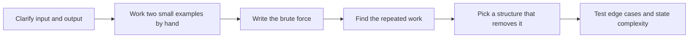

# Introduction to DSA

> **Module 05 · Data Structures & Algorithms** · Prerequisites: [Module overview](README.md) · Next: [Time Complexity](02-Time-Complexity.md)

---

## ⏱ If You Only Have 2 Minutes

- A **data structure** is a way to store data so that the operations you need are cheap. An **algorithm** is the step-by-step method that uses it.
- In backend code the structure often matters more than the loop. A hash lookup takes about the same time for 1,000 keys or 1,000,000 keys. A scan takes 1,000 times longer for the bigger set.
- Every choice is a trade-off: time against memory, and reads against writes. An index makes reads fast, but every insert must also update it.
- Interviewers look for four things: a correct answer, a stated complexity, a reason for the structure you picked, and a check of edge cases.
- Work in this order: clarify the problem, trace a small example by hand, write the brute force, find the repeated work, remove it with a better structure, then test.
- Finding duplicates with nested loops is O(n²). Finding them with a `Set` or `set` is O(n) on average. That one change is the core lesson of this chapter.
- Say the complexity out loud before you write the code.

---

## 1. What It Is and Why It Exists

A **data structure** is a layout for data in memory, together with rules for which operations on it are fast. An array is fast at "give me item number 5". A hash table is fast at "do you have the key `alice@example.com`?". A linked list is fast at "insert right here, if I already hold a pointer to this spot". No structure is best at everything, so the choice is always a choice of which operations you want to be cheap.

An **algorithm** is a finite sequence of steps that turns an input into an output. Sorting, searching and finding duplicates are all algorithms. Most algorithms depend on the structure underneath them, so the two are hard to separate in practice.

**Analogy:** a library. Books on shelves in sorted order let you find a title by checking the middle shelf and then halving the search. A card catalogue lets you jump straight to a title. A pile of books on the floor works only if you read every spine. All three libraries hold the same books. They differ only in what is fast.

**The problem it solves.** Without a good structure, every lookup scans everything. Suppose your sign-up API checks whether an email is already registered, and you store users in a plain list. With 5 million users, each check may read millions of records. The same check against a hash index reads a handful of entries. The data did not change. The structure did.

The same problem appears in query patterns. A page that loads 200 orders and then runs one extra query per order makes 201 round trips to the database. The number of round trips grows with the number of orders. This is the **N+1 query** problem. Loading all the orders in one batched query keeps the round trips constant. It is an access-pattern problem as much as a data-structure problem, and interviewers test both.

---

## 2. How It Works

To reason about any solution, follow four steps:

1. Name the input size (for example `n` users, or `m` edges).
2. Name the operation you repeat most often.
3. Choose the structure that makes that operation cheap.
4. Count how often the remaining expensive work happens.

**Trace.** Find the IDs that appear more than once in `[7, 3, 9, 3, 5, 7]`. Keep a set of the IDs seen so far.

| Step | Value | Set before | Already in set? | Action | Duplicates so far |
|---|---|---|---|---|---|
| 1 | 7 | {} | no | add 7 | none |
| 2 | 3 | {7} | no | add 3 | none |
| 3 | 9 | {7, 3} | no | add 9 | none |
| 4 | 3 | {7, 3, 9} | yes | record 3 | [3] |
| 5 | 5 | {7, 3, 9} | no | add 5 | [3] |
| 6 | 7 | {7, 3, 9, 5} | yes | record 7 | [3, 7] |

Six values make six checks. Each check is a hash lookup. Each value is handled once, and the set is never scanned. That is why the whole job is linear.

The method below is the order to follow in an interview:



Writing the brute force first matters. It gives you a correct answer to compare against, and it shows you exactly which step repeats. The fast version is only trustworthy after it agrees with the slow one on random inputs.

---

## 3. Key Concepts

### Trade-offs: time vs space, and reads vs writes

Most structures trade memory for speed. A set of 1 million IDs takes more memory than a list of the same IDs, but a membership check drops from a scan to a hash lookup. The second trade-off is reads against writes. An index on `users.email` makes lookups fast, but each `INSERT` must also update the index, and the index takes disk and memory. Denormalised data and caches are the same idea at a larger scale.

Here are the three ways to find duplicates in a list of `n` IDs:

| Approach | Time best | Time average | Time worst | Extra space | Why |
|---|---|---|---|---|---|
| Nested loops | O(n²) | O(n²) | O(n²) | O(1) | Every pair is compared, so there is no early exit when we want all duplicates |
| Sort, then scan neighbours | O(n) | O(n log n) | O(n log n) | O(n) worst | Comparison sorts need n log n steps; Timsort is O(n) only when input is already sorted |
| Hash set | O(n) | O(n) | O(n²) | O(n) | Each insert or lookup is O(1) on average; if every key collides, each one can take O(n) |

### Hash index vs scan

A scan reads every row until it finds a match, so it costs O(n). A hash index maps the key straight to the row location, so a lookup costs O(1) on average. For 10 million rows, that is about 10 million comparisons against a few hash probes and one row read.

A database's usual index is a B-tree, not a hash table. A B-tree lookup is O(log n), which is slower than an average hash lookup but keeps keys in order. That order lets the database answer range queries and `ORDER BY` without sorting. A hash index cannot do that. See [Indexes](../Module-03-Databases/19-Indexes.md) for the database side.

### N+1 queries vs one batch

N+1 means one query for the list and one extra query for each item. The cost is `N` network round trips. If each round trip takes about 1 ms, then 200 items cost about 200 ms before the database does any work. One batched query, with an `IN (...)` list or a join, costs one round trip however many items there are. The fix does not make the database faster. It changes how many times the program asks for data.

### How interviews test DSA

Expect two kinds of question. A **coding round** gives you a small problem, such as "find the two numbers that add to a target", and asks for a correct solution with its complexity. A **design round** asks how a real system does the same job, such as how a database finds a row, how a rate limiter counts requests, or how a cache chooses what to evict. The interviewer cares less about the name of the structure than about your reason for choosing it. Name the operation that repeats, then name the structure that makes it cheap.

---

## 4. Code Examples

Scenario: a nightly job reads the user IDs from one day's sign-ups and must report the IDs that appear more than once. Two versions are shown, a slow one and a fast one, with timings. The second block solves Two Sum, a classic interview problem that uses the same idea. The second block of each language assumes the first block is in the same file.

### Node.js / TypeScript

Built-ins: `Set` and `Map` keep insertion order and give average O(1) `add`, `has`, `get` and `set`. `Array.prototype.includes` and `indexOf` are O(n) scans, so calling them inside a loop is a common hidden O(n²). `Array.prototype.sort` is stable (required since ES2019), so equal values keep their original order.

```ts
// Node.js 22+, TypeScript 5. No dependencies. Run with: npx tsx duplicates.ts

// Brute force: compare every pair. O(n²) time, O(1) extra space (plus the result).
// Returns each duplicated value once. The order of the result is not defined.
export function findDuplicatesBrute(ids: readonly number[]): number[] {
  const out: number[] = [];
  for (let i = 0; i < ids.length; i++) {
    // If an earlier index holds the same value, that value was already handled.
    let seenEarlier = false;
    for (let j = 0; j < i; j++) {
      if (ids[j] === ids[i]) { seenEarlier = true; break; }
    }
    if (seenEarlier) continue;
    for (let j = i + 1; j < ids.length; j++) {
      if (ids[j] === ids[i]) { out.push(ids[i]); break; }
    }
  }
  return out;
}

// Hash set: one pass. O(n) average time, O(n) extra space.
// Edge cases both versions handle: [] gives [], [5] gives [], [2, 2, 2] gives [2], [1, 2, 3] gives [].
export function findDuplicatesSet(ids: readonly number[]): number[] {
  const seen = new Set<number>();
  const dupes = new Set<number>(); // a second Set stops a value being reported twice
  for (const id of ids) {
    if (seen.has(id)) dupes.add(id);
    else seen.add(id);
  }
  return [...dupes];
}
```

```ts
// Uses the two functions from the previous block.
import assert from "node:assert/strict";
import { performance } from "node:perf_hooks";

// Two Sum: return indices i < j with nums[i] + nums[j] === target, or null.
// Approach: a map from value to index. For each value, look for its complement first.
// Brute force is O(n²). This version is O(n) average time and O(n) space.
export function twoSum(nums: readonly number[], target: number): [number, number] | null {
  const indexOf = new Map<number, number>();
  for (let i = 0; i < nums.length; i++) {
    const j = indexOf.get(target - nums[i]);
    if (j !== undefined) return [j, i];  // the complement came earlier in the array
    indexOf.set(nums[i], i);             // store after the check, so a value never pairs with itself
  }
  return null;
}

const randomIds = (n: number, range: number): number[] =>
  Array.from({ length: n }, () => Math.floor(Math.random() * range));

// Correctness first: both duplicate versions must agree on small random inputs.
const sortAsc = (xs: number[]): number[] => [...xs].sort((a, b) => a - b);
for (let trial = 0; trial < 200; trial++) {
  const ids = randomIds(50, 20);
  assert.deepEqual(sortAsc(findDuplicatesBrute(ids)), sortAsc(findDuplicatesSet(ids)));
}
assert.deepEqual(twoSum([3, 3], 6), [0, 1]);
assert.equal(twoSum([1, 2], 10), null);

// Timing is illustrative. The ratio between the two lines is the point.
const ids = randomIds(20_000, 200_000);
for (const [name, fn] of [["brute O(n²)", findDuplicatesBrute], ["Set O(n)", findDuplicatesSet]] as const) {
  const start = performance.now();
  const dupes = fn(ids);
  console.log(`${name}: about ${dupes.length} duplicates in ${(performance.now() - start).toFixed(1)} ms`);
}
// Illustrative output on a laptop: brute about 150 ms, Set about 2 ms. Doubling n multiplies the brute time by about 4.
```

### Python

Built-ins: `set` and `dict` give average O(1) membership and lookup. `dict` keeps insertion order (guaranteed since Python 3.7). `x in some_list` is an O(n) scan. `collections.Counter` counts occurrences in one pass. `sorted()` and `list.sort()` use Timsort, which is stable.

```python
# Python 3.12+, standard library only. Run with: python duplicates.py
from collections.abc import Sequence


def find_duplicates_brute(ids: Sequence[int]) -> list[int]:
    """Compare every pair. O(n²) time, O(1) extra space plus the result."""
    out: list[int] = []
    n = len(ids)
    for i in range(n):
        # An earlier copy was already handled. `any` stops at the first match.
        if any(ids[j] == ids[i] for j in range(i)):
            continue
        if any(ids[j] == ids[i] for j in range(i + 1, n)):
            out.append(ids[i])
    return out


def find_duplicates_set(ids: Sequence[int]) -> list[int]:
    """One pass with a set. O(n) average time, O(n) extra space."""
    seen: set[int] = set()
    dupes: set[int] = set()  # a second set stops a value being reported twice
    for value in ids:
        if value in seen:
            dupes.add(value)
        else:
            seen.add(value)
    return list(dupes)
```

```python
# Uses the two functions from the previous block.
import random
import time
from collections.abc import Sequence


def two_sum(nums: Sequence[int], target: int) -> tuple[int, int] | None:
    """Indices i < j with nums[i] + nums[j] == target, or None. O(n) average time, O(n) space."""
    index_of: dict[int, int] = {}
    for i, value in enumerate(nums):
        j = index_of.get(target - value)
        if j is not None:
            return (j, i)       # the complement came earlier in the list
        index_of[value] = i     # store after the check, so a value never pairs with itself
    return None


def random_ids(n: int, value_range: int) -> list[int]:
    return [random.randrange(value_range) for _ in range(n)]


# Correctness first: both duplicate versions must agree on small random inputs.
for _ in range(200):
    ids = random_ids(50, 20)
    assert sorted(find_duplicates_brute(ids)) == sorted(find_duplicates_set(ids))
assert two_sum([3, 3], 6) == (0, 1)
assert two_sum([1, 2], 10) is None

# Timing is illustrative. Python is slower per step, so the input is smaller than the TypeScript one.
ids = random_ids(3_000, 30_000)
for name, fn in (("brute O(n²)", find_duplicates_brute), ("set O(n)", find_duplicates_set)):
    start = time.perf_counter()
    dupes = fn(ids)
    print(f"{name}: about {len(dupes)} duplicates in {(time.perf_counter() - start) * 1000:.1f} ms")
# Illustrative output: brute roughly 500 ms, set under 1 ms. The brute time grows about 4x when n doubles.
```

---

## 5. Production Concerns

- **Where the structure lives.** A `Set` lives in one process's memory. If two API instances each hold half the IDs, an in-memory check misses duplicates across instances. When the rule must hold across all writers, use a database unique constraint, or a shared store such as a Redis set.
- **Memory is part of the cost.** A hash set of 10 million numbers can use several hundred megabytes in a JavaScript or Python process once table overhead is counted. Estimate the size before you choose a structure, and compare it with the container memory limit.
- **Hash flooding.** A hash table is O(1) on average only when keys spread evenly across buckets. If an attacker can pick keys that collide, each lookup can degrade toward O(n). Python randomises the string hash seed for each process to make this harder. Limit how many keys one request can insert.
- **Watch the growth in production.** A nested-loop check that is fine at 1,000 rows may time out at 100,000. Log the input size next to each request's latency. A hidden O(n²) shows up as latency that grows faster than the data does.
- **Batch external calls.** The N+1 fix is one batched call per request. Cap the batch size so responses and memory stay bounded.

---

## 6. Common Mistakes

- **Calling `includes` or `in` inside a loop** — the loop becomes O(n²) without looking like it — build a `Set` or `set` once before the loop.
- **Saying "hash lookup is O(1)" with no qualifier** — collisions and resizing make the worst case O(n) — say "O(1) on average" and explain why.
- **Ignoring memory** — the faster structure exceeds the container limit and the process is killed — estimate the size before you choose.
- **Assuming the output order is free** — a `Set` keeps insertion order, but the order you need may come from the algorithm — state the order you return, or sort it.
- **Optimising before writing the brute force** — you cannot tell whether the fast version is right — write the slow version first and use it to test the fast one.
- **Skipping edge cases** — empty input, one element and all-equal values break naive code — test them before you time anything.
- **Timing one input size** — one number cannot show growth — time two or three sizes and compare the ratio.

---

## 7. Comparison Table

| Approach | Strength | Weakness | Use when |
|---|---|---|---|
| Brute force (nested loops) | Simplest; no extra memory | O(n²); too slow for large n | n is small (about 1,000 or fewer), or as a test oracle |
| Sort, then scan | O(n log n); no hashing; output is sorted | Modifies or copies the input; needs a sort | Data is already sorted, or you need sorted output anyway |
| Hash set | O(n) on average; simple to write | Memory per item; lives in one process | One process, in-memory data, output order does not matter |
| Database unique index | Enforced across all writers and instances | A network round trip per check | The rule must hold across instances or restarts |

---

## 8. Interview Questions

**[Junior] What is the difference between a data structure and an algorithm?**
A data structure is a way of storing data, together with the operations that are fast on that layout. An algorithm is a sequence of steps that solves a problem. You choose the algorithm to do the job, and the data structure decides how fast each step can run. An array makes index access cheap, and a hash table makes key lookup cheap. Most interview answers combine the two: "I'll use a hash map so each lookup is O(1) on average, which gives O(n) overall."

**[Junior] Why is a `Set` faster than an array for "is this value present?"**
An array must be scanned, so checking membership costs O(n) in the worst case. A `Set` or `set` uses a hash of the value to find its bucket, so the check costs O(1) on average. The trade-off is memory: the hash table keeps extra space and bucket overhead. For a few items the difference does not matter. For millions of items it is the difference between a scan and a lookup.

**[Mid] How would you find duplicate user IDs in a table of 10 million rows?**
Read the IDs in one pass and keep a hash set of the IDs seen so far, plus a second set of duplicates. That is O(n) time on average and O(n) extra memory. If memory is tight, sort the IDs externally and scan neighbours, which is O(n log n) time and bounded memory. In the database itself, a unique index or a `GROUP BY ... HAVING COUNT(*) > 1` query often does the job, and it avoids moving 10 million rows into the application.

**[Mid] Solve Two Sum in linear time. What pattern is this?**
The pattern is a **complement lookup**. For each value, compute `target - value` and check whether that number is already in a hash map. If it is, you have a pair. Store each value after the check, so one element never pairs with itself. The brute force compares every pair and is O(n²). The map version is O(n) on average and O(n) in space.

**[Senior] An endpoint's latency grows with the number of items in the request. The profile shows most time in a database loop. How do you diagnose and fix it?**
First confirm the pattern in the logs: count queries per request and check whether the count grows with the item count. That is the N+1 pattern. Fix it by loading the related rows in one batched query, using an `IN` list or a join, and building a map from the result in memory. Then check the query plan, since a batch query without an index can still scan. Add a cap on the batch size so a large request cannot blow up memory or time.

**[Senior] When is an in-memory hash-based solution the wrong answer in production?**
It is wrong when the rule must hold across processes, restarts or regions, because each process has its own set. It is also risky when the keys come from users, since an attacker can try to force collisions and turn O(1) average lookups into O(n) ones. It can use too much memory when the key space is large. In those cases, move the state into a shared store with a unique constraint, or bound the number of keys each request can add. The interview answer should name the constraint that breaks the in-memory version, not just the structure.

**[Senior] Why do you write the brute force before the optimised version, even when you already know the answer?**
The brute force is the reference for correctness. You can generate random inputs, run both versions, and compare results, including the edge cases. It also shows which step repeats, which tells you which structure removes the repeat. In an interview this also demonstrates a method, and it protects you from a fast solution that is subtly wrong on duplicates or empty input.

---

## 9. Cheat Sheet

```text
Data structure  = layout in memory + the operations that are fast on it
Algorithm       = steps that turn input into output
Trade-offs      = time vs space; reads vs writes (every index costs on insert)
Method          = clarify → examples → brute force → repeated work → structure → test
Duplicates      = nested loops O(n²) | sort O(n log n) | Set/set O(n) average
Lookup          = scan O(n) | hash O(1) average, O(n) worst | B-tree O(log n), keeps order
N+1             = one query plus N round trips; batching makes it one round trip
Built-ins       = Set/Map (JS), set/dict (Python): average O(1) lookup, insertion order
Traps           = includes/in inside loops; unbounded input; hash flooding; memory limits
Always say      = the complexity, and whether it is average or worst case
Test            = brute force as oracle; edge cases; two sizes to see the growth
```

---

## Related Topics

- [Time Complexity](02-Time-Complexity.md) — how to count operations and read growth rates.
- [Arrays](05-Arrays.md) — the structure behind most scans and index lookups.
- [Indexes](../Module-03-Databases/19-Indexes.md) — how a database turns scans into lookups, and what writes cost.
- [Memory Management](../Module-04-Operating-Systems/21-Memory-Management.md) — why memory limits decide how far a structure can grow.
- [Caching Fundamentals](../Module-07-Advanced-Backend-and-System-Design/14-Caching-Fundamentals.md) — hash-based caches at production scale.
