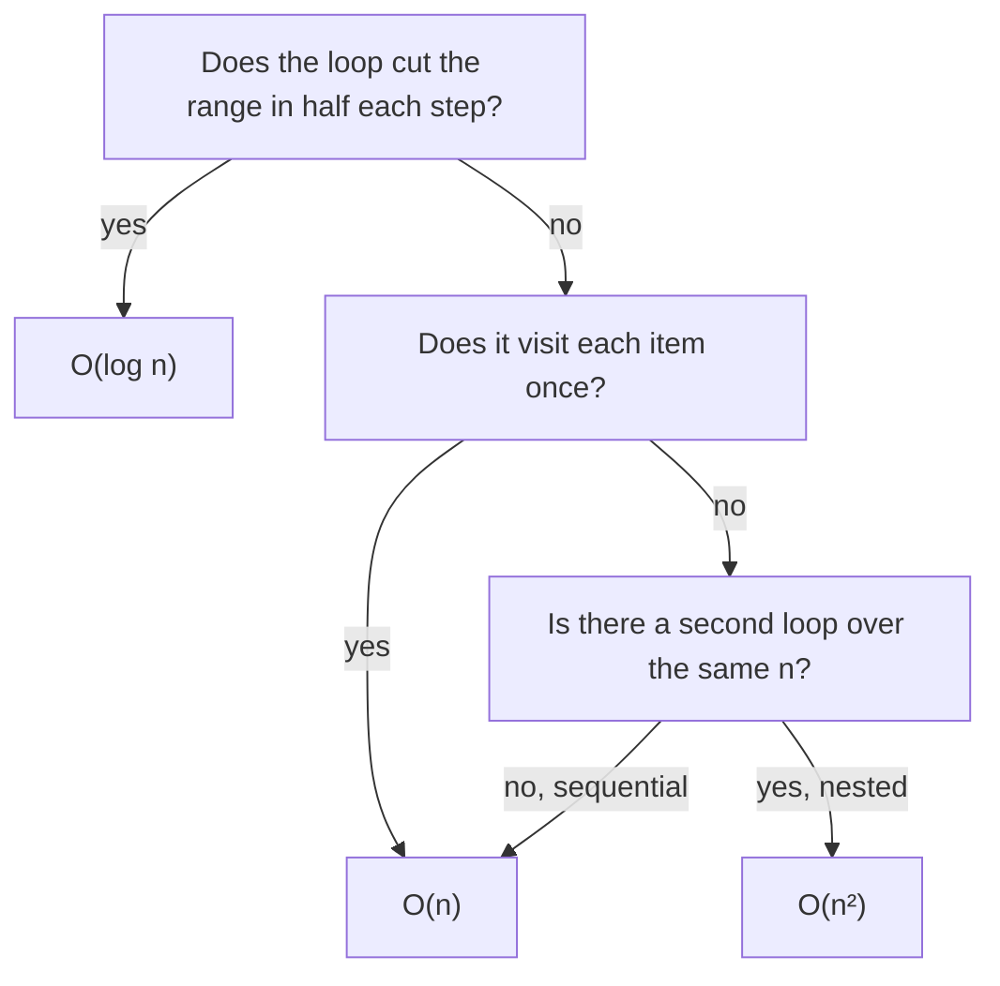

# Time Complexity

> **Module 05 · Data Structures & Algorithms** · Prerequisites: [Introduction to DSA](01-Introduction-to-DSA.md) · Next: [Space Complexity](03-Space-Complexity.md)

---

## ⏱ If You Only Have 2 Minutes

- Time complexity describes how the number of operations grows as the input size `n` grows. It is not a number of seconds.
- Count the work that depends on `n`, then drop constants and smaller terms: `3n + 5` is O(n), and `4n² + 10n` is O(n²).
- One loop over `n` items is O(n). Two loops nested over `n` are O(n²). Two loops one after the other are still O(n).
- A loop that halves the remaining range each time is O(log n). For n = 1,000,000, that is about 20 steps.
- The growth order is O(1) < O(log n) < O(n) < O(n log n) < O(n²) < O(2ⁿ) < O(n!).
- At n = 10⁶, O(n log n) is fine and O(n²) is not. At n = 10⁹, only O(n) or O(log n) work in a request budget.
- A call hidden inside a loop counts. `array.includes(x)` inside a loop over another array is O(n²) even though the loop looks simple.

---

## 1. What It Is and Why It Exists

**Time complexity** is a rule for how the running time of an algorithm grows when the input gets bigger. We write it with the Big O notation, such as O(n) or O(n²). The letter `n` stands for the size of the input: the number of rows, items, characters or edges. The notation ignores the exact speed of your machine, so the same answer holds on a laptop and on a server.

**Analogy:** counting the stops on a bus route. If the route has 10 stops, it takes 10 stops to ride it end to end. If the route doubles, the ride takes twice as many stops. The stopwatch time changes with traffic and the bus model, but the count of stops does not. Time complexity counts stops, not seconds.

**The problem it solves.** A function that runs in 5 ms on a 100-row test table can freeze a server on a 1-million-row production table. Nothing changed except `n`. Time complexity lets you predict that before deployment. Here is a common backend example. An endpoint loads 10,000 orders and then runs one query per order to fetch its customer. That is 10,001 round trips. If each round trip takes about 1 ms, the endpoint spends about 10 seconds just waiting. The work is O(n) round trips, and the fix is to batch them into one query.

---

## 2. How It Works

You can find the complexity of most code with four steps:

1. Identify `n`: which input size controls the work?
2. Count the basic operations on each line, as a function of `n`.
3. Combine the counts: sequential steps add (keep the largest), nested steps multiply, and a loop that halves the range gives a logarithm.
4. Simplify: drop constant factors and lower-order terms.

The flowchart below is the quick check for a loop. Labels with question marks are quoted, as Mermaid requires.



**Trace.** Binary search for `11` in the sorted array `[1, 3, 5, 7, 9, 11, 13, 15]`. The range starts at indexes 0 to 7.

| Step | lo | hi | mid | arr[mid] | Decision |
|---|---|---|---|---|---|
| 1 | 0 | 7 | 3 | 7 | 7 < 11, so move lo to 4 |
| 2 | 4 | 7 | 5 | 11 | Equal, so return index 5 |

Two comparisons found the value in an array of eight. Each step removes about half the remaining range, so an array of `n` items needs at most about log₂ n + 1 steps. Eight items need at most four. A linear scan of the same array could need eight.

---

## 3. Key Concepts

### Counting operations

Count the work that depends on `n` and ignore the rest. The rules are simple:

- **Sequential blocks add.** A loop over `n` followed by a loop over `n` is 2n, which is O(n).
- **Nested blocks multiply.** A loop over `n` inside a loop over `n` is n × n, which is O(n²).
- **Constants disappear.** `5n` is O(n). Constants matter for speed, but not for the growth rate.
- **The largest term wins.** `n² + 100n + 7` is O(n²). For large `n`, the square dominates.

Be careful with calls hidden in loops. `Array.prototype.includes`, `indexOf`, Python's `in` on a list, and string concatenation in a loop all cost more than they look. A loop over `n` that calls an O(n) function on each step is O(n²).

### Logarithmic loops

A loop that halves its range does about log₂ n steps. For n = 1,000,000, log₂ n is about 20. For n = 1,000,000,000 it is about 30. This is why binary search, balanced tree lookups and B-tree index lookups are fast even on huge data. A loop that multiplies its counter by 2 also gives a logarithm, and a loop that divides by 10 gives log₁₀ n.

### Recursion trees

For recursive code, write the cost as a recurrence and count the work at each level of the call tree.

- **Merge sort** splits the array in half and sorts each half, then merges in O(n). The recurrence is T(n) = 2T(n/2) + n. Each level of the tree does n total work, and there are log n levels, so the total is O(n log n).
- **Naive Fibonacci** calls itself twice: `fib(n) = fib(n-1) + fib(n-2)`. The number of calls grows like φⁿ, where φ ≈ 1.618. That is exponential, and it is usually written as a bound of O(2ⁿ). Chapter 03 returns to this function.

### Complexity table for common operations

| Operation | Best | Average | Worst | Space | Reason |
|---|---|---|---|---|---|
| Read array element by index | O(1) | O(1) | O(1) | O(1) | The address is computed directly from the index |
| Linear search in an unsorted array | O(1) | O(n) | O(n) | O(1) | The match may be first, or the scan may visit all n items |
| Binary search in a sorted array | O(1) | O(log n) | O(log n) | O(1) | Each step halves the range, so the search stops after about log n steps |
| Hash set or map lookup | O(1) | O(1) | O(n) | O(n) | A hash points at the bucket; all keys colliding forces a scan of one bucket |
| Merge sort | O(n log n) | O(n log n) | O(n log n) | O(n) | Log n levels of merging, each doing n work; the merge needs a buffer |
| Nested-loop pair check | O(n²) | O(n²) | O(n²) | O(1) | Every pair is visited when no duplicate is found early |

---

## 4. Code Examples

Scenario: a backend team wants to know how long common checks will take as the data grows. The first block gives one function for each growth class. The second block runs a timing harness and solves two classic problems.

### Node.js / TypeScript

Built-ins: `Array.prototype.sort` is stable and O(n log n) on average. `Array.prototype.includes` is O(n). `Map` and `Set` give average O(1) lookup. `Array.prototype.indexOf` is a scan, so it is O(n) too.

```ts
// Node.js 22+, TypeScript 5. No dependencies. Run with: npx tsx growth.ts

// O(1): an array index is a direct address calculation, whatever the length.
export function firstItem<T>(items: readonly T[]): T | undefined {
  return items[0];
}

// O(log n): each step halves the remaining range. The input must be sorted.
export function binarySearch(sorted: readonly number[], target: number): number {
  let lo = 0;
  let hi = sorted.length - 1;
  while (lo <= hi) {
    // lo + (hi - lo) / 2 avoids overflow in fixed-width languages; this is the habit.
    const mid = lo + Math.floor((hi - lo) / 2);
    if (sorted[mid] === target) return mid;
    if (sorted[mid] < target) lo = mid + 1;
    else hi = mid - 1;
  }
  return -1; // not found, including the empty array
}

// O(n): one pass, and the work grows in step with the input.
export function sum(values: readonly number[]): number {
  let total = 0;
  for (const v of values) total += v;
  return total;
}

// O(n log n): a comparison sort. Copy first so the caller's array is not changed.
export function sortedCopy(values: readonly number[]): number[] {
  return [...values].sort((a, b) => a - b);
}

// O(n²): every pair is checked. Fine for a few thousand items, too slow for a million.
export function hasEqualPair(values: readonly number[]): boolean {
  for (let i = 0; i < values.length; i++) {
    for (let j = i + 1; j < values.length; j++) {
      if (values[i] === values[j]) return true;
    }
  }
  return false;
}

// O(2ⁿ) results: each item is either in or out of a subset. Only feasible for n around 20.
// Copying each subset makes the work O(n · 2ⁿ); the exponential term still dominates.
export function allSubsets(items: readonly number[]): number[][] {
  const out: number[][] = [[]];
  for (const item of items) {
    const current = out.length;
    for (let k = 0; k < current; k++) out.push([...out[k], item]);
  }
  return out;
}

// O(n!): every ordering is generated. 10! is about 3.6 million; 13! is about 6.2 billion.
export function permutations(items: readonly number[]): number[][] {
  if (items.length <= 1) return [items.slice()];
  const out: number[][] = [];
  for (let i = 0; i < items.length; i++) {
    const rest = [...items.slice(0, i), ...items.slice(i + 1)];
    for (const p of permutations(rest)) out.push([items[i], ...p]);
  }
  return out;
}
```

```ts
// Uses the functions from the previous block. Node.js 22+, TypeScript 5.
import assert from "node:assert/strict";
import { performance } from "node:perf_hooks";

// Problem 1: are two strings anagrams?
// Sort both: O(n log n) time. Count letters: O(n) time, O(k) space for k distinct characters.
export function isAnagramSort(a: string, b: string): boolean {
  if (a.length !== b.length) return false; // different lengths can never match
  const norm = (s: string): string => [...s].sort().join("");
  return norm(a) === norm(b);
}

export function isAnagramCount(a: string, b: string): boolean {
  if (a.length !== b.length) return false;
  const counts = new Map<string, number>();
  for (const ch of a) counts.set(ch, (counts.get(ch) ?? 0) + 1);
  for (const ch of b) {
    const left = counts.get(ch) ?? 0;
    if (left === 0) return false; // the character is missing or already used up
    counts.set(ch, left - 1);
  }
  return true;
}

// Edge cases: "" and "" are anagrams; "a" and "b" are not; "listen" and "silent" are.
assert.equal(isAnagramSort("", ""), true);
assert.equal(isAnagramCount("a", "b"), false);
assert.equal(isAnagramCount("listen", "silent"), true);
assert.equal(isAnagramSort("listen", "silent"), true);

// Timing harness: doubling n should double a linear run and quadruple a quadratic run.
const sizes = [1_000, 2_000, 4_000];
let previous = 0;
for (const n of sizes) {
  const values = Array.from({ length: n }, (_, i) => i); // all distinct: the nested loop runs in full
  const start = performance.now();
  hasEqualPair(values);
  const ms = performance.now() - start;
  const ratio = previous === 0 ? "-" : (ms / previous).toFixed(1) + "x";
  console.log(`n=${n}: ${ms.toFixed(1)} ms (ratio vs previous: ${ratio})`);
  previous = ms;
}
// Illustrative output: n=1000 about 2 ms, n=2000 about 8 ms (4.0x), n=4000 about 30 ms (3.8x).
```

### Python

Built-ins: `bisect` provides binary search helpers on sorted lists. `sorted()` returns a new list and uses Timsort. `sum()` is O(n) in C. `collections.Counter` counts items. `x in some_list` is an O(n) scan, while `x in some_set` is average O(1).

```python
# Python 3.12+, standard library only. Run with: python growth.py
from collections.abc import Sequence


def first_item(items: Sequence[int]) -> int | None:
    # O(1): indexing a list is a direct address calculation.
    return items[0] if items else None


def binary_search(sorted_values: Sequence[int], target: int) -> int:
    # O(log n): each step halves the remaining range. The input must be sorted.
    lo, hi = 0, len(sorted_values) - 1
    while lo <= hi:
        mid = lo + (hi - lo) // 2  # the same midpoint habit; Python ints do not overflow here
        if sorted_values[mid] == target:
            return mid
        if sorted_values[mid] < target:
            lo = mid + 1
        else:
            hi = mid - 1
    return -1  # not found, including the empty list


def total(values: Sequence[int]) -> int:
    # O(n): one pass. The built-in sum(values) does the same work in C.
    result = 0
    for v in values:
        result += v
    return result


def sorted_copy(values: Sequence[int]) -> list[int]:
    # O(n log n): Timsort. sorted() returns a new list and leaves the input alone.
    return sorted(values)


def has_equal_pair(values: Sequence[int]) -> bool:
    # O(n²): every pair is checked when no duplicate exists.
    n = len(values)
    for i in range(n):
        for j in range(i + 1, n):
            if values[i] == values[j]:
                return True
    return False


def all_subsets(items: Sequence[int]) -> list[list[int]]:
    # 2ⁿ results: each item is in or out. Only feasible for n around 20.
    out: list[list[int]] = [[]]
    for item in items:
        out += [subset + [item] for subset in out]  # the list comprehension finishes before += runs
    return out


def all_permutations(items: Sequence[int]) -> list[list[int]]:
    # O(n!): every ordering. Ten items give 3,628,800 lists, so keep n small.
    if len(items) <= 1:
        return [list(items)]
    out: list[list[int]] = []
    for i, head in enumerate(items):
        rest = list(items[:i]) + list(items[i + 1:])
        out.extend([head, *p] for p in all_permutations(rest))
    return out
```

```python
# Uses the functions from the previous block. Python 3.12+, standard library only.
import random
import time
from collections import Counter


def is_anagram_sort(a: str, b: str) -> bool:
    # O(n log n): sorting both strings. Different lengths can never match.
    return len(a) == len(b) and sorted(a) == sorted(b)


def is_anagram_count(a: str, b: str) -> bool:
    # O(n) expected: count characters in each string and compare the counts.
    return len(a) == len(b) and Counter(a) == Counter(b)


# Edge cases: "" and "" are anagrams; "a" and "b" are not; "listen" and "silent" are.
assert is_anagram_sort("", "")
assert not is_anagram_count("a", "b")
assert is_anagram_count("listen", "silent")
assert is_anagram_sort("listen", "silent")

# Growth test: doubling n should about double a linear run and about quadruple a quadratic run.
previous = 0.0
for n in (1_000, 2_000, 4_000):
    values = list(range(n))  # all distinct, so the nested loop never exits early
    start = time.perf_counter()
    has_equal_pair(values)
    ms = (time.perf_counter() - start) * 1000
    ratio = "-" if previous == 0 else f"{ms / previous:.1f}x"
    print(f"n={n}: {ms:.1f} ms (ratio vs previous: {ratio})")
    previous = ms
# Illustrative output: n=1000 about 40 ms, n=2000 about 160 ms (4x), n=4000 about 650 ms (4x).
```

---

## 5. Production Concerns

- **Bound `n` at the edge.** The complexity you measure is only as good as the input bound. Cap page sizes, batch sizes and upload row counts at the API boundary. A cap of 100 items makes an O(n²) check harmless. Without one, the same code is a denial-of-service path.
- **Know which `n` you mean.** For a SQL query, `n` may be the table size, the number of matching rows, or the number of rows returned. An index changes a full table scan from O(n) to O(log n) for lookups, but each write must update the index too. See [Indexes](../Module-03-Databases/19-Indexes.md) and [Query Optimization](../Module-03-Databases/23-Query-Optimization.md).
- **Watch for hidden loops.** An `ORM` call inside a loop, a `JSON.parse` on each item, or an `includes` check on every row all add cost per step. Look at the code the loop calls, not just the loop.
- **Latency budgets.** Pure Python runs very roughly 10⁷ simple loop steps per second, so a 200 ms budget covers about 2 million steps. Tight JavaScript loops are much faster. Treat these as rough guides and measure. A real budget also includes network and database time.
- **Measure the growth.** Benchmark two or three input sizes and compare the ratio. Doubling `n` and seeing a 2× change suggests linear work. A 4× change suggests quadratic work. One timing cannot show a growth rate.

---

## 6. Common Mistakes

- **Reading a nested loop as O(n) because the inner loop is short** — the inner loop still runs for every outer step — count the total iterations, not the lines of code.
- **Ignoring the cost of a call inside a loop** — `list.includes(x)` in a loop over `n` is O(n²) — build a `Set` or `set` before the loop.
- **Confusing "fast on my test data" with "fast at scale"** — a 100-row fixture hides an O(n²) path — test with production-sized data or generated data at 10⁵ rows.
- **Dropping the wrong term** — `n log n` is not O(n) — keep the log factor when the algorithm uses it.
- **Treating O(log n) as free** — each step still does work, and log n grows slowly but not to zero — the bound is about steps, so the cost per step still matters.
- **Stating a complexity without the input variable** — "this is O(n)" tells the interviewer nothing — say what `n` is.
- **Assuming the best case is the normal case** — linear search can return on the first item, but its average and worst cases are O(n) — always report the case you mean.

---

## 7. Comparison Table

The growth classes, with a rough estimate of the number of operations at two input sizes. The estimates assume about 10⁸ simple operations per second. That number is a planning assumption, not a benchmark.

| Class | Example | n = 10⁶ | n = 10⁹ | Feasible in a request? |
|---|---|---|---|---|
| O(1) | Array index, hash lookup | instant | instant | Always |
| O(log n) | Binary search, B-tree lookup | instant | under 1 μs for each step | Always |
| O(n) | One scan, one pass | about 0.01 s | about 10 s | Up to about 10⁸ items |
| O(n log n) | Sort | about 0.2 s | about 5 min | Up to about 10⁷ items |
| O(n²) | All pairs | about 3 hours | not feasible | Only for n in the thousands |
| O(2ⁿ) | All subsets | not feasible | not feasible | Only for n around 20 |
| O(n!) | All orderings | not feasible | not feasible | Only for n around 10 |

---

## 8. Interview Questions

**[Junior] What is the time complexity of reading an array element by index, and why?**
It is O(1). An array stores its items next to each other in memory, so the address of item `i` is the start address plus `i` times the size of one item. The computer calculates that address directly and reads it. The cost does not depend on the length of the array. A linked list has no such address, so reading its `i`th item is O(i) in the worst case.

**[Junior] What does O(n log n) mean, and where does it show up?**
It means the work grows a little faster than linear: a little more than n steps, multiplied by a logarithm of n. Comparison-based sorting is the usual example, as in merge sort, heap sort and Timsort. It also appears in balanced tree operations when you insert n items one by one. For n = 10⁶, log₂ n is about 20, so n log n is about 20 million steps, which is comfortable for a backend job.

**[Mid] Why is a nested loop over the same array O(n²), but two loops one after another O(n)?**
A nested loop repeats the whole inner loop for each outer step. If each loop runs `n` times, the inner body runs `n × n` times. Two loops in sequence each run `n` times, so the total is `n + n = 2n`, and the constant factor drops out. The difference is multiplication versus addition. Always ask how many times the innermost statement runs.

**[Mid] A function checks `if (allowed.includes(item))` inside a loop over `items`. What is its complexity, and how do you fix it?**
If `allowed` has `m` items and `items` has `n`, the loop does up to `n × m` comparisons, which is O(n·m) and O(n²) when the lists are similar in size. Build a `Set` from `allowed` once before the loop, then check `set.has(item)` inside the loop. The build costs O(m) and each check is O(1) on average, so the total is O(n + m).

**[Senior] An endpoint's work grows with the number of cart items, and the code is O(n²) in that number. Is it a problem?**
It depends on the bound on `n`. If the cart is capped at 50 items, an O(n²) check does at most 2,500 comparisons, which is nothing, and a simpler solution is better. If the cart is unbounded, the same code can be attacked with a cart of 100,000 items. The fix is to enforce the bound at the API boundary and to document it. The complexity is only a problem when the input can grow without a limit.

**[Senior] A report must process 10⁹ rows in a nightly job. Which complexities are acceptable, and how do you check?**
At 10⁸ simple operations per second, an O(n) pass takes about 10 seconds, and O(n log n) takes about 5 minutes. Both are fine for a batch job. O(n²) would need about 10¹⁸ operations, which is not feasible on one machine. The check is to write the cost as a function of `n`, estimate it at the real size, and then measure a smaller size to confirm the growth. For data that does not fit in memory, the answer is a streaming algorithm or an external sort, which keep the working set small.

**[Senior] Derive the complexity of merge sort from its recurrence.**
Merge sort splits the input in half, sorts each half recursively, then merges the two sorted halves in O(n) time. So T(n) = 2T(n/2) + n. Draw the call tree: each level has total work n, because the sizes add up to n at every level. The tree has log₂ n levels, since the size halves each time. Multiply the work per level by the number of levels to get n log n. This holds for the best, average and worst case, because the splits do not depend on the data.

---

## 9. Cheat Sheet

```text
Meaning      = growth of operations as n grows; not seconds
Drop         = constants and smaller terms: 3n + 5 → O(n); n² + 100n → O(n²)
Sequential   = add (keep the largest); nested = multiply
Halving      = O(log n); 1,000,000 items → about 20 steps
Recurrence   = T(n) = 2T(n/2) + n → n log n (merge sort)
Classes      = O(1) < O(log n) < O(n) < O(n log n) < O(n²) < O(2ⁿ) < O(n!)
Feasibility  = 10⁸ simple ops/s: n log n fine at 10⁷; n² fails at 10⁶
Hidden cost  = includes / in / indexOf inside a loop turns O(n) into O(n²)
Fix          = build a Set/set or Map once before the loop
Always state = the variable (n), and best, average or worst case
Measure      = time two sizes; 2x data → 2x time (linear), 4x time (quadratic)
```

---

## Related Topics

- [Introduction to DSA](01-Introduction-to-DSA.md) — why structure choice changes the growth rate.
- [Space Complexity](03-Space-Complexity.md) — the same counting method applied to memory.
- [Big O Analysis](04-Big-O-Analysis.md) — formal O, Θ and Ω, and the rules for simplifying them.
- [Indexes](../Module-03-Databases/19-Indexes.md) — turning a table scan into a logarithmic lookup.
- [Rate Limiting](../Module-07-Advanced-Backend-and-System-Design/33-Rate-Limiting.md) — bounding input and work per client so growth stays under control.
