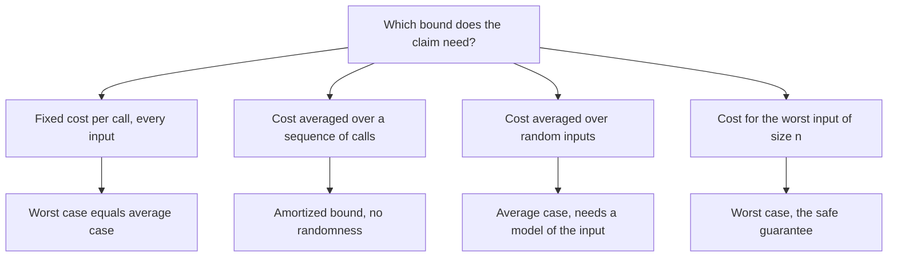

# Big O Analysis

> **Module 05 · Data Structures & Algorithms** · Prerequisites: [Space Complexity](03-Space-Complexity.md) · Next: [Arrays](05-Arrays.md)

---

## ⏱ If You Only Have 2 Minutes

- **O(g(n))** is an upper bound: for large `n`, the work is at most a constant times `g(n)`. **Ω** is a lower bound. **Θ** means both at once, so the bound is tight.
- Drop constant factors and lower-order terms: `3n² + 100n + 7` is O(n²). The constants still matter in practice, but not for the growth class.
- When there are two inputs, keep two variables. Scanning two lists of sizes `n` and `m` is O(n + m), not O(n).
- **Amortized** cost is the average over a sequence of operations, with no randomness. A dynamic array `push` is O(1) amortized, even though one push can cost O(n) when the buffer resizes.
- **Average case** is the expected cost over random inputs. A hash table lookup is O(1) on average and O(n) in the worst case.
- Quicksort is O(n log n) on average and O(n²) in the worst case. Production sorts avoid the bad case with randomised or median pivots, or with a fallback algorithm.
- Always say which bound you mean: worst, average, or amortized.

---

## 1. What It Is and Why It Exists

Big O notation is a shared language for growth. It lets you say "this grows linearly" or "this grows like the square of the input" without measuring a machine. The formal definitions are short. A function `f(n)` is O(g(n)) if there are constants `c > 0` and `n₀` such that `f(n) ≤ c · g(n)` for every `n ≥ n₀`. The constant `n₀` lets you ignore small inputs, where the exact shape of the curve does not matter.

**Analogy:** describing how a car uses fuel. You can say "about 0.1 litres per kilometre on the highway" and skip the litres used to start the engine and warm the tyres. Those extra litres matter for a 2 km trip and do not matter for a 2,000 km trip. Big O is the highway figure: it describes what happens as the trip gets long.

**The problem it solves.** Without a shared notation, two engineers say "this is O(n)" and mean different things. One means the worst case, and the other means the average. Interviews also test whether you know the difference between "O(1) per operation" and "O(1) amortized", because the claims can differ on the same data structure. Backend incidents follow the same pattern. A dashboard shows a p99 latency that grows with the size of a tenant's data. The engineer who knows which bound applies can say which code path is responsible.

---

## 2. How It Works

Find the bound in four steps:

1. Write the exact count of operations as a function `f(n)`, if you can.
2. Drop constant multipliers.
3. Drop lower-order terms.
4. State the case you mean: worst, average, or amortized.

**Trace 1: simplifying a count.** Take `f(n) = 3n² + 100n + 7`. The table shows how the lower terms lose weight as `n` grows, which is why the bound is O(n²).

| n | 3n² | 100n | Total f(n) | Share from 3n² |
|---|---|---|---|---|
| 10 | 300 | 1,000 | 1,307 | 23% |
| 100 | 30,000 | 10,000 | 40,007 | 75% |
| 1,000 | 3,000,000 | 100,000 | 3,100,007 | 97% |

At `n = 10`, the linear term is the bigger part. By `n = 1,000`, the square term is almost the whole cost. The growth class depends on the term that wins for large `n`, and the constant 3 does not change the class.

**Trace 2: amortized cost of a dynamic array.** A dynamic array starts with capacity 1. When it is full, it allocates a buffer twice as large and copies the old elements. The table pushes 9 values.

| Push # | Size before | Capacity before | Full? | Action | Copies this push | Total copies so far |
|---|---|---|---|---|---|---|
| 1 | 0 | 1 | no | write | 0 | 0 |
| 2 | 1 | 1 | yes | grow to 2, copy 1, write | 1 | 1 |
| 3 | 2 | 2 | yes | grow to 4, copy 2, write | 2 | 3 |
| 4 | 3 | 4 | no | write | 0 | 3 |
| 5 | 4 | 4 | yes | grow to 8, copy 4, write | 4 | 7 |
| 6 | 5 | 8 | no | write | 0 | 7 |
| 7 | 6 | 8 | no | write | 0 | 7 |
| 8 | 7 | 8 | no | write | 0 | 7 |
| 9 | 8 | 8 | yes | grow to 16, copy 8, write | 8 | 15 |

Nine pushes cause 15 copies. Add the 9 writes, and the total is 24 element writes, or about 2.7 per push. The worst single push cost 8 copies. Across the whole sequence, the average stays bounded by a constant.

The chart below shows the decision for each bound. Labels with punctuation are quoted.



---

## 3. Key Concepts

### Formal notation

| Notation | Meaning | Example |
|---|---|---|
| O(g(n)) | Upper bound: f(n) ≤ c · g(n) for large n | Binary search is O(log n) |
| Ω(g(n)) | Lower bound: f(n) ≥ c · g(n) for large n | Any comparison sort is Ω(n log n) in the worst case |
| Θ(g(n)) | Tight bound: both O and Ω | Merge sort is Θ(n log n) |

People often write O when they mean Θ. Writing O is still true, but it is a weaker claim. In an interview, say Θ when you have proved both directions.

### Simplification rules

Drop constant factors (`5n` becomes O(n)), drop lower-order terms (`n² + n` becomes O(n²)), and keep the dominant term of a sum (`n log n + n` becomes O(n log n)). Do not drop a term that depends on a second variable. The rules apply to growth, so they cannot hide an input that matters.

### Multiple variables

Name every input. A function that scans a list of `n` orders and a list of `m` refunds is O(n + m). Writing O(n) would be wrong when `m` is large and `n` is small. The same goes for a graph with `V` vertices and `E` edges. Its traversal cost is O(V + E). Only collapse the terms when you can prove one dominates, such as `m ≤ n`.

### Amortized analysis

An **amortized** bound averages the cost of a sequence of operations. No randomness is involved. The **aggregate method** adds up the total cost of `n` operations and divides by `n`. For a dynamic array:

- A push that does not resize costs 1.
- Resizes happen when the size reaches a power of two. The copies at those points are 1, 2, 4, 8 and so on.
- The copies up to `n` pushes add up to less than `2n`, because a geometric series is less than twice its largest term, and the largest term is less than `n`.
- So `n` pushes cost less than `n + 2n = 3n` in total. The amortized cost per push is less than 3, which is O(1).

Amortized O(1) does not mean every push is fast. One push can cost O(n). The guarantee is about the total, so it suits throughput, not tail latency for a single request.

### Average case vs worst case

- **Hash table lookup:** O(1) on average, assuming a good hash function and a bounded load factor. The worst case is O(n), when every key lands in one bucket.
- **Quicksort:** O(n log n) on average over random pivots, and O(n²) in the worst case. A naive first-element pivot on sorted input is the classic bad case.
- **Linear search:** O(n) in the average and worst cases, and O(1) in the best case, when the value is first.

Average-case claims always assume a model of the input. "Random keys" or "random pivots" is part of the claim. An attacker can choose inputs that break the model, which is why security-sensitive code cares about the worst case.

### Complexity table

| Operation | Best | Average | Worst | Space | Reason |
|---|---|---|---|---|---|
| Dynamic array push | O(1) | O(1) amortized | O(n) | O(n) | Doubling makes resizes rare; one resize copies all n items |
| Dynamic array read by index | O(1) | O(1) | O(1) | O(1) | The address is computed from the index |
| Hash table lookup | O(1) | O(1) | O(n) | O(n) | A good hash spreads keys across buckets; all keys in one bucket force a scan |
| Linear search | O(1) | O(n) | O(n) | O(1) | The match may be first, or the scan may visit all n items |
| Binary search (sorted) | O(1) | O(log n) | O(log n) | O(1) | Each step halves the range |
| Merge sort | O(n log n) | O(n log n) | O(n log n) | O(n) | Balanced splits and linear merges, independent of the data |
| Quicksort | O(n log n) | O(n log n) | O(n²) | O(log n) average stack | Balanced pivots halve the work; bad pivots peel off one item at a time |

---

## 4. Code Examples

Scenario: a backend team wants to verify the amortized claim for its own dynamic buffer. The first block builds a dynamic array that counts its copies. The second block runs the count for one million pushes and solves two classic interview problems that use the O(n + m) and O(n) patterns from this chapter.

### Node.js / TypeScript

Built-ins: `Array.prototype.push` is amortized O(1) in V8, which grows arrays by a fraction of their size. The ECMAScript specification does not fix the growth factor, so treat the bound as an implementation property. `Array.prototype.sort` is stable and O(n log n) in the worst case. `Map` and `Set` give average O(1) operations, with the hash-table caveats above.

```ts
// Node.js 22+, TypeScript 5. No dependencies. Run with: npx tsx dynarray.ts

// A dynamic array that doubles its buffer when full, and counts the copies it makes.
export class CountingDynamicArray<T> {
  private buffer: (T | undefined)[];
  private length = 0;
  /** Element copies made while resizing. Amortized analysis spreads this cost over the pushes. */
  copies = 0;
  /** Number of times the buffer was reallocated. */
  resizes = 0;

  constructor(initialCapacity = 1) {
    if (!Number.isInteger(initialCapacity) || initialCapacity < 1) {
      throw new RangeError("initialCapacity must be an integer of at least 1");
    }
    this.buffer = new Array<T | undefined>(initialCapacity);
  }

  get size(): number {
    return this.length;
  }

  get capacity(): number {
    return this.buffer.length;
  }

  // Amortized O(1): usually one write; occasionally a resize that copies every element.
  push(value: T): void {
    if (this.length === this.buffer.length) {
      this.grow(this.buffer.length * 2); // doubling keeps the number of resizes at about log n
    }
    this.buffer[this.length] = value;
    this.length += 1;
  }

  // O(1) worst case: direct index access with a bounds check.
  get(index: number): T {
    if (!Number.isInteger(index) || index < 0 || index >= this.length) {
      throw new RangeError(`index ${index} is out of range for size ${this.length}`);
    }
    return this.buffer[index] as T;
  }

  // O(n) for this one call: every existing element is copied into the new buffer.
  private grow(newCapacity: number): void {
    const next = new Array<T | undefined>(newCapacity);
    for (let i = 0; i < this.length; i++) {
      next[i] = this.buffer[i];
      this.copies += 1;
    }
    this.buffer = next;
    this.resizes += 1;
  }
}
```

```ts
// Uses CountingDynamicArray from the previous block. Node.js 22+, TypeScript 5.
import assert from "node:assert/strict";

// Problem 1: maximum subarray sum (Kadane's algorithm). O(n) time, O(1) space.
// Empty input is an error. All-negative input returns the largest single element.
export function maxSubarraySum(nums: readonly number[]): number {
  if (nums.length === 0) throw new RangeError("need at least one number");
  let best = nums[0];
  let endingHere = nums[0];
  for (let i = 1; i < nums.length; i++) {
    // Either extend the running subarray, or start a new one at this element.
    endingHere = Math.max(nums[i], endingHere + nums[i]);
    best = Math.max(best, endingHere);
  }
  return best;
}

// Problem 2: merge two sorted arrays. O(n + m) time and space: both lengths matter.
// Ties take from `a` first, so the merge is stable.
export function mergeSorted(a: readonly number[], b: readonly number[]): number[] {
  const out: number[] = [];
  let i = 0;
  let j = 0;
  while (i < a.length && j < b.length) {
    if (a[i] <= b[j]) out.push(a[i++]);
    else out.push(b[j++]);
  }
  while (i < a.length) out.push(a[i++]);
  while (j < b.length) out.push(b[j++]);
  return out;
}

// Edge cases: a mixed array, an all-negative array, empty input, and two empty arrays.
assert.equal(maxSubarraySum([-2, 1, -3, 4, -1, 2, 1, -5, 4]), 6);
assert.equal(maxSubarraySum([-5, -2, -9]), -2);
assert.throws(() => maxSubarraySum([]), RangeError);
assert.deepEqual(mergeSorted([1, 4, 9], [2, 3, 10]), [1, 2, 3, 4, 9, 10]);
assert.deepEqual(mergeSorted([], []), []);

// Amortized check: one million pushes. The copies total stays below 2n, so the average is below 3.
const n = 1_000_000;
const arr = new CountingDynamicArray<number>(1);
for (let i = 0; i < n; i++) arr.push(i);
console.log({
  n: arr.size,
  capacity: arr.capacity,
  resizes: arr.resizes,
  copies: arr.copies,
  copiesPerPush: (arr.copies / n).toFixed(2),
});
// Illustrative output: n 1000000, capacity 1048576, resizes 20, copies 1048575, copiesPerPush '1.05'.
```

### Python

Built-ins: `list.append` is amortized O(1) in CPython, and CPython's list over-allocates so that resizes are rare. `collections.deque` gives O(1) appends and pops at both ends. `heapq.merge` merges sorted iterables lazily, in O(N log k) for k inputs. `sorted()` uses Timsort, which is O(n log n) in the worst case.

```python
# Python 3.12+, standard library only. Run with: python dynarray.py
from typing import Generic, TypeVar, cast

T = TypeVar("T")


class CountingDynamicArray(Generic[T]):
    """A list-like buffer that doubles when full, and counts the element copies it makes."""

    def __init__(self, initial_capacity: int = 1) -> None:
        if initial_capacity < 1:
            raise ValueError("initial_capacity must be at least 1")
        self._buffer: list[T | None] = [None] * initial_capacity
        self._length = 0
        self.copies = 0   # element copies made while resizing
        self.resizes = 0  # number of reallocations

    def __len__(self) -> int:
        return self._length

    @property
    def capacity(self) -> int:
        return len(self._buffer)

    def push(self, value: T) -> None:
        # Amortized O(1): usually one write; occasionally a resize that copies every element.
        if self._length == len(self._buffer):
            self._grow(len(self._buffer) * 2)  # doubling keeps the resizes at about log n
        self._buffer[self._length] = value
        self._length += 1

    def get(self, index: int) -> T:
        # O(1) worst case: direct index access. Negative indexes are rejected on purpose.
        if not 0 <= index < self._length:
            raise IndexError(f"index {index} is out of range for size {self._length}")
        return cast(T, self._buffer[index])

    def _grow(self, new_capacity: int) -> None:
        # O(n) for this one call: every existing element is copied into the new buffer.
        new_buffer: list[T | None] = [None] * new_capacity
        for i in range(self._length):
            new_buffer[i] = self._buffer[i]
            self.copies += 1
        self._buffer = new_buffer
        self.resizes += 1
```

```python
# Uses CountingDynamicArray from the previous block. Python 3.12+, standard library only.
from collections.abc import Sequence


def max_subarray_sum(nums: Sequence[int]) -> int:
    # Kadane's algorithm: O(n) time, O(1) space. Empty input is an error.
    if not nums:
        raise ValueError("need at least one number")
    best = ending_here = nums[0]
    for i in range(1, len(nums)):  # an index loop: nums[1:] would copy the list, O(n) extra
        ending_here = max(nums[i], ending_here + nums[i])  # extend, or start fresh here
        best = max(best, ending_here)
    return best


def merge_sorted(a: Sequence[int], b: Sequence[int]) -> list[int]:
    # O(n + m) time and space: both lengths matter. Ties take from a first, so the merge is stable.
    out: list[int] = []
    i = j = 0
    while i < len(a) and j < len(b):
        if a[i] <= b[j]:
            out.append(a[i])
            i += 1
        else:
            out.append(b[j])
            j += 1
    out.extend(a[i:])
    out.extend(b[j:])
    return out


# Edge cases: a mixed list, an all-negative list, empty input, and two empty lists.
assert max_subarray_sum([-2, 1, -3, 4, -1, 2, 1, -5, 4]) == 6
assert max_subarray_sum([-5, -2, -9]) == -2
try:
    max_subarray_sum([])
except ValueError:
    pass
else:
    raise AssertionError("expected ValueError for empty input")
assert merge_sorted([1, 4, 9], [2, 3, 10]) == [1, 2, 3, 4, 9, 10]
assert merge_sorted([], []) == []

# Amortized check: one million pushes. The copies total stays below 2n, so the average is below 3.
n = 1_000_000
arr: CountingDynamicArray[int] = CountingDynamicArray(1)
for i in range(n):
    arr.push(i)
print({
    "n": len(arr),
    "capacity": arr.capacity,
    "resizes": arr.resizes,
    "copies": arr.copies,
    "copies_per_push": round(arr.copies / n, 2),
})
# Illustrative output: n 1000000, capacity 1048576, resizes 20, copies 1048575, copies_per_push 1.05
```

---

## 5. Production Concerns

- **Amortized is not the same as bounded latency.** A push that resizes a buffer of hundreds of megabytes copies all of it in one call. For a request handler with a p99 target, that single pause can matter even though the amortized cost is O(1). If you know the final size, allocate it up front. In Python, `[0] * n` does this. In JavaScript, build the array with `Array.from({ length: n }, ...)` so it has no holes.
- **Average-case claims need a defence.** Hash tables are O(1) on average only when keys spread evenly. Python randomises its string hash seed for each process. For user-supplied keys, cap how many keys one request may insert, so an attacker cannot force O(n) lookups cheaply.
- **Worst cases come from inputs you do not expect.** Sorted or nearly sorted data can trigger quicksort's O(n²) behaviour if the pivot is the first element. Python's built-in sort uses Timsort, which is O(n log n) in the worst case. Introsort, used by many C++ standard libraries, switches to heapsort when recursion goes too deep, so it keeps the bound too.
- **Constants matter at real sizes.** An O(log n) tree with pointer-chasing can be slower than an O(n) scan over a small contiguous array. For small `n`, a simple array with a linear scan is often the right choice. Benchmark at your real size before you change the structure.
- **Log the input size with the latency.** Big O only helps if you can tell which input grew. A metric for "items per request" next to "duration" shows whether a slowdown is caused by growth in `n`.

---

## 6. Common Mistakes

- **Saying "push is O(1)" with no qualifier** — one push can cost O(n) — say "O(1) amortized" and state the worst case when latency matters.
- **Quoting the average case for an adversarial input** — a hash table with attacker-chosen keys can degrade to O(n) — state the assumption, and defend against it.
- **Dropping a second variable** — `O(n + m)` becomes O(n) when `m` is large — keep every input variable unless you can prove one dominates.
- **Reading O as Θ** — an upper bound does not say the algorithm is always that slow — use Θ when you have proved the tight bound.
- **Confusing amortized and average case** — amortized is over a sequence of operations with no randomness; average is over random inputs — name the one you mean.
- **Ignoring constants at small n** — the asymptotically better algorithm can lose at the size you actually run — measure before you choose.
- **Proving an average bound from one random example** — a single input is not a distribution — state the input model, and test with many inputs.

---

## 7. Comparison Table

| Kind of bound | What it promises | Typical example | When to quote it |
|---|---|---|---|
| Worst case | No input of size n is slower than this | Hash lookup O(n); quicksort O(n²) | Security boundaries, hard latency targets, adversarial input |
| Average case | The expected cost over a stated input model | Hash lookup O(1); quicksort O(n log n) | Typical workloads where the input model holds |
| Amortized | The average cost over a sequence of operations | Dynamic array push O(1) | Throughput of a batch of operations, not one call's latency |
| Best case | The cheapest input of size n | Linear search O(1) | Rarely useful alone; say it only to show a range |

---

## 8. Interview Questions

**[Junior] What does O(n) mean, and does an O(n) algorithm always run faster than an O(n²) one?**
O(n) means the running time is at most a constant times `n` for large `n`. It is an upper bound on growth, not a promise about speed on small inputs. For small `n`, an O(n²) algorithm with a tiny constant can be faster than an O(n) one with a large constant. As `n` grows, the O(n) algorithm wins, and the gap keeps widening. Always state the input size where the comparison matters.

**[Junior] Why do we drop constant factors and lower-order terms?**
Constants depend on the machine, the language and the implementation, so they change between environments. Lower-order terms stop mattering as `n` grows. The growth class is the part that stays true across machines and input sizes, so it is the useful thing to compare. Constants still matter when you tune real code, and you should measure them separately.

**[Mid] What is the amortized cost of `push` on a dynamic array, and how do you show it?**
It is O(1) amortized. Use the aggregate method. Resizes happen at sizes 1, 2, 4, and so on, and their copies form a geometric series. Over `n` pushes the total copies are less than `2n`. Add the `n` writes, and the total is less than `3n`. Divide by `n` and the average is below 3, so it is O(1). The guarantee covers the total, so one push can still cost O(n).

**[Mid] How do you state the complexity of a hash table lookup in an interview?**
Say "O(1) average, O(n) worst case", and explain the assumptions. The average needs a hash function that spreads keys evenly and a load factor that the table keeps bounded by resizing. The worst case happens when many keys land in the same bucket, either by accident or on purpose. Then mention the defence you would use for untrusted keys, such as a randomised hash seed or a cap on inserts. That answer shows you know where the claim breaks.

**[Senior] When is the worst case the right number to quote in production?**
Quote the worst case when the input is controlled by someone who wants to hurt you, or when a latency target must hold for every request. A hash table with user-chosen keys, or a sort on user-supplied data that can be sorted or nearly sorted, both have average-case claims that an attacker can break. In those cases the worst-case bound is the real cost. The fix is either a worst-case-safe algorithm, such as Timsort or heapsort-backed introsort, or a limit on the input that keeps the bad case small.

**[Senior] Compare an O(n log n) algorithm with a large constant against an O(n²) algorithm with a small constant. Which do you choose for n = 50, and which for n = 10⁶?**
For `n = 50`, the difference is at most a few thousand operations. The simpler O(n²) code is easier to test and maintain, and it may even be faster because the constant dominates at this size. For `n = 10⁶`, n² is 10¹², which is not feasible, while n log n is about 2 × 10⁷ operations of work. The answer depends on the size and the cost of each step. Benchmark at the size you actually run, and write down the bound so future readers know where the choice stops being safe.

**[Senior] Why is quicksort O(n log n) on average but O(n²) in the worst case, and how do production sorts avoid the bad case?**
On average the pivot splits the array into two parts of similar size, so the recursion has about log n levels with O(n) work per level. In the worst case, each pivot is the smallest or largest item, so each level removes only one item, which gives n levels of O(n) work. Sorted input with a first-element pivot is a common trigger. Production sorts avoid it with random or median-of-three pivots, or by switching to a heap-based or merge-based algorithm when the recursion goes too deep. Python and V8 use Timsort, which is O(n log n) in the worst case.

---

## 9. Cheat Sheet

```text
O(g)        = upper bound: f(n) <= c·g(n) for large n
Ω(g)        = lower bound; Θ(g) = both (tight)
Simplify    = drop constants and lower terms: 3n² + 100n + 7 → O(n²)
Two inputs  = keep both: O(n + m), not O(n)
Amortized   = total cost of n operations / n; no randomness; push is O(1) amortized
Doubling    = copies total < 2n, so n pushes cost < 3n
Average     = expected over a stated random input model
Hash lookup = O(1) average, O(n) worst (all keys collide)
Quicksort   = O(n log n) average, O(n²) worst (bad pivots); Timsort is O(n log n) worst
Adversary   = if keys or inputs are user-chosen, quote the worst case
Latency     = amortized O(1) still allows one slow call (a resize)
Constants   = matter at small n; benchmark at the real size
Always say  = worst, average, or amortized, and the input model
```

---

## Related Topics

- [Time Complexity](02-Time-Complexity.md) — the counting method that the formal bounds build on.
- [Arrays](05-Arrays.md) — dynamic arrays, their doubling strategy and cache locality.
- [Hash Tables](11-Hash-Tables.md) — where average-case and worst-case bounds diverge.
- [Sorting Algorithms](26-Sorting-Algorithms.md) — worst-case behaviour across the common sorts.
- [Memory Management](../Module-04-Operating-Systems/21-Memory-Management.md) — why constants and memory layout change real timings.
