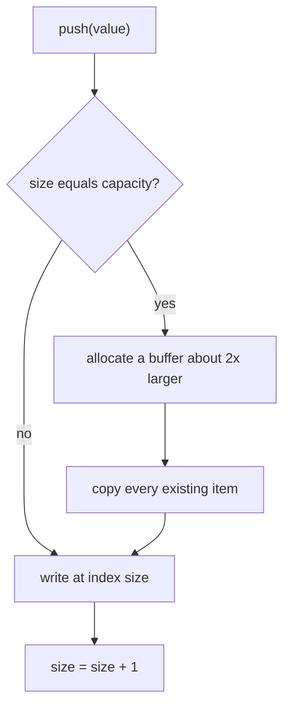

# Arrays

> **Module 05 · Data Structures & Algorithms** · Prerequisites: [Big O Analysis](04-Big-O-Analysis.md) · Next: [Strings](06-Strings.md)

---

## ⏱ If You Only Have 2 Minutes

- An array keeps its items in one block of memory, one slot after another. `arr[i]` is O(1) because the address is `base + i × element size`.
- Inserting or deleting in the middle is O(n). Every later item must shift by one slot.
- A dynamic array (Python `list`, JavaScript `Array`) doubles its buffer when it is full. One push can cost O(n), but the average over many pushes is O(1). This is **amortized** O(1).
- Contiguous memory is fast in practice. The CPU cache and prefetcher handle sequential scans well.
- A Python `list` stores references to objects. Indexing is O(1), but each element lives somewhere else in memory.
- JavaScript `Array` can mix types, and the engine may change how it stores it. Typed arrays such as `Float64Array` are fixed-length, contiguous, and hold one numeric type.

---

## 1. What It Is and Why It Exists

An **array** is a row of slots. Each slot holds one value, and the slots sit next to each other in memory. You give the array an index (0, 1, 2, …) and it goes straight to that slot without looking at the others. That is what makes it fast.

**Analogy:** a row of numbered lockers in a gym. If someone tells you "locker 17", you walk straight to it. But if you want to put a new locker between locker 3 and locker 4, every locker after that point has to move one spot down the row. The row is fast to read and slow to change in the middle.

**The problem it solves.** Programs need a place to keep many values in a known order, and they need to reach any of them quickly. A linked list (a chain of nodes) can keep the same values, but reaching item 1,000 means following 1,000 pointers, one at a time. An array reaches it in one step. Arrays are also the base for many other structures: hash tables keep their buckets in an array, binary heaps are stored in one array, and a string is usually a sequence of characters.

**The cost.** The price of contiguous storage is that the array has to grow as a single block. Growing it means allocating a bigger block and copying everything. Changing the middle means shifting. These costs decide when an array is the right choice.

---

## 2. How It Works

Two kinds of arrays matter:

- **Static array.** The size is fixed when it is created. C arrays, Java primitive arrays and typed arrays in JavaScript work this way.
- **Dynamic array.** A wrapper around a fixed **buffer** (also called the backing store). It tracks two numbers: `size` (items in use) and `capacity` (slots in the buffer). When `size == capacity` and you push, it allocates a bigger buffer, copies the items over, and continues. Python `list`, Java `ArrayList` and JavaScript `Array` all work like this, though each engine decides its own growth rule.

### Trace: pushing five items into a dynamic array

The array starts with capacity 1. Each push is one row in the table.

| Push | Size before | Capacity before | Action | Items copied | Size after | Capacity after |
|---|---|---|---|---|---|---|
| `push(a)` | 0 | 1 | Write to slot 0 | 0 | 1 | 1 |
| `push(b)` | 1 | 1 | Full: double to 2, copy `a`, write `b` | 1 | 2 | 2 |
| `push(c)` | 2 | 2 | Full: double to 4, copy `a, b`, write `c` | 2 | 3 | 4 |
| `push(d)` | 3 | 4 | Free slot: write to slot 3 | 0 | 4 | 4 |
| `push(e)` | 4 | 4 | Full: double to 8, copy 4 items, write `e` | 4 | 5 | 8 |

Five pushes copied `1 + 2 + 4 = 7` items in total. The copies form a geometric series, so the total work for n pushes stays below about 2n. Divide by n and each push costs O(1) on average. That is the amortized bound.

### Trace: inserting 25 at index 2

Start with `[10, 20, 30, 40]` in a buffer that has room for one more item.

| Step | Action | Array |
|---|---|---|
| 0 | Start | `[10, 20, 30, 40, _]` |
| 1 | Move slot 3 (`40`) to slot 4 | `[10, 20, 30, 40, 40]` |
| 2 | Move slot 2 (`30`) to slot 3 | `[10, 20, 30, 30, 40]` |
| 3 | Write `25` into slot 2 | `[10, 20, 25, 30, 40]` |

Two items moved. With n items, inserting at the front moves all n. Inserting at the end moves none.

### Growth as a flowchart



---

## 3. Key Concepts

### Contiguous memory and O(1) indexing

Because the slots are in a row, the address of item `i` is computed, not searched. For a `Float64Array`, each slot is 8 bytes, so item 1,000 is at `base + 8000`. This is why random access is O(1) in every language that stores arrays this way.

Contiguous memory also helps **cache locality**. When the CPU reads one item, it loads a whole cache line (commonly 64 bytes) around it. Scanning neighbouring items hits the cache over and over, and the hardware prefetcher can predict the next address. A linked list spreads its nodes around the heap, so each step can miss the cache. The Big O cost of a scan is the same for both, but the real speed of an array scan is often several times faster.

### Insert and delete in the middle

Inserting or deleting at index `i` shifts every item after `i`. That is O(n − i) work. The worst case is index 0 (shift everything) and the best case is the end (shift nothing). Many developers expect `insert` to be cheap because it is cheap in a linked list when you already hold a node. For arrays, the search is cheap, but the shift is not. If you need many inserts at the front, use a deque or a linked structure instead.

### Amortized append and growth factor

The growth factor is how much bigger the new buffer is. Doubling (×2) is the classic choice. It copies the fewest items, but it can waste up to half the buffer. Some runtimes grow by about 1.5× (Java's `ArrayList` is one well-known example), which wastes less memory but copies more often. CPython over-allocates list buffers by a smaller share, roughly one-eighth plus a few slots. The exact factor is an implementation detail. What matters is that it is a constant multiple, so the amortized cost stays O(1).

Amortized is not the same as average-case. It is a guarantee over any sequence of operations: the total cost of n pushes is O(n). A single push can still take O(n) time when it triggers a copy. That single slow push is where latency spikes come from in production.

### JavaScript arrays and typed arrays

A JavaScript `Array` is a dynamic array that can hold any values. The engine (V8 in Node.js) tracks what kind of values it holds, so it can store an all-numbers array in a compact form. This is an optimisation that engines may apply. Your code should not depend on it. If an array has holes (missing indexes, created by `new Array(n)` or `delete`), the engine may use a slower representation.

Typed arrays (`Int32Array`, `Uint8Array`, `Float64Array`, and others) are fixed-length and contiguous, and they hold one numeric type. They are much smaller in memory than a plain array of numbers, and they are the right tool for binary data and numeric work. They cannot grow. Storing a value that does not fit wraps silently: `Uint8Array` stores `300` as `44`. That is a common source of bugs.

### Python lists and 2D arrays

A Python `list` is an array of **references**. Each slot holds a pointer to a Python object. Indexing is still O(1), but reading the value means following the pointer to memory that may be far away. A list of a million small integers uses far more memory than a million bytes. For compact numeric data, use the `array` module (`array.array("d", ...)`) or NumPy. Both store raw values in one block.

A 2D array is an array of rows. Each row must be a separate object. In Python, `[[0] * cols] * rows` makes `rows` references to the same inner list, so changing one row changes all of them. Use `[[0] * cols for _ in range(rows)]`. In JavaScript, `Array(rows).fill(Array(cols))` has the same bug, so use `Array.from({ length: rows }, () => new Array(cols).fill(0))`.

### Complexity table

| Operation | Best | Average | Worst | Extra space | Why |
|---|---|---|---|---|---|
| Read `arr[i]` | O(1) | O(1) | O(1) | O(1) | Address is computed from the index |
| Search for a value (unsorted) | O(1) | O(n) | O(n) | O(1) | Best when the value is first; otherwise scan the items |
| Append (push) | O(1) | O(1) amortized | O(n) | O(1) | Worst case copies the whole buffer; copies are rare and paid for by the cheap pushes |
| Insert at index `i` | O(1) at end | O(n) | O(n) | O(1) | Items after `i` shift one slot right |
| Delete at index `i` | O(1) at end | O(n) | O(n) | O(1) | Items after `i` shift one slot left |
| Rotate or reverse in place | O(n) | O(n) | O(n) | O(1) | Every item is touched at least once |
| Whole array | O(n) | O(n) | O(n) | O(n) | Storage grows with the number of items |

The space column is extra space beyond the stored items. The stored items themselves take O(n).

---

## 4. Code Examples

Built-ins first. Use them before writing your own.

- **JavaScript:** `Array` (dynamic, with `push`, `pop`, `splice`, `at`, `toSorted` and `toReversed` in ES2023), typed arrays (`Int32Array`, `Float64Array`, `Uint8Array`) for fixed-size numeric data, and `Array.from` to build arrays with a length and a mapping function.
- **Python:** `list` (dynamic, with `append`, `pop`, `insert`, slicing), `array.array` for compact typed values, `collections.deque` for O(1) push and pop at both ends (it does not give O(1) random index access in the middle), and `bisect` for binary search on a sorted list.

The first block in each language is a teaching version of a dynamic array. The second block solves two interview problems with plain arrays: rotate an array in place, and product of array except self.

### Node.js / TypeScript

```ts
// Teaching version of a dynamic array. In production, use the built-in Array.
// Node.js 22+, TypeScript 5, strict mode. No dependencies.
export class DynamicArray<T> {
  private buffer: (T | undefined)[];   // fixed-capacity storage
  private length = 0;

  constructor(initialCapacity = 4) {
    if (!Number.isInteger(initialCapacity) || initialCapacity < 1) {
      throw new RangeError("initialCapacity must be an integer >= 1");
    }
    this.buffer = new Array<T | undefined>(initialCapacity);
  }

  get size(): number { return this.length; }
  get capacity(): number { return this.buffer.length; }

  get(index: number): T {
    this.checkIndex(index, this.length);           // reads must be inside [0, size)
    return this.buffer[index] as T;
  }

  push(value: T): void {
    if (this.length === this.buffer.length) this.grow(this.buffer.length * 2); // doubling
    this.buffer[this.length++] = value;
  }

  pop(): T {
    if (this.length === 0) throw new RangeError("pop from empty array");
    const value = this.buffer[--this.length] as T;
    this.buffer[this.length] = undefined;          // drop the reference so the GC can reclaim it
    return value;
  }

  insert(index: number, value: T): void {
    this.checkIndex(index, this.length + 1);       // insert may append at index === size
    if (this.length === this.buffer.length) this.grow(this.buffer.length * 2);
    // Shift the tail right by one slot. This loop is the O(n) cost of a middle insert.
    for (let i = this.length; i > index; i--) this.buffer[i] = this.buffer[i - 1];
    this.buffer[index] = value;
    this.length++;
  }

  removeAt(index: number): T {
    this.checkIndex(index, this.length);
    const value = this.buffer[index] as T;
    for (let i = index; i < this.length - 1; i++) this.buffer[i] = this.buffer[i + 1];
    this.length--;
    this.buffer[this.length] = undefined;
    return value;
  }

  toArray(): T[] {
    return Array.from({ length: this.length }, (_, i) => this.buffer[i] as T);
  }

  private grow(newCapacity: number): void {
    const next = new Array<T | undefined>(newCapacity);
    for (let i = 0; i < this.length; i++) next[i] = this.buffer[i];  // the O(n) copy
    this.buffer = next;
  }

  private checkIndex(index: number, limit: number): void {
    if (!Number.isInteger(index) || index < 0 || index >= limit) {
      throw new RangeError(`index ${index} out of range [0, ${limit})`);
    }
  }
}
```

**Interview problems**

```ts
// Problem 1: rotate an array right by k steps, in place.
// Approach: reverse all items, reverse the first k, reverse the rest. O(n) time, O(1) space.
function rotate<T>(nums: T[], k: number): void {
  const n = nums.length;
  if (n === 0) return;
  const shift = ((k % n) + n) % n;                 // handles k >= n and negative k
  reverse(nums, 0, n - 1);
  reverse(nums, 0, shift - 1);
  reverse(nums, shift, n - 1);
}

function reverse<T>(a: T[], lo: number, hi: number): void {
  for (let i = lo, j = hi; i < j; i++, j--) [a[i], a[j]] = [a[j], a[i]];
}

// Problem 2: for each i, the product of all nums[j] with j !== i. Division is not allowed,
// because a zero would break it. Approach: prefix products left to right, then suffix
// products right to left. O(n) time, O(1) extra space besides the output.
function productExceptSelf(nums: number[]): number[] {
  const out = new Array<number>(nums.length).fill(1);
  let prefix = 1;
  for (let i = 0; i < nums.length; i++) {
    out[i] = prefix;                               // product of everything left of i
    prefix *= nums[i];
  }
  let suffix = 1;
  for (let i = nums.length - 1; i >= 0; i--) {
    out[i] *= suffix;                              // times the product of everything right of i
    suffix *= nums[i];
  }
  return out;
}

const arr = [1, 2, 3, 4, 5, 6, 7];
rotate(arr, 3);                                     // works in place
console.log(arr);                                   // [5, 6, 7, 1, 2, 3, 4]
console.log(productExceptSelf([1, 2, 3, 4]));       // [24, 12, 8, 6]
console.log(productExceptSelf([]));                 // []  (empty input)
console.log(productExceptSelf([0, 5, 2]));          // [10, 0, 0]  (zeros handled)
```

### Python

```python
# Teaching version of a dynamic array. In production, use the built-in list.
# Python 3.12+ (PEP 695 generic syntax). Type-checked with mypy --strict.
class DynamicArray[T]:
    def __init__(self, initial_capacity: int = 4) -> None:
        if initial_capacity < 1:
            raise ValueError("initial_capacity must be >= 1")
        self._buffer: list[T | None] = [None] * initial_capacity  # fixed-size slots
        self._size = 0

    def __len__(self) -> int:
        return self._size

    @property
    def capacity(self) -> int:
        return len(self._buffer)

    def get(self, index: int) -> T:
        self._check(index, self._size)
        value = self._buffer[index]
        assert value is not None  # every slot below _size holds a value (T must not be None)
        return value

    def push(self, value: T) -> None:
        if self._size == len(self._buffer):
            self._grow(len(self._buffer) * 2)      # doubling keeps push amortized O(1)
        self._buffer[self._size] = value
        self._size += 1

    def pop(self) -> T:
        if self._size == 0:
            raise IndexError("pop from empty array")
        self._size -= 1
        value = self._buffer[self._size]
        self._buffer[self._size] = None            # drop the reference so the object can be freed
        assert value is not None
        return value

    def insert(self, index: int, value: T) -> None:
        self._check(index, self._size + 1)         # insert may append at index == size
        if self._size == len(self._buffer):
            self._grow(len(self._buffer) * 2)
        for i in range(self._size, index, -1):     # shift the tail right: the O(n) cost
            self._buffer[i] = self._buffer[i - 1]
        self._buffer[index] = value
        self._size += 1

    def remove_at(self, index: int) -> T:
        self._check(index, self._size)
        value = self._buffer[index]
        for i in range(index, self._size - 1):    # shift the tail left
            self._buffer[i] = self._buffer[i + 1]
        self._size -= 1
        self._buffer[self._size] = None
        assert value is not None
        return value

    def to_list(self) -> list[T]:
        return [self.get(i) for i in range(self._size)]

    def _grow(self, new_capacity: int) -> None:
        new_buffer: list[T | None] = [None] * new_capacity
        for i in range(self._size):                # copy every element: the O(n) step
            new_buffer[i] = self._buffer[i]
        self._buffer = new_buffer

    def _check(self, index: int, limit: int) -> None:
        # Unlike list, a negative index is rejected instead of counting from the end.
        if not 0 <= index < limit:
            raise IndexError(f"index {index} out of range [0, {limit})")
```

**Interview problems**

```python
# Problem 1: rotate a list right by k steps, in place.
# Approach: reverse all items, reverse the first k, reverse the rest. O(n) time, O(1) space.
def rotate[T](nums: list[T], k: int) -> None:
    n = len(nums)
    if n == 0:
        return
    shift = k % n                                  # Python's % is never negative for n > 0

    def reverse(lo: int, hi: int) -> None:
        while lo < hi:
            nums[lo], nums[hi] = nums[hi], nums[lo]
            lo += 1
            hi -= 1

    reverse(0, n - 1)
    reverse(0, shift - 1)
    reverse(shift, n - 1)


# Problem 2: for each i, the product of all nums[j] with j != i. No division, because a zero
# would break it. Approach: prefix products left to right, then suffix products right to left.
# O(n) time, O(1) extra space besides the output. Python ints do not overflow.
def product_except_self(nums: list[int]) -> list[int]:
    out = [1] * len(nums)
    prefix = 1
    for i, x in enumerate(nums):
        out[i] = prefix                            # product of everything left of i
        prefix *= x
    suffix = 1
    for i in range(len(nums) - 1, -1, -1):
        out[i] *= suffix                           # times the product of everything right of i
        suffix *= nums[i]
    return out


nums = [1, 2, 3, 4, 5, 6, 7]
rotate(nums, 3)
print(nums)                                        # [5, 6, 7, 1, 2, 3, 4]
print(product_except_self([1, 2, 3, 4]))           # [24, 12, 8, 6]
print(product_except_self([]))                     # []  (empty input)
print(product_except_self([0, 5, 2]))              # [10, 0, 0]  (zeros handled)
```

---

## 5. Production Concerns

- **Memory size.** A `Float64Array` of 50 million numbers needs about 400 MB in one contiguous block. Compare that with a plain JavaScript array of boxed values, or a Python `list` of float objects, which can use several times more memory. Choose the representation before the data gets big.
- **Growth spikes.** A copy on a large array can take tens of milliseconds, which shows up in p99 latency. If the final size is known, allocate it once (`new Float64Array(n)`, `[0] * n`) instead of growing it item by item.
- **Untrusted sizes.** A request body can contain an array of any length. Cap the length before you parse or process it, and reject oversized input with `413 Payload Too Large` or `400 Bad Request`. A single request should not decide how much memory your process uses.
- **Concurrency.** A JavaScript main thread is single-threaded, so one request handler finishes its array work before the next one starts. Data shared with `worker_threads` must sit in a `SharedArrayBuffer` and be changed with `Atomics`. In CPython, the GIL makes single list operations safe, but a check followed by an append is still two steps. Two threads can both pass the check.
- **Observability.** Record a histogram of array lengths for user-controlled inputs. A sudden jump in length often means a bug or an attack. Watch heap size as well, because a large array is one big allocation.

---

## 6. Common Mistakes

- **`new Array(n)` used as a filled list** — it creates `n` holes, so `arr[0]` is `undefined` and the array is "holey" — use `new Array(n).fill(0)` or `Array.from({ length: n }, () => 0)`.
- **Shifting from the front in a loop** — `list.pop(0)` or `arr.shift()` moves every item on each call, so a loop of n calls is O(n²) — use an index pointer, or `collections.deque` in Python.
- **Removing items while iterating forward** — each removal shifts the next item into the current index, and the loop skips it — iterate backwards, or build a new array with `filter` or a list comprehension.
- **Expecting out-of-range reads to fail in JavaScript** — `arr[99]` returns `undefined` instead of throwing — check `index < arr.length`, or use `arr.at()` with an explicit check.
- **Typed-array overflow** — `Uint8Array` silently wraps `300` to `44` — validate the value range before storing it.
- **Shared mutable default arguments in Python** — `def add(x, items=[])` keeps one list for every call — use `items: list[int] | None = None` and create the list inside the function.
- **Aliased 2D rows** — `[[0] * cols] * rows` or `Array(rows).fill(Array(cols))` shares one row object across all rows — build each row separately.

---

## 7. Comparison Table

| Structure | Index access | Append | Insert or delete in middle | Memory layout | Best for |
|---|---|---|---|---|---|
| Static or typed array (`Float64Array`, `array.array`) | O(1) | Not supported (fixed size) | O(n) | One contiguous block of raw values | Numeric data of known size, binary buffers |
| Dynamic array (`list`, `Array`) | O(1) | O(1) amortized | O(n) | Contiguous buffer of references or values | General sequences, most default choices |
| Linked list | O(n) | O(1) with a tail pointer | O(1) once you hold the node | Nodes scattered in the heap | Frequent splices where you already hold the node |
| Deque (`collections.deque`) | Near the ends only | O(1) at both ends | O(n) | Linked blocks of items | Queues and sliding windows |

The dynamic array wins on access and cache locality. A linked list wins when you need cheap splices next to a node you already hold.

---

## 8. Interview Questions

**[Junior] What does `arr[i]` cost, and why?**
It costs O(1). The array stores its items in one block, one slot after another, so the address of slot `i` is the base address plus `i` times the slot size. The program computes the address directly and does not look at any other slot. This is true for any index, whether it is the first, the middle or the last.

**[Junior] Why is inserting at the front of an array slow?**
Every item in the array has to move one slot to the right to make room. With n items, that is n moves. If you insert at the end, nothing moves. If you insert many times at the front, use a deque, a linked structure, or store the data in reverse order.

**[Mid] Why is `push` O(1) amortized when a single push can be O(n)?**
When the buffer is full, the array allocates a buffer about twice as large and copies all items, which costs O(n). After that copy, the next many pushes write into free slots at O(1) each. Doubling means the copies happen at sizes 1, 2, 4, 8, and so on. Their total cost is less than 2n for n pushes, so the average cost per push is O(1). The guarantee is about the total of many operations. One push can still be slow.

**[Mid] Rotate an array right by k steps in place. How, and what does it cost?**
Reverse the whole array, then reverse the first k items, then reverse the rest. Each item is moved a constant number of times, so the time is O(n) and the extra space is O(1). First take `k mod n`, because k can be larger than n or negative. Calling `splice` or `slice` to build a new array would work too, but it would use O(n) extra space.

**[Senior] A batch job loads 50 million numbers into an array, and p99 latency spikes every few seconds. What is the likely cause and the fix?**
The most likely cause is growth copies. Each time a dynamic array doubles, it copies the whole buffer, and at that size the copy is slow. The fix is to allocate the final size once (for example `new Float64Array(n)`), so no growth happens. If the size is not known in advance, collect items in chunks and merge them at the end. Also check whether a plain JavaScript array of boxed numbers is being used where a typed array would use far less memory and fewer GC pauses.

**[Senior] An endpoint accepts a JSON array of user IDs. What checks would you put around it?**
Set a maximum length before the body is parsed, and return a 413 or 400 when it is too large. Remove duplicates with a `Set` (expected O(1) per lookup), so the work does not grow with repeated values. If the IDs must be looked up in a database, send them in batches instead of one query per ID. Log the length as a metric, so you can see abuse before it becomes an outage.

**[Senior] When would you store a column of values as a typed array or `array.array` rather than as a list of objects?**
When there are many values of one numeric type and you process them in bulk, such as metrics, embeddings, or image pixels. Raw values in a contiguous block use less memory, scan faster because of cache locality, and create no per-value objects for the garbage collector to track. The cost is less flexibility: the type is fixed, the length is fixed, and out-of-range values are wrapped or rejected. Use it for the hot data and keep ordinary arrays for everything else.

---

## 9. Cheat Sheet

```text
Index read        O(1): address = base + i × element size
Middle insert     O(n): shift every later item one slot
Push              O(1) amortized, O(n) when the buffer doubles
Growth            copy into a buffer ~2x larger; total copies stay below 2n
JS Array          dynamic, mixed types; avoid holes; engine may optimise
Typed arrays      fixed length, contiguous, one numeric type; wrap on overflow
Python list       array of references; O(1) index; extra pointer per element
array.array       compact typed values in Python
Rotate            reverse all, reverse first k, reverse rest: O(n), O(1) space
Product except    prefix products, then suffix products: O(n), no division
Shift from front  O(n) per call; use a deque or an index pointer
2D arrays         build each row separately, never [row] * n
Cache locality    sequential scans are fast; pointer chasing is slow
Untrusted input   cap length before parsing; log the length
```

---

## Related Topics

- [Linked Lists](07-Linked-Lists.md) — the pointer-based alternative: cheap splices, slow indexing.
- [Hash Tables](11-Hash-Tables.md) — store their buckets in an array and resize them the same way.
- [Big O Analysis](04-Big-O-Analysis.md) — how to state amortized and worst-case bounds correctly.
- [Memory Management](../Module-04-Operating-Systems/21-Memory-Management.md) — how the OS allocates the big contiguous blocks an array needs.
- [Indexes](../Module-03-Databases/19-Indexes.md) — how databases use sorted structures to find rows without a full scan.
