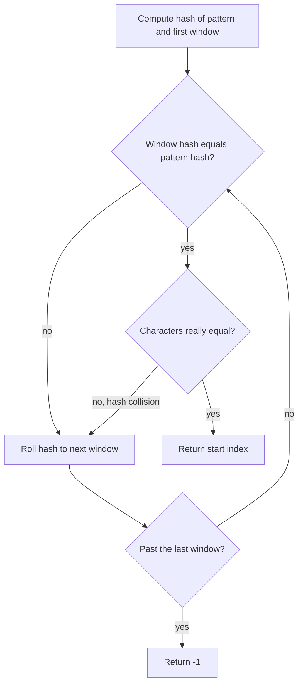

# Strings

> **Module 05 · Data Structures & Algorithms** · Prerequisites: [Arrays](05-Arrays.md) · Next: [Linked Lists](07-Linked-Lists.md)

---

## ⏱ If You Only Have 2 Minutes

- Strings are **immutable** in JavaScript and Python. Changing one character makes a new string, so you cannot edit `s[0]` in place.
- `s += piece` in a loop copies the whole string each time. In the naive model that is O(n²) for n pieces. Collect the pieces in a list or array, then join them once, in O(total length).
- JavaScript `length` counts UTF-16 code units. Python `len()` counts code points. An emoji such as `😀` has length 2 in JavaScript and length 1 in Python.
- Comparing with `<` orders strings by code unit (JavaScript) or code point (Python). It is not a language-aware sort. Use `localeCompare` or a collation when you need human order.
- Two strings that look the same can have different bytes. Normalise (NFC) before you compare or store identifiers.
- A polynomial rolling hash lets you check every window of a text in O(1) per step. Rabin–Karp uses it to find a pattern in O(n + m) on average, and it must verify every hash hit.

---

## 1. What It Is and Why It Exists

A **string** is a sequence of characters. In most backend code it holds text such as a user name, a JSON body, a log line or a URL. In memory it is stored as a sequence of numbers, one or more per character, depending on the encoding that the language uses internally.

**Analogy:** a printed label. You can read it, copy it, and stick it on something else. But you cannot erase one letter and write another in its place. If you want a different label, you print a new one. Strings work the same way in JavaScript and Python.

**The problem it solves.** Text is the most common data in a backend. You parse it, compare it, search it and join it. If you do these operations without thinking about cost, the code looks fine in a unit test and then slows to a crawl on a 10 MB request body. Immutability gives you safety, because a string passed to a function cannot change under you. It also creates a cost trap, because building text piece by piece makes many copies. This chapter covers both sides.

---

## 2. How It Works

### Trace: building a string with `+=` versus a builder

Suppose a loop appends three pieces, `"ab"`, `"cd"` and `"ef"`. In a naive model, each `+=` allocates a new string and copies the old one first.

| Step | Piece | Naive `s += piece` result | Characters copied in this step | Total copied so far |
|---|---|---|---|---|
| 1 | `"ab"` | `"ab"` | 2 | 2 |
| 2 | `"cd"` | `"abcd"` | 4 | 6 |
| 3 | `"ef"` | `"abcdef"` | 6 | 12 |

With a builder (an array or list of parts), the pieces are only stored. The final `join` copies each character once, so the total is 6 characters. The gap grows with n. For n pieces of the same size, the naive total is about n²/2 pieces' worth of copying, and the builder total is n.

Real engines do not always follow the naive model. V8 can use rope structures for concatenation, and CPython can sometimes extend a string in place. Those are optimisations that depend on the situation. Do not rely on them in a hot loop. Use a builder.

### Trace: what `length` counts

| String | Code points | JavaScript `length` | Python `len()` | Why |
|---|---|---|---|---|
| `"é"` (one code point, U+00E9) | 1 | 1 | 1 | Precomposed letter |
| `"é"` (`e` plus combining accent) | 2 | 2 | 2 | Two code points, one visible letter |
| `"😀"` (U+1F600) | 1 | 2 | 1 | Outside the Basic Multilingual Plane, so JavaScript stores it as a surrogate pair |

The second row is still a problem. Users see one letter, but the length is two. Counting what a user sees needs grapheme segmentation (`Intl.Segmenter` in JavaScript, or the `regex` package in Python), not `length`.

### Searching: how the work grows

A naive substring search tries every starting position and compares the pattern there. For a text of length n and a pattern of length m, that is O(n·m) in the worst case. Rabin–Karp reduces the comparisons by hashing. It computes a hash of the pattern and a hash of each window of the text. A window whose hash differs from the pattern's hash cannot match. The hash of the next window is computed from the current one in O(1), so the whole scan is O(n + m) on average.



---

## 3. Key Concepts

### Immutability

In JavaScript, string values are primitives. A TypeScript module runs in strict mode, so `s[0] = "x"` throws a `TypeError`. In sloppy-mode scripts, the assignment silently does nothing. Python raises `TypeError: 'str' object does not support item assignment`. Both languages create a new value for every change, so you must assign the result: `s = s.replace("a", "b")`.

Immutability is useful. A string can be used as a dictionary key or a set member, and nobody can change it after it is stored. The trade-off is that any edit costs a copy. If you need many edits, use a builder or a mutable byte buffer, such as `Uint8Array` or Python's `bytearray`.

### Repeated concatenation and builders

The fix for the `+=` loop is a builder. In JavaScript, push pieces into an array and call `join("")`. In Python, append to a list and call `"".join(parts)`. The standard library also has `io.StringIO`, which buffers writes and is a good choice when you write to something file-like. Always join once at the end, not inside the loop.

### Unicode: code points, code units and grapheme clusters

Unicode gives every character a number called a **code point**. Python's `str` is a sequence of code points, so indexing and `len()` work on code points. JavaScript strings are sequences of **UTF-16 code units**. Code points above U+FFFF need two code units, called a surrogate pair. `s.length`, `s[i]` and `s.charCodeAt(i)` all work on code units. This is why a loop that uses `s[i]` can split an emoji in half. To loop over code points, use `for (const ch of s)` or `Array.from(s)`.

A user-visible character is a **grapheme cluster**. It can contain several code points, such as a letter plus an accent. Counting or truncating what users see needs a segmenter, not `length`.

### Comparison and normalisation

Comparing strings with `<` or `>` orders them by code unit in JavaScript and by code point in Python. That order is stable and fast, but it is not the order a dictionary would use. `"B" < "a"` is true because uppercase letters have lower code points. For human-facing sorts, use `localeCompare` in JavaScript or `locale.strxfrm` with a configured locale in Python.

Two strings can look identical and still differ. `"é"` can be stored as one code point (NFC) or as `e` plus a combining accent (NFD). They render the same, but `===` and `==` return false. Normalise the text to NFC at the boundary (`s.normalize("NFC")` in JavaScript, `unicodedata.normalize("NFC", s)` in Python) before you compare, hash or store it. For case-insensitive comparison, Python's `str.casefold()` is more correct than `lower()`. JavaScript has no `casefold`, and `toLowerCase()` is locale-independent but still not a full case fold.

### String hashing and rolling hashes

A **polynomial hash** treats the string as the digits of a number in base `B` and reduces it modulo a prime `M`. For `s` of length n:

`h(s) = (s[0]·B^(n−1) + s[1]·B^(n−2) + … + s[n−1]) mod M`

To roll the window one character to the right, subtract the old first term, multiply by `B`, and add the new last character. Each step is O(1). Hash collisions are possible because many strings share a hash value, so a hit must always be checked character by character. Python randomises `hash(str)` for each process, so never store it or use it to shard data across machines. Use a stable hash such as SHA-256 for that.

### Substring search complexity

| Algorithm | Best | Average | Worst | Extra space |
|---|---|---|---|---|
| Naive scan | O(m) | O(n) on typical text | O(n·m) | O(1) |
| Rabin–Karp | O(n + m) | O(n + m) | O(n·m) | O(1) |
| KMP (prefix table) | O(n + m) | O(n + m) | O(n + m) | O(m) |

Reasons: the naive scan stops early on a mismatch, so typical text is cheap, but a text like `aaaa…a` with pattern `aaa…ab` forces m comparisons at every position. Rabin–Karp does constant work per window, and only collisions cost more. KMP never re-reads a text character, which gives a guaranteed linear bound.

### Complexity table

| Operation | Best | Average | Worst | Extra space | Why |
|---|---|---|---|---|---|
| Read `s[i]` | O(1) | O(1) | O(1) | O(1) | Address is computed from the index |
| Concatenate `a + b` | O(n + m) | O(n + m) | O(n + m) | O(n + m) | A new string is allocated and both parts are copied |
| `+=` in a loop of n constant-size pieces | O(n²) | O(n²) | O(n²) | O(n) | Each step copies the whole string built so far |
| Builder: n appends, one join | O(total) | O(total) | O(total) | O(total) | Each character is copied once in the join |
| Equality `a === b` | O(1) | O(1) | O(n) | O(1) | Different lengths or first characters exit early; equal strings compare all characters |
| Order `a < b` | O(1) | O(1) | O(min(n, m)) | O(1) | Stops at the first differing character |
| Anagram check with counts | O(n + m) | O(n + m) | O(n + m) | O(k) | Each character is counted once; k is the number of distinct characters |

---

## 4. Code Examples

Built-ins first.

- **JavaScript:** `String` methods such as `includes`, `startsWith`, `indexOf`, `normalize`, `localeCompare` and `padStart`. `Array.from(s)` and `for...of` iterate code points. `Intl.Segmenter` splits text into grapheme clusters. `TextEncoder` converts to UTF-8 bytes.
- **Python:** `str` methods such as `find`, `startswith`, `casefold`, `split` and `join`. `collections.Counter` counts characters. `io.StringIO` is a buffered text stream. `unicodedata.normalize` handles normalisation. `str` is a sequence of code points, so iteration needs no special care.

The first block in each language has a `StringBuilder` and a Rabin–Karp search. The second block has two interview problems: valid anagram, and longest common prefix. Python indexes in code points and TypeScript indexes in UTF-16 code units, so the positions from `rabinKarp` differ for text with emoji. The comments in each block mention this.

### Node.js / TypeScript

```ts
// StringBuilder and Rabin-Karp search. Node.js 22+, TypeScript 5, strict mode. No dependencies.
export class StringBuilder {
  private parts: string[] = [];
  private totalLength = 0;            // counted in UTF-16 code units, the same unit as String.length

  append(piece: string): this {
    this.parts.push(piece);            // O(1) amortized: no copy of the text built so far
    this.totalLength += piece.length;
    return this;
  }

  get length(): number { return this.totalLength; }

  toString(): string {
    const result = this.parts.join("");  // one copy of all characters
    this.parts = [result];               // collapse, so repeated toString() calls stay cheap
    return result;
  }
}

const BASE = 256;
const MOD = 1_000_003;   // a small prime: products stay below 2^53, so plain numbers are exact

// Returns the first index of pattern in text, or -1. Indexes are UTF-16 code units.
export function rabinKarp(text: string, pattern: string): number {
  const n = text.length;
  const m = pattern.length;
  if (m === 0) return 0;               // the empty string is found at 0 by convention
  if (m > n) return -1;

  let high = 1;                        // BASE^(m-1) mod MOD: the weight of the leading character
  for (let i = 1; i < m; i++) high = (high * BASE) % MOD;

  let patternHash = 0;
  let windowHash = 0;
  for (let i = 0; i < m; i++) {
    patternHash = (patternHash * BASE + pattern.charCodeAt(i)) % MOD;
    windowHash = (windowHash * BASE + text.charCodeAt(i)) % MOD;
  }

  for (let start = 0; start + m <= n; start++) {
    // A hash match is only a candidate. Hashes can collide, so compare the characters.
    if (patternHash === windowHash && text.startsWith(pattern, start)) return start;
    if (start + m < n) {
      // Roll: remove text[start] from the front, shift, and add text[start + m] at the back.
      const removed = (text.charCodeAt(start) * high) % MOD;
      windowHash = ((windowHash - removed + MOD) * BASE + text.charCodeAt(start + m)) % MOD;
    }
  }
  return -1;
}
```

**Interview problems**

```ts
// Problem 1: are s and t anagrams (same characters, same counts)?
// Approach: count code points of s, then subtract for each code point of t.
// O(n + m) time, O(k) space for k distinct characters.
export function isAnagram(s: string, t: string): boolean {
  const a = Array.from(s);             // iterate code points, not UTF-16 code units
  const b = Array.from(t);
  if (a.length !== b.length) return false;

  const counts = new Map<string, number>();
  for (const ch of a) counts.set(ch, (counts.get(ch) ?? 0) + 1);
  for (const ch of b) {
    const left = counts.get(ch) ?? 0;
    if (left === 0) return false;      // t uses this character more often than s does
    counts.set(ch, left - 1);
  }
  return true;
}

// Problem 2: the longest common prefix of a list of strings.
// Approach: extend the prefix one position at a time while every word agrees.
// O(n·m) time for n words and a shortest word of length m, O(1) extra space.
export function longestCommonPrefix(words: string[]): string {
  if (words.length === 0) return "";
  const first = words[0];
  let end = 0;                         // length of the shared prefix, in UTF-16 code units
  while (end < first.length && words.every((w) => end < w.length && w[end] === first[end])) {
    end++;
  }
  // Do not split a surrogate pair: a lone high surrogate is not a valid character.
  const last = first.charCodeAt(end - 1);
  if (end > 0 && last >= 0xd800 && last <= 0xdbff) end--;
  return first.slice(0, end);
}

console.log(isAnagram("listen", "silent"));           // true
console.log(isAnagram("café", "café"));          // false: NFC and NFD differ, normalise first
console.log(longestCommonPrefix(["flower", "flow", "flight"])); // "fl"
console.log(longestCommonPrefix([]));                  // ""
console.log(rabinKarp("backend", "end"));              // 4
```

### Python

```python
# StringBuilder and Rabin-Karp search. Python 3.12+ with type hints, checked with mypy --strict.
from typing import Self


class StringBuilder:
    def __init__(self) -> None:
        self._parts: list[str] = []
        self._length = 0                       # counted in code points, the same unit as len(str)

    def append(self, piece: str) -> Self:
        self._parts.append(piece)              # O(1) amortized: no copy of the text built so far
        self._length += len(piece)
        return self

    def __len__(self) -> int:
        return self._length

    def __str__(self) -> str:
        result = "".join(self._parts)          # one pass over all characters
        self._parts = [result]                 # collapse, so repeated str() calls stay cheap
        return result


BASE = 256
MOD = 1_000_003  # a small prime keeps the numbers small; collisions are checked anyway


def rabin_karp(text: str, pattern: str) -> int:
    """Return the first index of pattern in text, or -1. Indexes are code points."""
    n, m = len(text), len(pattern)
    if m == 0:
        return 0                               # the empty string is found at 0 by convention
    if m > n:
        return -1

    high = pow(BASE, m - 1, MOD)               # weight of the leading character
    pattern_hash = 0
    window_hash = 0
    for i in range(m):
        pattern_hash = (pattern_hash * BASE + ord(pattern[i])) % MOD
        window_hash = (window_hash * BASE + ord(text[i])) % MOD

    for start in range(n - m + 1):
        # A hash match is only a candidate. Hashes can collide, so compare the characters.
        if pattern_hash == window_hash and text.startswith(pattern, start):
            return start
        if start + m < n:
            # Roll: remove text[start] from the front, shift, and add text[start + m] at the back.
            removed = (ord(text[start]) * high) % MOD
            window_hash = ((window_hash - removed) % MOD * BASE + ord(text[start + m])) % MOD
    return -1


def is_anagram(s: str, t: str) -> bool:
    if len(s) != len(t):                       # len counts code points, so no surrogate issue
        return False
    counts: dict[str, int] = {}
    for ch in s:
        counts[ch] = counts.get(ch, 0) + 1
    for ch in t:
        left = counts.get(ch, 0)
        if left == 0:                          # t uses this character more often than s does
            return False
        counts[ch] = left - 1
    return True


def longest_common_prefix(words: list[str]) -> str:
    if not words:
        return ""
    first = words[0]
    end = 0                                    # length of the shared prefix, in code points
    while end < len(first) and all(end < len(w) and w[end] == first[end] for w in words):
        end += 1
    return first[:end]


print(is_anagram("listen", "silent"))                  # True
print(is_anagram("café", "café"))                # False: NFC and NFD differ, normalise first
print(longest_common_prefix(["flower", "flow", "flight"]))  # fl
print(longest_common_prefix([]))                       # ""  (empty input)
print(rabin_karp("backend", "end"))                    # 4
```

---

## 5. Production Concerns

- **Normalise at the edge.** Usernames, emails and tags can arrive in NFC or NFD. Normalise them once when they enter the system, store the normalised form, and make unique indexes work on it. Otherwise two visually identical names can both be accepted.
- **Case rules.** Lowercasing is not always safe. Turkish has dotted and dotless "i", so `toLowerCase()` with the wrong locale gives wrong results. Pick one case rule for identifiers and test it with that locale.
- **Length limits.** Limit input in code units or code points, and say which one. A 1 MB limit in bytes can be far fewer characters, and a 1,000-character limit in JavaScript can allow more visible characters than you expect for emoji. Check the limit before you run expensive work, such as a regex or a search.
- **Concatenation in hot paths.** Log lines, JSON responses and CSV exports often build strings in a loop. Use a builder, stream the output to the socket, or use `StringIO` for file-like output.
- **Hashing for sharding.** Python's `hash(str)` differs across processes, so it must not decide where data lives. Use a stable hash such as SHA-256 or a fixed-seed hash in every service.
- **Hash flooding.** An attacker who controls keys can make a hash table slow by choosing keys that collide. Use a per-process seed, cap the size of request maps, and reject keys you do not expect.
- **Observability.** Log the length of user-supplied strings as a metric. A sudden jump often means a bug or an attack. Never log full secrets or tokens as strings, even in debug output.

---

## 6. Common Mistakes

- **Building output with `+=` in a loop** — each step copies everything built so far, so a large export is O(n²) — collect parts in an array or list and join once.
- **Using `s[i]` to walk emoji** — JavaScript splits a surrogate pair into two broken halves — iterate with `for...of` or `Array.from(s)`.
- **Assuming `len()` or `length` is the visible length** — a letter with an accent can be two code points, and an emoji can be one or two units — use grapheme segmentation when the visible length matters.
- **Comparing strings before normalising** — `"café"` in two encodings does not match, so a login or a lookup fails — normalise to NFC at the boundary.
- **Using `==` with `localeCompare` results or `<` for human sorts** — uppercase letters sort before lowercase, so `"Zebra"` comes before `"apple"` — use a locale-aware collator for display sorting.
- **Trusting a hash match** — a rolling hash can collide, so two different strings can share a hash — always compare the characters after a hash hit.
- **Storing `hash()` results** — Python's string hash changes between runs — store a stable digest such as SHA-256 if the value must last.

---

## 7. Comparison Table

| Approach | Cost to build a string from n pieces | Mutable | Typical use |
|---|---|---|---|
| `s += piece` (JavaScript or Python) | O(n²) in the naive model | No | Two or three pieces, or a rare small concatenation |
| Array or list of parts, then `join` | O(total length) | The parts are mutable, the result is not | Building output in a loop |
| `io.StringIO` (Python) | O(total length) | Writes are buffered | Code that already writes to a file-like object |
| `Uint8Array` with `TextEncoder` or `bytearray` (Python) | O(total length) | Yes, bytes only | Binary protocols and byte-level edits |
| Template literal or f-string | O(length of the result) | No | Formatting a few values into one string |

Use the plain `+` or a template literal for small, fixed messages. Use a builder when the number of pieces depends on input size.

---

## 8. Interview Questions

**[Junior] Why can you not change one character of a JavaScript or Python string in place?**
Strings are immutable in both languages. A change always creates a new string, and the old one stays the same until it is garbage-collected. This makes strings safe to share and to use as dictionary keys. In JavaScript, `s[0] = "x"` throws a `TypeError` in strict mode. In Python it raises `TypeError`. To change a string, assign the result of an operation such as `replace`, or use a builder or a byte buffer if you edit many times.

**[Junior] What is the length of `"😀"` in JavaScript and in Python?**
It is 2 in JavaScript and 1 in Python. The emoji is one Unicode code point, U+1F600. JavaScript strings are sequences of UTF-16 code units, and this code point needs a surrogate pair of two units. Python's `str` is a sequence of code points, so `len` counts the emoji once. The difference matters for truncation, indexing and validation.

**[Mid] Why is building a string with `+=` in a loop slow, and how do you fix it?**
Each concatenation allocates a new string and copies the old content, so the total copying for n pieces grows like n². The fix is to append each piece to an array or list, then call `join` once at the end. That copies each character one time. Engines have optimisations that sometimes hide the problem, so the builder is the portable answer.

**[Mid] How do you check whether two strings are anagrams, and what does it cost?**
Count each character in the first string, then subtract the counts for the second string and fail if a count would go below zero. Check the lengths first. The time is O(n + m) and the extra space is O(k), where k is the number of distinct characters. Sorting both strings also works, at O(n log n) time. The counting method is better when the input is long.

**[Senior] You must find a short pattern in a 10 GB log stream. Which algorithm would you use, and why?**
For one pattern that must be found in a single pass, a linear algorithm such as KMP is the safe choice, because its worst case is O(n + m) and it reads each byte once. Rabin–Karp is a good choice when you search for many patterns of the same length at once, because you store their hashes in a set and check each window in O(1). In either case, verify the candidate match, stream the data in chunks instead of loading 10 GB into memory, and count the bytes you read as a metric.

**[Senior] Two users register with names that look identical, but the login fails for one of them. What is the likely cause, and how do you prevent it?**
The names are probably stored in different Unicode forms. One is precomposed (NFC), and the other is a base letter with a combining accent (NFD). They look the same on screen but compare as different strings. The fix is to normalise every identifier to one form (usually NFC) when it enters the system, and to build the unique index on the normalised value. Decide separately whether to apply case folding, and test it with locale-sensitive input such as Turkish "i".

**[Senior] Why must a service never use Python's built-in `hash()` to choose a shard for data?**
Python randomises string hashes for each process, so the same key can map to a different shard after a restart or on another server. Data written by one process would then be looked up in the wrong place. Use a stable hash function, such as SHA-256 or a fixed-seed hash, in every service. The same rule applies to any hash table that accepts keys from users: use a seed you control, and limit how many keys a request can create.

---

## 9. Cheat Sheet

```text
Immutable      s[i] = x is an error; every change makes a new string
+= in a loop   O(n²) in the naive model; collect parts and join once
Builder        JS: push + join("")   Python: list.append + "".join
JS length      UTF-16 code units; "😀" has length 2
Python len     code points; "😀" has length 1
Visible length grapheme clusters (Intl.Segmenter / regex package)
Iterate        JS: for...of or Array.from(s)   Python: for ch in s
Normalise      NFC at the boundary before compare, hash or store
Case           Python casefold() for matching; watch Turkish i in toLowerCase
Order          < compares code units / code points, not human order
Rabin-Karp     rolling polynomial hash; average O(n + m); verify every hit
KMP            O(n + m) worst case; O(m) extra space
Hash for shard Python hash(str) is randomised per process; use SHA-256
Anagram        count chars; O(n + m) time, O(k) space
LCP            extend while all words agree; O(n·m) for n words
```

---

## Related Topics

- [Arrays](05-Arrays.md) — strings are arrays of characters, and builders rely on dynamic arrays.
- [Hash Tables](11-Hash-Tables.md) — how string keys are hashed, and why hash choice matters for security.
- [HTTP Fundamentals](../Module-02-Core-Backend/01-HTTP-Fundamentals.md) — headers and bodies are strings, and their size limits are string limits.
- [Indexes](../Module-03-Databases/19-Indexes.md) — why a prefix search can use an index, and a substring search usually cannot.
