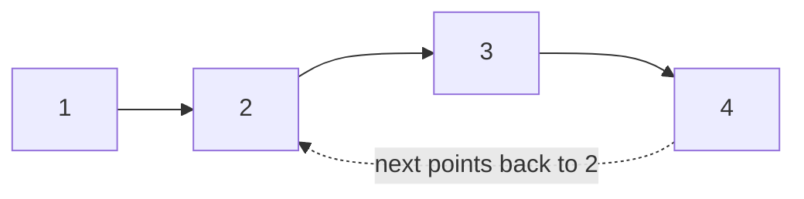

# Linked Lists

> **Module 05 · Data Structures & Algorithms** · Prerequisites: [Strings](06-Strings.md) · Next: [Stacks](08-Stacks.md)

---

## ⏱ If You Only Have 2 Minutes

- A linked list is a chain of nodes. Each node holds a value and a pointer (a reference) to the next node. The nodes do not need to sit next to each other in memory.
- Inserting or deleting after a node you already hold is O(1). You only change a few pointers.
- Finding a node by position or by value is O(n). You must walk the chain from the head, one node at a time.
- Keep a **tail** pointer, and `push_back` becomes O(1). Use a **dummy (sentinel) node** in front of the head, and deleting the first node needs no special case.
- **Floyd's algorithm** (fast and slow pointers) detects a cycle in O(n) time and O(1) extra space.
- Reversing a list in place is O(n) time and O(1) space. Save `next` before you overwrite it, or you lose the rest of the list.
- Backend uses: the recency order in an LRU cache, and free lists that keep track of unused memory blocks.

---

## 1. What It Is and Why It Exists

A **linked list** is a sequence of **nodes**. Each node has a `value` and a `next` pointer that holds the next node, or `null` at the end. A list is just a pointer to the first node (the **head**). Nodes can be anywhere in memory, because the chain links them together.

**Analogy:** a treasure hunt. Each clue tells you where the next clue is. You can add a new clue between two existing ones by rewriting one note, without moving the others. But to find clue number 50, you must read clues 1 to 49 first.

**The problem it solves.** Arrays are fast to read but slow to change in the middle. Linked lists are the reverse. They let you splice in or remove items at a known point with a few pointer updates. Many systems need exactly that: a queue of pending work where items are removed from the front and added to the back, a list of free memory blocks, or the recency order of a cache. A linked list makes these changes cheap, and it does not need a large block of memory to grow into.

**The cost.** Every node carries a pointer, so each value costs more memory. Walking the list jumps from node to node, which is slow for the CPU cache. Those two costs decide when a linked list is the wrong choice.

---

## 2. How It Works

### Trace: reversing a three-node list

Start with `1 → 2 → 3 → null`. Three pointers move through the list: `prev` (already reversed), `cur` (the node being fixed), and `next` (saved before the link changes).

| Step | Save `next` | Set `cur.next = prev` | Move `prev` | Move `cur` | List after the step |
|---|---|---|---|---|---|
| Start | - | - | `null` | `1` | `1 → 2 → 3 → null` |
| 1 | `2` | `1.next = null` | `1` | `2` | `null ← 1` and `2 → 3 → null` |
| 2 | `3` | `2.next = 1` | `2` | `3` | `null ← 1 ← 2` and `3 → null` |
| 3 | `null` | `3.next = 2` | `3` | `null` | `null ← 1 ← 2 ← 3` |

At the end, `prev` points at node 3, which is the new head. The result is `3 → 2 → 1 → null`.

### Trace: detecting a cycle with fast and slow pointers

Take the list `1 → 2 → 3 → 4 → 2`, where node 4 points back to node 2. The slow pointer moves one step each time, the fast pointer moves two.

| Round | Slow | Fast | Equal? |
|---|---|---|---|
| Start | 1 | 1 | - |
| 1 | 2 | 3 | No |
| 2 | 3 | 2 | No |
| 3 | 4 | 4 | Yes: cycle found |

If the list had no cycle, the fast pointer would reach `null` first. In a loop, the gap between the two pointers shrinks by one each round, so they must meet.



---

## 3. Key Concepts

### Singly versus doubly linked lists

A **singly linked** node has one pointer, `next`. You can walk forward only. A **doubly linked** node also has `prev`, so you can walk backward and remove a known node without searching for its predecessor. The cost is one more pointer per node and more pointer updates on every change.

| Feature | Singly linked | Doubly linked |
|---|---|---|
| Pointers per node | 1 | 2 |
| Remove a known node | O(n) (must find the predecessor) | O(1) |
| Walk backward | Not possible | O(n) |
| Memory overhead | Lower | Higher |

### Pointer work: O(1) splices, O(n) access

Once you hold a node, inserting after it means two pointer writes: `new.next = node.next`, then `node.next = new`. Nothing else moves. This is why a linked list is the right tool when the operation is "insert here" and you already have "here".

Getting to "here" is the expensive part. Access by index or search by value starts at the head and follows `next` until it finds the target, which is O(n). A hash map (see [Hash Tables](11-Hash-Tables.md)) that stores node references solves this in practice. That combination is how the LRU cache below works.

The cache effect matters too. An array scan reads memory in order, so the CPU prefetcher loads the next items in advance. A linked list scan follows pointers to nodes that may be far apart, so each step can miss the cache. Two lists with the same O(n) scan can differ in speed by a large factor.

### Dummy and sentinel nodes

A **dummy node** (also called a sentinel) is a node placed in front of the real head. It never holds real data. Because it always exists, every real node has a predecessor, and the code for "remove the first node" becomes the same as "remove any node". The dummy's `next` is the real head at the end. Merging two sorted lists is the classic interview example, and deleting a value is the most common use in everyday code. The chapter's implementation uses a dummy for `remove`.

### Fast and slow pointers

Two pointers moving at different speeds reveal structure in a list. A **slow** pointer moves one step each round and a **fast** pointer moves two. If the list has a cycle, the fast pointer enters the loop and catches the slow one. Floyd's algorithm does this in O(n) time and O(1) space, with no visited set. The same idea finds the middle of a list in one pass: when the fast pointer reaches the end, the slow pointer is at the middle.

### Where backends use linked lists

- **LRU cache.** An LRU (least recently used) cache needs three things: fast lookup by key, a recency order, and eviction of the oldest entry. A hash map gives the lookup. A doubly linked list keeps the order: the most recent node sits at the head, and the least recent at the tail. Moving a node to the head is O(1) once the map has given you the node, and eviction removes the tail in O(1). See [LRU Cache](43-LRU-Cache.md) for the full design.
- **Free lists.** Memory allocators and kernels keep unused blocks chained together. An allocation pops a block from the head, and a free pushes it back, both in O(1). The Linux kernel uses circular doubly linked lists (`list_head`) all over its code for the same reason.
- **Job and event queues.** An in-memory queue that adds work at the back and removes it at the front is a linked list in disguise. Production systems usually put the queue in Redis or a broker, but the in-process version follows the same pattern. See [Queues](09-Queues.md).

### Complexity table

| Operation | Best | Average | Worst | Extra space | Why |
|---|---|---|---|---|---|
| Access by index `k` | O(1) at head | O(n) | O(n) | O(1) | Walk `k` pointers from the head |
| Search by value | O(1) if first node | O(n) | O(n) | O(1) | Walk the chain until the value is found |
| Insert or delete at head | O(1) | O(1) | O(1) | O(1) | Only the head pointer changes |
| Insert at tail, with tail pointer | O(1) | O(1) | O(1) | O(1) | The tail pointer gives the last node directly |
| Insert at tail, without tail pointer | O(n) | O(n) | O(n) | O(1) | Must walk to find the last node |
| Insert or delete after a known node | O(1) | O(1) | O(1) | O(1) | Two or three pointer writes |
| Delete by value (singly linked) | O(1) if first node | O(n) | O(n) | O(1) | Must find the node and its predecessor |
| Reverse in place | O(n) | O(n) | O(n) | O(1) | Each node's link is flipped once |
| Detect cycle (Floyd) | O(1) if the loop is at the head | O(n) | O(n) | O(1) | The pointers stop at a meeting or at the end; with no cycle, the fast pointer walks to the end |

The space column is the extra space beyond the nodes. The nodes themselves take O(n) space, plus a pointer each.

---

## 4. Code Examples

Built-ins first.

- **JavaScript:** there is no linked list in the standard library. Use `Array` for most work, and `Map` or `Set` when you need insertion order. A `Map` keeps keys in insertion order, so deleting a key and setting it again moves it to the end. That is a short way to build an LRU cache.
- **Python:** `collections.deque` is a double-ended queue. It gives O(1) pushes and pops at both ends, but it is not a linked list, and its middle access is not O(1). `collections.OrderedDict` keeps insertion order and has `move_to_end`, which is also used for LRU caches. Python has no built-in singly linked list.

The first block in each language is a linked list with a head and tail, a dummy node in `remove`, and a `toArray` method for tests. The second block solves two interview problems on a bare node type: reverse a list iteratively, and detect a cycle with Floyd's algorithm. Merging two sorted lists is covered in the interview questions.

### Node.js / TypeScript

```ts
// Singly linked list with head and tail pointers. Node.js 22+, TypeScript 5, strict mode.
export class ListNode<T> {
  value: T;
  next: ListNode<T> | null;

  constructor(value: T, next: ListNode<T> | null = null) {
    this.value = value;
    this.next = next;
  }
}

export class SinglyLinkedList<T> {
  private head: ListNode<T> | null = null;
  private tail: ListNode<T> | null = null;   // kept so push_back is O(1)
  private count = 0;

  get size(): number { return this.count; }

  pushFront(value: T): void {
    this.head = new ListNode(value, this.head);
    if (this.tail === null) this.tail = this.head;  // the first node is also the last
    this.count++;
  }

  pushBack(value: T): void {
    const node = new ListNode<T>(value);
    if (this.tail === null) {                        // empty list: head and tail are the same node
      this.head = node;
      this.tail = node;
    } else {
      this.tail.next = node;
      this.tail = node;
    }
    this.count++;
  }

  // Removes the first node whose value matches. A dummy node in front of the head means
  // removing the first node uses the same code as removing any other node.
  remove(value: T): boolean {
    const dummy = new ListNode<T>(value, this.head);  // placeholder value, never read
    let prev: ListNode<T> = dummy;
    while (prev.next !== null && prev.next.value !== value) prev = prev.next;
    const target = prev.next;
    if (target === null) return false;                 // not found: list unchanged

    if (target === this.tail) this.tail = prev === dummy ? null : prev;  // keep tail correct
    prev.next = target.next;                           // unlink the node
    this.head = dummy.next;                            // the dummy's next is the real head
    this.count--;
    return true;
  }

  toArray(): T[] {
    const out: T[] = [];
    for (let node = this.head; node !== null; node = node.next) out.push(node.value);
    return out;
  }
}
```

**Interview problems**

```ts
// Shared node shape for the two problems below.
interface Node {
  value: number;
  next: Node | null;
}

// Problem 1: reverse a singly linked list, iteratively. Return the new head.
// Approach: walk the list once, flipping each link to point at the node before it.
// O(n) time, O(1) space.
export function reverseList(head: Node | null): Node | null {
  let prev: Node | null = null;
  let cur = head;
  while (cur !== null) {
    const next = cur.next;     // save the rest of the list before we overwrite the link
    cur.next = prev;           // point this node backwards
    prev = cur;
    cur = next;
  }
  return prev;                 // prev is the new head; it is null for an empty list
}

// Problem 2: does the list loop back on itself?
// Approach: Floyd's algorithm. The fast pointer moves two steps per round, the slow pointer
// moves one. In a loop, the fast pointer catches the slow one. O(n) time, O(1) space.
export function hasCycle(head: Node | null): boolean {
  let slow: Node | null = head;
  let fast: Node | null = head;
  while (fast !== null && fast.next !== null) {
    fast = fast.next.next;
    slow = (slow as Node).next;  // slow trails fast, so it is never null inside the loop
    if (slow === fast) return true;
  }
  return false;                  // fast reached the end: no cycle
}

// Test helpers and checks.
function fromValues(values: number[]): Node | null {
  let head: Node | null = null;
  for (let i = values.length - 1; i >= 0; i--) head = { value: values[i], next: head };
  return head;
}

function toValues(head: Node | null): number[] {
  const out: number[] = [];
  for (let n = head; n !== null; n = n.next) out.push(n.value);
  return out;
}

console.log(toValues(reverseList(fromValues([1, 2, 3]))));  // [3, 2, 1]
console.log(toValues(reverseList(fromValues([]))));         // []  (empty list)
console.log(toValues(reverseList(fromValues([7]))));        // [7] (one node)

const a: Node = { value: 1, next: null };
const b: Node = { value: 2, next: null };
const c: Node = { value: 3, next: null };
a.next = b; b.next = c; c.next = b;                         // 3 points back to 2
console.log(hasCycle(a));                                   // true
console.log(hasCycle(fromValues([1, 2, 3])));               // false
console.log(hasCycle(null));                                // false
```

### Python

```python
# Singly linked list with head and tail pointers. Python 3.12+, checked with mypy --strict.
from __future__ import annotations

from dataclasses import dataclass


@dataclass
class ListNode[T]:
    value: T
    next: ListNode[T] | None = None


class SinglyLinkedList[T]:
    def __init__(self) -> None:
        self._head: ListNode[T] | None = None
        self._tail: ListNode[T] | None = None  # kept so push_back is O(1)
        self._size = 0

    def __len__(self) -> int:
        return self._size

    def push_front(self, value: T) -> None:
        self._head = ListNode(value, self._head)
        if self._tail is None:                 # the first node is also the last
            self._tail = self._head
        self._size += 1

    def push_back(self, value: T) -> None:
        node = ListNode(value)
        if self._tail is None:                 # empty list: head and tail are the same node
            self._head = node
            self._tail = node
        else:
            self._tail.next = node
            self._tail = node
        self._size += 1

    def remove(self, value: T) -> bool:
        # A dummy node in front of the head means removing the first node uses the same code
        # as removing any other node. The dummy's value is a placeholder and is never read.
        dummy = ListNode(value, self._head)
        prev = dummy
        while prev.next is not None and prev.next.value != value:
            prev = prev.next
        target = prev.next
        if target is None:
            return False                       # not found: list unchanged
        if target is self._tail:               # identity, not ==: dataclasses compare by value
            self._tail = None if prev is dummy else prev
        prev.next = target.next                # unlink the node
        self._head = dummy.next
        self._size -= 1
        return True

    def to_list(self) -> list[T]:
        out: list[T] = []
        node = self._head
        while node is not None:
            out.append(node.value)
            node = node.next
        return out
```

**Interview problems**

```python
from __future__ import annotations

from dataclasses import dataclass


# Shared node shape for the two problems below.
@dataclass
class Node:
    value: int
    next: Node | None = None


# Problem 1: reverse a singly linked list, iteratively. Return the new head.
# Approach: walk the list once, flipping each link to point at the node before it.
# O(n) time, O(1) space.
def reverse_list(head: Node | None) -> Node | None:
    prev: Node | None = None
    cur = head
    while cur is not None:
        nxt = cur.next         # save the rest of the list before we overwrite the link
        cur.next = prev        # point this node backwards
        prev = cur
        cur = nxt
    return prev                # prev is the new head; it is None for an empty list


# Problem 2: does the list loop back on itself?
# Approach: Floyd's algorithm. The fast pointer moves two steps per round, the slow pointer
# moves one. In a loop, the fast pointer catches the slow one. O(n) time, O(1) space.
def has_cycle(head: Node | None) -> bool:
    slow = head
    fast = head
    while fast is not None and fast.next is not None:
        fast = fast.next.next
        assert slow is not None    # slow trails fast, so it is never None inside the loop
        slow = slow.next
        if slow is fast:           # identity: two different nodes can hold equal values
            return True
    return False                   # fast reached the end: no cycle


def from_values(values: list[int]) -> Node | None:
    head: Node | None = None
    for v in reversed(values):
        head = Node(v, head)
    return head


def to_values(head: Node | None) -> list[int]:
    out: list[int] = []
    node = head
    while node is not None:
        out.append(node.value)
        node = node.next
    return out


print(to_values(reverse_list(from_values([1, 2, 3]))))  # [3, 2, 1]
print(to_values(reverse_list(from_values([]))))         # []  (empty list)
print(to_values(reverse_list(from_values([7]))))        # [7] (one node)

a = Node(1)
b = Node(2)
c = Node(3)
a.next = b
b.next = c
c.next = b                                              # 3 points back to 2
print(has_cycle(a))                                     # True
print(has_cycle(from_values([1, 2, 3])))                # False
print(has_cycle(None))                                  # False
```

---

## 5. Production Concerns

- **Corrupt or hostile chains.** A `next` pointer that loops back is a real failure mode. It can come from a bad migration, a bug in a manual data fix, or a data row that points at itself. A traversal that follows `next` with no limit runs forever and holds a worker. Bound the number of hops, or use Floyd's check, before you trust a chain stored in a database.
- **Recursion depth.** A recursive reverse or traversal uses one stack frame per node. A list of 100,000 nodes can overflow the stack. Node throws `RangeError: Maximum call stack size exceeded`. Python's default recursion limit is 1,000, so a recursive walk fails with `RecursionError` much sooner. Use loops for anything that can be long.
- **Memory overhead.** Each node is a separate object with its own header and one or two pointers. For many small values, that overhead can be several times the size of the values. If you need compact storage, use an array with indexes as pointers.
- **Cache misses.** Following pointers across the heap is slow when nodes are scattered. A linked list of a million items can take far longer to scan than an array of the same values, even though both are O(n).
- **Concurrency.** Node.js runs your JavaScript on one thread, but an `await` in the middle of a pointer update lets another request run. Another request can then see a half-linked list. Finish all pointer writes before you await, or protect the structure with a lock or a single owner. Python threads need a lock for compound updates, because the GIL does not make a multi-step change atomic.
- **Observability.** Track the size of any in-memory list that users can grow, such as a pending queue or a cache, and alert when it rises. An unbounded list is a memory leak with a delay.

---

## 6. Common Mistakes

- **Overwriting `next` before saving it** — `cur.next = prev` runs first, and the rest of the list is lost — save `next` in a variable before you change any link.
- **No tail pointer on a queue** — `push_back` walks the whole list every time, so n pushes cost O(n²) — keep a tail pointer and update it on every insert and delete.
- **Forgetting the tail when removing the last node** — the tail still points at a removed node, and the next `push_back` writes into the discarded chain — update the tail whenever the removed node is the tail.
- **Using `==` to compare nodes in Python** — dataclasses compare by value, so two different nodes can look equal — use `is` for node identity.
- **Skipping the empty and one-node cases** — the code works on three nodes and crashes on zero or one — test `null`, one node, and a cycle that starts at the head.
- **Dereferencing `null` without a check** — `node.next.value` throws when `next` is `null` — check the pointer before you read through it.
- **Using a linked list for random access** — `list[k]` in a loop is O(n²) overall — use an array, or a linked list plus a hash map for the lookups.

---

## 7. Comparison Table

| Structure | Access by index | Insert or delete after a known position | Memory per element | Cache locality | Best for |
|---|---|---|---|---|---|
| Array (`Array`, `list`) | O(1) | O(n) | Value or reference only | Excellent: contiguous | Most sequences; fast scans |
| Singly linked list | O(n) | O(1) | Value plus one pointer | Poor: scattered nodes | Stacks, free lists, simple queues |
| Doubly linked list | O(n) | O(1) | Value plus two pointers | Poor: scattered nodes | LRU caches, moving items between positions |

Pick a linked list when you do many splices or moves next to nodes you already hold. Pick an array when you read by index or scan in order, which is most of the time.

---

## 8. Interview Questions

**[Junior] What is the difference between a singly and a doubly linked list?**
A singly linked node has one pointer, to the next node, so you can only walk forward. A doubly linked node has a second pointer to the previous node. That lets you remove a node you already hold in O(1), because you can reach its predecessor directly. The cost is one extra pointer per node and more pointer updates on each change.

**[Junior] Why is access by index O(n) in a linked list, but deletion after a known node is O(1)?**
To reach index `k`, you must follow `k` pointers from the head, so the cost grows with `k`. Deletion after a known node only changes one pointer: `prev.next = node.next`. You do not need to walk the list, because you already hold the node. The difference is between finding a node, which is O(n), and changing the links around a node you already have, which is O(1).

**[Mid] Reverse a singly linked list. Why must you save `next` first?**
Walk the list with three pointers: `prev`, `cur` and `next`. At each step, save `cur.next` in `next`, point `cur.next` at `prev`, then move `prev` and `cur` forward. If you set `cur.next` first, the only link to the rest of the list is gone, and you cannot reach it again. The time is O(n) and the extra space is O(1).

**[Mid] How do fast and slow pointers detect a cycle, and how can you find where the cycle starts?**
The fast pointer moves two steps and the slow pointer moves one. If there is no cycle, the fast pointer reaches `null`. If there is a cycle, the fast pointer enters it and gains one step on the slow pointer each round, so they meet. To find the start, reset one pointer to the head and move both one step at a time. They meet at the first node of the cycle. This is the standard result of Floyd's algorithm, and the total work is O(n) time and O(1) space.

**[Mid] Merge two sorted linked lists into one sorted list. What is the approach and cost?**
Create a dummy node and a tail pointer that starts at the dummy. While both lists have nodes, compare the two front values, attach the smaller node to the tail, and advance that list. When one list runs out, attach the rest of the other list. Return `dummy.next`. Nodes are relinked, not copied, so the time is O(n + m) and the extra space is O(1). The dummy removes the special case for the first node of the result.

**[Senior] Design an LRU cache with O(1) get and put. Which structures do you combine, and why?**
Use a hash map from key to node, and a doubly linked list of nodes in recency order. The map finds a node in O(1). The list lets you move a node to the front in O(1), because you can unlink it from its neighbours, and you can remove the tail in O(1) when the cache is full. The map and the list must stay in step: when you evict, remove the key from the map too. In JavaScript, a `Map` with delete-and-reinsert does the same job in a simpler way. In Python, `OrderedDict` with `move_to_end` is the usual choice.

**[Senior] A worker sometimes hangs while it walks a chain of records stored in the database. What is the likely cause, and how would you fix it?**
The likely cause is a cycle in the data: some record's `next` points back to an earlier record, so the walk never ends. Protect the walk in two ways. First, stop after a maximum number of hops and fail the job with a clear error. Second, keep a visited set, or run Floyd's check, so you find the cycle when it happens. Then fix the data, and add a constraint or a validation step so the bad link cannot be written again. The bounded walk is the fix that stops the hang, and the constraint is the fix that stops the cause.

**[Senior] Why does a linked list with O(n) scans often run slower than an array with O(n) scans?**
Both scans touch n items, so the Big O cost is the same. The difference is memory access. An array keeps its items in one block, so the CPU loads several items per cache line and the prefetcher predicts the next address. A linked list follows a pointer to a node that may be anywhere in the heap, so each step can miss the cache and wait for memory. Two structures with the same algorithmic cost can differ a lot in real time. This is why a benchmark, not only the Big O cost, should drive the choice.

---

## 9. Cheat Sheet

```text
Node          value + next (+ prev if doubly linked)
Access        O(n): walk from the head
Insert/delete O(1) once you hold the node (singly: delete needs the predecessor)
Tail pointer  makes push_back O(1)
Dummy node    one code path for deleting the first node
Reverse       save next, flip next, move prev and cur; O(n) time, O(1) space
Floyd         slow += 1, fast += 2; meet means cycle; O(n) time, O(1) space
Cycle start   reset one pointer to head; move both one step; meet at the start
Merge sorted  dummy head; take the smaller front node each step; O(n + m)
Node identity use is / === for nodes, not == on dataclasses
Never         walk an untrusted chain without a hop limit
Cache         LRU = hash map + doubly linked list; O(1) get and put
Cache lines   arrays are faster to scan; pointer chasing misses the cache
```

---

## Related Topics

- [Stacks](08-Stacks.md) — a stack is often built on a linked list, with pushes and pops at the head.
- [Queues](09-Queues.md) — FIFO queues need O(1) work at both ends, which a tail pointer provides.
- [LRU Cache](43-LRU-Cache.md) — the full design that combines a hash map with a doubly linked list.
- [Arrays](05-Arrays.md) — the contiguous alternative, with fast indexing and costly middle inserts.
- [Memory Management](../Module-04-Operating-Systems/21-Memory-Management.md) — how allocators keep free blocks in lists.
