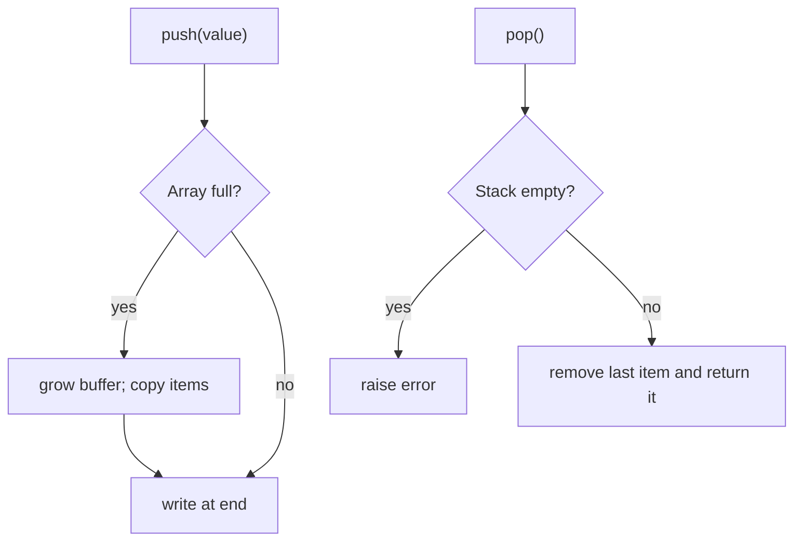

# Stacks

> **Module 05 · Data Structures & Algorithms** · Prerequisites: [Linked Lists](07-Linked-Lists.md) · Next: [Queues](09-Queues.md)

---

## ⏱ If You Only Have 2 Minutes

- A stack is **LIFO**: last in, first out. You add (`push`) and remove (`pop`) at the same end, and you read (`peek`) that same end.
- `push`, `pop` and `peek` are O(1). In an array-backed stack, `push` is O(1) amortized, because the buffer grows now and then.
- Build it on the end of an array (`Array` in JavaScript, `list` in Python). Adding or removing at the front of an array is O(n).
- The program's **call stack** is a stack. Every function call pushes a frame, and every return pops one. Deep recursion uses that stack, so it can overflow.
- Bracket matching and reverse Polish notation both use a stack: push what you have not finished, and pop when you can close it.
- Always check for an empty stack before `pop` or `peek`. Also check that the stack is empty at the end of a bracket scan, or `"((("` looks valid.

---

## 1. What It Is and Why It Exists

A **stack** is a collection with one open end. You can put an item on the top (`push`), take the top item off (`pop`), or look at the top item without removing it (`peek`). The last item you pushed is always the first one you pop. The name comes from a stack of plates: you add and take plates from the top.

**Analogy:** a pile of unfinished tasks on a desk. You always pick up the one on top, which is the most recent. When you finish it, the one underneath becomes the current task. A new interruption goes on the top and waits its turn.

**The problem it solves.** Many algorithms need to remember "where was I?" and return to the most recent unfinished step. Parsing a nested expression is one example: a `(` you have not closed yet must wait for its `)`. Depth-first search is another: the nodes you have started but not finished must be remembered in reverse order. A stack holds exactly that. Its O(1) operations at one end make it the cheapest way to keep such a list.

**The cost.** A stack gives you no access to the middle. If you need to read items by position or search them, a stack is the wrong tool. You can always search, but you do it by walking the whole stack.

---

## 2. How It Works

### Trace: checking `({[]})` with a stack

The rule: each opening bracket is pushed. Each closing bracket must match the bracket on top of the stack, which is then popped. The string is valid when every character has been handled and the stack is empty.

| Character | Action | Stack (top on the right) |
|---|---|---|
| `(` | Push | `(` |
| `{` | Push | `( {` |
| `[` | Push | `( { [` |
| `]` | Top is `[`, matches: pop | `( {` |
| `}` | Top is `{`, matches: pop | `(` |
| `)` | Top is `(`, matches: pop | empty |

The stack is empty at the end, so the string is valid. Change the last `)` to `]`, and the top is `(`, which does not match `]`, so the answer is invalid.

### Trace: evaluating `2 1 + 3 *` in reverse Polish notation

In reverse Polish notation (RPN), the operator comes after its operands. Numbers are pushed. An operator pops two operands and pushes the result.

| Token | Action | Stack (top on the right) |
|---|---|---|
| `2` | Push number | `2` |
| `1` | Push number | `2 1` |
| `+` | Pop `1` and `2`, push `2 + 1` | `3` |
| `3` | Push number | `3 3` |
| `*` | Pop `3` and `3`, push `3 * 3` | `9` |

The result is `9`, the only item left. The expression `(2 + 1) * 3` is the same calculation written in RPN, with no parentheses and no precedence rules to remember.

### Stack operations as a flowchart



### The call stack

When `main()` calls `f()`, the runtime pushes a **frame** for `f`. The frame holds `f`'s arguments, its local variables and the return address. When `f` returns, its frame is popped, and execution continues in `main`. Recursion pushes one frame per call, so a function that calls itself 10,000 times needs 10,000 frames at once. The stack has a fixed size, and the runtime stops the program when the limit is reached. In Node.js that is a `RangeError: Maximum call stack size exceeded`. In Python it is a `RecursionError`, when the recursion limit (1,000 by default) is passed.

---

## 3. Key Concepts

### LIFO order and the three operations

The defining rule is LIFO: the most recent item comes out first. Use a stack when the newest unfinished work is the next work to finish. Use a queue (FIFO) when the oldest item should go first. The two are opposite, and picking the wrong one reverses the order of your results without any error message.

The three operations each touch one end only. `push` adds to the end, `pop` removes from it, and `peek` reads it. No operation moves any other item, so each is O(1) work, apart from an occasional buffer copy in an array-backed stack.

### Array-backed stacks in both languages

An array-backed stack keeps its items in an array, with the top at the last index. In JavaScript, `Array.prototype.push` and `pop` work at the end of the array, both amortized O(1). In Python, `list.append` and `list.pop()` do the same. Do not use `unshift` or `shift`, or `list.insert(0, x)` and `list.pop(0)`, to work at the top. Those move every item, so they are O(n).

The array grows by copying into a bigger buffer, as described in [Arrays](05-Arrays.md). That copy is the only O(n) step, and it happens rarely. Some implementations also shrink the buffer when it is mostly empty. The chapter's code does not shrink, so `pop` is always O(1).

A linked-list stack is also possible. Push and pop at the head are O(1), with no copies at all. It uses more memory per item and has poorer cache locality. Most code uses the array version.

### The call stack connection

Every recursive function is a stack in disguise. You can turn any recursion into a loop with an explicit stack that you manage yourself. Depth-first search does this: push the start node, then repeatedly pop a node, process it, and push its unvisited neighbours. The result visits the same nodes, but the explicit stack lives on the heap, so its size is limited by memory and not by the runtime's call stack limit. This matters when the input can be very deep, such as a long chain of parent links or deeply nested JSON.

### Common uses

- **Undo.** Each action is pushed. Undo pops the most recent action and reverses it.
- **Parsing.** Matching brackets, quotes and nested tags. The stack holds the openers that still need a closer.
- **Expression evaluation.** Infix expressions such as `3 + 4 * 2` can be converted to RPN with a stack (the shunting-yard algorithm), and RPN is evaluated with a stack.
- **Depth-first search.** Explicit stacks replace recursion for large graphs and trees. See [Depth First Search](22-Depth-First-Search.md).
- **Monotonic stacks.** A stack that keeps items in sorted order finds the next greater element in O(n). See [Monotonic Stack](39-Monotonic-Stack.md).

### Complexity table

| Operation | Best | Average | Worst | Extra space | Why |
|---|---|---|---|---|---|
| `push` | O(1) | O(1) amortized | O(n) | O(1) amortized | Usually writes one slot; occasionally copies the buffer when it is full |
| `pop` | O(1) | O(1) | O(1) | O(1) | Removes the last slot; the code never shrinks the buffer |
| `peek` | O(1) | O(1) | O(1) | O(1) | Reads the last slot |
| `isEmpty` / `size` | O(1) | O(1) | O(1) | O(1) | The count is stored |
| Search for a value | O(1) if on top | O(n) | O(n) | O(1) | Must look at items one by one from the top |
| Whole stack | O(n) | O(n) | O(n) | O(n) | One slot per item |

Pushes are amortized O(1), not O(1) in every case. A single push can cost O(n) when the buffer doubles, but across many pushes the average stays constant.

---

## 4. Code Examples

Built-ins first.

- **JavaScript:** `Array` works as a stack with `push` and `pop`, both at the end. Its `at(-1)` method reads the top. Use `Array` for an in-memory stack in almost every case. There is no separate `Stack` class in the standard library.
- **Python:** `list` works as a stack with `append` and `pop()`, both at the end. `collections.deque(maxlen=n)` is useful for a bounded history, because appending to a full deque drops the item at the other end. Python has no separate `Stack` class in the standard library.

The first block in each language is a small typed stack class that checks for an empty stack. The second block solves two interview problems: valid parentheses, and evaluating reverse Polish notation with integers. Division truncates toward zero in both languages. Python's `//` operator rounds toward negative infinity, so the code uses `int(a / b)` instead.

### Node.js / TypeScript

```ts
// Array-backed stack. Node.js 22+, TypeScript 5, strict mode. No dependencies.
export class Stack<T> {
  private items: T[] = [];

  push(value: T): void {
    this.items.push(value);                 // amortized O(1): writes at the end of the array
  }

  pop(): T {
    if (this.items.length === 0) {
      // Array.prototype.pop returns undefined on empty input. Failing loudly here avoids
      // a silent undefined reaching the caller.
      throw new RangeError("pop from empty stack");
    }
    return this.items.pop() as T;
  }

  peek(): T {
    if (this.items.length === 0) throw new RangeError("peek on empty stack");
    return this.items[this.items.length - 1] as T;
  }

  isEmpty(): boolean {
    return this.items.length === 0;
  }

  get size(): number {
    return this.items.length;
  }

  // Returns the items from bottom to top, for tests and debugging.
  toArray(): T[] {
    return this.items.slice();
  }
}
```

**Interview problems**

```ts
// Problem 1: is the bracket string valid? Every opener must be closed by the same bracket
// type, in the right order. Characters other than brackets are ignored.
// Approach: push openers; on a closer, the top must be its matching opener.
// O(n) time, O(n) space in the worst case (all openers).
const MATCH = new Map<string, string>([[")", "("], ["]", "["], ["}", "{"]]);

export function isValidParentheses(s: string): boolean {
  const open: string[] = [];
  for (const ch of s) {
    if (ch === "(" || ch === "[" || ch === "{") {
      open.push(ch);
    } else if (MATCH.has(ch)) {
      // pop() returns undefined on an empty stack, which never equals an opener: invalid.
      if (open.pop() !== MATCH.get(ch)) return false;
    }
  }
  return open.length === 0;               // leftover openers are never closed
}

// Problem 2: evaluate a reverse Polish expression of integers, e.g. ["2", "1", "+", "3", "*"] = 9.
// Approach: push numbers; on an operator, pop two operands and push the result.
// O(n) time, O(n) space. Division truncates toward zero.
export function evalRPN(tokens: string[]): number {
  const stack: number[] = [];
  for (const tok of tokens) {
    if (tok === "+" || tok === "-" || tok === "*" || tok === "/") {
      if (stack.length < 2) throw new Error("malformed expression: operator needs two operands");
      const b = stack.pop() as number;     // the right operand is on top
      const a = stack.pop() as number;
      stack.push(applyOp(tok, a, b));
    } else {
      const n = Number(tok);
      if (tok === "" || !Number.isInteger(n)) throw new Error(`invalid token: "${tok}"`);
      stack.push(n);
    }
  }
  if (stack.length !== 1) throw new Error("malformed expression");
  return stack[0] as number;
}

function applyOp(op: string, a: number, b: number): number {
  switch (op) {
    case "+": return a + b;
    case "-": return a - b;
    case "*": return a * b;
    default:
      if (b === 0) throw new RangeError("division by zero");
      return Math.trunc(a / b);            // truncates toward zero, like most languages' integer division
  }
}

console.log(isValidParentheses("()[]{}"));    // true
console.log(isValidParentheses("({[]})"));    // true
console.log(isValidParentheses("(]"));        // false: wrong closer
console.log(isValidParentheses("((("));       // false: never closed
console.log(isValidParentheses(""));          // true: empty input
console.log(evalRPN(["2", "1", "+", "3", "*"]));   // 9
console.log(evalRPN(["4", "13", "5", "/", "+"]));  // 6  (13 / 5 truncates to 2)
console.log(evalRPN(["-7", "2", "/"]));            // -3
```

### Python

```python
# Array-backed stack. Python 3.12+, checked with mypy --strict.
class Stack[T]:
    def __init__(self) -> None:
        self._items: list[T] = []           # the top is the last element

    def __len__(self) -> int:
        return len(self._items)

    def is_empty(self) -> bool:
        return not self._items

    def push(self, value: T) -> None:
        self._items.append(value)           # amortized O(1): writes at the end of the list

    def pop(self) -> T:
        if not self._items:
            # list.pop() raises IndexError too, but this message says what went wrong.
            raise IndexError("pop from empty stack")
        return self._items.pop()

    def peek(self) -> T:
        if not self._items:
            raise IndexError("peek on empty stack")
        return self._items[-1]

    def to_list(self) -> list[T]:
        # Bottom to top, for tests and debugging. A copy, so callers cannot change the stack.
        return list(self._items)
```

**Interview problems**

```python
# Problem 1: is the bracket string valid? Every opener must be closed by the same bracket
# type, in the right order. Characters other than brackets are ignored.
# Approach: push openers; on a closer, the top must be its matching opener.
# O(n) time, O(n) space in the worst case (all openers).
MATCH = {")": "(", "]": "[", "}": "{"}


def is_valid_parentheses(s: str) -> bool:
    open_brackets: list[str] = []
    for ch in s:
        if ch in "([{":
            open_brackets.append(ch)
        elif ch in MATCH:
            # An empty stack means there is no opener to close, so the string is invalid.
            if not open_brackets or open_brackets.pop() != MATCH[ch]:
                return False
    return not open_brackets                 # leftover openers are never closed


# Problem 2: evaluate a reverse Polish expression of integers, e.g. ["2", "1", "+", "3", "*"] = 9.
# Approach: push numbers; on an operator, pop two operands and push the result.
# O(n) time, O(n) space. Division truncates toward zero.
OPS = {"+", "-", "*", "/"}


def apply_op(op: str, a: int, b: int) -> int:
    if op == "+":
        return a + b
    if op == "-":
        return a - b
    if op == "*":
        return a * b
    if b == 0:
        raise ZeroDivisionError("division by zero")
    return int(a / b)                        # truncates toward zero; // would round down


def eval_rpn(tokens: list[str]) -> int:
    stack: list[int] = []
    for tok in tokens:
        if tok in OPS:
            if len(stack) < 2:
                raise ValueError("malformed expression: operator needs two operands")
            b = stack.pop()                  # the right operand is on top
            a = stack.pop()
            stack.append(apply_op(tok, a, b))
        else:
            stack.append(int(tok))           # int() raises ValueError on a bad token
    if len(stack) != 1:
        raise ValueError("malformed expression")
    return stack[0]


print(is_valid_parentheses("()[]{}"))        # True
print(is_valid_parentheses("({[]})"))        # True
print(is_valid_parentheses("(]"))            # False: wrong closer
print(is_valid_parentheses("((("))           # False: never closed
print(is_valid_parentheses(""))              # True: empty input
print(eval_rpn(["2", "1", "+", "3", "*"]))   # 9
print(eval_rpn(["4", "13", "5", "/", "+"]))  # 6  (13 / 5 truncates to 2)
print(eval_rpn(["-7", "2", "/"]))            # -3
```

---

## 5. Production Concerns

- **Recursion depth.** A recursive walk over untrusted input uses one call-stack frame per level. Deep input can overflow the stack and crash the request, or the worker. Node throws `RangeError`, and Python raises `RecursionError` once the limit of 1,000 is passed. Convert the walk to an explicit stack, or cap the depth and reject deeper input.
- **Nesting attacks.** A parser that uses a stack grows it with every opener. A crafted request with a million `(` or `[` can use a lot of memory. Set a maximum nesting depth and reject input that goes past it, with a `400 Bad Request`.
- **Bounded history.** An undo stack keeps one entry per action. Without a limit, a long session grows the stack without end. Keep the last N entries, for example with `collections.deque(maxlen=N)`, and say so in the product.
- **Shared stacks.** A stack object that several requests use at the same time is a race condition. Create the stack inside the request or the parse, not as a module-level singleton.
- **Observability.** Record the maximum depth reached by a parser, and count the requests that hit the depth limit. A spike is a sign of abuse or a bad client.
- **Exceptions and cleanup.** If code pushes a resource (a lock, a transaction, a scope) and an error skips the pop, the stack is left wrong. Use `try`/`finally` in JavaScript and `with` or `try`/`finally` in Python to pair every push with a pop.

---

## 6. Common Mistakes

- **Popping an empty stack without a check** — `Array.pop()` returns `undefined` and the bug surfaces far away — check `isEmpty()` before `pop` or `peek`, or throw a clear error.
- **Accepting `"((("` as valid** — the scan ends with openers still on the stack — return `stack.length === 0`, not just `true`.
- **Using the front of an array as the top** — `shift` or `pop(0)` moves every item on each call — use the end of the array as the top.
- **Using a stack where order must be first in, first out** — a stack returns the newest item first, which reverses the processing order — use a queue.
- **Using Python `//` for division in RPN** — `-7 // 2` is `-4`, but truncation toward zero gives `-3` — use `int(a / b)` for small integers, or handle the sign yourself.
- **Recursing on untrusted depth** — a crafted deep input crashes the process — use an explicit stack with a depth limit.
- **Forgetting that `peek` on an empty stack is an error** — the code reads garbage or throws in the middle of a parse — check first, and return a clear error to the caller.

---

## 7. Comparison Table

| Structure | Order | Push and pop | Memory layout | Typical use |
|---|---|---|---|---|
| Array-backed stack | LIFO | O(1) amortized at the end | Contiguous buffer | Default in-memory stack |
| Linked-list stack | LIFO | O(1) worst case at the head | One node per item | Stacks with no copy spikes and unpredictable sizes |
| Queue (`deque` used as FIFO) | FIFO | O(1) at both ends | Blocks of items | Job queues, breadth-first search |
| Call stack | LIFO (managed by the runtime) | Automatic on call and return | One fixed-size stack per thread | Function calls and recursion |

A stack and a queue use the same data, but they remove items from opposite ends. Choose by the order you need, not by the operation names.

---

## 8. Interview Questions

**[Junior] What does LIFO mean, and what does it cost to push, pop and peek?**
LIFO means last in, first out. The most recent item pushed is the first one popped. Push, pop and peek all work on the top, and each costs O(1). In an array-backed stack, push is O(1) amortized, because the buffer sometimes grows and copies its items. Pop and peek never copy anything.

**[Junior] Where does a stack appear inside a running program?**
Every thread has a call stack. Each function call pushes a frame with its arguments and local variables, and each return pops that frame. Recursion makes many frames at once, so deep recursion can overflow the stack. A program that needs a deep stack of its own can use an explicit array instead, which lives on the heap.

**[Mid] How do you check whether a string of brackets is valid, and what does it cost?**
Scan the string from left to right. Push each opening bracket. When you see a closing bracket, check that the stack is not empty and that its top is the matching opener, then pop it. At the end, the string is valid only if the stack is empty. The time is O(n), and the space is O(n) in the worst case, when every character is an opener.

**[Mid] Evaluate a reverse Polish expression such as `2 1 + 3 *`. How does it work?**
Push each number. When you see an operator, pop the two top numbers, apply the operator with the right operand on top, and push the result. At the end, exactly one number should remain. The time is O(n) and the space is O(n). The stack handles precedence without parentheses, because the order of the tokens already says what to compute first.

**[Senior] When would you write depth-first search with an explicit stack instead of recursion?**
Use an explicit stack when the depth can be large or unknown, such as a long chain of parent links or user-supplied nested data. Recursion uses the runtime's call stack, which is small and fixed, so a deep input can crash the process. An explicit stack lives on the heap and is limited only by memory. You can also add a depth or size limit and report a clean error. The explicit version visits the same nodes in the same order, so you do not give up correctness to get safety.

**[Senior] A JSON-like parser crashes with a stack overflow on a crafted request. How do you diagnose and fix it?**
The crash means the parser recurses once per nesting level, and the request nests deeper than the call stack allows. Confirm it with a test that nests a few thousand levels. The fix has two parts. Move the parser to an explicit stack, or keep recursion and add a maximum depth that is checked before each push. Reject deeper input with a `400 Bad Request`, and log the depth as a metric. Also review the body size limit, because the same attack can send a large, shallow payload.

**[Senior] Design an undo history that uses bounded memory.**
Store each action as a command object with an undo method, in a double-ended structure with a maximum length. Undo pops from the newest end. When the stack is full, the oldest command must be dropped from the other end, so use `deque(maxlen=N)` in Python or a ring buffer in JavaScript. Store only the data needed to undo each action, not a full copy of the document, or the history will use too much memory. Say in the product how many steps are kept.

---

## 9. Cheat Sheet

```text
LIFO            last in, first out; one open end
Operations      push, pop, peek: O(1); push amortized in an array
Array as stack  top = end of the array; never shift or unshift
Call stack      one frame per call; recursion depth limited by the runtime
Node limit      RangeError: Maximum call stack size exceeded
Python limit    RecursionError past sys.getrecursionlimit() (1,000 by default)
Explicit stack  same DFS order, limited by memory, not the call stack
Brackets        push openers; closer must match top; valid if empty at the end
RPN             push numbers; operator pops two, pushes result; one value left
Division        truncate toward zero; Python // rounds down, so use int(a / b)
Empty stack     check before pop or peek; leftover openers mean invalid
Bounded history deque(maxlen=N) keeps the newest N entries
Never           recurse on untrusted depth without a limit
```

---

## Related Topics

- [Recursion](23-Recursion.md) — how each call uses a frame, and how to convert recursion to a loop with a stack.
- [Queues](09-Queues.md) — the FIFO counterpart, with the same data but the opposite order.
- [Monotonic Stack](39-Monotonic-Stack.md) — a stack that keeps its items sorted, for next-greater-element problems.
- [Stack Memory](../Module-04-Operating-Systems/23-Stack-Memory.md) — how the OS lays out the call stack for each thread.
