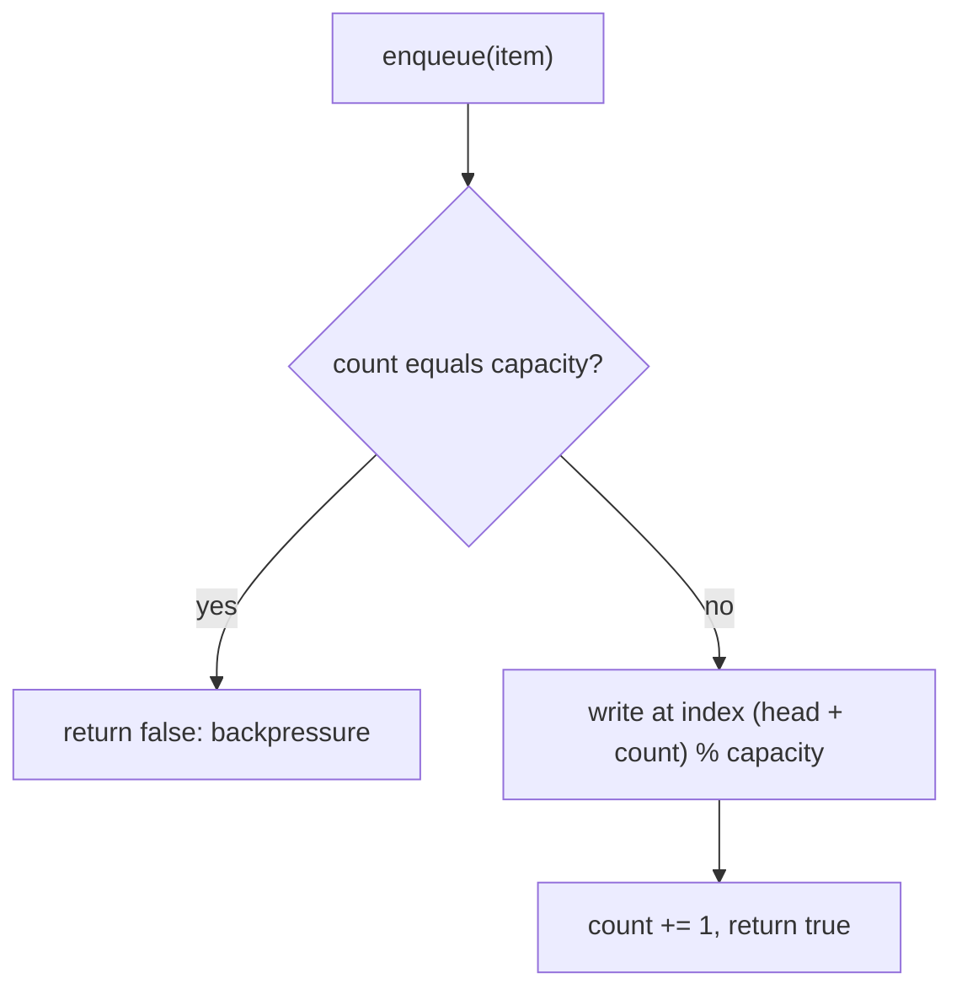

# Queues

> **Module 05 · Data Structures & Algorithms** · Prerequisites: [Stacks](08-Stacks.md) · Next: [Deque](10-Deque.md)

---

## ⏱ If You Only Have 2 Minutes

- A queue is **FIFO** (first in, first out). Items leave in the order they arrived. The two operations are `enqueue` (add at the back) and `dequeue` (remove from the front).
- Both operations should be O(1). A plain array is O(1) at the end but O(n) at the front, because removing the first item shifts every other item one slot left.
- For a fixed-size queue, use a **ring buffer** (a circular array with a head index and a count). Nothing moves, memory never grows, and "full" is a clear state.
- In Python, use `collections.deque` for an in-process queue. `list.pop(0)` is O(n) and is a common interview trap.
- A **bounded** queue is a backpressure tool. When it is full, the producer must wait, retry, or get a rejection such as HTTP 429. An unbounded queue hides overload until memory runs out.
- Job queues (BullMQ on Redis, Celery with a broker, Amazon SQS) let a request return quickly while a worker does slow work later. Most brokers deliver at least once, so job handlers must be idempotent.
- Two interview problems use queues: a queue built from two stacks (amortized O(1)), and counting recent calls in a sliding time window.

---

## 1. What It Is and Why It Exists

A **queue** is a collection with two main operations. `enqueue(x)` adds `x` at the back. `dequeue()` removes and returns the item at the front. The rule is called **FIFO**, which stands for first in, first out.

**Analogy:** a checkout line. New customers join at the end, and the cashier serves the person at the front. Nobody can cut in, so the wait is fair and easy to predict.

**The problem it solves.** Work often arrives faster than it can be done, or it must be done in the order it arrived. Without a queue, a web handler that receives "send welcome email" has two bad choices. It can send the email before replying, which makes the response slow. Or it can drop the task if the mail server is down. A queue sits between the two parts. The request handler puts a message in the queue and returns. A worker takes the message later, at its own pace, and can retry if something fails.

Queues also appear inside algorithms. Breadth-first search (see [Breadth First Search](21-Breadth-First-Search.md)) uses a queue to visit nodes level by level. An operating system's run queue and a network card's packet buffer use the same idea.

---

## 2. How It Works

### A ring buffer, step by step

An array has a fixed end at the back and a fixed start at the front. To make dequeue fast, we do not move the front. Instead we keep three values:

- `buf`: a fixed array with `capacity` slots.
- `head`: the index of the front item.
- `count`: how many items are stored now.

The back of the queue is at index `(head + count) % capacity`. The `%` (modulo) wraps the index around to the start of the array when it reaches the end. This is why it is called a **ring** or **circular** buffer.

- **enqueue** writes to the back slot and adds 1 to `count`. If `count` equals `capacity`, the queue is full, and enqueue should refuse the item.
- **dequeue** reads the slot at `head`, clears it, moves `head` forward by one (with wrap-around), and subtracts 1 from `count`. Nothing else moves.

Here is a trace with capacity 4, starting empty. Slots are shown as `buf[0] buf[1] buf[2] buf[3]`, where `_` means empty.

| Step | Operation | Returned | head | count | buf |
|---|---|---|---|---|---|
| 1 | enqueue(A) | true | 0 | 1 | `A _ _ _` (wrote slot 0) |
| 2 | enqueue(B) | true | 0 | 2 | `A B _ _` (wrote slot 1) |
| 3 | enqueue(C) | true | 0 | 3 | `A B C _` (wrote slot 2) |
| 4 | dequeue() | A | 1 | 2 | `_ B C _` (cleared slot 0) |
| 5 | enqueue(D) | true | 1 | 3 | `_ B C D` (wrote slot 3) |
| 6 | enqueue(E) | true | 1 | 4 | `E B C D` (wrote slot 0, wrap-around) |
| 7 | enqueue(F) | false | 1 | 4 | full, item refused |
| 8 | dequeue() | B | 2 | 3 | `E _ C D` (cleared slot 1) |

Step 6 shows the wrap-around. Step 7 shows the backpressure choice: the buffer does not overwrite old data. The caller learns that the queue is full and decides what to do.



### A queue from two stacks

Another way to build a queue uses two stacks (arrays used with push and pop). The **inbox** receives new items. The **outbox** serves dequeues. When the outbox is empty and someone dequeues, we move every item from the inbox to the outbox. Moving reverses their order, so the oldest item ends up on top of the outbox.

Each item moves from the inbox to the outbox at most once. Once in the outbox, it is popped and never moved again. So for a sequence of n operations, the total number of moves is at most n. The cost of the occasional big transfer is shared by the many cheap operations around it. This is **amortized** analysis: one dequeue can cost O(n), but the average over any sequence is O(1).

### An array with a head index

In JavaScript, a common shortcut is to keep a `head` index into a normal array. Dequeue reads `arr[head]` and increments `head`. The old slots stay in memory until you compact the array. This is simple and fast, but it can keep dead references alive, so compact it when `head` gets large.

---

## 3. Key Concepts

### FIFO and the two operations

Both operations must be O(1). If either one is O(n), a queue with a million items becomes slow in a loop that drains it. Keep this in mind when you choose a language's built-in type: the name "queue" does not promise O(1) dequeue.

### Why `shift()` and `pop(0)` are O(n)

Removing the first item of an array means every remaining item must move one slot to the left. That copy is O(n). In Python, `list.pop(0)` does exactly this, so draining a list of n items with `pop(0)` costs O(n²) in total. In JavaScript, the specification does not promise that `Array.prototype.shift()` is constant time. Some engines have optimizations for it, so it may look fast in a small test. Do not rely on that in a hot queue. Use a head index, a ring buffer, or a deque.

### Ring buffer (circular array)

A ring buffer has a fixed capacity, so its memory use is known in advance. It is common in network drivers, audio pipelines, and logging libraries. Its main risk is the full state. If you only compare `head` and `tail`, an empty and a full buffer look the same. Storing `count` solves that.

### Bounded queues and backpressure

**Backpressure** means a slow consumer slows down its producer instead of letting work pile up. A bounded queue gives you that signal. When it is full, you have to choose a policy:

| Policy | What happens | Use when |
|---|---|---|
| Block | Producer waits until a slot is free | Work can wait, and the producer is a thread or a coroutine |
| Reject | Enqueue returns an error; the API returns 429 or 503 | Clients can retry later, for example with `Retry-After` |
| Drop newest | The new item is discarded | Only the latest value matters and loss is acceptable |
| Drop oldest | The oldest item is evicted to make room | Recent data matters more than old data, such as live metrics |

HTTP 429 "Too Many Requests" is defined in [RFC 6585](https://www.rfc-editor.org/rfc/rfc6585). The `Retry-After` header is defined in [RFC 9110](https://www.rfc-editor.org/rfc/rfc9110).

### Job queues in backend systems

A **job queue** moves work from a request handler to a worker process. The message must survive a worker crash, so a job queue is usually backed by a broker. [Background Workers](../Module-02-Core-Backend/17-Background-Workers.md) covers the worker side in more detail. Three common options are BullMQ (a Node.js library that stores jobs in Redis), Celery (a Python task queue that uses RabbitMQ or Redis as its broker), and Amazon SQS (a managed queue service). Most of them deliver each message **at least once**. That means a message can be delivered twice, for example after a worker dies before it acknowledges the job. The handler must therefore be **idempotent**: running it twice must give the same result as running it once.

---

## 4. Code Examples

### Node.js / TypeScript

JavaScript has no queue class in its standard library. Use an array with `push` (O(1) at the end) for the back. For the front, use a head index or a ring buffer, not `shift()`, when the queue is hot. In the Node.js ecosystem, BullMQ provides a Redis-backed job queue with retries and delays. The code below uses a plain fixed-capacity ring buffer, which needs no locks because Node runs your JavaScript on one thread. Worker threads that share memory would need `Atomics` instead.

```ts
// No dependencies. Node.js 22+, TypeScript 5.
// A fixed-capacity FIFO queue. Enqueue refuses when full instead of overwriting,
// so the caller can apply backpressure.
export class RingQueue<T> {
  private readonly buf: (T | undefined)[];
  private head = 0;   // index of the front item
  private count = 0;  // number of stored items

  constructor(capacity: number) {
    if (!Number.isInteger(capacity) || capacity < 1) {
      throw new RangeError("capacity must be a positive integer");
    }
    this.buf = new Array<T | undefined>(capacity);
  }

  get size(): number {
    return this.count;
  }

  isEmpty(): boolean {
    return this.count === 0;
  }

  isFull(): boolean {
    return this.count === this.buf.length;
  }

  enqueue(item: T): boolean {
    if (this.isFull()) return false;
    const tail = (this.head + this.count) % this.buf.length;
    this.buf[tail] = item;
    this.count++;
    return true;
  }

  dequeue(): T | undefined {
    if (this.count === 0) return undefined;
    const item = this.buf[this.head];
    // Clear the slot. Otherwise the array keeps a reference and the GC cannot free the item.
    this.buf[this.head] = undefined;
    this.head = (this.head + 1) % this.buf.length;
    this.count--;
    return item;
  }

  peek(): T | undefined {
    return this.count === 0 ? undefined : this.buf[this.head];
  }
}
```

Two interview problems, solved with the code below:

- **Queue with two stacks.** Implement `enqueue` and `dequeue` using only push and pop on arrays. Approach: push to the inbox; when dequeuing from an empty outbox, move everything from the inbox. Complexity: O(1) amortized per operation, O(n) worst case for one dequeue, O(n) space.
- **Recent calls.** Each call `ping(t)` passes an increasing timestamp in milliseconds. Return how many pings happened in the last 3000 ms, including `t`. Approach: push each timestamp to a queue; drop timestamps older than `t - 3000` from the front. Complexity: O(1) amortized per ping, O(n) space in the worst case.

```ts
// Problem solutions. No dependencies.

// Queue with two stacks.
export class TwoStackQueue<T> {
  private readonly inbox: T[] = [];   // enqueue pushes here
  private readonly outbox: T[] = [];  // dequeue pops here; the order is already reversed

  get size(): number {
    return this.inbox.length + this.outbox.length;
  }

  enqueue(item: T): void {
    this.inbox.push(item);
  }

  dequeue(): T | undefined {
    // Refill only when the outbox is empty. Each item moves at most once, which gives amortized O(1).
    if (this.outbox.length === 0) {
      while (this.inbox.length > 0) {
        this.outbox.push(this.inbox.pop() as T);
      }
    }
    return this.outbox.pop();
  }
}

// Recent calls: count pings in the last 3000 ms.
export class RecentCounter {
  private readonly window: number[] = [];
  private head = 0;  // index of the oldest timestamp still inside the window

  ping(t: number): number {
    this.window.push(t);
    // Timestamps only grow, so the expired ones are always at the front.
    while (this.head < this.window.length) {
      const oldest = this.window[this.head] as number;
      if (oldest >= t - 3000) break;
      this.head++;
    }
    return this.window.length - this.head;
  }
}
```

### Python

Python has the best built-ins of the two languages. `collections.deque` gives O(1) appends and pops at both ends, and it accepts a `maxlen`. `queue.Queue` is a thread-safe queue with a `maxsize`, and its `put()` blocks when the queue is full. `asyncio.Queue` does the same for coroutines, with `await queue.put(item)`. Use `deque` when one thread or one coroutine owns the data. Use `queue.Queue` or `asyncio.Queue` when a producer must wait for a consumer. A `deque` is thread-safe for single appends and pops, but it does not block, so a consumer that uses it as a queue must poll.

Python 3.12 lets you write generic classes with the `class Name[T]:` syntax, which the examples use.

```python
# No third-party dependencies. Python 3.12+.
# A fixed-capacity FIFO queue. Enqueue refuses when full instead of overwriting,
# so the caller can apply backpressure.
class RingQueue[T]:
    def __init__(self, capacity: int) -> None:
        if capacity < 1:
            raise ValueError("capacity must be a positive integer")
        self._buf: list[T | None] = [None] * capacity
        self._head = 0    # index of the front item
        self._count = 0   # number of stored items

    def __len__(self) -> int:
        return self._count

    def is_full(self) -> bool:
        return self._count == len(self._buf)

    def enqueue(self, item: T) -> bool:
        if self.is_full():
            return False  # the caller decides: wait, retry, or reject
        tail = (self._head + self._count) % len(self._buf)
        self._buf[tail] = item
        self._count += 1
        return True

    def dequeue(self) -> T | None:
        if self._count == 0:
            return None
        item = self._buf[self._head]
        # Clear the slot so the buffer does not keep the object alive.
        self._buf[self._head] = None
        self._head = (self._head + 1) % len(self._buf)
        self._count -= 1
        return item
```

Two interview problems, solved with the code below:

- **Queue with two stacks.** Same statement as above. Approach and complexity are the same: amortized O(1) per operation, O(n) worst case for one dequeue, O(n) space.
- **Recent calls.** Same statement as above. Approach: a `deque` of timestamps; pop from the left while the oldest is outside the window. Complexity: O(1) amortized per ping, O(n) space.

```python
# Problem solutions. Standard library only.
from collections import deque


class TwoStackQueue[T]:
    def __init__(self) -> None:
        self._inbox: list[T] = []   # enqueue appends here
        self._outbox: list[T] = []  # dequeue pops here; the order is already reversed

    def __len__(self) -> int:
        return len(self._inbox) + len(self._outbox)

    def enqueue(self, item: T) -> None:
        self._inbox.append(item)

    def dequeue(self) -> T | None:
        # Refill only when the outbox is empty. Each item moves at most once: amortized O(1).
        if not self._outbox:
            while self._inbox:
                self._outbox.append(self._inbox.pop())
        return self._outbox.pop() if self._outbox else None


class RecentCounter:
    def __init__(self) -> None:
        self._calls: deque[int] = deque()

    def ping(self, t: int) -> int:
        self._calls.append(t)
        # Timestamps only grow, so the expired ones are always at the left end.
        while self._calls and self._calls[0] < t - 3000:
            self._calls.popleft()
        return len(self._calls)
```

---

## 5. Production Concerns

- **Bound the queue and watch its depth.** An unbounded queue turns a traffic spike into a memory leak. Set a maximum length, define the full policy from the table in section 3, and alert when the depth rises for a long time.
- **Alert on the age of the oldest message, not only the depth.** Ten thousand jobs that finish in one second are fine. Ten jobs that have waited an hour are not. Export the time the oldest job has been waiting.
- **Plan for retries and poison messages.** A job that always fails gets retried again and again, and each attempt uses a worker slot. Limit the number of attempts, then move the job to a dead-letter queue for a person to inspect.
- **Make handlers idempotent.** Store an idempotency key (for example the job ID) and check it before doing a side effect such as charging a card. Without that, a redelivered job charges the customer twice.
- **Ordering is only guaranteed for one consumer.** FIFO order holds inside one queue read by one consumer. With several workers, retries, or redelivery, the order of completion is not guaranteed. Only rely on order when the design needs it, and say so.
- **In-memory queues are lost on crash.** A ring buffer or a `deque` lives in one process. If the process dies, the items are gone. Use a durable broker when losing work is not acceptable.
- **Use blocking queues with care.** In Python, `queue.Queue.put()` blocks the calling thread. A blocked request handler can starve a thread pool. In an async service, `await queue.put()` pauses only that coroutine, but a full queue still holds memory.

---

## 6. Common Mistakes

- **Using `list.pop(0)` or `shift()` in a loop** — each call moves every remaining item, so draining n items costs O(n²) — use `collections.deque`, a ring buffer, or a head index.
- **An unbounded queue in front of a slow worker** — memory grows until the process is killed — set a `maxsize` and decide what to do when it is full.
- **Not clearing dequeued slots** — the buffer keeps old objects alive, which looks like a memory leak — set the slot to `undefined` or `None` after reading it.
- **Confusing full and empty in a ring buffer** — `head == tail` is true in both states — keep a `count`, or always leave one slot empty.
- **Assuming exactly-once delivery** — a redelivered job charges a customer twice — make the handler idempotent with a stored key.
- **Retrying a failing message forever** — one poison message keeps a worker busy — cap the attempts and send the message to a dead-letter queue.
- **Polling a `deque` as a blocking queue** — a consumer loop with `while not dq: pass` burns CPU — use `queue.Queue` or `asyncio.Queue`, which wait for you.

---

## 7. Comparison Table

| Option | Enqueue | Dequeue | Bounded | Safe to share | Use when |
|---|---|---|---|---|---|
| Array with `shift()` / `list.pop(0)` | O(1) amortized | O(n) | No | No | Small or cold code only |
| Array with head index (JS) | O(1) amortized | O(1) amortized | No | No (one thread) | Simple JS queue; compact it occasionally |
| Ring buffer | O(1) | O(1) | Yes, fixed size | No (add a lock or `Atomics`) | Fixed memory, predictable behaviour |
| `collections.deque` (Python) | O(1) | O(1) | Yes, with `maxlen` (drops) | Single appends and pops are thread-safe | In-process Python queue, sliding windows |
| `queue.Queue` / `asyncio.Queue` | O(1) | O(1) | Yes, with `maxsize` (blocks) | Yes (threads / async tasks) | Producer and consumer in one Python process |
| Redis-backed queue (BullMQ) | One network call | One network call | Configurable | Yes, across hosts | Work shared by many worker processes |
| Managed queue (Amazon SQS) | One API call | One API call | Retention and size limits | Yes, across services | Decoupling services; at-least-once delivery |

Complexity is per operation. Network queues add latency that no Big-O analysis shows, so measure end to end.

---

## 8. Interview Questions

**[Junior] What does FIFO mean, and what are the two basic queue operations?**
FIFO means first in, first out: the item that waited longest leaves first. `enqueue` adds an item at the back and `dequeue` removes the item at the front. A good queue does both in O(1) time. A stack, by contrast, is LIFO, where the last item in is the first out.

**[Junior] Why is `list.pop(0)` slow in Python?**
Removing the first element of a Python list means shifting all the remaining elements one slot to the left. That copy is O(n) for every call. Draining a queue this way costs O(n²) in total. Use `collections.deque`, whose `popleft()` is O(1).

**[Mid] How would you implement a fixed-capacity queue?**
Use a ring buffer: an array of fixed size, a `head` index, and a `count`. The back is at `(head + count) % capacity`. Enqueue fails when `count` equals the capacity, and dequeue moves `head` forward with wrap-around. Both operations are O(1) and the memory never grows.

**[Mid] Implement a queue using two stacks. What is the complexity?**
Push new items onto an inbox stack. When a dequeue finds the outbox empty, pop every item from the inbox and push it to the outbox, which reverses the order so the oldest item is on top. Each item moves at most once, so each operation is amortized O(1). A single dequeue can still cost O(n) when it triggers the transfer.

**[Senior] A queue of outgoing emails grows without limit during a traffic spike. What do you change?**
First, bound the queue so memory cannot grow without limit, and choose a full policy. The API should reject new work with 429 or 503 and a `Retry-After` header, so clients slow down. Second, scale the workers and alert on the age of the oldest message, because age shows user impact better than depth. Third, check whether a single slow dependency, such as the mail provider, is the real bottleneck and add a timeout and retries with backoff for it.

**[Senior] The broker delivers each job at least once. How do you make sure a payment is charged once?**
Duplicate delivery is normal, so the handler must be idempotent. Give each payment a unique idempotency key, store it with the result in the same database transaction as the side effect, and check it before calling the payment provider. The provider API should accept the same key so that a retried request returns the original result. Exactly-once behaviour comes from combining at-least-once delivery with idempotent handling, not from the broker alone.

**[Senior] Why should a bounded ring buffer reject new items instead of overwriting the oldest?**
Overwriting silently drops work that was accepted, so the producer never learns that the system is overloaded. Rejecting keeps every accepted item and gives the caller a signal to slow down, retry, or shed load. Overwrite is the right choice only for data where the newest value replaces the old one, such as the latest sensor reading or a live metric. Make that choice explicit in the design, because the default hides the loss.

---

## 9. Cheat Sheet

```text
FIFO          enqueue at back, dequeue at front; both must be O(1)
Array         push/pop at the end are O(1); shift() / pop(0) are O(n)
Ring buffer   index = (head + count) % capacity; keep count to tell full from empty
Full policy   block | reject (429/503) | drop newest | drop oldest: choose on purpose
Two stacks    inbox push, outbox pop; move everything when outbox is empty; amortized O(1)
Python        collections.deque: append/popleft O(1), maxlen drops from the other end
Python        queue.Queue / asyncio.Queue: maxsize, put() waits when full
Index access  deque middle indexing is O(n); ring buffer indexing is O(1)
Job queues    BullMQ (Redis), Celery (broker), SQS: at-least-once delivery
Idempotency   store a key; check it before any side effect (charge, email, write)
Watch         queue depth and age of the oldest message; dead-letter after N attempts
```

---

## Related Topics

- [Stacks](08-Stacks.md) — the LIFO counterpart; two stacks build a queue.
- [Deque](10-Deque.md) — a queue that works at both ends, with a bounded variant for history.
- [Breadth First Search](21-Breadth-First-Search.md) — the queue is the frontier of BFS.
- [Priority Queue](13-Priority-Queue.md) — when work should be served by priority, not arrival order.
- [Background Workers](../Module-02-Core-Backend/17-Background-Workers.md) — how a backend consumes a job queue.
