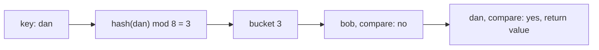

# Hash Tables

> **Module 05 · Data Structures & Algorithms** · Prerequisites: [Deque](10-Deque.md) · Next: [Hash Sets](12-Hash-Sets.md)

---

## ⏱ If You Only Have 2 Minutes

- A **hash table** maps a key to a value. A **hash function** turns the key into a number, and the number picks a **bucket** (a slot in an array).
- Lookup, insert and delete take **O(1) expected** time and **O(n) worst** time. The worst case happens when many keys land in the same bucket.
- Two ways to handle a **collision** (two keys in one bucket): **separate chaining** (each bucket holds a list) and **open addressing** (look for the next free slot, such as with linear probing).
- The **load factor** is `entries / buckets`. When it passes a limit (often 0.75), the table doubles and rehashes everything. Resizing costs O(n), but doubling makes the average insert O(1) **amortized**.
- Attackers can pick keys that all collide and slow a server down to O(n) per request. Python randomizes its string hashes with a keyed hash such as SipHash, which an attacker cannot predict.
- JavaScript `Map` keeps insertion order and accepts any key type. A plain object coerces keys to strings and has inherited properties such as `toString`. Python `dict` keeps insertion order (guaranteed since Python 3.7).
- Interview problems: two sum, and group anagrams. Both are one pass with a hash map.

---

## 1. What It Is and Why It Exists

A **hash table** stores pairs of a **key** and a **value** and finds a value from its key without scanning. Think of a coat check. You hand over a coat and get a ticket. The ticket number tells the attendant which hook to use. To get the coat back, you show the ticket, and the attendant goes straight to the hook. You never search every hook.

A hash table does the same thing with a **hash function**. The function takes a key such as `"user:42"` and returns an integer. The table uses that integer, modulo the number of buckets, as the index of an array slot. Finding a key means computing the hash, going to one bucket, and comparing a few keys in it.

**The problem it solves.** A plain array finds an item in O(1) only if you know its index. A sorted array or a balanced tree finds an item in O(log n), which is fast, but not constant. Many backend lookups need constant time on a large set: a session by its token, a user by ID, a cache entry by URL, a rate-limit counter by client IP. A hash table gives that speed.

---

## 2. How It Works

### A chaining table, step by step

To make the mechanism visible, this trace uses a **toy hash function**: the sum of the character codes of the key. It is easy to check by hand but poor in practice. The code in section 4 uses a better function. The trace starts with 4 buckets. Each key goes into the bucket `hash(key) mod buckets`.

| Step | Operation | Hash and bucket | Buckets after the step | Size / load factor |
|---|---|---|---|---|
| 1 | put "ann" | 317 mod 4 = 1 | 1: [ann] | 1 / 0.25 |
| 2 | put "bob" | 307 mod 4 = 3 | 1: [ann], 3: [bob] | 2 / 0.50 |
| 3 | put "cy" | 220 mod 4 = 0 | 0: [cy], 1: [ann], 3: [bob] | 3 / 0.75 |
| 4a | resize 4 to 8 (inserting "dan" would make load 1.00) | rehash every key with mod 8 | 3: [bob], 4: [cy], 5: [ann] | 3 / 0.375 |
| 4b | put "dan" | 307 mod 8 = 3, collides with "bob" | 3: [bob, dan], 4: [cy], 5: [ann] | 4 / 0.50 |
| 5 | get "ann" | 317 mod 8 = 5, one comparison | returns the value | 4 / 0.50 |
| 6 | get "dan" | 307 mod 8 = 3, two comparisons | returns the value | 4 / 0.50 |

Step 4a shows the resize. The index of a key depends on the number of buckets, so every key must be moved. Step 4b shows a collision: "bob" and "dan" share bucket 3 and form a chain. Steps 5 and 6 show the cost of a lookup: one hash, then a short scan of one bucket.



### Collisions: two ways to handle them

A **collision** happens when two different keys map to the same index. Every real hash table has collisions, because there are far more possible keys than buckets.

- **Separate chaining.** Each bucket holds a small list (a chain) of entries. Lookup scans the chain. This is simple, deletes are easy, and the table can exceed its bucket count without breaking, because chains just get longer.
- **Open addressing.** All entries live in one array. On a collision, the insert probes the next slot (linear probing: index + 1, + 2, and so on) until it finds a free one. Lookup follows the same probe sequence. Deletes need a special **tombstone** marker so that later lookups do not stop early. This layout is more cache-friendly, but it needs a lower load factor to stay fast.

### Load factor and resizing

The **load factor** is `α = entries / buckets`. With separate chaining, `α` is the average chain length. The expected cost of a lookup is O(1 + α), so the table keeps `α` below a limit, usually 0.75 for chaining or 0.5 to 0.75 for open addressing.

When an insert would push `α` past the limit, the table allocates twice as many buckets and moves every entry. One resize costs O(n). But after a resize the table has room for n more inserts before the next one. Adding up the costs over n inserts gives at most about 2n element moves in total. Divide by n inserts and you get O(1) **amortized** per insert. A single insert can still take O(n) when it triggers a resize, so latency-sensitive code may need to think about that pause.

---

## 3. Key Concepts

### Hash functions

A good hash function spreads keys evenly over the buckets and is fast to compute. It must be deterministic inside one process: the same key must always give the same hash, or lookups fail. Non-cryptographic functions such as FNV-1a or MurmurHash are fine for ordinary tables. They are **not** safe when an attacker chooses the keys, because the attacker can compute which keys collide.

### Expected O(1) vs worst-case O(n)

The O(1) bound is an **expected** bound. It assumes the hash spreads keys evenly, so each chain is short. In the worst case, every key lands in one bucket. Then a lookup scans all n entries and costs O(n). That is what a hash-flooding attack exploits, as described below. In an interview, always say "O(1) expected, O(n) worst case", and say why.

### Hash flooding and randomized hashing

In 2011, researchers showed that an HTTP server could be slowed to a crawl by sending a POST request with thousands of form fields whose names collided in the server's hash table. Each insert then cost O(n), so the whole request cost O(n²). The fix in most languages is **randomized hashing**: the hash function uses a random seed chosen when the process starts. Python does this for `str` and `bytes` keys with a **keyed hash such as SipHash**. An attacker who does not know the seed cannot build a colliding set of keys in advance. The seed is set by the `PYTHONHASHSEED` environment variable, and you can set it to a fixed value for reproducible tests.

### JavaScript `Map` vs plain objects

| | `Map` | Plain object (`{}`) |
|---|---|---|
| Key types | Any value, including objects and numbers | Strings and symbols (others are converted to strings) |
| Iteration order | Insertion order, for all keys | Integer-like keys first in ascending order, then strings in insertion order |
| Inherited keys | None | Yes: `"toString"`, `"constructor"` and `"__proto__"` exist on every object |
| Size | `map.size`, O(1) | `Object.keys(obj).length`, O(n) |
| Frequent add and delete | Designed for it | Works, but engines may slow down objects that change shape often |

Use `Map` for dictionaries built from data. Use an object only for a fixed record with known field names.

### Python `dict` order

Since Python 3.7, a `dict` keeps insertion order, and this is a language guarantee. Internally, CPython's `dict` uses open addressing with a compact array of entries, so iteration follows insertion order. Deleting a key and adding it again moves it to the end. Do not rely on the position of a key after you change the dict, and do not use `dict` order to implement a priority.

---

## 4. Code Examples

### Node.js / TypeScript

Built-in: `Map<K, V>` is a hash table with insertion order, `size`, and any key type. It is the right choice for almost every JavaScript dictionary. The class below is a teaching implementation of separate chaining for string keys, so you can see the buckets. It uses FNV-1a, a simple non-cryptographic hash, and it doubles the bucket array when the load factor would exceed 0.75.

```ts
// No dependencies. Node.js 22+, TypeScript 5.
// A string-keyed hash map with separate chaining. For teaching, not for production:
// it does not defend against attacker-chosen keys (see Production Concerns).
type Entry<V> = { key: string; value: V };

export class ChainedHashMap<V> {
  private static readonly MAX_LOAD = 0.75;
  private buckets: Entry<V>[][];
  private count = 0;

  constructor(initialBuckets = 8) {
    this.buckets = ChainedHashMap.makeBuckets<V>(initialBuckets);
  }

  get size(): number {
    return this.count;
  }

  // FNV-1a, 32-bit. Math.imul keeps the multiplication in 32 bits; >>> 0 makes the result unsigned.
  private hash(key: string): number {
    let h = 0x811c9dc5;
    for (let i = 0; i < key.length; i++) {
      h ^= key.charCodeAt(i);
      h = Math.imul(h, 0x01000193);
    }
    return h >>> 0;
  }

  private indexFor(key: string): number {
    return this.hash(key) % this.buckets.length;
  }

  has(key: string): boolean {
    return this.buckets[this.indexFor(key)].some((e) => e.key === key);
  }

  get(key: string): V | undefined {
    return this.buckets[this.indexFor(key)].find((e) => e.key === key)?.value;
  }

  set(key: string, value: V): void {
    const existing = this.buckets[this.indexFor(key)].find((e) => e.key === key);
    if (existing) {
      existing.value = value;  // updating a key does not change the size
      return;
    }
    // Check before inserting. Resize first, then compute the index again, because it changed.
    if ((this.count + 1) / this.buckets.length > ChainedHashMap.MAX_LOAD) {
      this.resize(this.buckets.length * 2);
    }
    this.buckets[this.indexFor(key)].push({ key, value });
    this.count++;
  }

  delete(key: string): boolean {
    const bucket = this.buckets[this.indexFor(key)];
    const i = bucket.findIndex((e) => e.key === key);
    if (i === -1) return false;
    bucket.splice(i, 1);
    this.count--;
    return true;
  }

  private resize(newBucketCount: number): void {
    const old = this.buckets;
    this.buckets = ChainedHashMap.makeBuckets<V>(newBucketCount);
    // Every index depends on the bucket count, so every entry must move.
    for (const bucket of old) {
      for (const entry of bucket) {
        this.buckets[this.indexFor(entry.key)].push(entry);
      }
    }
  }

  private static makeBuckets<T>(n: number): Entry<T>[][] {
    return Array.from({ length: n }, () => []);
  }
}
```

Two interview problems, solved with the built-in `Map`:

- **Two sum.** Given an array of numbers and a target, return the indices of two different elements whose sum is the target, or `null`. Approach: scan once, and for each value look up `target - value` among the values seen so far. Complexity: O(n) expected time, O(n) space. Duplicates work: `[3, 3]` with target 6 returns `[0, 1]`.
- **Group anagrams.** Given a list of words, group the words that are anagrams of each other. Approach: use the sorted letters of each word as the key, and append the word to that key's group. Complexity: O(n · k log k) time for n words of length at most k, and O(n · k) space. Groups come out in the order their first word appears.

```ts
// Problem solutions. Uses the built-in Map, which is what you should use in practice.

// Two sum: return the indices of two different elements that add up to target.
export function twoSum(nums: readonly number[], target: number): [number, number] | null {
  const seen = new Map<number, number>();  // value -> index of its first occurrence
  for (let i = 0; i < nums.length; i++) {
    const j = seen.get(target - nums[i]);
    if (j !== undefined) return [j, i];
    seen.set(nums[i], i);  // store after the check, so an element never pairs with itself
  }
  return null;
}

// Group anagrams: words with the same letters (in any order) end up in one group.
export function groupAnagrams(words: readonly string[]): string[][] {
  const groups = new Map<string, string[]>();
  for (const word of words) {
    const key = [...word].sort().join("");  // every anagram has the same sorted letters
    const group = groups.get(key);
    if (group) {
      group.push(word);
    } else {
      groups.set(key, [word]);
    }
  }
  return [...groups.values()];
}
```

### Python

Built-in: `dict` is a hash table with insertion order (guaranteed since 3.7). `set` is a hash set, covered in [Hash Sets](12-Hash-Sets.md). Python hashes `str` keys with a per-process random seed, as described in section 3. The class below is the same teaching design as the TypeScript one, with Python's 3.12 generic syntax. It uses FNV-1a on the UTF-8 bytes of the key, masked to 32 bits.

```python
# Standard library only. Python 3.12+.
# A string-keyed hash map with separate chaining. For teaching, not for production:
# use dict, which is faster and resists hash flooding through its keyed hash.
class ChainedHashMap[V]:
    MAX_LOAD = 0.75

    def __init__(self, initial_buckets: int = 8) -> None:
        self._buckets: list[list[tuple[str, V]]] = [[] for _ in range(initial_buckets)]
        self._count = 0

    def __len__(self) -> int:
        return self._count

    @staticmethod
    def _hash(key: str) -> int:
        # FNV-1a, 32-bit. The mask keeps the value in 32 bits, as the multiplication grows it.
        h = 0x811C9DC5
        for byte in key.encode("utf-8"):
            h ^= byte
            h = (h * 0x01000193) & 0xFFFFFFFF
        return h

    def _index(self, key: str) -> int:
        return self._hash(key) % len(self._buckets)

    def get(self, key: str) -> V | None:
        for k, v in self._buckets[self._index(key)]:
            if k == key:
                return v
        return None

    def set(self, key: str, value: V) -> None:
        bucket = self._buckets[self._index(key)]
        for i, (k, _) in enumerate(bucket):
            if k == key:
                bucket[i] = (key, value)  # update in place; size does not change
                return
        # Resize first, then compute the index again, because the bucket count changed.
        if (self._count + 1) / len(self._buckets) > self.MAX_LOAD:
            self._resize(len(self._buckets) * 2)
        self._buckets[self._index(key)].append((key, value))
        self._count += 1

    def delete(self, key: str) -> bool:
        bucket = self._buckets[self._index(key)]
        for i, (k, _) in enumerate(bucket):
            if k == key:
                del bucket[i]
                self._count -= 1
                return True
        return False

    def _resize(self, new_bucket_count: int) -> None:
        old = self._buckets
        self._buckets = [[] for _ in range(new_bucket_count)]
        # Every index depends on the bucket count, so every entry must move.
        for bucket in old:
            for key, value in bucket:
                self._buckets[self._index(key)].append((key, value))
```

Two interview problems, solved with the built-in `dict`. They are the same problems as in TypeScript:

- **Two sum.** Same statement as above. Approach: a dict from value to index, checked before each insert. Complexity: O(n) expected time, O(n) space.
- **Group anagrams.** Same statement as above. Approach: `"".join(sorted(word))` as the key, and `setdefault` to create or fetch the group. Complexity: O(n · k log k) time, O(n · k) space.

```python
# Problem solutions. Standard library only.
from collections.abc import Sequence


def two_sum(nums: Sequence[int], target: int) -> tuple[int, int] | None:
    seen: dict[int, int] = {}  # value -> index of its first occurrence
    for i, value in enumerate(nums):
        j = seen.get(target - value)
        if j is not None:
            return (j, i)
        seen[value] = i  # store after the check, so an element never pairs with itself
    return None


def group_anagrams(words: Sequence[str]) -> list[list[str]]:
    groups: dict[str, list[str]] = {}
    for word in words:
        key = "".join(sorted(word))  # every anagram has the same sorted letters
        groups.setdefault(key, []).append(word)
    return list(groups.values())  # dict order: groups appear in first-seen order
```

---

## 5. Production Concerns

- **Hash flooding (denial of service).** If a server stores attacker-controlled keys in a table, such as form field names, query parameters or JSON object keys, an attacker can send keys that all collide. Use a language or library version with randomized hashing, and cap the number of keys per request (for example, the number of form fields or JSON properties). A cap turns an O(n²) attack into a cheap rejection.
- **Unbounded growth.** A cache built on a hash table needs a size limit and an eviction policy. A `Map` without a limit grows until the process runs out of memory. See [LRU Cache](43-LRU-Cache.md) for a bounded design.
- **Resize pauses.** A resize copies every entry, so a table with ten million entries stalls for a noticeable time. Systems that need smooth latency, such as Redis, rehash incrementally, a few buckets per operation. Plan for the pause if you own a large in-process table.
- **Memory overhead.** Each chain node or entry object costs more than the key and value alone. Millions of small objects in a `Map` can use several times the memory of the raw data. Measure with `process.memoryUsage()` in Node, or `sys.getsizeof` and `tracemalloc` in Python.
- **Key equality and mutation.** A key used in a hash table must not change while it is in the table. Mutating it changes its hash, and the entry becomes unreachable. Use immutable keys, such as strings or IDs.
- **Database hash indexes.** PostgreSQL supports hash indexes for equality lookups, and B-trees remain the default for most queries because they also support ranges and ordering. Choose the index type from the query pattern, not from the O(1) claim alone.

---

## 6. Common Mistakes

- **Saying "hash table lookup is O(1)" without the qualifier** — an interviewer hears "always O(1)" and asks about the worst case — say "O(1) expected, O(n) worst case, because collisions can pile up".
- **Using a plain object for arbitrary keys in JavaScript** — keys such as `"constructor"` or `"__proto__"` hit inherited properties — use `Map` for dictionaries, or `Object.create(null)` if you must use an object.
- **Mutating a key after inserting it** — the hash changes, so the entry cannot be found and cannot be deleted — use immutable keys.
- **Forgetting to recompute the index after a resize** — the entry goes into a bucket that is no longer its home, and lookups miss it — always compute the index after any resize.
- **Writing your own hash function for untrusted input** — simple functions are easy to attack — use the runtime's hash table, which randomizes its hashing.
- **Relying on the order of a Python `set`** — sets have no order guarantee, so results change between runs — use `dict` (ordered) or sort the output explicitly.
- **Iterating and inserting in the same loop** — inserts can trigger a resize, and the iteration may skip or repeat entries — collect the changes first, then apply them.

---

## 7. Comparison Table

| Structure | Lookup | Insert | Ordered by key | Use when |
|---|---|---|---|---|
| Hash table (`Map`, `dict`) | O(1) expected, O(n) worst | O(1) expected, amortized | No (insertion order only) | Lookup by exact key, the default choice |
| Balanced BST (sorted map) | O(log n) | O(log n) | Yes | Range queries, sorted iteration, predictable worst case |
| Sorted array | O(log n) by binary search | O(n) to insert | Yes | Read-heavy data that rarely changes |
| Array indexed by integer | O(1) worst | O(1) | By index | Keys are small dense integers |
| Trie | O(k) for key length k | O(k) | Yes (lexicographic) | Prefix search and autocomplete |

A hash table has the best average speed for exact lookups. A balanced tree is the choice when you need sorted order or a guaranteed worst-case bound. See [Balanced Trees](18-Balanced-Trees.md) for the tree side of this trade-off.

---

## 8. Interview Questions

**[Junior] What is a hash table, and what is its average lookup time?**
A hash table stores key–value pairs in an array of buckets. A hash function turns each key into an index, so a lookup computes the index and checks the few entries in that bucket. The average lookup time is O(1). The worst case is O(n), when all keys land in one bucket.

**[Junior] What is a collision, and how do hash tables handle it?**
A collision happens when two different keys produce the same bucket index. With separate chaining, each bucket holds a list, and lookup scans it. With open addressing, the insert probes for the next free slot, and lookup follows the same sequence. Chaining is simpler, and open addressing is more cache-friendly.

**[Mid] What is the load factor, and why does the table resize at a limit?**
The load factor is the number of entries divided by the number of buckets. As it grows, chains get longer and lookups slow down. When the load factor passes a limit, such as 0.75, the table doubles its buckets and reinserts every entry. The resize is O(n), but because the table doubles, the average insert over many operations is O(1) amortized.

**[Mid] Solve two sum in one pass. What is the complexity?**
Scan the array once and keep a map from each value to its index. For each element, look up `target - value` in the map. If it is there, return both indices. Otherwise, store the current value and continue. The time is O(n) expected and the space is O(n). Checking before storing prevents an element from pairing with itself.

**[Senior] How could an attacker slow down a service through its hash tables, and how do you defend against it?**
An attacker sends many keys that collide in the server's hash function, for example form field names or JSON properties. Each insert then scans a long chain, so a request with n keys costs O(n²) work. The defences are randomized hashing with a per-process seed, a keyed hash such as SipHash so the attacker cannot predict collisions, and limits on the number of keys per request. Rate limits and request size limits add further protection.

**[Senior] A service keeps a 50-million-entry in-memory map and sees latency spikes every few minutes. What do you check?**
First, check whether the spikes line up with a resize, because a resize copies every entry and blocks the thread. Pre-size the table if you know the expected count, so it never grows during traffic. Then check memory overhead: each entry carries object and pointer costs, so a compact layout or a store outside the process may be better. If the table is a cache, consider bounding it with eviction, or moving it to a store such as Redis that rehashes incrementally.

**[Senior] When would you choose a balanced tree over a hash table?**
Choose a balanced tree when you need sorted iteration, range queries such as "all orders between two dates", or a guaranteed O(log n) worst case. A hash table cannot answer "the smallest key greater than x" efficiently. It also has an O(n) worst case, which matters for hostile or unpredictable keys. For exact-match lookups on a large set where order does not matter, a hash table is usually faster.

---

## 9. Cheat Sheet

```text
Hash table    key -> hash -> index = hash mod buckets -> scan a short bucket
Expected      lookup, insert, delete: O(1) expected; O(n) worst (everything collides)
Chaining      each bucket is a list; resize when load factor > 0.75
Open address  one array; probe on collision; deletes need tombstones
Load factor   entries / buckets; doubling on resize makes inserts O(1) amortized
Resize        O(n) once; recompute every index with the new bucket count
Flooding      attacker-chosen keys collide -> O(n) per insert; use randomized hashing
Python        dict keeps insertion order (3.7+); str hashes use a keyed hash such as SipHash
JavaScript    Map: any key type, insertion order, size; object keys are strings only
Two sum       map value -> index; check target - value before storing value
Anagrams      key = sorted letters; group lists in a map
Always say    "O(1) expected, O(n) worst case, amortized for inserts with resizing"
```

---

## Related Topics

- [Hash Sets](12-Hash-Sets.md) — the same hashing machinery without values, for membership and deduplication.
- [Arrays](05-Arrays.md) — the bucket array and the amortized doubling used in every resize.
- [Balanced Trees](18-Balanced-Trees.md) — the O(log n) alternative when you need order.
- [LRU Cache](43-LRU-Cache.md) — a hash map combined with a linked list for bounded, O(1) caches.
- [Consistent Hashing Basics](44-Consistent-Hashing-Basics.md) — how hashing spreads keys across many servers.
