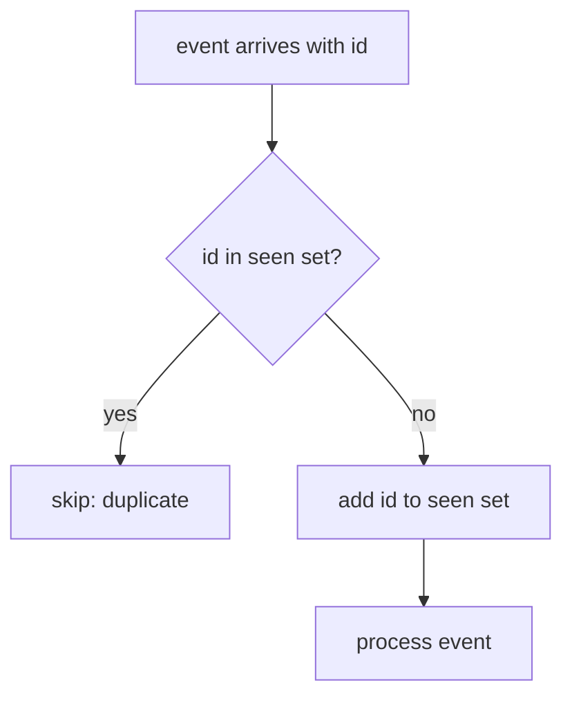

# Hash Sets

> **Module 05 · Data Structures & Algorithms** · Prerequisites: [Hash Tables](11-Hash-Tables.md) · Next: [Priority Queue](13-Priority-Queue.md)

---

## ⏱ If You Only Have 2 Minutes

- A **set** stores each element at most once. Its main question is "is this element here?", and a hash set answers it in **O(1) expected** time.
- A hash set is a hash table with no values. Everything in [Hash Tables](11-Hash-Tables.md) about hashing, collisions and resizing applies to it.
- **Set algebra**: union (A or B), intersection (A and B), difference (A but not B). Iterate over the smaller set when you intersect, so the cost is O(min(|A|, |B|)) expected.
- JavaScript `Set` keeps insertion order and compares values with **SameValueZero**: `NaN` equals `NaN`, and `+0` equals `-0`. Objects are compared by **reference**, so two objects with the same fields are two different members.
- Python `set` is unordered and needs its elements to be hashable. `frozenset` is an immutable set that can itself be a dict key or a set member. Custom classes need `__hash__` and `__eq__` that agree with each other.
- Backend uses: deduplicating events by ID, and tracking seen IDs with a TTL (in Redis, `SET key value NX EX seconds`).
- Interview problems: longest consecutive sequence, and the intersection of two arrays.

---

## 1. What It Is and Why It Exists

A **set** is a collection with no duplicates and no order that matters. You add an element, check whether it is present, and remove it. A **hash set** builds the set on top of a hash table, so each of those operations takes O(1) expected time.

**Analogy:** a guest list at the door. The guard does not care how many times a name was written down. The question is only "is this person on the list?" A paper list makes the guard read every line. A hash set is like a list where the guard can jump straight to the right name.

**The problem it solves.** Many backend and interview tasks need one of three things: remove duplicates, check membership quickly, or compare two groups. Scanning an array for each check costs O(n) per check, so checking n items costs O(n²). With a hash set, the whole job costs O(n). Membership checks are very common in real systems: has this event been processed, is this user banned, does this tag exist. Each one must be fast, because it happens on every request.

---

## 2. How It Works

### Deduplicating a stream step by step

The most common use is deduplication. Events arrive with IDs, and the same event can arrive twice, because most message systems deliver at least once. The rule is simple: process an ID only if the set does not have it yet, then add it.

The trace below uses the input `e1, e2, e1, e3, e2, e4`.

| Step | Input | In set before? | Action | Set after |
|---|---|---|---|---|
| 1 | e1 | no | process e1, add e1 | {e1} |
| 2 | e2 | no | process e2, add e2 | {e1, e2} |
| 3 | e1 | yes | skip (duplicate) | {e1, e2} |
| 4 | e3 | no | process e3, add e3 | {e1, e2, e3} |
| 5 | e2 | yes | skip (duplicate) | {e1, e2, e3} |
| 6 | e4 | no | process e4, add e4 | {e1, e2, e3, e4} |

Each step does one hash and one bucket check. The set never holds a value for the element, only the element itself.



### Set algebra with two sets

Take A = {1, 2, 3, 4} and B = {3, 4, 5}. The table shows each operation and the usual way to compute it with hash sets.

| Operation | Result | How it is computed |
|---|---|---|
| Union A ∪ B | {1, 2, 3, 4, 5} | Copy A, add every element of B |
| Intersection A ∩ B | {3, 4} | Iterate the smaller set; keep elements that the other set has |
| Difference A − B | {1, 2} | Iterate A; keep elements that B does not have |
| Symmetric difference A △ B | {1, 2, 5} | Elements in exactly one of the two sets |
| Subset: is A ⊆ B? | false (1 is missing from B) | Iterate A; every element must be in B |

Intersection iterates over the **smaller** set. If A has one element and B has a million, checking the one element against B costs O(1). The other order would cost a million checks.

### Why the hash set is O(1) expected

A hash set uses the same buckets, load factor and resizing as a hash table. Membership computes the hash, looks in one bucket, and compares a few elements. The O(1) bound is expected, not guaranteed. A bad hash function or hostile input can make every element collide, and then each check costs O(n), the same as a list scan.

---

## 3. Key Concepts

### Set semantics

A set has three rules. It holds at most one copy of each element, so adding an existing element changes nothing. Membership is the main query. Order is not part of the meaning, even if the implementation keeps one. Once you know these rules, the choice between a set and a list is clear: use a set when duplicates must be ignored, and a list when order or repeats matter.

### Equality and hashing for your own objects

A hash set needs two things from each element: a hash code, and an equality test. The two must agree. If two elements are equal, they must have the same hash. Otherwise a lookup can look in the wrong bucket and miss an element that is there.

| Language | What the set uses | What goes wrong by default |
|---|---|---|
| JavaScript `Set` | SameValueZero: `NaN` equals `NaN`; `+0` equals `-0`; objects compare by reference | Two objects with the same `id` are two members |
| Python `set` | `__hash__` and `__eq__` | Objects use identity by default, so equal-looking objects are separate |
| Python mutable class with `__eq__` | Defining `__eq__` sets `__hash__` to `None` | `TypeError: unhashable type` when added to a set |

To store objects by value in JavaScript, store a string key built from the fields (for example `${tenantId}:${eventId}`), or use a `Map` from the key to the object. In Python, a frozen dataclass (`@dataclass(frozen=True)`) generates `__hash__` and `__eq__` from its fields. A mutable object must not change its fields while it is in a set, because its hash would change too.

### Set algebra in code

Set algebra is a small set of loops. Union copies one set and adds the other. Intersection and difference iterate one set and test the other. Python provides these as operators (`|`, `&`, `-`, `^`) and methods (`issubset`, `isdisjoint`). JavaScript's `Set` has `add`, `has`, `delete` and iteration. Recent versions of the language (ES2025) add set methods such as `union` and `intersection`, but check your target runtime before you rely on them. The code in section 4 writes the operations out by hand.

### Time-limited membership (TTL sets)

A TTL (time to live) set remembers each element for a fixed time and then forgets it. It is the right tool for "have I seen this request in the last 10 minutes?" Keeping every ID forever grows without limit, and expiring old IDs bounds the memory. Redis gives this directly: `SET key 1 NX EX 600` sets the key only if it does not exist, with a 600-second expiry. The command returns success only for the first caller, so it is an atomic "add if absent" across many servers.

| Approach | Memory | Shared across servers | Exact |
|---|---|---|---|
| In-process `Set` with no expiry | Grows forever | No | Yes |
| In-process TTL map (section 4) | Bounded by the window | No | Yes |
| Redis `SET NX EX` | Bounded by TTL | Yes | Yes |
| Bloom filter | Fixed, small | Can be shared | No: false positives, no false negatives |

A Bloom filter is a probabilistic set. It can say "definitely not seen" or "probably seen", and it trades accuracy for a fixed memory size. It is covered in [Cache Data Structures](42-Cache-Data-Structures.md).

---

## 4. Code Examples

### Node.js / TypeScript

Built-in: `Set<T>` keeps insertion order, has `size`, and uses SameValueZero. Use it for almost every membership problem in JavaScript. The implementation below is a TTL set: a `Map` from each key to its expiry time. It returns `true` the first time a key is seen and `false` for duplicates within the window. It uses `performance.now()`, a monotonic clock, so that a change to the system clock cannot expire keys early or late.

```ts
// No dependencies. Node.js 22+, TypeScript 5.
// A set of keys that each expire after a TTL. Use it for "have I seen this in the last N ms?".
// Memory is bounded by the number of keys seen in one window (after prune()).
export class TtlSet<K> {
  private readonly expiresAt = new Map<K, number>();  // key -> expiry time in ms
  private readonly ttlMs: number;
  private readonly now: () => number;

  constructor(ttlMs: number, now: () => number = () => performance.now()) {
    if (!(ttlMs > 0)) throw new RangeError("ttlMs must be positive");
    this.ttlMs = ttlMs;
    this.now = now;  // injected so tests can control time
  }

  // Number of stored keys. Expired keys count until prune() removes them.
  get size(): number {
    return this.expiresAt.size;
  }

  // True only for the first sighting within the window. Duplicates return false.
  add(key: K): boolean {
    const t = this.now();
    const expires = this.expiresAt.get(key);
    if (expires !== undefined && expires > t) return false;  // still live: a duplicate
    this.expiresAt.set(key, t + this.ttlMs);  // new key, or an expired key that is seen again
    return true;
  }

  has(key: K): boolean {
    const expires = this.expiresAt.get(key);
    return expires !== undefined && expires > this.now();
  }

  // Remove expired keys in one pass. Deleting while iterating a Map is safe in JavaScript.
  prune(): number {
    const t = this.now();
    let removed = 0;
    for (const [key, expires] of this.expiresAt) {
      if (expires <= t) {
        this.expiresAt.delete(key);
        removed++;
      }
    }
    return removed;
  }
}
```

Two interview problems, solved with the built-in `Set`:

- **Longest consecutive sequence.** Given an unsorted array of integers, return the length of the longest run of consecutive integers, such as `[100, 4, 200, 1, 3, 2]` giving 4 (1, 2, 3, 4). Approach: put every number in a set. Start a count only at a number whose predecessor is missing, then count upward while the next number exists. Complexity: O(n) expected time, O(n) space. Each number is visited a constant number of times, because only run starts walk forward.
- **Intersection of two arrays.** Given two arrays, return their unique common values, in the order they appear in the second array. Approach: put the first array in a set, then scan the second and keep each value that is in the first set and not yet taken. Complexity: O(n + m) expected time, O(n + m) space.

```ts
// Problem solutions. Uses the built-in Set.

// Longest run of consecutive integers.
export function longestConsecutive(nums: readonly number[]): number {
  const values = new Set(nums);  // duplicates collapse here, so they cannot extend a run
  let best = 0;
  for (const n of values) {
    if (values.has(n - 1)) continue;  // not a run start: the run's first number will count it
    let length = 1;
    while (values.has(n + length)) length++;
    best = Math.max(best, length);
  }
  return best;  // empty input gives 0
}

// Unique values present in both arrays, in the order they appear in nums2.
export function intersection(nums1: readonly number[], nums2: readonly number[]): number[] {
  const inFirst = new Set(nums1);
  const taken = new Set<number>();  // stops duplicates in nums2 from repeating in the result
  const result: number[] = [];
  for (const x of nums2) {
    if (inFirst.has(x) && !taken.has(x)) {
      taken.add(x);
      result.push(x);
    }
  }
  return result;
}
```

### Python

Built-in: `set` is an unordered hash set with operators for union (`|`), intersection (`&`), difference (`-`) and symmetric difference (`^`), plus methods such as `issubset`, `issuperset` and `isdisjoint`. `frozenset` is the immutable version. Elements must be hashable. Lists and dicts are not, so `{[1, 2]}` raises `TypeError`. Set iteration order is arbitrary, so never depend on it. Python's `time.monotonic()` is the equivalent of `performance.now()`: it never goes backwards.

```python
# Standard library only. Python 3.12+.
# A set of keys that each expire after a TTL. Use it for "have I seen this in the last N seconds?".
import time
from collections.abc import Callable


class TtlSet[K]:
    def __init__(self, ttl_seconds: float, clock: Callable[[], float] = time.monotonic) -> None:
        if ttl_seconds <= 0:
            raise ValueError("ttl_seconds must be positive")
        self._ttl = ttl_seconds
        self._clock = clock  # injected so tests can control time
        self._expires_at: dict[K, float] = {}

    def __len__(self) -> int:
        return len(self._expires_at)  # includes expired keys until prune() runs

    def add(self, key: K) -> bool:
        now = self._clock()
        expires = self._expires_at.get(key)
        if expires is not None and expires > now:
            return False  # still live: a duplicate
        self._expires_at[key] = now + self._ttl  # new, or expired and seen again
        return True

    def has(self, key: K) -> bool:
        expires = self._expires_at.get(key)
        return expires is not None and expires > self._clock()

    def prune(self) -> int:
        # Collect first, then delete: changing a dict while iterating it raises RuntimeError.
        now = self._clock()
        expired = [key for key, expires in self._expires_at.items() if expires <= now]
        for key in expired:
            del self._expires_at[key]
        return len(expired)
```

Two interview problems, solved with the built-in `set`. They are the same problems as in TypeScript:

- **Longest consecutive sequence.** Same statement as above. Approach: a set, and count only from run starts. Complexity: O(n) expected time, O(n) space.
- **Intersection of two arrays.** Same statement as above. Approach: a set from the first array, and a scan of the second array with a second set to skip duplicates. Complexity: O(n + m) expected time, O(n + m) space.

```python
# Problem solutions. Standard library only.
from collections.abc import Sequence


def longest_consecutive(nums: Sequence[int]) -> int:
    values = set(nums)  # duplicates collapse here, so they cannot extend a run
    best = 0
    for n in values:
        if n - 1 in values:
            continue  # not a run start: the run's first number will count it
        length = 1
        while n + length in values:
            length += 1
        best = max(best, length)
    return best  # empty input gives 0


def intersection(nums1: Sequence[int], nums2: Sequence[int]) -> list[int]:
    in_first = set(nums1)
    taken: set[int] = set()  # stops duplicates in nums2 from repeating in the result
    result: list[int] = []
    for x in nums2:
        if x in in_first and x not in taken:
            taken.add(x)
            result.append(x)
    return result
```

---

## 5. Production Concerns

- **Bounded memory for seen-ID sets.** A dedup set with no expiry grows with every event for the life of the process. Use a TTL that matches the longest possible redelivery window of your broker, and prune or use a store with native expiry such as Redis.
- **Shared state across servers.** An in-process set is invisible to other instances. Two servers can each process the same event once, so the dedup is incomplete. Use a shared store with an atomic "set if absent" operation, such as Redis `SET NX EX`, when the work must happen once across the fleet.
- **The check and the act must be atomic.** A pattern like "if not seen, then process, then mark as seen" can run twice if two workers race between the check and the mark. Mark first with an atomic operation, or make the side effect itself idempotent.
- **Hostile keys.** A set of user-supplied strings is exposed to hash flooding, the same risk described in [Hash Tables](11-Hash-Tables.md). Limit the size of the set and of each key, and rely on the runtime's randomized hashing.
- **Memory per element.** A set of a million strings costs much more than the strings themselves, because of hash table overhead. For very large sets of integer IDs, a bitmap or a Bloom filter can use far less memory when false positives are acceptable.
- **Observability.** Count duplicates skipped and set size over time. A sudden rise in duplicates often means a producer is retrying too aggressively, and a set that keeps growing after the TTL should have expired means pruning is not running.

---

## 6. Common Mistakes

- **Adding objects to a JavaScript `Set` and expecting value equality** — two objects with the same fields are two members — store a string key built from the fields, or a `Map` from key to object.
- **Using a list for membership in a loop** — `arr.includes(x)` or `x in lst` is O(n) per check, so the loop is O(n²) — use a set or a dict.
- **Mutating a Python object after adding it to a set** — its hash changes, so the set cannot find it — use a frozen dataclass or an immutable key.
- **Defining `__eq__` without `__hash__`** — Python sets `__hash__` to `None`, and the object cannot go in a set — define `__hash__` from the same fields as `__eq__`, or make the class frozen.
- **Checking membership and then adding in two steps across threads or servers** — two workers can both pass the check — use an atomic operation such as `SET NX`, or a lock in one process.
- **Iterating a Python set and expecting an order** — set order depends on hashes and can change between runs — sort the output if you need a stable order.
- **Keeping IDs forever** — the set grows without bound and slows down the process — add an expiry, and prune on a schedule.

---

## 7. Comparison Table

| Structure | Membership | Insert | Duplicates | Order | Use when |
|---|---|---|---|---|---|
| Hash set (`Set`, `set`) | O(1) expected, O(n) worst | O(1) expected | Ignored | Insertion (JS), none (Python) | Default for membership and dedup |
| Array / list | O(n) | O(1) at the end | Allowed | Yes | Small data, or when order and repeats matter |
| Sorted array | O(log n) by binary search | O(n) | Ignored if you check | Sorted | Read-heavy data, range queries |
| Balanced BST (sorted set) | O(log n) | O(log n) | Ignored | Sorted | Need sorted iteration or range queries |
| Bloom filter | O(k) hashes, fixed | O(k) | Not exact | None | Very large sets where false positives are acceptable |
| Redis set / `SET NX EX` | One network call | One network call | Ignored | None | Shared across servers, with optional expiry |

The table answers a common question: a hash set is the fastest exact choice on one machine. For many machines, you need a shared store.

---

## 8. Interview Questions

**[Junior] What is a set, and what is the cost of checking membership in a hash set?**
A set holds each element at most once, and order is not part of its meaning. A hash set checks membership by hashing the element and looking in one bucket, so the expected cost is O(1). The worst case is O(n), when the hash puts many elements in the same bucket. A list would need O(n) for the same check.

**[Junior] Why does a JavaScript `Set` treat two equal-looking objects as different?**
A `Set` compares objects by reference, which means the same object in memory. Two objects with identical fields are two different objects, so both are kept. To compare by value, build a string key from the fields and store that, or use a `Map` from the key to the object.

**[Mid] How would you remove duplicate events that arrive at least once?**
Keep a set of the IDs of processed events. For each event, check the set first. If the ID is present, skip it. Otherwise, mark the ID as seen and process the event. For a single process, an in-memory set with a TTL is enough. Across many servers, use a shared store with an atomic "set if absent" operation, so that only one server wins the race.

**[Mid] Find the longest run of consecutive integers in an unsorted array.**
Put all the numbers in a set. For each number, check whether `n - 1` is in the set. If it is, this number is not the start of a run, so skip it. If it is not, count upward while `n + k` is in the set. Each number is walked at most once from a run start, so the time is O(n) expected. Sorting would also work, but it costs O(n log n).

**[Senior] How do you enforce a "process once" rule across a fleet of workers?**
An in-process set cannot see the other workers, so the check must go to shared state. Use an atomic operation such as Redis `SET key value NX EX ttl`, which succeeds for exactly one caller. The worker that wins processes the event. The TTL should cover the longest redelivery window, so that a late duplicate is still caught. Also make the side effect idempotent, because the lock can expire or the worker can crash after the check but before the work.

**[Senior] Your dedup set for event IDs uses 40 GB of memory. What are your options?**
First, set a TTL that matches the broker's redelivery window, so old IDs expire. Second, move the set to a store with native expiry, such as Redis, so memory is managed outside the process. Third, if exact answers are not required, use a Bloom filter for the first check, which says "definitely new" or "probably seen", and confirm the "probably seen" cases with the exact store. Each option trades memory, accuracy and operational cost, and the choice depends on how many duplicates would be harmful.

**[Senior] Why must `__eq__` and `__hash__` agree in Python, and what happens if they do not?**
A set or dict first compares hashes to find a candidate bucket, then uses `__eq__` to confirm a match. If two equal objects have different hashes, the set may look in the wrong bucket and fail to find one of them, so membership gives wrong answers. If a class defines `__eq__` but not `__hash__`, Python sets `__hash__` to `None`, and the objects cannot go in a set at all. Build both from the same fields, or use a frozen dataclass.

---

## 9. Cheat Sheet

```text
Set           unique elements, membership is the main query: O(1) expected
Set algebra   union, intersection (iterate smaller), difference, subset
JS Set        insertion order; SameValueZero (NaN = NaN, +0 = -0); objects by reference
Python set    unordered; elements must be hashable; frozenset is immutable
Hash rules    equal objects must have equal hashes; mutate nothing that is hashed
Dataclass     @dataclass(frozen=True) gives __hash__ and __eq__ from fields
Dedup         check, then mark, then process; mark atomically across servers
TTL           expire old keys; bounded memory; prune on a schedule
Redis         SET key 1 NX EX ttl: atomic "first caller wins" with expiry
Bloom filter  fixed memory; no false negatives; some false positives
Consecutive   set; count only from run starts (n - 1 not in set): O(n) expected
Intersection  set of one array, scan the other, skip duplicates with a second set
```

---

## Related Topics

- [Hash Tables](11-Hash-Tables.md) — the hashing, buckets and resizing that sets rely on.
- [Cache Data Structures](42-Cache-Data-Structures.md) — TTL caches and Bloom filters in backend systems.
- [Background Workers](../Module-02-Core-Backend/17-Background-Workers.md) — why jobs are delivered at least once and need deduplication.
- [Sorting Algorithms](26-Sorting-Algorithms.md) — the O(n log n) alternative to a set for some membership and deduplication tasks.
