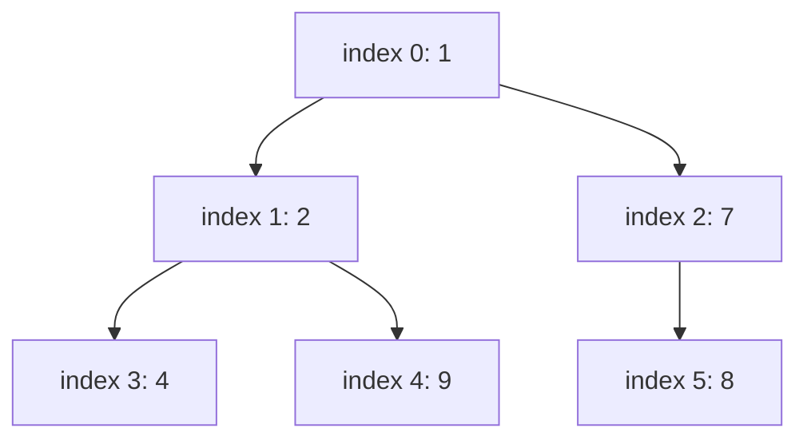

# Heaps

> **Module 05 · Data Structures & Algorithms** · Prerequisites: [Priority Queue](13-Priority-Queue.md) · Next: [Trees](15-Trees.md)

---

## ⏱ If You Only Have 2 Minutes

- A **binary heap** is a complete binary tree stored in a flat array. There are no pointers. The parent of index `i` is `(i - 1) // 2`, and its children are `2i + 1` and `2i + 2`.
- **Insert** appends the item and **sifts up**: it swaps with its parent while it is smaller. O(log n).
- **Extract-min** takes the root, moves the last item to the root, and **sifts down**: it swaps with its smaller child until the order holds again. O(log n).
- **Heapify** turns an unordered array into a heap in O(n). It sifts down every non-leaf, from the last parent back to the root. Pushing n items one by one is O(n log n).
- A heap only promises the minimum (or maximum) at the root. A balanced BST keeps everything sorted and supports search. Pick the heap when you only need the next item.
- Two heaps (one max-heap for the lower half, one min-heap for the upper half) give a running median in O(log n) per insert and O(1) per query.

---

## 1. What It Is and Why It Exists

A **heap** is a tree with one ordering rule. In a **min-heap**, every parent is less than or equal to each of its children. In a **max-heap**, every parent is greater than or equal to its children. The **binary** heap is the common version: each node has at most two children.

Two shape rules make the heap fast. First, the tree is **complete**: every level is full except possibly the last, and the last level fills from left to right. Second, the ordering rule only links a parent to its children. Two siblings have no order between them. So a heap is *not* a sorted tree. It only answers one question quickly: "what is the smallest item?"

**Analogy:** a knockout tournament. Each match is won by the smaller number. The champion sits at the top. Each round, only the winners of the matches move up. When the champion leaves, the next best player must be found among the players who lost to them. A heap does the same job with array positions instead of a bracket.

**The problem it solves.** Suppose you need the smallest item from a changing set. Keeping a sorted array makes insert O(n), because items must shift. A binary search tree works, but every node is a separate object with pointers, and it needs balancing to stay fast. A heap keeps the minimum at the top with one array and no pointers. Insert and remove-min are both O(log n), and reading the minimum is O(1). It is the standard engine behind the [priority queue](13-Priority-Queue.md) interface.

---

## 2. How It Works

### Array layout

Because the tree is complete, its nodes fill the array in level order with no gaps. You never store links. You compute positions with index math:

| Relationship | Formula | Example for index 1 |
|---|---|---|
| Parent of `i` | `(i - 1) // 2` | parent of 1 is 0 |
| Left child of `i` | `2i + 1` | left child of 1 is 3 |
| Right child of `i` | `2i + 2` | right child of 1 is 4 |

An array `[1, 2, 7, 4, 9, 8]` is this tree:



Each index is a valid heap position: 1 is at the top, and it is smaller than its children 2 and 7. Node 2 is smaller than its children 4 and 9. Node 7 is smaller than its child 8.

### Sift-up on insert

To insert, append the item at the end of the array. It may now be smaller than its parent. Swap it upward until the parent is smaller or it reaches the root. Here we insert 0 into `[1, 2, 7, 4, 9, 8]`:

| Step | Action | Array | Index of the moving item |
|---|---|---|---|
| 0 | Append 0 | `[1, 2, 7, 4, 9, 8, 0]` | 6 |
| 1 | Parent of 6 is 2 (value 7). 0 < 7, swap | `[1, 2, 0, 4, 9, 8, 7]` | 2 |
| 2 | Parent of 2 is 0 (value 1). 0 < 1, swap | `[0, 2, 1, 4, 9, 8, 7]` | 0 |
| 3 | Index 0 is the root. Stop | `[0, 2, 1, 4, 9, 8, 7]` | 0 |

The result is a valid heap. The loop ran twice, so the cost is the height of the tree, about log2(n).

### Sift-down on extract

To remove the minimum, take the root. Move the last array item to the root and shrink the array. Then the root may be larger than its children. Swap it with its *smaller* child, and repeat until neither child is smaller. Swapping with the larger child would break the heap.

### Heapify in O(n)

Given an unsorted array, you could push each item into an empty heap. That costs O(n log n) in the worst case. A faster method is **heapify**. Start at the last non-leaf node, index `n // 2 - 1`, and sift down each node going back to the root. Leaves already satisfy the rule, so they are skipped.

Trace on `[9, 4, 7, 1, 2, 8]`, where `n = 6`:

| Index | Value being sifted | Children examined | Array after this step |
|---|---|---|---|
| 2 | 7 | index 5 = 8 | `[9, 4, 7, 1, 2, 8]` (7 < 8, no change) |
| 1 | 4 | index 3 = 1, index 4 = 2 | `[9, 1, 7, 4, 2, 8]` (1 is smallest, swap) |
| 0 | 9 | index 1 = 1, index 2 = 7 | `[1, 9, 7, 4, 2, 8]` (1 is smallest, swap) |
| 1 | 9 (moved down) | index 3 = 4, index 4 = 2 | `[1, 2, 7, 4, 9, 8]` (2 is smallest, swap) |

The last row ends at index 4, which is a leaf, so it stops. The final array is a valid min-heap.

**Why heapify is O(n), not O(n log n).** Count the work by height. About half the nodes are leaves, and they cost nothing. About a quarter sit one level above the leaves, and each can sift down at most one level. In general, there are about n / 2^(h+1) nodes at height h, and each sifts down at most h levels. The total is n times the sum of h / 2^(h+1) over all heights. That sum converges to 1, so the total is O(n). Most of the work happens near the bottom, where sifts are short.

---

## 3. Key Concepts

### Min-heap and max-heap

Both use the same code with one comparison flipped. A max-heap is a min-heap with the comparator reversed. In TypeScript, pass `(a, b) => b - a`. In Python `heapq`, negate the values, as in the [priority queue chapter](13-Priority-Queue.md).

### Complexity

| Operation | Best | Average | Worst | Space | Why the bound holds |
|---|---|---|---|---|---|
| peek (find min) | O(1) | O(1) | O(1) | O(1) | The minimum is always at index 0 |
| push (insert) | O(1) | O(1) | O(log n) | O(1) extra | Best: new item is not smaller than its parent. Worst: it sifts up to the root, about log2(n) levels. Average is O(1) for random keys |
| pop (extract-min) | O(1) | O(log n) | O(log n) | O(1) extra | Best: the moved item is already not larger than its children. Otherwise it sinks along one path of length about log2(n) |
| heapify an array of n items | O(n) | O(n) | O(n) | O(1) extra | Every non-leaf is visited, and the sum of sift lengths over all nodes is about n |
| find an arbitrary value | O(1) | O(n) | O(n) | O(1) | Best: the value is the root. A heap has no order between siblings, so other searches scan the array |
| storage for n items | | | | O(n) | One array slot per item, with no pointers |

The insert average of O(1) holds for random keys, not for every input. Inserting keys in decreasing order makes every insert sift to the root, which is O(n log n) for n inserts. Amortized analysis does not apply here: each single operation has its own O(log n) worst case.

### Heap versus binary search tree

Both are trees, but they answer different questions.

| | Binary heap | Balanced BST |
|---|---|---|
| Shape | Complete tree in an array | Any shape that keeps the ordering rule, usually with node objects and pointers |
| Ordering rule | Parent is ≤ its children. Siblings have no order | Left < node < right for every node |
| Smallest item | O(1) peek, O(log n) remove | O(log n) to reach the leftmost node |
| Search for a key | O(n) | O(log n) |
| Sorted output or range queries | No. Only the minimum is reliable | Yes. An in-order walk is sorted |
| Build from n items | O(n) with heapify | O(n log n) with n inserts |
| Memory | One array, no pointers | One object per item, plus pointers |

Use a heap when you repeatedly take the smallest item. Use a BST when you also search by key, or need items in sorted order.

### Two heaps for a running median

A **median** splits the data into two halves. Keep the lower half in a max-heap and the upper half in a min-heap. The lower heap may hold one extra item when the total count is odd. The median is then the top of the lower heap. With an even count, it is the average of the two tops. Every insert goes into the lower heap, the top of the lower heap moves to the upper heap, and the sizes are rebalanced. Each insert is O(log n), and each median lookup is O(1).

---

## 4. Code Examples

### Node.js / TypeScript

The class below is a full binary min-heap. It takes a comparator, so the same code serves as a min-heap or a max-heap. It also builds from an array in O(n).

```ts
// Node.js 22+ / TypeScript 5. No dependencies.
// Binary min-heap stored in an array. Parent of i is (i - 1) >> 1; children are 2i + 1 and 2i + 2.
export class MinHeap<T> {
  private readonly a: T[];
  private readonly compare: (x: T, y: T) => number;

  // compare(x, y) < 0 means x comes out first. Pass an initial array to heapify it in O(n).
  constructor(compare: (x: T, y: T) => number, items: readonly T[] = []) {
    this.compare = compare;
    this.a = [...items];
    // Heapify: sift down every non-leaf, from the last parent back to the root.
    for (let i = (this.a.length >> 1) - 1; i >= 0; i--) this.siftDown(i);
  }

  get size(): number {
    return this.a.length;
  }

  // Undefined for an empty heap, so callers decide how to handle it.
  peek(): T | undefined {
    return this.a[0];
  }

  push(x: T): void {
    this.a.push(x);
    this.siftUp(this.a.length - 1);
  }

  pop(): T | undefined {
    if (this.a.length === 0) return undefined;
    const top = this.a[0];
    const last = this.a.pop()!;
    if (this.a.length > 0) {
      this.a[0] = last; // the popped item was not the only one: move the last item to the root
      this.siftDown(0);
    }
    return top;
  }

  private siftUp(i: number): void {
    const a = this.a;
    while (i > 0) {
      const parent = (i - 1) >> 1;
      if (this.compare(a[i], a[parent]) >= 0) return;
      [a[i], a[parent]] = [a[parent], a[i]];
      i = parent;
    }
  }

  private siftDown(i: number): void {
    const a = this.a;
    for (;;) {
      const left = 2 * i + 1;
      const right = left + 1;
      let smallest = i;
      // Bounds checks come first: an index past the end is not a child.
      if (left < a.length && this.compare(a[left], a[smallest]) < 0) smallest = left;
      if (right < a.length && this.compare(a[right], a[smallest]) < 0) smallest = right;
      if (smallest === i) return;
      [a[i], a[smallest]] = [a[smallest], a[i]];
      i = smallest;
    }
  }
}
```

Two interview problems, using the class above:

**Problem 1: kth largest in a stream.** Build a class that receives numbers one at a time and returns the k-th largest so far. *Approach:* keep a min-heap of the k largest values. Its root is the k-th largest. *Complexity:* O(log k) per add, O(k) space.

**Problem 2: median from a data stream.** Add numbers one at a time, and return the median after each add. *Approach:* two heaps, as described in Section 3. *Complexity:* O(log n) per add, O(1) per median query, O(n) space.

```ts
// Uses MinHeap from the block above.

// Problem 1: kth largest in a stream.
export class KthLargest {
  private readonly k: number;
  private readonly heap: MinHeap<number>;

  constructor(k: number, nums: readonly number[]) {
    this.k = k;
    this.heap = new MinHeap<number>((x, y) => x - y);
    for (const n of nums) this.add(n);
  }

  add(val: number): number {
    this.heap.push(val);
    if (this.heap.size > this.k) this.heap.pop(); // the smallest value can never reach the top k again
    return this.heap.peek()!; // the k-th largest, once the heap holds k values
  }
}

// Problem 2: median of a stream. Two heaps split the values at the median.
export class MedianFinder {
  private readonly low = new MinHeap<number>((x, y) => y - x); // max-heap: largest low value on top
  private readonly high = new MinHeap<number>((x, y) => x - y); // min-heap: smallest high value on top

  addNum(num: number): void {
    this.low.push(num);
    this.high.push(this.low.pop()!); // the largest low value moves up, so every low <= every high
    if (this.high.size > this.low.size) this.low.push(this.high.pop()!); // low keeps the extra item
  }

  findMedian(): number {
    if (this.low.size === 0) throw new RangeError("no numbers added");
    if (this.low.size > this.high.size) return this.low.peek()!;
    return (this.low.peek()! + this.high.peek()!) / 2;
  }
}
```

**Built-ins in JavaScript:** there is no heap in the language or standard library. Writing one, as above, is the usual answer in an interview. Also note that a `NaN` value breaks a numeric comparator (`NaN < 0` is false), so the heap order becomes wrong without any error. Validate numbers before you insert them.

### Python

Python has `heapq`, a min-heap with functions that work on a plain list. The class below shows how a heap works internally. For real code, use `heapq`, which is shown in the second block.

```python
# Python 3.12+. Standard library only. Learning version; production code should use heapq.
from collections.abc import Iterable
from typing import Any, Protocol


class Comparable(Protocol):
    def __lt__(self, other: Any, /) -> bool: ...


class MinHeap[T: Comparable]:
    """Binary min-heap in a list. Parent of i is (i-1)//2; children are 2i+1 and 2i+2."""

    def __init__(self, items: Iterable[T] = ()) -> None:
        self._a: list[T] = list(items)
        # Heapify: sift down every non-leaf, from the last parent back to the root. O(n) in total.
        for i in range(len(self._a) // 2 - 1, -1, -1):
            self._sift_down(i)

    def __len__(self) -> int:
        return len(self._a)

    def peek(self) -> T:
        if not self._a:
            raise IndexError("peek from an empty heap")
        return self._a[0]

    def push(self, x: T) -> None:
        self._a.append(x)
        self._sift_up(len(self._a) - 1)

    def pop(self) -> T:
        if not self._a:
            raise IndexError("pop from an empty heap")
        top = self._a[0]
        last = self._a.pop()
        if self._a:  # the popped item was not the only one: move the last item to the root
            self._a[0] = last
            self._sift_down(0)
        return top

    def _sift_up(self, i: int) -> None:
        a = self._a
        while i > 0:
            parent = (i - 1) // 2
            if not a[i] < a[parent]:
                return
            a[i], a[parent] = a[parent], a[i]
            i = parent

    def _sift_down(self, i: int) -> None:
        a = self._a
        n = len(a)
        while True:
            left, right = 2 * i + 1, 2 * i + 2
            smallest = i
            # Bounds checks come first: an index past the end is not a child.
            if left < n and a[left] < a[smallest]:
                smallest = left
            if right < n and a[right] < a[smallest]:
                smallest = right
            if smallest == i:
                return
            a[i], a[smallest] = a[smallest], a[i]
            i = smallest
```

The same two problems, using `heapq`:

```python
import heapq


class KthLargest:
    """Problem 1: kth largest in a stream. Min-heap of the k largest values seen so far."""

    def __init__(self, k: int, nums: list[int]) -> None:
        self.k = k
        self._heap: list[int] = []
        for n in nums:
            self.add(n)

    def add(self, val: int) -> int:
        heapq.heappush(self._heap, val)
        if len(self._heap) > self.k:
            heapq.heappop(self._heap)  # the smallest value can never reach the top k again
        return self._heap[0]  # the k-th largest, once the heap holds k values


class MedianFinder:
    """Problem 2: median of a stream. Two heaps split the values at the median."""

    def __init__(self) -> None:
        self._low: list[int] = []   # max-heap: store negatives so heapq's min-heap acts as a max-heap
        self._high: list[int] = []  # min-heap: the smallest values of the upper half

    def add_num(self, num: int) -> None:
        heapq.heappush(self._low, -num)
        # The largest low value moves up, so every low value is <= every high value.
        heapq.heappush(self._high, -heapq.heappop(self._low))
        if len(self._high) > len(self._low):  # low keeps the extra item when the count is odd
            heapq.heappush(self._low, -heapq.heappop(self._high))

    def find_median(self) -> float:
        if not self._low:
            raise ValueError("no numbers added")
        if len(self._low) > len(self._high):
            return float(-self._low[0])
        return (-self._low[0] + self._high[0]) / 2


data = [9, 4, 7, 1, 2, 8]
heapq.heapify(data)  # O(n) in-place heapify, the same idea as the MinHeap constructor
assert data[0] == 1

kl = KthLargest(3, [4, 5, 8, 2])
assert kl.add(3) == 4 and kl.add(5) == 5

mf = MedianFinder()
for x in [5, 3, 8]:  # the median after each add is 5, 4, 5
    mf.add_num(x)
assert mf.find_median() == 5
```

**Built-ins in Python:** `heapq.heappush`, `heappop`, `heapify`, `heappushpop` (push then pop, in one call), and `heapreplace` (pop then push). `heapq.nlargest(k, data)` and `heapq.nsmallest(k, data)` do the top-K work for you. `queue.PriorityQueue` wraps `heapq` with a lock, which is useful for threads. The heap is min-only, so negate values for a max-heap. `heapq` also does not track an item's position, so it cannot change or remove an arbitrary item cheaply.

---

## 5. Production Concerns

- **Memory per item.** In Python, every item is a separate object. A heap of one million `(priority, counter, job)` tuples uses far more memory than a heap of one million integers. In Node, each entry object adds garbage-collection work. For large heaps, store small records and keep the payload in a separate table keyed by ID.
- **Comparator correctness.** A comparator that returns `NaN` silently corrupts the order, because every comparison with `NaN` is false. Validate or reject bad numbers at the boundary.
- **Bounded memory for streams.** Top-K and median need memory for every item, or at least for K. For a metric such as p99 latency over a long period, exact medians may not fit in memory. Use bounded approximations, such as HdrHistogram or t-digest, which trade a small error for fixed memory.
- **Removing old items.** A two-heap median cannot forget values from a rolling window. Removal from a heap by value costs O(n). For a sliding window, use lazy deletion with timestamps or bucket counts instead.
- **Thread safety.** A heap is not safe to share between threads or async tasks that both push and pop. Wrap it in a lock, or keep one owner that serves requests through a queue.
- **What to measure.** Track heap size, and the time spent in `push` and `pop`. A sudden growth in heap size means producers are faster than consumers.

---

## 6. Common Mistakes

- **Iterating the array to see the order** — only index 0 is the minimum, and the rest is partly ordered — pop items one at a time to read them in order.
- **Building a heap with n pushes when you have all the data** — O(n log n) instead of O(n) — call heapify on the whole array.
- **Wrong child formula** — using `2i` for the right child, or `i / 2` for the parent — use `2i + 1` and `2i + 2`, and `(i - 1) // 2` for the parent.
- **Missing bounds checks in sift-down** — reading an index past the end, which gives `undefined` or an error — test `left < n` and `right < n` before comparing.
- **Two-heap median with unequal sizes** — the median is wrong when the halves differ by more than one — rebalance after every add so the lower heap is never smaller and never more than one bigger.
- **Using `heapq` for a max-heap without negation** — the smallest value comes out first, so "top scores" returns the worst scores — negate the values on push and on pop.
- **Using a heap for search** — checking whether a value exists costs O(n) — use a hash set for membership, or a balanced BST if you also need order.

---

## 7. Comparison Table

| Structure | Find min | Insert | Search by key | Sorted iteration | Typical backend use |
|---|---|---|---|---|---|
| Binary heap | O(1) | O(log n) | O(n) | No | Job scheduling, top-K, Dijkstra |
| Balanced BST | O(log n) | O(log n) | O(log n) | Yes | Ordered indexes, range queries |
| Sorted array | O(1) | O(n) | O(log n) with binary search | Yes | Small, mostly read-only lists |
| Hash set | O(n) | O(1) average | O(1) average | No | Membership checks, deduplication |

Use a heap for the minimum, a BST for ordered queries, and a hash set for membership. A database B-tree index is an ordered structure of the same kind as the BST, built for disk pages rather than memory.

---

## 8. Interview Questions

**[Junior] What is a binary heap, and why is it stored in an array?**
A binary heap is a complete binary tree with an ordering rule: each parent is less than or equal to its children in a min-heap. Because the tree is complete, its nodes fill an array in level order with no gaps. The parent and child positions are computed from the index, so the structure needs no pointers. That makes it compact and cache-friendly.

**[Junior] What is the cost of peek, push and pop in a binary heap?**
Peek is O(1), because the minimum is at index 0. Push and pop are O(log n) in the worst case, because each one moves an item along a single path from the bottom to the top, or from the top to the bottom. The path length is the height of the tree, about log2(n).

**[Mid] Why is heapify O(n), when pushing n items is O(n log n)?**
Heapify starts at the bottom non-leaf nodes and sifts each one down. Most nodes are near the bottom and have short paths. About half the nodes are leaves and cost nothing. The total work is the sum of the node heights, weighted by how many nodes have each height. That sum is about 2n. Pushing one at a time makes many items sift up from deep positions, and the sum over all items is larger.

**[Mid] When would you choose a balanced BST over a heap?**
Choose a BST when you need more than the minimum. Examples are search by key, range queries such as "all orders between two dates", and sorted iteration. A heap can only answer "what is smallest" quickly. A BST answers all of those in O(log n), but each node costs more memory and the code is larger. If the data only needs a priority queue, a heap is simpler and faster.

**[Senior] Design a running median over a stream of numbers. What are the costs?**
Use two heaps. The lower half is a max-heap, the upper half is a min-heap, and the lower half holds at most one extra item. Insert into the lower half, move its top to the upper half, and rebalance so the sizes differ by at most one. The median is the top of the larger heap, or the average of both tops when the sizes are equal. Each add is O(log n), each query is O(1), and memory is O(n). This works for an append-only stream. It does not support removal of old values efficiently, so a rolling window needs a different design, such as bucketed counts or a bounded sketch.

**[Senior] How would you support changing a priority or cancelling a timer that is already in a heap?**
Keep a map from each item's ID to its current array index, and update that map every time two items swap. To change a priority, find the index through the map, then sift up or sift down from that index. Removal is the same, after moving the last item into the hole. Both are O(log n) plus the map lookup. The simpler alternative is lazy deletion: mark the timer as cancelled, leave it in the heap, and skip it when popped. Lazy deletion is simpler and safe, but the heap can hold dead entries until they reach the top, so it uses more memory. Choose the indexed heap when cancellations are frequent.

---

## 9. Cheat Sheet

```text
Layout       complete tree in an array; parent (i-1)//2; children 2i+1, 2i+2
Min-heap     parent <= children; root is index 0
Push         append, sift up: O(log n) worst, O(1) best
Pop          swap root with last, shrink, sift down: O(log n) worst
Heapify      sift down from n//2 - 1 to 0: O(n) total, not O(n log n)
Peek         O(1)
Max-heap     reverse the comparator; in Python, negate values
Search       O(n); a heap is not for lookup by key
Top K        min-heap of size K: O(n log K)
Running median  max-heap (low) + min-heap (high), sizes differ by at most 1
Kth stream   min-heap of size K; root is the Kth largest
Python       heapq is a min-heap of list functions; use heapq.heapify once
JavaScript   no built-in heap; write one, validate NaN before inserting
```

---

## Related Topics

- [Priority Queue](13-Priority-Queue.md) — the interface this heap implements, plus ordering and tie-breaking
- [Heap Sort](29-Heap-Sort.md) — an in-place sort built from heapify and sift-down
- [Binary Search Trees](17-Binary-Search-Trees.md) — the ordered alternative when you need search by key
- [Balanced Trees](18-Balanced-Trees.md) — balanced BSTs as a second way to build a priority queue
