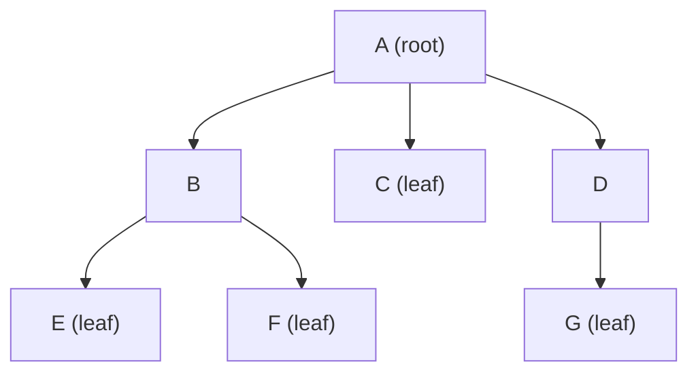

# Trees

> **Module 05 · Data Structures & Algorithms** · Prerequisites: [Heaps](14-Heaps.md) · Next: [Binary Trees](16-Binary-Trees.md)

---

## ⏱ If You Only Have 2 Minutes

- A **tree** is a connected set of nodes with one **root** and no cycles. Every node except the root has exactly one **parent**. With n nodes there are exactly n - 1 edges.
- Key terms: **depth** is the number of edges from the root to a node, **height** is the longest path from a node down to a leaf, and **degree** is the number of children.
- Four common representations: node objects with a `children` array (most apps), a **parent array** (cheap "walk up"), an **adjacency list** keyed by ID (how database rows look), and **nested JSON** (how APIs send trees).
- Three traversal orders for an n-ary tree: **pre-order** (node, then children), **post-order** (children, then node) and **level-order** (one depth at a time, with a queue). Each visits every node once, so each is O(n) time.
- Recursion uses the call stack, O(h) space for height h. A chain of 100,000 nodes can overflow the stack, so use an explicit stack for deep or untrusted input.
- Build a tree from flat `(id, parentId)` rows in O(n) with a map. Reject unknown parents, duplicate IDs and cycles.
- Backend uses: DOM and JSON documents, file systems, org charts, category trees and comment threads.

---

## 1. What It Is and Why It Exists

A **tree** is a way to store things that contain other things. A folder on your disk contains files and more folders. Each item has exactly one parent folder, except the top folder, which is the **root**. A tree is a special kind of [graph](20-Graphs.md): it is connected, it has no cycles, and every node has one parent.

Trees appear in almost every backend system:

- **JSON and HTML documents** are trees. An API response `{ "order": { "items": [ ... ] } }` is a tree of objects.
- **Category trees** in a shop: Electronics contains Phones, which contains Android phones.
- **Comment threads**: each reply has one parent comment.
- **Org charts**: each employee reports to one manager.

**The problem it solves.** Imagine a database table `comments(id, parent_id, body)`. To show a thread, your code must turn those flat rows into a nested structure. If you search the table again for each reply, the cost grows quickly. With a tree in memory, you build the structure once and then walk it. Trees also let you ask useful questions, such as "how deep is this thread?" or "what is the total size of this folder?", with one traversal.

---

## 2. How It Works

Here is a small sample tree that the rest of this chapter uses:



### Four ways to represent a tree

Each representation suits a different job. Choose by the questions you ask most often.

| Representation | Shape | Good for | Cost |
|---|---|---|---|
| Node objects | `{ value, children: [...] }` | Walking down from a node; the most common choice in application code | Each node is an object; finding a parent needs an extra pointer |
| Parent array | `parent[i]` is the index of node `i`'s parent; the root holds -1 | Walking up to the root; compact storage | Finding children needs a scan, unless you build a reverse index |
| Adjacency list | Map from ID to a list of child IDs | Data loaded from a database table or a message | Each lookup is a map access, but you must check that every ID exists |
| Nested JSON | `{ "id": "A", "children": [ ... ] }` | APIs, files and documents sent as one value | Changing one node means rewriting the whole document |

### Traversal trace

A **traversal** visits every node. The three orders differ only in *when* a node is visited relative to its children.

For the sample tree, a pre-order walk visits each node and then its children, left to right:

| Step | Visit | Output so far |
|---|---|---|
| 1 | A (root) | A |
| 2 | B (first child of A) | A, B |
| 3 | E (first child of B) | A, B, E |
| 4 | F (second child of B) | A, B, E, F |
| 5 | C (second child of A) | A, B, E, F, C |
| 6 | D (third child of A) | A, B, E, F, C, D |
| 7 | G (child of D) | A, B, E, F, C, D, G |

The other orders give these results on the same tree:

- **Post-order** (children first, then the node): E, F, B, C, G, D, A.
- **Level-order** (one depth at a time): [A], [B, C, D], [E, F, G].

Notice that the post-order result ends with the root, and the level-order result groups the nodes by depth. These differences matter when you choose an order for a task.

---

## 3. Key Concepts

### Terminology

| Term | Definition | Value in the sample tree |
|---|---|---|
| Root | The only node with no parent | A |
| Leaf | A node with no children | C, E, F, G |
| Depth of a node | Number of edges from the root to the node (the root has depth 0) | G has depth 2 (A to D to G) |
| Height of a node | Number of edges on the longest path from the node down to a leaf | B has height 1; A has height 2 |
| Height of the tree | Height of the root | 2 |
| Degree of a node | Number of children | A has degree 3 |
| Subtree | A node and all of its descendants | The subtree at B is {B, E, F} |

Depth is counted from the top, and height is counted from the bottom. Many bugs come from mixing the two. When a question says "maximum depth" of a tree, most interview problems mean the number of **nodes** on the longest root-to-leaf path. Read the definition in the question before you write code.

### Traversal orders

- **Pre-order** visits the node before its children. It is used to copy a tree, to print a document outline, or to make a decision that must be made before going deeper.
- **Post-order** visits children before the node. It is used when the parent's answer depends on the children, such as the size of a folder, which is the sum of its files and subfolders.
- **Level-order** visits each depth in turn. It uses a **queue**, so it is a breadth-first search. It is used to render a tree by level, or to find the nearest matching node.

### Recursive versus iterative

A recursive traversal uses the call stack. Each call stores one frame, so the stack depth is the tree height h. An iterative version uses an explicit stack or queue on the heap, so the limit is memory, not the call stack. For pre-order, push the children onto a stack in reverse order, so the leftmost child is popped first. Post-order is trickier iteratively. A common trick is to run a modified pre-order that visits the children right to left, then reverse the result.

### Complexity

| Operation | Best | Average | Worst | Space | Why the bound holds |
|---|---|---|---|---|---|
| Pre-order or post-order (recursive) | O(n) | O(n) | O(n) | O(h) call stack | Every node is visited once. The stack holds one frame per level on the current path, so h is between log n (balanced) and n (chain) |
| Pre-order or post-order (iterative) | O(n) | O(n) | O(n) | O(h) stack | The explicit stack holds at most one path plus pending siblings |
| Level-order | O(n) | O(n) | O(n) | O(w) queue | Each node enters and leaves the queue once. w is the widest level: 1 for a chain, about n - 1 for a star |
| Build from n flat rows | O(n) | O(n) | O(n) | O(n) | One pass creates a map entry per row, then one pass links each child to its parent |
| Find a node by ID | O(1) | O(1) | O(1) | O(n) for the index | With a map from ID to node, the lookup is a single hash access. Without it, you must scan the tree, which is O(n) |

Each traversal bound holds because every node is processed once, and the work per node is constant. The space bounds depend on the shape of the tree, so state them as O(h) or O(w), not as O(n), unless you know the tree is a chain.

---

## 4. Code Examples

### Node.js / TypeScript

The first block defines the node type and four traversals. Each traversal is written once with explicit types.

```ts
// Node.js 22+ / TypeScript 5. No dependencies.
// An n-ary tree: each node holds a value and any number of children, in order.
export interface TreeNode<T> {
  value: T;
  children: TreeNode<T>[];
}

// Pre-order: visit the node, then its children left to right. Output starts with the root.
export function preOrder<T>(root: TreeNode<T> | null, out: T[] = []): T[] {
  if (root === null) return out;
  out.push(root.value);
  for (const child of root.children) preOrder(child, out);
  return out;
}

// Post-order: visit the children first, then the node. Use it for bottom-up totals.
export function postOrder<T>(root: TreeNode<T> | null, out: T[] = []): T[] {
  if (root === null) return out;
  for (const child of root.children) postOrder(child, out);
  out.push(root.value);
  return out;
}

// Level-order: one array per depth. Each step maps the frontier to the next frontier.
export function levelOrder<T>(root: TreeNode<T> | null): T[][] {
  const levels: T[][] = [];
  let frontier: TreeNode<T>[] = root === null ? [] : [root];
  while (frontier.length > 0) {
    levels.push(frontier.map((n) => n.value));
    frontier = frontier.flatMap((n) => n.children);
  }
  return levels;
}

// Iterative pre-order with an explicit stack. Push children in reverse so the leftmost pops first.
// Deep trees cannot overflow the call stack here; memory is the only limit.
export function preOrderIterative<T>(root: TreeNode<T> | null): T[] {
  const out: T[] = [];
  const stack: TreeNode<T>[] = root === null ? [] : [root];
  while (stack.length > 0) {
    const node = stack.pop()!;
    out.push(node.value);
    for (let i = node.children.length - 1; i >= 0; i--) stack.push(node.children[i]);
  }
  return out;
}
```

Two interview problems, using the code above:

**Problem 1: maximum depth of an n-ary tree.** Given the root, return the number of nodes on the longest root-to-leaf path. *Approach:* the depth of a node is 1 plus the largest depth among its children. An empty tree has depth 0. *Complexity:* O(n) time, O(h) call stack. Alternatively, `levelOrder(root).length` gives the same answer with O(w) queue space.

**Problem 2: build a tree from flat rows.** Given rows of `(id, parentId)`, where `parentId` is `null` for roots, build the nested tree. *Approach:* create every node first and store it in a map. Then link each node to its parent. Reject duplicate IDs, unknown parents and cycles. A cycle is detected by counting the nodes reachable from the roots: any row that no root reaches is inside a cycle. *Complexity:* O(n) time, O(n) space.

```ts
// Uses TreeNode and preOrder from the block above.

// Problem 1: maximum depth of an n-ary tree. Depth counts nodes on the longest root-to-leaf path.
export function maxDepth<T>(root: TreeNode<T> | null): number {
  if (root === null) return 0;
  let deepest = 0;
  for (const child of root.children) deepest = Math.max(deepest, maxDepth(child));
  return deepest + 1; // this node adds one level
}

export interface Row {
  id: string;
  parentId: string | null;
}

// Problem 2: build a tree from flat (id, parentId) rows. Returns the roots (parentId null).
export function buildTree(rows: readonly Row[]): TreeNode<Row>[] {
  const byId = new Map<string, TreeNode<Row>>();
  for (const row of rows) {
    if (byId.has(row.id)) throw new Error(`duplicate id ${row.id}`);
    byId.set(row.id, { value: row, children: [] });
  }
  const roots: TreeNode<Row>[] = [];
  for (const row of rows) {
    const node = byId.get(row.id)!;
    if (row.parentId === null) {
      roots.push(node);
      continue;
    }
    const parent = byId.get(row.parentId);
    if (parent === undefined) throw new Error(`unknown parentId ${row.parentId}`);
    parent.children.push(node);
  }
  // Every row has one parent, so each node is linked exactly once. A row that no root
  // reaches must be part of a cycle.
  const reached = roots.reduce((sum, root) => sum + preOrder(root).length, 0);
  if (reached !== rows.length) throw new Error("cycle detected: some rows cannot be reached from a root");
  return roots;
}
```

**Built-ins in JavaScript:** there is no tree type in the standard library. The DOM is a tree, and `Map` is the usual way to index nodes by ID. `Array.prototype.flatMap` helps with level-order. `structuredClone` copies a nested object, but it is not a traversal.

### Python

The Python version uses a dataclass for the node. Python 3.12 generic syntax (`[T]`) keeps the type hints short.

```python
# Python 3.12+. Standard library only.
from __future__ import annotations

from dataclasses import dataclass, field


@dataclass
class TreeNode[T]:
    value: T
    children: list[TreeNode[T]] = field(default_factory=list)


def pre_order[T](root: TreeNode[T] | None) -> list[T]:
    out: list[T] = []

    def visit(node: TreeNode[T]) -> None:
        out.append(node.value)  # node first, then children left to right
        for child in node.children:
            visit(child)

    if root is not None:
        visit(root)
    return out


def post_order[T](root: TreeNode[T] | None) -> list[T]:
    out: list[T] = []

    def visit(node: TreeNode[T]) -> None:
        for child in node.children:  # children first, so the node comes last
            visit(child)
        out.append(node.value)

    if root is not None:
        visit(root)
    return out


def level_order[T](root: TreeNode[T] | None) -> list[list[T]]:
    levels: list[list[T]] = []
    frontier = [root] if root is not None else []
    while frontier:
        levels.append([node.value for node in frontier])
        frontier = [child for node in frontier for child in node.children]
    return levels


def pre_order_iterative[T](root: TreeNode[T] | None) -> list[T]:
    out: list[T] = []
    stack = [root] if root is not None else []
    while stack:
        node = stack.pop()
        out.append(node.value)
        stack.extend(reversed(node.children))  # reversed, so the leftmost child pops first
    return out
```

The same two problems in Python:

```python
# Uses TreeNode and pre_order from the block above.
from typing import NamedTuple


def max_depth[T](root: TreeNode[T] | None) -> int:
    """Problem 1: maximum depth. Depth counts nodes on the longest root-to-leaf path."""
    if root is None:
        return 0
    return 1 + max((max_depth(child) for child in root.children), default=0)


class Row(NamedTuple):
    id: str
    parent_id: str | None


def build_tree(rows: list[Row]) -> list[TreeNode[Row]]:
    """Problem 2: build a tree from flat (id, parent_id) rows. Returns the roots."""
    by_id: dict[str, TreeNode[Row]] = {}
    for row in rows:
        if row.id in by_id:
            raise ValueError(f"duplicate id {row.id}")
        by_id[row.id] = TreeNode(row)  # create every node first, so parents can come later in the list
    roots: list[TreeNode[Row]] = []
    for row in rows:
        node = by_id[row.id]
        if row.parent_id is None:
            roots.append(node)
        elif row.parent_id in by_id:
            by_id[row.parent_id].children.append(node)
        else:
            raise ValueError(f"unknown parent_id {row.parent_id}")
    # A row no root reaches is inside a cycle.
    reached = sum(len(pre_order(root)) for root in roots)
    if reached != len(rows):
        raise ValueError("cycle detected: some rows cannot be reached from a root")
    return roots
```

**Runtime difference:** Python's default recursion limit is 1,000 frames, so the recursive `pre_order` above fails with `RecursionError` on a chain of about 1,000 nodes. Node's default stack holds roughly ten thousand frames, depending on frame size. In both runtimes, deep input needs the iterative version. Python's `max((...), default=0)` also handles the leaf case without a special check.

---

## 5. Production Concerns

- **Deep input.** A reply chain or a badly built category tree can be very deep. Recursion on that input can crash the process. Use an explicit stack, or cap the depth when data is written. A cap of around 10 to 20 levels is typical for comment threads.
- **Cycles on move.** When a user moves a folder, the new parent must not be a descendant of the folder. Before the update, walk up from the new parent to the root. If you meet the folder, reject the move. Two moves at the same time can still create a cycle, so run the check and the update in one transaction, and lock the rows you read.
- **Storage in a database.** An adjacency list (`parent_id` column) is the simplest and makes moves cheap. Reading a whole subtree needs a recursive query. In PostgreSQL that is `WITH RECURSIVE`, which returns all descendants in one statement. A **materialized path** (for example `/1/4/9/`) turns "all descendants" into a prefix match, but a move must rewrite the paths of every descendant.
- **Large fan-out.** A thread with 50,000 replies should not be sent in one response. Load the top level, and fetch the children of a node when the user opens it.
- **Order.** Database rows have no guaranteed order. Store a `position` column for siblings and sort by it. Without it, the same thread can render in a different order after a reload.
- **What to measure.** Track the maximum depth and node count of imported trees, and reject imports above a limit. Alert when a single request traverses more nodes than expected.

---

## 6. Common Mistakes

- **Recursing on untrusted deep input** — a deep chain crashes the process with a stack overflow — use an explicit stack, or cap the depth at write time.
- **Missing the cycle check when moving a node** — a node becomes its own ancestor, and every traversal loops forever — walk up from the new parent before you update.
- **Linking children before every node exists** — a row that appears before its parent loses its link — create all nodes in a first pass, then link them in a second pass.
- **Using pre-order for bottom-up totals** — a folder size is computed before its files are counted — use post-order when the parent needs the children's results.
- **Relying on the storage order for siblings** — the database returns rows in any order — store a `position` column and sort by it.
- **Confusing depth and height** — off-by-one errors in limits and loops — depth counts down from the root, and height counts up from the leaves.
- **Loading the whole tree to show one branch** — memory use and latency grow with the full size — load the subtree you need, or paginate the children.

---

## 7. Comparison Table

There is no single best way to store hierarchical data in a database. The choice depends on whether you read more or move more.

| Storage method | Read a subtree | Move a node | Read ancestors | Typical use |
|---|---|---|---|---|
| Adjacency list (`parent_id`) | Recursive query (`WITH RECURSIVE`) | Update one row | Recursive query | Comment threads and org charts with frequent edits |
| Materialized path (`/1/4/9/`) | One prefix match | Rewrite the path of every descendant | Read the path, then fetch | Category trees that are read often and moved rarely |
| Nested sets (left and right numbers) | One range query | Renumber many rows | One range query | Read-heavy trees that rarely change |
| Nested JSON document | Free once loaded | Rewrite the document | Free once loaded | Settings, API payloads and documents |

The adjacency list is the default for most applications. Choose the materialized path when subtree reads dominate, and keep the nested JSON form for data that is always read and written as a whole.

---

## 8. Interview Questions

**[Junior] What is the difference between a tree and a graph?**
A tree is a connected graph with no cycles. It has exactly one root, every non-root node has exactly one parent, and there are n - 1 edges for n nodes. A general graph can have cycles, several paths between two nodes, and nodes with any number of links. Trees are a good model when each item belongs to exactly one parent.

**[Junior] Name the three traversal orders and when you would use post-order.**
Pre-order visits a node before its children, post-order visits children first and then the node, and level-order visits one depth at a time. Post-order is the right choice when the answer for a node depends on its children, such as the total size of a folder. Each traversal visits every node once, so it costs O(n) time.

**[Mid] How do you traverse a tree without recursion?**
Use an explicit stack for pre-order: pop a node, visit it, and push its children in reverse order so the leftmost child is processed first. Level-order uses a queue instead of a stack. Post-order is harder: a common method is to run a modified pre-order that visits children right to left, and then reverse the output. The iterative version avoids the call-stack limit, but it still needs O(h) or O(w) extra memory.

**[Mid] Given a flat table of `(id, parentId)` rows, how do you build a nested tree?**
Create one node per row first and store it in a map keyed by ID. Then link each node to its parent by looking up `parentId` in the map. Two passes are needed because a child row can appear before its parent row. Check for duplicate IDs and unknown parents, and detect cycles by checking that every row is reachable from a root. The whole process is O(n) time and O(n) space.

**[Senior] How would you store a category tree that is read often and updated now and then?**
The answer depends on the query mix. If the page usually shows "all products under this category", a materialized path gives a single prefix query, but a move rewrites every descendant path. If categories move often, an adjacency list keeps each move to one row, and a recursive query reads the subtree in one statement. Nested sets are fast to read but renumber many rows on every change. For most stores, I would start with an adjacency list and a recursive query, add a cached materialized path only if the subtree reads become the bottleneck, and measure both before changing.

**[Senior] A comment page crashes with a stack overflow for one thread. What do you check and change?**
First, confirm the cause in the logs: a `RangeError` or `RecursionError` during traversal points to recursion depth. Check the depth of that thread and how it was created. Then change the traversal to an explicit stack, so memory is the only limit. Next, cap the depth when new replies are written, and load deep replies on demand instead of in one response. Add a metric for maximum depth, so a deep thread is visible before it crashes a worker.

**[Senior] How do you prevent a cycle when a user moves a folder in a shared drive?**
Before the move, walk up from the new parent through `parent_id` links. If the folder being moved appears on that path, the move would create a cycle, so reject it. Two users can move folders at the same time, and each check can pass against the old state. Run the check and the update in one transaction, and lock the rows on the path, or serialize moves for the same drive. Add a periodic integrity check that finds any node that its root cannot reach.

---

## 9. Cheat Sheet

```text
Tree         connected, no cycles, one root, n nodes = n - 1 edges
Depth        edges from root (root = 0)        Height   edges to deepest leaf
Pre-order    node, then children               Post-order children, then node
Level-order  BFS with a queue, one depth at a time
Recursive    O(n) time, O(h) call stack        deep input can overflow
Iterative    explicit stack (pre) or queue     O(n) time, memory-bound
Pre-order    push children in reverse order onto the stack
Build        map by id; create nodes, then link; O(n)
Checks       duplicate id, unknown parent, cycle (unreached rows)
Move         walk up from new parent first; reject if node is an ancestor
DB storage   adjacency list + WITH RECURSIVE; or materialized path
JSON         nested objects are the tree; rewriting one node rewrites all
Python       recursion limit 1000 by default; use iterative for deep input
JavaScript   no tree type; Map for ID lookup; flatMap for level-order
```

---

## Related Topics

- [Binary Trees](16-Binary-Trees.md) — the special case where every node has at most two children
- [Breadth First Search](21-Breadth-First-Search.md) — level-order traversal is breadth-first search on a tree
- [Depth First Search](22-Depth-First-Search.md) — pre-order and post-order are depth-first search
- [Database Indexes](../Module-03-Databases/19-Indexes.md) — B-trees, the tree structure behind most database indexes
