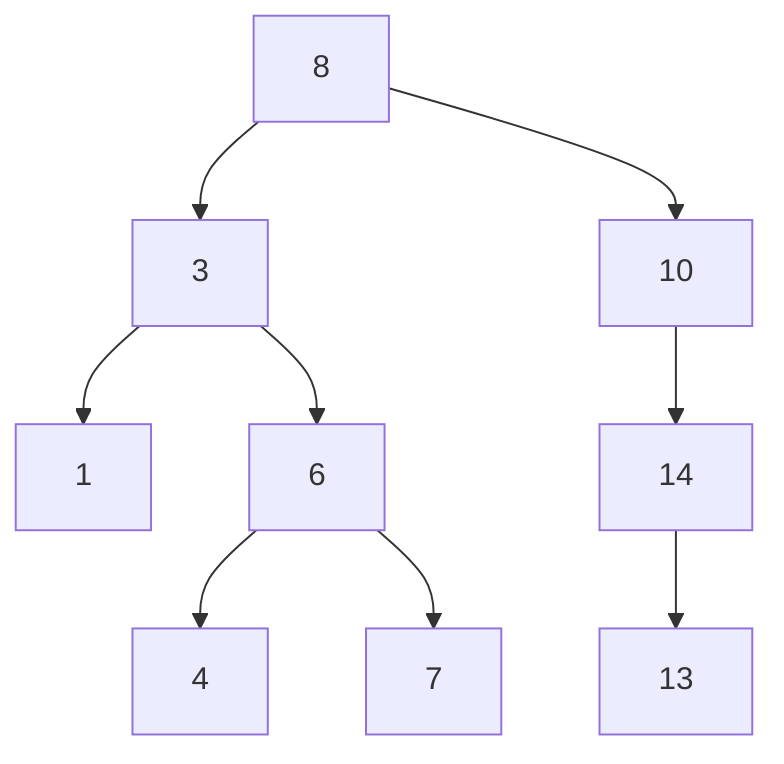

# Binary Trees

> **Module 05 · Data Structures & Algorithms** · Prerequisites: [Trees](15-Trees.md) · Next: [Binary Search Trees](17-Binary-Search-Trees.md)

---

## ⏱ If You Only Have 2 Minutes

- A **binary tree** is a tree where every node has at most two children, called `left` and `right`.
- **Full**: every node has 0 or 2 children. **Perfect**: every internal node has 2 children and all leaves share one depth, so n = 2^(h+1) - 1. **Complete**: every level is full except possibly the last, which fills left to right. **Balanced**: at every node, the two subtree heights differ by at most 1.
- In this chapter, **height** counts edges from a node down to its deepest leaf, and **depth** counts edges from the root. A leaf has height 0. An empty subtree has height -1.
- **In-order** (left, node, right) gives sorted output for a binary search tree. **Pre-order** copies a tree. **Post-order** computes answers from the bottom up. **Level-order** uses a queue.
- **Diameter** is the longest path in edges. At each node, `left height + right height + 2` is a candidate. The answer may not pass through the root. It takes O(n).
- **Lowest common ancestor** in an unordered binary tree: recurse into both sides. If both sides find a target, the current node is the answer. It takes O(n).

---

## 1. What It Is and Why It Exists

A **binary tree** is the most common tree shape in computer science. Each node has a value and at most two child links. The child links are named `left` and `right`, and the order matters: a left child is not the same as a right child.

Binary trees appear in many places:

- **Expression trees.** The expression `(a + b) * c` is a tree: `*` at the root, `+` on the left with children `a` and `b`, and `c` on the right. Compilers and query planners use this idea.
- **Decision trees.** Each node asks a yes-or-no question. Many machine learning models and rule engines are built this way.
- **Binary search trees** and **heaps**. These are binary trees with an ordering rule. Chapters 14 and 17 cover them.
- **Huffman coding.** Compression builds a binary tree in which each left or right step is a bit.

**Analogy:** a game of twenty questions. Each answer sends you to the left or the right branch, and the tree of questions is a binary tree. A good tree gets you to an answer in few questions.

**The problem it solves.** Many problems need a choice at each step, and the choices form a hierarchy. Two children per node keeps the tree simple to write and simple to reason about. When the tree is also ordered and balanced, each search halves the remaining work, which is why a balanced tree of a million items is about 20 levels deep.

---

## 2. How It Works

Here is the sample tree used in this chapter:

```text
        8
      /   \
     3     10
    / \      \
   1   6      14
      / \    /
     4   7  13
```

The same tree as a diagram:



### Four traversal orders

A traversal visits every node once. The orders differ only in *when* the node is visited, relative to its left and right subtrees.

| Order | Rule | Result on the sample tree |
|---|---|---|
| In-order | left, node, right | 1, 3, 4, 6, 7, 8, 10, 13, 14 |
| Pre-order | node, left, right | 8, 3, 1, 6, 4, 7, 10, 14, 13 |
| Post-order | left, right, node | 1, 4, 7, 6, 3, 13, 14, 10, 8 |
| Level-order | one depth at a time, left to right | 8, 3, 10, 1, 6, 14, 4, 7, 13 |

In-order is sorted here only because this sample is an ordered tree: every value in a left subtree is smaller than its node, and every value in a right subtree is larger. For a general binary tree, in-order gives no sorted result.

### Iterative in-order trace

The iterative version keeps its own stack. Walk left as far as possible, pushing each node. When you cannot go further, pop a node, visit it, and then walk into its right subtree.

| Step | Action | Stack after the step (top on the right) | Output so far |
|---|---|---|---|
| 1 | Walk left from 8: push 8, 3, 1. Node 1 has no left child | 8, 3, 1 | (none yet) |
| 2 | Pop 1 and visit it. Its right child is empty | 8, 3 | 1 |
| 3 | Pop 3 and visit it. Move right to 6, then walk left: push 6, 4 | 8, 6, 4 | 1, 3 |
| 4 | Pop 4 and visit it. Its right child is empty. Pop 6 and visit it. Move right to 7 and push it | 8, 7 | 1, 3, 4, 6 |
| 5 | Pop 7 and visit it. Pop 8 and visit it. Move right to 10 and push it | 10 | 1, 3, 4, 6, 7, 8 |
| 6 | Pop 10 and visit it. Move right to 14, then walk left: push 14, 13 | 14, 13 | 1, 3, 4, 6, 7, 8, 10 |
| 7 | Pop 13 and visit it. Pop 14 and visit it. Stack empty, no node left | (empty) | 1, 3, 4, 6, 7, 8, 10, 13, 14 |

The steps match the in-order result in the table above.

### Diameter trace

The **diameter** is the longest path between any two nodes, in edges. At node 8, the left subtree has height 2 (3, then 6, then 4). The right subtree has height 2 (10, then 14, then 13). The path 4-6-3-8-10-14-13 goes through the root and has 2 + 2 + 2 = 6 edges. Some nodes have a longer path only inside a subtree, so the algorithm must check every node, not only the root.

---

## 3. Key Concepts

### Shapes

| Shape | Rule | Node count | Where it shows up |
|---|---|---|---|
| Full | Every node has 0 or 2 children | Always odd | Expression trees, Huffman trees |
| Perfect | Every internal node has 2 children, and all leaves are at the same depth | 2^(h+1) - 1 | Textbook examples; the densest tree of a given height |
| Complete | Every level is full except the last, which fills left to right | Any n | Binary heaps stored in an array |
| Balanced | For every node, left and right heights differ by at most 1 | Any n | AVL trees, and the height guarantee behind BSTs |

Perfect implies full, and complete trees have only one short level. Balanced is a property of heights, not of the number of children. An unbalanced tree can still be full: a chain where each node has two children, one of them a leaf, is full but not balanced.

### Height versus depth

Depth is measured from the root: the root has depth 0, and a node's depth is the number of edges above it. Height is measured from the bottom: a leaf has height 0, and a node's height is `1 + max(left height, right height)`. An empty subtree is -1 in the code below, so that a leaf's formula works without a special case. Many interview questions ask for "max depth" but mean the number of nodes on the longest path, which is height plus one. Always confirm the convention before writing code.

### Recursive and iterative traversal

The recursive version is short and mirrors the definition. Its cost is the call stack, one frame per level. The iterative in-order version above uses an explicit stack, so deep trees are limited by memory instead. Level-order always needs a queue, which is an explicit data structure, not recursion.

### Complexity

| Operation | Best | Average | Worst | Space | Why the bound holds |
|---|---|---|---|---|---|
| Recursive traversal (in, pre or post) | O(n) | O(n) | O(n) | O(h) call stack | Each node is visited once. The stack holds one frame per level on the current path. h is about log n for a balanced tree and n for a chain |
| Iterative traversal (in or pre) | O(n) | O(n) | O(n) | O(h) stack | Each node is pushed and popped once. At most one path plus pending right children is on the stack |
| Level-order | O(n) | O(n) | O(n) | O(w) queue | Each node enters and leaves the queue once. w is the widest level, up to about n / 2 |
| Diameter or height (post-order) | O(n) | O(n) | O(n) | O(h) call stack | Each node computes its height once from its two children |
| Lowest common ancestor (no parent links) | O(1) | O(n) | O(n) | O(h) call stack | Best: the root is one of the targets. Otherwise the search may visit every node before both targets are found |
| Search for a value (not ordered) | O(1) | O(n) | O(n) | O(h) | Best: the value is at the root. Without ordering, any other node may hold it, so the search checks all nodes |

Space bounds use h or w, not n, because the shape decides them. Balanced trees keep h near log n, but a degenerate chain makes h equal to n.

---

## 4. Code Examples

### Node.js / TypeScript

The first block defines the node type, the four traversal orders, and an iterative in-order version. It avoids `Array.prototype.shift()` for the queue, because `shift()` can be slow on large arrays.

```ts
// Node.js 22+ / TypeScript 5. No dependencies.
export interface BinaryNode<T> {
  value: T;
  left: BinaryNode<T> | null;
  right: BinaryNode<T> | null;
}

// Recursive traversals. They differ only in where the value is pushed relative to the two calls.
export function inOrder<T>(node: BinaryNode<T> | null, out: T[] = []): T[] {
  if (node === null) return out;
  inOrder(node.left, out);
  out.push(node.value);
  inOrder(node.right, out);
  return out;
}

export function preOrder<T>(node: BinaryNode<T> | null, out: T[] = []): T[] {
  if (node === null) return out;
  out.push(node.value);
  preOrder(node.left, out);
  preOrder(node.right, out);
  return out;
}

export function postOrder<T>(node: BinaryNode<T> | null, out: T[] = []): T[] {
  if (node === null) return out;
  postOrder(node.left, out);
  postOrder(node.right, out);
  out.push(node.value);
  return out;
}

// Iterative in-order: walk left as far as possible, pushing nodes. Pop, visit, then go right.
export function inOrderIterative<T>(root: BinaryNode<T> | null): T[] {
  const out: T[] = [];
  const stack: BinaryNode<T>[] = [];
  let cur: BinaryNode<T> | null = root;
  while (cur !== null || stack.length > 0) {
    while (cur !== null) {
      stack.push(cur);
      cur = cur.left;
    }
    cur = stack.pop()!;
    out.push(cur.value);
    cur = cur.right;
  }
  return out;
}

// Level-order (flat). Read the queue with an index instead of shift(), which can be slow on large arrays.
export function levelOrder<T>(root: BinaryNode<T> | null): T[] {
  const out: T[] = [];
  const queue: BinaryNode<T>[] = root === null ? [] : [root];
  for (let head = 0; head < queue.length; head++) {
    const node = queue[head];
    out.push(node.value);
    if (node.left !== null) queue.push(node.left);
    if (node.right !== null) queue.push(node.right);
  }
  return out;
}
```

Two interview problems, using the code above:

**Problem 1: diameter of a binary tree.** Return the number of edges on the longest path between any two nodes. *Approach:* post-order. Each node returns its height, and at each node, update the best answer with `left + right + 2`. *Complexity:* O(n) time, O(h) call stack.

**Problem 2: lowest common ancestor.** Given the root and references to two nodes p and q in the tree, return the deepest node that has both as descendants. A node counts as its own descendant. *Approach:* if the current node is null, p, or q, return it. Otherwise search both subtrees. If both return a node, the current node is the answer. If only one returns a node, that result is the answer. *Complexity:* O(n) time, O(h) call stack.

```ts
// Uses BinaryNode from the block above.

// Problem 1: diameter of a binary tree, in edges. The longest path may skip the root.
export function diameter<T>(root: BinaryNode<T> | null): number {
  let best = 0;
  // Returns the height in edges. A missing child has height -1, so a leaf has height 0.
  const height = (node: BinaryNode<T> | null): number => {
    if (node === null) return -1;
    const left = height(node.left);
    const right = height(node.right);
    best = Math.max(best, left + right + 2); // the path through this node: left edge + right edge
    return 1 + Math.max(left, right);
  };
  height(root);
  return best;
}

// Problem 2: lowest common ancestor of two node references. No parent links, no ordering.
export function lowestCommonAncestor<T>(
  root: BinaryNode<T> | null,
  p: BinaryNode<T>,
  q: BinaryNode<T>,
): BinaryNode<T> | null {
  if (root === null || root === p || root === q) return root;
  const left = lowestCommonAncestor(root.left, p, q);
  const right = lowestCommonAncestor(root.right, p, q);
  if (left !== null && right !== null) return root; // p and q were found in different subtrees
  return left ?? right; // both targets are on one side, so the answer is found there
}
```

**Built-ins in JavaScript:** there is no binary tree in the standard library. Use plain objects, as above. For a queue, use an index into an array, or a small deque class for heavy use. A recursive function on a deep tree runs out of call stack in Node, typically at around ten thousand frames, which depends on frame size. Use the iterative versions for deep input.

### Python

Python's `collections.deque` gives O(1) `popleft()`, so the Python level-order version uses it directly. The recursive functions use a closure that appends to one output list, which avoids building a new list at every call.

```python
# Python 3.12+. Standard library only.
from __future__ import annotations

from collections import deque
from dataclasses import dataclass


@dataclass
class BinaryNode[T]:
    value: T
    left: BinaryNode[T] | None = None
    right: BinaryNode[T] | None = None


def in_order[T](root: BinaryNode[T] | None) -> list[T]:
    out: list[T] = []

    def visit(node: BinaryNode[T] | None) -> None:
        if node is not None:
            visit(node.left)
            out.append(node.value)  # the only change between orders is where this line sits
            visit(node.right)

    visit(root)
    return out


def pre_order[T](root: BinaryNode[T] | None) -> list[T]:
    out: list[T] = []

    def visit(node: BinaryNode[T] | None) -> None:
        if node is not None:
            out.append(node.value)
            visit(node.left)
            visit(node.right)

    visit(root)
    return out


def in_order_iterative[T](root: BinaryNode[T] | None) -> list[T]:
    out: list[T] = []
    stack: list[BinaryNode[T]] = []
    cur = root
    while cur is not None or stack:
        while cur is not None:  # go as far left as possible, remembering each node
            stack.append(cur)
            cur = cur.left
        cur = stack.pop()
        out.append(cur.value)
        cur = cur.right
    return out


def level_order[T](root: BinaryNode[T] | None) -> list[T]:
    out: list[T] = []
    queue: deque[BinaryNode[T]] = deque([root] if root is not None else [])
    while queue:
        node = queue.popleft()  # O(1), unlike list.pop(0), which shifts every item
        out.append(node.value)
        if node.left is not None:
            queue.append(node.left)
        if node.right is not None:
            queue.append(node.right)
    return out
```

The same two problems in Python:

```python
# Uses BinaryNode from the block above.


def diameter[T](root: BinaryNode[T] | None) -> int:
    """Problem 1: diameter in edges. The longest path may skip the root."""
    best = 0

    def height(node: BinaryNode[T] | None) -> int:
        nonlocal best
        if node is None:
            return -1  # a missing child has height -1, so a leaf has height 0
        left, right = height(node.left), height(node.right)
        best = max(best, left + right + 2)  # the path through this node: left edge + right edge
        return 1 + max(left, right)

    height(root)
    return best


def lowest_common_ancestor[T](
    root: BinaryNode[T] | None, p: BinaryNode[T], q: BinaryNode[T]
) -> BinaryNode[T] | None:
    """Problem 2: lowest common ancestor of two node references in a binary tree."""
    if root is None or root is p or root is q:
        return root
    left = lowest_common_ancestor(root.left, p, q)
    right = lowest_common_ancestor(root.right, p, q)
    if left is not None and right is not None:
        return root  # p and q were found in different subtrees
    return left if left is not None else right
```

**Runtime difference:** Python's default recursion limit is 1,000, which is far lower than Node's stack. A chain of about 1,000 nodes makes the recursive functions above raise `RecursionError`. For deep input, use `in_order_iterative`, or call `sys.setrecursionlimit`, which is a last resort because a deep C stack can still crash the process. Python's `is` checks identity, which is what the LCA needs. Node's `===` does the same for object references.

---

## 5. Production Concerns

- **Degenerate shapes.** A binary search tree built from sorted input becomes a chain. Search, insert and traversal then cost O(n), and recursion overflows. Use a balanced tree (AVL or red-black), or a B-tree, as shown in later chapters.
- **Fan-out in databases.** Database indexes use B-trees, which are trees with many children per node, not binary trees. Each node is one disk page with hundreds of keys, so a table with millions of rows has only a few levels. That is why an index lookup reads a handful of pages, not twenty.
- **Memory layout.** Each node in a pointer-based tree is a separate object, and walking the tree jumps between memory locations. A complete tree can be stored in an array, as a heap does, which is compact and faster to scan.
- **Concurrency.** Many readers can share an immutable tree safely. Writers must lock the nodes they change, or copy the path to the root (path copying), which is how many persistent data structures work.
- **Expression evaluation.** Parsed expressions from user input, such as filter rules, can be deep. Evaluate them iteratively, or limit the depth at parse time, to avoid stack overflow from hostile input.
- **What to measure.** Track the height of large in-memory trees after bulk loads. If the height is much larger than log2(n), the tree is unbalanced and lookups will be slow.

---

## 6. Common Mistakes

- **Mixing up height and depth** — off-by-one errors in diameter and max-depth answers — write the convention in a comment and test a single node and an empty tree.
- **Treating a missing child as height 0** — a leaf and an empty subtree look the same, and the diameter comes out one too small — use -1 for an empty subtree, as the code above does.
- **Taking the diameter through the root only** — the longest path may sit entirely inside one subtree — update the best answer at every node.
- **Using BST logic on an unordered tree** — searching only one side for a node returns the wrong ancestor — search both subtrees when the tree has no ordering.
- **Comparing values instead of node references in LCA** — duplicate values cause the wrong node to match — compare references, or use unique IDs.
- **Using `list.pop(0)` or `Array.shift()` as a queue** — each removal costs O(n) on big inputs — use `collections.deque`, or an index in JavaScript.
- **Assuming a binary tree is balanced** — a chain has height n, and recursion fails — check the height, and use a balanced structure for ordered data.

---

## 7. Comparison Table

| Structure | Children per node | Ordering rule | Typical use | Search by value |
|---|---|---|---|---|
| Binary tree | At most 2 | None | Expression trees, decision trees, Huffman coding | O(n) |
| Binary search tree | At most 2 | Left < node < right | In-memory ordered sets and maps | O(log n) if balanced, O(n) if not |
| Binary heap | At most 2 | Parent ≤ children (min-heap), complete shape | Priority queues, top-K | O(n) |
| B-tree | Many, set by page size | Keys sorted within and across nodes | Database and file-system indexes | O(log n), with few levels |

Use a binary tree when the structure is a hierarchy of choices, and no ordering is needed. Use a balanced BST when you need ordered in-memory lookups, and a B-tree when the data lives on disk.

---

## 8. Interview Questions

**[Junior] What is the difference between a full, a complete and a perfect binary tree?**
A full binary tree has every node with 0 or 2 children. A complete binary tree has every level full except possibly the last, which fills from left to right, and that shape is what a heap uses. A perfect binary tree is full, and all its leaves are at the same depth, so it has 2^(h+1) - 1 nodes. Every perfect tree is full and complete, but not every full tree is perfect.

**[Junior] What is the height of a tree with one node?**
Zero, in the convention used in this chapter, which counts edges from the node down to its deepest leaf. A single node has no edges below it. Some textbooks and LeetCode problems count nodes instead, so the answer is 1 there. Always confirm the convention in the question.

**[Mid] Why does an in-order traversal of a binary search tree produce sorted output?**
Every value in a node's left subtree is smaller than the node, and every value in its right subtree is larger. In-order visits the left subtree, then the node, then the right subtree. By induction on the subtrees, the output is sorted at every level. The traversal is O(n), so sorting a BST costs no more than reading it.

**[Mid] How do you compute the diameter of a binary tree in O(n)?**
Use a post-order function that returns each subtree's height. At each node, the longest path through that node is the sum of the two child heights plus two edges. Keep the largest of these sums in a variable. Only one pass is needed, so the time is O(n). The answer is not the root's height, because the longest path can sit inside a subtree.

**[Senior] Why is "longest path through the root" not enough for the diameter?**
Consider a tree where the root has one short branch and one deep subtree. The longest path could be entirely inside the deep subtree, and never touch the root. The root-only formula would miss it. The correct method checks every node as the highest point of a path, so the algorithm has to visit all nodes.

**[Senior] How would you answer many lowest-common-ancestor queries on a fixed tree?**
A single recursive query costs O(n). For many queries, preprocess the tree once. Record each node's depth and its ancestors at powers of two (binary lifting). That preprocessing is O(n log n) time and memory. Each query then climbs the two nodes to the same depth and jumps up in powers of two, which costs O(log n). If the tree is static and queries dominate, this is the usual trade-off. If the tree changes often, recompute or use an online algorithm.

**[Senior] Why do database indexes use B-trees instead of binary trees?**
A database reads data in fixed-size pages from disk. A binary tree has two children per node, so a table of a million rows is about 20 levels deep, and each level can cost a disk read. A B-tree node holds hundreds of keys, so the same table is only three or four levels deep. Fewer levels means fewer page reads per lookup, and that is the cost that matters most on disk.

---

## 9. Cheat Sheet

```text
Binary tree    each node: value, left, right (at most two children)
Full           every node has 0 or 2 children
Perfect        full, all leaves at the same depth; 2^(h+1) - 1 nodes
Complete       levels full except the last, filled left to right (heap shape)
Balanced       subtree heights differ by at most 1 at every node
Height/depth   height: edges down to deepest leaf (leaf 0, empty -1); depth: edges from root
In-order       left, node, right; sorted for a BST
Pre-order      node, left, right; copies a tree
Post-order     left, right, node; bottom-up answers (height, diameter)
Level-order    queue (BFS); deque.popleft() in Python, index in JavaScript
Diameter       post-order; best = max(left + right + 2) over all nodes; O(n)
LCA            recurse; both sides found -> this node; O(n) without parent links
Iterative      explicit stack for in-order; memory-bound, not call-stack-bound
Deep input     recursion fails near 1,000 frames in Python; iterate instead
Databases      B-trees with many keys per node; few levels, few disk reads
```

---

## Related Topics

- [Trees](15-Trees.md) — the general n-ary tree, terminology and the four representations
- [Binary Search Trees](17-Binary-Search-Trees.md) — binary trees with an ordering rule, where in-order gives sorted output
- [Recursion](23-Recursion.md) — base cases, recurrences and why deep recursion runs out of stack
- [Stack Memory](../Module-04-Operating-Systems/23-Stack-Memory.md) — where each recursive call's frame lives, and why it overflows
